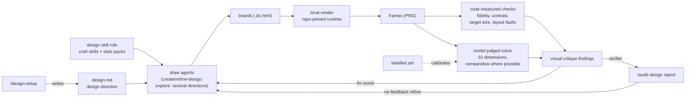
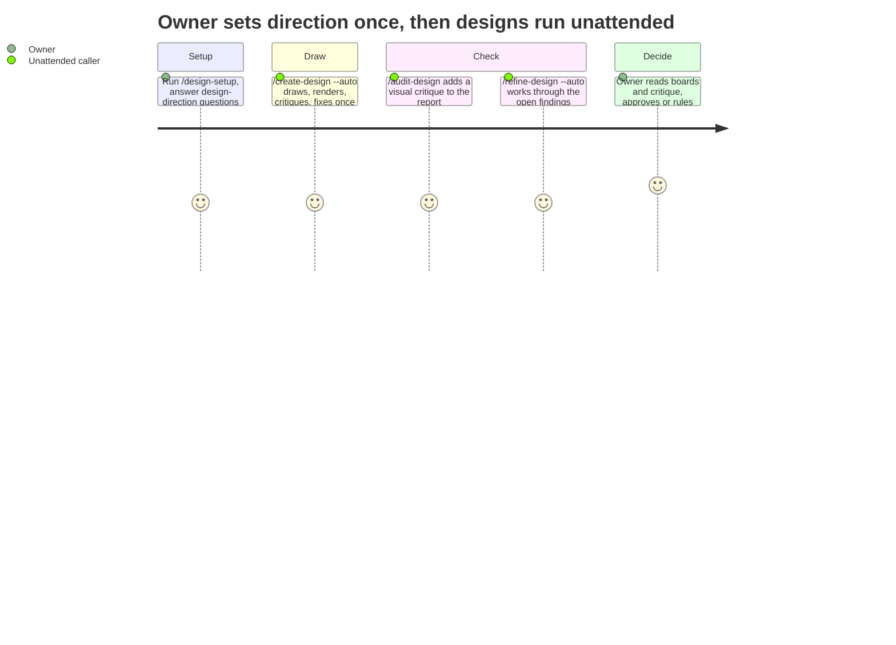

# PRD: Design quality — on-brand, good-looking boards, judged from what renders

**Version**: 1.1.1
**Status**: Draft
**Created**: 2026-11-06
**Last Updated**: 2026-11-06
**Author**: @product-manager
**Stakeholders**: James Simmons (owner)

**Source**: the owner's `/create-prd` arguments (quoted in full in §1.2) and the session brief
`docs/PRD/design-quality.brief.md`, which rests on the DORCH-T001 live walk
(`.trd-state/task-dorch-t001-live-walk/findings.md` and `evidence/`). Parent PRD:
`docs/PRD/design-stage.md` (v1.2.2), whose decisions this one inherits except where §Supersedes
says otherwise.

---

## Changelog

| Version | Date | Changes | Author |
|---------|------|---------|--------|
| 1.1.1 | 2026-11-06 | `/audit-prd` against the brief. **Fixed citations:** parent PRD version is 1.2.2, not 1.1.0; the constitution quote in F9 now reads "labeled" as the source spells it; the nav quote "unchanged from src/main.jsx" is attributed to the brief (it is a comment in the walk's board markup, not in `06a-create-trd-home-pane.txt`). **Corrected stale claims:** AC-F1.6 — today the design commands stop only on a missing or template-identical `design.md` (`design-map.js setup()`), so a blank field already runs on; what is new is naming each blank direction field. AC-F3.4 — the missing-Playwright ISSUES line already exists in all three commands; what is new is listing the critique as not run. **Changed:** AC-F9.2 reports per-dimension agreement only where frames carry per-dimension labels, consistent with AC-F9.1 and AC-F9.4. Could Not Verify now says why each row is still open | @product-manager |
| 1.1.0 | 2026-11-06 | `/refine-prd` (interactive): the owner answered OQ-1, OQ-2, OQ-4, OQ-5, OQ-8, OQ-10 and OQ-12; OQ-3, OQ-6, OQ-7, OQ-9 and OQ-11 decided as defaults (see Resolved Questions). Added: six named style packs (AC-F2.4), `--explore` and `--style` on `/create-design` (AC-F6.1, AC-F6.4), the labelled set's source (AC-F9.4), the rubric scale (AC-F5.6). Changed: AC-F1.6 (blank direction field is named, run continues), AC-F1.7 (one References field). Removed: nothing | @product-manager |
| 1.0.0 | 2026-11-06 | Initial PRD creation; session-fidelity pass ran against this conversation (4 inventions removed: shipped-only packs, pack-as-brand fallback, per-dimension labelling, two verdicts attributed to the owner) | @product-manager |

---

## 1. Product Summary

### 1.1 Problem Statement

The owner's goal for the design stage, in their words: *"The entire goal of this capability is to
autonomously produce on-brand, design-system aligned, GOOD LOOKING UX/UI."* Of the boards
`/create-design --auto` drew in the DORCH-T001 live walk, the owner said: *"the output of this task
is visually poor."*

The walk and the code show three causes, which the owner accepted as the basis for this work:

1. **Nothing judges what a board looks like.** The five `/create-design` reviewers (the `AXES`
   list in `packages/core/workflows/create-design.js`: flow, consistency, reuse, data, standards)
   are `code-reviewer` agents told to "Review the boards in `<dir>/canvas/project/`", that is, the
   markup. `/audit-design`'s `VERIFIERS` (`packages/core/workflows/audit-design.js`) are
   traceability, conventions, reuse and render; the render verifier runs
   `design-render.js render` and reports only render *errors* — no agent looks at the frame it
   produces. The same is true of `create-design.js`'s `render` stage.
2. **The drawing agents get no design craft.** `packages/skills/frontend-design/SKILL.md` exists,
   but no design command, workflow or contract references it (`grep -rn frontend-design
   packages/core/commands packages/core/workflows packages/core/contracts` returns nothing). The
   to-be draw agents are `frontend-implementer` on Sonnet at high effort
   (`create-design.js`, label `tobe:`).
3. **The reuse rule makes to-be boards copy today's layout.** `design.md` §4 says "an existing
   view beats a new one; a new component needs a reason" (`.claude/rules/design.md`,
   `packages/skills/design-setup/template.md` line 40). In the walk the to-be boards reproduced the
   nav "unchanged from src/main.jsx" (the boards' own markup comment, as recorded in the brief,
   `docs/PRD/design-quality.brief.md`), including roughly 24 px nav links the run itself noted
   were under the fixture's 44 px touch-target floor
   (`evidence/06a-create-trd-home-pane.txt` line 94).

A fourth defect surfaced on the way: **six of eight walk boards did not render** ("the runtime
booted but mounted nothing": no `<x-dc>` root, props passed as `data-props`). With publishing off,
the contract gives a run no runtime unless another canvas exists
(`packages/core/contracts/design-commands.md` §1 step 3: "there is no runtime: pass none, so
renders are skipped"), so nothing rendered the boards and the review passed them. That is the
publish-off path's defect; whether the publish-on path produces good boards is unproven
(brief, Settled and Superseded tables).

### 1.2 Proposed Solution

The owner's invocation, verbatim:

> Add: a design-direction section in design.md (brand, style pack, references, departure
> latitude) set by /design-setup; a 'design' skill role with craft skills and selectable style
> packs, plus an explore mode drawing several directions; a visual critique of rendered frames
> (repo-pinned runtime, independent of publishing) inside create/refine-design and as an
> audit-design verifier, with code-measured checks (system fidelity, contrast, target size,
> layout faults) and model-judged rubric scores (usability, hierarchy, craft, brand, consistency,
> responsiveness, states, copy, density, distinctiveness), comparative where possible and
> calibrated against a labelled set.
>
> It must do so without overengineering the solution — keep it simple and elegant, not brittle

In short: the owner states the direction once; drawing agents are given craft and that direction;
every board is rendered locally whatever the publishing switch says; and a critic looks at the
rendered frames, measuring what code can measure and scoring what needs judgement, inside the
commands that already draw, refine and audit designs.

### 1.3 Value Proposition

An unattended `/create-design` run should hand the owner boards worth building from. Today it can
commit boards that do not render and boards that copy the current screen's faults. This makes
quality something the pipeline sees and acts on, and it rides on loops that already exist:
`/refine-design --auto` with no feedback already works through the latest `/audit-design`
report's open findings (`packages/core/commands/refine-design.md` line 69, "No feedback"), so a
visual verifier in `/audit-design` feeds a create → audit → refine loop with no new plumbing.

### 1.4 Solution Architecture

---

## 2. User Analysis

### 2.1 Target Users

| User Type | Description | Primary Need |
|-----------|-------------|--------------|
| Owner | Runs `/design-setup`, reads designs and audit reports, rules on open decisions | Boards that look good and on-brand without hand-holding each run |
| Unattended caller | `/create-design --auto` and `/refine-design --auto` driven by another command or session | A design whose quality was checked from rendered output, with findings it can act on |

### 2.2 User Personas

None beyond the table: the source names the owner and the unattended path only.

### 2.3 User Journey

---

## 3. Goals and Non-Goals

### 3.1 Goals

| ID | Goal | Success Metric | Priority |
|----|------|----------------|----------|
| G1 | Autonomously drawn boards are on-brand, design-system aligned and good-looking (the owner's stated goal) | The owner's judgement of the publish-on re-check of the walk, run after this capability lands (brief, Superseded table). No numeric metric was stated | P0 |
| G2 | Every board is rendered and judged from its frame, whether publishing is on or off | Re-rendering the walk's eight boards through the new path reports the six non-rendering boards as findings (the walk's measured case) | P0 |
| G3 | The owner sets design direction once, in `design.md`, and every design command uses it | A run's draw and critique prompts carry the direction fields; a field left blank is named, not guessed | P0 |
| G4 | Reuse means the design system's components and tokens, not today's layout | A to-be board may depart from the current screen as far as departure latitude allows, while still drawing with existing components | P0 |
| G5 | The model-judged scores can be trusted | Agreement with a labelled set, measured over several runs; the owner sets the agreement bar from the first replay's measurement (OQ-6) | P1 |
| G6 | It stays simple: no new command, no new long-lived subsystem where an existing stage, verifier or skill will do | Owner's constraint; checked at `/audit-trd` and `/audit-build` against NFR-1 | P0 |

### 3.2 Non-Goals (Explicit Scope Exclusions)

| ID | Non-Goal | Rationale |
|----|----------|-----------|
| NG1 | Density and motion fields in the design direction | Proposed in session; the invocation lists brand, style pack, references and departure latitude only. Density remains a *rubric dimension* (F5), not a setting |
| NG2 | Mandating a panel of one-lens critics plus a reconciler | Proposed, not adopted. "Visual critique" was adopted without a shape; the TRD chooses the simplest shape that covers F5 |
| NG3 | Naming models for the critic or the draw agents in this PRD | Proposed (Opus-class vision critic, stronger draw model), not adopted. Model choice is a TRD decision |
| NG4 | Feeding the owner's overrulings of critiques back into the labelled set or the critic's examples automatically | Proposed, not adopted; the invocation says only "calibrated against a labelled set" |
| NG5 | Building a richer fixture product with a real design system | Proposed, not adopted. See Risk R3 |
| NG6 | Applying the quality rubric to the BUILT UI after `/implement-trd` | Proposed as optional, not adopted. Build comparison stays with `/sync-design` and `verify-design-comparison` |
| NG7 | A pass/fail threshold that blocks a board below the bar | Owner, OQ-5: never block; critique results are reported and fed to the fix round, and no score blocks a commit |
| NG8 | Platform craft skills (web, iOS, Android conventions) | Proposed, not adopted |
| NG9 | Turning any code-measured check into a pass/fail pixel gate on build-versus-board comparison | Inherited rejection (`design-stage.md` §8, from verification-artifacts O2b): model judgement per frame is the verdict there; a percentage is evidence |
| NG10 | A new design command (for example `/critique-design` or `/explore-design`) | Owner's simplicity constraint plus the inherited rejections of an implement-design command and a fourth screen-modifying command. Critique and explore live inside existing commands |
| NG11 | Changing the publish-on/off default | Publishing stays on by default (brief, Settled); the render check must not depend on it, not replace it |

---

## 4. Feature Requirements

### 4.1 P0 — Core Features

#### F1: Design direction in `design.md`, set by `/design-setup`
**Priority**: P0
**Description**: A new design-direction section in `.claude/rules/design.md` holding brand, style
pack, references and departure latitude. `/design-setup` asks for each and writes them; nothing
else writes the file.

**User Stories**:
- As the owner, I want to state the brand and look once so that every design run draws toward it.
- As the owner, I want to say how far a to-be board may depart from today's screen so that reuse
  of components does not force reuse of layout.

**Acceptance Criteria**:
- [ ] AC-F1.1: `design.md` (and the `design-setup` template) has a design-direction section with
  four fields: brand, style pack, references, departure latitude.
- [ ] AC-F1.2: `/design-setup` interviews the owner for each of the four fields, one topic at a
  time with a stated default, as it does for the existing fields; it is the only writer of
  `design.md`.
- [ ] AC-F1.3: The style-pack field names a pack in the `design` skill role (F2), whether one the
  framework ships or one the project adds, and `/design-setup` offers the available packs as its
  choices.
- [ ] AC-F1.4: Departure latitude is a field of its own, separate from the reuse rule; its
  permitted values are named levels the TRD defines, with `/design-setup` offering a default (OQ-3).
- [ ] AC-F1.5: The design commands pass the design-direction section to every draw agent and to
  the visual critique (F5) as text, the way `designRules` is passed today.
- [ ] AC-F1.6: A design-direction field left blank does not stop the run. The run draws with the
  product's own design system and no style pack, names each blank field in ISSUES, and points at
  `/design-setup` (owner, OQ-4), so products set up before this release keep working. Today the
  design commands already run on with blank fields: they stop only when `design.md` is missing
  or identical to the template (`design-map.js setup()`, `design-commands.md` §1 step 1), even
  though `design.md`'s header says a blank field stops a run. What is new is naming each blank
  direction field. A template-identical `design.md` still ends STUCK as today.
- [ ] AC-F1.7: One "References" field, in the design-direction section, holds every product or
  site to draw toward, competitors included; §4's "Competitor references" line is removed
  (owner, OQ-2).

**Dependencies**: F2 (the style-pack list).

#### F2: A `design` skill role with craft skills and selectable style packs
**Priority**: P0
**Description**: `packages/skills/framework-skills.txt` today has two roles, `check` and
`support`. Add a `design` role for skills that teach drawing craft. `frontend-design` joins it;
other craft skills are added as the owner selects them ("from anthropic, our own", brief). Style
packs are selectable within this role.

**User Stories**:
- As the owner, I want drawing agents to use real design craft so that boards stop looking like
  wireframes.
- As the owner, I want a few different styles available so that I can pick the one that fits the
  product.

**Acceptance Criteria**:
- [ ] AC-F2.1: `framework-skills.txt` accepts the role `design`, and every reader of that file
  (including `/rebase-project` and scaffolding) handles it.
- [ ] AC-F2.2: `frontend-design` is listed with role `design`.
- [ ] AC-F2.3: Every draw agent in `/create-design` (as-is, parts, to-be, fix) and
  `/refine-design` receives the text of the `design`-role craft skills and of the style pack
  `design.md` names.
- [ ] AC-F2.4: Style packs ship as part of the `design` role, each selectable by name from
  `design.md` (F1); a project can add its own. The first release ships six (owner, OQ-1, in the
  owner's words): clean product UI; dense data / enterprise; expressive editorial; playful
  consumer; modern consumer (Spotify); modern B2B SaaS (not too rounded, dark, more compact).

**Dependencies**: F8 (the reuse line in `frontend-design` must change before it is loaded).

#### F3: Local render with the repo-pinned runtime, independent of publishing
**Priority**: P0
**Description**: The visual critique renders frames with a runtime that ships with the framework,
so a run with publishing off, with no canvas, or with no Artifact tool still renders every board.

**User Stories**:
- As an unattended caller, I want every board rendered so that a board that mounts nothing is
  caught before it is committed.

**Acceptance Criteria**:
- [ ] AC-F3.1: `/create-design`, `/refine-design` and `/audit-design` render the boards they draw,
  change or audit with the repo-pinned runtime, with publishing on or off.
- [ ] AC-F3.2: The "no runtime: pass none, so renders are skipped" path in
  `design-commands.md` §1 step 3 no longer leaves a run without a render.
- [ ] AC-F3.3: A board whose render reports an error (including "the runtime booted but mounted
  nothing") is a high-ranked finding in `/create-design`'s fix round, `/refine-design`'s
  re-challenge and `/audit-design`'s report.
- [ ] AC-F3.4: When the product lacks Playwright or its Chromium (`design-render.js` exit 2), the
  run names the missing tool and the install step in ISSUES, and the critique is listed as not run
  — never reported as a pass. The ISSUES half is already built: `create-design.js` returns
  `render_missing_tool` and `create-design.md` lists the install step, `refine-design.md` does
  the same, and `audit-design.js`'s render verifier reports exit 2 as a finding. Only the
  "critique not run" half is new, and it extends those paths rather than adding a second one.
- [ ] AC-F3.5: Rendering the walk's eight boards
  (`.trd-state/task-dorch-t001-live-walk/evidence/`) through this path reports `01-home`,
  `04-trips` and the four as-is boards as render failures, and `02-home` and `03-trips` as clean.

**Dependencies**: none inside this PRD. See R1 and Could Not Verify on how the pinned runtime is
obtained and kept current.

#### F4: Reuse means components and tokens; departure latitude governs layout
**Priority**: P0
**Description**: Component reuse stays mandatory. Reproducing the current layout is not the
intent: how far a to-be board may depart from today's screen is governed by departure latitude
(F1).

**Acceptance Criteria**:
- [ ] AC-F4.1: The `design.md` reuse rule (template and `/design-setup` default) states that reuse
  means the design system's components and tokens, and refers layout departure to departure
  latitude.
- [ ] AC-F4.2: The to-be draw prompt in `create-design.js` and the `/refine-design` redraw are
  given departure latitude and no longer instruct, or imply, drawing the current screen unchanged
  unless latitude says so.
- [ ] AC-F4.3: The reuse reviewer axis and the `/audit-design` reuse verifier keep flagging a
  hand-drawn copy of an existing component, and do not flag a layout change that departure
  latitude permits.

**Dependencies**: F1.

#### F5: Visual critique of rendered frames
**Priority**: P0
**Description**: A critique that reads the rendered frames (F3), with code-measured checks and
model-judged rubric scores, run inside `/create-design` and `/refine-design` and as an
`/audit-design` verifier.

**User Stories**:
- As the owner, I want something to look at the boards the way I do so that visually poor boards
  are caught and fixed before I see them.

**Acceptance Criteria**:
- [ ] AC-F5.1: `/create-design`'s challenge stage includes the visual critique, and its findings
  go to the existing one fix round with the markup reviewers' findings.
- [ ] AC-F5.2: `/refine-design`'s re-challenge of changed boards includes the visual critique.
- [ ] AC-F5.3: `/audit-design` has a visual-critique verifier; its findings appear in the audit
  report like any other verifier's, so `/refine-design --auto` with no feedback consumes them.
- [ ] AC-F5.4: **Code-measured checks**, computed by code from the rendered page rather than by a
  model: design-system fidelity (colours, type and components traced to the product's tokens and
  components), contrast, target size, and layout faults. Each finding names the board, the frame
  (state and viewport) and the measured value.
- [ ] AC-F5.5: Contrast and target-size findings are judged against the owner's "Accessibility
  floor" in `design.md` §4. No floor recorded means the check reports measured values without a
  pass/fail and the run names the unfilled field; the framework supplies no default number.
- [ ] AC-F5.6: **Model-judged rubric scores** on ten dimensions: usability, hierarchy, craft,
  brand, consistency, responsiveness, states, copy, density, distinctiveness. Each score carries
  the board, the frame(s) it read and a reason specific enough to act on. Scores use a 1–5 scale,
  the scale this repo's eval rubrics already use (`CLAUDE.md`, Eval Framework: "judged 1–5") (default, OQ-7).
- [ ] AC-F5.7: Brand and distinctiveness are scored against the design direction (F1) and style
  pack (F2); a dimension that cannot be judged for a board (for example responsiveness with one
  viewport, states with one state) is reported as not judged, not scored.
- [ ] AC-F5.8: The critique edits nothing; only the existing fix round (create) and redraw
  (refine) change boards, and `/audit-design` stays read-only.
- [ ] AC-F5.9: A critique that returns nothing is reported as not run (the existing "NO REPORT
  FROM" / dead-axis handling), never as a clean result.

**Dependencies**: F3 (frames), F1 (direction and floor).

#### F8: `frontend-design` and the reuse line
**Priority**: P0 (prerequisite of F2)
**Description**: `packages/skills/frontend-design/SKILL.md` line 14 says "In an existing product,
reuse beats a bold new look: match its established components, tokens and conventions, and apply
the bold direction below only where there is no existing design to follow." Departure latitude,
not a fixed line in the skill, governs how far a to-be design departs.

**Acceptance Criteria**:
- [ ] AC-F8.1: The skill keeps "match established components and tokens" and refers how far the
  look may depart to the design direction's departure latitude.

**Dependencies**: F1.

### 4.2 P1 — Complete Solution

#### F6: Explore mode — several directions
**Priority**: P1
**Description**: A mode in which the draw step produces several distinct directions for the same
screens, so the owner (or, unattended, the run) can choose among them.

**Acceptance Criteria**:
- [ ] AC-F6.1: Explore mode is `/create-design --explore`, a flag on an existing command, not a
  new command (NG10). `/create-design --style <pack>` overrides `design.md`'s style pack for that
  one design (owner, OQ-8).
- [ ] AC-F6.2: Each direction is drawn with the same components and design direction, differing
  within the departure latitude and style choices.
- [ ] AC-F6.3: Every direction is rendered and critiqued (F3, F5), and the directions are compared
  with each other (F7).
- [ ] AC-F6.4: When the run is attended, the owner chooses; when unattended, the choice is
  recorded as a decision with its options, the option taken and why, under the brief's existing
  "Decisions taken by default" convention (`OD-n`): the top-ranked direction is taken, and the
  owner can overturn it with `/refine-design` (owner, OQ-8).
- [ ] AC-F6.5: Explore draws three directions by default (default, OQ-9: the smallest count that
  is more than an either/or); the TRD may change it to fit the agent pool (R5).

**Dependencies**: F2, F3, F5.

#### F7: Comparative critique where possible
**Priority**: P1
**Description**: Where there is something to compare against, the critique judges frames side by
side rather than alone.

**Acceptance Criteria**:
- [ ] AC-F7.1: A to-be board with an as-is predecessor is critiqued against that predecessor's
  frame, and the critique says whether the to-be board is better on each rubric dimension.
- [ ] AC-F7.2: In explore mode, directions are ranked against each other with the reason.
- [ ] AC-F7.3: A board with nothing to compare against is critiqued alone, and the output says so.

**Dependencies**: F5; F6 for AC-F7.2.

#### F9: Calibration against a labelled set
**Priority**: P1
**Description**: The model-judged scores (F5) are calibrated against a labelled set of frames,
following this repo's precedent for model judges: the discipline-hook corpus
(`test/discipline-corpus/`), verified "against a labeled corpus, with acceptance thresholds
stated over multiple runs rather than a single pass/fail" (`constitution.md` Principle 4).

**Acceptance Criteria**:
- [ ] AC-F9.1: A committed labelled set of rendered frames, each carrying the owner's label
  (overall, or per dimension where the owner gives one).
- [ ] AC-F9.2: A replay scores the critique against the set over several runs and reports
  agreement with the owner's labels (per dimension only for frames that carry per-dimension
  labels) and its run-to-run spread.
- [ ] AC-F9.3: The acceptance bar is stated as a threshold over runs once the owner sets it
  from the first replay's measurement (OQ-6); until then the replay reports and does not gate.
- [ ] AC-F9.4: Labelled frames include the walk's boards
  (`.trd-state/task-dorch-t001-live-walk/evidence/`, rendered at
  https://claude.ai/artifact/JwNxK9CWwYPxiAifTXkgxu), which the owner has already judged
  "visually poor". The rest come from real runs: the owner labels frames from the next
  `/create-design` runs, explore-mode directions included, as they review them, each good or poor
  with a short reason (owner, OQ-10).

**Dependencies**: F5.

---

## 5. Non-Functional Requirements

| ID | Requirement | Source |
|----|-------------|--------|
| NFR-1 | Simple and not brittle: reuse the existing stages (challenge, fix round, verifiers, `design-render.js`) and skill mechanism; add no new command and no new long-lived subsystem where an existing one will do | Owner: "without overengineering the solution — keep it simple and elegant, not brittle" |
| NFR-2 | `design.md` is written only by `/design-setup`; no autonomous run edits it | `design.md` header; `constitution.md` governance split |
| NFR-3 | The render and critique work with publishing on or off | Owner: "repo-pinned runtime, independent of publishing" |
| NFR-4 | Playwright stays the product's, resolved from the project, never shipped in `.claude/` | Inherited: `design-render.js` header ("Playwright is the PRODUCT's (D13)") |

## 6. Acceptance Criteria Summary

### Feature Acceptance Criteria

| ID | Feature | Criterion | Verification Method |
|----|---------|-----------|---------------------|
| AC-F1.1 | F1 | Direction section with four fields | Unit test (template) |
| AC-F1.2 | F1 | `/design-setup` asks and writes each field | Manual / prose test |
| AC-F1.3 | F1 | Style pack names a shipped or project-added pack | Unit test |
| AC-F1.4 | F1 | Departure latitude separate from reuse | Unit test (template) |
| AC-F1.5 | F1 | Direction passed to draw agents and critique | Workflow unit test |
| AC-F1.6 | F1 | Blank direction field named; run continues on the product's system | Prose test |
| AC-F1.7 | F1 | One references field | Unit test (template) |
| AC-F2.1 | F2 | `design` role read everywhere | Unit + BATS |
| AC-F2.2 | F2 | `frontend-design` has role `design` | Unit test |
| AC-F2.3 | F2 | Every draw agent gets craft + pack text | Workflow unit test |
| AC-F2.4 | F2 | Six named packs ship, selectable by name; projects add their own | Unit test |
| AC-F3.1 | F3 | Render with pinned runtime, publish on or off | Unit + live run |
| AC-F3.2 | F3 | No skipped-render path | Prose test |
| AC-F3.3 | F3 | Render error is a high finding in all three commands | Workflow unit test |
| AC-F3.4 | F3 | Missing Playwright named, critique not run | Unit test |
| AC-F3.5 | F3 | Walk's six failing boards caught, two clean | Live / fixture run |
| AC-F4.1 | F4 | Reuse rule means components and tokens | Unit test (template) |
| AC-F4.2 | F4 | Draw prompts carry latitude | Workflow unit test |
| AC-F4.3 | F4 | Reuse checks flag copies, not permitted layout change | Workflow unit test + live |
| AC-F5.1 | F5 | Critique in create-design challenge | Workflow unit test |
| AC-F5.2 | F5 | Critique in refine-design re-challenge | Prose test |
| AC-F5.3 | F5 | Critique verifier in audit-design | Workflow unit test |
| AC-F5.4 | F5 | Four code-measured checks with measured values | Unit test (fixture boards) |
| AC-F5.5 | F5 | Floor from `design.md`; no default number | Unit test |
| AC-F5.6 | F5 | Ten rubric dimensions with reasons | Workflow unit test (schema) + live |
| AC-F5.7 | F5 | Brand vs direction; unjudgeable reported | Workflow unit test |
| AC-F5.8 | F5 | Critique edits nothing | Workflow unit test |
| AC-F5.9 | F5 | Silent critique reported as not run | Workflow unit test |
| AC-F6.1–6.5 | F6 | `/create-design --explore` (3 directions) and `--style <pack>` | Workflow unit test + live |
| AC-F7.1–7.3 | F7 | Comparative critique | Workflow unit test + live |
| AC-F8.1 | F8 | `frontend-design` defers to latitude | Unit test (skill text) |
| AC-F9.1–9.4 | F9 | Labelled set and multi-run replay | Replay script |

### Non-Functional Acceptance Criteria

| ID | Requirement | Criterion | Verification Method |
|----|-------------|-----------|---------------------|
| AC-N1 | NFR-1 | No new command; critique and explore live in existing stages | `/audit-trd`, `/audit-build` review |
| AC-N2 | NFR-2 | No code path other than `/design-setup` writes `design.md` | Grep / prose test |
| AC-N3 | NFR-3 | AC-F3.1 holds with `publishArtifacts: false` | Live run |
| AC-N4 | NFR-4 | No Playwright under `.claude/` | Unit test |

---

## 7. Risk Assessment

| ID | Risk | Likelihood | Impact | Mitigation Strategy |
|----|------|------------|--------|---------------------|
| R1 | The repo-pinned runtime drifts from the Design type's live runtime, so a board that renders locally fails on the canvas, or the reverse | Med | High | Belief, not fact, that it can be kept current (see Could Not Verify). The TRD states how the pinned copy is refreshed and detects drift when publishing is on |
| R2 | Model-judged scores vary between identical runs | High | Med | Measured precedent: the discipline judge "has been observed to vary its false-positive and false-negative calls across identical repeated runs" (`constitution.md` Principle 4). F9 measures spread over several runs; scores do not block (NG7) |
| R3 | The fixture product cannot look good whatever the critique does ("four components and almost no tokens", session) so live proof and calibration are weak | Med | Med | Belief, not fact: settle by counting the react-web fixture's components and tokens. NG5 rejected a richer fixture; revisit if F9's labelled set cannot be built from it |
| R4 | The critique's subjectivity collides with the existing reviewer rule that "'it looks cluttered' is manufactured and FORBIDDEN" (`create-design.js` review prompt), and the fix agent either ignores rubric findings or chases vague ones | Med | Med | AC-F5.6 requires each score to carry an actionable reason tied to a frame; the markup-reviewer rule stays as is (OQ-11) |
| R5 | Several directions (F6) times several viewports and states multiplies renders and critiques against the 20-slot agent pool (`constitution.md`, "Concurrency counts the whole tree") | Med | Med | Explore defaults to three directions and the TRD may lower it (OQ-9); the TRD batches as `audit-design.js` already does (waves of `MAX_PARALLEL`) |

### Contingency Plans

**R1 Contingency**: if the pinned runtime cannot be kept current, render with it when publishing
is off and with the live runtime when it is on, and record which was used in the readout.

---

## 8. Decisions and Rejected Alternatives

| Proposal / Challenge | Verdict | Rationale | Revisit when |
|----------------------|---------|-----------|--------------|
| Fix the render problem alone with a `/plan` | Superseded (assistant, after the owner's "visually poor"; owner invoked /create-prd) | The output is visually poor, not just broken; a render check makes broken boards visible but does not make good ones | Never as a substitute; a render-only fix could still ship first as a slice of this PRD's TRD |
| A second `/plan` for critique, guidance, model and reuse rule | Superseded (assistant; owner invoked /create-prd) | It holds product decisions and is bigger than one fix | — superseded by this PRD |
| "The render finding is the most serious result of the walk" | Corrected | It is the publish-off path's defect; publish-on is unproven | A publish-on re-check shows the same failure |
| Publish-on re-check `/task` before this lands | Deferred | It would only confirm boards render, not that they are good | When this capability lands |
| Density and motion as direction fields (NG1) | Not adopted | Not in the invocation; simplicity | Critique repeatedly flags density or motion the owner wants controlled |
| Panel of one-lens critics + reconciler (NG2) | Not adopted as a requirement | Shape left open; simplicity | F9 shows one critic cannot reach the agreement bar |
| Naming models in the PRD (NG3) | Not adopted | Model choice is technical | F9 shows the model is the limiting factor |
| Overrulings feed the labelled set (NG4) | Not adopted | Not in the invocation | The labelled set proves too small to calibrate |
| Richer fixture product (NG5) | Not adopted | Not in the invocation | F9's labelled set cannot be built from existing fixtures (R3) |
| Rubric on the built UI (NG6) | Not adopted | Not in the invocation | After this lands, if built UI drifts in quality from approved boards |
| Blocking threshold (NG7) | Rejected (owner, OQ-5) | Without a calibrated bar a gate is guesswork and brittle; scores go to the fix round and the readout | The owner asks for one after F9's replay meets an agreement bar they set |
| Platform craft skills (NG8) | Not adopted | Not in the invocation | A mobile design run shows web craft misapplied |
| axe-core through Playwright for accessibility | Left to the TRD | A mechanism; the invocation names contrast and target size, not a tool | — TRD decision |
| `--style <pack>` per-design override | Adopted (owner, OQ-8) | A flag on `/create-design`, alongside `--explore` | — |
| Explore and `--style` on `/refine-design` too | Not adopted (owner chose `/create-design` only, OQ-8) | Less surface; an unattended choice is overturned with `/refine-design` | The owner wants alternatives for an existing design |
| Three, one or no shipped packs | Rejected (owner, OQ-1: six) | The owner wants a real choice of looks out of the box | — |

### Confirmed grounding — do not re-litigate

- "The entire goal of this capability is to autonomously produce on-brand, design-system aligned, GOOD LOOKING UX/UI."
- "It must do so without overengineering the solution — keep it simple and elegant, not brittle."
- Component reuse stays mandatory; layout reproduction is not the intent; departure latitude is a separate setting.
- `design.md` stays owner-governed: only `/design-setup` writes it.
- Publishing stays ON by default; the render check must not depend on publishing.
- No critique score blocks a commit (OQ-5). Priorities as drafted: render, direction, craft, reuse and critique P0; explore, comparative and calibration P1 (OQ-12).
- Inherited from `design-stage.md`: model judgement per frame is the build-comparison verdict and a pixel percentage is evidence only; approval is by the owner's invocation; no implement-design command; no standalone claude.ai/design or DesignSync.

---

## Supersedes

| Document | What it decided | What this PRD says instead | Why this governs |
|----------|-----------------|----------------------------|------------------|
| `docs/TRD/design-stage.md` D12 (and `design-commands.md` §1 step 3) | Each run reads `dc-runtime.js` live through the canvas; with publishing off and no other canvas there is no runtime and renders are skipped; the pinned copy is a test fixture only (D14, NG4) | Render frames with the repo-pinned runtime so the critique works whether or not publishing is on | Owner, this session; the skipped-render path is exactly what let six non-rendering boards through in the walk |
| `docs/PRD/design-stage.md` AC-F1.4 | `design.md` reuse rule: "an existing view beats a new one; a new component needs a reason" | Reuse means components and tokens; departure latitude governs layout | Owner, this session; the rule made to-be boards copy the current nav, faults included |
| `docs/PRD/design-stage.md` AC-F14.2 | `frontend-design` says reuse beats a bold new look in an existing product | Departure latitude, not a fixed line in the skill, governs departure | Owner, this session; same cause as above |

---

## Open Questions

None open. Every question raised in 1.0.0 was answered by the owner or decided as a default in
1.1.0; the record is below.

### Resolved Questions (1.1.0)

| ID | Question | Decision | Verdict |
|----|----------|----------|---------|
| OQ-1 | Which style packs ship, and how many? | Six: clean product UI; dense data / enterprise; expressive editorial; playful consumer; modern consumer (Spotify); modern B2B SaaS (not too rounded, dark, more compact) (AC-F2.4) | Owner |
| OQ-2 | Do "references" replace §4 "Competitor references"? | Yes: one References field in the direction section (AC-F1.7) | Owner |
| OQ-3 | What values does departure latitude take? | Named levels defined in the TRD, with `/design-setup` offering a default; free text rejected because the reuse checks must read it | Default (technical; the TRD defines the levels) |
| OQ-4 | Does a blank direction field stop a run? | No: named in ISSUES, run continues on the product's own system (AC-F1.6) | Owner |
| OQ-5 | Should a low score block anything? | Never; report and send to the fix round (NG7) | Owner |
| OQ-6 | What agreement with the labelled set counts as calibrated? | Not set until the first replay reports agreement and run-to-run spread; the owner sets the bar from that measurement (AC-F9.3). Setting it now would be an invented number | Default |
| OQ-7 | What scale do rubric scores use? | 1–5, this repo's eval-rubric scale (AC-F5.6) | Default (precedent) |
| OQ-8 | How is explore invoked; how is a style chosen per design? | `/create-design --explore` and `--style <pack>`; unattended choice recorded as `OD-n` (AC-F6.1, AC-F6.4) | Owner |
| OQ-9 | How many directions does explore draw? | Three by default; the TRD may change it to fit the agent pool (AC-F6.5) | Default |
| OQ-10 | Where do labelled frames come from, and who labels them? | The owner labels frames from real runs as they review them (AC-F9.4) | Owner |
| OQ-11 | How do rubric findings coexist with the "it looks cluttered is FORBIDDEN" reviewer rule? | The rule stays for the markup reviewers; a rubric finding must cite a frame and a specific, actionable reason (AC-F5.6), which is what the rule exists to require | Default |
| OQ-12 | Priorities | As drafted: render, direction, craft, reuse, critique P0; explore, comparative, calibration P1 | Owner |

## Could Not Verify

State after `/audit-prd` 1.1.1 (all three verifiers reported; source: `docs/PRD/design-quality.brief.md`).
None of these rows was checked by this audit: each needs a measurement, a live canvas or a
spike rather than a read of the PRD against its source, so it was out of scope and stays open.

| Claim | Why still open | How I'd check it |
|-------|----------------|------------------|
| The repo-pinned `dc-runtime.js` can be shipped to consuming projects and kept current with the Design type's runtime (Belief, not fact, per the brief) | Needs a live canvas's runtime to diff against; the audit reads files only | Check how `packages/core/lib/__fixtures__/design/dc-runtime.js` was obtained (`git log --follow`, its only commit is 8e9daff) and diff it against a live canvas's `artifact-type/dc-runtime.js` |
| The react-web fixture has "four components and almost no tokens" (session claim) | A count of the fixture, not a source check; no verifier was asked to count | Count components and tokens under `test/fixtures/design/react-web/` |
| Every reader of `framework-skills.txt` tolerates a third role | Needs each parser read; a TRD grounding task, not a PRD fidelity check | `grep -rn framework-skills packages/` and read each parser |
| The as-is, parts and fix draw agents also receive no craft skill (only checked that no command/workflow/contract names `frontend-design`) | Needs every draw-agent prompt read; no verifier flagged it either way | Read each draw-agent prompt in `create-design.js` and `refine-design.md` |
| Code can measure "design-system fidelity" and "layout faults" from a rendered board in this runtime | Only a spike can settle it | A spike over the fixture boards in the TRD |
