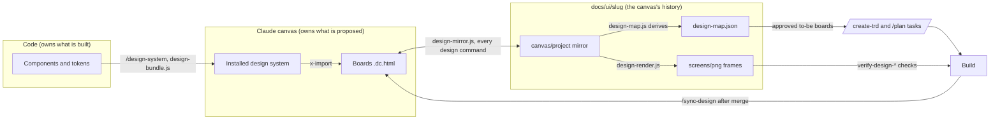
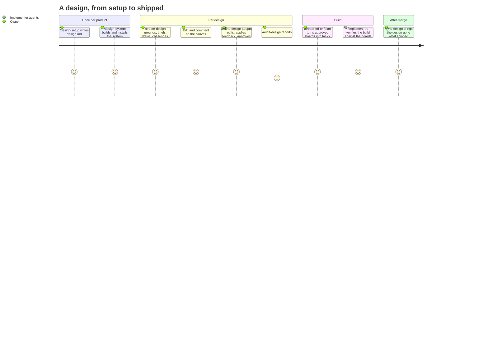

# PRD: Design stage on the Claude canvas

**Version**: 1.2.2
**Status**: Draft
**Created**: 2026-11-03
**Last Updated**: 2026-11-05
**Author**: @product-manager
**Stakeholders**: James Simmons (owner)

**Sources.** The requirement set is GitHub issue #58, copied verbatim to
`docs/plan/design-stage.issue-58.md` (cited below as "the issue", with its section name). What
this session added is in `docs/PRD/design-stage.brief.md` ("the brief"); its table "Owner
rulings, `/refine-prd` 2026-11-04" holds the owner's eight answers, which win over the issue
where they differ (cited below as "ruling OQ-n"); the fourteen challenge-pass findings the owner
accepted are in its table "Challenge-pass findings B1–B14, as the owner accepted them" (cited
below as "ruling Bn"). The phase-0 spike record is
`.trd-state/task-issue-58-phase-0-spike/findings.md` ("findings"), with its evidence in the
`evidence/` directory beside it.

**The owner's instruction for this PRD, verbatim:** "Build per our design but don't over
engineer this. Use our existing patterns". Read as the brief records it: the issue's scope is
the requirement set; "don't over engineer" governs how much machinery each part gets, not which
parts exist. Every part of the issue is either a feature below or a stated Non-Goal.

---

## Changelog

| Version | Date | Changes | Author |
|---------|------|---------|--------|
| 1.0.0 | 2026-11-03 | Initial PRD from issue #58, the session brief and the phase-0 spike findings | @product-manager |
| 1.1.0 | 2026-11-04 | The owner's eight rulings applied (`/refine-prd`, interactive). **Changed:** AC-F13.4 — only an owner ruling accepts a build that differs from its board; a TRD decision does not, so the PRD now agrees with `verification-artifacts` D14 (OQ-2). F9 — runs in the main session like `/refine-prd`, no workflow; AC-F9 verification method no longer says "Workflow test" (OQ-7). Priorities — issue phases 1–4 are P0, phase 5 is P1: F10, F11, F12 and F14 move to P0, F13 stays P1, F13 moved below F14 so the P0 and P1 sections are contiguous; G4 and G5 move from P1 to P0 (OQ-1). NFR-2 and AC-N2 — `ensemble.publishArtifacts: false` ends the same way as no artifact access: write the repository copy and renders, end STUCK naming the publish step (OQ-5). AC-F8.1 — on a stale design system, draw against the installed one, record the drift in `design-map.json` and ISSUES, put `/design-system --sync` first in NEXT, no mid-run question (OQ-3). AC-F1.4 and AC-F1.6 — the 4.5:1 and 44 px values move out of what `design.md` must record and into what `/design-setup` offers as a default; `design.md` records the owner's answer (OQ-6). AC-F8.5 — a still-differing as-is board carries a mark downstream checks can read; the TRD names the field (OQ-8). R5 mitigation now points at AC-F14.3. **Added:** AC-F14.3 — `/audit-docs` skips `docs/ui/` (OQ-4); NG13 (no `refine-design.js`); Decisions rows for the `refine-design.js` workflow and for a TRD decision accepting a difference; a "Resolved by the owner, 2026-11-04" table. **Removed:** the Supersedes row that overrode D14 and the Decisions row "Superseded for `/sync-design`"; all eight Open Questions rows (OQ-1 to OQ-8), now in the resolved table; the "my assignment, not the source's" priority note; the R5 contingency. F15 (phase-0 remainder) stays P1: the scope ruling covers phases 1–5 only | @product-manager |
| 1.2.0 | 2026-11-04 | The owner accepted all fourteen challenge-pass findings on 1.1.0 (B1–B14; the brief, "Challenge-pass findings B1–B14, as the owner accepted them", cited below as "ruling Bn"; the acceptance itself is the brief's "Owner rulings" row dated 2026-11-04). **Added:** AC-F6.9 — every design command, not only `/create-design`, checks whether the design system is older than the code it was built from, with OQ-3's carry-on behaviour; `/audit-design` reports the drift rather than writing the map, as it is report only (B1). AC-F5.9 — every design command starts with a cheap check: the canvas version against the last synced version in the map, reading boards only when it changed; the end-of-command half is the publish each command already does (B2); a Could Not Verify row for that version lookup. AC-F6.8 — `/design-system` installs the system on the product's canvases on its first build, not only on `--sync` (B3). NG14 — no React wrappers for Vue, Svelte, Angular or Web Components (B4). NG15 — Forge's stale `/create-design` references are Forge's to fix (B5). **Changed:** AC-F12.1 — `building` boards are requirements alongside `approved` and `shipped` (B6). AC-F6.2 — the system's version and code commit go in each `design-map.json` only, never in `design.md`, which stays owner-only (B7). AC-F2.1 and AC-F5.1 — the map holds a `canvases` list, each entry with `url`, `version`, `synced_at` (B8). AC-F5.6 — now also states the unit tests cover the issue's four sync cases: canvas changed, repository changed, both changed, publish refused (B9). AC-F3.3 — the approval commit stays; where it is recorded is the TRD's choice (B10). AC-F1.3 — sign-in points at `verification.md` §3 and `design.md` holds no credential (B12). NFR-3 and AC-N3 — the map can list more than one canvas, one per epic flow; no automatic 512-file split (B13). F9 description — carries the single-agent publish permission as a note (B14). AC-F8.1 points at AC-F6.9. **Removed:** AC-F5.5 "neither changed" (B9); NG12 (B11); AC-F1.7, folded into AC-F1.3 (B12); AC-F9.6, now a note (B14); the matching rows in the acceptance-criteria summary. Removed IDs are not reused | @product-manager |
| 1.2.1 | 2026-11-04 | `/audit-prd` against the issue. **Fixed citations:** "ruling Bn" now resolves to the brief's table "Challenge-pass findings B1–B14, as the owner accepted them", added to the brief verbatim from the `/refine-prd` session (the "Owner rulings" row records only the acceptance); NG5 names `packages/core/commands/augment-trd-figma.md`; the spike evidence is in `evidence/` beside findings.md. **Changed:** AC-F8.3 — the brief round asks only about open decisions with no reasonable default (`autonomy.md` case 1), never under `--auto`, so it agrees with NFR-4 and AC-N4. NFR-7 names the `flutter-widget` fixture's path. **Removed:** the Could Not Verify row for the `flutter-widget` fixture (checked: it exists). Could Not Verify now says, per row, why it is still open | @product-manager |
| 1.2.2 | 2026-11-05 | Owner ruling in `/refine-verification` (2026-11-05): **invocation is approval**. AC-F9.4 rewritten: the issue's separate approval act (chat, an "approved" canvas comment, `--approve`) left an unattended chain unable to get from a design to a build, unlike every other stage, where running the next command is the approval. `/create-trd --design` and `/plan --design --boards` now approve the boards they build; `--approve` stays as an early choice; the comment and chat channels are dropped. AC-F9.4 stays must-pass. |

---

## 1. Product Summary

### 1.1 Problem Statement

Ensemble has no design stage (the issue, Summary). A design today is either drawn by the
built-in `/design` starter, "which reads almost nothing and checks nothing", or hand-assembled
over many rounds — one product's 44-board flow took about 20 rounds. Either way nothing ties a
board to the code it describes, nothing builds from it, nothing tests the build against it, and
nothing updates it after the build ships.

That 44-board canvas used none of the canvas's structural features: 0 design systems, 0
`x-import` (real components mounted on a board), 0 `dc-import` (shared parts), 0 interactive
boards, 0 tweaks, 0 pages, no comments (the issue, Evidence).

### 1.2 Proposed Solution

A design stage that works on Claude Design canvases (the issue, Summary). It:

- grounds every design in the existing screens, components, routes and data;
- draws with the product's **real components** wherever the stack allows;
- feeds approved boards into `/create-trd` and `/plan` as build tasks;
- tests the build against the boards with the existing verification skills;
- keeps the canvas, the repository copy and the design system in step, before and after the build.

**The one rule that runs through all of it** (the issue, verbatim): "Code owns what is built,
and the design system follows the code. The canvas owns what is proposed. The repository holds
a copy of the canvas source, which is the canvas's history."

The hand-off to code is the canvas source, read exactly with the Artifact tool — the canvas
editor has no "Handoff to Claude Code" export (the issue, Evidence: Export).

### 1.3 Value Proposition

A design becomes a traceable input to the existing pipeline rather than a picture beside it:
each board cites the brief item and PRD/issue source it answers, becomes TRD tasks citing its
board id, is the frame the build is verified against, and is brought up to date when the build
ships.

### 1.4 Solution Architecture

Three copies are kept in step (the issue, "Keeping things in sync before the build"): the live
canvas, the repository mirror, and the design system (a copy of the code).

---

## 2. User Analysis

### 2.1 Target Users

| User Type | Description | Primary Need |
|-----------|-------------|--------------|
| Owner | The person who runs the commands, edits and comments on the canvas, and approves boards | A design grounded in the real product that the build is held to |
| Implementer agents | The agents `/implement-trd` dispatches | Board source and a task that says which components and props go at which route |
| Unattended orchestrator | A session started by an orchestrator (Forge) with no person present | Design commands that run to a result without a prompt nobody will answer |

### 2.2 User Personas

**Persona: the owner**
- **Role**: product owner and engineer on a product with an existing codebase
- **Goals**: change existing screens with designs built from the product's real components, and know the build matches
- **Pain Points**: the 20-round hand assembly; nothing links a board to code or to the build
- **Technical Proficiency**: High

### 2.3 User Journey

---

## 3. Goals and Non-Goals

### 3.1 Goals

Success metrics are the issue's own phase "Done when" criteria (the issue, Delivery plan), with
phase 0 brought up to date by findings. Priorities are the owner's (ruling OQ-1).

| ID | Goal | Success Metric | Priority |
|----|------|----------------|----------|
| G1 | A product's real components draw on a canvas | A React component package and plain React Native components build into a system that renders on a canvas and locally; the design-system install path draws on the hosted page (unproven by the spike, findings §(a)) | P0 |
| G2 | Designs are created and refined on the canvas, grounded in the product | The 44-board flow redone: as-is boards match their screenshots, to-be boards use `x-import`, links are playable, hand edits and comments round-trip | P0 |
| G3 | Canvas and repository stay in step | Mirror unit tests cover all four sync cases | P0 |
| G4 | Approved boards become build tasks and the build is verified against them | A TRD built from approved boards verifies against them in `/implement-trd`'s loop | P0 |
| G5 | A design can be audited | Findings name a board and line; rejected findings name the file that refutes them | P0 |
| G6 | The design stays current after the build | After a merge, shipped boards replace the as-is boards and drift is reported | P1 |

### 3.2 Non-Goals (Explicit Scope Exclusions)

| ID | Non-Goal | Rationale |
|----|----------|-----------|
| NG1 | Standalone claude.ai/design and the `DesignSync` tool | The issue, Decisions: not in scope; they close on Dec 14, 2026 |
| NG2 | An implement-design command | The issue, Decisions: `/create-trd` and `/plan` take a design as their source |
| NG3 | A separate command for modifying existing screens | The issue, Decisions: it is `/create-design`'s default mode (as-is boards) |
| NG4 | Vendoring the Design type's canvas rules into a skill | The issue, Decisions: read live on every run, because they change release to release |
| NG5 | Changes to `packages/core/commands/augment-trd-figma.md` (and its vendored copy, `.claude/commands/augment-trd-figma.md`) | The issue, Edits: "Unchanged" |
| NG6 | Changes to `verify-data-fidelity` | The issue, Testing against the design: "(unchanged)"; it is selected, not edited |
| NG7 | PPTX, "Send to app" or "Handoff to Claude Code" export | Not on this canvas surface (the issue, Evidence: Export) |
| NG8 | Removing a "confirm with the client" step from `packages/skills/frontend-design` | No such step exists in this repository's skill (see F14 and Supersedes). The plugin skill `frontend-design:frontend-design` is not this repository's to edit |
| NG9 | Changing how an orchestrator spawns sessions (trusted-folder handling) | Findings §(d) says "the orchestrator's spawn has to account for that"; the spawn is in the orchestrator, not Ensemble |
| NG10 | Expo font loading, `cssInterop` on third-party components, and dark mode in bundles | Findings §(b), "Not checked". Not asked for; recorded so nobody assumes they work |
| NG11 | A NativeWind Babel transform step in `design-bundle.js` | Findings §(b): not needed for NativeWind 4 (see Supersedes) |
| NG13 | A `refine-design.js` workflow | Ruling OQ-7: `/refine-design` runs in the main session like `/refine-prd`. The issue's Workflows list names it; recorded in Decisions with a revisit condition |
| NG14 | React wrappers for Vue, Svelte, Angular or Web Components; those stacks use parts | Ruling B4. The issue's stack table offers wrappers, its Libraries row says "Others: none, so parts are used". Revisit when a product on one of those stacks needs the structure check |
| NG15 | Fixing the downstream orchestrator's (Forge's) stale `/create-design` references | The issue, Decisions: "which it fixes on its own side"; ruling B5. This feature does not touch Forge |

---

## 4. Feature Requirements

Priorities are the owner's (ruling OQ-1): issue phases 1 to 4 — rules and libraries,
`/design-system`, create and refine, `/audit-design`, design as a `/create-trd` and `/plan`
source, the design checks — are P0; phase 5 (`/sync-design`, `/audit-design --drift`) is P1.
F14 has no phase in the issue; it is P0 because its criteria serve P0 features (the
`design` and `audit-design` artifact kinds, and keeping `/audit-docs` off `docs/ui/` once
`/create-design` writes there). F15 is phase 0, which the ruling does not cover; it keeps its
1.0.0 priority, P1. There is no P2 — every part of the issue is in scope.

### 4.1 P0 — Core Features

#### F1: `design.md` rules and `/design-setup`
**Priority**: P0 (issue phase 1)
**Description**: An owner-governed rules file, `.claude/rules/design.md`, that works like
`verification.md`: only the owner changes it, by running the `design-setup` skill (the issue,
"Owner-governed rules"; Skills).

**User Stories**:
- As the owner, I want my product's design policy written once, by me, so that no agent guesses at it.

**Acceptance Criteria**:
- [ ] AC-F1.1: `design.md` records the **design system**: its artifact link and namespace; the source of truth (code, Figma or canvas); the build command; and whether the product's build may run to bundle components.
- [ ] AC-F1.2: `design.md` records, **per platform**: the board component kind (real or parts), the tokens source, the component library paths, and the viewport sizes.
- [ ] AC-F1.3: `design.md` records **how to reach a screen**: the route list, sign-in and seed data pointing at `verification.md` environments, the capture command, and where current screenshots live. For sign-in credentials it points at `verification.md` §3 and holds no credential itself; the file is committed (ruling B12).
- [ ] AC-F1.4: `design.md` records **design rules**: reuse (~~"an existing view beats a new one; a new component needs a reason"~~ *Superseded 2026-11-06 by `docs/PRD/design-quality.md` (the reuse rule only: AC-F4.1, reuse means components and tokens).*), an accessibility floor, ~~competitor references~~ *Superseded 2026-11-06 by `docs/PRD/design-quality.md` (AC-F1.7, one References field).*, and process rules such as "every round publishes a before/after".
- [ ] AC-F1.5: A `design.md` template is added under `packages/core/templates/claude-directory/rules/`, filled by `/design-setup`.
- [ ] AC-F1.6: `design-setup` is an owner interview, one question per topic, offering defaults detected from the repository; it is never chained, and follows `verification-setup`'s pattern and exemption (owner-invoked only; `verification-setup` sets `disable-model-invocation: true`, seen in `packages/skills/verification-setup/SKILL.md`). For the accessibility floor it offers contrast 4.5:1 and 44 px touch targets (the issue's values) as the default; `design.md` records the owner's answer, not the default (ruling OQ-6).

**Dependencies**: none.

#### F2: `design-map.js`
**Priority**: P0 (issue phase 1)
**Description**: Schema, read and write for `docs/ui/<slug>/design-map.json`, "the link between
design and code", one entry per board (the issue, "What gets created", Libraries).

**Acceptance Criteria**:
- [ ] AC-F2.1: The map carries `canvases`, a list with one entry per canvas (`url`, `version`, `synced_at`) (ruling B8; the issue's schema shows a single `canvas`), `design_system` (`url`, `version`, `code_commit`, `paths`) and `boards[]` with the fields in the issue's schema: `id`, `file`, `kind`, `replaces`, `platform`, `viewport`, `route`, `states` (each with a `setup`), `components`, `parts`, `links`, `brief_items`, `status`, `trd`, `shipped_commit`.
- [ ] AC-F2.2: `kind` is one of `as-is`, `to-be`, `part`, `flow`.
- [ ] AC-F2.3: `status` moves `draft` → `approved` → `building` → `shipped`, or to `superseded`, and the library is what moves it.
- [ ] AC-F2.4: `components`, `parts` and `links` are derived from board source by the library, never typed by hand. A unit test covers derived fields from board source (the issue, Testing this work).

**Dependencies**: none.

#### F3: `design-render.js`
**Priority**: P0 (issue phase 1)
**Description**: Local render of committed boards with the Design type's `dc-runtime.js`, served
locally (the issue, Libraries). Needs no claude.ai login (the issue, Evidence: Local render).

**Acceptance Criteria**:
- [ ] AC-F3.1: Writes a PNG at each board's viewport and for each state, plus each board's render errors.
- [ ] AC-F3.2: Each state — an `sc-if` branch or a tweak value — is exported as its own frame, `NN-name--state.png` (the issue, Testing against the design).
- [ ] AC-F3.3: Frames for verification are rendered from the committed source at the commit the board was approved, so the build is tested against the approved design, not a later edit. Where that commit is recorded is the TRD's choice (ruling B10).
- [ ] AC-F3.4: A unit test shows a known board produces a stable PNG.
- [ ] AC-F3.5: A release-change test renders the fixture boards with the current `dc-runtime.js` (the issue, Open risks).
- [ ] AC-F3.6: A command whose contract includes a local render pass states it, because the Design type tells an agent never to render or verify unless asked, and that contract is the ask (the issue, Limits).

**Dependencies**: the Design type's `dc-runtime.js` (Could Not Verify).

#### F4: `design-bundle.js`
**Priority**: P0 (issue phase 1)
**Description**: Per-stack bundle recipes for real components (the issue, Libraries; stack
table, as amended by findings §(b)).

**Acceptance Criteria**:
- [ ] AC-F4.1: React web: an esbuild IIFE assigning the namespace global, with React mapped to the page's globals, plus compiled CSS.
- [ ] AC-F4.2: React Native: the `react-native` → `react-native-web` alias and Node built-in stubs.
- [ ] AC-F4.3: React Native with NativeWind 4: `jsxImportSource: 'nativewind'` and CSS compiled by the app's own Tailwind config; no Babel step required (findings §(b)).
- [ ] AC-F4.4: Other stacks: no bundle, so parts are used (the issue's stack table states which stacks use parts).
- [ ] AC-F4.5: The library reports every stub it adds (the issue, Open risks: bundles leak app logic).
- [ ] AC-F4.6: A unit test shows a fixture React library mounts under `dc-runtime`.

**Dependencies**: F1 (whether the product build may run).

#### F5: `design-mirror.js` — canvas and repository in step
**Priority**: P0 (issue phase 1)
**Description**: Three-way sync between the live canvas, the repository copy
(`docs/ui/<slug>/canvas/project/`) and the last synced canvas version, run at the start and end
of every design command (the issue, "Keeping things in sync before the build").

**Acceptance Criteria**:
- [ ] AC-F5.1: Base is the `version` recorded for that canvas in the map's `canvases` list.
- [ ] AC-F5.2: Canvas changed, repository didn't: the canvas edit is adopted into the repository, committed as "design: adopt canvas edits (<boards>)", and the map fields are re-derived.
- [ ] AC-F5.3: Repository changed, canvas didn't: the repository source is published.
- [ ] AC-F5.4: Both changed on the same board: the canvas version is kept, the repository version is written beside it as `<board>.repo.dc.html`, and it is reported under ISSUES. No silent overwrite in either direction.
- [ ] AC-F5.6: When the canvas refuses a publish over a newer save: re-read, redo, and STUCK after a third refusal. Unit tests cover the issue's four sync cases — canvas changed (AC-F5.2), repository changed (AC-F5.3), both changed (AC-F5.4) and publish refused (this criterion) (the issue, phase 1 Done when; ruling B9).
- [ ] AC-F5.7: Any agent that publishes does a whole-artifact `read` (no `path`) first; a one-file read is refused (findings §(c)).
- [ ] AC-F5.8: The mirror leaves out `project/ds/`; the design system's version is recorded instead.
- [ ] AC-F5.9: Every design command starts with a cheap check: it compares the live canvas's version with the last synced version in `design-map.json`, and reads the boards and runs AC-F5.2–5.4 only when the version changed. When nothing changed there is no full read. The end-of-command half of the sync is the publish the command already does (the issue, "run at the start and end of every design command"; ruling B2, where the owner raised wall-clock cost).

**Dependencies**: F2.

#### F6: `/design-system [--sync]`
**Priority**: P0 (issue phase 1)
**Description**: Builds or refreshes the product's Design System artifact from code, and installs
it on the product's canvases (the issue, Commands).

**Acceptance Criteria**:
- [ ] AC-F6.1: Tokens become list-format `tokens.json`; fonts and logos are copied; components are bundled per platform with `design-bundle.js`, plus a README and preview per component.
- [ ] AC-F6.2: Records the system's version and code commit in each `design-map.json` only, never in `design.md`, which stays owner-only (ruling B7).
- [ ] AC-F6.3: Runs the product build only if `design.md` allows it.
- [ ] AC-F6.4: The README lists every stub `design-bundle.js` added.
- [ ] AC-F6.5: `--sync` re-runs after the code changes and reinstalls the system on each canvas that records it, since a canvas's copy never updates by itself.
- [ ] AC-F6.6: When `design.md` says Figma is the source, it uses the Figma connector route (`from-design-tool.md`, main session only).
- [ ] AC-F6.7: The installed system draws on the hosted canvas (closes the gap findings §(a) left: the spike linked bundles from `project/lib/`, not as an installed system).
- [ ] AC-F6.8: On its first build it installs the system on the product's canvases, not only on `--sync` (the issue, Commands: "installs it on the product's canvases"; ruling B3).
- [ ] AC-F6.9: Every design command — `/create-design`, `/refine-design`, `/audit-design`, `/sync-design` — checks whether the design system is older than the code it was built from (`git log <code_commit>..HEAD -- <paths>`). On a change it carries on against the installed system, records the drift in `design-map.json` and under ISSUES, and puts `/design-system --sync` first in NEXT, asking nothing (ruling OQ-3). `/audit-design` reports the drift instead of writing the map, since it is report only (AC-F10.4) (the issue, "Code and design system"; ruling B1).

**Dependencies**: F1, F4.

#### F7: Skills `designing-on-canvas` and `design-grounding`
**Priority**: P0 (issue phase 2)

**Acceptance Criteria**:
- [ ] AC-F7.1: `designing-on-canvas` holds our board conventions only: `x-import` for every real component, shared parts as `dc-import`, `is_interactive` on any linked board, tweaks for states and variants, one canvas page per flow, NN-name board ids, board titles, no inline copies of components.
- [ ] AC-F7.2: The canvas rules themselves are read live from the Design type's `SKILL.md` and references on every run, never vendored.
- [ ] AC-F7.3: `design-grounding` says how to inventory screens, components, flows and data for each stack, and how to capture missing screenshots.

**Dependencies**: none.

#### F8: `/create-design <brief|PRD|issue> [--new] [--auto]`
**Priority**: P0 (issue phase 2)
**Description**: Grounds the design, writes the brief, draws the boards and challenges them.
Workflow `create-design.js` (the issue, "Workflow: what `/create-design` does").

**Acceptance Criteria**:
- [ ] AC-F8.1: **Resolve.** Reads `design.md`; if missing, STUCK with "run `/design-setup`". Reads the Design type's `SKILL.md` and references. Checks that the recorded `code_commit` still matches the component and token paths (`git log <code_commit>..HEAD -- <paths>`, AC-F6.9); on a mismatch it carries on and draws against the installed system, records the drift in `design-map.json` and under ISSUES, and puts `/design-system --sync` first in NEXT. It asks no mid-run question (ruling OQ-3).
- [ ] AC-F8.2: **Ground.** Read-only agents in parallel write `grounding/`: `screens.md` (with screenshot paths, captured if missing), `components.md` (props and where each is used), `flows.md`, `data.md` (fields the backend actually returns), `standards.md`; competitor patterns optionally.
- [ ] AC-F8.3: **Brief.** One agent writes `brief.md`: screens and their states (empty, loading, error); per board the existing components and views it reuses, and anything new with its reason; open decisions. With a person present it asks one round of at most four questions written from the material (the issue, step 3), each about an open decision the material leaves with no reasonable default — `autonomy.md` case 1, so the round is not a checkpoint; a decision that has a default is decided, not asked. Under `--auto`, or with no person present, it asks nothing and records every assumption in `brief.md`.
- [ ] AC-F8.4: Every board cites its `brief_items`, and every brief item cites its PRD or issue source.
- [ ] AC-F8.5: **As-is boards** (default; skipped with `--new` for screens with no predecessor). Each screen in scope gets an as-is board rebuilt from real components or parts, rendered, and compared with the current screenshot; a board that still differs carries a mark in the map that the downstream checks (F12, F13) can read, and is never silently kept. Which field holds the mark is the TRD's choice (ruling OQ-8).
- [ ] AC-F8.6: **Parts first.** One agent writes the shared parts the design system lacks.
- [ ] AC-F8.7: **To-be boards in parallel.** One agent per board writes its board on disk following `designing-on-canvas`, starting from the as-is board where one exists.
- [ ] AC-F8.8: **Render and challenge.** Every board is rendered; read-only reviewers return ranked findings on flow and logic, consistency, reuse (an inline copy of an existing component or view), data reality, standards and accessibility, and render errors; one fix round follows.
- [ ] AC-F8.9: **Publish and commit.** The lead does a whole-artifact read, publishes `canvas.json` and the parts, then the boards in order; installs the design system on the canvas if missing or outdated; writes `design-map.json` (status `draft`); exports `screens/png/`; commits `docs/ui/<slug>/`; records the artifact; ends with the standard readout, canvas link above the banner.
- [ ] AC-F8.10: Writes `docs/ui/<slug>/` with `brief.md`, `grounding/`, `canvas/project/`, `design-map.json` and `screens/png/NN-name[--state].png`. `grounding/` is refreshed only when the code it covers changes.

**Dependencies**: F1–F7.

#### F9: `/refine-design <slug> [feedback] [--auto] [--approve <ids>]`
**Priority**: P0 (issue phase 2)
**Description**: Applies feedback (the issue, Commands; "Approval is the owner's act"). It
runs in the main session the way `/refine-prd` does — interactive by default, `--auto`
unattended — with no workflow script (ruling OQ-7; NG13). As the issue allows, it may let a
single agent publish a single board after a whole-artifact read (findings §(c)); this is a
permission, not a criterion (ruling B14).

**Acceptance Criteria**:
- [ ] AC-F9.1: Reads the live canvas first and adopts hand edits (through F5).
- [ ] AC-F9.2: Takes feedback from the argument, chat, canvas comments and the viewer's selected elements.
- [ ] AC-F9.3: Changes only the affected boards, re-challenges them, publishes only what changed, posts a before/after, and answers each comment it handled.
- [ ] AC-F9.4: A to-be board is approved by the owner's invocation, never by a separate approval act: `/create-trd --design` and `/plan --design --boards <ids>` approve the to-be boards they build (recording `approved_commit`), and `/refine-design --approve <ids>` approves boards ahead of a build. No canvas comment, chat remark or `--auto` run approves a board. Nothing builds from a board no invocation named (owner ruling, 2026-11-05).
- [ ] AC-F9.5: Runs in the main session, interactive by default; `--auto` for unattended runs (the refine-command exemption is by mode, per `autonomy.md`; ruling OQ-7).

**Dependencies**: F5, F8.

#### F10: `/audit-design <slug>`
**Priority**: P0 (issue phase 3; ruling OQ-1)
**Description**: Report only. Workflow `audit-design.js`, on the existing audit skeleton (index,
parallel verifiers, reconcile) — the shape `packages/core/workflows/audit-prd.js` already has.

**Acceptance Criteria**:
- [ ] AC-F10.1: Writes `audit-design-report.md` and maintains `## Could Not Verify`.
- [ ] AC-F10.2: Findings name a board and line; rejected findings name the file that refutes them.
- [ ] AC-F10.3: Reports any board with no source and any brief item with no board.
- [ ] AC-F10.4: Changes no board (report only).

**Dependencies**: F2, F8.

#### F11: Design as a source for `/create-trd` and `/plan`
**Priority**: P0 (issue phase 4; ruling OQ-1)
**Description**: Approved boards flow into the existing commands (the issue, Edits; "From design
to code").

**Acceptance Criteria**:
- [ ] AC-F11.1: `/create-trd` (command and `create-trd.js`) accepts a design through a PRD reference or `--design docs/ui/<slug>`; `/plan` does the same for one board or a small set.
- [ ] AC-F11.2: Each `approved` to-be board becomes tasks citing its board id: route, components and props (from `x-import`), new shared components (from parts), states (from `sc-if` and tweaks), interactions (from links) and data fields (from `grounding/data.md`).
- [ ] AC-F11.3: The board moves to `building` and the TRD path is recorded in the map.
- [ ] AC-F11.4: Real-component boards: the task says which components and props go at which route. Parts boards: the task carries the board's PNG and source as the reference.
- [ ] AC-F11.5: The implementer reads board source from `docs/ui/<slug>/canvas/project/`, never from a screenshot alone.
- [ ] AC-F11.6: New shared components (parts the brief marked as new) become their own tasks, ahead of the screens that use them.
- [ ] AC-F11.7: The design checks are selected in the TRD's `## Verification Artifacts` automatically (that section exists today: `packages/core/commands/create-trd.md`, "Section 9a: Verification Artifacts").

**Dependencies**: F2, F9, F12.

#### F12: Testing the build against the design
**Priority**: P0 (issue phase 4; ruling OQ-1)
**Description**: Four checks join `## Verification Artifacts` when the PRD or TRD references a
design, all inside the existing functional-verification loop (`/implement-trd`,
`/verify-build`) (the issue, "Testing against the design").

**Acceptance Criteria**:
- [ ] AC-F12.1: `verify-design-comparison` (edited) accepts `design-map.json` as the route-and-state manifest per frame. Only `approved`, `building` and `shipped` to-be boards are requirements — `building` because AC-F11.3 moves a board there when its TRD is written (ruling B6); as-is boards are regression baselines — a screen the design did not mean to change must still match its as-is board. Its verdict stays model judgement per frame (verification-artifacts O2b).
- [ ] AC-F12.2: `verify-design-structure` (new): do the components a board names appear at its route in the build? A React tree walk in Playwright compares rendered components against the board's `components`. React and react-native-web only; otherwise "not verifiable here".
- [ ] AC-F12.3: `verify-flow-as-built` (edited) takes the designed screen-to-screen edges from the board links in `design-map.json`.
- [ ] AC-F12.4: `verify-data-fidelity` is selected with `grounding/data.md` as input, unchanged.
- [ ] AC-F12.5: Parts boards skip the structure check; the design comparison carries the weight.

**Dependencies**: F2, F3.

#### F14: Edits to existing files not covered above
**Priority**: P0 (no issue phase; serves P0 features — see the note under section 4)

**Acceptance Criteria**:
- [ ] AC-F14.1: `lib/artifacts.js` documents new kinds `design` (the canvas) and `audit-design`. (No schema change: `KINDS` is "Documentation only: any valid slug is accepted", `packages/core/lib/artifacts.js`.)
- [ ] AC-F14.2: `packages/skills/frontend-design/SKILL.md` ~~states that in an existing product, reuse beats a bold new look.~~ *Superseded 2026-11-06 by `docs/PRD/design-quality.md` (AC-F4.1, departure latitude governs departure, not a fixed line in the skill).* (Today it tells the agent to "commit to a BOLD aesthetic direction" and says nothing about reuse.)
- [ ] AC-F14.3: `/audit-docs` skips `docs/ui/` — a one-line change to its document set. `/audit-design --drift` is the design's own drift check (ruling OQ-4).

**Dependencies**: none.

### 4.2 P1 — Complete Solution

#### F13: After the build — `/sync-design <slug>` and `/audit-design --drift`
**Priority**: P1 (issue phase 5; ruling OQ-1)
**Description**: Keeps the design current after a merge (the issue, "After the build"). Workflow
`sync-design.js`.

**Acceptance Criteria**:
- [ ] AC-F13.1: `/audit-build`'s NEXT names `/sync-design <slug>` when the closed feature has a design; it is not chained.
- [ ] AC-F13.2: For each `building` board, captures the built screen at its route and states into `as-built/png/`.
- [ ] AC-F13.3: Compares build with board using the `verify-design-comparison` logic. **Matches:** the board becomes `shipped` with `shipped_commit` set; the to-be board becomes the new as-is for that screen, and the old as-is moves to a "History" page on the canvas.
- [ ] AC-F13.4: **Differs, and an owner ruling accepts the difference:** the board is rebuilt from the shipped components to match the build, and the ruling is cited in a canvas note. Only an owner ruling counts — as `docs/TRD/verification-artifacts.md` D14 defines one (a PRD ruling, an amendment recording the owner's words, a TRD decision that quotes the owner, or an owner comment on the page); a TRD decision the architect wrote does not (ruling OQ-2).
- [ ] AC-F13.5: **Differs, with no ruling:** reported under ISSUES; the board stays `building`; the owner decides to fix the build, or accept and rebuild the board.
- [ ] AC-F13.6: If component or token paths changed, runs `/design-system --sync`. Then publishes, commits and updates the map.
- [ ] AC-F13.7: `/audit-design --drift`, runnable at any time, compares every `shipped` and as-is board with a fresh screenshot of the current build, and the installed design system's version with the current one; reports code changes made outside any design and screens never designed; lists a screen with no board for `/create-design` to rebuild as an as-is board.

**Dependencies**: F2, F3, F6, F10, F12.

#### F15: Phase-0 remainder
**Priority**: P1 — not a gate on the rest (the brief, Superseded)

**Acceptance Criteria**:
- [ ] AC-F15.1: A screenshot of the NativeWind board drawn on the hosted canvas, showing the chips (findings §(a), "What would settle it").
- [ ] AC-F15.2: An orchestrator-started session under the james account creates and publishes an artifact (findings §(d)).

**Dependencies**: none.

---

## 5. Non-Functional Requirements

| ID | Requirement | Source |
|----|-------------|--------|
| NFR-1 | Each part gets the least machinery that meets its criteria, reusing existing patterns: create/refine/audit command shapes, an owner interview like `verification-setup`, owner-governed rules like `verification.md`, workflows on `test-harness.js`, artifacts through `artifacts.js`, the four-section readout and banners | The owner: "Build per our design but don't over engineer this. Use our existing patterns"; the brief, Settled |
| NFR-2 | With no claude.ai artifact access (`claude -p`, Agent SDK, CI), or with `ensemble.publishArtifacts: false`, a design command writes the repository copy and renders, then ends STUCK with the publish step named | The issue, Open risks; Limits ("Artifacts are off for `claude -p` and the Agent SDK"); ruling OQ-5 for publishing off |
| NFR-3 | A design too big for one canvas (512 files) uses one canvas per epic flow; the map can list more than one canvas. There is no automatic split (ruling B13) | The issue, Open risks; Limits (512 files, up to 4 design systems per canvas) |
| NFR-4 | Design commands run autonomously per `autonomy.md`; `/refine-design` is interactive by default and obeys the rule under `--auto` | constitution.md Prohibited Pattern 8; `autonomy.md`; the issue, Commands |
| NFR-5 | Every design command ends with the four-section readout and a COMMAND COMPLETE/STUCK banner, the canvas link above it | constitution.md Prohibited Pattern 7; `command-status.md`; the issue, step 8 |
| NFR-6 | No published board or design-system page contains a credential | `command-status.md`, "Never publish a document that contains a credential" |
| NFR-7 | Libraries have unit tests (bundle, render, mirror, map as listed in F2–F5); workflows have tests on `test-harness.js`; live runs on fixtures — one React web, one React Native, the `flutter-widget` variant (parts only; `ensemble-vnext-test-fixtures/variants/<variant>/flutter-widget/`, the `fixture_path` in `test/evals/specs/dev-loop/dev-loop-flutter.yaml`) — plus the 44-board flow as the real case | The issue, "Testing this work"; stack.md (Jest, Node 18+) |

---

## 6. Acceptance Criteria Summary

### Feature Acceptance Criteria

| ID | Feature | Criterion | Verification Method |
|----|---------|-----------|---------------------|
| AC-F1.1–1.4 | F1 | `design.md` records system, per-platform, reach-a-screen and design-rule fields | Manual (template review) |
| AC-F1.5 | F1 | Template added under `templates/claude-directory/rules/` | Unit test (file present) |
| AC-F1.6 | F1 | `design-setup` interviews one topic at a time with detected defaults, offers the accessibility floor as a default, never chained | Manual / session log |
| AC-F2.1–2.3 | F2 | Map schema, kinds and status transitions | Unit test |
| AC-F2.4 | F2 | Derived fields from board source | Unit test |
| AC-F3.1–3.3 | F3 | PNG per viewport and state, render errors, from approved commit | Unit test |
| AC-F3.4 | F3 | Known board gives a stable PNG | Unit test |
| AC-F3.5 | F3 | Release-change test with current `dc-runtime.js` | Unit test |
| AC-F3.6 | F3 | Render pass stated in command contracts | Manual |
| AC-F4.1–4.4 | F4 | Per-stack recipes, NativeWind without Babel | Unit test + live fixture run |
| AC-F4.5 | F4 | Every stub reported | Unit test |
| AC-F4.6 | F4 | Fixture React library mounts under `dc-runtime` | Unit test |
| AC-F5.1–5.4 | F5 | Base version; canvas-changed, repository-changed and both-changed cases | Unit test |
| AC-F5.6 | F5 | STUCK after a third refused publish; the four sync cases covered | Unit test |
| AC-F5.7 | F5 | Whole-artifact read before any publish | Live run |
| AC-F5.8 | F5 | `project/ds/` left out, version recorded | Unit test |
| AC-F5.9 | F5 | Version check first; no board read when the version is unchanged | Unit test |
| AC-F6.1–6.5 | F6 | System built, recorded, gated by `design.md`, stubs listed, `--sync` reinstalls | Live fixture run |
| AC-F6.6 | F6 | Figma route when Figma is the source | Manual |
| AC-F6.7 | F6 | Installed system draws on the hosted canvas | Live run (owner looks) |
| AC-F6.8 | F6 | First build installs the system on the product's canvases | Live fixture run |
| AC-F6.9 | F6 | Every design command checks for a stale system and carries on | Workflow test + session log |
| AC-F7.1–7.3 | F7 | Skill content; rules read live | Manual |
| AC-F8.1–8.10 | F8 | Resolve, ground, brief, as-is, parts, to-be, challenge, publish | Workflow test + live run (44-board flow) |
| AC-F9.1–9.5 | F9 | Adopt edits, feedback sources, targeted changes, owner-only approval, modes, main session | Session log + live run |
| AC-F10.1–10.4 | F10 | Report, Could Not Verify, board-and-line findings, refuting file | Workflow test |
| AC-F11.1–11.7 | F11 | Design input, tasks per board, status `building`, checks selected | Workflow test + live run |
| AC-F12.1–12.5 | F12 | Four checks inside the verification loop | Live run in `/implement-trd` |
| AC-F13.1–13.7 | F13 | Sync outcomes (a difference accepted only by an owner ruling), History page, drift report | Workflow test + live run |
| AC-F14.1 | F14 | Artifact kinds documented | Unit test (artifacts.test.js) |
| AC-F14.2 | F14 | Reuse line in `frontend-design` | Manual |
| AC-F14.3 | F14 | `/audit-docs` leaves `docs/ui/` out of its document set | Unit test (`docs-audit-assemble` inventory) |
| AC-F15.1–15.2 | F15 | Hosted screenshot; james account run | Manual |

### Non-Functional Acceptance Criteria

| ID | Requirement | Criterion | Verification Method |
|----|-------------|-----------|---------------------|
| AC-N1 | NFR-1 | Each new command, skill, workflow and library maps to an existing pattern named in NFR-1, or the TRD states why not | TRD review |
| AC-N2 | NFR-2 | With artifacts unavailable or `ensemble.publishArtifacts: false`, repository copy and renders exist and the run ends STUCK naming the publish step | Workflow test |
| AC-N3 | NFR-3 | The map accepts and reads back more than one canvas | Unit test |
| AC-N4 | NFR-4 | No mid-run pause outside the four cases; `--auto` asks nothing | Session log |
| AC-N5 | NFR-5 | Readout and banner present; canvas link above the banner | Session log |
| AC-N6 | NFR-6 | No credential in published content | Manual |
| AC-N7 | NFR-7 | Listed unit, workflow and live fixture runs exist and pass | Test run |

---

## 7. Risk Assessment

| ID | Risk | Likelihood | Impact | Mitigation Strategy |
|----|------|------------|--------|---------------------|
| R1 | The design-system install-and-draw path fails on the hosted canvas; the spike proved only bundles linked from `project/lib/` (findings §(a)) | Med | High | AC-F6.7 checks it in phase 1, before phases 2–5 depend on it |
| R2 | The canvas type changes across releases | Med | Med | `designing-on-canvas` holds only our conventions; release-change test (AC-F3.5) |
| R3 | Bundles leak app logic (a shared package pulled in `crypto`) | Med | Med | Every stub reported (AC-F4.5) and listed in the README (AC-F6.4) |
| R4 | An unattended launch into a folder the account never trusted stops at the trust prompt (findings §(d)) | Med | Med | Design commands run in a trusted project folder; the spawn fix is the orchestrator's (NG9) |
| R5 | A comprehensive `/audit-docs` run treats `docs/ui/**` as loose docs and cuts to-be or History boards as "describing something that does not exist" — `docs-audit-assemble.js` lists every tracked file under `docs/` and reviews loose docs in a comprehensive run | Med | High | `/audit-docs` skips `docs/ui/` (AC-F14.3, ruling OQ-4) |
| R6 | Two agents publish at once and one is refused | Low | Low | One publisher per round stays the default; refusal handling (AC-F5.6) |

**R1 contingency**: if the installed system does not draw on the hosted page, boards link the
bundle from `project/lib/` as the spike did, and the gap is reported to the owner.

---

## 8. Decisions and Rejected Alternatives

| Proposal / Challenge | Verdict | Rationale | Revisit when |
|----------------------|---------|-----------|--------------|
| An implement-design command | Rejected | `/create-trd` and `/plan` take a design as source (the issue) | A design's build cannot be expressed as TRD tasks |
| A fourth command for modifying existing screens | Rejected | It is `/create-design`'s default mode (the issue) | As-is boards prove unwanted in most runs |
| Vendor the canvas rules | Rejected | They change release to release (the issue) | The Design type's rules can no longer be read live |
| Standalone claude.ai/design and `DesignSync` | Rejected | Out of scope; closes Dec 14, 2026 (the issue) | Never — the surface is closing |
| Board agents publish in parallel | Rejected as the default; any agent *can* publish after a whole-artifact read | One canvas version per round; no refusals from simultaneous saves (the issue; findings §(c)) | One-publisher rounds are measured as the bottleneck |
| NativeWind Babel transform in the recipe | Superseded | Not needed for NativeWind 4 (findings §(b)) | A NativeWind version needs it, or `cssInterop`/dark mode is brought into scope |
| Phase 0 as a gate on the rest | Superseded | Done except a hosted screenshot and the james run (the brief, findings) | Either remaining check fails |
| A pixel-percentage gate for the design comparison | Rejected (inherited) | Verdict is model judgement per frame; the percentage is evidence (verification-artifacts O2b). The issue's "pixel comparison" means this check | Model judgement measured missing regressions a percentage would catch |
| `/create-design` asks the owner to run `/design-system --sync` when the system is stale | Rejected by the owner (ruling OQ-3): it draws against the installed system, records the drift in the map and ISSUES, and puts `/design-system --sync` first in NEXT | `autonomy.md`: outside the four cases, decide and proceed | Designs drawn against a stale system are measured needing a redraw after the sync |
| `/sync-design` accepts a difference on a TRD decision as well as an owner ruling (the issue's wording, AC-F13.4 in 1.0.0) | Rejected by the owner (ruling OQ-2); only an owner ruling counts, as `verification-artifacts` D14 already requires | A decision the architect wrote is not an owner ruling; letting it accept a difference lets the plan grade itself, and the rebuilt board becomes the frame later runs verify against (D14) | The owner amends D14 itself |
| A `refine-design.js` workflow (the issue's Commands and Workflows) | Rejected by the owner (ruling OQ-7); `/refine-design` runs in the main session like `/refine-prd` | The existing refine commands have no workflow (`packages/core/workflows/` holds no `refine-*` script), and the owner asked for existing patterns; interactive refinement belongs in the session the owner is talking to | A `/refine-design --auto` run measurably exhausts the main session's context on a large canvas, or `/refine-prd` itself gains a workflow |
| Design commands never go STUCK over a failed publish (`command-status.md`) | Superseded for design commands | The canvas is where the design is edited and commented, not a convenience link (the issue, Open risks) | Never for design commands while the canvas is the design's home |

### Confirmed grounding — do not re-litigate

- "Build per our design but don't over engineer this. Use our existing patterns" (the owner, `/create-prd` invocation, 2026-11-03).
- The names `create-design`, `refine-design`, `audit-design` (the issue, Decisions).
- Whether the product's build may run to bundle components is per product, in `design.md` (the issue, Decisions).
- Approval is the owner's act; nothing builds from a `draft` board (the issue).

---

## Supersedes

| Document | What it decided | What this PRD says instead | Why this governs |
|----------|-----------------|---------------------------|------------------|
| The issue's stack table and `design-bundle.js` recipe | NativeWind: "not yet", "real once the NativeWind transform is bundled"; recipe includes "the NativeWind Babel transform when it is used" | NativeWind is **real**, with `jsxImportSource: 'nativewind'` and the app's Tailwind; no Babel step (AC-F4.3) | Later measurement on a real product (findings §(b)), recorded as superseded in the brief |
| The issue, Edits: `skills/frontend-design` | Drop the "confirm with the client" step | Nothing to drop in this repository; only the reuse line is added (AC-F14.2, NG8) | The code states fact: `grep -niE "client\|stakeholder\|approv\|confirm" packages/skills/frontend-design/SKILL.md` finds nothing |
| `.claude/rules/command-status.md`, Artifact links | A failed publish is never fatal; a command must not go STUCK over it. With publishing off, commands skip the publish, emit no link, and still record the path | Design commands end STUCK with the publish step named, both when artifacts are unavailable and when `ensemble.publishArtifacts` is `false` (NFR-2) | Narrower and later: the rule covers documents whose on-disk copy is the deliverable; for a design the canvas is the working surface. The publishing-off case is the owner's ruling OQ-5 |

---

## Open Questions

None open.

### Resolved by the owner, 2026-11-04

Answered in `/refine-prd`; the answers are verbatim in the brief, "Owner rulings, `/refine-prd`
2026-11-04".

| ID | Question | Answer | Choice (verbatim) | Applied in |
|----|----------|--------|-------------------|------------|
| OQ-1 | The issue orders work in phases but assigns no priority | Issue phases 1 to 4 are P0; phase 5 (`/sync-design`, `--drift`) is P1 | "Phases 1-4 P0, sync P1" | Goals; section 4 note; F10–F12, F14 to P0 |
| OQ-2 | `/sync-design` lets a TRD decision accept a build that differs from its board; `verification-artifacts` D14 rejected exactly that | Only an owner ruling accepts a difference; a TRD decision does not. Keeps D14 | "Owner ruling only (Recommended)" | AC-F13.4; Decisions; Supersedes row removed |
| OQ-3 | On a stale design system, ask the owner to run `/design-system --sync` first, or carry on? | Draw against the installed system, record the drift in the map and ISSUES, `/design-system --sync` first in NEXT | "Carry on, record drift (Recommended)" | AC-F8.1; Decisions |
| OQ-4 | Is `docs/ui/` in `/audit-docs`'s scope? | `/audit-docs` skips `docs/ui/`; `/audit-design --drift` is the design's own drift check | "Exclude docs/ui/ (Recommended)" | AC-F14.3; R5 |
| OQ-5 | What does a design command do with `ensemble.publishArtifacts: false`? | Writes the repository copy and renders, then ends STUCK naming the publish step | "Write files, end STUCK (Recommended)" | NFR-2; AC-N2; Supersedes |
| OQ-6 | The accessibility floor "contrast 4.5:1, 44 px touch targets": fixed, or a default? | `/design-setup` offers 4.5:1 and 44 px; the owner's answer is what `design.md` records | "Offered default (Recommended)" | AC-F1.4; AC-F1.6 |
| OQ-7 | The issue names `refine-design.js`; `/refine-prd` and `/refine-trd` have no workflow | No workflow: `/refine-design` runs in the main session, interactive by default, `--auto` unattended | "No workflow (Recommended)" | F9; NG13; Decisions |
| OQ-8 | Which field marks an as-is board that still differs from its screenshot? | The PRD requires the mark exist and be readable by the checks; the TRD names the field | "Leave to the TRD (Recommended)" | AC-F8.5 |

---

## Could Not Verify

Rewritten by `/audit-prd`, 2026-11-04. That audit checked this PRD against the issue, the
brief, findings and this repository's files. It did not read the live Design types, run
anything on a canvas or open plugin files outside this repository, so the rows below stay open.
Checked and confirmed, so removed: the `flutter-widget` fixture exists
(`ensemble-vnext-test-fixtures/variants/baseline/flutter-widget/`, plus five other variants).

| Claim | How I'd check it | Why still open |
|-------|------------------|----------------|
| The Design type's `SKILL.md`, `format.md`, `design-system-components.md`, `view-state.md`, `print.md`, `make-from-this.md` and the Design System type's `from-code.md`, `from-design-tool.md` exist and can be read live by a command | `Artifact` `action: "list", scope: "types"`, then `read` with the Design type's `type_url` | Live Artifact types were outside this audit, which read files only |
| The type ships `artifact-type/dc-runtime.js`, usable as `support.js` for a local render | Read the Design type's files listing | Same: needs a live read of the Design type |
| A canvas holds 512 files and up to 4 design systems; it has no version history; a canvas's copy of a design system never updates by itself | The Design type's references | Same: needs a live read of the Design type |
| The installed design system (`project/ds/` plus a `designSystems` record) draws on the hosted canvas | AC-F6.7 live run | Needs a live canvas run; the spike did not prove it (findings §(a)) |
| The NativeWind board's components visibly draw on the hosted page (owner comments suggest it) | AC-F15.1 screenshot | Needs the owner's screenshot of the hosted canvas |
| The james account can publish from an orchestrator-started session | AC-F15.2 | Needs a run under that account |
| Standalone claude.ai/design and `DesignSync` close on Dec 14, 2026 | The issue's own claim; check the platform announcement | An external announcement; this audit read only repository files |
| The plugin skill `frontend-design:frontend-design` has the "confirm with the client" step the issue meant | Read that plugin's `SKILL.md` | The plugin is installed outside this repository and was not opened |
| `verify-design-comparison` today takes a route manifest that `design-map.json` can replace — its `SKILL.md` names "a routes file, or a manifest mapping frame stem to the navigation path" | Read the skill's Inputs and Capture sections end to end | No verifier raised it and this audit did not read the skill end to end |
| A canvas's current version can be read without reading its boards (AC-F5.9's cheap check). Belief, not fact | `Artifact` `action: "list"` shows last-updated per artifact; check whether it, or a `read` header, carries the version `design-map.json` records | Needs a live Artifact call against a canvas |
| Spike results (findings §(b), §(c), §(d)) — read from findings.md, not re-run | The evidence files in `.trd-state/task-issue-58-phase-0-spike/evidence/`: `local-render-probe.json`, `workflow-agent-publish.json`, `accounts/*.json` (all present) | The files exist; nobody re-ran the spike or compared each result with findings.md |
