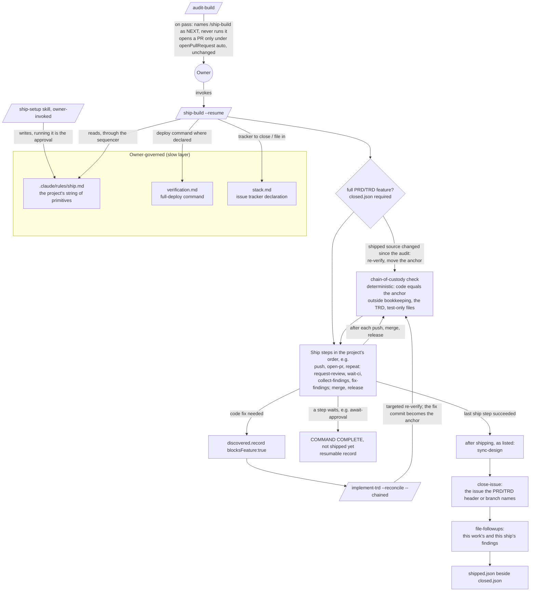
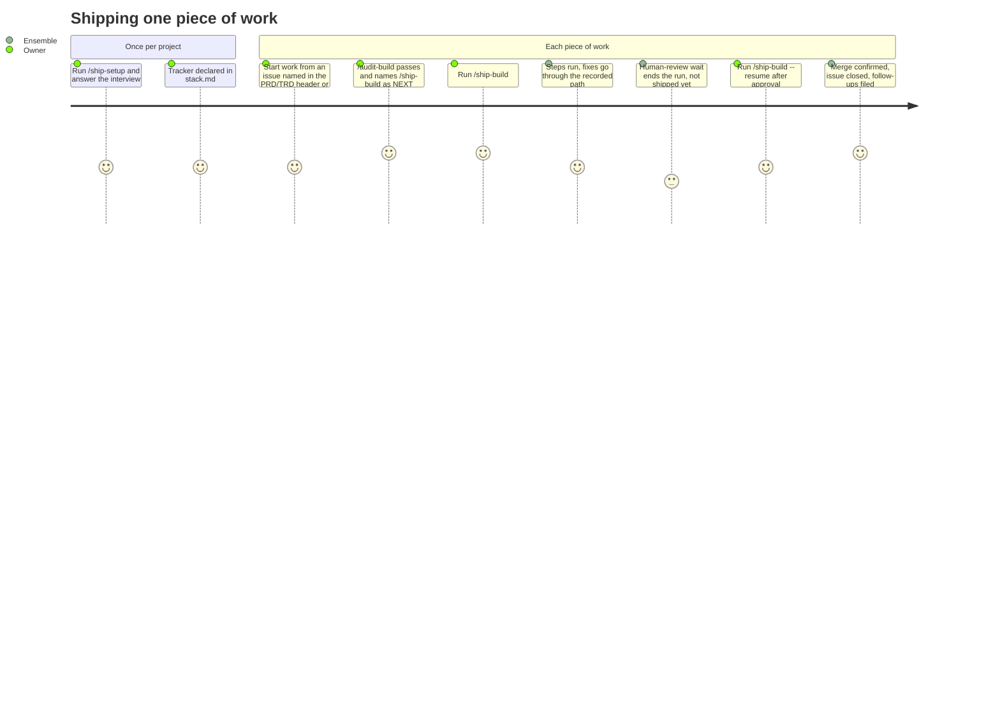

# PRD: /ship-build and ship.md — the project defines "shipped", Ensemble delivers each piece of work there

**Version**: 2.2.1
**Status**: Draft
**Created**: 2026-10-31
**Last Updated**: 2026-11-07
**Author**: @product-manager
**Stakeholders**: Project owner (James Simmons)
**Source**: GitHub issue #53, whose body matches `docs/plan/ship-build.brief.md` §1–§9, plus the
brief's §10: the owner's rulings during `/refine-prd` on 2026-10-31, 2026-11-01 and 2026-11-02,
ending with the 2026-11-02 simplification ("Take all of A-D") and the follow-on rulings after the
first TRD ("Take: F G I"). None of §10 is in the issue body. Owner ruling J (2026-11-06) and the
post-merge design-sync scope relayed with it (2026-11-05) are recorded in TRD 2.0.0
(`docs/TRD/ship-build.md`, objectives J-1 to J-7 and the "Ruling J" column), not in the brief; the
product PM's `/refine-prd` instruction of 2026-11-07 settles two points of them on the owner's
behalf, pending the owner's review (§8).
On refinement the source is the brief including §10, plus ruling J as TRD 2.0.0 records it.

---

## Changelog

| Version | Date | Changes | Author |
|---------|------|---------|--------|
| 1.0.0 | 2026-10-31 | Initial PRD from GitHub #53 / `docs/plan/ship-build.brief.md` | @product-manager |
| 1.1.0 | 2026-10-31 | First-round owner rulings OQ-A to OQ-P (no `ship.md` → commit and push, no PR; `/ship-setup` a skill; only `/ship-build` opens PRs; `/rebase-project` migrates `openPullRequest: auto`; default round cap 2 with critical-only in the final round; `ship.md` authorizes production deploys; a WAITING banner; release stages P0, platform stages P1; issue search when none recorded; audit gate for full features only; `ship.md` in `.claude/rules/`; tracker in `stack.md`), defaults OQ-G, OQ-Q, OQ-R, and the new merged-to-target check (F14). Features renumbered | @product-manager |
| 1.1.1 | 2026-10-31 | `/audit-prd`: attributions corrected (derived vs owner-ruled), citations fixed, Could Not Verify rewritten | @product-manager |
| 1.2.0 | 2026-10-31 | Second-round rulings: critical-only applies in the final round under any cap (OQ-S part 2); F14 redesigned as the chain-of-custody check, superseding the 1.1.1 ancestry-check design; derived requirements confirmed (full commit ids, `/close-feature` passes the audit gate, deploy command in `ship.md`, close only on one clear match). OQ-U and OQ-V raised | @product-manager |
| 1.3.0 | 2026-11-01 | Third-round rulings: OQ-U (anchor stays the audited commit; the TRD and test-only files are ignored; shipped-source changes are re-verified, then move the anchor); OQ-V (owned-files rule for release commits; identity links for publish, store and OTA); fixing in both `ci-green` and `external-review` confirmed | @product-manager |
| 1.3.1 | 2026-11-01 | `/audit-prd`: AC-F3.1's resolution order shown to be new; no Azure DevOps work-item skill; `implement-trd.md` must admit `/ship-build` as a `--chained` caller and also reads `openPullRequest`; no record of unfixed review findings exists (OQ-W); non-production deploy permissions raised (OQ-X); R12 re-measured | @product-manager |
| 1.4.0 | 2026-11-02 | Fourth-round rulings: OQ-X (a `ship.md` `deploy` authorizes any environment); OQ-W (`/implement-trd` records unfixed review findings, AC-F9.7); an ambiguous short anchor id fails; the constitution patterns 7 and 8 draft kept; OQ-Y (record every unfixed finding, file above the bar, list the rest). Rows 1.0.0–1.4.0 are condensed in 2.0.0; their full text is in PRD 1.4.0 (commit `379b6e4`) | @product-manager |
| 2.0.0 | 2026-11-02 | **Simplified to the owner's three problems** (owner, 2026-11-02, also in the brief §10): orchestrate a project-configurable ship process; log the issues found and not fixed; ship the code that was verified. **Reversals — rulings A–D ("Take all of A-D"):** **A**, no release or platform stages: removed F13 release stages (AC-F13.1–F13.4), F15 platform stages (AC-F15.1–F15.3), F16 `verify-deployed` (AC-F16.1–F16.4), the owned-files rule (AC-F1.8, AC-F14.11), the publish/store/OTA identity links (AC-F14.12), goals G7 and G9, risk R13; they become example `run <command>` lines in the template (AC-F1.1); reverses OQ-J and OQ-V. **B**, no WAITING banner: a run stopped at `await-human-review` ends `COMMAND COMPLETE` and says the work is not shipped yet (AC-F3.5, AC-F6.1); removed AC-F6.4, AC-F6.5, AC-F12.4 (`command-status.md` banner), AC-F12.6 (`discipline-stop` prompt), AC-F12.8 (constitution patterns 7 and 8), risks R7 and R10; reverses OQ-H and the "Keep the draft" ruling. **C**, close the source issue only when one was recorded: removed the search (AC-F7.5), its one-clear-match safeguard (AC-F7.6) and risk R6; reverses OQ-K. **D**, no re-audit while shipping: removed the narrow re-audit (AC-F5.5); a fix is re-verified only. **Merged, no behaviour change:** goals 9 → 3, one per problem (old G2 into AC-F3.3, G3 into AC-F5.1 and AC-F5.4, G6 into AC-F11.2, G4 into AC-F7.1); non-goals 17 → 6 (NG2–NG8, NG11–NG13, NG16 and NG17 each restated a criterion; new NG18 records ruling A); the final-round rule AC-F5.8–F5.11 with AC-F3.9 → AC-F5.8; anchor moves AC-F14.7, AC-F14.10 and AC-F3.8 → AC-F14.7; custody links AC-F14.3–F14.5 → AC-F14.3; the short-id rule from AC-F14.8 → AC-F14.6; AC-F1.5 and AC-F1.7 → AC-F1.4; AC-F2.3 and AC-F2.6 → AC-F2.1; AC-F3.4 → AC-F3.3; AC-F4.5 → AC-F4.4 and AC-F4.6; AC-F7.4 → AC-F7.1; AC-F9.4 → AC-F9.3; AC-F12.5 → AC-F12.2. **Removed as duplicates:** AC-F6.3 (of AC-F7.1), AC-F7.3 and AC-F9.6 (of AC-F1.3). **Moved to the TRD:** AC-F2.4, AC-F2.5 and AC-F12.7 (registration conventions) and AC-F5.6 (one fix round per CI run or review pass; §8). **Dropped:** AC-F5.12 (`async-discipline.md` already requires a bounded wait; NFR-2). **Reworded:** AC-F3.1 resolves the current work the way `/implement-trd` does. Provenance moved out of criteria into §8; Open Questions emptied (all answered); R12 condensed. 102 → 55 criteria. F-numbers kept; removed features and criteria are marked in place. | @product-manager |
| 2.1.0 | 2026-11-02 | **Rulings F, G, I** (owner, "Take: F G I", after judging the first TRD's 18 tasks over-engineered; E and H declined). **F**, `ensemble.openPullRequest` left in place: `/audit-build`, `/close-feature`, `/implement-trd` and `pull-request.js` keep reading it, `/rebase-project` migrates nothing; removed AC-F11.2–F11.5 and risk R1; AC-F11.1 keeps only "names `/ship-build`, never runs it"; `open-pr` reuses a PR already open for the branch (AC-F4.3); AC-F1.6, AC-F3.6, AC-F4.4 and AC-F12.2 (the PR exception stays) reworded; new NG19, R14. **G**, close only an issue the work already names: removed F8 (AC-F8.1); AC-F7.2 reads the reference from the PRD/TRD header or the branch name; new NG20. **I**, deterministic code only where a wrong answer is costly: no criterion mandated code for sequencing, run state or triage; the verification method of AC-F3.2, AC-F3.3 and AC-F5.8 now names the run record instead of a unit test. 55 → 50 criteria | @product-manager |
| 2.2.0 | 2026-11-07 | **Ruling J** (owner, 2026-11-06, recorded in TRD 2.0.0): a project strings **shipping primitives** — single actions, each with a defined input, result and waiting state — together in its own `ship.md`, and a small deterministic **sequencer** runs the string. **Replaced:** AC-F4.1 (the stage vocabulary becomes the primitive set; `ci-green` and `external-review` become strings of primitives inside a bounded `repeat`, `await-human-review` becomes `await-approval`, `deploy` becomes `release`). **Changed, the 11 criteria TRD 2.0.0 marks:** AC-F1.2 (steps in two parts, ship and after shipping, with a bounded repeat), AC-F1.3 (`close-issue` and `file-followups` are after-shipping steps; leaving one out switches it off), AC-F1.4 (no fixing stages: round count on `repeat`, bar on `collect-findings`, below-bar filing on `file-followups`), AC-F2.1 (`/ship-setup` offers the common string as its default answer), AC-F3.2 (the sequencer, code, hands out steps in order; verification is now a unit test, as ruling J supersedes ruling I for sequencing), AC-F4.2 (the five examples re-expressed; a release runs end to end once its identity command reports the released commit), AC-F4.4 and AC-F4.6 (`deploy` is `release`; every outward primitive runs only because it is listed), AC-F5.8 (a below-critical finding is recorded at once and filed by `file-followups`), AC-F6.1 (any step that waits ends the run resumably), AC-F14.7 (anchor moves recorded by the custody check alone). **Renamed only, no behaviour change:** "stage" → "step" and the old stage names in AC-F3.3, F3.7, F4.3, F5.1, F5.7, F6.2, F7.1, F12.2, F14.1, F14.3, F14.8, F17.1, the summary tables, risks R2, R4 and R11, the glossary and §1. **Added:** F18 (objectives J-1 to J-6: the primitives, their contracts, the owner-written string, the generic repeat, the default string, simplicity) and F19 (J-7: `/sync-design` after a design's feature merges); §8 rows for ruling J and the two points below. **Settled by the product PM on the owner's behalf, 2026-11-07, pending the owner's review:** (a) the default template ships with no active ship step; the common string is its first example, labelled as the default, so AC-F2.2 and AC-F3.6 keep holding — now stated in AC-F1.1, AC-F2.2 and AC-F3.6; (b) a ship files only the follow-ups of the work it ships and those it found itself; rows already in the shared sweep ledger are left alone (AC-F9.1), reversing TRD 2.0.0's OQ-15 call, which would have filed 23 old rows as issues on the first sweep ship. 50 → 57 criteria | @product-manager |
| 2.2.1 | 2026-11-07 | Attribution corrected (`/audit-trd`): the 2026-11-07 settlement of TRD 2.0.0's OQ-15 (old sweep-ledger rows are not filed) and OQ-22 (the default template ships with no active step) was a decision the product PM took on the owner's behalf, to be reviewed by the owner — not an owner confirmation. §8 rows, the Source note, the ruling summary, Open Questions and the attribution notes on AC-F1.1 and AC-F9.1 now say so. No criterion's requirement changed | @product-manager |

---

## 1. Product Summary

### 1.1 Problem Statement

The Ensemble pipeline ends at `/audit-build`. A passing audit closes the feature and, when the
project sets `ensemble.openPullRequest: auto`, opens a pull request (`.claude/commands/audit-build.md`,
"Open the pull request"). Everything after that is manual, and the same project does it the same
way every time: wait for CI, fix what fails, answer the reviewer, merge, deploy, close the issue,
file the leftovers. The brief's example: in the 2026-10-30 session that fixed #49, after
`COMMAND COMPLETE: /audit-build` the owner typed "Merge it"; the agent checked CI by hand, merged
by hand, and listed four unfiled leftovers in prose nobody will act on (reported by the brief; see
Could Not Verify). Findings seen and not fixed are, in the brief's words, "records nobody reads
after the readout".

The owner's request, verbatim:

> I think we need a /ship-build command, which uses a ship.md file (similar to how we have
> verification.md, along with a command to configure it), for shipping work when done.
>
> Depending on the project that might end at:
> - PR to develop, iterating until CI passes, and merging
> - merging to main and deploying to prod
> - PR, external review with code rabbit, fix all non-trivial issues, merge when green, deploy
> - etc.
> - submit PR, wait for human review
> - commit and push
>
> Essentially the project defines what "shipped" means for that project, but then there's an
> ensemble command that ensures each item ships (note that shipping should also close the issue)
>
> Related to that, closing the issue by default should take any issues found during verification
> but not fixed (out of scope) and ensure issues are created for them, wherever the project
> tracks issues

On 2026-10-31:

> This command should also verify that the code verified and audited is merged to the target
> branch (assuming ship.md specifies a target branch). This should be a deterministic check.

And on 2026-11-02, setting the scope of this version:

> I believe we've designed the right thing but have over designed it. It's supposed to solve a
> few simple problems: 1. Orchestrate a project-configurable ship process, which may be as simple
> as raising a PR or as complex as monitoring CI, fixing issues, re-verifying, merging, and
> deploying 2. Ensure issues identified but not fixed are logged 3. Ensure the code verified is
> the code shipped.

Everything in this PRD serves one of those three problems.

### 1.2 Proposed Solution

Three pieces, copying the pattern `verification.md` set: a project-specific, owner-governed
policy file, filled in by an interview, that commands read rather than guess.

1. **`ship.md`** (F1, F18) — the project's own string of shipping primitives: the ordered steps
   that must succeed before its work counts as delivered, then the steps that follow delivery.
   "Shipped" means the last ship step succeeded. A small deterministic sequencer runs the string
   (owner ruling J).
2. **`/ship-setup`** (F2) — an owner-invoked interview that writes `ship.md`. Running it is the
   owner's approval of the outward-facing steps it records.
3. **`/ship-build [--resume]`** (F3–F7, F9, F14) — runs the current work's string; fixes what
   shipping finds through the recorded path implementation uses and re-verifies each fix; checks
   deterministically after each push, merge and deploy that the code there is the code verified;
   closes the issue the work already names; files every finding seen and not fixed; writes `shipped.json`.

How the three problems map: the configurable process is F1–F7, F11, F12, F17 and F18; logging
unfixed issues is F9 and F10; shipping the verified code is F14, with F5's re-verification of
every fix. F19 keeps a design's boards in step with the merged code.

### 1.3 Value Proposition

- The owner states once, per project, what "shipped" means; each piece of work gets there by one
  command instead of a hand-run sequence of CI checks, merges and deploys.
- Leftover findings become tracker issues instead of readout prose.
- The code pushed, merged and deployed is provably the code that was verified, or re-verified since.

### 1.4 Key Differentiators

- `ship.md` is the owner's **standing authorization** for the outward-facing acts it lists. Today
  `autonomy.md` says a command's authorization "does not reach an outward-facing or irreversible
  act that merely follows from its work — a merge, a deploy, a release", with one exception,
  `openPullRequest: auto`. The capability works only because `ship.md` becomes that authorization
  (F12), beside that exception, which stays (ruling F).
- The chain-of-custody check is deterministic code, not a model judgement (F14), and so is the
  sequencer that runs the string (J-3).

### 1.5 Solution Architecture

---

## 2. User Analysis

### 2.1 Target Users

| User Type | Description | Primary Need |
|-----------|-------------|--------------|
| Project owner | The engineer who runs Ensemble on a project and decides what "shipped" means for it | Say once what delivery means; have each piece of work delivered there without hand-running CI, merge, deploy, issue close and follow-up filing |
| Consuming project | Any project Ensemble is scaffolded into, each with a different definition of shipped (the owner's five examples, plus "etc.") | A policy file that can express its own sequence, from "commit and push" to "PR, external review, merge, deploy" |

### 2.2 User Personas

**Persona: Project owner**
- **Role**: Engineer and sole decision-maker for a project using Ensemble
- **Goals**: Finish a feature, `/plan` or `/sweep`, and get it delivered by the project's own definition with one command
- **Pain Points**: After `/audit-build` the rest is manual — checking CI, merging, deploying, closing the issue — and unfixed findings end as readout lines nobody files
- **Technical Proficiency**: High

### 2.3 User Journey

---

## 3. Goals and Non-Goals

### 3.1 Goals

One goal per problem the owner named on 2026-11-02.

| ID | Goal | Success Metric | Priority |
|----|------|----------------|----------|
| G1 | The project configures its own ship process, from raising a PR to monitoring CI, fixing, re-verifying, merging and deploying, and one command runs it | Each of the owner's five examples and the default string (F4 table) is a valid `ship.md` that runs end to end (AC-F4.2); after a passing `/audit-build`, no step `ship.md` lists has to be run by hand (AC-F3.3) | P0 |
| G2 | Issues identified but not fixed are logged | Every finding seen and not fixed is filed once in the declared tracker, or named in the readout where it was not filed (F9) | P0 |
| G3 | The code verified is the code shipped | At each push, merge and deploy a deterministic check finds the code byte-identical to the anchor, and any change made while shipping is re-verified before it moves the anchor (F14) | P0 |

No numeric success metric is given: the source states none.

### 3.2 Non-Goals (Explicit Scope Exclusions)

| ID | Non-Goal | Rationale |
|----|----------|-----------|
| NG1 | `/ship-build` does **not** chain after `/audit-build`, and `/audit-build` never runs it | Owner decision OQ-2: shipping is a distinct decision. A passing audit only names `/ship-build` in NEXT |
| NG9 | No relationship to, or dependency on, Forge's `ship-workplan`; it is not replaced. Ensemble never assumes Forge exists | Owner decision OQ-8 |
| NG10 | The issue tracker is **not** declared in `ship.md` | Owner decisions OQ-6 and OQ-P: other commands file issues too, so it belongs in `stack.md`. Overrides the brief §2 line "`ship.md` names which one" |
| NG14 | No functional verification of a deployed build. The deploy link (AC-F14.3) checks only which commit is running | Owner ruling OQ-I: "simply verify that the code is live" |
| NG15 | `/sweep` does not start committing | Owner ruling OQ-O: `push` commits a sweep's changes (AC-F4.7) |
| NG18 | No named release or platform stages (`version-bump`, `changelog`, `tag`, `publish`, `mobile-build`, `store-submit`, `ota-update`) and no `verify-deployed` stage. A project expresses these as `run <command>` stages; the template carries examples (AC-F1.1) | Owner ruling A, 2026-11-02 |
| NG19 | `ensemble.openPullRequest` is not retired or migrated in this version. `/audit-build`, `/close-feature`, `/implement-trd`'s NEXT wording and `pull-request.js` keep reading it; `/rebase-project` writes no `ship.md` from it. `/ship-build` becomes the recommended way to ship; retiring the setting is a later, separate small change | Owner ruling F, 2026-11-02 |
| NG20 | No command is taught to record a source issue (`/sweep`, `/plan` and `/create-prd` are unchanged for this), and `/sweep` does not change where it stores run state. `close-issue` reads only what the current work already names (AC-F7.2) | Owner ruling G, 2026-11-02 |

Removed in 2.0.0, each restating a criterion: NG2 (AC-F5.1), NG3 (AC-F5.4), NG4 (AC-F5.7), NG5 and
NG6 (AC-F5.2, F5.3), NG7 (AC-F6.1), NG8 (AC-F5.8), NG11 (AC-F3.6), NG12 (AC-F12.3; F10's approval
dependency), NG13 (AC-F9.2), NG16 (AC-F14.8, F14.9), NG17 (AC-F11.3, itself removed in 2.1.0;
NG19).

---

## 4. Feature Requirements

F-numbers are kept from 1.4.0 so that references do not shift; removed features and criteria are
marked in place.

### 4.1 P0 - Core Features (Must Have)

#### F1: `ship.md` policy file and template
**Priority**: P0
**Description**: An owner-governed policy file at `.claude/rules/ship.md`, beside `verification.md`
(owner ruling OQ-N, accepting that files in `.claude/rules/` are loaded into every session): the
project's string of shipping primitives (F18), each step with its parameters. "Shipped" means the
last ship step succeeded.

**User Stories**:
- As the project owner, I want to write down, once, what "shipped" means for this project so that every command reads it rather than guesses.

**Acceptance Criteria**:
- [ ] AC-F1.1: A `ship.md` template exists in `packages/core/templates/claude-directory/rules/` and is scaffolded into a project's `.claude/rules/ship.md` by the mechanism that scaffolds `verification.md`. The template carries example `run <command>` lines for release and platform steps — version bump, changelog, tag, publish, mobile build, store submission, OTA update — and for checking which build a deployed environment runs. **The template ships with no active ship step.** Its first worked example, labelled as the default `/ship-setup` offers, is the common string (J-5): push, open a PR, then repeat — request an outside AI review, wait for CI, collect findings, fix them — until clean, merge, release; after shipping, sync the design, close the issue, file the follow-ups. The owner's five examples (F4 table) and the `run` examples follow it. Nothing under `## Examples` is ever run. A scaffolded, unedited `ship.md` therefore lists no step, which is what keeps AC-F2.2 and AC-F3.6 true in a project whose owner never ran `/ship-setup` (product PM on the owner's behalf, 2026-11-07, pending the owner's review).
- [ ] AC-F1.2: `ship.md` expresses an ordered string of steps, each a primitive name plus parameters, in two parts: the ship steps, and the steps run after shipping. A bounded `repeat` block (J-4) groups steps that run again until a stated result or a round count is reached.
- [ ] AC-F1.3: `close-issue` and `file-followups` are after-shipping steps. "On by default" means the default string and `/ship-setup`'s default answer include both; leaving one out switches it off. Neither can be placed among the ship steps, so neither can run before the work shipped.
- [ ] AC-F1.4: There are no fixing stages. Iteration is a `repeat` block with a round count (default **2** where none is written); the severity bar is a parameter of the step that collects findings; whether below-bar review findings are filed is a parameter of `file-followups`; what happens after the last round is AC-F5.8.
- [ ] AC-F1.6: The file states that it is owner-governed and changes only through `/ship-setup`. (2.1.0: the exception for a `/rebase-project` migration went with AC-F11.4, ruling F.)

Removed in 2.0.0: AC-F1.5 and AC-F1.7 (merged into AC-F1.4); AC-F1.8 (owned files, ruling A).

**Dependencies**: F12 (governance amendment placing `ship.md` in the owner-governed layer).

#### F2: `/ship-setup` interview skill
**Priority**: P0
**Description**: An interview that writes `ship.md`. It is a skill like `/verification-setup`
(`packages/skills/verification-setup/SKILL.md`): owner-invoked only, interactive by purpose; the
owner types `/ship-setup` (owner ruling OQ-B).

**User Stories**:
- As the project owner, I want to be interviewed for my project's shipping string so that I do not hand-write the file, and so that running the interview is my approval of the outward-facing steps it records.

**Acceptance Criteria**:
- [ ] AC-F2.1: Invoking `/ship-setup` interviews the owner and writes `.claude/rules/ship.md`. It offers the default string (J-5) as its default answer, so accepting it is one answer. For each `repeat` block it offers a round count of **2**, and for each step that collects findings the significance bar (AC-F5.7), both changeable. For a `release` whose environment has no full-deploy command in `verification.md` §2, it records the release command in `ship.md` (AC-F4.6).
- [ ] AC-F2.2: Running `/ship-setup` is the owner's approval of the outward-facing steps it records; `/ship-build` asks for no further confirmation before running them. Until the owner runs it, `ship.md` lists no step (AC-F1.1), so `/ship-build` opens no PR, merges nothing and releases nothing in that project; it only pushes (AC-F3.6).

Removed in 2.0.0: AC-F2.3 and AC-F2.6 (merged into AC-F2.1); AC-F2.4 and AC-F2.5 (readout and
skill registration: framework conventions, moved to the TRD).

**Dependencies**: F1, F12.

#### F3: `/ship-build` run
**Priority**: P0
**Description**: Runs the current work's `ship.md` string in order, through the sequencer (F18), and records the outcome.

**User Stories**:
- As the project owner, I want one command that ships whatever Ensemble is currently working on so that I do not hand-run each step.

**Acceptance Criteria**:
- [ ] AC-F3.1: `/ship-build` ships whatever Ensemble is currently working on — the PRD/TRD feature, the `/plan` or the `/sweep` in flight — and resolves it the way `/implement-trd` resolves the current work.
- [ ] AC-F3.2: The sequencer (J-3), deterministic code, hands out the steps in the order `ship.md` lists them; a step starts only after the previous one recorded success. A step that waits ends the run resumably (AC-F6.1); a step that stops ends it `COMMAND STUCK`; a `repeat` block runs as J-4 defines.
- [ ] AC-F3.3: The work counts as shipped only when the last ship step succeeded, and no step `ship.md` lists needs to be run by hand. Then the after-shipping steps it lists run, `close-issue` and `file-followups` among them by default, and `/ship-build` writes its shipped record, `shipped.json`, in `.trd-state/<feature>/` beside `closed.json`. "Closed" (verified) and "shipped" (delivered) stay distinct: a feature can be closed and not yet shipped.
- [ ] AC-F3.5: A run ends with the standard four-section readout and a `COMMAND COMPLETE` or `COMMAND STUCK` banner as its last line. `COMMAND COMPLETE` means the run did its job, not that the work shipped; the shipped record says whether it shipped.
- [ ] AC-F3.6: A project with no `ship.md`, or whose `ship.md` lists no ship step (the template as scaffolded, AC-F1.1): `/ship-build` commits and pushes, opens no PR, and the readout points to `/ship-setup`. It says the branch is ready for a PR, or, where a PR is already open for the branch (as `/audit-build` opens one under `openPullRequest: auto`), names that PR instead.
- [ ] AC-F3.7: **Audit gate.** A full PRD → TRD feature ships only when its `.trd-state/<feature>/closed.json` exists, written by a passing `/audit-build` or by the owner's `/close-feature` override (whose `"audit": null` satisfies the gate). Work from a `/plan` TRD and `/sweep` work ships without one. A full feature without `closed.json` stops before the first step and the readout names `/audit-build` or `/close-feature` as NEXT.

Removed in 2.0.0: AC-F3.4 (merged into AC-F3.3); AC-F3.8 (merged into AC-F14.7); AC-F3.9 (merged
into AC-F5.8).

**Dependencies**: F1, F4.

#### F4: Core primitive set
**Priority**: P0
**Description**: The primitives the owner's own examples need (J-1), plus `run <command>` for
everything else. Each of the owner's examples maps to a string (brief §3, parameters as the brief
sketched them, re-expressed in primitives under ruling J; they are examples, not defaults — the
default round count is 2, AC-F1.4). The default string (J-5) is listed first; it is the
template's first example, not an active policy (AC-F1.1):

| Example | String |
|---|---|
| Default (J-5) | `push` → `open-pr` → `repeat until=clean { push, request-review tool=coderabbit, wait-ci, collect-findings, fix-findings }` → `merge` → `release env=production identity=…`; after shipping: `sync-design`, `close-issue`, `file-followups` |
| commit and push | `push` |
| submit PR, wait for human review | `push` → `open-pr base=main` → `await-approval` |
| PR to develop, iterate until CI passes, merge | `push` → `open-pr base=develop` → `repeat rounds=3 { push, wait-ci, collect-findings, fix-findings }` → `merge method=merge` |
| merge to main and deploy to prod | `push` → `open-pr base=main` → `repeat { push, wait-ci, collect-findings, fix-findings }` → `merge` → `release env=production identity=…` |
| PR, CodeRabbit review, fix non-trivial, merge when green, deploy | `push` → `open-pr` → `repeat { push, request-review tool=coderabbit, wait-ci, collect-findings, fix-findings }` → `merge` → `release identity=…` |

`identity=…` is the command that prints the commit a release is running; the deploy link
(AC-F14.3) needs it. The exact syntax of a string is the TRD's to set.

**User Stories**:
- As the project owner, I want each of my real shipping sequences to be expressible as a string of the same primitives so that one command covers every project I run.

**Acceptance Criteria**:
- [ ] AC-F4.1: The primitive set is the owner's eight (J-1) — `open-pr`, `wait-ci`, `request-review`, `await-approval`, `collect-findings`, `fix-findings`, `merge`, `release` — plus `push`, `run <command>`, `close-issue` and `file-followups`, kept from the stage vocabulary, and `sync-design` (F19). The old stages map onto them: `ci-green` is `wait-ci`, `collect-findings` and `fix-findings` inside a `repeat`; `external-review` is the same with `request-review`; `await-human-review` is `await-approval`; `deploy` is `release`.
- [ ] AC-F4.2: Each of the six strings in the table above — the default and the owner's five — is valid `ship.md` content and runs end to end; a string with a `release` does so once its identity command reports the released commit (AC-F14.3).
- [ ] AC-F4.3: `open-pr` opens a PR against the base `ship.md` names, whatever `openPullRequest` is set to: the listing is its authorization. Where a PR is already open for the branch — as `/audit-build` or `/close-feature` opens one under `openPullRequest: auto` — the step reuses it and opens no second one. `/audit-build`'s and `/close-feature`'s PR opening is unchanged (ruling F). Today `pull-request.js ensure` already reuses an open PR, but opens one only under `auto` and only against the default branch; how `open-pr` builds on it is the TRD's to set.
- [ ] AC-F4.4: `merge`, `release`, `run` and every other outward-facing primitive run only because `ship.md` lists them, and the listing is their authorization. A project whose `ship.md` lists no `merge` is never merged by `/ship-build`: the policy file, not `pull-request.js`, decides whether `/ship-build` merges; `pull-request.js` itself still never merges (R3). A `release` step authorizes a deploy to any environment, production included; `verification.md` §1's "Loop may DEPLOY to it?" column governs only the verification loop and does not block it.
- [ ] AC-F4.6: Where `verification.md` §2 declares a full-deploy command for the environment, `release` reuses it; otherwise it uses the command `ship.md` records (AC-F2.1); with neither, the step stops and reports, never guesses.
- [ ] AC-F4.7: `push` commits a `/sweep`'s uncommitted changes by pathspec before pushing; `/sweep` itself stays never-commit.

Removed in 2.0.0: AC-F4.5 (merged into AC-F4.4 and AC-F4.6).

**Dependencies**: F1, F18, F12 (the authorization for `merge`, `release` and `run`).

#### F5: Fixing while shipping
**Priority**: P0
**Description**: Shipping finds problems the build did not (CI failures, reviewer findings, a
failed deploy). Each fix must be as safe as one made during implementation, and is re-verified for
what it could have changed, never re-audited (owner decision OQ-3, brief §7; ruling D).

**User Stories**:
- As the project owner, I want CI failures and significant review findings fixed through the same recorded path as implementation so that shipping never lands an unreviewed, ungrounded change.
- As the project owner, I want a fix loop to stop iterating after its last round and ship unless something critical is still open, so that a reviewer's endless minor comments cannot hold a feature back.

**Acceptance Criteria**:
- [ ] AC-F5.1: A code fix is recorded as a discovery (`discovered.record` with `blocksFeature: true`) and built by `/implement-trd --reconcile --chained`, so every code fix appears as a discovery row and a TRD row with a commit. `/ship-build` never edits code itself. Fixing happens in `fix-findings`, wherever a string places it, for CI failures and review findings alike. `.claude/commands/implement-trd.md` and its `packages/core/commands/` copy, which today name only `/verify-build` and `/audit-build` as `--chained` callers, admit `/ship-build`.
- [ ] AC-F5.2: Triage before fixing:

  | Failure | Action | Re-verify |
  |---|---|---|
  | Flaky test or infrastructure (re-run passes) | Re-run CI **once**; no code change | none |
  | Lint or format | The project's formatter/linter is run and its output committed — not a model edit; anything needing a hand edit goes through the recorded path | none |
  | Test or build failure in this feature's code | Fix via the recorded path | affected criteria only |
  | Failure in code this feature did not touch | Stop and report; file as a follow-up | — |
  | Review finding at or above the bar | Fix via the recorded path | affected criteria only |
  | Review finding below the bar | Not fixed; filed only if `ship.md` opts in | — |
  | Deploy failure | Stop and report; never auto-fix | — |
- [ ] AC-F5.3: When it is unclear whether a failure belongs to this feature, a judge decides. Failures it rules out of scope are reported and filed as follow-ups, never fixed here.
- [ ] AC-F5.4: After a fix, only criteria whose covered files changed are re-verified; every other proven criterion stays proven, and the widest re-check is the must-pass criteria whose own covered files the fix changed. (Evidence already stores a sha256 of each covered file, in `packages/core/lib/live-evidence.js`.) A fix is never re-audited.
- [ ] AC-F5.7: The default severity bar is significance: correctness, security, data loss, a broken contract. Where the reviewer labels severity, its labels are used; otherwise a judge decides against the bar. The bar is a `ship.md` parameter of `collect-findings`.
- [ ] AC-F5.8: **Round count and the final round.** A `repeat` block runs at most its `ship.md` round count (**2** by default). In the final round — the last its count allows — `collect-findings` sorts the findings still open. A critical one stops the run (`COMMAND STUCK`), says what is still failing and leaves the PR as it is. Every below-critical one is recorded at once as a follow-up (F9) and the block ends clean. `file-followups` files it, so the readout lists it with its issue in a run that reaches `file-followups`, and otherwise as recorded, not yet filed (AC-F9.5). A finding is critical by the reviewer's own severity label where it gives one, and by the AC-F5.7 judge otherwise, CI failures included.

Removed in 2.0.0: AC-F5.5 (narrow re-audit, ruling D); AC-F5.6 (one fix round per CI run or review
pass: moved to the TRD, §8); AC-F5.9–F5.11 (merged into AC-F5.8); AC-F5.12 (bounded CI wait:
`async-discipline.md` already requires it, NFR-2).

**Dependencies**: F3, F4, F9, F18; existing `discovered.js`, `/implement-trd --reconcile --chained`,
`live-evidence.js`.

#### F6: Long waits end the run, resumably
**Priority**: P0
**Description**: A human-review wait can take hours; the run stops there rather than hold a turn
(owner decision OQ-4). Under ruling J the same holds for any step whose wait outlasts a bounded
primitive (J-2).

**User Stories**:
- As the project owner, I want `/ship-build` to stop and say so at a human-review wait, then continue later, so that no session sits holding a turn for hours.

**Acceptance Criteria**:
- [ ] AC-F6.1: `await-approval`, and any other step that returns a wait, ends the run with a resumable record of which steps succeeded and which remain. The run ends `COMMAND COMPLETE`; its readout says the work is not shipped yet and names `/ship-build --resume` in NEXT.
- [ ] AC-F6.2: `/ship-build --resume` runs the remaining steps from that record.

Removed in 2.0.0: AC-F6.3 (duplicate of AC-F7.1); AC-F6.4 and AC-F6.5 (WAITING banner, ruling B).

**Dependencies**: F3.

#### F7: Close the source issue
**Priority**: P0
**Description**: Shipping closes the issue the work came from (owner's request; brief §4), and
only one the current work already names (rulings C and G).

**Acceptance Criteria**:
- [ ] AC-F7.1: `close-issue` runs only after the last ship step succeeded — never when the PR opens and never at a wait, since a PR still waiting for human review has not shipped — and closes the issue in the tracker `stack.md` declares (F10).
- [ ] AC-F7.2: `close-issue` closes the issue the current work already names: an issue reference in its PRD or TRD header (`/create-prd` records an issue key on the PRD's `**Source**:` line today) or in its branch name (`process.md`'s `<issue-id>-<session>` pattern). With none found, it closes nothing and the readout says so.

Removed in 2.0.0: AC-F7.3 (duplicate of AC-F1.3); AC-F7.4 (merged into AC-F7.1); AC-F7.5 and AC-F7.6
(search for a matching issue and its one-clear-match safeguard, ruling C).

**Dependencies**: F10.

#### F8: Record the source issue when work starts — Removed in 2.1.0 (ruling G; NG20)

AC-F8.1 (`/plan`, `/create-prd` and `/sweep` record an issue reference as the work's source issue)
is removed; `close-issue` reads what the work already names (AC-F7.2).

#### F9: File the leftovers
**Priority**: P0
**Description**: By default, shipping files an issue for every finding that was seen and not
fixed, in the project's tracker (owner's request; brief §5). Unfixed review findings are recorded
nowhere today, so this feature also builds that record (AC-F9.7; owner ruling OQ-W).

**Acceptance Criteria**:
- [ ] AC-F9.1: Sources filed: non-blocking `discovered.jsonl` rows, `/audit-build`'s out-of-scope list, verification criteria left `not_verifiable`, the unfixed review findings in AC-F9.7's record, failures the ownership judge ruled were not this feature's (AC-F5.3), below-critical findings left after a `repeat` block's final round (AC-F5.8), and the `followups` in a `/task`'s `closed.json`. **From findings ledgers, a ship files only the rows of the work it ships and those this ship found; it leaves older ledger rows alone.** For `/sweep` work, whose shared ledger (`.trd-state/_sweep/discovered.jsonl`) cannot tell one sweep's rows from another's (NG20), that means only the findings this ship recorded: rows already in the shared ledger are neither filed nor marked (product PM on the owner's behalf, 2026-11-07, pending the owner's review). A `/task`'s follow-ups are still filed as OQ-L ruled.
- [ ] AC-F9.2: Review findings below the significance bar are not filed unless `ship.md` opts in (AC-F1.4). The bar applies unchanged to AC-F9.7's record.
- [ ] AC-F9.3: Each filed issue links back to the work it was found in. Each finding is filed at most once, keyed by a stable id, so a re-run does not duplicate.
- [ ] AC-F9.5: Any finding it cannot file (no tracker configured, a failed call) is listed in the readout, not dropped. The readout also names each below-bar review finding from AC-F9.7's record that it did not file, and the path of that record.
- [ ] AC-F9.7: **Record of unfixed review findings.** `/implement-trd`'s end-of-run review step (Step 7.2) writes **every** review finding it chose not to fix, whatever its severity, to a file under `.trd-state/<feature>/`, and `file-followups` reads that file. The change is made in `.claude/commands/implement-trd.md` and its `packages/core/commands/` copy. The file's name and format, and how the step obtains the findings of a review it does not wait for, are the TRD's to set.

Removed in 2.0.0: AC-F9.4 (merged into AC-F9.3); AC-F9.6 (duplicate of AC-F1.3).

**Dependencies**: F10; the change to `/implement-trd` Step 7.2 (AC-F9.7).

#### F10: Issue tracker declared in `stack.md`
**Priority**: P0
**Description**: The tracker is declared in project setup, not `ship.md`, because other commands
file issues too (owner decisions OQ-6, OQ-P). Tracker skills that exist today:
`packages/skills/managing-linear-issues` and `managing-jira-issues`; GitHub is reached through `gh`.
No Azure DevOps work-item skill exists — `managing-azure-devops` is pipelines-only by its own
`when_to_use` — so an Azure DevOps project falls under AC-F10.3 until one is built.

**Acceptance Criteria**:
- [ ] AC-F10.1: The `stack.md` template has a place to declare the project's issue tracker.
- [ ] AC-F10.2: `/ship-build`'s `close-issue` and `file-followups` use the tracker that declaration names.
- [ ] AC-F10.3: With no tracker declared, nothing is filed or closed and the readout lists what could not be (consistent with AC-F9.5).

**Dependencies**: owner approval of the `stack.md` change in this repository (`constitution.md` Governance Split).

#### F11: `/audit-build` names `/ship-build`; `ensemble.openPullRequest` left in place for now
**Priority**: P0
**Description**: A passing audit names `/ship-build` as the next step (owner decision OQ-2).
Retiring `ensemble.openPullRequest` and moving all PR opening to `/ship-build` (brief §2, §8; OQ-9,
OQ-C, OQ-D) is deferred to a later, separate change (owner ruling F, 2026-11-02; NG19). Until then
the setting is read as today: by `readMode()` in `packages/core/lib/pull-request.js`, by
`/audit-build` and `/close-feature` when they open a PR, and by `implement-trd.md` to word its NEXT;
this repository sets it to `auto` (`.claude/settings.json`) and `scaffold-project.sh` backfills
`never`. `/ship-build` coexists with it as AC-F3.6 and AC-F4.3 describe.

**Acceptance Criteria**:
- [ ] AC-F11.1: On a pass, `/audit-build` names `/ship-build` in NEXT and never runs it. Its PR opening under `openPullRequest: auto` is unchanged.

Removed in 2.1.0 — deferred, ruling F: AC-F11.2 (only `/ship-build` opens PRs; nothing reads the
setting, `implement-trd.md`'s NEXT wording and its `verify-command-surface.test.js` assertions
included); AC-F11.3 (`/close-feature` loses its PR-opening step); AC-F11.4 (`/rebase-project`
migrates `auto` to a `push` → `open-pr` `ship.md`); AC-F11.5 (the setting retired, no longer
backfilled).

**Dependencies**: none.

#### F12: Governance amendments
**Priority**: P0
**Description**: `merge`, `release` and the other outward-facing steps run only because `ship.md`
is the owner's standing authorization for them (§1.4). These amendments are owner-approved
changes the build drafts (brief §2, §9).

**Acceptance Criteria**:
- [ ] AC-F12.1: A drafted amendment to `constitution.md`'s Governance Split table adds `ship.md` to the owner-governed slow layer beside `verification.md`, with running `/ship-setup` as the confirmation.
- [ ] AC-F12.2: A drafted amendment to `autonomy.md` makes a `merge`, `release` (to any environment, production included), `run` or other outward-facing step listed in `ship.md` the owner's standing authorization for it, and names `/ship-setup` as interactive by purpose beside `/verification-setup`. The existing `openPullRequest: auto` exception stays as it is (ruling F).
- [ ] AC-F12.3: Neither `constitution.md` nor `autonomy.md` is changed until the owner approves.

Removed in 2.0.0: AC-F12.4, AC-F12.6 and AC-F12.8 (WAITING banner in `command-status.md`, the
`discipline-stop` judge prompt and `constitution.md` patterns 7 and 8; ruling B); AC-F12.5 (merged
into AC-F12.2); AC-F12.7 (`framework-skills.txt` registration, moved to the TRD).

**Dependencies**: owner approval of AC-F12.1 and AC-F12.2. Without it, F4's `merge`, `release`,
`run` and other outward steps have no authorization (R2).

#### F13: Release stages — Removed in 2.0.0 (ruling A; NG18)

#### F14: Chain of custody — the code verified is the code pushed, merged and deployed
**Priority**: P0
**Description**: The owner's third problem (§1.1), and the 2026-10-31 rulings: "This should be a
deterministic check", "confirming with certainty that the exact code version verified and audited
has been pushed, merged, deployed (or however far our process takes it)". One rule: at each custody link (push,
merge, deploy) the shipped code must be byte-identical to an anchor commit, and only a re-verified
change moves the anchor.

**User Stories**:
- As the project owner, I want certainty that the exact code that was verified is what was pushed, merged and deployed, so that no step can quietly ship different code.

**Acceptance Criteria**:
- [ ] AC-F14.1: **Anchor.** The anchor starts at the audited commit (`closed.json`'s `audit.auditedCommit`). With no audited commit — `/plan` and `/sweep` work, and `/close-feature`'s `"audit": null` — it is the commit `/ship-build`'s `push` step pushed. Only AC-F14.7 moves it.
- [ ] AC-F14.2: **Code equality.** The code at a link equals the anchor's when the two commits' trees differ in no file outside the ignored paths: `.trd-state/`, the audit report (`.trd-state/<feature>/audit-build-report.md`), the feature's TRD, and test-only files. Every other file is **shipped source**. A **test-only file** is a file the project's test framework treats as a test (in this repository, for example, Jest's `*.test.js`, pytest's `test_*.py`, BATS's `*.test.sh`); the exact pattern, including whether fixtures and test helpers count, is the TRD's to set.
- [ ] AC-F14.3: **Custody links.** *Push:* after each push `/ship-build` makes — including AC-F3.6's push with no `ship.md` — the remote branch head's code equals the anchor's. *Merge:* after `merge`, the commit GitHub records as the PR's merged head (e.g. `gh pr view --json headRefOid`) has code equal to the anchor's, and the PR merged into the target branch `ship.md` names; this holds for merge, squash and rebase merges alike. *Deploy:* after `release`, the deployed build reports a commit whose code equals the anchor's; a build that reports no identity, or a different one, fails the link.
- [ ] AC-F14.6: **Full commit ids.** `/audit-build` writes the full commit id in its report header's `Audited commit:` line (written today from `git rev-parse --short HEAD`, in `.claude/commands/audit-build.md` and its `packages/core/commands/` copy), so `closed.json` stores it in full. A short anchor id stored before this change that resolves to exactly one commit is used normally; an ambiguous one fails with that reason, never a guess.
- [ ] AC-F14.7: **What moves the anchor.** Any change to shipped source after the audited commit — a closing audit's chained fix made before shipping starts, a fix `/ship-build` makes (F5), or a commit made by a `run` step — is re-verified for the must-pass criteria whose covered files it changed (AC-F5.4), and its commit then becomes the anchor before the next custody link. Where no must-pass criterion's covered files changed, nothing is re-run and the anchor still moves; a formatter/linter tool run's commit needs no re-verification (AC-F5.2) and moves the anchor once committed; a criterion that fails its re-verification leaves the anchor where it was. A change only to ignored paths needs no move. Each move is recorded by the custody check alone (AC-F14.9), in a record no other part of `/ship-build` writes, and nothing else moves the anchor.
- [ ] AC-F14.8: **A mismatch fails loudly.** Any other difference at a custody link stops the run (`COMMAND STUCK`), naming the step and the files that differ; a PR that is unmerged, or merged into another branch, fails the merge link the same way, naming which. It is never auto-fixed.
- [ ] AC-F14.9: The check is deterministic code — a lib function with unit tests — not a model judgement. It lives outside `pull-request.js` (R3).

Removed in 2.0.0: AC-F14.4 and AC-F14.5 (merged into AC-F14.3); AC-F14.10 (merged into AC-F14.7);
AC-F14.11 (owned files) and AC-F14.12 (publish, store-submit and OTA links), ruling A.

**Dependencies**: F3 (the shipped record), F4 (`push`, `merge`, `release`), F5 (AC-F5.4's
re-verify rule).

#### F18: Shipping primitives and the sequencer (ruling J)
**Priority**: P0
**Description**: Owner ruling J (2026-11-06, recorded in TRD 2.0.0's objectives J-1 to J-6):
shipping is built from **primitives**, single shipping actions, which a project strings together
in its own `ship.md`; a small deterministic **sequencer** runs that string. It replaces the fixed
stage list, and the fixing stages with their own round counters, of PRD 2.1.0.

**User Stories**:
- As the project owner, I want to compose my project's ship process from a small set of well-defined actions, in whatever order it needs, so that a new process is a new string, not new code.

**Acceptance Criteria**:
- [ ] J-1: **The primitives.** The owner's shipping primitives are: open a PR; wait for CI; request an outside AI reviewer (CodeRabbit, Codex, or another Claude Code session); wait for human review or approval; collect findings; fix findings through Ensemble's own tools (`/plan`, `/implement-trd`); merge; release. Whether `push` and the post-merge design sync are primitives is the TRD's to decide and justify (TRD 2.0.0 makes both primitives); `run`, `close-issue` and `file-followups` stay (AC-F4.1).
- [ ] J-2: **Defined contracts.** Each primitive has a defined input, a defined result and a defined waiting state: what it waits on, and with which bounded primitive (`Monitor`, a parked, resumable end of run, …) per `async-discipline.md` (NFR-2).
- [ ] J-3: **The owner's string, run by code.** A project strings primitives together in its own `ship.md`, in whatever order it wants, and a deterministic sequencer runs that string.
- [ ] J-4: **Generic iteration.** "Iterate until fixed" is a generic sequencing construct, a bounded repeat, not special handling of one string.
- [ ] J-5: **The default string, not hardcoded.** The most common string — open a PR, queue an outside AI reviewer plus CI, review findings and iterate until fixed, merge, release — is the default `ship.md` template's worked example and `/ship-setup`'s default answer, not an active policy in every scaffolded project (AC-F1.1). It is not hardcoded: a string with a human approval step, or with no outside reviewer, runs on the same code.
- [ ] J-6: **Simple over clever.** A piece is either a primitive or the thing that sequences primitives, never both. Adding a primitive is one new unit with no change to the sequencer. The sequencer is small enough to read in one sitting. Anything that serves only one particular string is cut or made an option.

**Dependencies**: F1 (where the string is written), F3 (the run that drives the sequencer).

#### F19: Design sync after merge (J-7)
**Priority**: P0
**Description**: The owner's scope of 2026-11-05, relayed with ruling J: once a design's feature
has merged, its boards are brought in step with the merged code without anyone asking.

**Acceptance Criteria**:
- [ ] J-7: After a design's feature merges into the default branch (merged = the audited commit is an ancestor of the default branch), `/sync-design` runs automatically, with nothing asked, triggered by Forge's merge step or by a check on the default branch. Until then the design stage only detects unsynced boards and recommends a sync. Ensemble's side is a deterministic check anything can invoke, and Ensemble never assumes Forge (NFR-4); Forge's half is outside this repository.

**Dependencies**: F18 (`sync-design` as an after-shipping step); the existing `/sync-design`.

### 4.2 P1 - Enhanced Features (Should Have)

#### F15: Platform stages — Removed in 2.0.0 (ruling A; NG18)

#### F16: `verify-deployed` — Removed in 2.0.0 (ruling A; NG18; the deploy link, AC-F14.3, keeps the identity check)

#### F17: Resume from a trigger on the PR
**Priority**: P1
**Description**: Owner decision OQ-4 allows the remaining steps to run "from a trigger set on the
PR (e.g. on approval)" as an alternative to `/ship-build --resume`.

**Acceptance Criteria**:
- [ ] AC-F17.1: When a trigger is set on the PR at `await-approval`, the event it names (e.g. approval) runs the remaining steps as `--resume` would.
- [ ] AC-F17.2: The readout claims a trigger only when one was actually set (`constitution.md` prohibited pattern 6, no false async claims).

**Dependencies**: F6.

### 4.3 P2 - Future Features (Nice to Have)

None. The source assigns nothing to P2.

---

## 5. Non-Functional Requirements

| ID | Requirement | Source |
|----|-------------|--------|
| NFR-1 | `/ship-build` and `/ship-setup` end with the four-section readout and a `COMMAND COMPLETE` or `COMMAND STUCK` banner as the last line | Brief §8; `constitution.md` prohibited pattern 7; `.claude/rules/command-status.md`; ruling B |
| NFR-2 | No turn claims later work (a resume, a trigger, a CI result, a notification) without the primitive that backs it in the same turn; a CI wait uses a bounded primitive | `constitution.md` prohibited pattern 6; `.claude/rules/async-discipline.md`; owner decision OQ-4 |
| NFR-3 | `/ship-build` runs autonomously from invocation to banner; it asks the owner only in `autonomy.md`'s four cases. `/ship-setup` is interactive by purpose | `constitution.md` prohibited pattern 8; `.claude/rules/autonomy.md`; owner ruling OQ-B |
| NFR-4 | Ensemble never assumes Forge exists | Owner decision OQ-8 |
| NFR-5 | The chain-of-custody check is deterministic and unit-tested | Owner ruling 2026-10-31 (F14) |

No performance, cost or latency requirement is stated by the source; none is written here.

---

## 6. Acceptance Criteria Summary

### Feature Acceptance Criteria

| ID | Feature | Criterion | Verification Method |
|----|---------|-----------|---------------------|
| AC-F1.1 | F1 | Template scaffolded to `.claude/rules/ship.md` with no active ship step; default string first among its examples; example `run` lines for release and platform steps | BATS (scaffold) / unit test |
| AC-F1.2 | F1 | Ordered steps with parameters, in ship and after-shipping parts, with a bounded `repeat` | Unit test (sequencer parse) |
| AC-F1.3 | F1 | `close-issue`, `file-followups` after shipping, in the default, each left out to switch it off | Unit test |
| AC-F1.4 | F1 | Round count on `repeat` (default 2), bar on `collect-findings`, below-bar filing on `file-followups` | Unit test / manual |
| AC-F1.6 | F1 | Owner-governed; changes only via `/ship-setup` | Manual |
| AC-F2.1 | F2 | `/ship-setup` interviews, offers the default string, round count 2 and the significance bar, records a release command where `verification.md` has none, writes `ship.md` | Session log |
| AC-F2.2 | F2 | Running it is the approval; no re-confirmation; never run → only a push | Session log / unit test |
| AC-F3.1 | F3 | Resolves the current work the way `/implement-trd` does | Unit test / manual |
| AC-F3.2 | F3 | The sequencer hands out steps in order, each after the previous succeeded; wait parks, stop sticks | Unit test (sequencer) |
| AC-F3.3 | F3 | Shipped = last ship step succeeded; then after-shipping steps and `shipped.json`; closed ≠ shipped | Unit test / run record |
| AC-F3.5 | F3 | Readout, then COMPLETE or STUCK last; COMPLETE ≠ shipped | Session log |
| AC-F3.6 | F3 | No `ship.md`, or no ship step: commit, push, no PR, point to `/ship-setup`; name a PR already open | Unit test / manual |
| AC-F3.7 | F3 | Full PRD→TRD feature needs `closed.json`; `/plan`, `/sweep` do not | Unit test / manual |
| AC-F4.1 | F4 | Primitive set present; old stages map onto it | Unit test / manual |
| AC-F4.2 | F4 | Default and five owner strings parse and run end to end (release with an identity command) | Unit test (parse) / manual (live) |
| AC-F4.3 | F4 | `open-pr` opens against `ship.md`'s base whatever the setting; reuses an open PR | Unit test / manual |
| AC-F4.4 | F4 | `merge`, `release`, `run` and other outward primitives only when listed; listing authorizes; release to any environment; `pull-request.js` still never merges | Unit test / manual |
| AC-F4.6 | F4 | Release command: `verification.md`, else `ship.md`; with neither, stop | Unit test / manual |
| AC-F4.7 | F4 | `push` commits a sweep by pathspec | Manual / BATS |
| AC-F5.1 | F5 | Code fixes via `discovered.record` + `--reconcile --chained`; no direct edits; `implement-trd.md` admits `/ship-build` | Session log / grep |
| AC-F5.2 | F5 | Triage table followed; lint = tool run | Session log |
| AC-F5.3 | F5 | Ownership judge; out-of-scope failures filed, not fixed | Session log |
| AC-F5.4 | F5 | Re-verify only criteria whose covered files changed; never re-audit | Unit test / session log |
| AC-F5.7 | F5 | Significance bar; reviewer labels used when present | Manual |
| AC-F5.8 | F5 | `repeat` runs at most its rounds (default 2); in the final round critical stops (STUCK, PR left), below-critical recorded, filed by `file-followups`, block ends clean | Unit test (repeat) / run record |
| AC-F6.1 | F6 | Any wait ends run COMPLETE with resumable record; readout says not shipped, NEXT `--resume` | Unit test / session log |
| AC-F6.2 | F6 | `--resume` runs remaining steps | Unit test / manual |
| AC-F7.1 | F7 | Close only after the last ship step, in the declared tracker | Manual (live) |
| AC-F7.2 | F7 | Close the issue the PRD/TRD header or branch names; none, close nothing and say so | Session log / manual |
| AC-F9.1 | F9 | All sources filed, only this work's and this ship's; old sweep-ledger rows untouched | Unit test / manual |
| AC-F9.2 | F9 | Below-bar not filed unless opted in, AC-F9.7's record included | Manual |
| AC-F9.3 | F9 | Filed issue links back; at most once, stable id | Unit test / manual (live) |
| AC-F9.5 | F9 | Unfiled listed in readout; below-bar review findings named with the record's path | Session log |
| AC-F9.7 | F9 | `/implement-trd` Step 7.2 records every review finding it did not fix | grep / session log |
| AC-F10.1 | F10 | `stack.md` template declares tracker | Manual |
| AC-F10.2 | F10 | Close/file use declared tracker | Manual |
| AC-F10.3 | F10 | No tracker: nothing filed or closed, readout lists it | Session log |
| AC-F11.1 | F11 | `/audit-build` names `/ship-build`, never runs it; PR opening unchanged | grep / manual |
| AC-F12.1 | F12 | `constitution.md` amendment drafted | Manual (owner review) |
| AC-F12.2 | F12 | `autonomy.md` amendment drafted: listed outward steps authorized, `/ship-setup` interactive, PR exception kept | Manual (owner review) |
| AC-F12.3 | F12 | Neither changed before approval | git log review |
| AC-F14.1 | F14 | Anchor: audited commit, else the pushed commit | Unit test |
| AC-F14.2 | F14 | Code equal = no tree difference outside `.trd-state/`, the audit report, the TRD, test-only files | Unit test |
| AC-F14.3 | F14 | Push, merge and deploy links each compare with the anchor | Unit test (stubbed `gh`); manual (live squash and rebase merges) |
| AC-F14.6 | F14 | Full commit id written; unique short id resolves, ambiguous fails | Unit test / grep |
| AC-F14.7 | F14 | Changes to shipped source re-verified, then move the anchor; each move recorded by the custody check alone | Unit test |
| AC-F14.8 | F14 | Any other difference stops the run naming step and files; never auto-fixed | Unit test / session log |
| AC-F14.9 | F14 | Deterministic lib with unit tests, outside `pull-request.js` | Unit test / grep |
| AC-F17.1 | F17 | PR trigger resumes remaining steps | Manual (live) |
| AC-F17.2 | F17 | Trigger claimed only when set | Session log |
| J-1 | F18 | The owner's primitives exist; `push` and the design sync settled by the TRD | Unit test / grep |
| J-2 | F18 | Each primitive states input, result and waiting state with its bounded primitive | Unit test (contracts) |
| J-3 | F18 | The project's string runs under deterministic code | Unit test (sequencer) |
| J-4 | F18 | Iteration is one generic bounded repeat | Unit test / code review |
| J-5 | F18 | Default string is the template's first example and `/ship-setup`'s default; strings with an approval step or no outside reviewer run on the same code | Unit test / session log |
| J-6 | F18 | Primitive or sequencer, never both; a new primitive needs no sequencer change | Code review / unit test |
| J-7 | F19 | `/sync-design` runs unasked after merge, via a deterministic check with no Forge assumption | Unit test / manual (live) |

### Non-Functional Acceptance Criteria

| ID | Requirement | Criterion | Verification Method |
|----|-------------|-----------|---------------------|
| AC-N1 | NFR-1 | Last line of every final turn is a COMPLETE or STUCK banner, preceded by the readout | Session log |
| AC-N2 | NFR-2 | No unbacked resume, trigger, CI or notification claim | `discipline-stop` judge; session log |
| AC-N3 | NFR-3 | `/ship-build` asks only in the four cases; `/ship-setup` interviews | Session log |
| AC-N4 | NFR-4 | No Forge call or assumption in either command | grep / manual |
| AC-N5 | NFR-5 | Unit tests cover each link (push, merge, deploy), the ignored-path classification, each way the anchor moves, and each failure condition | Jest |

---

## 7. Risk Assessment

| ID | Risk | Likelihood | Impact | Mitigation Strategy |
|----|------|------------|--------|---------------------|
| R2 | The governance amendments (F12) are not approved, so `merge`, `release`, outward-facing `run` and other outward steps have no authorization under `autonomy.md` as it stands | Med | High | Treat F12 as a precondition for those stages; the TRD orders it first |
| R3 | `packages/core/lib/pull-request.test.js` (lines 290-299) fails the build if `/merge/i` appears in `pull-request.js`'s executable code — which a `merge` step, or F14's reading of a PR's merged state, would trip | High if placed there | Med | Implement `merge` and the F14 check outside `pull-request.js` (AC-F14.9), or revise the test in the TRD with the reason recorded |
| R4 | An external reviewer draws new comments on each fix, so a fix loop never converges (named by the owner in OQ-5) | Med | Med | Significance bar (AC-F5.7) and the `repeat` round count with its final-round rule (AC-F5.8) |
| R5 | A model judge misclassifies: the ownership judge files this feature's bug away or fixes untouched code; the criticality judge lets a critical finding through as below-critical, or stops on a minor one | Med | High (a missed critical ships) | `constitution.md` Principle 4 records that model judges vary across identical runs; every below-critical finding is filed and named in the readout (AC-F5.8), never silently dropped; reviewer labels preferred over the judge |
| R8 | `async-discipline.md` + `autonomy.md` are 16,995 bytes combined against a 17,000-byte ceiling in `test/integration/tests/runtime-integrity.test.sh` — 5 bytes of headroom for the `autonomy.md` amendment (AC-F12.2) | High | Med | Trim, or raise the ceiling with a reason, as part of the amendment the owner approves |
| R9 | Features closed before AC-F14.6 store a short `auditedCommit` (e.g. `"4a9519a"`, `"1f17223"`, `"be577eb"` in `.trd-state/*/closed.json`) | High (for in-flight features) | Low | A short id that resolves to exactly one commit is used normally; an ambiguous one fails with that reason (AC-F14.6) |
| R11 | Merging past a still-failing, below-critical CI check (AC-F5.8) is refused by the target's branch protection | Med | Low | The `merge` step fails and stops the run with the reason (AC-F3.2). Belief, not fact, that this is common — settle by checking the target repos' protection rules |
| R12 | Files outside `.trd-state/` change between the audited commit and shipping on most features. Measured 2026-11-01 (`git diff --name-only <auditedCommit> <commit that added closed.json> -- . ':(exclude).trd-state'` over every `.trd-state/*/closed.json` with an audited commit): 16 of 19 audit-closed features — 9 changed only the TRD, 2 the TRD and tests, 5 shipped source (`artifact-manifest`, `audit-docs-moved-trd-skip`, `audit-docs-prd-handling`, `create-trd-grounding-write`, `docs-as-built`) | Mitigated (was High, measured) | Residual: a must-pass criterion that fails its re-verification stops shipping | The check ignores the feature's TRD and test-only files (AC-F14.2), so 11 of the 16 pass unchanged; a shipped-source change is re-verified and moves the anchor before the push (AC-F14.7) |
| R14 | Under `openPullRequest: auto`, `/audit-build` opens the PR against the default branch (`pull-request.js ensure` passes `--base` the default branch), so a `ship.md` whose `open-pr` names another base, such as `develop`, finds a PR already open against the wrong one | Med (projects with `auto` and a non-default base) | Med | The TRD decides whether `open-pr` retargets the reused PR or stops; either way the merge link fails a PR merged into another branch (AC-F14.8), so the wrong base cannot ship silently |

Removed in 2.0.0: R6 (issue search, ruling C), R7 and R10 (WAITING banner, ruling B), R13 (release
stages that commit, ruling A). Removed in 2.1.0: R1 (retiring `openPullRequest` drops PRs from
`auto` projects; the setting stays, ruling F).

### Contingency Plans

**R2 Contingency**: If the amendments are not approved, ship only the steps that are not
outward-facing acts under `autonomy.md` (`push`; a PR only where `openPullRequest: auto`, the
exception that stays, already authorizes one) and report the rest as not authorized.

**R8 Contingency**: If no trim fits, the ceiling is raised in `runtime-integrity.test.sh` in the
same commit as the amendment, with the reason in the test's comment, as was done for the
`command-status.md` 12,500 → 13,000 raise.

---

## 8. Decisions and Rejected Alternatives

| Proposal / Challenge | Verdict | Rationale | Revisit when |
|----------------------|---------|-----------|--------------|
| Retire `ensemble.openPullRequest` with this feature: only `/ship-build` opens PRs, `/audit-build` and `/close-feature` lose their PR step, `/rebase-project` migrates `auto` (old AC-F11.2–F11.5; OQ-9's folding, OQ-C's PR part, OQ-D) | **Deferred (owner, ruling F, 2026-11-02)** | Over-engineered for a first version; `/ship-build` becomes the recommended way to ship and coexists with the setting, reusing a PR already open (AC-F3.6, AC-F4.3) | `/ship-build` is in use and retiring the setting is taken up as its own small change |
| Teach `/sweep`, `/plan` and `/create-prd` to record a source issue, with `/sweep` storing run state where `/ship-build` can read it (old F8, AC-F8.1) | **Rejected (owner, ruling G, 2026-11-02)** | Close only an issue the current work already names: the PRD/TRD header or the branch name (AC-F7.2) | Work routinely ships whose issue appears in neither, and the owner closes those by hand |
| A fixed stage vocabulary with fixing stages (`ci-green`, `external-review`) that each carry their own round counter (PRD 2.1.0 F4) | **Replaced (owner, ruling J, 2026-11-06)** | Primitives a project strings together, run by a small deterministic sequencer with one generic bounded repeat (F18); the five examples become strings of the same primitives (F4) | A string the owner needs cannot be written with the primitives and the one repeat |
| Deterministic code for stage sequencing, run-state bookkeeping and finding triage | **Rejected (owner, ruling I, 2026-11-02); superseded for sequencing by ruling J (2026-11-06)** | Ruling I: deterministic code only where a wrong answer is costly. Ruling J makes sequencing and run state the sequencer's, which is code (J-3, AC-F3.2); triage stays model work inside `collect-findings`, and ruling I's test still decides what a primitive puts in code | The run record shows a mis-triaged finding |
| Ship the default string as active policy in every scaffolded `ship.md` (a literal reading of J-5's "is the default `ship.md` template") | **Rejected (product PM on the owner's behalf, 2026-11-07, confirming TRD 2.0.0 OQ-22; pending the owner's review)** | An active default would merge and release in projects whose owner never ran `/ship-setup` (AC-F2.2) and the no-`ship.md` path could never fire (AC-F3.6). The template ships with no ship step and the default string as its first, labelled example; `/ship-setup` offers it as one answer (AC-F1.1, J-5) | The owner wants new projects to ship by the default string without running `/ship-setup` |
| On a project's first sweep ship, file every open row of the shared sweep ledger, old sweeps' included (TRD 2.0.0 OQ-15; 23 such rows in this repository on 2026-11-07) | **Rejected (product PM on the owner's behalf, 2026-11-07; pending the owner's review)** | A surprising outward-facing side effect for little value: an unrelated ship would open issues for old leftovers nobody tied to it. A ship files only the follow-ups of the work it ships and those it found; older ledger rows are left alone (AC-F9.1) | The owner wants old sweep leftovers filed; a one-off pass over the ledger, not a ship, would do it |
| Named release and platform stages — `version-bump`, `changelog`, `tag`, `publish` at P0; `mobile-build`, `store-submit`, `ota-update`, `verify-deployed` at P1 — with an owned-files rule for release commits and identity links for publish, store and OTA (OQ-J, OQ-V) | **Rejected (owner, ruling A, 2026-11-02) — reverses OQ-J and OQ-V**, and narrows OQ-7 to `run` stages | Over-designed for the three problems. Each becomes an example `run <command>` line in the template (AC-F1.1); a `run` stage's commit follows the single anchor rule (AC-F14.7) | A project needs a release step whose result a `run` line cannot check, such as which version a store holds |
| A distinct WAITING banner for a run stopped at `await-human-review`, with `command-status.md`, the `discipline-stop` judge and `constitution.md` patterns 7 and 8 amended (OQ-H; "Keep the draft", 2026-11-02) | **Rejected (owner, ruling B, 2026-11-02) — reverses OQ-H and the "Keep the draft" ruling** | `COMMAND COMPLETE` means the run did its job; the shipped record says whether the work shipped (AC-F3.5, AC-F6.1) | Owners read a COMPLETE at a human-review wait as shipped |
| `close-issue` searches for a matching open issue when none was recorded, closing on exactly one clear match (OQ-K) | **Rejected (owner, ruling C, 2026-11-02) — reverses OQ-K** | Close the source issue only when one was recorded (AC-F7.2) | Work routinely starts without a recorded issue and the owner closes issues by hand |
| A narrow `/audit-build` re-audit after a fix that changed requirement-bearing code (brief §7) | **Rejected (owner, ruling D, 2026-11-02)** | A fix is re-verified, targeted, never re-audited (AC-F5.4) | A shipped fix breaks a requirement that targeted re-verification did not cover |
| One fix round per CI run or review pass as a PRD criterion (old AC-F5.6, brief §7 "Fix findings together") | Moved to the TRD (2.0.0) | An implementation note, not a product requirement; the owner's §7 ruling still stands and the TRD carries it | — |
| `/ship-setup` readout/banner, `disable-model-invocation`, and `framework-skills.txt` registration as PRD criteria (old AC-F2.4, F2.5, F12.7) | Moved to the TRD (2.0.0) | Framework conventions every skill follows, not product requirements | — |
| Chain `/ship-build` automatically after a passing `/audit-build` | Rejected (owner, OQ-2) | Shipping is a distinct decision | The owner asks for an unattended full pipeline including shipping |
| Hold the turn open through a multi-hour human review | Rejected (owner, OQ-4) | No long-held turns; the run ends with a resumable record | A platform primitive can wait hours with a bounded, real notification path |
| Fix every reviewer comment ("fix all non-trivial" read literally) | Rejected (owner, OQ-5) | Each fix draws new comments; iterates forever | Never for nitpicks or style; the bar is a `ship.md` parameter |
| Declare the issue tracker in `ship.md` | Rejected (owner, OQ-6, OQ-P) | Other commands file issues too | A tracker is needed only by shipping |
| Declare the issue tracker in `process.md` | Rejected (brief OQ-6) | "`process.md` describes workflow, not systems" | `process.md` comes to describe the systems a project uses |
| Tie `/ship-build` to Forge's `ship-workplan` | Rejected (owner, OQ-8) | Ensemble never assumes Forge; `ship-workplan` verifies a whole workplan, `/ship-build` delivers one feature | Never, while Ensemble must run without Forge |
| Full re-verify of all criteria while shipping | Rejected (owner, brief §7) | The changed-files rule suffices | A fix breaks a criterion whose covered files did not change |
| Auto-fix a deploy failure | Rejected (brief §7) | Stop and report | Revisit for a disposable environment only on the owner's request |
| `/ship-build` editing code itself | Rejected (brief §7) | Fixes must be grounded, recorded, committed and reviewed; a lint/format fix is a tool run (OQ-G, default) | The recorded path proves unusable for a class of fix beyond formatter output |
| `/ship-build` fixes only third-party review findings, not CI failures | Rejected (owner, 2026-11-01: "Both, as written") | CI failures stay fixable (`fix-findings` after `wait-ci`) | The owner asks to narrow what is fixed while shipping |
| Open a PR when a project has no `ship.md` | Rejected (owner, OQ-9, OQ-A) | `/ship-build` without `ship.md` commits and pushes; a PR comes from `ship.md`'s `open-pr`, or, until the setting is retired (ruling F), from `/audit-build` under `openPullRequest: auto` | The owner asks for a PR default without `ship.md` |
| `/ship-setup` as a slash command | Rejected (owner, OQ-B) | A skill like `/verification-setup` | A command must invoke it |
| Remove `/close-feature` | Rejected (owner, OQ-C) | It is the owner's "this is done" override; its PR path stays until the setting is retired (ruling F) | The owner no longer needs to close a feature without a passing audit |
| Leave `openPullRequest: auto` projects without a `ship.md` | Rejected (owner, OQ-D); the migration deferred with the retirement (ruling F) | While the setting stays, such projects keep getting PRs from `/audit-build`, so nothing is lost | The setting is retired |
| No default round cap | Rejected (owner, OQ-E) | Default 2, editable | A project's history shows 2 rounds rarely converge |
| Never merge past any open problem at the cap (brief §7 "Bounded") | Narrowed (owner, OQ-E) | Only critical findings stop the ship in the final round; below-critical are filed | Below-critical leftovers cause harm after merge |
| Apply the critical-only rule in round 2 whatever the cap | Rejected (owner, OQ-S part 2) | It applies in the final round under whatever cap the project sets | A project raises its cap and wants the rule to start earlier |
| `verification.md`'s "never deploy to production" also binds `ship.md` | Rejected (owner, OQ-F) | "VERIFICATION may not deploy to prod, but SHIP certainly can" | — |
| `verification.md`'s "Loop may DEPLOY to it?" column binds a `ship.md` `deploy` (now `release`) to non-production environments (the brief §2 "command and permissions") | Rejected (owner, OQ-X) | The column governs only the verification loop; the command is still reused. Avoids production allowed but staging blocked | The owner wants `verification.md` to restrict where shipping may deploy |
| Functional verification of the deployed build | Rejected (owner, OQ-I) | "simply verify that the code is live" | The owner asks for post-deploy functional checks |
| Drop unfixed review findings as a filing source, since nothing records them | Rejected (owner, OQ-W) | Build the record (AC-F9.7): "Nothing a reviewer raised is silently lost" | The record proves empty or redundant in practice |
| File every finding in AC-F9.7's record, below-bar included | Rejected (owner, OQ-Y) | Record all, file above the bar, list the rest in the readout | Below-bar findings named in readouts are routinely acted on |
| Audit gate for every kind of work | Rejected (owner, OQ-M) | `/plan` and `/sweep` work have no audit | — |
| `/sweep` starts committing | Rejected (owner, OQ-O) | `push` commits a sweep by pathspec | — |
| The custody check as a model judgement | Rejected (owner, F14) | "This should be a deterministic check." | Never |
| An ancestry check with an allow-list of later commits and a `gh pr view` fallback (PRD 1.1.1) | Superseded (owner, 2026-10-31) by the chain-of-custody check | One comparison per link, whatever the merge method | A host or merge method leaves no recorded PR head to compare |
| Compare the merged code against the target branch's tip | Rejected (owner, OQ-T part 2) | The target's tip also carries other work merged since | The owner wants the target branch checked as a whole |
| Other anchor rules: ignore only `.trd-state/` and the audit report; anchor on the commit that wrote `closed.json`; change `/audit-build` so nothing changes after the audited commit (1.2.0's OQ-U options) | Not chosen (owner, OQ-U, 2026-11-01: "Audited commit + targeted re-verify") | Measured: 16 of 19 features would otherwise stop (R12); later shipped-source changes are re-verified instead | Targeted re-verification at ship time proves costlier than changing `/audit-build` |

(The "Revisit when" conditions are this PRD's, not the owner's; the verdicts are the owner's unless
marked default.)

### Confirmed grounding — do not re-litigate

The owner's words behind these verdicts are in the brief §6, §7 and §10, and the 2026-11-02 three
problems are quoted in §1.1. Rulings A–D supersede any earlier quote they contradict (OQ-H, OQ-J,
OQ-K, OQ-V, the "Keep the draft" ruling, and the brief §7 narrow re-audit). Rulings F and G, also
2026-11-02, defer OQ-9's folding of `openPullRequest` into `ship.md`, OQ-C's "only `/ship-build`
opens PRs" and OQ-D's migration, and replace the recorded source issue with the one the work
already names. Ruling J (2026-11-06) replaces the stage list with primitives and a sequencer and
supersedes ruling I for sequencing; the product PM's 2026-11-07 decision, taken on the owner's
behalf and pending the owner's review, settles the default template and the old sweep-ledger rows.

### Corpus decisions this PRD overrides

| Document | Its decision | What the source says instead | Why the source governs |
|---|---|---|---|
| `docs/TRD/pr-at-cycle-end.md` | With `openPullRequest: auto`, `/audit-build` and `/close-feature` open the PR via `pull-request.js ensure`; no other command does | `/ship-build`'s `open-pr` step also opens one, whatever the setting, reusing a PR already open; `/audit-build` and `/close-feature` are unchanged | Owner decisions OQ-2 and ruling F; the TRD must be corrected when this ships |
| `docs/TRD/pr-at-cycle-end.md` | "No automatic merge, tag or release; those still need the owner's explicit go." and "Merging stays the owner's; no command may call `gh pr merge`" | `ship.md` is the owner's explicit, standing go; `merge`, `deploy` and any listed `run` stage run when listed | The owner names `ship.md` as that go. Enforced today by `pull-request.test.js` (R3) |

---

## Open Questions

None. OQ-A to OQ-Y were all answered by the owner between 2026-10-31 and 2026-11-02, and rulings A–D,
F, G, I and J followed, with the two J points settled on 2026-11-07 by the product PM on the
owner's behalf (the owner has yet to review them: OQ-15 and OQ-22 in §8); the rulings in force are in §8 and the brief §10, and the questions as asked are in PRD 1.4.0 (git history).

---

## Could Not Verify

State after `/audit-prd` of 2026-11-01, trimmed in 2.0.0 to the claims that still bear on a
requirement (the re-audit scope row went with ruling D; the issue-search part of the tracker row
with ruling C).

| Claim | Why it is not settled | How to check it |
|-------|-----------------------|-----------------|
| The brief's §10 records the owner's answers verbatim, including the 2026-11-02 simplification relayed to this pass by the orchestrator | Needs the `/refine-prd` session transcripts | Compare §10 with those sessions' transcripts |
| The #49 session (2026-10-30): owner typed "Merge it", agent checked CI and merged by hand, four leftovers unfiled | Needs that session's transcript | Read that session's transcript or `.trd-state/` records for the #49 fix |
| CodeRabbit labels finding severity, including a "critical" level — Belief, not fact | External service | CodeRabbit documentation or a sample review on a PR |
| A trigger on a PR (e.g. on approval) can resume `/ship-build` — Belief, not fact | Needs a prototype | Prototype with GitHub Actions or `RemoteTrigger` |
| Ruling J's words (J-1 to J-7) as TRD 2.0.0 records them are the owner's, relayed; the brief §10 does not carry them | Needs the 2026-11-05 and 2026-11-06 session transcripts | Compare TRD 2.0.0's J rows with those sessions |
| Codex and a headless Claude Code session can each be requested to review a PR and post findings there (J-1) — Belief, not fact | Not tried here | One trial PR per reviewer |
| `stack.md` drives selection of the `managing-*` tracker skills | Skill selection was not read | Read `packages/core/templates/skill-selection-instructions.md` and `scaffold-project.sh`'s skill selection |
| `managing-linear-issues`, `managing-jira-issues` and `gh` each support creating and closing issues | Only the Azure DevOps skill was read | Read each `packages/skills/managing-*/SKILL.md` |
| `discovered.jsonl` non-blocking rows are distinguishable from blocking ones for filing (`blocksFeature` is stored by `discovered.js`) | The read/filter functions were not read | Read `discovered.js` read/filter functions |
| A deployed environment exposes a way to read its build identity, for the deploy link | Per-project infrastructure | Ask per project at `/ship-setup`; `verification.md` §2 has no production row |
| After a squash or rebase merge, GitHub still records the PR's head commit (e.g. `headRefOid`), so the merge link can compare its code — Belief, not fact | Not checked against GitHub here | `gh pr view <n> --json state,baseRefName,headRefOid,mergeCommit` on one squash-merged and one rebase-merged PR |

---

## Appendices

### Appendix A: Glossary

| Term | Definition |
|------|------------|
| Primitive | One shipping action with a defined input, result and waiting state (J-1, J-2) |
| String | The ordered steps a project writes in its `ship.md`: ship steps, then after-shipping steps (AC-F1.2) |
| Step | One entry in a string: a primitive and its parameters |
| Sequencer | The deterministic code that runs a string: order, `repeat`, wait, stop, resume (J-3) |
| Default string | The common string J-5 names; the template's first example and `/ship-setup`'s default answer, never active until the owner accepts it |
| Shipped | The last ship step in `ship.md` succeeded (brief §3); recorded in `shipped.json` |
| Closed | The feature was verified and judged done (`closed.json`, `/close-feature`); distinct from shipped |
| Recorded path | A fix recorded as a discovery and built by `/implement-trd --reconcile --chained`, giving it grounding, a TRD row, a commit and the end-of-run code review |
| Significance bar | The severity threshold for fixing review findings: correctness, security, data loss, broken contract (OQ-5) |
| Final round | A `repeat` block's last permitted round under whatever count the project sets — round 2 under the default |
| Critical | The severity at which a finding still open after the final round stops the ship: the reviewer's own label where it gives one, otherwise the AC-F5.7 judge, CI failures included |
| Ownership judge | A model judgement of whether a failure belongs to this feature, used when the line is unclear |
| Chain-of-custody check | The deterministic check, at each custody link (push, merge, release), that the code there is byte-identical to the anchor outside the ignored paths (F14) |
| Anchor | The commit the chain-of-custody check compares against: the audited commit, or with none the commit `/ship-build` pushed; moved only by a re-verified change to shipped source (AC-F14.7) |
| Test-only file | A file the project's test framework treats as a test; ignored by the chain-of-custody check. The exact pattern is the TRD's to set |
| Shipped source | Every file outside `.trd-state/`, the audit report, the feature's TRD and test-only files |

### Appendix B: Related Documents

- `docs/plan/ship-build.brief.md` / GitHub #53 — source
- `docs/TRD/ship-build.md` 2.0.0 — records ruling J (J-1 to J-7)
- `docs/TRD/pr-at-cycle-end.md` — PR opening this adds to; the setting it defines stays (ruling F)
- `docs/TRD/feature-close-out.md` — `closed.json`, beside which `shipped.json` sits
- `docs/TRD/verification-md-setup.md` — model for `/ship-setup`
- `docs/TRD/verification-preflight.md` — the "running build is HEAD" identity check (O2, D8), a model for the deploy link
- `docs/TRD/task-command.md` — OQ-1 defers `/task` follow-up filing to this design (OQ-L, answered)
