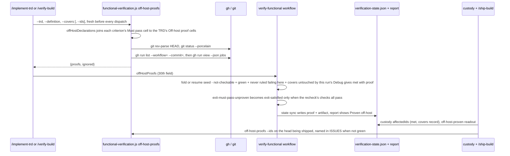

# TRD: Off-host proof for must-pass criteria the host cannot check

**Version**: 1.3.0
**Status**: Draft
**Created**: 2026-11-12
**Last Updated**: 2026-11-12
**Author**: @technical-architect
**Source PRD**: `docs/plan/accepted-gaps-for-not-checkable-must-pass-criteria.investigation.md` (workplan `verification-targeted-loop`, roadmap item 4, `docs/plans/verification-targeted-loop/roadmap.md`; GitHub issue FortiumPartners/ensemble-vnext#113). Its objectives come from the PM's instruction of 2026-11-12, quoted in the `/plan` invocation. That instruction is newer than the roadmap's item 4 brief and replaces its design: the roadmap *accepts* an unproven gap that custody skips; the instruction *proves* the criterion off-host, with a CI job declared up front whose green result on the same commit settles it `met`. Nothing is "accepted" (NG1).
**Task ID Prefix**: OHP

---

## Changelog

| Version | Date | Changes | Author |
|---------|------|---------|--------|
| 1.0.0 | 2026-11-12 | Initial TRD creation | @technical-architect |
| 1.1.0 | 2026-11-12 | 2026-11-12: revised after the adversarial review | @technical-architect |
| 1.2.0 | 2026-11-12 | `/audit-trd`: `docs/guides/PROCESS.md`'s must-pass-unproven row added to D18 and OHP-D001; D7's "D20" qualified as triage D20; §3.1's table marked as an illustration; OHP-B005's narrative-only dependency on OHP-B001 dropped and the task moved to Phase 1; `## Could Not Verify` added | @technical-architect |
| 1.3.0 | 2026-11-12 | `/amend` AMEND-001: O11's coverage evidence recorded in §6.1 (`verify-functional.js` out of the line-coverage target; library figures measured at `/audit-build`); O11 now served by AMEND-001 | @technical-architect |

## Objectives

O1–O7 are the investigation's objectives, carried with their wording and their Must pass
marks. O8–O12 come from `CLAUDE.md`, the constitution, or the investigation's own Intended
Change text, and say so. Three notes on v1.1.0: O4's citation of the existing prohibition is
corrected (the investigation pointed at `refine-verification.md:92`, which is a heading); O9
is re-targeted from a definition column to the TRD column, because D1 declares the proof only
in the TRD; and O1's "a success definition can declare" is met through the definition's own
`Must pass` cell, which names the objective that carries the job (D1, a labelled departure
from the investigation).

| ID | Objective | Source | Must pass |
|----|-----------|--------|-----------|
| O1 | A success definition can declare, up front, an off-host proof for a must-pass criterion: a named CI job (workflow file and job name). The declaration is read deterministically from the definition; on a row that is not must-pass it is ignored and reported, never acted on. | Investigation O1 (PM instruction, 2026-11-12) | yes |
| O2 | When a must-pass criterion with a declared off-host proof is triaged `not-checkable-here`, the loop checks that job's conclusion for the run's commit (`gh run list` / `gh run view`). A green job settles the criterion `met`, citing the CI run id (and its URL) as evidence; a red, cancelled, still-running or absent job leaves it unproven, and the run ends `must-pass-unproven` as today. | Investigation O2 (PM instruction, 2026-11-12, acceptance) | yes |
| O3 | The loop never accepts a gap by itself and never invents a proving environment at run time: a must-pass not-checkable criterion with no declared off-host proof still ends the run `must-pass-unproven`, and a must-pass criterion of kind `build-defect` or `evidence-gap` is never settled by an off-host proof, whatever CI says. | Investigation O3 (PM instruction, 2026-11-12, acceptance) | yes |
| O4 | `/refine-verification --auto` may not add or change an off-host proof on a must-pass criterion (D16 of `docs/TRD/verification-must-pass.md` stands: the must-pass sentence of `refine-verification.md`'s `**Owner rulings**` bullet, "is also an owner ruling, never an acceptance", and its `--auto` paragraph "**Access only the owner has is never guessed.**", pinned by `refine-verification-must-pass.test.js`); only an interactive refinement with the owner, or the TRD author at plan time, may declare one. | Investigation O4 (PM instruction, 2026-11-12, acceptance); citation corrected in v1.1.0 | yes |
| O5 | Custody (`packages/core/lib/custody.js`) treats a CI-proven criterion like any other `met` criterion: it is re-proved when its covered files change and its proof is reused when they do not. | Investigation O5 (PM instruction, 2026-11-12) | |
| O6 | The verification report and `/ship-build`'s readout name each criterion proven off-host and by which CI run. | Investigation O6 (PM instruction, 2026-11-12) | |
| O7 | A headless fixture run (the `fixtures` environment in `verification.md`) with one host-only must-pass criterion and a stubbed CI result shows the criterion settled `met` with the run id cited. | Investigation O7 (PM instruction, 2026-11-12, acceptance) | |
| O8 | Every `git` and `gh` call the off-host lookup makes passes its arguments as an array to `spawnSync`, never through a shell: the workflow file and job name come from a file a model helped write. | `CLAUDE.md` "Security Considerations — Command Injection Prevention"; domain-derived: a table cell is untrusted input reaching a process call | |
| O9 | A TRD with no `Off-host proof` column, and so a run with no declared off-host proof, behaves exactly as today, and a report with no off-host-proven criterion renders byte-identically to today's. | Investigation, Intended Change items 1 and 6 ("A definition with no such column behaves exactly as today"; "earlier reports stay byte-identical"), re-targeted to the TRD column by D1 | |
| O10 | Every edited packaged runtime file under `packages/core/` has its `.claude/` mirror updated to be byte-identical. | `constitution.md` Architecture Invariants, "Vendored Runtime"; existing mirror-parity tests (`refine-verification-must-pass.test.js` "the mirror is byte-identical", `functional-verification.test.js` mirror parity) | |
| O11 | Tests pass with unit coverage of the changed code at or above 60% and integration coverage at or above 50%, where applicable. | `constitution.md` Quality Gates | |
| O12 | Documentation describing the changed behaviour is updated in the same change. | `constitution.md` Quality Gates ("Documentation updated") | |

## 1. Overview

### 1.1 Technical Summary

Today a must-pass criterion the host cannot check (read-aloud, which needs host audio) is
ruled `not_met` with cause `environment-unreachable` or `capability-absent`, and the workflow's
fold (`reconcileJudgeKinds`, `packages/core/workflows/verify-functional.js`) gives it kind
`not-checkable-here` and re-statuses it `not_verifiable`. The decide-next step then relabels a
clean `exit-satisfied` as `exit-must-pass-unproven`, and nothing can ever prove the criterion.

This change adds one way to prove it, declared before the run and checked by code:

1. **Declare, in the TRD only.** The TRD author puts `<workflow file>#<job name>` in an
   optional `Off-host proof` column of the TRD's `## Objectives` table, on a must-pass
   objective. The success definition is not changed: a criterion is covered by the declaration
   through its existing `Must pass` cell, which names the objective or objectives it proves. A
   deterministic reader in `functional-verification.js` joins the two at read time (criterion →
   objective → job) and acts on a criterion only when every must-pass objective its cell names
   declares the same job.
2. **Look up CI before every dispatch, in code.** `/implement-trd` and `/verify-build` run a new
   lib CLI verb, `off-host-proofs`, fresh before every workflow dispatch. It asks `gh` for that
   job's conclusion on `HEAD` and checks that the working tree has no uncommitted change to the
   criterion's covered files. The result goes to the workflow as a new argument,
   `offHostProofs`.
3. **Settle in the workflow script.** When the fold settles a must-pass criterion
   `not_verifiable` with kind `not-checkable-here` (or a resume seeds one), and its
   `offHostProofs` entry is `green`, and this host never ruled it a build defect, an evidence gap
   or unbuilt (in this invocation or the snapshot it resumes), and no Debug pass of this
   invocation touched its covered files, the script settles it `met` with a `proof` record naming
   the job and run. Anything else leaves it unproven with a reason naming why.
4. **The exit.** On an `exit-must-pass-unproven`, the script repeats the must-pass recheck's own
   checks over the criteria as they now stand; only when every one passes does the exit become
   `exit-satisfied`.
5. **Report and readout.** The report gains a `**Proven off-host**:` line (only when one exists).
   `/ship-build`'s STATE names each criterion proven off host and its run, and its ISSUES name any
   declared job that is no longer green on the head being shipped.
6. **Custody unchanged.** The criterion is `met` in `verification-state.json`, so custody
   re-proves it when its covered files change and reuses it when they do not. New tests pin that,
   and pin the one case custody leaves to CI (TR4).
7. **`/refine-verification`.** D16 stands. Its must-pass not-checkable Owner ruling names a
   third way out (declare an off-host proof). Only the interactive mode, with the owner, may
   write that declaration, into the TRD; `--auto` records an `OWNER-CALL` and never writes, edits
   or removes an `Off-host proof` cell.

### 1.2 Key Technical Decisions

| ID | Decision | Choice | Serves Objective | Rationale | Alternatives Considered |
|----|----------|--------|------------------|-----------|------------------------|
| D1 | Where an off-host proof is declared | **Departure from the investigation (v1.1.0, after the adversarial review).** Only in an optional `Off-host proof` column of the TRD's `## Objectives` table, on a must-pass objective, found by header name at any position (hyphens and underscores fold to spaces, as `Must pass` already does). A cell names one CI job as `<workflow file>#<job name>`, for example `.github/workflows/ci.yml#read-aloud`. The workflow file must end in `.yml` or `.yaml` and its basename must match `^[A-Za-z0-9._][A-Za-z0-9._-]*\.ya?ml$` (so it cannot start with a dash); the job name is everything after the first `#`, trimmed, must be non-empty and must not start with `-`. Blank, `no`, `none`, `n/a` or a dash means no declaration. The success definition gains no column: a criterion is declared through its existing `Must pass` cell, which names the objective(s) it proves, joined at read time by D2's reader (criterion → objective → job) | O1, O8, O9 | A definition column carried no independent information (v1.0.0's reader already required it to equal the TRD's cell), and a model deriver that writes the definition was one more place a job could be invented. The TRD is also the only file `/refine-verification`'s `## Writes` already lets an interactive owner ruling change. O1's "a success definition can declare" holds through the definition's own `Must pass` cell | A definition column after `Must pass`, copied from the TRD by the deriver and by `spec-scope.js criteria --trd` and cross-checked against the TRD (the investigation's design and v1.0.0; rejected for the reasons given). A definition column alone (rejected: the deriver is isolated from the TRD and the author never sees criterion ids at plan time). One job per objective only, no lists (chosen; revisit when a criterion genuinely needs two jobs green) |
| D2 | Reading the declarations | One pure reader, `offHostDeclarations({ objectives, criteria })`, and a file wrapper, `offHostDeclarationsFromFiles(trdPath, definitionPath)`, beside `mustPassCoverage` / `mustPassCoverageFromFiles` in `packages/core/lib/functional-verification.js`. It reuses `mustPassCoverage`'s join: the must-pass criterion set comes from `mustPassCoverage`, and each criterion's named objective ids come from the same `Must pass` cell tokenizing (lifted into one helper both call), keeping only declared must-pass objectives as `mustPassCoverage` does. Objective level: a cell on an objective not marked must-pass is `ignored` with reason `not must-pass`; a cell that fails D1's parse is `ignored` with `malformed`. Criterion level: a must-pass criterion is `declared` only when **every** must-pass objective its `Must pass` cell names carries a valid declaration and all name the same job; when none does, nothing is reported for it; when some do and some do not, or they name different jobs, it is `ignored` with reason `not declared for every named objective`. Returns `{ declared: [{id, objectives, workflow, job}], ignored: [{id, cell, reason}] }` | O1, O3 | Declared before the run and read by code, never by a model. A criterion that also proves an objective with no declared job cannot ride on another objective's job | Act on any one named objective's declaration (rejected: a criterion proving O3 and O4 would be settled by O3's job while O4 declared nothing). Fail the whole run on a bad cell (rejected: the instruction says ignore and report) |
| D3 | How the declaration survives the TRD's own rewrites | `spec-scope.js` `objectiveRows` gains an optional `offHostProof` field (the raw cell, present only when non-blank), read by header name like `Must pass`. `renderObjectives`, which `/plan`'s spec path runs to rebuild the Objectives table with exactly four columns, carries each kept id's `Off-host proof` cell through the rewrite the way its `marks` map carries `Must pass`, and writes the column only when some kept row has a value, so an unmarked TRD stays byte-identical. No deriver change, no change to `spec-scope.js criteria`, and the definition keeps its eight columns | O1, O9 | Without the carry-through, `/plan` on a spec-locked TRD silently erases the only place the proof is declared (TR3) | Leave `renderObjectives` alone (rejected: a spec-path TRD could never keep a declaration) |
| D4 | Where CI is looked up | A new CLI verb, `off-host-proofs`, in `functional-verification.js`, run by the command before every workflow dispatch (D11). It reads the TRD and the definition itself (D2), resolves `HEAD` with `git rev-parse HEAD`, checks the working tree (D5), and for each declaration runs `gh run list --workflow=<workflow basename> --commit=<HEAD sha> --json databaseId,status,conclusion,url,headSha,createdAt`, takes the newest run (by `createdAt`) whose `headSha` equals `HEAD`, checks that its `databaseId` is a positive integer, then runs `gh run view <databaseId> --json jobs` and finds the job whose `name` equals the declared job exactly. Every `git` and `gh` call is `spawnSync` with an argument array and no shell, following `custody.js`'s `run` helper; the basename reaches `gh` only as the single argument `--workflow=<basename>`, after D1's validation, and the job name never reaches an argument list. A missing flag or an unreadable TRD or definition exits 1 with one stderr line, the convention this file's other verbs already follow (`usage()` and the `preclassify` read failures both `process.exit(1)`). `custody.js`'s `coverMatcher` and `classifyPath` are required lazily inside the lookup function: `custody.js` requires `functional-verification.js` at load for `BUILD_TOKEN`, so a top-level require is a cycle (the precedent is `live-evidence.js` `deriveCriterionCovers`) | O2, O3, O8 | The workflow script has no shell or filesystem, and a model running `gh` would be a model deciding a proof. `functional-verification.js` already owns the definition-reading verbs the commands call (`must-pass-coverage`, `preclassify`) | An agent stage inside the workflow that runs `gh` at exit (rejected: one more model hop between CI and the verdict). A new lib module for the lookup (rejected for now: the commands already call this one CLI for every definition read; revisit if `functional-verification.js` gains more process-spawning verbs). Exit 2 for bad input (rejected: that is `live-evidence.js`'s convention, not this file's) |
| D5 | What commit counts, and when the working tree voids it | The commit is `HEAD`. A declaration's status is, in order: `dirty` when `git status --porcelain=v1 -z --untracked-files=all` lists an uncommitted path matching one of the criterion's covers (matched with `custody.js`'s `coverMatcher`), or, for a criterion with no covers record, any uncommitted path `custody.js`'s `classifyPath` classes as `shipped`; `error` when `git` or `gh` fails or returns unparseable output (a non-integer `databaseId` included); `missing` when no run of that workflow exists for `HEAD`, or the newest run has no job of that name; `pending` when the newest run or that job is not `completed`; `green` when the job's conclusion is `success`; `red` for any other completed conclusion. Only `green` proves anything | O2, O3 | CI proves a commit; verification runs on the working tree. The covers check is the same notion of "what this criterion depends on" the regression pass and custody already use, so the three agree | Prove against the merge base or the PR head (rejected: the instruction says "the same commit"). Ignore the working tree (rejected: an uncommitted edit to the covered code would ride on a green result for code CI never saw). Reimplement cover matching (rejected: `coverMatcher` and `classifyPath` are exported and tested) |
| D6 | How the result reaches the workflow | A new workflow argument, `offHostProofs`: an array of `{id, workflow, job, status, runId, url, commit, reason}`, `[]` when nothing is declared. Validated before any agent runs, in the `PRECLASSIFIED` validator's style (the validator is the template; `PRECLASSIFIED` itself is not changed): each `id` must be a criterion of this run and in `mustPassIds`; `workflow` and `job` non-empty strings; `status` one of the six in D5; a `green` entry must carry a non-empty `url` and `commit` and an integer `runId`. A wrong shape throws. The workflow then reads 30 fields | O2, O3 | Same validation standard as every other argument; a malformed entry is a command bug, caught before any model spend | Pass only green entries (rejected: a red or missing job's reason belongs in the report, so the owner sees why the declared proof did not prove it) |
| D7 | Where and when the script settles a criterion `met` | One helper, called from two places only: (a) `reconcileJudgeKinds`, at the point an entry is final as `not_verifiable` with kind `not-checkable-here` (a `not_met` re-statused there, or a Judge-returned `not_verifiable`), so the inner loop and each regression round both pass through it; (b) the resume seeding, for each resumed `not_verifiable` `not-checkable-here` must-pass entry that persists there today (its digest matches), the path `/verify-build` fix rounds k ≥ 1 and `--resume` both use, so a job `missing` in round 0 and `green` by round 1 settles (D10). The helper settles the entry `met` only when all three rules hold. **Rule 1:** its id is in `MUST_PASS_IDS` and its `offHostProofs` entry is `green`. **Rule 2:** the id is not in a refusal set holding every id this invocation, or the resume snapshot, ever ruled `build-defect`, `evidence-gap` or `unbuilt`; the set is filled from the snapshot (an `unbuilt` entry, or a `not_met` entry whose kind, read the way D20 of `docs/TRD/triage-unmet-results-by-kind.md` reads it (`kindOf(cause)` when non-null, else the stored `kind`, else `build-defect`), is not `not-checkable-here`) before the seeding, and from every entry the fold records with such a kind or status. A green CI run on `HEAD` cannot overrule a failure this host saw on that same code. **Rule 3:** no Debug record of **this invocation** touched its covers. A record counts only when its `iteration` is greater than `RESUME_ITERATION` or it is a regression-round repair (`regression` set); a counted record with `files: null` touches every criterion; a criterion with no covers record is touched by any counted record whose `files` is `null` or non-empty. The synthetic `{iteration: RESUME_ITERATION, files: null}` record a resumed run pushes at start does not count: the pre-dispatch lookup already proved `HEAD` green and the covered files clean, so whatever the interrupted pass changed is either in `HEAD`, which CI ran, or reads `dirty`. A `files: null` record from a Debug pass of this invocation still voids. The settled entry is `status: 'met'`, `tier1: null`, `artifact` = the run URL, `reason` naming the job and run, `cause` kept, `proof: {kind: 'off-host', workflow, job, runId, url, commit}`, no `kind` and no `verificationDigest`. Any other case leaves it `not_verifiable` with its reason extended to name the declared job and why it did not prove it (`red`, `pending`, `missing`, `dirty`, `error`, `changed by Debug in this run`, or `ruled <kind> earlier in this run`). A `not_met` entry of kind `build-defect` or `evidence-gap` never reaches the helper. The preclassified seeding does not call it: `preclassify` emits only `check:verify-design-structure` rows, which never carry `Must pass` | O2, O3 | The fold is the one place every not-checkable verdict passes through; the resume seeding is the one place one is settled without it. Rule 2 keeps O3 honest when a criterion flips between kinds. Rule 3 closes the staleness of a lookup made before dispatch without voiding a proof for an edit the lookup already saw | Apply at exit only (rejected: a criterion settled `not_verifiable` mid-run would then be re-opened at exit, which the triage design forbids). Re-run the lookup after each Debug pass (rejected: the script has no shell; voiding is the honest answer). Settle at the preclassified seeding too (v1.0.0; rejected: unreachable for a must-pass criterion). Let the synthetic resume record void every proof (rejected: it would void every off-host proof on every resumed run, though the lookup already covers that pass's edits) |
| D8 | When the exit action changes | Only `exit-must-pass-unproven` becomes `exit-satisfied`, and only after the script repeats `applyMustPassRecheck`'s checks over the criteria as they now stand (settled entries, this iteration's returns and carried entries, assembled the way `applyMustPassRecheck` assembles them): no `not_met` except a settled `definition-problem` or `regression-unchecked`, no `unbuilt`, every id in `MUST_PASS_IDS` `met`, `MUST_PASS_UNCOVERED` empty, and, when `FLOOR` is set, proven/N at or above `FLOOR`. Any check failing leaves the action as it is. It is applied at two points, each only when some entry in `settled` carries a `proof` this invocation set: in the loop right after the fold that produced the exit (beside `replaceStalledExit`, marked replaced so `reportFixOf` patches the report's `outcome` and `reason` through the state sync), and at the end of `runRegressionPass` on the last round's action (setting `reportFixed`). `applyMustPassRecheck` then sees the criteria `met` and does not block. Its comment "One-directional -- it only ever blocks" is reworded: the recheck itself still only blocks, and the off-host upgrade is the one place an exit is un-blocked, under the same checks. No other action is upgraded | O2, O3 | `decideNext` produces `exit-must-pass-unproven` only from a clean `exit-satisfied` over the floor, but the Judge is a model running that CLI. Repeating the checks in code means a Judge-returned `exit-must-pass-unproven` over an open gap or a missed floor can never become `satisfied` | Flip the action whenever every must-pass id is `met` (v1.0.0; rejected for the reason given). Also upgrade `exit-insufficient-coverage` (rejected: its base action is not knowable from the result; investigation OQ-2) |
| D9 | Keeping state and report in step | `proof` joins the carry-only-when-present keys (`imageKeys`) and `STATE_KEYS`, and the state-sync patches carry `proof` and `artifact`. An exit whose final criteria include an off-host-proven entry always runs the state sync with those patches, whether or not anything else changed | O6, O5 | The Judge writes the state file and report input itself and is not asked to copy `proof`; the script cannot trust it to. Custody and `/ship-build` read `verification-state.json`, so `proof` must land there by code | Ask the Judge to copy `proof` (rejected: a model copy of the one field that names the proving run) |
| D10 | A resumed run | (a) A `met` entry carried in from a resume snapshot with `proof.kind === 'off-host'` is seeded as settled only when this invocation's `offHostProofs` has a `green` entry for it whose `commit` equals `proof.commit`; otherwise it re-enters the open set and is judged again. The resume-cap return (no budget left, so no iteration runs and it returns the snapshot's criteria) applies the same filter: such an entry is reported `not_verifiable`, kind `not-checkable-here`, with `proof` and `artifact` dropped and a reason naming the commit it was proven on and this lookup's status, and that return's `gaps`, `coverage` and `mustPass` are computed from the filtered list. It settles nothing new there, since no iteration ran. (b) A resumed `not_verifiable` `not-checkable-here` must-pass entry that persists goes through D7's helper at the seeding (rules 2 and 3 apply; at that point no Debug record of this invocation exists). (c) The synthetic Debug record a resumed run pushes never voids a proof (D7 rule 3) | O2 | A proof is for one commit; a resume after a commit, or after CI changed, must not keep a proof for code that moved, and must be able to settle one that CI has since proven | Keep every resumed `met` as today (rejected: a stale off-host proof would survive a new commit). Run the helper at the resume-cap return (rejected: nothing ran in this invocation; that return reports what the prior run established, minus a proof that no longer holds) |
| D11 | When the lookup runs, and `--criteria` subset runs (custody's re-proof path) | `off-host-proofs` runs fresh immediately before **every** `verify-functional` dispatch, and its output is never reused across dispatches: `/implement-trd` §8.3, which the fresh run and the §8.2 `--resume` path both reach; `/verify-build` Step 4, which every fix round's step 4 reuses; under `--criteria`, the first dispatch with `--ids <named ids>` (the same restriction it applies to `mustPassIds`) and its one retry with `--ids <retry set>`, recomputed. A sweep file passes `[]`. **Departure from the investigation**, which passed `[]` for a subset: custody re-proves a must-pass criterion through exactly this subset run (`ship-custody-gate.md` step 3), so with `[]` a CI-proven criterion whose covers changed could never be re-proved, and O5 asks that it be re-proved, not refused | O2, O5 | CI moves between dispatches (a job finishes; a fix round commits), so a stale result could settle code CI never saw or miss a proof that now exists. Without the subset entries O5 is unreachable: every re-proof of a CI-proven criterion would end `not_verifiable` and custody would refuse the merge | `[]` for a subset as the investigation wrote (rejected for the reason given). Compute once per command run (rejected: a fix round's commit or a finished CI job would be missed) |
| D12 | A CI run still in progress | Not waited for. `pending` leaves the criterion unproven with a reason saying the run had not finished; a later `/verify-build` after CI finishes settles it | O2, O3 | The instruction says red or missing leaves it unproven, and the loop has no bounded way to wait (investigation OQ-1) | Poll until done (rejected: unbounded wait inside a verification run; revisit if owners report re-running `/verify-build` only to wait out CI) |
| D13 | The report line | `renderReport` prints `**Proven off-host**: <id> — <workflow>#<job>, run <runId> (<url>)`, entries comma-separated, directly after the `**Must pass**:` line, only when a criterion in the input carries `proof.kind === 'off-host'` | O6, O9 | Same gate-on-presence rule as the must-pass line, so every earlier report stays byte-identical | A separate `## Proven off-host` section (rejected: one line carries it; a section is weight for a one-row list) |
| D14 | The `/ship-build` readout | A CLI verb `off-host-proven --state-dir <dir>` prints `[{id, statement, workflow, job, runId, url, commit}]` from `<dir>/verification-state.json`, overlaid by `<dir>/reverify/verification-state.json` when present (the re-proof's entry wins per id, being the later proof); `[]` when neither file exists or parses. The verb reads each `statement` itself from `<dir>/success-definition.md` (the `Functional statement` cell, found by header name with the same table reader D2 uses), `null` when that file or the row is absent, because a state file's criteria are not guaranteed to carry `statement`. `ship-build.md` Step 6 STATE runs it and names each criterion proven off host by its statement in plain words (its id when the statement is `null`) and its run URL. Step 6 ISSUES then runs `off-host-proofs --trd <trd-path> --definition <state-dir>/success-definition.md --ids <those ids>` in the work tree, whose `HEAD` is the head being shipped, and names each job that is no longer `green` for that head, with its status in words (TR4). Neither is a gate | O6, O5 | One lib call keeps the readout from parsing JSON or a table in prose; the overlay makes the readout name the proof the merge actually relied on; the ISSUES line covers the one case custody leaves to CI | Read the state in the command's prose (rejected: the readout would depend on a model parsing a state file). Let Step 6 read the statement from the definition by id in prose (rejected for the same reason) |
| D15 | Custody | No change to `custody.js`. A CI-proven criterion is `met` in `verification-state.json`; its `artifact` is a URL that matches no live-evidence manifest entry, so `affectedIds` falls back to the criterion-covers record (`record-criteria`, which records covers for every `met` criterion), and reuses or re-proves it on that record like any other. New tests pin both cases, and pin that a change classed `test-only` or `ci-config` moves the anchor without re-proof under the default tiers (the gap TR4 names and D14 reports) | O5 | The rule O5 asks for is the rule custody already applies to every `met` criterion | A custody branch for off-host proofs (rejected: O5 says "like any other met criterion"; NG5) |
| D16 | `/refine-verification` (amends D16 of `docs/TRD/verification-must-pass.md`; that decision otherwise stands) | The must-pass not-checkable Owner ruling (today in the `**Owner rulings**` bullet's must-pass sentence, "is also an owner ruling, never an acceptance", and the `--auto` paragraph "**Access only the owner has is never guessed.**") names three ways out: declare an environment that reaches it (via `/verification-setup`), declare an off-host proof (a CI workflow and job) on every must-pass objective the criterion's `Must pass` cell names, in the TRD's Objectives table, or remove the must-pass marking. Interactive, when the owner chooses the off-host proof and names `<workflow file>#<job name>`, the command writes it into those TRD Objectives rows (adding the column if absent) with a dated changelog line, and the ruling's `Written into` cell names the TRD. That is a TRD write for an interactive owner ruling, which `## Writes` already permits, so `## Writes` is unchanged; the success definition is not written (D1). Under `--auto` the ruling is an `OWNER-CALL` as today and the command never writes, edits or removes an `Off-host proof` cell; that sentence joins the command's `## Never` list | O4 | The instruction lets an interactive refinement declare one and forbids `--auto` from doing so. Owner rulings already carry a `Written into` column naming the document a ruling changed | Only record the ruling and leave the edit to the owner (rejected: the instruction names interactive refinement as a place where a proof is declared). Let `--auto` declare one when CI is green (rejected: O4). Also write the definition (v1.0.0; rejected: D1 gives it no column) |
| D17 | The live proof | A headless fixture scenario, `test/smoke/scenarios/verify-off-host-proof.sh`, in the `fixtures` environment. The fixture is a scaffolded git repo with everything committed, so `HEAD` equals the tree. Its TRD has one must-pass objective whose Objectives row declares `.github/workflows/ci.yml#read-aloud`, a Master Task List task that `Serves` it, and a Task Grounding block whose `**Touches:**` line names the read-aloud source, so `derive-criteria` gives the criterion a covers record (without one, the untracked `.session.jsonl` that `smoke_claude` leaves would read as a dirty shipped path, D5). Its pre-seeded success definition has the eight standard columns and one host-only criterion naming that objective in `Must pass`. The criterion reaches `not-checkable-here` through the Exercise and Judge fold (D7 (a)): the fixture's `verification.md` §5 names the host capability it needs (`smoke_write_triage_verification_md`), the Judge rules it `capability-absent` or `environment-unreachable`, and `reconcileJudgeKinds` re-statuses it; preclassification is not involved (it covers only design-structure check rows). A fake `gh` on `PATH` is a small script switching on its arguments: `run list` prints one completed run whose `headSha` is the fixture's real `HEAD` and whose `databaseId` is a fixed id; `run view <that id>` prints a `read-aloud` job concluded `success`; every call appends its argv to a log. It runs one `/verify-build` and asserts the criterion is `met` with `proof.runId` equal to the stub's id, the report's `**Proven off-host**:` line names that run, the outcome is `satisfied`, the log's `run list` line carries the fixture's `HEAD` sha and its `run view` line carries the run id. A Judge that rules the criterion any other cause or kind, on any iteration, is a named INCONCLUSIVE, never a pass; an empty log is a named failure ("stub never called"). Registered in `test/smoke/run-smoke.sh` (opt-in `--with-llm`) and `test/smoke/README.md` | O7 | Same shape as `verify-triage-kinds.sh` and `verify-regression-pass.sh`; the stub needs no new env var and no real GitHub | A real CI run on a test repository (rejected: `github-live-test` is authorized for `/ship-build` merge-order behaviour, and a stub gives a deterministic result). Preclassify the criterion (v1.0.0; rejected: `preclassify` does not classify a plain criterion) |
| D18 | Documents that describe the changed behaviour | `docs/reference/verification.md`: the TRD Objectives `Off-host proof` column and its join through `Must pass`; the `must-pass-unproven` outcome row's "never accepted as such" sentence; the "It only ever blocks, never un-blocks" sentence (D8 un-blocks); the `/refine-verification` chat step's "two ways out"; the state file's per-criterion keys gaining `proof`; the report table's `**Proven off-host**` row; the CLI verbs `off-host-proofs` and `off-host-proven`, with D5's six statuses and D12. `docs/guides/PROCESS.md`: the `must-pass-unproven` outcome row's "you either declare an environment that reaches it or remove the mark" names the off-host proof as a third way out. `docs/TRD/functional-verification.md` §3.3 (`offHostProofs`, pinned by `verify-functional-trd-sync.test.js`; OHP-B002). `docs/TRD/verification-must-pass.md` D16 marked AMENDED inline (2026-11-12, by this TRD's D16), the row kept in place | O12 | The reference page is what an owner reads; §3.3 is test-pinned; the corpus convention writes amendments inline in the decision row | Leave the parent TRD unmarked (rejected: its D16 would contradict the new third way out) |

### 1.3 Technology Stack

| Layer | Technology | Purpose | Notes |
|-------|------------|---------|-------|
| Lib and CLI | Node.js 18+ (`stack.md`) | Reader, CI lookup, report line, readout verb | `child_process.spawnSync` with argument arrays |
| Workflow | `verify-functional.js` (Workflow script) | Settle, upgrade, state sync | No shell, no filesystem; everything arrives in args |
| Commands, contracts | Markdown prompts | Dispatch, ruling, readout, TRD authoring | Constitution principles 2 and 3 |
| CI query | `gh` CLI (`verification.md` §4: installed) | `gh run list`, `gh run view` | Uses the running user's `gh` login (`verification.md` §3) |
| Tests | Jest ^29, BATS, headless smoke | Unit, prose and live proof | `stack.md` |

### 1.4 Integration Points

| System | Type | Direction | Notes |
|--------|------|-----------|-------|
| GitHub Actions (via `gh`) | CLI, read-only | In | Run list and job conclusions for `HEAD`. Never writes |
| `custody.js` | Library (lazy require) | In | `coverMatcher`, `classifyPath` reused by the lookup, required inside the function because `custody.js` requires `functional-verification.js` at load; custody's own rules unchanged |
| `verification-state.json` | File | Out | Carries `proof` on an off-host-proven entry, read by custody and `/ship-build` |

## 2. System Architecture

### 2.1 Data Flow



## 3. Technical Specifications

### 3.1 Declaration column and reader

The two tables below are an **illustration** of the format, not this TRD's objectives: their
ids (O3, O5, FS-3, FS-4), `PRD FR-4`/`FR-5` and the `ci.yml#read-aloud` job are hypothetical,
and this repository's `ci.yml` has no such job.

**TRD `## Objectives`** (optional column, any position, found by header name):

```markdown
| ID | Objective | Source | Must pass | Off-host proof |
|----|-----------|--------|-----------|----------------|
| O3 | Read-aloud speaks the selected passage | PRD FR-4 | yes | .github/workflows/ci.yml#read-aloud |
| O5 | Read-aloud highlights each word as it is spoken | PRD FR-5 | yes | |
```

**Success definition** (unchanged: eight columns; the `Must pass` cell is the declaration's join):

```markdown
| ID | Functional statement | Cites | Evidence that would prove it | Derivation | Tier 1 | Parts | Must pass |
|----|----|----|----|----|----|----|----|
| FS-3 | Read-aloud speaks the selected passage | FR-4 | audio capture of the passage | [read] | judge-only — audio | | O3 |
| FS-4 | Read-aloud speaks and highlights each word | FR-4, FR-5 | audio capture plus a screenshot per word | [read] | judge-only — audio | | O3, O5 |
```

In this illustration, FS-3 is declared (`ci.yml#read-aloud`). FS-4 is `ignored` with `not declared for every named
objective`: O5 declares no job, so CI on O3's job cannot prove what FS-4 claims about O5.

**Reader** (`functional-verification.js`):

```typescript
function offHostDeclarations(input: {
  objectives: Array<{ id: string; mustPass: boolean; offHostProof?: string }>; // spec-scope objectiveRows, every row
  criteria: Array<{ id: string; mustPass?: string }>;                         // the definition's rows: id and raw Must pass cell
}): {
  declared: Array<{ id: string; objectives: string[]; workflow: string; job: string }>;
  ignored: Array<{
    id: string;   // the objective's id for 'not must-pass' and 'malformed'; the criterion's for the third reason
    cell: string; // the objective's Off-host proof cell, or the criterion's Must pass cell
    reason: 'not must-pass' | 'malformed' | 'not declared for every named objective';
  }>;
};
```

A criterion whose named must-pass objectives carry no valid declaration produces neither a
`declared` nor an `ignored` entry. The must-pass criterion set and each criterion's named
objective ids come from `mustPassCoverage` and its cell tokenizing, never from a second parser.

### 3.2 CI lookup verb

```
node functional-verification.js off-host-proofs --trd <TRD> --definition <definition> [--covers <json file>] [--ids <id,id,...>]
```

- Run fresh before every workflow dispatch; its output is never reused across dispatches (D11).
- `--covers`: a JSON file `{ "<id>": ["<path>", ...] }` (what `live-evidence.js derive-criteria`
  printed); absent or unreadable means no criterion has a covers record.
- `--ids`: restrict `proofs` to these criterion ids (D11).
- Argument hygiene (O8, D1, D4): a declaration that fails the basename pattern
  `^[A-Za-z0-9._][A-Za-z0-9._-]*\.ya?ml$` or the job rule (non-empty, no leading `-`) is
  `malformed` and never reaches `gh`; the basename is passed as the one argument
  `--workflow=<basename>`; `databaseId` must be a positive integer before `gh run view`.
- Prints one JSON line and exits 0, even when `gh` is absent (each entry then reads `error`):

```typescript
interface OffHostLookup {
  proofs: Array<{
    id: string; workflow: string; job: string;
    status: 'green' | 'red' | 'pending' | 'missing' | 'dirty' | 'error';
    runId: number | null; url: string | null; commit: string;   // commit = HEAD sha
    reason: string;                                              // plain words, always present
  }>;
  ignored: Array<{ id: string; cell: string; reason: string }>; // from the reader, unchanged
}
```

Exit 1 with one stderr line for a missing flag (`usage()`) or an unreadable TRD or definition,
this file's existing convention. The command treats a non-zero exit as `offHostProofs: []`
plus one ISSUES line, never STUCK.

### 3.3 Workflow argument and settled entry

```typescript
interface OffHostProofArg {            // args.offHostProofs: OffHostProofArg[]  ([] when none)
  id: string; workflow: string; job: string;
  status: 'green' | 'red' | 'pending' | 'missing' | 'dirty' | 'error';
  runId: number | null; url: string | null; commit: string; reason?: string;
}

interface OffHostProof { kind: 'off-host'; workflow: string; job: string; runId: number; url: string; commit: string }

// A settled entry proven off-host (verification-state.json and the result's criteria):
// { id, status: 'met', tier1: null, artifact: <url>, reason, cause: <the not-checkable cause>,
//   provenAt, proof: OffHostProof }
```

Validation errors throw, worded like the existing ones:
`verify-functional: args.offHostProofs[<i>].id "<id>" is not a must-pass criterion of this run`.

**Behaviour**:
- The settle helper (D7) is called from `reconcileJudgeKinds` and from the resume seeding of a
  persisting not-checkable must-pass entry; never from the preclassified seeding.
- It refuses any id this invocation or the resume snapshot ruled `build-defect`, `evidence-gap`
  or `unbuilt` (D7 rule 2), and any id whose covers a Debug record of this invocation touched
  (D7 rule 3; the synthetic resume record does not count).
- The upgrade (D8) acts only on `exit-must-pass-unproven`, only when an off-host proof was set in
  this invocation, and only after `applyMustPassRecheck`'s checks all pass on the current criteria.
- An exit carrying any `proof.kind === 'off-host'` entry always syncs state and report (D9).
- A resumed off-host `met` is re-opened unless a `green` entry for the same commit is present; the
  resume-cap return reports it `not_verifiable` instead (D10).
- `mustPassSummary` and `decideNext` keep their rules, and so does `applyMustPassRecheck`: they
  read `met`. Only `applyMustPassRecheck`'s comment changes (D8).

**Error handling**:
- Non-green status: criterion stays `not_verifiable`; reason names the job and the status in words.
- Debug of this invocation touched its covers: same, reason `changed by Debug in this run`.
- Ruled a failing kind earlier: same, reason `ruled <kind> earlier in this run` (or `in the run it resumes`).
- A Judge returning `proof` on any entry: dropped and logged; only the script sets it.

### 3.4 `/ship-build` readout verb

```
node functional-verification.js off-host-proven --state-dir <dir>
→ [{"id","statement","workflow","job","runId","url","commit"}]   ([] when none or unreadable)
```

`statement` comes from `<dir>/success-definition.md` (`null` when that file or the row is
absent). Step 6 ISSUES then calls `off-host-proofs --ids <those ids>` (§3.2) for the head being
shipped (D14).

## 4. Master Task List

### 4.1 Task ID Convention

`OHP-[CATEGORY][SEQ]`: B = build, T = test, D = documentation. Unit tests ship inside each
build task. Every edited file under `packages/core/` is copied to its `.claude/` mirror in the
same task (O10); `packages/full/` holds symlinks and needs no copy.

### 4.2 Phase 1: Library, workflow, refinement, command wiring, ship readout and the custody pin

| Task ID | Description | Serves | Skills | Dependencies | Acceptance Criteria |
|---------|-------------|--------|--------|--------------|---------------------|
| OHP-B001 | Lib side of the declaration, lookup, report and readout: `spec-scope.js` `objectiveRows` reads an `Off-host proof` column by header name and `renderObjectives` carries it through `/plan`'s rewrite (D3); `offHostDeclarations` and `offHostDeclarationsFromFiles`, joined through the `Must pass` cell with `mustPassCoverage`'s cell tokenizing lifted into one shared helper (D1, D2); the `off-host-proofs` verb with `spawnSync` array calls, `--workflow=<basename>` only after D1's validation, an integer `databaseId` before `gh run view`, `custody.js` `coverMatcher` and `classifyPath` required lazily inside the function, and exit 1 for a missing flag or an unreadable input (D4, D5); `renderReport`'s `**Proven off-host**:` line (D13); the `off-host-proven` verb, reading each statement from the definition (D14); the header verb list and `usage()` updated | D1, D2, D3, D4, D5, D13, D14 | `jest` | None | `npx jest packages/core/lib/functional-verification.test.js packages/core/lib/spec-scope.test.js` passes with new cases. Reader: a criterion naming one must-pass objective that declares a job is declared; one naming two must-pass objectives that declare the same job is declared; one where only one of its two named objectives declares a job, and one where they declare different jobs, are each `ignored` with `not declared for every named objective`; a cell on an objective not marked must-pass is `ignored` `not must-pass`; a non-YAML workflow file, a basename starting with `-`, an empty job and a job starting with `-` are each `ignored` `malformed`; a TRD with no column yields nothing. `objectiveRows` carries `offHostProof` only when non-blank (the existing `toEqual` cases unchanged); `renderObjectives` keeps an `Off-host proof` cell through a rewrite and leaves a TRD with none byte-identical. Verb, with a stub `gh` on `PATH` that switches on `run list` and `run view`: `green` (run id, URL, HEAD), `red`, `pending`, `missing` (no run; no job of that name), `error` (gh fails; a non-integer `databaseId`), `dirty` (an uncommitted change under a covered path, including a new file in a new directory; and, with no covers, under a shipped path), and only the `--ids` subset when given; the recorded argv shows `--workflow=ci.yml` as one argument and the HEAD sha on the `run list` call; a missing flag and an unreadable TRD each exit 1. `renderReport` without any `proof` is byte-identical to before, and with one prints the line; `off-host-proven` overlays `reverify/` per id, carries `statement` from the definition (`null` when absent) and prints `[]` for a missing dir. Mirrors byte-identical |
| OHP-B002 | Workflow side: the `offHostProofs` argument and its validation (D6); the settle helper, called from `reconcileJudgeKinds` and from the resume seeding of persisting not-checkable must-pass entries, with the refusal set filled from the resume snapshot and from every fold, and the Debug-touched test over this invocation's own Debug records only (D7, D10); the `exit-must-pass-unproven` to `exit-satisfied` upgrade after repeating `applyMustPassRecheck`'s checks, in the loop and at the end of the regression pass, and the comment above `applyMustPassRecheck` ("One-directional -- it only ever blocks") reworded (D8); `proof` in `imageKeys`, `STATE_KEYS` and the state-sync patches, with the forced sync on an exit carrying one (D9); D10's commit filter at the resume seeding and at the resume-cap return; a Judge-returned `proof` dropped. `PRECLASSIFIED` and its seeding are not changed. `docs/TRD/functional-verification.md` §3.3 declares `offHostProofs` and its shape, and `verify-functional-trd-sync.test.js` expects 30 fields | D6, D7, D8, D9, D10 | `jest` | None | `npx jest packages/core/workflows/verify-functional.test.js packages/core/workflows/verify-functional-trd-sync.test.js` passes with new cases: a must-pass not-checkable criterion with a `green` proof ends `met`, `artifact` the run URL, `proof.runId` cited, outcome `satisfied`; `red`, `missing`, `pending`, `dirty` and `error` leave it `not_verifiable` and the run `must-pass-unproven`, reason naming the job and status; no declared proof leaves `must-pass-unproven`; a must-pass `build-defect` (and an `evidence-gap`) with a `green` entry is never settled and the run is not satisfied; a criterion ruled a build defect in iteration 1, followed by a Debug edit outside its covered files, then ruled not checkable in iteration 2 with a `green` entry stays unproven and the run is not satisfied; a resume snapshot holding it `unbuilt`, or `not_met` as a build defect, likewise refuses it; a Debug record of this invocation touching its covers, and a `files: null` record from a Debug pass of this invocation, each void the proof; a resumed run (`RESUME_ITERATION` 1 or more) whose only `files: null` record is the synthetic resume record settles it; a persisting not-checkable must-pass entry in a fix-round snapshot (iteration 0) with a `green` entry is seeded `met`; a Judge-returned `exit-must-pass-unproven` with an open `not_met`, and one below the floor, never become `satisfied` although the off-host criterion settles; an `exit-insufficient-coverage` is never upgraded; an `offHostProofs` id that is not must-pass throws; a resumed off-host `met` on a different commit re-opens, and the resume-cap return reports it `not_verifiable` with `proof` dropped; every return path carries the same criterion shape. Mirror byte-identical |
| OHP-B004 | `/refine-verification`: the must-pass not-checkable Owner ruling names the third way out (an off-host proof declared on every must-pass objective the criterion's `Must pass` cell names, in the TRD's Objectives table); interactive writes the cell into those TRD Objectives rows only (adding the column if absent) and names the TRD under `Written into`; `--auto` records an `OWNER-CALL` and never writes, edits or removes an `Off-host proof` cell, stated in the ruling bullet, the `**Access only the owner has is never guessed.**` paragraph and the `## Never` list (D16). `## Writes` is unchanged | D16 | `jest` | None | `npx jest packages/core/lib/refine-verification-must-pass.test.js packages/core/commands/verify-command-surface.test.js` passes: the existing "both ways out" case becomes "three ways out" (still requires `/verification-setup`, "remove the must-pass marking" and `OWNER-CALL`, plus "off-host proof"); a new case asserts the `--auto` text forbids writing, editing or removing an `Off-host proof` cell and that `## Never` carries it; another asserts the interactive path writes the TRD only; the Accepted-as-not-verifiable bullet still excludes must-pass criteria; the surface file's `refine-verification.md` pins still pass; mirror byte-identical |
| OHP-B003 | Commands and contract: `implement-trd.md` §8.3 runs `off-host-proofs` immediately before the dispatch, after `criterionCovers` is derived (its output written to a file for `--covers`), and says this holds on the fresh path and the §8.2 `--resume` path alike; it passes `offHostProofs` and puts each `ignored` entry and a non-zero exit in ISSUES. `verify-build.md` Step 4 runs it fresh before every dispatch, naming each fix round's step 4, the `--criteria` dispatch restricted with `--ids`, and its retry recomputed with `--ids <retry set>`; a sweep file passes `[]`. Both dispatch lists move to 30 fields with `offHostProofs` last. `contracts/trd-authoring.md` documents the optional Objectives column: its format, must-pass objectives only, every objective a criterion names must carry the same job, and who may write it (D1, D6, D11). No deriver-input change and no `contracts/functional-verification.md` change (D1, D3) | D1, D6, D11 | `jest` | None | `npx jest packages/core/commands/verify-command-surface.test.js packages/core/commands/verify-build-criteria.test.js` passes with the counts moved to 30 and `offHostProofs` last in both dispatch blocks; new prose cases assert that implement-trd §8.3 runs `off-host-proofs` before the dispatch and says so for the `--resume` path, that verify-build Step 4 runs it fresh before every dispatch and names the fix rounds, the `--criteria` `--ids` restriction and the retry's recomputation, that the sweep path passes `[]`, and that trd-authoring names the `Off-host proof` column; mirrors byte-identical |
| OHP-T001 | Custody pin across the seam from workflow state to custody: in `custody.test.js`, a must-pass criterion `met` with `proof.kind: 'off-host'` and a run-URL `artifact`, plus a criterion-covers record, is reused (`reused`) when no covered file changed and listed for re-proof (`reverify`) when one did; a `--reverified` state where it is `met` again moves the anchor; and a change to `.github/workflows/ci.yml` alone moves the anchor (rule `tier-ci`) without re-proving it, pinning the gap TR4 names so a change to it is deliberate (D15) | D15 | `jest` | None | `npx jest packages/core/lib/custody.test.js` passes with the new cases; no change to `custody.js` |
| OHP-B005 | `/ship-build` Step 6: STATE runs `off-host-proven --state-dir <state-dir>` and names each criterion proven off host by its statement in plain words (its id when the statement is `null`) and its run URL, saying nothing when the list is empty; ISSUES runs `off-host-proofs --trd <trd-path> --definition <state-dir>/success-definition.md --ids <those ids>` on the head being shipped and names each declared job no longer `green` for that head, with its status in words; both are skipped when the list is empty or the work has no TRD. Not a gate (D14, TR4) | D14 | `jest` | None | `npx jest packages/core/commands/ship-build-surface.test.js` passes with new cases pinning both calls, the STATE sentence and the ISSUES sentence; mirror byte-identical |

### 4.3 Phase 2: Documents

| Task ID | Description | Serves | Skills | Dependencies | Acceptance Criteria |
|---------|-------------|--------|--------|--------------|---------------------|
| OHP-D001 | Documents (D18). `docs/reference/verification.md`: (1) a paragraph on the TRD Objectives `Off-host proof` column and its join through the definition's `Must pass` cell, beside the must-pass-marks paragraph at the end of `## 10a`; (2) the `must-pass-unproven` outcome row's "never accepted as such" sentence names the off-host way out; (3) "It only ever blocks, never un-blocks" corrected for D8's upgrade; (4) the `/refine-verification` chat step's "two ways out" made three; (5) the state file's per-criterion key list gains `proof`; (6) a report-table row for `**Proven off-host**`; (7) CLI rows for `off-host-proofs` and `off-host-proven`, with D5's six statuses and D12 (a running job is not waited for). `docs/guides/PROCESS.md`: (8) the `must-pass-unproven` outcome row's "What to do" cell ("you either declare an environment that reaches it or remove the mark") names the third way out, an off-host proof (a CI workflow and job) declared in the TRD's Objectives table. `docs/TRD/verification-must-pass.md` D16 marked AMENDED inline (2026-11-12, by this TRD's D16), row kept | D18 | | OHP-B001 | Each of passages (1)–(8) states the behaviour this TRD built; `grep -n "Off-host proof" docs/reference/verification.md` finds passage (1); `grep -n "only ever blocks, never un-blocks" docs/reference/verification.md` and `grep -n "two ways out" docs/reference/verification.md` find nothing; `grep -n "must-pass-unproven" docs/guides/PROCESS.md` shows a row naming the off-host proof; D16's row in `verification-must-pass.md` carries the AMENDED marker |
| AMEND-001 | O11's coverage evidence recorded in §6.1: `verify-functional.js` taken out of the Jest line-coverage target (a workflow script with a top-level `return`, which Jest cannot instrument); the unit target evidenced by the library figures measured at `/audit-build` (`functional-verification.js` 73%, `spec-scope.js` 86%, `custody.js` 94%, 1117 tests passing); the off-host lookup (`functional-verification.js` lines 932-1026) stated as exercised by separate-process CLI tests, with the deferred live scenario OHP-T002 covering the integration half; the two O11 rows of Could Not Verify updated to match. OWNER-CALL: a routine engineering choice made by Forge as the owner's delegate, not yet reviewed by the owner — amendment, 2026-11-12 | O11 | | None | §6.1's Unit Tests scope no longer names `verify-functional.js` and says why; §6.1 states the three measured figures and the 1117-test count as the unit target's evidence, the separate-process tests for lines 932-1026, and OHP-T002 for the integration half; the paragraph carries the OWNER-CALL marker; `grep -n "AMEND-001" docs/TRD/accepted-gaps-for-not-checkable-must-pass-criteria.md` finds this row; no file outside this TRD changes |

### 4.4 Phase 3: Live proof

| Task ID | Description | Serves | Skills | Dependencies | Acceptance Criteria |
|---------|-------------|--------|--------|--------------|---------------------|
| OHP-T002 | [LIVE] Headless fixture scenario `test/smoke/scenarios/verify-off-host-proof.sh` in the `fixtures` environment per D17: the host-only criterion reaches not-checkable through the Judge and the fold; the fixture TRD declares the job in its Objectives table and gives the task a Task Grounding `**Touches:**` line; the stub `gh` switches on `run list` and `run view` and logs every argv. Registered in `test/smoke/run-smoke.sh` (opt-in `--with-llm`, with a timeout entry) and `test/smoke/README.md`. Artifacts (state file, report, stub log, transcript) recorded under `.trd-state/<feature>/evidence/live/OHP-T002/` and in the live-evidence manifest | D17 | | OHP-B001, OHP-B002, OHP-B003 | One live `/verify-build` on the fixture: `verification-state.json` holds the host-only must-pass criterion `met` with `proof.runId` equal to the stub's id; the report's `**Proven off-host**:` line names that run; the outcome is `satisfied`; the stub log's `run list` line carries the fixture's `HEAD` sha and its `run view` line carries the stub's run id. A Judge ruling any cause other than `capability-absent` or `environment-unreachable` is a named INCONCLUSIVE, and a stub never called is a named failure; neither is a pass. `bats test/integration/tests/smoke-registration.test.sh` passes |

## Deferred by design

| Task ID | Why it cannot run now |
|---------|-----------------------|
| OHP-T002 | Tagged [LIVE]: /implement-trd sets it aside unless run with --include-deferred. It needs only the authorized fixtures environment and a fake gh on PATH, not real CI, so it can finish in the same run when that flag is passed. |

## 5. Execution Plan

### 5.1 Phase Overview

| Phase | Focus | Prerequisites | Parallelizable Sessions |
|-------|-------|---------------|------------------------|
| 1 | Lib, workflow, refinement, command wiring, ship readout and the custody pin (each with its tests) | None | OHP-B001, OHP-B002, OHP-B004, OHP-B003, OHP-T001, OHP-B005 in parallel: disjoint files (OHP-B004 runs `verify-command-surface.test.js`, which OHP-B003 edits; it does not edit it) |
| 2 | Documents | OHP-B001 | OHP-D001 alone: it documents the flag names, JSON shapes and status words of the built `functional-verification.js` (OHP-D001 grounding, Careful (4)) |
| 3 | `[LIVE]` end-to-end fixture run | OHP-B001, OHP-B002, OHP-B003 | OHP-T002 alone; placed last so the live proof (O7) runs against the finished plugin rather than one with a phase still in flight |

### 5.2 Session Details

- **1A** OHP-B001 — @backend-implementer
- **1B** OHP-B002 — @backend-implementer
- **1C** OHP-B004 — @backend-implementer
- **1D** OHP-B003 — @backend-implementer
- **1E** OHP-T001 — @backend-implementer
- **1F** OHP-B005 — @backend-implementer
- **2A** OHP-D001 — @backend-implementer, after 1A
- **3A** OHP-T002 — @verify-app, after 1A, 1B and 1D

### 5.3 Critical Path

OHP-B001 → OHP-D001. OHP-B005 has no dependency: it edits prose and its test pins prose, and the verb names and output it cites are fixed by §3.2 and §3.4. OHP-T002 waits on OHP-B001, OHP-B002 and
OHP-B003, and is deferred by design.

## 6. Quality Requirements

### 6.1 Testing Requirements

| Type | Coverage Target | Source | Scope |
|------|-----------------|--------|-------|
| Unit Tests | 60% | `constitution.md` Quality Gates (O11) | New and changed functions in `functional-verification.js`, `spec-scope.js` and `custody.js` (AMEND-001: `verify-functional.js` is excluded from the line-coverage target; see below) |
| Integration Tests | 50% where applicable | `constitution.md` Quality Gates (O11) | The custody seam (OHP-T001) and the fixture run (OHP-T002, deferred by design) |

**Coverage evidence for O11 (AMEND-001, 2026-11-12).** `packages/core/workflows/verify-functional.js` is excluded from the Jest line-coverage target. It is a workflow script with a top-level `return` (line 3744), which the workflow harness evaluates and Jest cannot instrument, so no line figure exists for it; its behaviour is pinned by `verify-functional.test.js` (OHP-B002's cases) rather than measured as a percentage. The unit target's evidence is the whole-file line coverage measured at `/audit-build` on 2026-11-12: `functional-verification.js` 73%, `spec-scope.js` 86% and `custody.js` 94%, each above the 60% target, with 1117 tests passing across 6 suites. The off-host lookup (`lookupOffHostProofs` and its `runCmd` helper, `functional-verification.js` lines 932-1026) is exercised by tests that run the CLI in a separate process (`spawnSync` in the `off-host-proofs and off-host-proven verbs` describe of `functional-verification.test.js`), which the in-process figure does not count; the deferred live scenario OHP-T002 covers the integration half. OWNER-CALL: a routine engineering choice made by Forge as the owner's delegate; not yet reviewed by the owner.

The acceptance command from the source is
`npx jest packages/core/workflows/verify-functional.test.js packages/core/lib/custody.test.js packages/core/lib/refine-verification-must-pass.test.js`
with the new and updated cases listed in OHP-B002, OHP-T001 and OHP-B004.

### 6.2 Code Quality Standards

None beyond the constitution's and `stack.md`'s.

### 6.3 Security Requirements

- O8: `git` and `gh` are called through `spawnSync` with argument arrays only; the workflow
  file and job name are never interpolated into a shell string (domain-derived, see O8). The
  basename must match `^[A-Za-z0-9._][A-Za-z0-9._-]*\.ya?ml$` and is passed as the one argument
  `--workflow=<basename>`, so it can never be read as a flag; the job name never reaches an
  argument list; `databaseId` is checked to be an integer before it is passed to `gh run view`.
- The lookup only reads from GitHub. Nothing in this change writes to a remote.

## 7. Risk Assessment

### 7.1 Risks Imported from PRD

The investigation lists no risks; its open questions are carried in Open Questions below.

### 7.2 Technical Risks

| ID | Risk | Likelihood | Impact | Mitigation |
|----|------|------------|--------|------------|
| TR1 | The headless session's Bash rebuilds `PATH` from the user's shell profile, so the fixture's fake `gh` is not the one the lookup runs | Med | High (the live proof would hit real GitHub or nothing) | The stub logs every call and the scenario fails by name when the log is empty (OHP-T002) |
| TR2 | One of the workflow's result-building paths drops or mis-states `proof`, so custody or the readout sees a met criterion with no proof, or a stale proof as met. The final result, the zero-criteria return, `endOnSetupFailure` and the cap fall-through build their criteria from the `settled` map and so carry `proof`; the resume-cap return does not, it returns the snapshot's criteria raw | Med | Med | `proof` travels through `imageKeys` and `STATE_KEYS`; the resume-cap return applies D10's commit filter explicitly; OHP-B002's acceptance checks every return path |
| TR3 | `/plan`'s spec path rebuilds the Objectives table (`spec-scope.js renderObjectives`, exactly four columns) and erases the `Off-host proof` column, the only place a proof is declared | Med | High (the declaration silently disappears and the run ends `must-pass-unproven`) | D3: `renderObjectives` carries the cell through; OHP-B001 tests it, and that a TRD with none stays byte-identical |
| TR4 | Custody blind spot: a change to the declared job's test file (class `test-only`) or to `ci.yml` (class `ci-config`) moves the custody anchor with no re-proof, because the default `ensemble.reproof` tiers `testOnly` and `ciConfig` are `ci`. A CI-proven criterion can then ship on a head where its job is red, or no longer exists | Med | Med | Inside this scope: `/ship-build` Step 6 runs `off-host-proofs --ids <the off-host-proven ids>` on the head being shipped and names, in ISSUES, any job no longer green for that head (D14, OHP-B005); OHP-T001 pins the `tier-ci` move so a change to it is deliberate. Not a gate, and `custody.js` stays unchanged (NG5, NG12) |
| TR5 | D7 rule 2 also refuses a criterion whose first capture this host ruled an evidence gap before a later Judge saw it was host-only, so that run ends `must-pass-unproven` although CI is green | Med | Low | The reason names the earlier ruling. A fix round, or a fresh `/verify-build`, starts from a snapshot holding only `met` and not-checkable entries, so it settles the criterion when the Judge rules it not checkable on first sight. The fixture run (D17) reports such a ruling as INCONCLUSIVE, never as a pass |

**TR1 contingency**: if the stub is not reached, set the fixture's `PATH` in the scenario's
own wrapper around the headless `claude` call and re-run; do not add a production env var
for it.

## 8. Non-Goals (Scope Boundaries)

| ID | Non-Goal | Rationale |
|----|----------|-----------|
| NG1 | An "accepted gap" status that custody skips and the run treats as satisfied (the roadmap's item 4 design) | Replaced by the PM's instruction: prove off-host, never accept (investigation, Decision) |
| NG2 | Waiting for a CI run that is still in progress | Investigation OQ-1; D12 |
| NG3 | Upgrading an `exit-insufficient-coverage` run when an off-host proof lifts it over the floor | Investigation OQ-2; D8 |
| NG4 | Roadmap item 5, "Block only on material failures", and item 6, "Rank follow-ups, product items first" | Built separately; scope is this feature only |
| NG5 | Changing custody's rules | O5 asks for the existing rule applied to CI-proven criteria (D15); its blind spot is reported, not closed (TR4) |
| NG6 | Editing `.claude/rules/verification.md`, `ship.md`, `constitution.md` or `stack.md` | Owner-governed (roadmap Out-of-scope fence; `CLAUDE.md` Approval Requirements) |
| NG7 | Running or triggering CI, or writing anything to GitHub | The lookup reads conclusions only (§6.3) |
| NG8 | Forge's side of shipping | Roadmap Out-of-scope fence |
| NG9 | Editing the roadmap's item 4 brief | The investigation records that the instruction supersedes it; the plan's PM owns the roadmap |
| NG10 | An `Off-host proof` column in the success definition, the deriver copying one, or `spec-scope.js criteria --trd` copying one (the investigation's design) | D1: the TRD is the only place a proof is declared; the definition joins through `Must pass` |
| NG11 | Settling a preclassified criterion off-host | D7: `preclassify` emits only design-structure check rows, which never carry `Must pass`; `PRECLASSIFIED` is untouched |
| NG12 | Blocking `/ship-build` when a declared job is no longer green on the head being shipped | TR4's mitigation is a readout line, not a gate; custody stays unchanged (NG5) |

## Verification Artifacts

None apply — this change has no UI design, no interaction diagram, and renders no data from
an API or store: it changes the verification loop's own workflow, library and commands.

## Verification Environment

**Environment**: local, for every objective except O7. O7 uses `fixtures` (OHP-T002).
**Refresh**: local: none declared. fixtures: `packages/core/scripts/scaffold-project.sh --refresh --plugin-dir packages/full <slot folder>`.
**Cannot be checked there**: `claude --remote` sessions and failures that occur only on the GitHub Actions runner (`verification.md` §5). This feature adds one: a real GitHub Actions job conclusion is not read in either environment; the fixture run stubs `gh` (D17).

## 9. Task Grounding

### OHP-B001
- **Touches:** `packages/core/lib/functional-verification.js`, `packages/core/lib/functional-verification.test.js`, `packages/core/lib/spec-scope.js`, `packages/core/lib/spec-scope.test.js`; mirrors `.claude/lib/functional-verification.js`, `.claude/lib/spec-scope.js` (both currently byte-identical to the packaged copies [ran: `cmp`])
- **Reuse:**
  - `objectiveRows` / `parseObjectiveTable` in `spec-scope.js` (`function objectiveRows`, `function parseObjectiveTable`): the `Must pass` column is already found by header name with hyphens/underscores folded to spaces; add the `Off-host proof` column the same way (compare the folded form `off host proof`) [read].
  - `mustPassCoverage` (pure, `functional-verification.js`) decides which definition rows are must-pass; `offHostDeclarations` calls it for that set. Lift its `Must pass` cell tokenizing (the bold/backtick strip, the `[\s,;]+` split and the placeholder filter for `no`, `none`, `n/a` and dashes) into one helper that both `mustPassCoverage` and `offHostDeclarations` call, so the join can never drift from the one that decides must-pass; keep only declared must-pass ids, as `mustPassCoverage` does. Its output shape does not change [read].
  - The definition-table reading idiom inside `mustPassCoverageFromFiles` (`maskFencedLines` + `findTables` + a `clean` header function): lift it into one small reader inside `functional-verification.js`, used by `mustPassCoverageFromFiles`, `offHostDeclarationsFromFiles` and `off-host-proven`'s statement lookup (header `Functional statement`). `live-evidence.js` `deriveCriterionCovers` carries its own copy; leave it, it is not this task's file [read].
  - `coverMatcher(cover)` and `classifyPath(p, trdRel)`, both exported from `custody.js` (`module.exports = { reconcile, check, detach, classifyPath, resolveCommit, compare, coverMatcher, main }`) [read]. Do not reimplement cover matching.
  - The `run(cmd, args, cwd)` helper in `custody.js` is NOT exported; write a 6-line `spawnSync` array helper of the same shape in the lib (do not export custody's private one) [read].
  - CLI plumbing in the lib's `if (require.main === module)` block: the `flag(name)` closure, `readJsonOrNull`, `usage()`; model the new verbs on the `must-pass-coverage` branch (`subcommand === 'must-pass-coverage'`) [read].
  - Stub-`gh` test pattern: `custody.test.js` writes `#!/bin/sh` into a tmp `bin` dir and prepends it to `PATH` (`describe('check: pr-head link (stub gh)'`) [read]. Here the stub must switch on its first two arguments (`run list` versus `run view`) and append `"$@"` to a log the test reads.
- **Replaces:** nothing becomes unreachable; this is additive. The header comment's verb list (just above `if (require.main === module)`, "node functional-verification.js must-pass-coverage ...") and the `usage` string (`const usage = () =>`) must gain the two new verbs or they go stale [read].
- **Follow:** `renderReport`'s present-only gate for the must-pass line (`const mustPassIds = Array.isArray(input.mustPass)...`, `**Must pass**:`): print the new `**Proven off-host**:` line only when an entry carries `proof.kind === 'off-host'`, so earlier reports stay byte-identical [read]. For `objectiveRows`, follow the `invalidValue` precedent: the `offHostProof` key exists only when it has a value [read: `readMark`].
- **Careful:**
  - CIRCULAR REQUIRE. `custody.js` requires `./functional-verification` at its top (`const { BUILD_TOKEN } = require('./functional-verification')`), and `functional-verification.js` assigns `module.exports` late. A top-level `require('./custody')` in `functional-verification.js` makes custody receive an empty `{}`, so `BUILD_TOKEN` is `undefined` and its deploy link silently misbehaves (`output.match(undefined)` matches the empty string). Require custody lazily inside the lookup function, as `live-evidence.js` `deriveCriterionCovers` does ("a top-level require is a cycle") and as `record-files.js`'s header requires ("must not require custody.js") [read].
  - `spec-scope.js` `renderObjectives` rebuilds the Objectives table as exactly `| ID | Objective | Source | Must pass |`, keeping only each id's `Must pass` cell (`marks` map). It would erase an `Off-host proof` column (TR3). `/plan` runs it on spec-locked TRDs (`plan.md`, `spec-scope.js render-objectives`). Carry the column through the rewrite the same way `marks` carries `Must pass`, write it only when some kept row has a value (with the `Must pass` column beside it), and leave an unmarked TRD byte-identical [read].
  - `spec-scope.js` `criteria()` is NOT changed (D1, D3): the definition keeps its eight columns, so `spec-scope.test.js`'s `/\| Parts \| Must pass \|$/` assertion stays as it is [read].
  - Existing exact-shape assertions in `spec-scope.test.js` (`toEqual([{ id: 'O1', text: ..., mustPass: false }])` and the CLI `objectives` output cases). `toEqual` ignores `undefined` but not `''`, so `offHostProof` must be absent (not `''`) when the cell is blank [read].
  - Exit codes are decided: exit 1, this file's convention (`usage()` calls `process.exit(1)`, and so do the `preclassify` payload and verification-file read failures). `mustPassCoverageFromFiles` lets `fs.readFileSync` throw; the new verb catches an unreadable TRD or definition and prints one stderr line before `process.exit(1)` rather than a stack trace. Exit 2 is `live-evidence.js`'s convention, not this file's [read].
  - Validation before any `gh` call (D1, D4, O8): basename against `^[A-Za-z0-9._][A-Za-z0-9._-]*\.ya?ml$`, passed as `--workflow=<basename>`; job non-empty and not starting with `-`; `databaseId` a positive integer before `gh run view`. A failing declaration is `malformed` (reader) or `error` (lookup), never a call [decided].
  - `git status --porcelain` collapses an untracked directory to `dir/`; use `--porcelain=v1 -z --untracked-files=all` so a covered file under a new directory is seen. Paths are repo-root-relative; run with `cwd` = the repo root [ran, `/audit-trd` 2026-11-12: in a scratch repo, `--porcelain` printed `?? newdir/` and `--porcelain=v1 -z --untracked-files=all` printed `?? newdir/a.js`].
  - `gh` availability checked: this machine has gh 2.86.0 and `gh run list` offers `-w/--workflow`, `-c/--commit`, and `--json` fields `databaseId,status,conclusion,url,headSha,createdAt`; `gh run view --json jobs` is valid [ran: `gh run list --help`, `gh run view --help`].
  - Collision: `.claude/lib/functional-verification.js` / `spec-scope.js` mirrors are touched by no other task in this TRD. `functional-verification.test.js` is touched only here. No same-wave collision with the other Phase 1 tasks (disjoint files).

### OHP-B002
- **Touches:** `packages/core/workflows/verify-functional.js`, `packages/core/workflows/verify-functional.test.js`, `packages/core/workflows/verify-functional-trd-sync.test.js`, `docs/TRD/functional-verification.md` (§3.3 `VerifyFunctionalArgs`, header version, changelog row); mirror `.claude/workflows/verify-functional.js` (byte-identical today [ran: `cmp`])
- **Reuse:**
  - The `PRECLASSIFIED` validator (`const PRECLASSIFIED = (() => {`) as the template for an `OFF_HOST_PROOFS` validator: "wrong shape throws", checked before any agent. Declare it after `CRITERION_BY_ID` and after `MUST_PASS_IDS`, both of which it reads. `PRECLASSIFIED` itself, and its seeding loop, are not changed [read].
  - `imageKeys(c)`: the carry-only-when-present key list. Adding `'proof'` there carries it through `foldRulings` (which spreads `...imageKeys(c)` into `settled`) and through the resume seeding (same spread) without further edits [read].
  - `settledList(settled)` spreads the whole settled entry, so `proof` reaches `buildFinalResult`, the Judge prompt's settled JSON and `syncState`'s `entryOf` for every settled `met`; `endOnSetupFailure` spreads `settled.get(c.id)` the same way [read].
  - `applyMustPassRecheck`: its criteria assembly (`[...settledList(settled), ...returned not settled, ...carriedCriteria(...)]`) and its checks (the `not_met`/`unbuilt` clean-base test that excepts `definition-problem` and `regression-unchecked`, `mustPassSummary(...).unproven`, `MUST_PASS_UNCOVERED`, and `coverage.proven / N < FLOOR`) are what D8's upgrade repeats. Factor them into one helper both call rather than copying, so the two cannot drift; `applyMustPassRecheck`'s behaviour does not change [read].
  - The inline `coverMatches(cover, file)` (it exists because the script cannot `require` custody's `coverMatcher`; a table-driven test keeps the two copies in step) for the Debug-touched test; `CRITERION_COVERS` for each id's covers [read].
  - `reportFixOf(judgeResult)` and `syncState(..., reportFix, ...)` for the "replaced exit" write; `replaceStalledExit` is the shape to copy for the upgrade function [read].
- **Replaces:** nothing is made unreachable; `exit-must-pass-unproven` stays reachable (red, missing, pending, refused, no declaration). The comment above `applyMustPassRecheck`, "One-directional -- it only ever blocks.", becomes false as a statement about the must-pass exit and is reworded: the recheck itself only blocks, and D8's upgrade is the one place an exit is un-blocked, under the same checks [read].
- **Follow:** `reconcileJudgeKinds` already does the analogous script-side re-statusing: the `if (c.status === 'not_met' && kind === 'not-checkable-here')` branch sets `out.status = 'not_verifiable'`, `changed = true`, `closed.add(c.id)`. Hook the settle where `out` is final, next to the digest stamp (`if (out.status === 'not_verifiable' && out.kind === 'not-checkable-here' && VERIFICATION_DIGEST !== '')`), so a `not_met`-re-statused entry and a Judge-returned `not_verifiable` both pass through it; a settled `met` drops `kind` and `verificationDigest` and sets `changed = true`. In the same `.map`, after `out` is final, add the id to the refusal set when `out.kind` is `build-defect` or `evidence-gap` or `out.status` is `unbuilt`. For the Judge-returned-`proof` drop, add `proof` to the destructure at the top of the `.map` AND handle the `c.status === 'met'` early return (it returns `rest`) [read].
- **Careful:**
  - The two fold call sites: the loop (`reconcileJudgeKinds(judgeRaw, iteration, recaptureIds)`) and the regression round (`reconcileJudgeKinds(raw, iteration, scopeIds, 'regression-unchecked')`, whose `changed` is discarded). A regression round first deletes its scope from `settled` (`for (const id of scopeIds) settled.delete(id)`), so a CI-proven `met` the round re-opens is re-judged and re-folded through the helper; if a Debug record of this invocation touched its covers the helper voids it, which is the specified behaviour. The round's stand-ins (`settled: 'regression-unchecked'`, kind `evidence-gap`) go into the refusal set too [read].
  - The resume seeding (`if (RESUME_CRITERIA) { for (const c of RESUME_CRITERIA) {`) runs at top level BEFORE `const globRegexCache = new Map()` and `CHANGE_EXCLUDED_DIRS` are initialised. `coverMatches` touches `globRegexCache` for a glob cover, which would be a TDZ `ReferenceError` there. At that point `debugChanges` holds at most the synthetic resume record, which rule 3 does not count, so the helper must select counted records first and return before calling `coverMatches` when there are none. Declare the refusal set beside `debugChanges` and fill it from `RESUME_CRITERIA` before this loop [read].
  - Resume and regression, decided (D7 rule 3, D10): `RESUME_ITERATION >= 1` pushes `{ iteration, files: null }` and every resumed `met` is in `resumedProof`, so `regressionScope` puts it in round 1 as `changes-unknown`. A resumed CI-proven `met` that D10 seeds is therefore re-exercised in that round and re-folded; because the synthetic record is not counted, it is re-settled when CI is still green and nothing in this invocation contradicts it. A record counts when `iteration > RESUME_ITERATION` or it carries `regression` (loop records start at `RESUME_ITERATION + 1`; regression repairs carry `regression: 1`). Say this in the code comment and test both halves [read].
  - The preclassified seeding is unreachable for a must-pass criterion (`preclassify` only emits `check:verify-design-structure` rows, and a check row never carries a `Must pass` mark), so no settle and no test there (D7, NG11) [read: `preclassifyNotCheckable`; contract "A check row leaves `Must pass` blank and never carries a mark"].
  - Forced sync: the loop only calls `syncState` when `reconciledKinds.changed || closure.changed || replaced` and not `exitSyncDeferred`; `runRegressionPass` calls it only `if (record || outcomePending)`. The settle must set `changed = true`, and the exit path with an off-host-proven entry must sync on BOTH paths. The sync prompt (`buildStateSyncPrompt`) lists the keys it patches in prose ("set its status and reason ... kind, settled, causeKey, awaiting, regression"): add `artifact` and `proof` to that prose and to the `patches` object in `syncState`. `STATE_KEYS` feeds only `stateEntryOf` for OPEN entries, so adding `proof` there is harmless but not what carries it [read].
  - Upgrade placement: the loop's order is reconcile -> `foldRulings` -> `closeCauses` -> `replaceStalledExit` -> `syncState` -> `runRegressionPass` -> `recheckAndReconcile`. Apply the upgrade after `replaceStalledExit` and set `replaced = true` so `reportFixOf` is passed. In `runRegressionPass`, apply it to the last round's `result` after the `reportFixed = false` line and set `reportFixed = true` [read].
  - Field count: `verify-functional-trd-sync.test.js` extracts `a.<name>` with `/\ba\.([A-Za-z_]\w*)/g` over the whole script text (expects 29 today). Adding `a.offHostProofs` makes 30; do not write any other `a.xxx` token (including in comments) [read]. The test also requires the header `**Version**` equal the highest changelog row, so bump `docs/TRD/functional-verification.md` version and add a changelog row.
  - Return paths: `buildFinalResult`, the zero-criteria return, `endOnSetupFailure` and the cap fall-through build `criteria` from the `settled` map, so `proof` rides along. The resume-cap return does NOT: it returns `criteria: RESUME_CRITERIA || []` raw (with `gaps`, `unbuilt`, `coverage` and `mustPass` computed from the same raw list), so D10's commit filter is applied there explicitly and those four fields are computed from the filtered list [read].
  - Collision: `docs/TRD/functional-verification.md` is touched only by this task (OHP-D001 touches `docs/TRD/verification-must-pass.md` and `docs/reference/verification.md`, not this file). `verify-functional-trd-sync.test.js` is this task's only; the command-count tests are OHP-B003's.

### OHP-B004
- **Touches:** `packages/core/commands/refine-verification.md`, `packages/core/lib/refine-verification-must-pass.test.js`; mirror `.claude/commands/refine-verification.md` (byte-identical today [ran: `diff -q`])
- **Reuse:** the must-pass sentence in the `**Owner rulings**` bullet ("A must-pass criterion of kind `not-checkable-here` ... is also an owner ruling, never an acceptance ... Either way the ruling names the two ways out", about lines 123-128) and the `**Access only the owner has is never guessed.**` paragraph (about lines 172-178). Edit these in place; do not add a parallel section [read]. The `Owner rulings` table already has a `Written into` column [read].
- **Replaces:** the phrase "the two ways out" in both places and the existing test title/assertion `the Owner rulings bullet names both ways out` become wrong; rewrite them to "three ways out". Nothing else is deleted [read].
- **Follow:** the `## Never` list: one bullet per prohibition, bold lead sentence. Add "Never writes, edits or removes an `Off-host proof` cell under `--auto`." [read]. The test file's slicing idiom (`derive().split('- **Owner rulings**')[1].split('- **Extra checks**')[0]`; `text.split('**Access only the owner has is never guessed.**')[1].split('\n---')[0]`) for the new cases [read].
- **Careful:**
  - `## Writes` needs no change (D16): interactive mode writes only the TRD's Objectives rows, and `## Writes` already allows "The PRD or TRD, only for an owner ruling made in interactive mode". The success definition is not written, because it has no `Off-host proof` column (D1); do not add it to `## Writes` [read].
  - The ruling must tell the owner to declare the job on every must-pass objective the criterion's `Must pass` cell names, because D2 acts on nothing less [decided].
  - Existing pins that must keep passing: `refine-verification-must-pass.test.js` ("Accepted bullet excludes must-pass", the `/verification-setup`, `remove the must-pass marking`, `OWNER-CALL` strings); `verify-command-surface.test.js` pins `refine-verification.md` text (the artifact record line and the setup-failure passages) and its byte-parity. Both files are in the acceptance command. OHP-B003 edits `verify-command-surface.test.js` in the same phase (its dispatch-count cases); a failure in those cases mid-phase is that task's in-flight change, not this one's [read].
  - Citation: the existing prohibition (D16 of `docs/TRD/verification-must-pass.md`) lives in the two passages named under Reuse, not at `refine-verification.md:92`, which is the heading "2. Work out every section ..." [read].
  - Collision: no other task edits this file or its mirror.

### OHP-B003
- **Touches:** `packages/core/commands/implement-trd.md`, `packages/core/commands/verify-build.md`, `packages/core/contracts/trd-authoring.md`; tests `packages/core/commands/verify-command-surface.test.js`, `packages/core/commands/verify-build-criteria.test.js`; mirrors `.claude/commands/implement-trd.md`, `.claude/commands/verify-build.md`, `.claude/contracts/trd-authoring.md` (all byte-identical today [ran: `cmp`])
- **Reuse:**
  - `implement-trd.md` §8.3's "Derive `criterionCovers` first" block: the `off-host-proofs` call goes right after it and immediately before the `Workflow({ name: "verify-functional", ...` block, because it needs the derive output (`--covers <json file>`; `derive-criteria` prints to stdout, so the prose must say to write it to a file). §8.2's `--resume` composition ("After resolving `criteria` here, this path also runs §8.1's `must-pass-coverage` call") reaches the same §8.3 dispatch; say explicitly that the call runs there on both paths [read].
  - `verify-build.md` Step 4 already says "the same command and flags as `/implement-trd` §8.3" for `criterionCovers`. The fix loop's step 4 is "Step 4's dispatch (above), unchanged", so placing the call inside Step 4 and saying "fresh before every dispatch" covers every fix round. The `--criteria` section's "Restrict `mustPassIds` to them" and retry sentences are where the `--ids` restriction and the retry's recomputation go; the sweep branch is "A sweep file has no TRD ... skip the call and use `[]`" [read].
  - `contracts/trd-authoring.md` `### Section 1a: Objectives` (the `| ID | Objective | Source | Must pass |` template and the `**Must pass**` paragraph) is where the optional column is documented [read].
- **Replaces:** the literal "29" count wherever it appears: `verify-build.md` "All 29 fields", "the list is the 29 fields", "the same 29 fields except"; and the tests that pin it: `verify-command-surface.test.js` (`describe('both dispatch blocks carry the same 29 fields ...'`, `toHaveLength(29)`, "says 29 fields, not 28 ...") and `verify-build-criteria.test.js` ("(29)", `toBe(29)`, the two "the list is the 29 fields" matches). The `fields.slice(-7)` assertion ends at `preclassified`; with `offHostProofs` last it becomes the last eight [read].
- **Follow:** the way `criterionCovers` was added by the regression pass: dispatch-block comment in both commands, one ISSUES line on failure ("A non-zero exit passes ... never STUCK"), identical order in both blocks (the surface test compares them) [read].
- **Careful:**
  - No deriver-input change and no `contracts/functional-verification.md` change (D1, D3): the definition keeps its eight columns and `Must pass` stays its last column, so `contracts/functional-verification.test.js` (the "last column", "uses the same eight columns" and `{id, text}` only cases) and `verify-command-surface.test.js`'s `/id and text only/` case stay as they are. Do not touch them [read].
  - Freshness (D11): the prose must forbid reusing an earlier dispatch's output. Under `--criteria` the retry restricts `mustPassIds` "to the retry set", so the retry's `offHostProofs` must be recomputed with `--ids <retry set>`; otherwise the workflow's own validator (id must be in `mustPassIds`) throws [read; D6].
  - Runtime reality worth stating in the prose: `gh run list --commit=<HEAD>` only finds a run when HEAD was pushed and CI ran; at the end of `/implement-trd` HEAD is usually local, so the entry reads `missing` and the criterion stays unproven. Not a defect; the ISSUES line should say so [inferred].
  - Mirrors for the two commands and the contract are checked by byte-parity tests; copy after every edit.
  - Collision: `verify-command-surface.test.js` also holds `refine-verification.md` pins, which OHP-B004 runs but does not edit; `ship-build` is in a different test file. `contracts/trd-authoring.md` is edited only here.

### OHP-B005
- **Touches:** `packages/core/commands/ship-build.md`, `.claude/commands/ship-build.md` (byte-identical mirror, [read] `cmp` said the two are the same today), `packages/core/commands/ship-build-surface.test.js`
- **Reuse:** the existing Step 6 STATE bullet (`## Step 6: Readout and banner` [read]) already reads files from `<state-dir>` read-only (`status`'s `custodyPath`, `<state-dir>/shipped.json`); add one read-only bullet beside the "custody anchor and any moves" sentence, and one ISSUES bullet beside the uncommitted-changes sentence; do not add a new section. The Jest harness `section('## Step 6', '## Completion signal')` in `ship-build-surface.test.js` (`describe('Step 6: readout and banner'` [read]) flattens whitespace, so each new case is one `expect(s).toContain(...)` on a call string and a sentence; the byte-identical-mirror case (`test('the .claude/ copy is byte-identical'`) already guards the mirror. The invocation shape to copy is `node .claude/lib/functional-verification.js <verb> --state-dir <state-dir>`, as `ship-build.md` already writes `node .claude/lib/ship-sequencer.js status --state-dir <state-dir>` [read]. The verb names and output are fixed by §3.2 and §3.4.
- **Replaces:** nothing. No sentence of Step 6 says anything about off-host proof today [read]; these are added bullets.
- **Follow:** the "Filed follow-ups are listed one by one" sub-bullet under STATE [read]: a conditional list, one line per entry, silent when there is nothing to list. The off-host lines say nothing when `off-host-proven` prints `[]` (D14).
- **Careful:** (1) `<state-dir>` for sweep work is `.trd-state/ship-<id>/` and has no `verification-state.json` and no TRD ([read] `ship-build.md` Step 1 item 4; `custody.js` `affectedIds` reads `path.join(stateDir,'verification-state.json')`), so `off-host-proven` prints `[]` there and both bullets are skipped; that is not an error. (2) The statement: `off-host-proven` reads it from `<state-dir>/success-definition.md` (D14), because `verification-state.json` criteria are not guaranteed to carry `statement` (the framework's own `.trd-state/one-full-regression-pass-at-the-end/verification-state.json` criteria keys are `artifact, awaiting, cause, causeKey, id, image, imageExcluded, kind, provenAt, reason, settled, status, tier1, ui, verificationDigest` [ran, `jq keys`]); when it is `null`, name the id. (3) The ISSUES call (TR4): `off-host-proofs --trd <trd-path> --definition <state-dir>/success-definition.md --ids <ids>` with `<trd-path>` from Step 1; it runs in the work tree, whose `HEAD` is the branch head the run pushed. Without `--covers`, any uncommitted shipped path reads `dirty`, which Step 6 names as such (it already lists uncommitted changes); a non-zero exit is one ISSUES line. (4) Step 6 is "one screen" (`command-status.md`); add conditional bullets, not a table. (5) Other Step 6 pins that must stay green: lint-command-structure (`structure ok: 1 file(s)`), balanced code fences, "never names the external orchestrator", "AskUserQuestion appears only as a prohibition" [read, `ship-build-surface.test.js`]. A fenced example inside a new bullet must keep fences balanced. (6) The full plugin's commands folder is a symlink to the core commands folder [read], so it needs no copy. (7) Collision: no other task in this TRD touches `ship-build.md` or `ship-build-surface.test.js` [read the roster].

### OHP-T001
- **Touches:** `packages/core/lib/custody.test.js` only.
- **Reuse:** (1) the `describe('reconcile: change classes and ensemble.reproof'` block's helper `twoCriteria({ recA, recB, ... })` [read]: it anchors a repo, writes a two-row definition and a `verification-state.json` with both rows `met` and `artifact: null`, and records criterion-covers with `liveEvidence.recordCriterionCovers(s.stateDir, map)`. Call it, then overwrite `verification-state.json` so FS-1 carries `artifact: 'https://github.com/o/r/actions/runs/123'` and `proof: { kind: 'off-host', workflow: '.github/workflows/ci.yml', job: 'read-aloud', runId: 123, url: ..., commit: <anchor sha> }`. (2) The `'a change to a file in A's record re-proves A only (B's record names another file)'` case in `describe('shipped changes re-prove by covers'` [read] is the template for both halves: change `src/b.js` and expect `{ action: 'reverify', ids: ['FS-2'], reused: ['FS-1'] }` (FS-1, the CI-proven one, reused); change `src/a.js` and expect `ids: ['FS-1']`. (3) For the anchor move: the local `reverified(s, status)` helper lives INSIDE `describe('with a success definition'` [read] and is not shared; write a small local one (a `{criteria:[{id, status:'met', proof}]}` JSON file) rather than moving the existing helper. The pattern to copy is `'a manifest whose covered file changed: reverify; --reverified met moves, not met is refused'`: `reconcile(s.args({ reverifiedPath }))` then `expect(moved).toMatchObject({ action: 'moved', anchor: head, ids: [...] })` and `s.readCustody().moves[0]` to have `rule: 'reverified'`. (4) For the TR4 pin: the same `twoCriteria` set-up, then commit a change to `.github/workflows/ci.yml` only; `classifyPath` reads it `ci-config` and the default `ciConfig` tier is `ci`, so expect `{ action: 'moved' }` with the "left to CI" reason and a move with rule `tier-ci`, FS-1 in no `ids` [read: `partitionChanges`, `REPROOF_DEFAULTS`].
- **Replaces:** nothing. Pure additions.
- **Follow:** the `'a state written by the regression pass'` describe [read] (added by the regression feature's AMEND-003): it also hand-writes a state file with extra keys (`provenAt`, `regression`) and asserts custody treats the entry by its `status` and covers, which is exactly the shape of this pin.
- **Careful:** (1) Why custody needs no change [read, `affectedIds`]: it takes `artifactById.get(id)` from the state, looks it up in the live-evidence manifest with `realOrResolved(artifact, cwd)` (a URL resolves to a nonexistent `<cwd>/https:/github.com/...` path and `fs.realpathSync` is in a try/catch, so no throw, no manifest hit), then falls back to `proven.has(id) ? recorded.get(id)`, the criterion-covers record. A `met` entry therefore keeps its covers record. The test must include a covers record for the CI-proven id or it takes the "no covers record" branch (affected by ANY shipped change), which is a different result. (2) The unclaimed-path guard returns every id when a changed shipped path is named by no record (`if (shipped.some((p) => !allMatchers.some((m) => m(p)))) return { ids, reused: [] }`): to see `reused`, the changed file must be named by SOME criterion's record, as `twoCriteria({ recA: ['src/a.js'], recB: ['src/b.js'] })` does. (3) `reconcile`'s `--reverified` check reads only `id` and `status` of each row (`statusOf` [read]), so `proof` in the re-proof file proves nothing about custody; the test pins that a `met` row carrying `proof` is accepted exactly like one without. (4) The TRD fixture constant in this file has no `Off-host proof` column (`TRD_TEXT`, `TRD2`), which is right: custody does not read it. (5) No dependency on OHP-B002: the state file is hand-written in the `proof` shape §3.3 fixes, so this task runs in Phase 1. (6) Not touched: the custody library itself (the task says so, and `affectedIds` needs no change, see (1)). The test file has no mirror under the vendored lib folder [ran: listing that folder for custody shows only the library]. (7) Collision: no other task touches `custody.test.js`.

### OHP-D001
- **Touches:** `docs/reference/verification.md`, `docs/guides/PROCESS.md` (the `must-pass-unproven` outcome row only, about line 439 [read]; no test pins its text [ran: a recursive grep of `packages` and `test` for `guides/PROCESS.md` finds no Jest or BATS file]), `docs/TRD/verification-must-pass.md` (the D16 row only)
- **Reuse:** the passages already present, edited in place, not new sections: (1) the must-pass-marks paragraph at the end of `## 10a. CLI verbs` ("`spec-scope.js` reads must-pass marks from **every** Objectives table in a TRD", about line 499 [read]) gets a sibling paragraph on the `Off-host proof` column and its join; the definition-columns `| Must pass | ...` row (about line 129) stays true and is not changed (D1: no definition column); (2) the outcome table row `must-pass-unproven` (about line 428 [read]); (6) the report table row `| **Must pass** | ...` (about line 451 [read]) gets a sibling `**Proven off-host**` row; (7) the CLI table (`## 10a. CLI verbs`, about line 476 [read]) gets two rows after `must-pass-coverage`. For the amended-row convention there is no prior `AMENDED` marker in `docs/TRD/*.md` ([ran] grep found only this TRD's own text), so write it as a leading `**AMENDED 2026-11-12 (by accepted-gaps-for-not-checkable-must-pass-criteria D16):**` in the Choice cell, keep the original wording after it, and leave the row in place (D18).
- **Replaces:** passages that go false, each named in the task row: (2) about line 428, "A must-pass criterion that can only be `not verifiable` here is never accepted as such: it needs an environment that reaches it, or the marking removed from the TRD" (there is now a third way, a declared off-host proof, and a green job settles it `met`) [read]; (3) about line 417, "It only ever blocks, never un-blocks" (D8 un-blocks `exit-must-pass-unproven` when an off-host proof settles the last unproven must-pass criterion and the recheck's checks pass); the same claim as a code comment above `applyMustPassRecheck` is OHP-B002's file, not this task's [read]; (4) about lines 571-573, `### The chat (/refine-verification)` step 2, "never a must-pass criterion, which becomes an owner ruling naming the two ways out: an environment that reaches it, or removing its marking from the TRD" (OHP-B004 makes it three) [read]; (5) about line 459, "`verification-state.json` ... `criteria` (every criterion: `id`, `status`, `tier1`, `artifact`, `reason`, `cause`, `provenAt`, plus `causeKey` and `awaiting` where they apply)" lacks `proof`, which D9 adds [read].
- **Follow:** the way `docs/reference/verification.md` already documents the regression pass: prose that names the function and the argument (`runRegressionPass`, `criterionCovers`) with a `(**code**)` / `(**model**)` marker for who does it, as in the `Must pass` row ("The deriver marks it (**model**); ... copies it (**code**)"). Mark `offHostDeclarations`, the CI lookup and the settle **code**; the declaration itself is written by the TRD author or an interactive owner ruling, never by a model step (D1).
- **Careful:** (1) The CLI table is already behind the code: `preclassify`, `verification-digest`, `reproof-retry-set` and `merge-reproof-retry` are in the usage string of `functional-verification.js` [read] but not in `## 10a` [read]. Add only `off-host-proofs` and `off-host-proven`; do not "fix" the others in this change. (2) Document D5's six statuses and D12 (a running CI job is not waited for), because the owner's first question on a `must-pass-unproven` report will be "was the job red, missing or still running". (3) D11 departs from the investigation (`--criteria` passes `offHostProofs`); state the re-proof behaviour in a passage about custody re-proof only if the doc already has one: `docs/guides/ship-build.md` (not this task's file) carries the `reverify` row, and `docs/reference/verification.md` does not [read]. (4) Take the exact flag names, JSON shapes and status words from the built `functional-verification.js` (after OHP-B001); §3.2 fixes them, including exit 1 for bad input, so the two should agree. (5) Depends on OHP-B001 only: passages (3)–(5) describe this TRD's decisions (D8, D9, D16), not text another task writes. (6) No test pins either file's text [ran: a recursive grep of packages and test for the reference page's path finds only TRD docs and prose, no Jest file], and neither file is mirrored. (7) Collision: `docs/TRD/functional-verification.md` §3.3 is OHP-B002's; this task must not edit it. No other task edits `docs/reference/verification.md`, `docs/guides/PROCESS.md` or `docs/TRD/verification-must-pass.md`. (8) `docs/guides/CONCEPTS.md`'s must-pass passage stays true (a CI-proven criterion counts as proven) and is not edited.

### OHP-T002
- **Touches:** new `test/smoke/scenarios/verify-off-host-proof.sh`; `test/smoke/run-smoke.sh` (add the name to the single-line `LLM_OPT_IN_SCENARIOS=(...)`, and a `[verify-off-host-proof]=N` entry in `declare -A SCENARIO_TIMEOUT`, with a comment like its neighbours); `test/smoke/README.md` (a table row beside `verify-regression-pass` and a tree line beside its tree line); the recorded evidence under `.trd-state/accepted-gaps-for-not-checkable-must-pass-criteria/evidence/live/OHP-T002/` and an entry appended to `.trd-state/accepted-gaps-for-not-checkable-must-pass-criteria/evidence/live-manifest.jsonl`
- **Reuse:** copy `test/smoke/scenarios/verify-regression-pass.sh` (the newest sibling), not `verify-triage-kinds.sh` alone. From it: the header comment shape, `smoke_scaffold_project`, `smoke_claude "/verify-build ${TRD_REL}" "$TIMEOUT_RUN" "$PROJECT_DIR" "$SESSION_FILE"`, `smoke_final_text`, `assert_tail_matches` for the banner, the named-INCONCLUSIVE convention, `save_evidence` and the preserve-on-failure `cleanup`, the `SMOKE_PROJECT_DIR` override (needed in the `fixtures` slot under `.trd-state/<feature>/evidence/live/work/slot-<n>`), and its pre-run `live-evidence.js derive-criteria` self-check [read]. From `verify-triage-kinds.sh`: `smoke_write_triage_verification_md` (it patches the SHIPPED template, `packages/core/templates/claude-directory/rules/verification.md`, to add a §5 bullet naming the unreachable capability; never this repo's `verification.md`), and the `kind_of`/`status_of` jq helpers over `verification-state.json` [read]. The stub `gh` is a bash script written with a heredoc into a mktemp `bin/`, exported as `PATH="$BIN:$PATH"` BEFORE calling `smoke_claude`, which inherits the environment (`smoke_claude` only exports `CLAUDE_CODE_*` and `ENSEMBLE_RUNTIME_REFRESH_DISABLE` [read]).
- **Replaces:** nothing. New file plus registrations. No existing scenario is superseded (`verify-triage-kinds.sh` still proves the three kinds without a declared proof).
- **Follow:** `test/integration/tests/smoke-registration.test.sh` [read] is the contract the registration must satisfy: the name is in exactly one roster, the roster line is parsed with `sed -n "s/^LLM_OPT_IN_SCENARIOS=(\(.*\))\$/\1/p"` (so it must stay ONE line), a file exists for every name, and `^\s*\[name\]=[0-9]+` must match in `run-smoke.sh`; a scenario that calls `smoke_claude` must not be in `ALL_SCENARIOS`. It is in the acceptance criteria. The TRD fixture format to follow is `smoke_write_regression_trd` [read]: `**Source PRD**`, an `## Objectives` table (here with `Must pass` = `yes` and an `Off-host proof` cell `.github/workflows/ci.yml#read-aloud`), a `## 4. Master Task List` table with a task that `Serves` the objective, and a `## 9. Task Grounding` block with a `**Touches:**` line naming the read-aloud source file. The pre-seeded definition has the standard eight columns, its one criterion naming the objective in `Must pass`; it has no off-host column (D1).
- **Careful:** (1) The criterion reaches `not-checkable-here` through the Exercise and Judge fold (D17), not preclassification: `preclassifyNotCheckable` classifies only rows whose derivation is `check:verify-design-structure` [read]. As in `verify-triage-kinds.sh` (FS-3), a live Judge rules it `capability-absent` or `environment-unreachable` and `reconcileJudgeKinds` re-statuses it; any other ruling, on any iteration, is a named INCONCLUSIVE, never a pass. (2) The covers record: `smoke_claude` leaves `.session.jsonl` (and the scenario's `.final_text`) untracked in the project root, and `classifyPath('.session.jsonl')` is `shipped` (only `.trd-state/`, `OWNER-CALLS.md`, `.claude/verification-notes.md` are record files [read, `record-files.js`]). With no covers record D5 would read the proof `dirty`. The fixture TRD's `**Touches:**` line gives the criterion a covers record; assert it with the pre-run `derive-criteria` check, so only a change to the covered file can make the proof `dirty`. (3) The stub answers two different calls: `gh run list --workflow=ci.yml --commit=<sha> --json databaseId,status,conclusion,url,headSha,createdAt` prints a one-element array with `status: completed`, `conclusion: success`, a fixed `databaseId`, a `url` and `headSha` equal to the fixture repo's real `HEAD` (read with `git rev-parse HEAD` after the fixture commit and written into the stub); `gh run view <databaseId> --json jobs` prints `{"jobs":[{"name":"read-aloud","status":"completed","conclusion":"success"}]}`. A small `case "$1 $2"` switch does it; the `custody.test.js` stub's single canned line is not enough. Every call appends its argv to a log the scenario reads. (4) Only `run list` carries the sha (`--commit=<sha>`); `run view` carries the run id. Assert the sha on the `run list` line and the run id on the `run view` line. (5) TR1 contingency: the headless session's Bash tool may rebuild `PATH`; the scenario must fail by name ("stub never called") when the log is empty, never pass. Putting the stub dir in `PATH` of the calling process is the first attempt; if it is not reached, wrap the `claude` call, do not add an env var to production code. (6) The fixture must commit everything before the session (`git add -A; git commit`, as the sibling scenarios do) so `HEAD` equals the tree; the lookup is on `HEAD`. (7) TR5: a first-iteration evidence-gap ruling refuses the settle for the rest of that run (D7 rule 2); report it as INCONCLUSIVE, not as a product failure. (8) `TIMEOUT_RUN` of 1500s and a `SCENARIO_TIMEOUT` of 1800s match `verify-triage-kinds`; one host-only criterion and no Debug stage should need less, but keep the `run-smoke.sh` cap above the scenario's own `TIMEOUT_RUN`, as its comments require. (9) The manifest entry is appended with `node .claude/lib/live-evidence.js record --state-dir ... --task OHP-T002 --artifact <file> --shows ... --environment fixtures --covers ...` ([read] its manifest lives at `evidence/live-manifest.jsonl` under the state dir; `record` rejects an artifact or covered file that does not exist). The framework's gitignore template ignores every state dir's evidence folder [read], so the evidence is local, not committed. (10) Collision: only this task edits `test/smoke/`. It consumes OHP-B003's command wiring (the `off-host-proofs` call in `verify-build.md`), which is why OHP-B003 is a real dependency.

## Open Questions

| ID | Question | What I assumed | Owner-only |
|----|----------|----------------|------------|
| OQ-1 | Should a CI run still in progress be waited for? | No (D12, NG2), as the investigation assumed | |
| OQ-2 | Should an `exit-insufficient-coverage` run be upgraded when an off-host proof lifts it over the floor? | No (D8, NG3), as the investigation assumed | |
| OQ-3 | Should custody's `--criteria` re-proof receive off-host proofs, which the investigation set to `[]`? | Yes, restricted to the named ids (D11): with `[]`, O5's "re-proved when its covered files change" could never succeed for a CI-proven criterion | |
| OQ-4 | Should the success definition carry its own `Off-host proof` column, as the investigation proposed? | No (D1, NG10): the proof is declared only in the TRD's Objectives table and reaches each criterion through the definition's existing `Must pass` cell; a definition column carried no independent information, and a model deriver could have written one | |

## Could Not Verify

State after `/audit-build` of 2026-11-12, against the delivered code: all five verifiers
reported; 12 objectives and 8 tasks were checked. Seven tasks are built; the live fixture
scenario (OHP-T002) is deferred by design and not built. The audit was given no product
source, so whether the delivered behaviour matches the investigation
(`docs/plan/accepted-gaps-for-not-checkable-must-pass-criteria.investigation.md`) was not
checked, only whether the code matches this TRD.

| Claim | Where | Why it was not checked |
|-------|-------|------------------------|
| The delivered behaviour matches the source's requirements and leaves none out | Whole TRD, against the investigation | No source was supplied to the audit's validation check, so fidelity to the investigation and omissions from it were not checked; only TRD-to-code traceability was |
| `gh run list --commit=<HEAD>` finds a run only once `HEAD` is pushed and CI has run, so at the end of `/implement-trd` the entry usually reads `missing` | OHP-B003 grounding, Careful (marked [inferred]) | Needs a real GitHub Actions run; the audit reads documents and code and does not call GitHub (`verification.md` §5 lists runner-only behaviour as not reproducible here) |
| The headless session's Bash keeps the fixture's `PATH`, so the stub `gh` is the one the lookup runs | TR1, OHP-T002 Careful (5) | Shown once, by hand: the verification run's fixture evidence (`.trd-state/accepted-gaps-for-not-checkable-must-pass-criteria/evidence/it3/FS-32-state.json`) has the stub's run id on commit `2c70bef`, a different sha from the pre-run lookup's `bfe4165` (`it3/run.log`), so the session made its own call and reached the stub. No repeatable check exists until OHP-T002 is built |
| Unit coverage of the changed code in `packages/core/workflows/verify-functional.js` is at or above 60% (O11) | §6.1, O11 | The file is out of the line-coverage target by AMEND-001: Jest cannot instrument it (a top-level `return`, line 3744, which the workflow harness evaluates), so no figure exists. §6.1's coverage evidence paragraph holds the measured library figures. The off-host lookup itself (`functional-verification.js` lines 932-1026) is tested only through a spawned CLI process, which the in-process figure does not count |
| Integration coverage of the fixture run is at or above 50% (O11) | §6.1, O11 | Its scope is the OHP-T002 scenario, which is deferred by design and not built |
