# TRD: Audit before functional verification

**Version**: 1.1.1
**Status**: Draft
**Created**: 2026-11-16
**Last Updated**: 2026-11-16
**Author**: @technical-architect
**Source PRD**: [docs/plan/audit-before-functional-verification.investigation.md](../plan/audit-before-functional-verification.investigation.md) (Forge workplan `storybook-framework-requests`, roadmap item 1; PM instruction and OWNER-CALL 2026-11-16)
**Task ID Prefix**: ABFV

---

## Changelog

| Version | Date | Changes | Author |
|---------|------|---------|--------|
| 1.0.0 | 2026-11-16 | Initial TRD creation from the audit-before-functional-verification investigation | @technical-architect |
| 1.1.0 | 2026-11-16 | Applied the accepted corrections of an adversarial review (the review is not kept in the repository; its corrections are the ones listed here): Step 7.3 re-audits in place instead of naming `/audit-build` in NEXT; the deferred close is a line on the existing audit round ledger, not a `pending-close.json` file, and its `trdHash` is taken after the fix run; `/verify-build` closes only at today's "otherwise `/audit-build`" points, with `stale`, `nothing to close`, `--no-fix` and `--resume` rules; `anchorCommit` is the head at close after a satisfied verification (`--verified`); every STUCK exit returns a RETURN line under `--chained`; `--close-deferred` makes no records write of its own; `renderReport`'s Next line, the router's flow hint and one `command-status.md` sentence are now tasked; `/plan --implement` named as a caller. Added D19 (Step 7.3 records its result in `implement.json`, and a close needs that audit's run id) and D20 with a Could Not Verify entry; the seam test anchors on headings; the live slot gets its own git repo | @technical-architect |
| 1.1.1 | 2026-11-16 | `/audit-trd` corrections: removed the F-number citations to the adversarial review, which is not in the repository; the byte-ceiling raise rule asks for a reason naming the feature (the earlier raises carry no date); D4's cap arithmetic attaches to the sum (`MAX_REAUDITS` is 2); D3 and ABFV-B002 make step 2's `round` count folded rounds; D5 and D10 state what a not-run Step 8 does after a deferred close; ABFV-D001 adds `docs/guides/ship-build.md` (custody anchor, closed-feature gate); Could Not Verify rewritten | @technical-architect |

## Objectives

O1–O7 are the investigation's objectives, copied with their ids and must-pass marks. The source
carries no `**Source spec**:` header, so the locked-scope rule does not bind. O8 and O9 come from
the investigation's Decision section and the project's standing rules; O10 is the constitution's
coverage gate.

| ID | Objective | Source | Must pass |
|----|-----------|--------|-----------|
| O1 | A default `/implement-trd` run (not `--chained`) runs the code audit (`/audit-build`, with its fix run) after the end-of-run code review and BEFORE the functional-verification loop, so verification runs once, on code that already carries the audit's fixes | investigation O1 (roadmap item 1; PM instruction, 2026-11-16) | yes |
| O2 | The feature is closed and the PR opened (when `ensemble.openPullRequest` is `auto`) only after BOTH the audit has passed AND verification has run with outcome `satisfied` (or was skipped by `--no-verify`); a passing audit followed by a failing verification closes nothing and opens no PR | investigation O2 (roadmap item 1, "only after verification has also run") | yes |
| O3 | `/implement-trd`'s readout NEXT and `/verify-build`'s hand-off follow the new order: neither tells the owner to run `/audit-build` after a verification when an audit has already passed on this feature; `/verify-build` with outcome `satisfied` and an audit pass on record completes that deferred close (and PR) itself | investigation O3 (roadmap item 1, "its NEXT text and /verify-build's hand-off") | |
| O4 | `/audit-build` invoked on its own by the owner behaves exactly as today: audits, chains its fix run, closes the feature and opens the PR on a pass | investigation O4 (roadmap item 1, "Keep /audit-build usable on its own") | yes |
| O5 | Command text (`packages/core/commands/` and the `.claude/commands/` mirror) and docs that describe the order (`CLAUDE.md`, `.claude/rules/process.md`, `docs/guides/*`, `docs/reference/implement-trd.md`, `docs/reference/verification.md`, others grep finds) state audit-first; a grep finds no text still saying verification runs before the audit | investigation O5 (roadmap item 1, "How it will be checked") | |
| O6 | Jest tests pin the order: the existing tests that pin "satisfied → NEXT `/audit-build`" are rewritten to pin audit-first, and new tests pin the deferred-close mode and its library support | investigation O6 (roadmap item 1) | |
| O7 | A headless fixture session (the `fixtures` environment of `verification.md` §1) shows `/implement-trd` running the audit step before the verification step | investigation O7 (roadmap item 1, "How it will be checked"; PM acceptance) | |
| O8 | The deferred close is a run record: it is written to the audit round ledger (`.trd-state/<feature>/audit-rounds.jsonl`), reaches origin on the feature's records ref, and is never committed on the branch | investigation Decision ("Run records go to the records ref, never committed on the branch"); `.claude/rules/command-status.md` "Run records go to the records ref" | |
| O9 | Every edited command exists byte-identical under `packages/core/commands/` and `.claude/commands/`, every edited library under `packages/core/lib/` and `.claude/lib/`, `router.py` under `packages/router/hooks/` and `.claude/hooks/`, and `command-status.md` under `.claude/rules/` and `packages/core/templates/claude-directory/rules/`; `packages/full/` carries the same content | investigation Decision ("Mirrors … must stay byte-identical (existing tests check this)"); `constitution.md` Architecture Invariants, "Vendored Runtime"; the identity checks in `test/integration/tests/runtime-integrity.test.sh` | |
| O10 | Tests pass with unit coverage at or above 60% and integration coverage at or above 50% where integration tests apply | `constitution.md` Quality Gates | |

**Must pass** is on O1, O2 and O4, as the investigation marks them: without O1 there is no
feature; a wrong O2 closes and opens a PR on unverified code; a broken O4 takes away the owner's
after-the-fact audit.

## Intended Change

Decided by the PM's instruction of 2026-11-16 (roadmap item 1), with the design corrected by this
TRD's review and audit. Checkable outcomes, each failing if the change does nothing:

- A default `/implement-trd` transcript shows the `audit-build` Skill call (`--chained --defer-close`)
  after the end-of-run review and before the `Workflow(verify-functional)` call; a `--chained` fix
  run makes no audit call (O1).
- After a passing audit and a verification that is not `satisfied`, no `closed.json` exists and no PR
  is opened, while the audit round ledger holds a deferred close (O2).
- After a passing audit and a `satisfied` verification (or `--no-verify`), `closed.json` exists with
  `closedBy: "audit"` and the PR opens when `ensemble.openPullRequest` is `auto` (O2).
- `/verify-build` ending `satisfied` with a deferred close on record completes the close itself; its
  NEXT names `/audit-build` only when no audit has passed (O3).
- `/audit-build` with neither new flag still writes `closed.json` and opens the PR on a pass (O4).

## 1. Overview

### 1.1 Technical Summary

The close and the PR stay owned by `/audit-build`. What changes is *when* its close runs, by
splitting one audit run into two caller-only modes, each passed after `--chained`:

1. **`/implement-trd` gains Step 7.3.** After the end-of-run review (§7.2) has returned and its
   edits are committed, a default run calls
   `Skill({ skill: "audit-build", args: "<trd> --prd <prd> --chained --defer-close" })`. The audit
   runs, records its round, chains its fix run (`/implement-trd --reconcile --chained`) exactly as
   today, writes and publishes its report, and — where today it would close — appends a
   **deferred-close line** to its own round ledger instead and returns one
   `[STATUS: /audit-build] RETURN →` line. While that line says `re-audit needed`, Step 7.3 calls
   again, up to the audit cap of three audits. It then records what the audit returned in
   `implement.json`.
2. **Step 8 (verification) then runs once**, on code that already carries the audit's fixes.
3. **Step 9 completes the close only when verification allows it.** When Step 7.3 recorded
   `passed, close deferred` and Step 8's outcome is `satisfied` with no `definition-problem`
   criterion (or Step 8 was skipped by `--no-verify`), it calls
   `Skill({ skill: "audit-build", args: "<trd> --chained --close-deferred --verified" })`
   (`--verified` only after a satisfied Step 8), which runs today's close tail from the ledger —
   the waived-defect gate, `/close-feature`'s close step with `closedBy: "audit"`, and the PR —
   without re-running any verifier.
4. **`/verify-build`** completes the same deferred close at the two places its text routes to
   `/audit-build` today, and names `/audit-build` only when no usable audit pass is on record.
5. **`/audit-build` with neither mode is unchanged** (O4). A later round of any kind supersedes a
   deferred close simply by being later on the ledger; nothing is deleted.

`audit-rounds.js` gains one read helper and one CLI verb (`pending-close`), and folds the lines of
one audit run into one round. No workflow script changes: both modes are command-level behaviour
around the existing `audit-build` workflow call.

### 1.2 Key Technical Decisions

| ID | Decision | Choice | Serves Objective | Rationale | Alternatives Considered |
|----|----------|--------|------------------|-----------|------------------------|
| D1 | Audit and verification relative order | The audit runs first, then verification; never both at once. Inherited unchanged from the investigation (OWNER-CALL by the PM, 2026-11-16) | O1 | Running both at once still discards verification evidence whenever the audit's fix run changes code | Parallel audit and verification — rejected by the OWNER-CALL; revisit only if the audit's fix run is measured to change no code across a run of features |
| D2 | Who owns the close | Defer the close, do not move it: `/audit-build` gains two caller-only modes, `--chained --defer-close` (audit, record the close on the ledger instead of performing it) and `--chained --close-deferred` (perform it). `--chained` gives both the RETURN-line terminator `/implement-trd --chained` already uses; either mode given without `--chained` is ignored and the run is a standalone one. Inherited from the investigation; the `--chained` pairing is this TRD's addition | O2, O4 | One implementation of the close tail (gate, close fields, PR) instead of three that drift | Copying the close tail into `/implement-trd` and `/verify-build` — rejected (three copies of the gate and PR logic); re-running a full `/audit-build` after verification — rejected (a second verifier wave on unchanged code, the cost the request removes). Revisit if a fourth caller needs a close |
| D3 | Where the deferred close is stored | On the existing audit round ledger, `.trd-state/<feature>/audit-rounds.jsonl`: `--defer-close` appends, through the existing `record` subcommand, a second line for its round carrying the round's `runId`, `closeDeferred: true` and a `close` object (`trdHash`, `anchorCommit`, `report`, `caveats`). `readRounds` folds a later line with the same non-empty `runId` into that round, so the round counts once. A close is pending when the last round `readRounds` returns (rounds since the last close) has `closeDeferred: true`. Library change: the fold, one helper `pendingClose`, one CLI verb `pending-close` (§3.1). `audit-build.md` step 2's definition of `round` ("the number of ledger lines since the last close, counting this one") becomes the number of rounds `readRounds` returns since the last close, counting this one, so a deferred-close line does not advance the round number STATE prints ("round 2 of at most 3"); every existing ledger counts the same either way | O2, O8 | The ledger is already a run record carried by every audit's one `record-ref.js write`, and its since-close read already gives the right lifetime: a later round supersedes, a close consumes, nothing is deleted. A second line is needed because the round is recorded in step 2, before `decide` and the fix run, while its `trdHash` and `anchorCommit` exist only after the fix run, and the ledger never rewrites a line. The close fields are nested under `close` so the round's own `trdHash`, which a re-audit's `previous` reads, is not overwritten | A separate `pending-close.json` with write, read and clear verbs (version 1.0.0) — rejected: `record-ref.js` `commitOn()` overlays the previous ref tip's tree, so a file cleared from the folder stays on the ref and a fresh-checkout `ensure` brings it back; move step 2's `record` after the fix run — rejected: `decide` counts the round just recorded, and `stale-wake` must find it during the fix run's wait; a field in `implement.json` alone — rejected: a standalone `/audit-build` would have to edit another command's state file to supersede it |
| D4 | Where Step 7.3 sits, how often it calls, when it is skipped | Step 7.3 runs after §7.2's review result has arrived and §7.2's pathspec commit of its edits is made (waiting may span turns; the review's completion re-invokes the session). It calls `--chained --defer-close`; while the RETURN is `re-audit needed` it calls again, at most 1 + `MAX_REAUDITS` calls in all (1 + 2 = 3: `MAX_REAUDITS` is 2 in `audit-rounds.js` and is not exported, so the prose states the number), and only then goes to Step 8. A third `re-audit needed` (which `decide` never returns at the cap) is read as `cap reached`. Skipped under `--chained` (a fix run never audits, which stops implement-trd → audit-build → implement-trd from recursing) and on §3.6 step 0's explicit `--resume --verify` path (which already skips Step 7). Not skipped by `--no-verify`. Step 8 runs after Step 7.3 whatever its last RETURN says | O1, O3 | O1 places the audit after the review and wants verification to run once, on code carrying the audit's fixes. A re-audit is part of the audit — its round follows a fix run that changed code — so it must finish before verification; naming `/audit-build` in NEXT for it would send the owner to a standalone audit that closes on code verification never saw. The cap is `audit-rounds.js`'s, so Step 7.3 keeps no count of its own beyond the bound | Name `/audit-build` for a re-audit in NEXT (version 1.0.0's D10) — rejected for the reason given; start the audit as soon as §7.2 is dispatched — rejected, review edits would then land after the audit; skip Step 8 when the audit returns STUCK — rejected: verification still gives the owner evidence, and nothing closes either way |
| D5 | How Step 9 decides to close | Step 9 reads `implement.json`'s `audit.return` (D19), never a remembered RETURN line, and calls `--chained --close-deferred` only when it is `passed, close deferred` AND (Step 8's outcome is `satisfied` with no criterion carrying `settled: 'definition-problem'`, OR Step 8 was skipped by `--no-verify`). It adds `--verified` exactly when Step 8 ran and was satisfied (D18). The ledger itself is read inside `--close-deferred`. A Step 8 that did not run without `--no-verify` (§8.1's `not run: no success definition derivable` or `not run: no definition produced`) is neither case, so nothing closes (O2 names only `satisfied` or `--no-verify`); D10 gives its NEXT | O2 | Verification can span many turns, and the `--resume --verify` path skips Step 7 altogether, so the result must be on disk. `definition-problem` already makes a `satisfied` run route to `/refine-verification` today, so it cannot close | Carry the Step 7.3 RETURN line in context to Step 9 — rejected: lost on the `--resume --verify` path and on a long run |
| D6 | What stays in the `--defer-close` run | Every per-audit act stays where it is today: the report write, `trd-guard`, the round record, `audit-index.json`, the fix-run chain, `anchorCommit`'s computation (with its wait for the fix run's review), the TRD citation commit, the report publish and `artifacts.js record`, and the one records write. Only the close-specific acts move to `--close-deferred`: the waived-defect gate, the close step, the unsynced-boards check and the PR. **Departs from investigation item 3**, which listed "commit the TRD" and "publish" in the deferred tail | O2, O3 | The TRD commit and the report publish happen on every audit run today, close or not; they are not close acts. Keeping them in the audit run means the report is linkable in `/implement-trd`'s readout even when verification fails and nothing closes, which is exactly when the owner needs to read it | Follow item 3 literally — rejected: the report link would be missing whenever the close is held back, and the TRD's citation fixes would sit uncommitted across verification's Debug commits |
| D7 | How `--close-deferred` states the close tail | By reference to step 4's `close` true branch of "After the workflow returns", run from the ledger's round, with the acts D6 keeps in the audit run skipped, and with "Write the records, once, last" skipped too: the caller's one records write carries `closed.json`. The step-4 text itself is not restructured | O4 | One text for the close tail; standalone `/audit-build` reads exactly the words it reads today, and the existing prose tests over step 4 (`waived-defects-close-prose.test.js`, `verify-command-surface.test.js`, `records-ref-writers-prose.test.js`'s count of one `record-ref.js write`) keep pinning the same lines | Extract the close tail into a shared subsection used by both — rejected: rewrites the text O4 says must behave unchanged and breaks its pins for no behavioural gain; a records write inside `--close-deferred` — rejected: a second write in the same run, and a second literal that `WRITE_COUNTS['commands/audit-build.md'] = 1` forbids |
| D8 | When a deferred close is superseded or stale | Superseded: it counts only while its round is the last one `readRounds` returns since the last close, so any later round (standalone or `--defer-close`) supersedes it and a close consumes it; nothing is deleted and no round clears anything. Stale: the line's `close.trdHash` is computed by `audit-rounds.js trd-hash` at the moment the line is written, after the fix run's RETURN and the `anchorCommit` wait, so the fix run's own promotions are inside it; `--close-deferred` recomputes `trd-hash` and, when it differs, closes nothing, writes nothing and returns `RETURN → stale: the TRD changed since the audit`. A feature already closed reads `nothing to close` (the since-close read has no rounds). Because a `/verify-build` fix round promotes rows into the TRD (`implement-trd.md` §2.1a), `/verify-build` closes directly only when its fix loop built nothing | O2 | O2 requires that the audit which passed is the audit of what is being closed. An `/amend`, or a fix round that promotes a task, adds TRD rows and code no audit saw. `trd-hash` already exists and covers exactly the Objectives and Master Task List | Copy the round's `trdHash` (computed before the workflow) — rejected: the fix run's promotions would make every audit that chained a fix read `stale`; no staleness check, per the investigation's "Debug commits do not invalidate" — kept for code changes (NG1), but a TRD change is a change of scope, not a Debug edit; compare `auditedCommit` to HEAD — rejected: every verification Debug commit would then void the close, which the investigation rules out |
| D9 | A refused close under `--close-deferred` | When the waived-defect gate's `ok` is false, `--close-deferred` writes no close record, opens no PR, appends nothing to the ledger and returns `RETURN → STUCK: close refused: <each failed row's criterion and error>`. The caller makes its one records write, then ends its run `COMMAND STUCK` with today's `Reason:` and `Next:` wording from step 4 (both ways out, then `/audit-build docs/TRD/<feature>.md`) | O2, O3 | Matches today's refusal, so the owner sees one shape whichever command reached the close. The deferred close stays on the ledger, so the named standalone `/audit-build` re-run is cheap: `rerun-scope` returns `none` when only records changed, so the earlier verdict stands, no workflow is dispatched, and the standalone run runs the gate again and closes | NEXT `/verify-build` — rejected: re-runs verification to retry a tracker filing; allow the owner to type `--close-deferred` — rejected: the investigation makes both modes caller-only |
| D10 | NEXT precedence in `/implement-trd` Step 9 | Closed by Step 9 → the audit's closed NEXT (ship with `/ship-build`, then the PR in words, then the unsynced-board steps the RETURN printed). Verification not `satisfied` (or `definition-problem`, or `setup-failure`) → verification's NEXT only, exactly as today, with one STATE line saying what the audit found and that the close waits. Step 8 not run (not `--no-verify`) after `audit.return` is `passed, close deferred` → this replaces today's "otherwise `/audit-build`" branch for that case: `not run: no definition produced` → `/verify-build` (it derives the definition itself, then completes the close per D11), and `not run: no success definition derivable` → `/close-feature docs/TRD/<feature>.md`, with one STATE line saying the audit passed and no verification can run because no source resolved (a standalone `/audit-build` would close on unverified code, and `/verify-build` has nothing to derive from); after any other `audit.return`, a not-run Step 8 takes the branch below. Verification `satisfied` or skipped and no close → by `audit.return`: `cap reached` → `/close-feature docs/TRD/<feature>.md`; `open: <why>` → the design work; `STUCK: <why>` or `error: <why>` → the fix it names, then `/audit-build <trd>`; and when the close returned `stale` or `nothing to close` → `/audit-build <trd>` with one STATE line saying why. There is no `re-audit needed` branch: Step 7.3 re-audits in place (D4). NEXT never names `/audit-build` merely because verification passed | O3 | One loop per NEXT: when verification failed, `/verify-build` (D11) completes the close itself once verification passes, so the audit's result is not lost | Name both the re-audit and the verification steps — rejected: a standalone `/audit-build` closes on a pass (O4), so running it before verification is fixed would close on unverified code |
| D11 | `/verify-build`'s hand-off | Only at the two places today's text routes to `/audit-build` — readout rule O4's `satisfied` with no `definition-problem`, and the fix loop's step 6 when the outcome is `satisfied`, nothing buildable or blocked remains and no criterion is `definition-problem` — and nowhere else. There it runs `audit-rounds.js pending-close` with `implement.json`'s `audit.runId`. A pending close → `--chained --close-deferred --verified`, then NEXT by RETURN: `closed; PR …` → shipping (`/ship-build`, the PR in words, unsynced boards); `stale` → `/audit-build <trd>` with one STATE line saying the TRD changed since the audit; `nothing to close` → shipping when `closed.json` exists, else `/audit-build <trd>`; `STUCK: close refused` → COMMAND STUCK per D9; any other `STUCK: <why>` → COMMAND STUCK naming it, Next `/audit-build <trd>`. No pending close: `closed.json` exists → shipping; else `/audit-build <trd>` (D20). A `--resume` run (which implies `--no-fix`) may complete the close; an explicit `--no-fix` run never closes, and where a pending close exists its NEXT is plain `/verify-build` (OWNER-CALL, decided by `/plan`, 2026-11-16). Under `--chained`, under `--criteria`, and for a sweep file: unchanged, no close attempted | O3 | Inherited from investigation item 5, narrowed to the exact points where the old NEXT named `/audit-build`, so no outcome that never routed to the audit now closes. `--no-fix` is the owner asking for a report only, and closing opens a PR; `--resume` only finishes an interrupted check, so letting it close loses nothing. `--chained` and `--criteria` runs belong to `/ship-build` and `/plan`, whose own runs decide shipping | Close from `/ship-build`'s re-verification too — rejected: by then the feature is already closed; let `--no-fix` close — rejected by the OWNER-CALL |
| D12 | The run lock under nesting | §1.5: a lock whose `session_id` is this session belongs to the calling run; a `--chained` run in the same session proceeds without the wait/force/abort prompt and leaves the lock for its caller to release | O1 | Step 7.3 nests `/implement-trd --reconcile --chained` (the audit's fix run) inside the `/implement-trd` run that holds `implement.lock`. Without this, every default run with an audit gap would hit its own lock | Release the lock before Step 7.3 — rejected: Steps 8 and 9 would then run unlocked against a concurrent session |
| D13 | Output of the two modes | `--chained` gives both one terminator, a `[STATUS: /audit-build] RETURN → …` line (§3.2), and no banner, no `notify-complete.sh`, no `PushNotification`. Every exit that today ends `COMMAND STUCK` ends `RETURN → STUCK: <why>` instead. `--defer-close` writes the report as today but does not print the readout; lines a caller must carry (filed issue URLs, the close record, the PR URL or skip reason, unsynced-board steps, caveats) are printed above the RETURN line. `.claude/rules/command-status.md`'s Enforcement section gains one sentence naming this nesting beside the chains it already lists | O1, O2, O5 | `command-status.md`: one banner per run; `notify-complete.sh` would mark the run finished and switch off the autonomy judge mid-run (the reason `/verify-build --chained` gives). The Enforcement section is where every banner-less chain is listed; one missing reads as a bug | Print the audit readout inside `/implement-trd`'s turn — rejected: a second four-section readout before the run's own |
| D14 | Authority for `/implement-trd` to run the audit and close | Running `--chained --defer-close` and `--chained --close-deferred` is `/implement-trd`'s documented contract, whether the owner invoked it or `/plan --implement` chained it (`plan.md` calls `implement-trd <trd> --verify`, a default run), on the same footing `/audit-build` already gives its own fix-run chain. The PR stays authorized only by `ensemble.openPullRequest: auto` through `pull-request.js ensure` | O1, O2 | `autonomy.md` scopes authorization to one command and forbids a command *deciding at runtime* to run the next; a documented step of the invoked command is not that. The roadmap item is the instruction that adds the step. `/plan --implement` is named because it is the second way a default run starts, unattended: its TRDs are now audited and closed by the same steps | Leave the audit as a NEXT step — rejected: that is today's order, which O1 replaces |
| D15 | Mirrors | Edit the sources, copy byte-for-byte: commands to `.claude/commands/`, `audit-rounds.js` and `functional-verification.js` to `.claude/lib/`, `router.py` to `.claude/hooks/router.py`, and `.claude/rules/command-status.md` to `packages/core/templates/claude-directory/rules/command-status.md`. `packages/full/commands/core`, `packages/full/lib/audit-rounds.js`, `packages/full/lib/functional-verification.js` and `packages/full/hooks/router.py` are symlinks into the sources, so they need no edit (this is "the repo's existing sync" the investigation refers to) | O9 | Existing mirror-identity tests already enforce the copies | A sync script — rejected: nothing to sync through symlinks |
| D16 | Form of O7's proof | One `[LIVE]` task runs `/implement-trd` once in a `fixtures` slot built with `smoke_scaffold_project` (its own git repo, identity, rules and first commit), and records the session evidence under `.trd-state/<feature>/evidence/live/ABFV-T002/` with a `live-manifest.jsonl` entry; no new smoke scenario | O7 | O7 asks for one session showing the order; the live-evidence manifest is the framework's mechanism for a `[LIVE]` proof that the verification loop can reuse. A slot with no `.git` of its own resolves git to the enclosing worktree, so the run's branch switch and commits would land on this feature's branch | A new opt-in `test/smoke/scenarios/` script — rejected for now: a repeatable model-spending check nobody asked for; revisit if the order regresses or another feature needs the same check; bare `scaffold-project.sh` — rejected for the git reason given |
| D17 | Where the tests go | Each command task rewrites the existing pins for its own command in `verify-command-surface.test.js` (they would fail otherwise) and adds its new pins there; the library task extends `audit-rounds.test.js`; the `/verify-build` task rewrites `renderReport`'s pins in `functional-verification.test.js`; the docs task keeps `test_router.py` passing; one seam test, anchored on section headings, checks that the flags and RETURN strings the callers use are the ones `/audit-build` defines and that the calls sit in the right sections | O6 | The existing pins live in those files; moving them would hide the rewrite. The seam is owned by no single command task. A textual-first-occurrence check would read the Execution Model's mention of `Workflow(verify-functional` (`implement-trd.md` line 88) as the call | One new test file for everything — rejected: leaves the old pins failing in place |
| D18 | `anchorCommit` when the close follows a satisfied verification | With `--verified`, `--close-deferred` writes `audit.anchorCommit` as the full output of `git rev-parse HEAD` at close time; without it (only `/implement-trd` after `--no-verify`), the value the deferred-close line recorded by step 4's rule. OWNER-CALL (adopted 2026-11-16) | O2 | Verification proved every commit up to HEAD, the audit fix run's and the Debug stage's included, so `/ship-build`'s custody check (`custody.js` anchors at `audit.anchorCommit`, else `audit.auditedCommit`, else the head) need not re-prove them. With no verification, today's rule keeps custody re-proving what only the audit saw. An opt-in flag fails safe: a caller that forgets it gets the recorded value and custody re-proves more, never less | Always HEAD — rejected: after `--no-verify` it would skip custody's re-proof of code nobody verified; always the recorded value — rejected by the OWNER-CALL, custody would re-prove commits verification already proved |
| D19 | Which audit a close may use | Step 7.3, after its last call, writes `implement.json` `audit: { "return": "<the text after RETURN →>", "runId": "<the pending round's runId from pending-close, when return is passed, close deferred; else null>", "calls": <n> }` (an error writes `"return": "error: <why>"`). `--close-deferred` passes that `runId` to `pending-close`, which returns the pending round only when the run ids match | O2 | A Step 7.3 that records no round (a trd-guard restore, a rerun-scope question, an unavailable skill) leaves an earlier run's deferred close as the ledger's last round; without the match, Step 9 or a later `/verify-build` would close on an audit of earlier code. `implement.json` is `/implement-trd`'s own file and one `/verify-build` already reads and writes | Rely on "the last round is closeDeferred" alone — rejected for the reason given; append a superseding ledger line on every Step 7.3 STUCK — rejected: a second line kind that `decide`'s count must also ignore |
| D20 | A satisfied `/verify-build` with no usable audit pass on record | NEXT is a standalone `/audit-build <trd>`, and the residual risk is stated under Could Not Verify | O3, O4 | A feature with no deferred close was not verified-then-audited by this mechanism (built before it, Step 7.3 errored, or its audit ended open, capped or STUCK), so there is nothing to complete; the standalone audit is O4's after-the-fact audit | Run `--chained --defer-close` then `--close-deferred` from `/verify-build` — rejected: the audit's fix run would change code after this verification, so an honest close needs a second verification, a loop `/verify-build`'s rounds do not have; revisit if the Could Not Verify risk is seen in practice |

### 1.3 Technology Stack

| Layer | Technology | Purpose | Notes |
|-------|------------|---------|-------|
| Library | JavaScript / Node.js 18+ | `audit-rounds.js` ledger fold and `pending-close`; `functional-verification.js` report Next line | `stack.md` |
| Router hook | Python 3 | `router.py` `FRAMEWORK_HINT` flow text | `stack.md` |
| Commands | Markdown prompts | `audit-build.md`, `implement-trd.md`, `verify-build.md` | `constitution.md` Principle 3 |
| Tests | Jest ^29, pytest ^7, BATS ^1.9 | library unit tests, command prose pins, the router pin, rule-file ceilings | `stack.md` |
| Live check | headless `claude --print` in a `fixtures` slot | O7 | `verification.md` §1 |

### 1.4 Integration Points

| System | Type | Direction | Notes |
|--------|------|-----------|-------|
| `pull-request.js ensure` | CLI | Out | Unchanged; called from `--close-deferred` instead of the audit run. Acts only when `ensemble.openPullRequest` is `auto` |
| `waived-defects.js gate` | CLI | Out | Unchanged; called from `--close-deferred` with `--closed-by audit` |
| `record-ref.js write` / `ensure` | CLI | Both | Unchanged; the ledger is already one of the records it carries. `--close-deferred` makes no write of its own; its caller's one write carries `closed.json` |
| `custody.js` (`/ship-build`) | file read | In | Reads `closed.json`'s `audit.anchorCommit`, which `--close-deferred` sets per D18 |
| `implement.json` | file | Both | Step 7.3 writes `audit` (D19); `--close-deferred` and `/verify-build` read `audit.runId` |

## 2. System Architecture

### 2.1 Data Flow

The default `/implement-trd` run's tail, after this change:

```mermaid
sequenceDiagram
    participant IT as /implement-trd
    participant CR as /code-review (§7.2)
    participant AB as /audit-build
    participant FX as /implement-trd --reconcile --chained
    participant VF as Workflow(verify-functional)
    participant L as audit-rounds.jsonl
    participant S as implement.json

    IT->>CR: high --fix branch diff
    CR-->>IT: result; IT commits review edits
    loop Step 7.3: at most 3 calls, again only on re-audit needed
        IT->>AB: --chained --defer-close
        AB->>L: record the round, then decide
        opt chain = true
            AB->>FX: fix run
            FX-->>AB: RETURN → chained by /audit-build
        end
        alt decide.close
            AB->>L: deferred-close line (trd-hash now, anchorCommit)
            AB-->>IT: RETURN → passed, close deferred
        else reaudit, capReached, uncovered or STUCK
            AB-->>IT: RETURN → re-audit needed, cap reached, open or STUCK
        end
    end
    IT->>S: audit = return, runId
    IT->>VF: Step 8 (unless --no-verify)
    VF-->>IT: outcome
    IT->>S: read audit.return (Step 9)
    alt passed, close deferred AND (satisfied without definition-problem, OR --no-verify)
        IT->>AB: --chained --close-deferred [--verified]
        AB->>L: pending-close (run id must match)
        AB->>AB: trd-hash check, gate, close step, PR
        AB-->>IT: RETURN → closed, stale, nothing to close or STUCK
    end
    IT->>IT: readout, records write, banner
```

`/verify-build` reaches the same `--close-deferred` call from its own satisfied outcome (D11).

## 3. Technical Specifications

### 3.1 The deferred close on the round ledger (`audit-rounds.js`)

**The deferred-close line**, appended by `--chained --defer-close` through the existing `record`
subcommand, after the fix run's RETURN and the `anchorCommit` wait, only when `decide` returned
`close: true`:

```json
{
  "runId": "<the run id on this audit's round line>",
  "closeDeferred": true,
  "close": {
    "trdHash": "<audit-rounds.js trd-hash of the TRD at this moment>",
    "anchorCommit": "<full commit id, or null, by step 4's rule>",
    "report": ".trd-state/<feature>/audit-build-report.md",
    "caveats": ["<each caveat decide returned, and anything the fix run did not finish>"]
  },
  "ts": "<ISO-8601 UTC>"
}
```

The round line written in step 2 already carries the `verdict` and `auditedCommit` the close
record copies, so the deferred-close line does not repeat them.

**`readRounds` folds by run id.** After its since-close filter, a line whose `runId` is a
non-empty string equal to an earlier line's is merged onto that round: its fields are set on the
round, except `ts`, which stays the round's. Lines with no `runId` are never folded. Today every
run id has exactly one line (step 0's `stale-wake` stops a second record), so every existing
ledger reads the same, and `decide`'s re-audit count and `staleWake` are unchanged by a
deferred-close line.

**`pendingClose(stateDir, { runId } = {})`** returns the last round `readRounds(stateDir)`
returns when it has `closeDeferred: true`, else `null`. With a non-empty `runId`, a pending round
whose `runId` differs is not returned.

**CLI** (same JSON-in, JSON-out convention as the existing subcommands):

| Subcommand | Input | Output |
|------------|-------|--------|
| `pending-close` | `{stateDir, runId?}` | `{pending: <round>}`; `{pending: null}` when the last since-close round is not a deferred close, or there is no ledger; `{pending: null, mismatch: "<the pending round's runId>"}` when `runId` was given and differs; `{pending: null, error: "<why>"}` when the pending round lacks `close.trdHash`, `close.report`, `verdict` or `auditedCommit`. Throws (exit 1) when `stateDir` is missing |

Module exports gain `pendingClose`. The usage string and the header comment list `pending-close`.
No write verb is added: `record` already appends any line.

### 3.2 `/audit-build` modes

`--chained` is for callers only and is always passed with exactly one mode. It makes the run end
with one RETURN line (D13) and turns each exit that ends `COMMAND STUCK` standalone into
`RETURN → STUCK: <why>`. `--verified` is accepted only with `--chained --close-deferred`.

| Mode | Who passes it | Behaviour |
|------|---------------|-----------|
| neither | the owner | Unchanged (O4) |
| `--chained --defer-close` | `/implement-trd` Step 7.3 only | Every step as today through the report, `trd-guard`, the round record, `audit-index.json`, `decide`, the fix-run chain, the TRD citation commit, the publish and `artifacts.js record` (D6). Where step 4's `close` is true: skip the waived-defect gate, the close step, the unsynced-boards check and the PR; once the fix run is completely done (today's `anchorCommit` wait), run `trd-hash` and append the deferred-close line (§3.1) through `record`; then the one records write; then `RETURN → passed, close deferred`. `reaudit` → `RETURN → re-audit needed`; `capReached` → `RETURN → cap reached`; neither (uncovered items, or `do not proceed` with no defects) → `RETURN → open: <why>` |
| `--chained --close-deferred` (and `--verified`) | `/implement-trd` Step 9 and `/verify-build` only | Read `implement.json`'s `audit.runId`; run `pending-close` with it. No pending round (none, a later round, a closed feature, another audit's run id, or an `error`) → `RETURN → nothing to close`. `trd-hash` now differs from `close.trdHash` → `RETURN → stale: the TRD changed since the audit`, nothing written (D8). Otherwise run step 4's `close` true branch (D7) from the round's `verdict` and `auditedCommit` and the line's `close.report` and `close.caveats`: the gate (`--closed-by audit`; a refusal is `RETURN → STUCK: close refused: <rows>`, D9), the close step with `closedBy: "audit"` and `audit.anchorCommit` per D18 (its step 0 and step 4 skipped as today), the unsynced-boards check, the PR. Skip the TRD commit and the publish (the `--defer-close` run made them) and "Write the records, once, last" (the caller writes). No workflow, no verifier, no new round |
| `--report-only` with either | — | `--report-only` wins: nothing is recorded, deferred or closed, as today |

Both caller-only modes are named in the argument-hint and User Input as "for callers only, never
typed by hand", like `/implement-trd --chained`. `--defer-close` honours step 0's stale-wake check
and the fix run's review-after-RETURN wait exactly as today. When the audit workflow was
unavailable (the subagent fallback) and the round has no run id, `--defer-close` records the
round with `runId: "fallback-<the round's ts>"` so the deferred-close line can name it.

**RETURN lines** (the only terminator of either mode):

```
[STATUS: /audit-build] RETURN → passed, close deferred
[STATUS: /audit-build] RETURN → re-audit needed
[STATUS: /audit-build] RETURN → cap reached
[STATUS: /audit-build] RETURN → open: <why>
[STATUS: /audit-build] RETURN → STUCK: <why>
[STATUS: /audit-build] RETURN → closed; PR <opened|updated|skipped|failed>: <url or reason>
[STATUS: /audit-build] RETURN → nothing to close
[STATUS: /audit-build] RETURN → stale: the TRD changed since the audit
[STATUS: /audit-build] RETURN → STUCK: close refused: <rows>
```

**Each standalone COMMAND STUCK exit, under `--chained`**, none of which calls
`notify-complete.sh`:

| Exit (`audit-build.md`) | Under `--chained` |
|-------------------------|-------------------|
| No TRD (User Input, line 37–45) | `RETURN → STUCK: no TRD path given and .trd-state/current.json names none` (unreachable from the callers, which always pass the path) |
| `trd-guard` restore (line 244–246) | `RETURN → STUCK: the audit's TRD edit deleted <headings>; the TRD was restored` |
| Gate refusal (step 4, line 338–348) | `RETURN → STUCK: close refused: <rows>` (reached only under `--close-deferred`) |
| Rerun-scope question (line 385–387) | `RETURN → STUCK: <the question>; default: <the default>` |

### 3.3 `/implement-trd` changes

- **Usage header, User Input, Execution Model**: the tail line (line 73) reads
  `END-OF-RUN REVIEW -> AUDIT -> FUNCTIONAL VERIFICATION -> CLOSE (when verification allows) -> COMPLETE`,
  and the FUNCTIONAL VERIFICATION paragraph (lines 86–89) runs after Step 7.3's audit. The
  `--chained` entry adds "skips Step 7.3's audit".
- **§1.5**: D12's same-session rule.
- **§3.7**: Step 7.3 is added to what `--chained` skips; the "Unchanged" paragraph says §7.2's
  review still runs and Step 7.3 does not.
- **§6 State File Schema**: the `audit` field of D19.
- **Step 7 intro**: names Step 7.3 between §7.2 and Step 8.
- **New §7.3 Audit (skipped under `--chained`)**: D4's wait (end the turn; the review's
  completion re-invokes the session), its skips, and the call
  `Skill({ skill: "audit-build", args: "<trd> --prd <prd> --chained --defer-close" })` (the
  `--prd` path is the one §3.6 resolved, omitted when there is none); while the RETURN is
  `re-audit needed`, the same call again, at most three calls in all (`MAX_REAUDITS` + 1); then
  `node .claude/lib/audit-rounds.js pending-close '{"stateDir":".trd-state/<feature>"}'` for the
  run id when the last RETURN is `passed, close deferred`, and the `implement.json` `audit` write
  (D19). Step 8 follows whatever the RETURN says. A skill that is unavailable or errors writes
  `"return": "error: <why>"` and one ISSUES line.
- **Step 9**: after §9.0's push and before the readout, D5's check and the
  `--chained --close-deferred` call (`--verified` per D5). RETURN handling: `closed; PR …` → the
  feature is closed; `stale` or `nothing to close` → one STATE line saying why; `STUCK: close
  refused` → COMMAND STUCK per D9; any other `STUCK: <why>` → COMMAND STUCK naming it. §9.1's
  existing records write runs before either banner and carries `closed.json`.
  STATE gains one audit line: the VERDICT in plain words, the report link (from
  `artifacts.js get --kind audit-build`) or path, how many audits ran, and whether the feature is
  now closed, the close waits for verification, or why it stays open. NEXT follows D10. The
  paragraph "A passing `/audit-build` opens the PR …" is rewritten: the PR opens when this run
  closes the feature (the audit passed and verification allowed it) and
  `ensemble.openPullRequest` is `auto`; when it is `never`, NEXT says in words to open it once the
  feature has closed.

### 3.4 `/verify-build` changes

- **Readout rule O4** (line 473) and **the fix loop's step 6** (line 786): D11's close, at exactly
  the points those lines route to `/audit-build` today, with its explicit-`--no-fix` and `--resume`
  rules and its NEXT by RETURN. The call runs after the report is written and before the readout;
  Output discipline's one records write (line 821–824) runs after it, before the banner, on the
  STUCK path too.
- STATE for `stale` says the TRD changed since the audit passed (a fix round promoted rows into
  it), so the audit no longer covers it, and that `/verify-build` closes directly only when its
  fix loop built nothing.
- The line "The report's Next line says the same" stays true through §3.5.
- "`--chained`", "`--criteria`" and the sweep-file NEXT: unchanged.

### 3.5 The report's Next line and the router's flow hint

- **`renderReport`** (`packages/core/lib/functional-verification.js`, the `satisfied` non-sweep
  branch, lines 2027–2035): with no settled definition problem, the Next line names both branches
  the readouts take, for example
  `**Next**: close the feature — the command that ran this check closes it when an audit has already passed (its readout says whether it did); otherwise run `/audit-build``.
  The sweep branch and the definition-problem branch are unchanged.
- **`FRAMEWORK_HINT`** (`packages/router/hooks/router.py`, lines 88–94): the New-feature flow says
  `/implement-trd` runs review, the code audit and then verification inside it and closes the
  feature when both allow; `/audit-build` audits on its own, after the fact; a satisfied
  `/verify-build` closes the feature when the audit already passed. `/audit-build` stays named
  before `/close-feature` (`TestFrameworkHintNamesCloseFeature`), and every slash token names an
  existing command (`runtime-integrity.test.sh`'s banner check, the test at line 499).

### 3.6 Error handling

- `pending-close` returns an `error`: treated as no pending close; one ISSUES line names the
  ledger and the error; NEXT follows the no-pending branch (`/audit-build`).
- `--close-deferred` PR failure: one line above the RETURN line, never STUCK, as today.
- Step 7.3's skill unavailable or erroring: one ISSUES line; `audit.return` is `error: <why>`;
  Step 8 still runs; NEXT after a `satisfied` verification is `/audit-build` (D10).

## 4. Master Task List

### 4.1 Task ID Convention

`ABFV-[CATEGORY][SEQ]`: B = command or library behaviour, D = documentation, T = cross-seam test
or `[LIVE]` verification.

### 4.2 Phase 1: Library

| Task ID | Description | Serves | Skills | Dependencies | Acceptance Criteria |
|---------|-------------|--------|--------|--------------|---------------------|
| ABFV-B001 | In `packages/core/lib/audit-rounds.js`, per §3.1: make `readRounds` fold a later ledger line carrying the same non-empty `runId` into its round; add `pendingClose(stateDir, { runId })` and the `pending-close` CLI verb; extend the header comment, the usage string and `module.exports`. Jest tests in `audit-rounds.test.js`. Copy the file to `.claude/lib/audit-rounds.js`. No write verb: the deferred-close line is written through the existing `record` | D3, D8, D19, O2, O6, O8, O9 | `jest` | None | Tests cover: a deferred-close line folds into its round, so `readRounds`' length and `decide`'s re-audit count are unchanged by it, and the round keeps its own `ts`, `round` and top-level `trdHash`; `staleWake` still matches the run id; a line with no `runId` is never folded; every existing `ledger`, `decide` and `staleWake` test passes unmodified; `pendingClose` returns the last since-close round when it has `closeDeferred: true`, `null` when a later round follows it, `null` after a `closed.json` whose `closedAt` is later, `null` with no ledger; with `runId` it returns `null` and `mismatch` for another run's round; a pending round missing `close.trdHash`, `close.report`, `verdict` or `auditedCommit` gives `{pending:null, error}`; `pending-close` round-trips through a spawned `node audit-rounds.js pending-close` and exits 1 without `stateDir`; the usage string names `pending-close`. `.claude/lib` copy byte-identical. `npx jest packages/core/lib/audit-rounds.test.js` passes |

### 4.3 Phase 2: The audit's modes

| Task ID | Description | Serves | Skills | Dependencies | Acceptance Criteria |
|---------|-------------|--------|--------|--------------|---------------------|
| ABFV-B002 | Add the caller-only modes to `packages/core/commands/audit-build.md` per §3.2: argument-hint and User Input parsing for `--chained`, `--defer-close`, `--close-deferred` and `--verified`; a new section after step 4 stating each mode by reference to the steps it reuses; the deferred branch of step 4's `close` true bullet (the deferred-close line through `record`, its `trdHash` from `trd-hash` run after the fix run's RETURN and the `anchorCommit` wait); `--close-deferred`'s `pending-close` read with `implement.json`'s `audit.runId`, D8's `stale` and `nothing to close`, D9's refusal and D18's `anchorCommit`; under `--chained`, each COMMAND STUCK exit as `RETURN → STUCK: <why>`; the RETURN lines; Output discipline saying neither mode emits a banner or notification. Leave the standalone text of step 4 and the PR paragraph unchanged except for one sentence each saying what `--defer-close` skips (D7). In step 2, change the definition of `round` to count the rounds `readRounds` returns since the last close (D3), not ledger lines. Copy to `.claude/commands/audit-build.md`. Pin the new text in `verify-command-surface.test.js` | D2, D6, D7, D8, D9, D13, D18, O2, O4, O6 | `jest` | ABFV-B001 | New pins: the argument-hint names `--chained`, `--defer-close`, `--close-deferred` and `--verified`; each RETURN line of §3.2 is present (by its fixed prefix); the `--defer-close` text names `trd-hash` after the fix run's RETURN and the `anchorCommit` wait, `closeDeferred` and `record`, and skips the gate, the close step and the PR; the `--close-deferred` text names `pending-close`, `audit.runId`, `trd-hash`, `--closed-by audit`, `closedBy: "audit"`, `--verified` with `git rev-parse HEAD`, and `pull-request.js ensure`, and contains no `Workflow(`; the new text contains no `record-ref.js write` and no `notify-complete.sh`; under `--chained`, the trd-guard, gate-refusal and rerun-scope exits read `RETURN → STUCK`; step 2 no longer defines `round` as a count of ledger lines. Every existing pin over `audit-build.md` in `verify-command-surface.test.js`, `waived-defects-close-prose.test.js`, `records-ref-writers-prose.test.js` (`WRITE_COUNTS` 1) and `records-ref-readers-prose.test.js` passes unmodified (O4). Mirror byte-identical |

### 4.4 Phase 3: Callers

`ABFV-B003` and `ABFV-B004` both edit `verify-command-surface.test.js` and so serialize; they stay
separate for **verifiability**: each command's new hand-off has its own acceptance criteria and
its own failing pins to rewrite.

| Task ID | Description | Serves | Skills | Dependencies | Acceptance Criteria |
|---------|-------------|--------|--------|--------------|---------------------|
| ABFV-B003 | Edit `packages/core/commands/implement-trd.md` per §3.3: usage header, User Input, Execution Model (tail line and its FUNCTIONAL VERIFICATION paragraph), §1.5 (D12), §3.7, §6's state-file schema (`audit`, D19), Step 7 intro, new §7.3 (D4's wait, call, re-audit loop and skips; D19's write), Step 9's close check and call (D5, D18), its RETURN handling (D9), its STATE audit line, its NEXT (D10) and the PR paragraph; copy to `.claude/commands/implement-trd.md`. Rewrite the four tests in `verify-command-surface.test.js` that assert today's order, and add pins for §7.3 and Step 9 | D4, D5, D9, D10, D12, D13, D14, D18, D19, O1, O2, O3, O6 | `jest` | ABFV-B002 | Pins: a `### 7.3` heading sits between `### 7.2` and `## Step 8`, and that section contains `--chained --defer-close`, the re-audit loop bounded at three calls, `MAX_REAUDITS`, "skipped under `--chained`", "not by `--no-verify`" and the `implement.json` `audit` write; §3.7 lists Step 7.3 among what `--chained` skips and still carries its two pinned phrases within its 4000-character window; Step 9 (heading to `### 9.0a`) contains `audit.return`, `--chained --close-deferred` and `--verified`, names both close conditions, names the two not-run branches of D10 (`/verify-build` for `no definition produced`, `/close-feature` for `no success definition derivable`), and has neither a NEXT branch naming `/audit-build` for a `satisfied` verification alone nor any `re-audit needed` branch; the Execution Model line orders REVIEW -> AUDIT -> FUNCTIONAL VERIFICATION -> CLOSE; the §7.2-to-Step-8 slice still matches `does not block waiting for it to finish`; `WRITE_COUNTS` 3 holds. Rewritten, not deleted: Step 9's `satisfied branch: NEXT names /audit-build`, and the three tests asserting "passing `/audit-build` opens the PR when `ensemble.openPullRequest` is `auto`" (the last one renamed, since its wording does change). `npx jest packages/core/commands` passes. Mirror byte-identical |
| ABFV-B004 | Edit `packages/core/commands/verify-build.md` per §3.4: readout rule O4 and the fix loop's step 6 take D11's close at exactly the two "otherwise `/audit-build`" points, with its explicit-`--no-fix` and `--resume` rules and its NEXT by RETURN; copy to `.claude/commands/verify-build.md`. Change `renderReport`'s satisfied Next line in `packages/core/lib/functional-verification.js` per §3.5, copy it to `.claude/lib/functional-verification.js`, and rewrite its three pins in `functional-verification.test.js`. Rewrite the `verify-build.md` pin "satisfied branch: NEXT names /audit-build" in `verify-command-surface.test.js` and add pins for the fix loop's step 6 | D9, D11, D18, D20, O3, O6, O9 | `jest` | ABFV-B002, ABFV-B003 | Pins: readout rule O4 names `pending-close`, `--chained --close-deferred --verified`, shipping for `closed; PR` and for `nothing to close` with `closed.json`, `/audit-build` with one STATE line for `stale`, `/audit-build` when no audit pass is on record, plain `/verify-build` for an explicit `--no-fix` with a pending close, and that a `--resume` run may close; step 6 names the same close at its "nothing buildable or blocked remains" point and nowhere else; "closes directly only when its fix loop built nothing" is present; the `--chained`, `--criteria` and sweep pins pass unmodified; `WRITE_COUNTS` 2 holds. `renderReport` for a satisfied non-sweep run without a definition problem prints the §3.5 line, and the tests at `functional-verification.test.js` lines 969, 2951 and 5129 pin it; the sweep and definition-problem tests pass unmodified. `npx jest packages/core/lib/functional-verification.test.js packages/core/commands` passes. Both mirrors byte-identical |

### 4.5 Phase 4: Docs, seam and live check

| Task ID | Description | Serves | Skills | Dependencies | Acceptance Criteria |
|---------|-------------|--------|--------|--------------|---------------------|
| ABFV-D001 | Update every statement of the end-of-run order to audit-first and close-after-verification: `CLAUDE.md` (Development Workflow block), `README.md`, `.claude/rules/process.md` and `packages/core/templates/process.md.template`, `packages/core/templates/CLAUDE.md.template`, `docs/guides/{PROCESS,QUICK-REFERENCE,CONCEPTS,README,ARCHITECTURE}.md`, `docs/guides/ship-build.md` (the closed-feature gate and the custody anchor, per D18), `docs/reference/{implement-trd,verification,README,other-commands}.md` (including `/plan --implement`'s chain, which now audits and closes), and `FRAMEWORK_HINT` in `packages/router/hooks/router.py` with its copy `.claude/hooks/router.py` (§3.5); add one sentence to `.claude/rules/command-status.md`'s Enforcement section naming `/implement-trd` → `/audit-build --chained`, copied to `packages/core/templates/claude-directory/rules/command-status.md`; and any further file the grep below finds | O5, D13, D14, D15, D18 | `pytest` | ABFV-B002, ABFV-B003, ABFV-B004 | A case-insensitive grep over `packages/core/commands/`, `.claude/commands/`, `CLAUDE.md`, `README.md`, `.claude/rules/`, `packages/core/templates/`, `docs/guides/`, `docs/reference/`, `packages/router/`, `packages/core/lib/`, `.claude/hooks/router.py` and `.claude/lib/` for each of ``After verification, `/audit-build` ``, `You: /audit-build`, `satisfied.*/audit-build` and `verify.*-->.*audit-build` returns only: lines that route to a standalone `/audit-build` because no usable audit pass is on record (no audit, an audit that did not pass, or a `stale` or `nothing to close` close); the audit-cap bullet of `docs/reference/other-commands.md` ("once you are satisfied, never another `/audit-build`", line 366 today); and lines in `*.test.js` and `test_*.py` files (test titles and assertions pin wording; they do not state the order). `CLAUDE.md` stays at or under 16000 bytes and `command-status.md` at or under 15000 in both copies, or the ceiling in `runtime-integrity.test.sh` is raised with a reason comment naming this feature; `docs/guides/ship-build.md`'s Custody section names both anchors (the head at close after a satisfied verification, else the head after the audit's fix run) and its closed-feature gate names `/implement-trd` as a writer of `closed.json`; the two `command-status.md` copies are identical; `pytest packages/router/tests` passes with `TestFrameworkHintNamesCloseFeature` unmodified; the `process docs describe the new default` tests and `bats test/integration/tests/runtime-integrity.test.sh` pass |
| ABFV-T001 | Add `packages/core/commands/audit-first-order.test.js`. Slicing `implement-trd.md` by headings: the `### 7.3` section sits between `### 7.2` and `## Step 8` and holds the `--chained --defer-close` call; the `### 8.3` section holds the `Workflow({ name: "verify-functional"` call; the `## Step 9: Completion` section (to `### 9.0a`) holds the `--chained --close-deferred` call; and the three headings come in that order. In every `Skill({ skill: "audit-build"` call in `implement-trd.md` and `verify-build.md`, `--chained` immediately precedes the mode; every flag those calls pass appears in `audit-build.md`'s argument-hint; every `[STATUS: /audit-build] RETURN →` outcome either caller branches on appears, by its fixed prefix, among `audit-build.md`'s RETURN lines | O1, O6, D17 | `jest` | ABFV-B002, ABFV-B003, ABFV-B004 | `npx jest packages/core/commands/audit-first-order.test.js` passes; in a scratch copy, renaming one RETURN outcome in `audit-build.md`, or swapping `--chained` and the mode in one call, makes the test fail (checked once, not committed) |
| ABFV-T002 | [LIVE] In a `fixtures` slot at `.trd-state/audit-before-functional-verification/evidence/live/work/slot-1`, made with `smoke_scaffold_project` from `test/smoke/lib/project.sh` (scaffold, rules, its own `git init`, committer identity and first commit), folder-trust accepted once as `verification.md` §1a says, run a default `/implement-trd` headless against the two-requirement fixture that `test/smoke/scenarios/verify-functional.sh` writes (`smoke_write_fv_prd`, `smoke_write_fv_trd`); save the transcript and an order excerpt under `.trd-state/audit-before-functional-verification/evidence/live/ABFV-T002/` and list them, with the command and library files exercised, in `evidence/live-manifest.jsonl`; destroy the slot afterwards | O7, D16 | | ABFV-B001, ABFV-B002, ABFV-B003 | The transcript shows one to three `Skill` calls to `audit-build` with `--chained --defer-close`, all before the `Workflow` call to `verify-functional`, and the run ends with one banner. Then, by the branch the run took (recorded with the evidence): the audit returned `passed, close deferred` and verification `satisfied` → `closed.json` has `closedBy: "audit"` and an `audit.anchorCommit` equal to the head the transcript's close step read, and `audit-rounds.js pending-close` on the slot's state folder prints `{"pending":null}`; the audit passed and verification was not `satisfied` → no `closed.json`, and `pending-close` prints a round with `closeDeferred: true` whose `runId` equals `implement.json`'s `audit.runId`; the audit did not pass (`cap reached`, `open` or `STUCK`) → no `closed.json`, `pending-close` prints `{"pending":null}`, and the readout's STATE names the audit's result |
| AMEND-001 | [review:correctness] pendingClose treats a held-back close as spent only while closed.json exists, so deleting closed.json to reopen a feature brings the old held-back close back and a later satisfied /verify-build closes on an audit that never saw the new code (`packages/core/lib/audit-rounds.js`) — promoted from a bug discovery found by code-review | amendment — no objective recorded |  | None | [review:correctness] pendingClose treats a held-back close as spent only while closed.json exists, so deleting closed.json to reopen a feature brings the old held-back close back and a later satisfied /verify-build closes on an audit that never saw the new code no longer reproduces: code-review finding 2: readRounds returns all rounds once closed.json is gone; last is still closeDeferred |
| AMEND-002 | [review:correctness] a --resume run may close with --verified, setting audit.anchorCommit to HEAD although the resumed evidence may predate commits made since the interruption, so /ship-build custody skips re-proving them (`packages/core/commands/verify-build.md`) — promoted from a bug discovery found by code-review | amendment — no objective recorded |  | None | [review:correctness] a --resume run may close with --verified, setting audit.anchorCommit to HEAD although the resumed evidence may predate commits made since the interruption, so /ship-build custody skips re-proving them no longer reproduces: code-review finding 8 |
| AMEND-003 | [test-gap] No test pins that /audit-build --chained --defer-close runs 'Write the records, once, last' (the records-ref write) after recording the deferred-close line; proven live only — promoted from a gap discovery found by audit-build — find and fix every instance of this weakness across the feature's touched files, and list each one fixed (observed: packages/core/commands/verify-command-surface.test.js:2736-2741 checks trd-hash and `audit-rounds.js record` only; packages/core/commands/audit-build.md:500-527 (--defer-close text names the records write); live: .trd-state/audit-before-functional-verification/evidence/fs8-records-ref-audit-rounds.jsonl. The fold of audit-rounds.jsonl itself is generic (packages/core/lib/record-ref.js:284).) | amendment — no objective recorded |  | None | [test-gap] No test pins that /audit-build --chained --defer-close runs 'Write the records, once, last' (the records-ref write) after recording the deferred-close line; proven live only no longer holds |
| AMEND-004 | [test-gap] The rule that a --resume or targeted close omits --verified is pinned by regex over command prose only; library close behaviour is tested behaviourally — promoted from a gap discovery found by audit-build — find and fix every instance of this weakness across the feature's touched files, and list each one fixed (observed: packages/core/commands/audit-first-order.test.js:115-123; packages/core/lib/audit-rounds.test.js:305+ (consumeClose)) | amendment — no objective recorded |  | None | [test-gap] The rule that a --resume or targeted close omits --verified is pinned by regex over command prose only; library close behaviour is tested behaviourally no longer holds |

## Deferred by design

| Task ID | Why it cannot run now |
|---------|-----------------------|
| ABFV-T002 | Tagged [LIVE]: a headless model session in a fixtures slot, which /implement-trd sets aside by default unless --include-deferred is passed; it needs B001-B003 built and the slot scaffolded from packages/full, but no deploy. It proves O7 and can run in the same run with --include-deferred or in the verification loop afterwards. |

## 5. Execution Plan

### 5.1 Phase Overview

| Phase | Focus | Prerequisites | Parallelizable Sessions |
|-------|-------|---------------|------------------------|
| 1 | `audit-rounds.js` ledger fold and `pending-close`, with their tests | None | — |
| 2 | `/audit-build`'s two caller-only modes, with their pins | Phase 1 | — |
| 3 | `/implement-trd` and `/verify-build` hand-offs, `renderReport` | Phase 2 | — (serialized on `verify-command-surface.test.js`) |
| 4 | Docs and router hint; cross-command seam test; `[LIVE]` fixture session | Phase 3 | ABFV-D001, ABFV-T001 and ABFV-T002 in parallel |

### 5.2 Session Details

**Session 1A**: ABFV-B001 — @backend-implementer.
**Session 2A**: ABFV-B002 — @backend-implementer. Blocked by 1A.
**Session 3A**: ABFV-B003 then ABFV-B004 — @backend-implementer (serialized on `verify-command-surface.test.js`). Blocked by 2A.
**Session 4A**: ABFV-D001 — @backend-implementer. Blocked by 3A.
**Session 4B**: ABFV-T001 — @verify-app. Blocked by 3A; parallel with 4A.
**Session 4C**: ABFV-T002 — @verify-app. Blocked by 3A; parallel with 4A and 4B.

### 5.3 Parallelization Map

```mermaid
gantt
    title Execution Plan (No time scale - dependency order only)
    dateFormat X
    axisFormat %s

    section Phase 1
    ABFV-B001: b1, 0, 1

    section Phase 2
    ABFV-B002: b2, after b1, 1

    section Phase 3
    ABFV-B003: b3, after b2, 1
    ABFV-B004: b4, after b3, 1

    section Phase 4
    ABFV-D001: d1, after b4, 1
    ABFV-T001: t1, after b4, 1
    ABFV-T002: t2, after b4, 1
```



### 5.4 Critical Path

ABFV-B001 → ABFV-B002 → ABFV-B003 → ABFV-B004 → ABFV-D001 (or ABFV-T001).

## 6. Quality Requirements

### 6.1 Testing Requirements

| Type | Coverage Target | Source | Scope |
|------|-----------------|--------|-------|
| Unit Tests | 60% | `constitution.md` Quality Gates | `audit-rounds.js` fold and `pending-close`; `renderReport`'s Next line |
| Integration Tests | 50% where applicable | `constitution.md` Quality Gates | Command prose pins, the router pin and the seam test (ABFV-T001) |

End-to-end coverage: ABFV-T002 is the one `[LIVE]` walk of the assembled order. A real PR opening
is not exercised there (the fixture's `ensemble.openPullRequest` defaults to `never`); the PR path
is unchanged code (`pull-request.js ensure`) reached from a new caller, pinned by B002's prose
tests.

### 6.2 Code Quality Standards

Every edited command, library, router hook and rule file mirror byte-identical (O9), enforced by
the existing mirror tests and `test/smoke/scenarios/artifact-contracts.sh`. The rule-file and
`CLAUDE.md` byte ceilings in `runtime-integrity.test.sh` hold (ABFV-D001).

### 6.3 Security Requirements

None: the change handles no credential, personal data or external input beyond what the existing
close tail already handles.

## 7. Risk Assessment

### 7.1 Risks Imported from PRD

The investigation has no Risks section; its Grounding names two hazards.

| PRD Risk ID | Risk | Technical Mitigation |
|-------------|------|---------------------|
| H1 | `/implement-trd --chained` must skip Step 7.3, or audit → fix run → audit recurses | D4; ABFV-B003 pins §3.7 listing Step 7.3; ABFV-T002's transcript shows the audit calls only in the outer run |
| H2 | `/audit-build`'s stale-wake check and the fix run's §7.2 review that can finish after the RETURN line (`anchorCommit` waits for it) still apply inside `--defer-close` | §3.2 keeps both unchanged in `--defer-close`; the deferred-close line, with its `trdHash`, is written only after today's `anchorCommit` wait (D8) |

### 7.2 Technical Risks

| ID | Risk | Likelihood | Impact | Mitigation |
|----|------|------------|--------|------------|
| TR1 | The nested fix run hits the outer run's `implement.lock` and stops on the wait/force/abort prompt | High without D12 | High: every default run with an audit gap stalls | D12; ABFV-B003 pins the same-session rule |
| TR2 | `/verify-build`'s fix loop builds after the audit, then closes on the earlier deferred close; the audit never saw that code | Medium | Medium | A fix round promotes its rows into the TRD, so `trd-hash` changes and the close returns `stale` (D8); code the Debug stage changes without a TRD change is accepted under the investigation's decision (NG1) and was verified by that run |
| TR3 | Waiting for §7.2's review before Step 7.3 lengthens every default run | Medium | Low | D4's revisit condition; the wait is the same one `--shipping` and `anchorCommit` already make |
| TR4 | A standalone `/audit-build` reached from a satisfied `/verify-build` with no audit pass on record (D20) chains a fix run, then closes on code no verification saw | Low | Medium | Stated under Could Not Verify; confined to features with no deferred close |
| TR5 | A later Step 7.3 records no round, and a close then uses an earlier run's deferred close | Low | Medium | D19's run-id match |

### 7.3 Contingency Plans

**TR1 Contingency**: if the same-session rule cannot be followed reliably in prose, Step 7.3
releases the lock immediately before its `Skill` call and re-takes it on return.

## 8. Non-Goals (Scope Boundaries)

| PRD ID | Non-Goal | Rationale |
|--------|----------|-----------|
| NG1 | Treating verification Debug commits that land after the audit as voiding the deferred close | Investigation "not absorbed": `/ship-build` custody already handles later commits; separate |
| NG2 | Capping verification runs per feature | Investigation "not absorbed": roadmap item 2, built separately |
| NG3 | Running the audit and verification in parallel | Investigation Decision (OWNER-CALL 2026-11-16) |
| NG4 | Copying the close tail into `/implement-trd` or `/verify-build`, or re-running a full audit after verification | Investigation Decision, rejected alternatives |
| NG5 | Any change to standalone `/audit-build` behaviour, to `/verify-build --chained` / `--criteria`, or to the sweep-file NEXT | Investigation O4 and Intended Change item 5 |
| NG6 | Any change to the `audit-build` or `verify-functional` workflow scripts | Both modes are command-level (§1.1) |

## Verification Artifacts

None apply — this change has no UI design, no interaction diagram and renders no data.

## Verification Environment

**Environment**: local (Jest, BATS, pytest, `node` against `packages/core/lib/`); fixtures for O7's headless session (ABFV-T002)
**Refresh**: local: none declared; fixtures: `packages/core/scripts/scaffold-project.sh --refresh --plugin-dir packages/full <slot folder>`
**Cannot be checked there**: `claude --remote` sessions and failures that occur only on the GitHub Actions runner (`verification.md` §5); a real PR opened by `--close-deferred` with `ensemble.openPullRequest: auto` — the fixture slot is not a GitHub repository with a remote, so the PR branch is proven by prose pins only

## Could Not Verify

Updated by `/audit-build` on 2026-11-16 (five of five verifiers reported, against the
investigation; 10 requirements and 9 tasks checked). Gaps that audit found are in its report,
not here. What is listed here was not checked by that audit, and why:

- **A standalone `/audit-build` after a satisfied `/verify-build` closes on code no verification
  saw, when its fix run changes code (D20, TR4).** It is reached only when no deferred close is
  on record: features built before this change, a Step 7.3 that errored, or an audit that ended
  open, capped or STUCK. `/ship-build`'s custody check starts at that fix run's head
  (`anchorCommit`), so it does not re-prove the fix run's work either. This is today's
  behaviour, now confined to that case. Out of scope for a code audit: it is a residual risk the
  design accepts, seen only in practice. The owner acts: after such an audit, if its readout
  says the fix run changed code, run `/verify-build` before shipping.
- **A real PR opened by `--close-deferred` with `ensemble.openPullRequest: auto`.** The fixture
  slot is not a GitHub repository with a remote, so the PR branch is proven by prose pins only
  (§6.1, Verification Environment). `claude --remote` sessions and failures that occur only on
  the GitHub Actions runner cannot be reproduced here either (`verification.md` §5).
- **ABFV-T002's own run, and how long it takes with the audit added.** The task is deferred by
  design (`implement.json` status `deferred`), so its evidence folder `evidence/live/ABFV-T002/`
  and `evidence/live-manifest.jsonl` do not exist yet. O7 itself was shown by the verification
  loop's own fixture run instead (`evidence/live/slot1-tool-sequence.txt`: `audit-build
  --chained --defer-close` before `verify-functional`, then `--close-deferred --verified`). The
  only timing measurement is the same fixture's default run without an audit, 1471 s on
  2026-08-19; the task sets no time bound, so its timeout must be chosen generously.
- **Two behaviours no live run reached: a re-audit inside Step 7.3 before verification, and
  `anchorCommit` taken at close after a verification Debug commit.** The end-of-run
  `/code-review --fix` repaired every seeded defect first, so no fixture run produced a second
  audit round or a Debug commit (verification report, FS-4 and FS-23, settled as evidence the
  fixture cannot produce). Both rest on command-text pins and the `audit-rounds.js` library
  tests only.

## 9. Task Grounding

### ABFV-B001
- **Touches:** `packages/core/lib/audit-rounds.js`, `packages/core/lib/audit-rounds.test.js`, `.claude/lib/audit-rounds.js` (byte-identical copy; identical today [ran: diff -q]). The full-plugin entry packages/full/lib/audit-rounds.js is a symlink to ../../core/lib/audit-rounds.js [ran: ls -la packages/full/lib], so it needs no edit. The lib mirror is checked by the PAIRS list in runtime-integrity.test.sh (packages/core/lib against .claude/lib, line 223) [read].
- **Reuse:** Owner: `audit-rounds.js` already owns the round ledger and the close decision; this extends it. `record()` (lines 120–125) writes the deferred-close line unchanged: it stamps a missing `ts` and appends, never rewriting a line. Put the fold inside `readRounds()` (lines 132–153) after its since-close filter, so `decide` (through `cli()`'s `ledger()`, line 239) and `staleWake` (`ledger({ all: true })`, line 245) see one entry per run id without changing. `pendingClose` is `readRounds()`'s last entry, so the since-close rule (`closed.json`'s `closedAt`, lines 135–149) is the one already there. Take the input-check style from the `cli()` switch (`if (!input.trd || !input.stateDir) throw new Error('trd-guard needs trd and stateDir')`, line 255); the `main` guard (lines 274–281) turns a throw into stderr `audit-rounds: <msg>` and exit 1. `trdHash()` (lines 199–208) already exists; add no second hash. [read]
- **Replaces:** nothing becomes unreachable. Version 1.0.0 of this TRD planned `pending-close-write`, `pending-close-read`, `pending-close-clear` and a `pending-close.json` file; none is built. Three strings must be extended or they go stale: the header comment's CLI list (lines 15–29), the `default:` usage string (line 268) and `module.exports` (line 272). [read]
- **Follow:** the `describe('ledger', ...)` block (line 207) and its `R(n, extra)` helper (line 8), which gives each round a distinct `runId` of `r<n>`; and the `describe('CLI', ...)` block (line 254), whose `run(cmd, input)` helper spawns `node audit-rounds.js <cmd>` with JSON on stdin (lines 255–256). [read]
- **Careful:** (1) Fold only lines whose `runId` is a non-empty string. Every existing test round has a distinct run id, and the "a reopened feature restarts the count" test gives its second `round: 1` `runId: 'again'`, so every existing test passes unmodified [read]. (2) Keep the round's own `ts` when folding: the since-close filter compares each line's `ts` with `closedAt` before the fold, and the deferred-close line is always written before any close. (3) Nest nothing new at the top level that a round already has: a re-audit's `previous` takes `trdHash` from the last ledger round (`audit-build.md` lines 389–392), which must stay the pre-workflow hash. (4) `cli` is not exported (`module.exports` lists ten names); the existing CLI tests spawn the script, so follow them, and export `cli` only if an in-process test needs it. (5) `cli(argv)` reads stdin when `argv[1]` is undefined (line 237), so `pending-close` with empty input parses as `{}`; keep the "needs stateDir" throw explicit. (6) Why not a separate file: `record-ref.js` `commitOn()` (line 407) reads the previous ref tip's tree into the index before adding the folder's files (`read-tree`, line 413), so a file removed from the folder stays on the ref and a fresh-checkout `ensure` restores it [read]. (7) No other task edits these files; ABFV-B002 only calls the CLI.

### ABFV-B002
- **Touches:** `packages/core/commands/audit-build.md`, `.claude/commands/audit-build.md` (byte-identical copy; identical today [ran: cmp]), `packages/core/commands/verify-command-surface.test.js`. The full-plugin commands folder is a symlink to ../../core/commands, so it needs no edit. [read]
- **Reuse:** Owner: `/audit-build` keeps the close; both modes reuse its text by reference. The close tail already exists as step 4 of "After the workflow returns" (anchor `**4. Close, or re-audit.**`, line 331): the waived-defect gate command (line 333), `/close-feature`'s "The close step" with `"closedBy": "audit"` and the `"audit": { ... "anchorCommit": <below> }` object (lines 348–352), the `anchorCommit` rule and its wait for the fix run's review (lines 356–367), the unsynced-boards check (Readout NEXT, line 534), `**Write the records, once, last.**` (line 440) and `**Open the pull request.**` (line 451, `pull-request.js ensure --expect-branch`). Also reuse `audit-rounds.js trd-hash` (line 203) and `record` (line 313), and the `/implement-trd --chained` shape for "ends with one `[STATUS: /<cmd>] RETURN →` line, no banner, no `notify-complete.sh`, no `PushNotification`" (`implement-trd.md` §3.7, lines 1050–1083). [read]
- **Replaces:** nothing becomes unreachable in standalone use. Statements that stop being unconditional are qualified, not deleted: Output discipline's "End your final turn with the banner" and `notify-complete.sh` (lines 539–556); and the four COMMAND STUCK exits, which become RETURN lines under `--chained`: No TRD (lines 37–45), the `trd-guard` restore (lines 244–246), the gate refusal (lines 338–348) and the rerun-scope question (lines 385–387). [read]
- **Follow:** `implement-trd.md` §3.7's RETURN-line paragraph ("a new verb reporting a chained build's return to its caller", lines 1076–1078), and the parse paragraph `**Parse --report-only.**` (line 47) for where the new flags are parsed. The argument-hint is on line 5 and no test pins it verbatim [ran: grep over the command tests]. [read]
- **Careful:** existing pins that must keep passing unmodified. (a) `records-ref-writers-prose.test.js` `WRITE_COUNTS['commands/audit-build.md'] = 1` (line 67) counts the literal `record-ref.js write`; the new section names the existing "Write the records, once, last" paragraph instead of repeating the command, and `--close-deferred` skips it (D7). (b) `records-ref-readers-prose.test.js` needs `record-ref.js ensure --state-dir` (User Input, line 31) before `node .claude/lib/audit-rounds.js trd-snapshot` (line 189); `--close-deferred` relies on that same User Input `ensure` and adds none. (c) `waived-defects-close-prose.test.js` slices `auditClose` from `**4. Close, or re-audit.**` to the end of the file (line 18) and requires its first gate command to precede "perform `/close-feature`'s \"The close step\""; a new section after step 4 sits inside that slice, so it refers to the gate rather than placing the command before step 4's own. (d) `verify-command-surface.test.js`: the PR paragraph wording (lines 777–791), the `**NEXT.** When capReached` to ` --- ` span with no `git add` or `git commit` (lines 793–807), and step 0's stale-wake wording (line 2340). (e) Under `--defer-close`, the PR paragraph and the `close` true bullet's close acts do not run; say so in those paragraphs, not only in the new section. (f) The deferred-close line's `trdHash` is computed when the line is written, after the fix run: the fix run's `/implement-trd --reconcile` promotes blocking discoveries into the Master Task List (`implement-trd.md` §2.1a, `promoteToTrd`, line 329), and the round's own `trdHash` was computed before the workflow, so copying it would make `--close-deferred` read `stale` whenever a fix ran. (g) A rerun-scope `none` re-audit under `--defer-close` takes the close-true path: the earlier passing verdict stands and the close is deferred, not performed. (h) A default `/implement-trd` cannot start on a closed feature (§1.2 closed-feature guard, line 193), so `--defer-close` meets an existing `closed.json` only as a re-audit of a closed feature, which then defers as any round does. Collisions: `verify-command-surface.test.js` is also edited by ABFV-B003 and ABFV-B004 (serialized by their declared edges); nothing else edits `audit-build.md`.

### ABFV-B003
- **Touches:** `packages/core/commands/implement-trd.md`, `.claude/commands/implement-trd.md` (identical today [ran: cmp]), `packages/core/commands/verify-command-surface.test.js`.
- **Reuse:** Owner: `/implement-trd`'s Step 7 and Step 9 own the end-of-run sequence; §7.3 is a new step inside it, not a new command. Anchors: Execution Model line (line 73) and its FUNCTIONAL VERIFICATION paragraph (lines 86–89); usage header and the `## User Input` parse paragraph (lines 9–66, which names `/audit-build` as a `--chained` caller); `### 1.5 Concurrent Execution Check` (line 274); `### 3.7 --chained mode` (line 1018); `### State File Schema` (line 1468); `## Step 7: End-of-Run Review` intro (lines 1572–1575) and `### 7.2 End-of-run full-branch code review` (line 1601); `## Step 8: Functional Verification` (line 1638); `## Step 9: Completion` (line 2233), its NEXT template (lines 2357–2378) and the PR paragraph (lines 2380–2385); §9.1's records write (lines 2474–2479). Reuse `artifacts.js get --state-dir ... --kind audit-build` for the STATE report link (the kind exists, `audit-build.md` "Publish it", line 426); §7.2's recording rule and pathspec commit (lines 1613–1634) as the "review result has arrived" signal D4 waits on; the existing `definition-problem` NEXT branch (lines 2364–2365); the "Not blocking" STATE line (lines 2291–2293), which already says each waived failure is filed "when the feature closes". [read]
- **Replaces:** (1) Step 9's NEXT branch `1. /audit-build <trd> --prd <prd>` and its step 2 (lines 2373–2377) and the PR paragraph (lines 2380–2385) are superseded; delete them rather than leaving a second NEXT rule. (2) Tests asserting today's order, rewritten, not deleted: `satisfied branch: NEXT names /audit-build` for Step 9 (lines 681–685); `implement-trd.md says /audit-build opens the PR when openPullRequest is auto` (lines 809–811); `implement-trd.md NEXT is ordered steps with the PR in words` (lines 1229–1233); `the openPullRequest NEXT wording is unchanged` (lines 2395–2397), whose title also becomes false. Four tests on one wording. (3) The Step 7 intro ("before Step 8's functional verification ... and Step 9's completion report", lines 1574–1575) and the Execution Model paragraph "After Step 7's end-of-run review" (lines 86–88) name the old tail. [read]
- **Follow:** §3.7's "Under it:" bullet list (lines 1035–1052) for adding Step 7.3; the RETURN wording `audit-build.md` gains in ABFV-B002. [read]
- **Careful:** (a) `verify-command-surface.test.js` takes `section37` as 4000 characters from the §3.7 heading (line 825) and asserts two phrases inside it (lines 913–914); keep the new §3.7 bullet from pushing them past 4000 characters. (b) The pin `Step 7.2 keeps "does not block"` slices `### 7.2` to `## Step 8` (lines 2385–2393), which will now include the new §7.3; §7.2 still says the command does not block, so word §7.3's wait as "end the turn; the review's completion re-invokes the session". (c) `records-ref-writers-prose.test.js` pins `commands/implement-trd.md: 3` (line 66); Step 9's close adds no write: §9.1's existing one carries `closed.json`. (d) §1.5 is prose only: `implement.lock` is written by no code (it appears only in `implement-trd.md` line 276, `close-feature.md` line 117 and `record-ref.js` line 284's skip list), so D12 is a prose rule; `/close-feature`'s close step removes `implement.lock` (step 3) and clears `current.json` (step 2), which now happens inside Step 9. (e) `--chained` runs still execute §7.2's review (§3.7 "Unchanged", lines 1065–1067), so the nested fix run inside Step 7.3 runs a second review; ABFV-B002's `anchorCommit` wait depends on it. (f) `plan.md --implement` calls `implement-trd <trd> --verify` (`docs/reference/other-commands.md` line 185), a default run, so it now audits and closes; no `plan.md` edit (D14). (g) Step 8 contains exactly one `Workflow(` call (line 1644); §7.3 uses `Skill(`, never `Workflow(`. (h) Step 9's NEXT must agree with `renderReport`'s Next line, which ABFV-B004 changes after this task (§3.5); word the satisfied branch so the §3.5 text describes it. Collisions: shares `verify-command-surface.test.js` with ABFV-B002 and ABFV-B004; ABFV-D001 edits `docs/reference/implement-trd.md`, a different file.

### ABFV-B004
- **Touches:** `packages/core/commands/verify-build.md`, `.claude/commands/verify-build.md` (identical today [ran: cmp]), `packages/core/commands/verify-command-surface.test.js`, `packages/core/lib/functional-verification.js`, `.claude/lib/functional-verification.js` (identical today [ran: cmp]), `packages/core/lib/functional-verification.test.js`. The full-plugin entry packages/full/lib/functional-verification.js is a symlink into packages/core/lib [ran: ls -la].
- **Reuse:** Owner: `/verify-build`'s readout rule O4 is the one statement of its NEXT; the close joins it there. Anchors: `## Readout` (line 466) and the rule `**NEXT follows one rule, stated once here (O4): outcome satisfied → /audit-build, except that ...` (lines 473–484); the sweep-file NEXT ending `Never /refine-verification or /audit-build.` (lines 514–535); `## --chained` (line 537); `--no-fix` (line 628) and `--resume` implying `--no-fix` (lines 644–648); the fix loop's step 6 (lines 762–791), whose "otherwise `/audit-build`" is line 786; Output discipline's one records write (lines 821–824). Reuse the `--close-deferred` call and RETURN lines exactly as ABFV-B002 defines them, the `definition-problem` branch of rule O4 for "satisfied but not closable", and D9's COMMAND STUCK `Reason:`/`Next:` wording from `audit-build.md` step 4. In `functional-verification.js`, the `satisfied` non-sweep branch of `renderReport` (lines 2027–2035) is the one line to change. [read]
- **Replaces:** the rule text "outcome `satisfied` → `/audit-build`" (line 473) and "otherwise `/audit-build`" (line 786). The pin `satisfied branch: NEXT names /audit-build` for `verify-build.md` (lines 727–730, over the `## Readout` to `## --fix` slice) is rewritten. No pin covers the fix loop's step 6 today, so its criterion needs a new pin. In `functional-verification.test.js`, the three assertions of `**Next**: /audit-build` for a satisfied run (lines 969, 2951 and 5129) are rewritten to the §3.5 text; the negative assertion at line 5127 and the sweep test at line 960 stay. [read]
- **Follow:** the rule's existing shape, "one rule, stated once" then "A sweep file's NEXT replaces the rule above"; keep the `--chained`, `--criteria` and sweep wording untouched (a pin near line 1623 forbids pointing a sweep file at `/audit-build`). [read]
- **Careful:** (a) Rule O4 promises "The report's Next line says the same" (lines 481–482); after this task the readout's NEXT varies (shipping or `/audit-build`) while the report's line is written before the close, so the §3.5 line describes both branches rather than naming one. (b) Step 6 routes to `/refine-verification` also when "anything buildable or blocked remains" (lines 784–786); D11's close sits only on its `/audit-build` side. (c) `--no-fix` "makes the run report-only" and `--resume` "implies `--no-fix`"; tell the two apart by whether `--no-fix` was given explicitly. (d) A fix round runs `/implement-trd --reconcile --chained`, whose §2.1a promotes `blocksFeature: true` rows (lines 685–691, 709–711) into the TRD, so `trd-hash` changes and `--close-deferred` returns `stale`. (e) `records-ref-writers-prose.test.js` pins `commands/verify-build.md: 2` (line 70); the close adds none, and the existing write runs after it, on the STUCK path too. (f) This command still emits its own banner, `notify-complete.sh` and `PushNotification`; the `--close-deferred` call sits before the readout and emits none of those. (g) A dated note in `.claude/verification-notes.md` (line 565) quotes the old report line; it is history, not a pointer, so leave it. Collisions: shares `verify-command-surface.test.js` with ABFV-B002 and ABFV-B003 (serialized after both); no other task edits `functional-verification.js` or its test.

### ABFV-D001
- **Touches:** `CLAUDE.md`, `README.md`, `.claude/rules/process.md`, `packages/core/templates/process.md.template`, `packages/core/templates/CLAUDE.md.template`, `docs/guides/PROCESS.md`, `docs/guides/QUICK-REFERENCE.md`, `docs/guides/CONCEPTS.md`, `docs/guides/README.md`, `docs/guides/ARCHITECTURE.md`, `docs/guides/ship-build.md`, `docs/reference/implement-trd.md`, `docs/reference/verification.md`, `docs/reference/README.md`, `docs/reference/other-commands.md`, `packages/router/hooks/router.py`, `.claude/hooks/router.py` (identical today [ran: cmp]), `.claude/rules/command-status.md`, `packages/core/templates/claude-directory/rules/command-status.md` (identical today [ran: cmp]), and only if a byte ceiling must be raised, `test/integration/tests/runtime-integrity.test.sh`. The full-plugin hook packages/full/hooks/router.py is a symlink to ../../router/hooks/router.py [ran: ls -la].
- **Reuse:** the Step 7.3, Step 9, D10 and D11 wording comes from TRD §3.3 to §3.5 and, once written, from `audit-build.md`, `implement-trd.md` and `verify-build.md` (ABFV-B002 to B004): copy their terms (`--chained --defer-close`, `--chained --close-deferred`, "close deferred", the round ledger) rather than inventing doc-only names. The doc idiom for a run-record row is the state-file table in `docs/guides/PROCESS.md` (line 660, "`.trd-state/<feature>/closed.json` | Written by a passing `/audit-build` ..."; line 661 is the `audit-rounds.jsonl` row, which gains the deferred-close line). Anchors [read]: `CLAUDE.md` lines 63–64 (the `/implement-trd` and `/audit-build` lines of the Development Workflow block); `README.md` the "Full pipeline" row naming `/implement-trd -> /audit-build`; `.claude/rules/process.md` lines 19–20, 169 and 188, and the same lines at 19–20, 177 and 196 of `process.md.template`; `CLAUDE.md.template` lines 45–46; `docs/guides/PROCESS.md` lines 25, 46, 185, 202, 223, 270, 390, 632 and 660–661; `docs/guides/QUICK-REFERENCE.md` lines 16, 17 and 121; `docs/guides/CONCEPTS.md` line 311; `docs/guides/README.md` lines 32, 44 and 85; `docs/guides/ARCHITECTURE.md` lines 153–154 ("One banner per run"); `docs/guides/ship-build.md` the closed-feature gate (lines 257–261, "which a passing `/audit-build` writes") and `## Custody: ship what was verified` (lines 322–326, "the head after `/audit-build`'s own fix run (`closed.json` `audit.anchorCommit`)"); `docs/reference/implement-trd.md` step-table rows 8–10 (lines 50–52), flowchart nodes at lines 75 and 78, the `--chained` row (line 90), `## 7. End-of-run review (Step 7)` (line 272), and the Completion table's Readout and Pull request rows (lines 307 and 310); `docs/reference/verification.md` line 29 and the `satisfied` outcome row (line 425); `docs/reference/README.md` pipeline rows 6–9 (lines 56–59) and the "Chaining commands" bullet (line 177); `docs/reference/other-commands.md` the `/audit-build` section (line 264), "The `--implement` chain" (lines 182–188) and the optional-PR line (line 398); `router.py` lines 88–94; `command-status.md`'s Enforcement section (lines 249–265).
- **Replaces:** the statements that verification precedes the audit become false and are rewritten, not left beside the new text. Found by the acceptance grep today [ran]: `docs/guides/CONCEPTS.md` line 311, `docs/guides/PROCESS.md` lines 46, 185 and 390, `docs/guides/QUICK-REFERENCE.md` line 121, `docs/reference/verification.md` line 425, `docs/reference/implement-trd.md` line 307, `router.py` line 94 (both copies), and `verify-build.md` line 473 (rewritten by ABFV-B004). Stating the same order without matching the patterns [read]: `README.md`'s pipeline row, `docs/guides/README.md` lines 32 and 85, `docs/reference/README.md` rows 6–9, `docs/reference/verification.md` line 29, and the process files' Staged Execution Loop and Process step 4; and `docs/guides/ship-build.md` lines 259 and 324–325, which become incomplete once `--close-deferred --verified` writes the head at close as `anchorCommit` (D18).
- **Follow:** the `process docs describe the new default` block in `verify-command-surface.test.js` (lines 688–701): keep both process files free of `[--verify: functional loop]`. `docs/guides/PROCESS.md` line 222–223 already treats `--chained` as "only other commands pass them"; describe the two modes the same way, and add `/implement-trd` to that list of callers. [read]
- **Careful:**
  - Byte ceilings in `runtime-integrity.test.sh` (the test at lines 575–615) [ran: wc -c]: `command-status.md` is 14987 bytes against a 15000 ceiling in both copies, and `CLAUDE.md` is 15999 against 16000. D13's Enforcement-section sentence and the Development Workflow edit must fit: trim within the same paragraph first (the owner's rule recorded in that test: trim once, then raise with a reason), and raise a ceiling only with a reason comment naming the feature that needed it and why the trim was not enough, like the earlier raises there (they name a feature or release, not a date).
  - `command-status.md` and its template must stay identical (`cmp` at `runtime-integrity.test.sh` line 572, and `records-ref-writers-prose.test.js` lines 105–118), and the chaining paragraph must keep the strings that test pins: "`/plan --implement` on a sweep list", `/sweep --chained` and `/verify-build --chained` (lines 564–570). Neither copy is owner-governed.
  - `.claude/rules/process.md` and `process.md.template` are not identical today (the template carries a design-commands section and placeholders) [ran: diff]; `process-doc-audit-docs.test.js` says no lint keeps them in step [read]. Apply the same wording edit to both by hand; do not copy one over the other.
  - `router.py`: every slash token inside `FRAMEWORK_HINT` must name an existing command (`runtime-integrity.test.sh`, the test at line 499, which fails in both directions); `TestFrameworkHintNamesCloseFeature` (`test_router.py` lines 1191–1204) needs `/audit-build` before `/close-feature` and both `/task` and `/ship-build` present; the context must still end with `FRAMEWORK_HINT` (line 703). Copy the edited file byte-for-byte to `.claude/hooks/router.py`; no mirror test covers that pair, since `packages/router/hooks` is not in the PAIRS list (lines 221–227).
  - The acceptance grep, run today, also hits `docs/reference/other-commands.md` line 366 (the audit-cap bullet) and test lines in `verify-command-surface.test.js` (681, 727, 729) and `functional-verification.test.js` (969, 2949, 2951); the criterion carves them out by name.
  - Same-file collision: none of the files above is in another task's Touches. D001 runs after ABFV-B004, so its grep sees the finished command text.

### ABFV-T001
- **Touches:** `packages/core/commands/audit-first-order.test.js` (new file; greenfield) [ran: ls packages/core/commands — no file by this name].
- **Reuse:** the `read`/`flat` helper pair and the `REPO = path.join(__dirname, '..', '..', '..')` idiom used by the command prose tests, for example `packages/core/commands/sync-design-chained.test.js` and `waived-defects-close-prose.test.js`; do not add a helper module. The slicing idiom in `waived-defects-close-prose.test.js` (`auditBuild.slice(auditBuild.indexOf('**4. Close, or re-audit.**'))`, line 18) for scoping assertions to one section. [read]
- **Replaces:** nothing.
- **Follow:** `packages/core/commands/sync-design-chained.test.js`, the closest caller/callee seam test (a command's flags and RETURN line pinned in prose). Mirror parity of the three commands is already asserted by `verify-command-surface.test.js` (`packages/core <-> .claude mirror parity`, line 52) and `waived-defects-close-prose.test.js`; do not duplicate it. [read]
- **Careful:**
  - Anchor on headings, never on a first textual occurrence (D17). `Workflow(verify-functional` first appears in the Execution Model block (`implement-trd.md` line 88), before Step 7 (line 1572); the real call is `Workflow({ name: "verify-functional", args: {` in `### 8.3 Assemble the remaining args and dispatch` (lines 2003 and 2085). Slice the new `### 7.3` section, `### 8.3` and `## Step 9: Completion` (line 2233) by heading, then compare. [ran: grep -n]
  - Other `[STATUS: ...] RETURN →` lines in the callers belong to other commands (`[STATUS: /implement-trd] RETURN → chained by ...`, `[STATUS: /verify-build] RETURN → <outcome>, <met> of <total> met`). Match only `[STATUS: /audit-build] RETURN →`. [read]
  - `RETURN → open: <why>`, `RETURN → STUCK: <why>` and `RETURN → STUCK: close refused: <rows>` are templates; compare fixed prefixes, not the templated text.
  - `audit-build.md`'s argument-hint today is `"[path-to-trd] [--prd <path>] [--project <dir>] [--report-only]"`; the callers' own hints carry no audit flag, so read the caller side from the `Skill({ skill: "audit-build", args: ... })` call sites. [read]
  - Verification environment is `local`; Jest picks up `packages/core/commands/*.test.js` through the root `package.json` `jest` key. [read]

### ABFV-T002
- **Touches:** `.trd-state/audit-before-functional-verification` only — evidence under its evidence/live/ABFV-T002/ folder and evidence/live-manifest.jsonl, and the throwaway slot at evidence/live/work/slot-1, destroyed afterwards. All of it is gitignored (the .gitignore patterns .trd-state/* and .trd-state/**/evidence/; git check-ignore reports the slot path ignored by .gitignore line 23) [ran]. Nothing in the source tree.
- **Reuse:** `smoke_scaffold_project` in `test/smoke/lib/project.sh` (lines 44–102): it runs `scaffold-project.sh --plugin-dir packages/full --force`, writes the `constitution.md`, `stack.md` and `process.md` rules `/implement-trd` needs, then, when the slot has no `.git`, runs `git init`, sets a committer identity and commits (lines 93–100); it needs `REPO_ROOT` set. Also `smoke_claude` (line 108; headless `claude --print` with `--plugin-dir`, `--setting-sources project`, `--permission-mode bypassPermissions`, stream-json output) and `smoke_final_text` (line 145) in the same file. For the fixtures, copy `smoke_write_fv_prd` (line 63) and `smoke_write_fv_trd` (line 101) out of `test/smoke/scenarios/verify-functional.sh`: they are defined inside that scenario, not in the library, and the library's `smoke_write_trd` writes no `**Source PRD**:` header, which Step 3.6 needs. Record evidence with `node .claude/lib/live-evidence.js record --state-dir .trd-state/audit-before-functional-verification --task ABFV-T002 --artifact <file> --covers <comma-separated files> --shows "<one line>" --environment fixtures`, one call per artifact; `--covers` must name existing files (line 112 rejects an empty list). Read the outcome with `node .claude/lib/audit-rounds.js pending-close` against the slot's `.trd-state/<feature>`. [read]
- **Replaces:** nothing.
- **Follow:** the `[LIVE]` task `CAUSE-T001` in `docs/TRD/targeted-inner-loop-by-shared-cause.md` (a `fixtures`-slot run, evidence under `evidence/live/CAUSE-T001/`, listed in `live-manifest.jsonl`, assigned `@verify-app`). This TRD lists ABFV-T002 under `## Deferred by design`, so `/implement-trd` sets it aside unless `--include-deferred` is passed. [read]
- **Careful:**
  - Use `smoke_scaffold_project`, not bare `scaffold-project.sh`: the script has no `git init` [ran: grep], so a slot made with it alone resolves git to this worktree, and the run's branch switch and commits would land on this feature's branch (D16).
  - The fixture has two requirements (FR-1, FR-2) and FR-2 is not asserted by a test [read], so the audit may report a test gap and chain a fix run. Test gaps never block a close, so the likely result is `passed, close deferred` after one fix run, but the acceptance covers every branch: decide nothing in advance beyond recording which branch occurred.
  - Size of the run: the same fixture's default `/implement-trd` without an audit took 1471 s on 2026-08-19, and `verify-functional.sh` budgets 1500 s per run; the audit adds a verifier wave and possibly a fix run and re-audits. Run it with `Bash({run_in_background: true})` and `Monitor`, with a timeout above the 600 s foreground limit. [read]
  - Every per-task prompt carries the battery instruction "NEVER run a live, model-spending check" (`implement-trd.md`, `<check_battery>`); for a `[LIVE]` task the run itself is the task, as it was for CAUSE-T001. Do not report the task "not run". [read]
  - `ensemble.openPullRequest` in the slot is `never` (`scaffold-project.sh` sets it with `setdefault`), so the PR path is not exercised, as §6.1 says. [read]
  - The transcript is stream-json, one record per line, with a one-line non-JSON preamble; filter with `grep '^{'` before `jq` (see `smoke_final_text`). [read]
  - File collisions: none. It reads the command files and libraries B001 to B003 produce through the `packages/full` symlinks, so the slot sees the edited sources at scaffold time. [read]

### AMEND-001

- **Touches:** `packages/core/lib/audit-rounds.js`

### AMEND-002

- **Touches:** `packages/core/commands/verify-build.md`

### AMEND-003

- **Touches:** `packages/core/commands/verify-command-surface.test.js`

### AMEND-004

- **Touches:** `packages/core/commands/audit-first-order.test.js`
