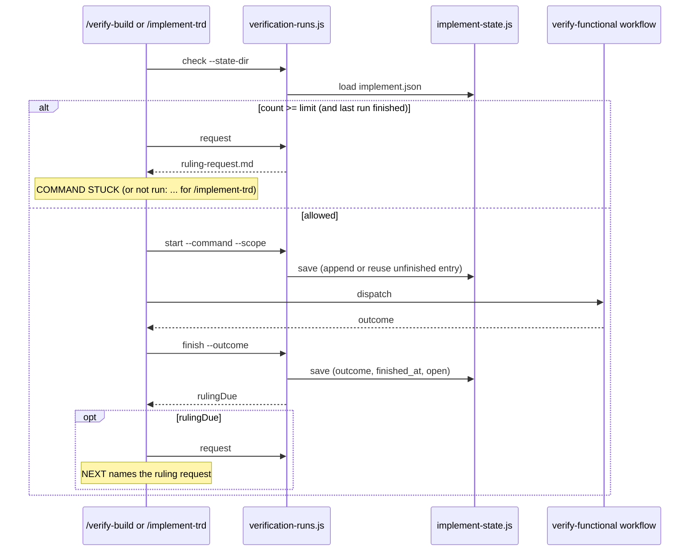

# TRD: Cap verification runs per feature

**Version**: 1.0.2
**Status**: Draft
**Created**: 2026-11-16
**Last Updated**: 2026-11-16
**Author**: @technical-architect
**Source PRD**: [docs/plan/cap-verification-runs-per-feature.investigation.md](../plan/cap-verification-runs-per-feature.investigation.md) (workplan `storybook-framework-requests`, roadmap item 2; Storybook PM request, message b8002d99, 2026-11-16)
**Task ID Prefix**: VRL

---

## Changelog


| Version | Date | Changes | Author |
|---------|------|---------|--------|
| 1.0.0 | 2026-11-16 | Initial TRD creation from the cap-verification-runs-per-feature investigation | @technical-architect |
| 1.0.1 | 2026-11-16 | /plan adversarial pass applied: interrupted run keyed to `verification-state.json` `outcome: null` and STUCK runs counted (D4); `save()` merge limited to `implement.json` (D5, OWNER-CALL); second run-limit check at the top of `/implement-trd` Step 8 (D7); `finish` rewrites the report's Next line at the limit (D13); ruling rows worded truthfully in filed issues (VRL-B001); second settings template (VRL-B003). | /plan |
| 1.0.2 | 2026-11-16 | /audit-trd findings applied: VRL-B003 edits no integration test, so it no longer shares `scaffold-delivery.test.sh` with VRL-B001; VRL-D001's text and grounding made to agree with D7 (no `--verify --resume` skip); §1.4 and D11 say `waived-defects.js` wording changes; a runs-only `implement.json` stub is not a corrupted state file (§3.1, VRL-D001); D14's symlink sentence and four citations corrected (`readThresholds` range, §3.6a spread line, the `:1506-1545` schema claim, the DSGN-T002 evidence file); Could Not Verify rewritten. | /audit-trd |

## Objectives

O1–O7 are the investigation's objectives, copied with their ids, wording and must-pass marks. The
source carries no `**Source spec**:` header, so the locked-scope rule does not bind; nothing was
added to them. O8 and O9 come from the constitution.

| ID | Objective | Source | Must pass |
|----|-----------|--------|-----------|
| O1 | Every counted verification run of a feature is recorded in `.trd-state/<feature>/implement.json` as `functional_verification.runs`, one entry per run, and the count is carried across `/implement-trd`'s verification pass, `/verify-build`, `/refine-verification` and every `--resume` of either command — no command starts a fresh count, and resuming an interrupted run does not add a second entry for it | investigation O1 (the PM's instruction, 2026-11-16; roadmap item 2 brief) | yes |
| O2 | When a feature already has as many counted runs as the limit allows, `/verify-build` (and `/implement-trd`'s own verification pass) starts no further run: it dispatches nothing, writes one ruling request listing everything still open, and ends on that request | investigation O2 (the PM's instruction, 2026-11-16; roadmap item 2 acceptance "a third run is refused with a ruling request") | yes |
| O3 | When a feature has reached the limit, `/refine-verification` writes no `verification-plan.md`; it writes (or re-reads) the same ruling request and ends on it | investigation O3 (the PM's instruction, 2026-11-16; roadmap item 2 acceptance "/refine-verification declines a third plan") | yes |
| O4 | A run that ends not satisfied and brings the count to the limit names the ruling request as its NEXT step, not `/refine-verification` | investigation O4 (roadmap item 2 brief: "After 2 full runs ... stop recovering") | |
| O5 | The ruling request lists every criterion still open (in plain words, with its cause and how many runs it stayed open) and offers exactly three outcomes — ship as is, fix one named thing, drop it — each with the step that carries it out; it is addressed to the product PM, who may escalate to the owner | investigation O5 (the PM's instruction, 2026-11-16; OWNER-CALL (PM, 2026-11-16): the ruling goes to the product PM, who may escalate) | |
| O6 | The limit is a setting, `ensemble.verificationRunLimit` in `.claude/settings.json`, defaulting to 2 when absent; a refresh never overwrites an owner's value | investigation O6 (the PM's instruction: "The limit is a setting defaulting to 2") | |
| O7 | Shipping or dropping an open criterion through the ruling leaves it filed as a defect issue in the project's tracker, as every other waived criterion is | investigation O7 (standing owner rule, 2026-11-12: "ANY such requirements must be captured as issues") | yes |
| O8 | The vendored runtime under `.claude/` and the `packages/full` distribution carry exactly the edited `packages/core` files (identical content; a new library is symlinked into `packages/full/lib/`) | `constitution.md` Architecture Invariants, "Vendored Runtime" (identical behaviour in local CLI and web sessions); `stack.md` File Structure (`full/` is the complete plugin distribution); investigation Grounding "Vendoring" | |
| O9 | Tests pass with unit coverage at or above 60% and integration coverage at or above 50% where integration tests apply | `constitution.md` Quality Gates | |

**Must pass** is on O1, O2, O3 and O7, exactly as the investigation marks them: a lost count lets a
third recovery cycle through, a missing refusal is the feature not existing, and a waived criterion
that is never filed breaks the owner's standing rule.

## 1. Overview

### 1.1 Technical Summary

Today nothing counts verification runs. `/verify-build`'s `cap` (`verify-build.md:429`, default 3)
bounds iterations inside one run, and the fix loop's stop rule bounds rounds inside one
invocation, but `/refine-verification` → `/verify-build` can repeat without end ("Refine, run,
repeat", `verify-build.md:640`).

This change adds one deterministic owner of the count:

1. **A new library, `packages/core/lib/verification-runs.js`,** reads the limit from
   `ensemble.verificationRunLimit` (absent → 2), keeps an append-only list of counted runs in
   `implement.json` under `functional_verification.runs`, answers "may another run start?",
   renders the ruling request to `.trd-state/<feature>/ruling-request.md`, and records the PM's
   ruling, writing waived (`[non-blocking] `) discovery rows through the existing
   `recordNonBlockingFollowups` so `waived-defects.js gate` files them as defect issues at close.
2. **`implement-state.save()` never drops a run entry**: it merges `functional_verification.runs`
   from the file on disk, so a command carrying a stale in-memory state object cannot erase the
   count (the hazard the investigation's Grounding names for `/implement-trd`).
3. **`/implement-trd` §3.6 spreads `functional_verification`** instead of replacing it.
4. **The three commands call the library's CLI** at fixed points: before a run starts (refuse at
   the limit, end `COMMAND STUCK` on the ruling request), at the first dispatch (`start`), when the
   workflow returns (`finish`, which says whether a ruling is now due), and, in
   `/refine-verification`, before Derive (decline a plan at the limit).

No model call is added. The framework writes the request; it never chooses an outcome.

### 1.2 Key Technical Decisions

| ID | Decision | Choice | Serves Objective | Rationale | Alternatives Considered |
|----|----------|--------|------------------|-----------|------------------------|
| D1 | Where the count, limit, refusal and ruling request live | New library `packages/core/lib/verification-runs.js` with a CLI; the three commands call it rather than re-deriving any of it in prose. Inherited from the investigation's Decision. | O1, O2, O3, O5 | `functional-verification.js` is already ~3500 lines and documented pure (no clock, no git); this code reads settings and writes state. No existing library owns per-feature run history. | Add to `functional-verification.js` — rejected for the purity contract; revisit if that file drops its "pure" claim. Prose-only rules in each command — rejected: three commands would each re-derive the count and drift. |
| D2 | Where the count is stored | `implement.json` → `functional_verification.runs`, an array; count = its length. Inherited from the investigation. | O1 | The Judge rewrites `verification-state.json` on every run and a fresh run starts it over, so it cannot carry a count across runs. `implement.json` goes to the records ref and is restored by `implement-state.load()` (`restoreFromRef`), so the count follows the feature across worktrees. | `verification-state.json` — rejected (rewritten per run). A separate `runs.json` — rejected: a second per-feature record for one array, and the PM specified `implement.json`; revisit if `implement.json` writers multiply further. |
| D3 | `/implement-trd` §3.6 | Both §3.6 assignments become spreads: `state.functional_verification = { ...state.functional_verification, prd_resolved, prd_path }`. Inherited from the investigation ("absorbed [BLOCKS]"). | O1 | Before this change §3.6's two assignments (investigation: `implement-trd.md:825-827`; now `:833` and `:835`, both spreads) replaced the whole object on every run, which would reset the count on every re-run (`--reconcile` included). §3.6a (now `:987-988`) already spreads; this makes §3.6 match. | Leave §3.6 alone and rely on D5 alone — rejected: D5 protects against stale saves, but an explicit `= { … }` assignment documented as the pattern invites the next writer to copy it. |
| D4 | What counts as one run | One counted run = the first dispatch of the `verify-functional` workflow over a feature's own success definition, by `/implement-trd` §8.3 or by one `/verify-build` invocation (the fix loop's later rounds belong to that run). **Not counted:** a resume of an interrupted run, whatever flag led there — an interrupted run is one whose `verification-state.json` has `outcome: null`, the test `verify-build.md` step 1a.1 and its `--resume` section already use (so `/verify-build --resume` against a *finished* state file, which starts a fresh run, IS counted); `--criteria` subset re-proofs (custody, under `reverify/`, including their one retry); a sweep file (`<slug>-sweep`); rerun scope `none`. `start` continues the last entry instead of appending only when that entry is unfinished (`finished_at: null`) **and** `verification-state.json` has `outcome: null`; an unfinished last entry whose state file has an outcome (a run that ended STUCK after the workflow returned, or whose `finish` was lost) is closed by `start` as `outcome: 'abandoned'` and counts. Every path that ends after `start` calls `finish`, STUCK paths included (`verify-build.md` fix-loop step 3's `RETURN → STUCK`). Inherited from the investigation, plus the continue rule; corrected after the adversarial review (a STUCK run must not be free). | O1, O2 | The ask is runs, "not only rounds per run". Keying "interrupted" to `outcome: null` reuses the framework's one existing definition rather than inventing a second, and makes "resuming an interrupted run does not add a second entry" hold on every path that re-enters it (for example `/implement-trd --resume` without `--verify` after a crash mid-verification). | Count every workflow dispatch, rounds included — rejected by the investigation (the ask is explicitly runs). Count resumes — rejected by O1. Append always and let an abandoned entry count — rejected: a crash would spend the PM's budget. |
| D5 | Keeping the count safe from stale saves | **OWNER-CALL (Forge, 2026-11-16):** the count stays in `implement.json` as the PM specified; the adversarial review proposed a separate `verification-runs.json` with one writer instead, rejected only because it departs from the PM's stated field. `implement-state.save()`, **only when `path.basename(filePath) === 'implement.json'`** (it also writes `verification-state.json`, live-evidence and custody records, which must see no extra read), reads the file on disk (when it exists and parses) and merges `functional_verification.runs`: union by `n`, per `n` the entry with a non-null `finished_at` wins, else the incoming one; sorted by `n`. A save can therefore never shorten the list; only deleting the file (`--reset-state`) clears it. The CLI writes through `load()`/`save()` and prints the merged `runs`. | O1 | Measured in this repo: `implement-trd.md:813-819` records that "a key that exists only on disk is clobbered by that first phase write" — `/implement-trd` and `/verify-build` carry `state` in context and `save()` writes the whole object. A rule in code holds where a prose instruction ("reassign `runs` before saving") has already been shown not to. | Prose only: each command copies the CLI's printed `runs` into its state object before its next save — rejected as the sole guard for the reason above, kept as the documented practice. Reload the whole state from disk before every save — rejected: it would discard the command's own in-memory changes, the opposite hazard. |
| D6 | Run entry shape | `{ n, command, started_at, scope, outcome, finished_at, open }`. `open` is added to the investigation's shape: the ids not `met` (or settled as a definition problem) when the run finished, read by `finish` from `<state-dir>/verification-state.json`. | O5 | O5 asks how many runs each open criterion stayed open; `verification-state.json` holds only the latest run, so per-run membership must be kept somewhere. Departure from the investigation's entry shape, stated here. | Re-derive from archived reports — rejected: no report history is kept. Store full criterion records per run — rejected: ids are enough; statements and causes come from the latest state and definition. |
| D7 | Where each command asks | `/verify-build`: after step 1a chooses the scope (scope `none` → no check), before step 2's preflight; `start` at step 4's first dispatch; `finish` after step 5's return, or after the fix loop's last round. `/implement-trd`: `check` at §3.6 before the derive dispatch (so a refused run spends no derive agent), and **again at the top of Step 8, before §8.1 reads `prd_resolved`** — that second check decides the outcome `not run: verification run limit reached`, so a §3.6 refusal is never misreported by §8.1 as `not run: no definition produced`; skipped only under `--no-verify` and `--chained` (a resume is handled by D4's interrupted-run rule, so there is no per-flag resume skip); `start` at §8.3, `finish` at §8.4. `/refine-verification`: `check` after `record-ref.js ensure`, before Derive. `start` refuses in code too, so a skipped prose check still cannot start a run past the limit. | O2, O3 | The investigation places the checks; checking before §3.6's derive and step 2's preflight avoids spending agents on a run that will be refused. | Check only at dispatch — rejected: a refused `/implement-trd` would already have spent the derive pass. |
| D8 | How a refusal ends | `/verify-build` and `/refine-verification` end `═══ COMMAND STUCK: /<command> ═══`, `Reason: verification run limit reached (<n> of <limit> runs)`, `Next:` the ruling request path (and its link). `/implement-trd` keeps the banner its other work dictates; its FUNCTIONAL VERIFICATION outcome is `not run: verification run limit reached`, with one ISSUES line and NEXT naming the request. Inherited from the investigation. | O2, O3 | The command did not do what it was invoked to do and a person must decide before anything moves; `/implement-trd` did build its tasks. | End `COMMAND COMPLETE` with the request in NEXT — rejected by the investigation: it reads as success. |
| D9 | Limit vs latest outcome | The limit applies whatever the latest outcome was; a run past the limit is refused after a `satisfied` run too, and the request then says nothing is open. Inherited from the investigation. | O2 | One rule, no outcome-dependent exception to reason about. In `/refine-verification` the limit check runs first and wins over its "does not apply to a run that ended `satisfied`" rule (`refine-verification.md:127`; the limit-wins rule is at `:113-115`): at the limit it declines with the ruling request either way. | Exempt a run after `satisfied` — rejected by the investigation; custody re-proofs (uncounted, D4) already cover re-checking a satisfied feature after a change. |
| D10 | The ruling request as a record | `renderRulingRequest` writes `.trd-state/<feature>/ruling-request.md` deterministically from `runs`, `verification-state.json` and `success-definition.md`; re-rendering with unchanged inputs gives the same text, and a recorded ruling is shown in it. Commands record it with `artifacts.js record --kind ruling-request` and publish it like the verification report when `ensemble.publishArtifacts` is not `false`. `ruling-request` joins `artifacts.js KINDS` and the kinds list in `command-status.md`. | O2, O3, O5 | The investigation asks for it to be published/recorded like the verification report; one renderer gives `/verify-build`, `/implement-trd` and `/refine-verification` the same document ("the same ruling request", O3). | Model-written request — rejected: three commands would write three versions. Unpublished, like `verification-plan.md` — rejected by the investigation. |
| D11 | Carrying out the three outcomes | `record-ruling --outcome ship\|fix\|drop [--criterion <id>] --by <who>` stores `functional_verification.ruling = { outcome, criterion, by, recorded_at }` and, for `ship` and `drop`, writes a `[non-blocking] ` row per open criterion via `recordNonBlockingFollowups` with reason `shipped as is by ruling <date>` / `dropped by ruling <date>`; for `fix`, every open criterion except the named one. The request names each outcome's steps: ship → `record-ruling --outcome ship`, then `/audit-build`; fix → `record-ruling --outcome fix --criterion <id>`, then `/amend "<the criterion in words>"`, then `/audit-build`; drop → `record-ruling --outcome drop`, then `/audit-build`. The framework never runs `record-ruling` itself. Inherited from the investigation ("absorbed [BLOCKS]"). | O5, O7 | `waived-defects.js gate` (run by `/audit-build` and `/close-feature`) already files every `[non-blocking] ` row as a defect issue before close, so no new filing path is needed. The issue *wording* does change: `waived-defects.js` `waiverLine`/`buildIssue` today state for every row that the criterion "is not must-pass, so it did not block" and was waived under `Blocking: must-pass only`, which is false for a ruling row, so VRL-B001 makes them word a ruling row as waived by the PM's ruling. `recordNonBlockingFollowups` is idempotent per ref. | A new waiver row kind — rejected: the gate would need to learn it. Let the framework apply the ruling — rejected by the investigation: the outcome is the PM's act. |
| D12 | The setting | `ensemble.verificationRunLimit`: an integer ≥ 1; absent or `null` → 2. Set but invalid → the CLI exits non-zero naming the setting, and the command ends `COMMAND STUCK` naming it. Read following `docs-audit-assemble.js readThresholds` (`:85-116`). Shipped in the template `settings.json`; `scaffold-project.sh` backfills it with `setdefault` beside `publishArtifacts`. | O6 | Same shape and validation as the one existing `ensemble.*` numeric setting; `setdefault` is how every other `ensemble` key survives a refresh (`scaffold-project.sh:1647-1658`). | Fall back to 2 on an invalid value — rejected: a silent default hides a typo in a limit the PM set deliberately. Store it in `verification.md` — rejected by the investigation (owner-governed; the PM asked for a setting). |
| D13 | Ruling due after a run | `finish` returns `rulingDue: true` when the count has reached the limit and the run's NEXT would otherwise have been `/refine-verification` or another `/verify-build` — any outcome but `satisfied`, or `satisfied` with a definition problem. The command then renders the request and its NEXT names it instead of `/refine-verification`. **When `rulingDue`, `finish` also rewrites the `**Next**:` line of `<state-dir>/verification-report.md` to name `ruling-request.md`**, so the published report and the readout still never disagree (`verify-build.md:553-554`, `implement-trd.md:2462`); `renderReport` is unchanged. A `setup-failure` run at the limit (OQ-2) makes a ruling due too: the ruling request NEXT wins over the setup-failure NEXT, and the request lists the setup problems and their fixes so the PM sees the environment, not the code, is broken. | O4 | Computed in one place so the three commands' NEXT lines, and the report, cannot disagree. | Let each command decide from the count — rejected for the same drift reason as D1. |
| D14 | Mirroring | Each task copies every `packages/core` file it edits over its `.claude/` copy in the same change; `packages/full/lib/verification-runs.js` is a symlink to `../../core/lib/verification-runs.js` (pattern: `packages/full/lib/rerun-scope.js`). | O8 | `packages/full/contracts`, `scripts` and `templates` are directory symlinks into `packages/core`, and `packages/full/commands` is a real directory whose `core` entry is a symlink to `../../core/commands` (beside a real `plugin-only/`), so an edited core command needs no `packages/full` copy; only `packages/full/lib` is per-file. | A final mirror-only task — rejected: each task's acceptance can check its own copies, and a separate pass costs an implement-loop dispatch for nothing. |

### 1.3 Technology Stack

| Layer | Technology | Purpose | Notes |
|-------|------------|---------|-------|
| Library | Node.js 18+ (CommonJS, no new dependency) | `verification-runs.js`, `implement-state.js` change | per `stack.md` |
| Commands | Markdown prompts | `/implement-trd`, `/verify-build`, `/refine-verification` | constitution Principle 3 |
| Tests | Jest ^29, BATS ^1.9 | library and prose tests; `scaffold-project.test.sh` | per `stack.md` |

### 1.4 Integration Points

| System | Type | Direction | Notes |
|--------|------|-----------|-------|
| `implement-state.js` | library call | out | the only writer of `implement.json` |
| `functional-verification.js` | library call | out | `recordNonBlockingFollowups`, `readDefinitionRows` |
| `waived-defects.js gate` | file (discovery ledger) | out | files the rows D11 writes; its issue wording (`waiverLine`/`buildIssue`) gains a ruling-row case (VRL-B001, D11) |
| `artifacts.js` / `Artifact` tool | CLI / tool | out | records and publishes the ruling request |
| records ref (`record-ref.js`) | git ref | out | `implement.json` and `ruling-request.md` travel with each command's one records write |

## 2. System Architecture

### 2.1 Data flow



`/refine-verification` runs only the `check` → `request` branch. The PM later runs
`record-ruling`, which writes `functional_verification.ruling` and the waived rows that
`/audit-build`'s `waived-defects.js gate` files.

## 3. Technical Specifications

### 3.1 `verification-runs.js` (new)

**Interface**:

```typescript
const DEFAULT_LIMIT = 2;
interface Run {
  n: number;                 // 1-based
  command: '/implement-trd' | '/verify-build';
  started_at: string;        // ISO
  scope: 'full' | 'targeted';
  outcome: string | null;    // the workflow's outcome, null until finish
  finished_at: string | null;
  open: string[];            // criterion ids open at finish; [] until finish
}
readLimit(root: string): number;                       // throws RunLimitError naming the setting
status(stateDir, { root }): { count, limit, allowed, continuing: boolean, runs: Run[] };
start(stateDir, { command, scope, root, nowIso }):     // refuses (allowed:false) and writes nothing at the limit
  { allowed, continued: boolean, run: Run | null, count, limit, runs };
finish(stateDir, { outcome, root, nowIso }): { run, count, limit, rulingDue: boolean, runs };
renderRulingRequest(stateDir, { feature, command, root, nowIso }): { path, open: OpenItem[] };
recordRuling(stateDir, { outcome: 'ship' | 'fix' | 'drop', criterion?, by, nowIso }):
  { ruling, waived: { recorded: string[], skipped: string[], failed: string[] } };
// CLI: check | start | finish | request | record-ruling, each printing one JSON object
```

**Behavior**:
- `allowed` is `count < limit`, or the last entry is unfinished and `verification-state.json` has
  `outcome: null` (`continuing: true`; D4).
- `start` appends `{ n: count + 1, …, outcome: null, finished_at: null, open: [] }`, or returns the
  unfinished last entry with `continued: true`; an unfinished last entry whose state file has an
  outcome is first closed as `outcome: 'abandoned'` (it counts), then the limit is applied.
- `finish` fills the last unfinished entry; `open` = ids in `verification-state.json` whose
  `status` is not `met` (a definition problem is stored as `not_met` with `settled:
  'definition-problem'`, so it is already included). `rulingDue` per D13; when true, `finish`
  rewrites the report's `**Next**:` line (D13). No unfinished entry → exits non-zero (`no run in progress`); the command reports it as one
  ISSUES line, never STUCK.
- The request (`ruling-request.md`) carries: who it is for (the product PM, who may escalate to the
  owner); the runs (n, command, start, outcome); one row per open criterion with its functional
  statement from `success-definition.md` (falling back to the state entry's `reason` when the
  definition has none), its kind and cause from the state entry, and how many runs listed it in
  `open`; exactly three outcomes, each with its steps (D11); the recorded ruling, if any. With
  nothing open it says so in one line and still lists the outcomes' steps.
- `record-ruling --outcome fix` requires `--criterion` to be an open id; anything else exits
  non-zero naming the id. A second `record-ruling` replaces `ruling`; waived rows already written
  stay (idempotent per ref).
- All writes go through `implement-state.load()`/`save()`.

**Error Handling**:
- Invalid `ensemble.verificationRunLimit`, or `.claude/settings.json` not valid JSON: exit 2 with
  `{ "error": "<setting> must be an integer of at least 1 (got …)" }`.
- No `implement.json`: `status` reports count 0; `start` seeds `functional_verification` on a new
  state object only when the file is absent — it never replaces an existing one. The seed is a
  stub holding only `{ functional_verification: { runs } }`, which lacks the fields
  `/implement-trd` §2.3 State Validation requires (`version, trd_file, trd_hash, phase_cursor,
  tasks`). §2.3 must therefore treat a file with `functional_verification` and no `tasks` as
  this stub, not as a corrupted state file (no git reconstruction, no `--reset-state` offer,
  which would delete the count): `/implement-trd` starts a fresh state object, and `save()`'s
  merge (D5) carries `runs` into it. VRL-D001 writes that rule into §2.3.

### 3.2 `implement-state.save()`

Only when `path.basename(filePath) === 'implement.json'`: before writing, reads `filePath` when it exists and parses; merges
`functional_verification.runs` per D5; an unreadable file means no merge. Nothing else in the
object is merged. The incoming object is not mutated.

### 3.3 Commands

| Command | Before a run | At first dispatch | On return | Readout |
|---------|--------------|-------------------|-----------|---------|
| `/verify-build` | a new step 1b, after 1a's scope choice; skipped for scope `none`, a sweep file and `--criteria` (an interrupted-run resume passes `check` as `continuing`, D4) | step 4: `start --command /verify-build --scope <full\|targeted>`; the fix loop's later rounds do not call it | step 5 (no plan) or fix-loop step 6: `finish --outcome <o>`; a fix-loop `RETURN → STUCK` also calls `finish` before its STUCK banner | refused → STUCK (D8); `rulingDue` → NEXT names the request, never `/refine-verification` |
| `/implement-trd` | §3.6, before the derive dispatch, and again at the top of Step 8 before §8.1; skipped under `--no-verify` and `--chained` | §8.3 `start` | §8.4 `finish` | FUNCTIONAL VERIFICATION `not run: verification run limit reached`; ISSUES line; NEXT names the request |
| `/refine-verification` | after `record-ref.js ensure`, before Derive, both modes | — | — | at the limit: no plan written, `request`, record and publish, STUCK (D8) |

Each command that holds `state` in memory copies the `runs` the CLI prints into its object before
its next `save()` (D5's documented practice; the merge in `save()` is the backstop). VRL-D001
adds `runs` and `ruling` to the schema block and its prose at `implement-trd.md:1506-1545`,
which today document only `prd_resolved`, `source_kind`, `prd_path`, `target` and
`environments`.

## 4. Master Task List

### 4.1 Task ID Convention

`VRL-[CATEGORY][SEQ]`: B = library code, D = command and reference prose, T = `[LIVE]`
feature-level verification. Unit and prose tests ship inside each B and D task.

### 4.2 Phase 1: Libraries (three files, in parallel)

| Task ID | Description | Serves | Skills | Dependencies | Acceptance Criteria |
|---------|-------------|--------|--------|--------------|---------------------|
| VRL-B001 | New `packages/core/lib/verification-runs.js` (§3.1) with `verification-runs.test.js`; copy to `.claude/lib/verification-runs.js`; symlink `packages/full/lib/verification-runs.js` → `../../core/lib/verification-runs.js`. | O1, O2, O3, O4, O5, O6, O7, D1, D2, D4, D6, D9, D10, D11, D12, D13 | `jest` | None | `npx jest packages/core/lib/verification-runs.test.js` passes, each case in a temp `.trd-state/<f>/`: absent setting → limit 2; `5` → 5; `0`, `-1`, `"2"`, `2.5` → exit 2 naming `ensemble.verificationRunLimit`; two `start`/`finish` pairs then `start` → `allowed: false`, file unchanged; a `start` after an unfinished entry with `verification-state.json` `outcome: null` → `continued: true`, length unchanged; a `start` after an unfinished entry whose state file has an outcome → that entry closed as `abandoned` and counted (at 1 of 2 a new run is allowed, at 2 of 2 refused); `finish` with no unfinished entry → non-zero; `finish` reads `open` from a fixture `verification-state.json`; `rulingDue` true for `stalled` at 2 of 2, false for `stalled` at 1 of 2, false for `satisfied` at 2 of 2, true for `satisfied` with a `not_met` entry settled `definition-problem` at 2 of 2, true for `setup-failure` at 2 of 2; when `rulingDue`, the fixture report's `**Next**:` line names `ruling-request.md` and no other line changes; the request lists each open criterion's statement, cause and runs-open count (a criterion open in both runs shows 2), the three outcomes and their steps, and says "nothing is open" for an empty list; rendering twice with unchanged inputs gives identical text; `record-ruling ship` writes one `[non-blocking] ` row per open id and `waived-defects.listWaived` returns them; `fix --criterion X` waives all but X; `fix` with a non-open id → non-zero; `drop` rows carry `dropped by ruling`; `waived-defects.js` words an issue filed from a ruling row as waived by the PM's ruling (not as `Blocking: must-pass only`), and `waived-defects.test.js` passes with a case for it; `verification-runs` is in `scaffold-delivery.test.sh`'s delivered-module list; an existing `functional_verification` key (`prd_path`, `environments`) survives every write. `cmp` against `.claude/lib/verification-runs.js` reports no difference; `readlink packages/full/lib/verification-runs.js` is `../../core/lib/verification-runs.js`. |
| VRL-B002 | `implement-state.js save()`: for files named `implement.json` only, merge `functional_verification.runs` from disk (§3.2, D5); cases in `implement-state.test.js`; copy to `.claude/lib/implement-state.js`. | O1, D5 | `jest` | None | `npx jest packages/core/lib/implement-state.test.js` passes with new cases: disk has 2 runs, incoming has none → written file has 2; incoming has 1 (stale) → 2; disk run 2 finished and incoming run 2 unfinished → finished one kept; incoming has 3 → 3; disk file absent or unparseable → incoming written as is; no other key is merged (a changed `tasks` entry in the incoming object wins); a save to a file not named `implement.json` (for example `verification-state.json`) reads nothing from disk and writes the incoming object byte-for-byte as before; the incoming object is not mutated. `cmp` against `.claude/lib/implement-state.js` reports no difference. |
| VRL-B003 | Shipped surface: `"verificationRunLimit": 2` in `packages/core/templates/claude-directory/settings.json` and `packages/full/.claude/settings.json` (a second, regular-file template); `ensemble.setdefault("verificationRunLimit", 2)` in `scaffold-project.sh` beside `publishArtifacts`, with a case in `scaffold-project.test.sh`; `ruling-request` added to `artifacts.js KINDS` (its doc comment says twelve) and to the kinds list in `packages/core/templates/claude-directory/rules/command-status.md` and `.claude/rules/command-status.md`; copy `artifacts.js` to `.claude/lib/`. One task: each piece is one line registering the new surface, and none has behaviour of its own. | O6, O8, D10, D12, D14 | `jest` | None | `bats packages/core/scripts/scaffold-project.test.sh` passes, including a case where a project with `"verificationRunLimit": 4` keeps 4 after a refresh and one without the key gains 2; `npx jest packages/core/lib/artifacts.test.js` passes with the `KINDS` list updated to twelve entries and `grep -rn eleven packages/core/lib/artifacts*.js` finds nothing; both settings templates carry the key and `cmp` reports them identical; both `command-status.md` copies name `ruling-request` and `cmp` reports them identical; `cmp packages/core/lib/artifacts.js .claude/lib/artifacts.js` reports no difference. |

### 4.3 Phase 2: Commands (three files, in parallel), then reference docs

| Task ID | Description | Serves | Skills | Dependencies | Acceptance Criteria |
|---------|-------------|--------|--------|--------------|---------------------|
| VRL-D001 | `packages/core/commands/implement-trd.md`: §3.6 spreads in both assignments (D3); `check` before the derive dispatch, skipped under `--no-verify` and `--chained` (D7) — on the `--verify --resume` path §3.6 step 0 already skips §3.6 whole, so this check is simply not reached there and no separate skip is written; §2.3 State Validation treats a `functional_verification`-only `implement.json` as the `verification-runs.js` stub, not a corrupted file (§3.1 Error Handling); a second `check` at the top of Step 8 before §8.1 that decides `not run: verification run limit reached` (D7); §8.3 `start`, §8.4 `finish` and the `rulingDue` branch (D13); the refused outcome `not run: verification run limit reached` in Step 9 with its ISSUES and NEXT lines (D8); §9.0a records and publishes `ruling-request` when one was written (D10); add `runs` and `ruling` to the schema and prose at `:1506-1545`; copy the CLI's printed `runs` into `state` before the next save (D5). New prose test `packages/core/commands/implement-trd-run-limit-prose.test.js`; copy to `.claude/commands/implement-trd.md`. | O1, O2, O4, D1, D3, D5, D7, D8, D10, D13 | `jest` | VRL-B001, VRL-B002 | The prose test passes and fails if: either §3.6 assignment lacks `...state.functional_verification`; §2.3 has no rule that a `functional_verification`-only `implement.json` is a stub, not a corrupted file; Step 8 has no `verification-runs.js check` before §8.1's `prd_resolved` read; the text keeps a `--verify --resume` skip of the check; the text loses `verification-runs.js check`, `start` or `finish`; `not run: verification run limit reached` is missing; the `rulingDue` NEXT does not name the ruling request. `grep -c "state.functional_verification = { prd_resolved"` is 0. `npx jest packages/core/commands` passes. `cmp` against `.claude/commands/implement-trd.md` reports no difference. |
| VRL-D002 | `packages/core/commands/verify-build.md`: `check` after step 1a's scope choice, before step 2, as a new step 1b; skipped for scope `none`, a sweep file and `--criteria`, while a resume of an interrupted run (`outcome: null`) passes it as `continuing` and a `--resume` of a finished state file is checked and counted like a plain run (D4, D7); refusal → request, record, publish, `COMMAND STUCK` with the D8 reason (D8); step 4 `start` on the first dispatch only; `finish` after step 5 or the fix loop's step 6, and before the STUCK banner on fix-loop step 3's `RETURN → STUCK`; the Readout's "the report's Next line says the same" sentence names the at-limit exception (`finish` rewrites the report's line, D13); the Readout's NEXT rule gains the `rulingDue` branch, which replaces `/refine-verification` (D13); "Refine, run, repeat" (`:640`) names the limit; the Artifact link section publishes `ruling-request`. New prose test `packages/core/commands/verify-build-run-limit-prose.test.js`; copy to `.claude/commands/verify-build.md`. | O1, O2, O4, D4, D7, D8, D10, D13 | `jest` | VRL-B001, VRL-B002 | The prose test passes and fails if: the `check` call is missing or appears after step 2's heading; the D8 reason line is missing; the `--criteria` or sweep paths lose their "not counted" statement; the resume skip is worded as anything other than "an interrupted run (`outcome: null`)"; fix-loop step 3's STUCK path has no `finish`; the NEXT rule has no `rulingDue` branch. `npx jest packages/core/commands` passes (including `verify-command-surface.test.js` and `verify-build-criteria.test.js`). `cmp` against `.claude/commands/verify-build.md` reports no difference. |
| VRL-D003 | `packages/core/commands/refine-verification.md`: a run-limit check in Inputs after `record-ref.js ensure`, before Derive, in both modes (D7); at the limit no `verification-plan.md` is written — `request`, `artifacts.js record --kind ruling-request`, publish (D10), the records-ref write, `COMMAND STUCK` with the D8 reason (D8); Writes, Never and Readout name the decline branch. New prose test `packages/core/commands/refine-verification-run-limit-prose.test.js`; copy to `.claude/commands/refine-verification.md`. | O3, D7, D8, D10 | `jest` | VRL-B001 | The prose test passes and fails if: the check is missing or follows the `## Derive` heading; Writes does not say no plan is written at the limit; the D8 reason line is missing; the `--auto` mode is not covered by the same check. `npx jest packages/core/commands` passes (including `refine-recommend-prose.test.js`). `cmp` against `.claude/commands/refine-verification.md` reports no difference. |
| VRL-D004 | Reference and history: `docs/reference/verification.md`, `docs/reference/implement-trd.md` and `docs/reference/other-commands.md` describe the per-feature run limit, the setting, what counts and the ruling request; a dated `AMENDED 2026-11-16 by docs/TRD/cap-verification-runs-per-feature.md D13` marker on `docs/TRD/refine-verification.md` O4 (the one NEXT rule gains the at-limit exception), original wording kept; CHANGELOG `[Unreleased]` entry. | O4, O5, O6, D13 | | VRL-D001, VRL-D002, VRL-D003 | Each reference file names `ensemble.verificationRunLimit`, its default 2, and `ruling-request.md`; `docs/TRD/refine-verification.md` carries the marker and nothing else in it changes; CHANGELOG `[Unreleased]` names the feature. |

### 4.4 Phase 3: Feature-level verification

| Task ID | Description | Serves | Skills | Dependencies | Acceptance Criteria |
|---------|-------------|--------|--------|--------------|---------------------|
| VRL-T001 | [LIVE] In a `fixtures` slot (`verification.md` §1, §1a), scaffold a project from `packages/full`, seed `.trd-state/<f>/implement.json` with two finished runs and a `verification-state.json` with two open criteria, then run headless `/refine-verification --auto` and `/verify-build`; then reseed with one finished `stalled` run and check the second run's NEXT. Record each transcript and the written files under `.trd-state/<feature>/evidence/live/VRL-T001/` and list them in `live-manifest.jsonl`. | O2, O3, O4 | | VRL-B003, VRL-D002, VRL-D003 | At 2 of 2: `/refine-verification --auto` ends `COMMAND STUCK` with `verification run limit reached (2 of 2 runs)`, writes no `verification-plan.md`, and writes `ruling-request.md` listing both criteria and the three outcomes; `/verify-build` ends the same way, dispatches no `verify-functional` workflow (no new `verification-state.json` write), and `runs` still has two entries. At 1 of 2 with a stub that ends the second run not satisfied: `runs` has two entries and NEXT names the ruling request, not `/refine-verification`. |
| AMEND-001 | [test-gap] No test calls record-ruling twice: a second ruling should replace functional_verification.ruling and keep the waived rows already written, one per criterion (TRD §3.1 Behavior). — promoted from a gap discovery found by audit-build — find and fix every instance of this weakness across the feature's touched files, and list each one fixed (observed: packages/core/lib/verification-runs.test.js describe record-ruling (each test uses a fresh fixture); behaviour at packages/core/lib/verification-runs.js:366-371 and packages/core/lib/functional-verification.js:1703-1708) | amendment — no objective recorded |  | None | [test-gap] No test calls record-ruling twice: a second ruling should replace functional_verification.ruling and keep the waived rows already written, one per criterion (TRD §3.1 Behavior). no longer holds |

## Deferred by design

| Task ID | Why it cannot run now |
|---------|-----------------------|
| VRL-T001 | [LIVE] task: needs headless model sessions in a scaffolded fixtures slot; /implement-trd sets [LIVE] tasks aside unless --include-deferred, so it runs as a separate live pass after the build |

## 5. Execution Plan

### 5.1 Phase Overview

| Phase | Focus | Prerequisites | Parallelizable Sessions |
|-------|-------|---------------|------------------------|
| 1 | Libraries and shipped surface, each with its tests | None | 1A, 1B, 1C in parallel (different files) |
| 2 | Command prose with prose tests, then reference docs | Phase 1 task(s) each depends on | 2A, 2B, 2C in parallel; 2D after them |
| 3 | `[LIVE]` headless verification | Phase 2 | single session |

### 5.2 Session Details

- **1A** VRL-B001, **1B** VRL-B002, **1C** VRL-B003 (@backend-implementer each).
- **2A** VRL-D001 (blocked by 1A, 1B), **2B** VRL-D002 (blocked by 1A), **2C** VRL-D003 (blocked by 1A); **2D** VRL-D004 after 2A–2C.
- **3A** VRL-T001 (@verify-app), after 1C, 2B and 2C.

### 5.3 Parallelization Map

```mermaid
gantt
    title Execution Plan (no time scale, dependency order only)
    dateFormat X
    axisFormat %s
    section Phase 1
    VRL-B001 verification-runs: b1, 0, 1
    VRL-B002 save merge: b2, 0, 1
    VRL-B003 setting and kind: b3, 0, 1
    section Phase 2
    VRL-D001 implement-trd: d1, after b1 b2, 1
    VRL-D002 verify-build: d2, after b1, 1
    VRL-D003 refine-verification: d3, after b1, 1
    VRL-D004 reference docs: d4, after d1 d2 d3, 1
    section Phase 3
    VRL-T001 live: t1, after b3 d2 d3, 1
```



### 5.4 Critical Path

VRL-B001/VRL-B002 → VRL-D001 → VRL-D004 (three steps); VRL-B001 → VRL-D002/VRL-D003 → VRL-T001 is equal in length.

## 6. Quality Requirements

### 6.1 Testing Requirements

| Type | Coverage Target | Source | Scope |
|------|-----------------|--------|-------|
| Unit Tests | ≥ 60% | `constitution.md` Quality Gates | `verification-runs.js`, the `implement-state.js` change |
| Integration Tests | ≥ 50% | `constitution.md` Quality Gates | where applicable: `scaffold-project.test.sh` (BATS) and VRL-T001 |

Command behaviour is prose; Jest prose tests pin the load-bearing sentences, and VRL-T001 is the
one `[LIVE]` walk of the refusal path (`constitution.md` sets `verification_level: unit-only`;
the `[LIVE]` marker overrides it for that task).

### 6.2 Code Quality Standards

- Any `git` call the library makes (through `record-ref.js`, via `load()`) is spawned with argument
  arrays, never a shell string (`CLAUDE.md` Security Considerations).

### 6.3 Security Requirements

None. The feature handles no credential, personal data, payment or tenancy boundary.

## 7. Risk Assessment

### 7.1 Risks Imported from PRD

The investigation has no risks section. Its Grounding names one hazard, carried as TR1.

### 7.2 Technical Risks

| ID | Risk | Likelihood | Impact | Mitigation |
|----|------|------------|--------|------------|
| TR1 | A command saves a stale in-memory `implement.json` after the CLI wrote a run, erasing the count (investigation Grounding, which cited `implement-trd.md:957-960` before the build; the whole-object save is now described at `implement-trd.md:821-823`). | High without D5 | High (O1 is must-pass) | D5's merge in `save()`, tested in VRL-B002; commands also copy the printed `runs`. |
| TR2 | A path that should not count calls `start` anyway (for example the fix loop's later rounds, or `--criteria`), spending the PM's budget in one invocation. | Med | Med | D4's list stated in each command; VRL-D002's prose test fails if a "not counted" statement is lost; VRL-T001 checks the count after a refused run. |
| TR3 | Features already in a refine-and-run cycle when this ships have no `runs` and start at 0, so their next two runs are allowed. | High (by design) | Low | Stated as OQ-1; no backfill is built. |

## 8. Non-Goals (Scope Boundaries)

| PRD ID | Non-Goal | Rationale |
|--------|----------|-----------|
| NG1 | Counting fix-loop rounds as runs | Rejected in the investigation's Decision: the ask is runs, "not only rounds per run" |
| NG2 | Storing the limit in `verification.md` | Rejected in the investigation's Decision: owner-governed, and the PM asked for a setting |
| NG3 | The end-of-run order of audit vs verification | Roadmap item 1 (`feature/10-audit-before-functional-verification`); investigation "not absorbed"; this change works in either order |
| NG4 | Per-kind artifact publishing | Roadmap item 4; investigation "not absorbed"; the request uses the existing `artifacts.js` and `publishArtifacts` switch |
| NG5 | The framework choosing or applying a ruling outcome | Investigation After §6: "applying it is the PM's act. The framework writes the request; it never picks an outcome itself" |
| NG6 | Capping custody re-proofs (`--criteria`) or sweep verification | Investigation After §1: not counted |

## Verification Artifacts

None apply — this change builds no screen, has no interaction diagram and renders no data from an
API or a store.

## Verification Environment

**Environment**: local for the library and prose tests; fixtures for VRL-T001
**Refresh**: local: none declared; fixtures: `packages/core/scripts/scaffold-project.sh --refresh --plugin-dir packages/full <slot folder>`
**Cannot be checked there**: `claude --remote` sessions and failures that occur only on the GitHub Actions runner (`verification.md` §5); a real defect issue filed in a tracker by `waived-defects.js gate` after a ship or drop ruling (VRL-B001 proves the rows exist and `listWaived` returns them, not the filing)

## 9. Task Grounding

### VRL-B001
- **Touches:** `packages/core/lib/verification-runs.js` (new), `packages/core/lib/verification-runs.test.js` (new), `.claude/lib/verification-runs.js` (copy), `packages/full/lib/verification-runs.js` (new symlink, `../../core/lib/verification-runs.js`), `packages/core/lib/waived-defects.js` and `packages/core/lib/waived-defects.test.js` (an issue filed from a ruling row — summary reason `shipped as is by ruling …` / `dropped by ruling …` — is worded as waived by the PM's ruling, not by `Blocking: must-pass only`; `buildIssue`/`waiverLine` today state the must-pass-only waiver for every row) [read — grounding finding], `.claude/lib/waived-defects.js` (copy), `test/integration/tests/scaffold-delivery.test.sh` (add `verification-runs` to the `for m in trd-parser task-graph implement-state …` list in the test `delivered lib modules are real files that load`) [read — the list and its comment about `plan-weight` being "delivered only through packages/full/lib's per-file symlink"]. Greenfield otherwise: `packages/core/lib/` has no file that counts runs and `grep -rn "verificationRunLimit\|runLimit" packages/core/lib packages/core/commands packages/core/workflows` finds nothing [ran].
- **Reuse:**
  - `load(filePath, opts)` / `save(filePath, state)` in `packages/core/lib/implement-state.js` — the only sanctioned `implement.json` writer; `save()` already `mkdir -p`s the folder and writes by temp+rename [read]. `load()` throws ENOENT on a missing file after a `restoreFromRef` attempt, which runs `record-ref.ensure` (a fetch) unless `opts.local` is set; `status`/`check` should catch ENOENT as "count 0" and pass `{ local: true }` so a read-only check does no network call [read — `function load(filePath, opts = {})`, `restoreFromRef`].
  - `recordNonBlockingFollowups(stateDir, nonBlocking, nowIso)` and `readDefinitionRows(definitionText)` in `packages/core/lib/functional-verification.js` (both in `module.exports`) [read]. `recordNonBlockingFollowups` takes `Array<string|{id, reason}>`, returns `{recorded, skipped, failed}`, writes `summary: "[non-blocking] <id>: <reason>"` with `foundBy: 'verify-functional'` hard-coded (OQ-7), and skips an id whose latest open row is already `[non-blocking]` [read]. The statement for a criterion is `row.cells['functional statement']` — the key `offHostProven` uses (`r.cells['functional statement'] ?? null`) [read]; do not reuse `waived-defects.js criterionFacts`' key list, which does not contain it.
  - `listWaived(stateDir)` in `packages/core/lib/waived-defects.js` for the test's "rows are returned" assertion [read].
  - Setting read: `readThresholds(repo)` in `packages/core/lib/docs-audit-assemble.js` — missing file → default, JSON parse failure → named error, `undefined`/`null` → default, otherwise `Number.isInteger` check with a message naming the setting [read].
- **Replaces:** nothing — nothing in the tree counts runs. `verify-build.md`'s `cap: capArg ?? 3` is an iteration cap inside one run and stays [read].
- **Follow:** CLI shape of `packages/core/lib/rerun-scope.js` (`main(argv)` returns an exit code, `emit(obj)` prints one JSON line, `if (require.main === module) process.exit(main(...))`) and its symlink commit `70a16a7b` (`packages/full/lib/ci-time.js`, `test-baseline.js` were added later because "the scaffold test counts packages/core/lib/*.js against what a fresh scaffold delivers" — `scaffold-project.test.sh` test `ITR-B014: fresh scaffold delivers .claude/lib/*.js matching packages/core/lib`) [read]. Flag parsing: `artifacts.js parseArgs` (`--name value` pairs, throws on an unknown positional) [read].
- **Careful:**
  - Whether a refusal is an exit code or JSON is not stated in TRD §3.1 (only `finish`-with-no-run and an invalid setting exit non-zero). Pick one and document it in the file header: the three command tasks (VRL-D001, VRL-D002, VRL-D003) all branch on it. The TRD's shape implies exit 0 with `allowed: false` [inferred].
  - `open` in `finish` is "status !== 'met'" over `verification-state.json` `criteria`. In the code, a definition-problem entry has `status: 'not_met'` with `settled: 'definition-problem'` (`renderReport`: `settledGaps = criteria.filter((c) => c.status === 'not_met' && isSettledGap(c))`) [read], so TRD §3.1's "plus any `met` entry with `settled: 'definition-problem'`" is a state the workflow never produces. Build the fixture for the "`satisfied` with a definition-problem entry" test with `status: 'not_met'`. `not_verifiable`, `unbuilt` and the settled `regression-unchecked` entries are also non-`met`, so they land in `open` and a ship or drop ruling will file them too [read — `JUDGE` schema enum `settled: ['definition-problem','regression-unchecked',null]` in `verify-functional.js`].
  - `offHostProven()` overlays `<state-dir>/reverify/verification-state.json` on the top-level state (the re-proof wins per id); TRD §3.1 reads only the top-level file. Decide whether `open` should overlay it; custody re-proofs are uncounted by D4 but can mark a criterion `met` [read].
  - `start` on an absent `implement.json` seeds a bare object. Readers of `implement.json` expect `version, trd_file, trd_hash, phase_cursor, tasks` (`implement-trd.md` §2.3 State Validation) and `records-cutover.js isUnfinished` treats "has `implement.json`, no `closed.json`" as an in-flight feature [read]. `/verify-build` normally finds the file (it exists whenever `/implement-trd` ran, including `--no-verify` — `verify-build.md` says that is its primary case), so the seed path is rare; make it write only `{ functional_verification: { runs: [...] } }` and say so in the header.
  - Every write goes through `save()`; `implement-state.js`'s header calls it "the only writer of implement.json semantics". Spawn nothing with a shell string (`CLAUDE.md` Security Considerations).
  - Mirrors: `.claude/lib/` is a plain copy (`cmp` clean today for `implement-state.js`, `artifacts.js` [ran]); `packages/full/lib/*` are per-file symlinks and `scaffold-project.sh copy_libs` copies with `cp -L`, so a missing symlink means a scaffolded project never receives the library.
  - Collides with no other task's files. `test/integration/tests/scaffold-delivery.test.sh` is edited by this task only: VRL-B003 uses that file's `refresh keeps an owner's openPullRequest and backfills never when absent` test as a shape reference and puts its own refresh case in `packages/core/scripts/scaffold-project.test.sh` (VRL-B003 Careful).

### VRL-B002
- **Touches:** `packages/core/lib/implement-state.js` (`save()`), `packages/core/lib/implement-state.test.js` (new cases in `describe('save()')`), `.claude/lib/implement-state.js` (copy; `.claude/hooks/status.js` requires `../lib/implement-state`, so the hook's writes get the merge only after this copy) [read — `cmp packages/core/lib/implement-state.js .claude/lib/implement-state.js` is clean today [ran]].
- **Reuse:** the existing `save()` body — per-writer temp path + `renameSync`, `mkdirSync(dirname)`, cleanup on throw [read — `function save(filePath, state)`]. Merge the disk file with a plain `fs.readFileSync` + `JSON.parse` inside try/catch (an unreadable or absent file means no merge, per the TRD); do not call `load()` — it falls back to `restoreFromRef`, which runs git. Test style: the existing `save()` cases write to a temp dir and re-read the file [read — `implement-state.test.js` `describe('save()')`, `:78`].
- **Replaces:** nothing is deleted. `implement-trd.md` §3.6's paragraph "A key that exists only on disk is clobbered by that first phase write" stays true for every key except `functional_verification.runs`; VRL-D001 should scope that sentence rather than leave it reading as a blanket rule [read — `implement-trd.md` §3.6 "Set it on the in-memory state object first"].
- **Follow:** the doc-comment style of `save()` (it explains the measured failure behind each choice); return a new object, never mutate `state` (the TRD requires "the incoming object is not mutated").
- **Careful:**
  - `save()` is also the writer for `verification-state.json` and the workflow's other state files: `verify-functional.js` tells its Judge to "load `${STATE_WRITER}` and call `save(${STATE_PATH}, …)`" with `STATE_WRITER` = `<LIB_DIR>/implement-state` [read]. The merge must be a strict no-op when the disk file has no `functional_verification.runs` array (a `verification-state.json` never does), and must not add a `functional_verification` key to an object that had none unless the disk had runs.
  - Case "disk has 2 runs, incoming has no `functional_verification` at all" needs a copy of the incoming object with `functional_verification: { runs }` created; "incoming has 3, disk 2" keeps 3; same `n` with a non-null `finished_at` on either side keeps the finished one; sorted by `n`.
  - `status.js` (the `SubagentStop` hook) imports `implement-state` and writes `implement.json` too; it reads fresh before it writes, so it was never the stale writer, but it now also passes through the merge [read — `packages/core/hooks/status.js:63`].
  - `--reset-state` deletes the file, so the merge sees nothing and the count clears (OQ-5) — that is the one intended exception.
  - Existing byte-level expectations: the `save()` tests compare parsed JSON, not bytes; keep `JSON.stringify(state, null, 2)` so output formatting does not change [read].
  - Collides with no other task's files.

### VRL-B003
- **Touches:** `packages/core/templates/claude-directory/settings.json`, **`packages/full/.claude/settings.json`** (a second shipped settings template, byte-identical to the first today and not a symlink [ran — `diff` reports identical; `ls -la packages/full/.claude` shows a regular file]; the `pr-at-cycle-end` TRD FIX-002 edited both, and `notify-on-complete.test.sh` pins `openPullRequest` "in all three settings copies"), `packages/core/scripts/scaffold-project.sh` (the `ensemble.setdefault(...)` run: `publishArtifacts`, `openPullRequest`, `records`), `packages/core/scripts/scaffold-project.test.sh` (new case next to `records: scaffold stamps ensemble.records ref; an owner's branch survives --refresh`, `:2955`), `packages/core/lib/artifacts.js` (`KINDS`, plus the comment "lists the eleven document kinds" at the file header `:17` and the `/** The eleven document kinds. … */` comment at `:39`), `packages/core/lib/artifacts.test.js` (`describe('KINDS')` test is named `lists the eleven document kinds` and asserts the exact array), `.claude/lib/artifacts.js` (copy; `cmp` clean today [ran]), `packages/core/templates/claude-directory/rules/command-status.md` and `.claude/rules/command-status.md` (the kinds list at line 220 in both; `cmp` clean today [ran]) [read].
- **Reuse:** the three-line `setdefault` run in `scaffold-project.sh` (comment style: "setdefault, never assignment: an owner who chose X must keep it across every refresh") [read]; the refresh-keeps-owner-value test shape in `scaffold-project.test.sh` (`records:` case: scaffold, edit the key with python, `--refresh`, re-read) and in `test/integration/tests/scaffold-delivery.test.sh` (`refresh keeps an owner's openPullRequest and backfills never when absent`; read for its shape only, not edited — see Careful) [read].
- **Replaces:** nothing. The word "eleven" in `artifacts.js` (two places) and in the `artifacts.test.js` test title become "twelve"; `grep -rn "eleven" packages/core/lib/artifacts*.js` should find nothing afterwards [ran — currently 3 hits].
- **Follow:** commit-level precedent `a89d64c0`/`5f5b9cf1` ("PR at cycle end") for adding an `ensemble` key: template + `packages/full/.claude/settings.json` + setdefault + two BATS tests [read — `docs/TRD/pr-at-cycle-end.md` FIX-002 Touches]. This repo's own `.claude/settings.json` needs no edit: `readLimit` defaults to 2 when the key is absent (D12).
- **Careful:**
  - `any valid slug` is already accepted by `artifacts.js record` (`KIND_RE`), so adding `ruling-request` to `KINDS` changes documentation and the `it.each(artifacts.KINDS)` test only; nothing depends on it before VRL-D001/D002/D003 call `record --kind ruling-request` [read].
  - **Edit no integration test.** The precedent's extra BATS cases in `test/integration/tests/scaffold-delivery.test.sh` and `test/integration/tests/notify-on-complete.test.sh` are not copied: the refresh-keeps-owner-value case goes in `scaffold-project.test.sh` (this task's acceptance), and `notify-on-complete.test.sh` pins only `openPullRequest`. VRL-B001 edits `scaffold-delivery.test.sh` (delivered-module list) in the same wave, so editing it here would collide.
  - Wave note: no other task touches this task's files.

### VRL-D001
- **Touches:** `packages/core/commands/implement-trd.md`, `.claude/commands/implement-trd.md` (byte-identical mirror; `verify-command-surface.test.js` asserts `implement-trd.md is byte-identical to its mirror` [read]), `packages/core/commands/implement-trd-run-limit-prose.test.js` (new). Anchors in `implement-trd.md` [read]: §3.6 `### 3.6 Dispatch the background success-definition derive pass` with the two assignments `state.functional_verification = { prd_resolved: false, prd_path: null };` (`:825`) and `= { prd_resolved: true, prd_path: "<resolved PRD path>" };` (`:827`); the derive dispatch `**2. Dispatch the derive pass in the background**` (`:842`); §3.6 step 0 (`--verify --resume` gate, `:704`); `### 8.3 Assemble the remaining args and dispatch` (`:2003`) whose `Workflow({ name: "verify-functional", args: {` block ends `blockingNote, … } })`; `### 8.4 Render the outcome` (`:2131`); the schema block `"functional_verification": {` (`:1506`) and its prose `**On \`functional_verification\``(`:1523`); the Step 9 template (`NEXT` at `:2357`, the `**Rules this template enforces` marker); `### 9.0a Artifact link` (`:2401`).
- **Reuse:** `verification-runs.js` (VRL-B001) `check`/`start`/`finish`/`request` — do not restate the count, limit or request text in prose. The §3.6a spread pattern (`:961-962`, `state.functional_verification = { ...state.functional_verification, target, environments }`) is the model for §3.6's fix; the §9.0a report block is the model for recording and publishing `ruling-request` (`artifacts.js get` → `Artifact(... url:)` → ALWAYS `artifacts.js record --kind … --command /implement-trd`) [read]. `.claude/lib/` paths are written as `node .claude/lib/<lib>.js` throughout the file.
- **Replaces:** the two wholesale assignments at `:825` and `:827` (replace both with `{ ...state.functional_verification, prd_resolved: …, prd_path: … }`; acceptance `grep -c "state.functional_verification = { prd_resolved"` must print 0 [ran — currently 2 matches]). The §3.6 prose sentence "A key that exists only on disk is clobbered by that first phase write" is partly superseded by VRL-B002's merge for `runs` only; keep it true by naming the exception.
- **Follow:** the `--no-verify` / `--chained` skip wording already used in §3.6 and §3.7; the "Report, never STUCK" ISSUES convention for a failed side CLI (see §8.4 `record-criteria` and `record-nonblocking`) [read].
- **Careful:**
  - **Step 8 must re-derive the refusal, not remember it.** §3.6 skips the derive pass on refusal, so Step 8 later finds `prd_resolved: true` and no `success-definition.md`, which §8.1 renders as `not run: no definition produced` — the conflation §3.6's "Persist it" paragraph says it exists to prevent, and it names in-context memory as not surviving to Step 8. TRD §3.3 does not say how Step 8 learns of the refusal. Either re-run `verification-runs.js check` at the top of §8.1 before reading `prd_resolved`, or persist a field; the first needs no new schema [read].
  - **Place `start` after `off-host-proofs` and immediately before the `Workflow(` call.** `verify-command-surface.test.js` extracts the dispatch fields with `/Workflow\(\{ name: "verify-functional", args: \{([\s\S]*?)\} \}\)/` (first match; must stay 32 fields) and asserts the `off-host-proofs` call sits between `derive-criteria --state-dir` and `Workflow({ name: "verify-functional"`; do not write that literal string anywhere earlier in the file [read].
  - The NEXT edit sits between `\nNEXT\n` and `**Rules this template enforces` (a test slices that span and requires "in order" and the sentence "passing `/audit-build` opens the PR when `ensemble.openPullRequest` is `auto`") [read].
  - **Setup-failure precedence.** Step 9 NEXT says the `setup-failure` branch "replaces both branches below" (fix environment, `/verify-build`); D13's `rulingDue` is true for any non-`satisfied` outcome, including `setup-failure` (OQ-2). State which wins; at the limit `/verify-build` would be refused.
  - **The report disagrees at the limit.** `renderReport` writes `**Next**: refine the plan with \`/refine-verification\` …` into `verification-report.md` for every non-satisfied, non-setup-failure outcome (`functional-verification.js`, `lines.push(isSweep ? … : '**Next**: refine the plan with …')`), and Step 9's NEXT comment says it uses the "exact wording `renderReport` puts under its own Diagnosis line … so the readout and the report never disagree". No task changes `renderReport`; the published report and the readout will name different next steps at the limit [read].
  - `--chained` (`§3.7`) and `--no-verify` run no `check` (D7). The `--verify --resume` path (§3.6 step 0) never reaches §3.6's check, because step 0 skips §3.6 and goes straight to Step 8; Step 8's check does run there and answers `continuing: true` for the interrupted run (D4), so write no `--verify --resume` skip of it (the prose test fails on one). `/audit-build` and `/ship-build` call `--reconcile --chained`, so their re-builds are uncounted; a bare `--reconcile` runs Step 8 and is counted [read — §3.7 text].
  - `state` is held in memory across Step 8; copy the CLI's printed `runs` into it before the next `save()` (D5) — `save()`'s merge (VRL-B002) is only the backstop.
  - **The runs-only stub (§3.1 Error Handling).** §2.3 says "On every start, validate state file" with required fields `version, trd_file, trd_hash, phase_cursor, tasks`, and Error Handling's "State file corrupted" row routes to git reconstruction and offers `--reset-state` [read — `implement-trd.md` `### 2.3 State Validation`, `## Error Handling`]. A `/verify-build` on a feature with no `implement.json` leaves `{ functional_verification: { runs } }`; add one §2.3 sentence that a file with `functional_verification` and no `tasks` starts a fresh state, not a repair. `records-cutover.js isUnfinished` will read that feature as in flight (it has `implement.json` and no `closed.json`), which is accurate: it has had a counted run.
  - **Schema block test.** `verify-command-surface.test.js` ("the state-schema block carries needs-owner, need, default and target") slices from `"functional_verification": {` to the next fence and uses `toMatch`, so adding `runs` and `ruling` keys there keeps it passing; do not remove `"need":`, `"default":` or `"target":` [read].
  - **Collisions:** none in files with other tasks in this TRD. `implement-trd.md` is also pinned by `implement-trd-battery.test.js`, `implement-trd-shipping.test.js`, `owner-rules-wiring.test.js`, `record-criteria-prose.test.js` and `records-ref-*-prose.test.js` (read-only text checks); run `npx jest packages/core/commands` after editing.

### VRL-D002
- **Touches:** `packages/core/commands/verify-build.md` and its byte-identical mirror `.claude/commands/verify-build.md` [read: `cmp` reports them identical today; `verify-command-surface.test.js` "verify-build.md is byte-identical to its mirror" and `verify-build-criteria.test.js` "mirror is byte-identical" both fail on drift]; new `packages/core/commands/verify-build-run-limit-prose.test.js`. `packages/full/commands/core` is a directory symlink to `../../core/commands` [read: `ls -la packages/full/commands`], so no `packages/full` copy is needed.
- **Reuse:** (1) `verification-runs.js check|start|finish|request` from VRL-B001: do not re-derive the count, the limit or the `rulingDue` rule in prose. (2) The Artifact link section of the same file, `### Artifact link (see ...command-status.md)` (~line 801) [read]: it already shows the publish-the-FILE call, `artifacts.js get` for the stored `url:`, `artifacts.js record` outside the publish switch, then the one `record-ref.js write ... --command /verify-build` before the banner. The `ruling-request` publish is one more instance of that paragraph (kind `ruling-request`, path `.trd-state/<feature>/ruling-request.md`), not a new mechanism. (3) The existing `COMMAND STUCK` wording at the end of Output discipline (`On unrecoverable failure use ... Reason: and Next:`) [read] for the refusal banner. (4) The `--resume` section's statement that `outcome: null` is what makes a state file resumable (~line 650, "The state file's `outcome` key decides") [read]; use the same test to say what is "a resume".
- **Replaces:** the sentence "Refine, run, repeat — never an old cycle's plan re-applied ..." (~line 640, `Refine, run, repeat`) [read] reads as an unbounded cycle; it stays true about plans but must now say the cycle ends at the limit. The Readout rule "NEXT follows one rule, stated once here (O4)" and its closing claim "The report's Next line says the same, so the readout and the report never disagree" (~lines 473-482) [read] go false at the limit unless an exception is written into the same paragraph (see Careful 1). Nothing is made unreachable or deletable.
- **Follow:** the way step 1a already gates a run: numbered items, DECISIONS carries a one-line statement (`Rerun scope: ...`). Add a sibling `### 1b. Check the run limit` heading after 1a rather than a sub-item of 1a, because step 1a opens with "a first run on a feature with neither [state nor report] ... skips this step" [read], and the check must still run on a first `/verify-build` of a feature whose `implement.json` already lists runs. For a prose test, follow `verify-build-criteria.test.js`: `flat()` the file, split on headings (`## \`--criteria <ids>\``), assert regexes, plus a mirror-equality test [read].
- **Careful:**
  1. **Report vs readout.** The report's own Next line is written by `renderReport` in `packages/core/lib/functional-verification.js` (literal `'**Next**: refine the plan with \`/refine-verification\` ...'`, ~lines 2013 and 2033) [read] and the workflow writes it before `finish` runs. At `rulingDue` the readout NEXT will name the ruling request while `verification-report.md` still says `/refine-verification`. Neither this task nor any other in the TRD edits `renderReport`; `verify-command-surface.test.js` "verify-build.md readout NEXT matches renderReport's wording (O4)" must keep passing (keep the `refine the plan with \`/refine-verification\`` branch intact and ADD the `rulingDue` branch), and the new exception must say the report's line is superseded by the ruling request. See the grounding finding.
  2. **Which paths count (D4).** Not counted, and the prose must say so once each: `--criteria` (`## \`--criteria <ids>\``, uses `cap: 1`, paths under `reverify/`, one retry dispatch) [read]; a sweep file (feature `<slug>-sweep`, step 1) [read]; `--chained` on a TRD alone is stripped and ignored (the run is ordinary, so it IS counted) [read: "with a TRD alone the flag is ignored"]; scope `none`; step 1a.1's automatic resume. Fix-loop rounds 1..k re-run "Step 4's dispatch" [read: fix loop item 4, and "each fix round's step 4, which re-runs this Step 4 dispatch"], so `start` must be written at the first dispatch only, with an explicit "not at a fix round's step 4" clause. The `--criteria` retry is a second dispatch in the same section: also uncounted.
  3. **`--resume` of a finished state file is not a resume.** The `--resume` section says that an `outcome` that is one of the seven strings "means it finished and `--resume` starts a fresh run instead" (~line 654) [read]. D4/D7 say `check` is skipped for "a resume". Read literally, `/verify-build --resume` against a finished state file dispatches a fresh run with no check and no `start`. Word the skip as "a resume of a state file whose `outcome` is `null`" (same test step 1a.1 uses), and let a `--resume` of a finished file go through `check` and `start` like a plain run.
  4. **The check can sit before records are restored.** `record-ref.js ensure` is at step 3 (`### 3. Read the inputs from disk`), after step 1b would run [read]. `verification-runs.js` reads through `implement-state.load()`, which falls back to `restoreFromRef` when `implement.json` is missing [read: `implement-state.js` `load()`/`restoreFromRef`], but `request` also reads `verification-state.json` and `success-definition.md`; on the refusal path run `record-ref.js ensure --state-dir .trd-state/<feature>` first (one line) so a fresh worktree renders a complete request.
  5. **Scope question comes first.** Step 1a's "Unsure?" branch asks (interactive) or ends STUCK (unattended) before the check in 1b runs [read], so a refused run can still cost a scope question. Say the check happens as soon as the scope is known to be `targeted` or `full`; do not move it before 1a (scope `none` must stay uncounted and unrefused).
  6. **Existing tests that slice this file by heading text:** `### 2. Preflight the environment` ... `### 3.` (must not mention lanes/refresh/full-run), `### 3c.` ... `### 4.`, `### Artifact link` (`split('### Artifact link')[1]` takes everything after the FIRST such heading, so add no second heading containing that text and keep the "publish each selected check's page" and "identical to `/implement-trd` §9.0a" phrases), `## Readout` ... `## \`--fix`, and the fix-loop slice `### The fix loop (default when a plan exists` ... `## Output discipline` [read: `verify-command-surface.test.js`]. The `All 32 fields` and `argument-hint` lines are pinned; do not touch them.
  7. **In-memory state.** This command never calls `implement-state.js` by name; it mutates `state.functional_verification.environments` at step 2 and `.fix` at fix-loop step 0 and appends `fix.rounds` each round, all "set in memory then saved" per §3.6a [read: step 2 text; fix loop item 0, "Initialise implement.json's functional_verification.fix"]. Those saves happen AFTER `start` wrote `runs`, so they are exactly the stale-save hazard (TR1). Tell the command to copy the CLI's printed `runs` into `state.functional_verification.runs` right after `start` and `finish`, and rely on VRL-B002's merge as the backstop (hence the dependency note in the findings).
  8. **Collision:** `verify-command-surface.test.js` pins this file's text and is also the home of `implement-trd.md` assertions VRL-D001 may need to adjust; if either D001 or D002 edits it they cannot share a wave. Prefer new prose-test files only (the TRD's plan) and edit the existing suite only if a pinned sentence is reworded. The mirror `.claude/commands/verify-build.md` is touched by D002 only.
  9. **Words:** `waived-defect-wording.test.js` bans "non-blocking follow-up" and "listed and filed as" in the files it lists (not verify-build.md, but `docs/reference/verification.md`); the ship/drop text here should say "filed as a defect issue" to stay consistent with 4.17.7 [read].

### VRL-D003
- **Touches:** `packages/core/commands/refine-verification.md` and its mirror `.claude/commands/refine-verification.md` [read: byte-identical today; `refine-verification-must-pass.test.js` reads both paths]; new `packages/core/commands/refine-verification-run-limit-prose.test.js`.
- **Reuse:** (1) `verification-runs.js check` and `request` (VRL-B001). (2) The `record-ref.js ensure` block already at the top of `## Inputs` (~line 83-91) [read]: the check goes directly after it. (3) The command's own tail: `artifacts.js record ... --command /refine-verification` already exists for `verification-plan` (Writes, ~line 285) [read]; the ruling-request record is a second call of the same shape, with the stored URL from `artifacts.js get --kind ruling-request` passed as `url:` and `--url <returned URL>` only when a publish returned one. (4) The publish paragraph in `verify-build.md` `### Artifact link` is the pattern to copy (publish the FILE, the switch is `ensemble.publishArtifacts`, failure is one line and never blocks the banner); this command has NO publish step today, and says the plan "is never published" [read], so the new text must not contradict that sentence: it concerns `verification-plan.md` only. (5) The existing tail: `record-ref.js write ... --command /refine-verification --step "verification plan"` before the banner, and `notify-complete.sh "refine-verification" "stuck"` [read]; the decline branch reuses both with a different `--step`.
- **Replaces:** nothing is deleted. Statements that gain an exception: Writes' first bullet ("written once the open items are answered, or straight away when there were none"), the Never section's last bullet and the Readout's "**NEXT** is `/verify-build`, naming the plan path" [read]; each must say "except at the run limit".
- **Follow:** the "Modes" table sentence that `--auto` "obeys autonomy discipline like any other command and asks nothing"; the limit branch in `--auto` and interactive modes is identical and asks nothing in both (the decline needs no owner input). The section pins in `refine-verification-must-pass.test.js` slice `## Derive (both modes)` ... `## Open items`, `- **Owner rulings**` ... `- **Extra checks**`, `\n## Never` ... `\n---` and `**Access only the owner has is never guessed.**` ... `\n---` [read]; the new text must not disturb those slices.
- **Careful:**
  1. **A hidden fence trap.** `functional-verification.test.js` ("refine-verification.md's example plan", ~line 3073) extracts the example plan with `/^[ \t]*```markdown\n([\s\S]*?# Verification plan:[\s\S]*?)\n[ \t]*```/m` [read]. It takes the FIRST ```` ```markdown ```` fence in the file and lazily runs to the next closing fence after the string `# Verification plan:`. Any ```` ```markdown ```` fence placed before the existing example (that is, anywhere in Inputs, which comes first) would be matched first and swallow the text up to the plan; use ```` ```bash ```` fences or prose in the new Inputs text.
  2. **Satisfied with nothing open.** `## Inputs` already says "This command does not apply to a run that ended `satisfied` with nothing open" [read]. D9 says the limit applies whatever the latest outcome was, so at the limit after a `satisfied` run this check would end STUCK with a request listing nothing open. Decide which sentence wins and state it in the new text (the TRD's D9 is the later decision); otherwise the two sentences contradict each other.
  3. **Order.** `Derive` step 1 reads the report and state; the check must come before any read for the diagnosis, and BEFORE `**Next run scope**` is computed (that calls `rerun-scope.js changed` in Writes) [read]. `--auto` spawns a `product-manager` subagent in "Open items"; the decline must happen before it, so no agent is spent.
  4. **`Never starts /verify-build`** (Never section) stays true; the decline also never writes `verification-plan.md` or edits the PRD/TRD, so Writes should list the decline's only writes: `ruling-request.md` (via the CLI), the `artifacts.json` entry and the records ref.
  5. **No sweep case**: `/refine-verification` never takes a sweep file; nothing to skip. A feature with no `implement.json` has count 0 and cannot reach the limit (`status` reports count 0 when the file is absent, TRD §3.1).
  6. Mirror parity is asserted in `refine-verification-must-pass.test.js` only through reading both paths; keep `cmp` clean.

### VRL-D004
- **Touches:** `docs/reference/verification.md`, `docs/reference/implement-trd.md`, `docs/reference/other-commands.md`, `docs/TRD/refine-verification.md` (O4 row only), `CHANGELOG.md` (`## [Unreleased]`). None of the reference pages or the TRD is mirrored into `.claude/` [read: no copies exist; a grep of `packages/` and `test/` finds one Jest suite that reads `docs/reference/verification.md`, see Careful 1].
- **Reuse:** the passages already present, edited in place [read]: `docs/reference/verification.md` flag table row for `--cap N` (~line 47: "Inner iteration cap, default 3; a total budget across every resume of one run") gets a sibling sentence that the per-feature run limit is a different cap; the files table (~lines 56-70, row for `verification-plan.md`) gets a `ruling-request.md` row and `implement.json`'s `functional_verification.runs`; `## 12. Recovery` (~line 579, "The chat (`/refine-verification`)" steps 1-4) gets the limit exception before step 1; the outcome table rows (~lines 426-428, "same" for `stuck`) and the report row (~line 461: "Next names `/refine-verification` then `/verify-build`") get the at-limit exception. `docs/reference/implement-trd.md` Step 8 passages (~lines 166, 190, 289) and the §9 Readout row (~line 307) [read] describe `functional_verification` and NEXT. `docs/reference/other-commands.md` verification summary table (~lines 556-570) and the sentence "A plan is used once: refine, run, repeat." (~line 569) [read]. For the settings key, follow how `ensemble.openPullRequest` is documented in `other-commands.md` (~lines 328, 409-411, 467) and `implement-trd.md` (~line 310): name, allowed values, shipped default.
- **Replaces:** the sentences that go false, to be edited not left beside the new text: "A plan is used once: refine, run, repeat." (`other-commands.md` ~569) reads as unbounded; `verification.md` ~line 461 "Next names `/refine-verification` then `/verify-build`" (the readout, at the limit, names the ruling request while the report still does, see D002 Careful 1); `implement-trd.md` ~line 307 NEXT wording "after any other outcome short of `satisfied`, `/refine-verification` then `/verify-build`"; and `docs/TRD/refine-verification.md` O2's loop "`/refine-verification` → `/verify-build` → ... → …" and its quoted "repeat as necessary", which O2 states as the owner's words [read]: the TRD scopes the marker to O4 only, so O2 keeps an unbounded loop with no marker (decide whether to mark O2 too; the TRD says "nothing else in it changes").
- **Follow:** the AMENDED convention that now exists in the corpus (the `accepted-gaps` TRD said none existed [ran: grep found it only in that TRD at its time], but `docs/TRD/verification-must-pass.md` D16 now carries it): a leading bold marker inside the cell with the original wording kept after it, e.g. `**AMENDED 2026-11-16 (by cap-verification-runs-per-feature D13): ...**` [read: `verification-must-pass.md` line 119; `functional-verification.md` D8 row uses `— **AMENDED date by path D#**` in the title cell plus an italic note]. For the CHANGELOG entry: `## [Unreleased]` currently holds a bold lead paragraph, `### Fixed` with three bullets of the form `- **Title (#N).** body`, no `### Added` [read]; add `### Added` (41 earlier releases use that heading) with one bullet `- **Per-feature verification run limit.** ...` and a short `### Not yet proven` (16 releases use it) that says VRL-T001's live evidence status.
- **Careful:**
  1. **`waived-defect-wording.test.js` pins `docs/reference/verification.md`**: it must match `/defect\s+issue/` and must NOT contain "listed and filed as" or "non-blocking follow-up" [read]. The ship/drop description must say a waived criterion "is filed as a defect issue" and avoid "follow-up" in that phrase.
  2. **Describe built behaviour, not the TRD.** Take the CLI verbs, flag names, `ruling-request.md` sections and the `rulingDue` rule from the built `verification-runs.js` (VRL-B001) and the final prose of D001-D003, not from TRD §3. That, not a file dependency, is the only reason this task follows them (see findings).
  3. **No collision on files:** no other task edits these five paths. `docs/reference/implement-trd.md` is a different file from VRL-D001's `packages/core/commands/implement-trd.md`. `docs/TRD/functional-verification.md` §3.3 is pinned by `verify-functional-trd-sync.test.js`; do not touch it.
  4. State the OQ answers an owner will ask first: runs before the feature shipped are not counted (OQ-1); `setup-failure` counts (OQ-2); `--reset-state` clears the count (OQ-5); the setting accepts any integer of at least 1 and an invalid value stops the command (D12).
  5. Mark who acts, as `docs/reference/verification.md` does: the count, limit and refusal are **code** (`verification-runs.js`), the ruling itself is the PM's.

### VRL-T001
- **Touches:** no tracked source file [inferred]. Writes only under `.trd-state/cap-verification-runs-per-feature/evidence/live/VRL-T001/**` and a throwaway slot `.trd-state/cap-verification-runs-per-feature/evidence/live/work/slot-1` [read: `.claude/rules/verification.md` §1 `fixtures` and §1a "headless fixture session", count 4]; plus one line per artifact appended to `.trd-state/cap-verification-runs-per-feature/evidence/live-manifest.jsonl` via `node .claude/lib/live-evidence.js record --state-dir D --task VRL-T001 --artifact P --covers a.js,b.js [--shows S] [--environment fixtures]` [read: usage in `live-evidence.js` header]. `.trd-state/*` is gitignored [ran: `git check-ignore -v` names `.gitignore:23`], so nothing in this task reaches a commit.
- **Reuse:** `test/smoke/scenarios/verify-regression-pass.sh` and `verify-triage-kinds.sh` and `test/smoke/lib/project.sh` [read]: `smoke_scaffold_project` (scaffold + the constitution/stack/process files the validator needs + `git init` + a first commit), `smoke_claude "/verify-build <trd>" <secs> <dir> <session file>` (the documented headless flags), `smoke_final_text` (the last assistant message, where the banner sits), `assert_tail_matches`, the named-INCONCLUSIVE convention, `save_evidence`, the `SMOKE_PROJECT_DIR` override for a `fixtures` slot, and `smoke_write_regression_trd`/`..._definition` as the fixture TRD and pre-seeded success definition shape (the 1 of 2 case needs a definition already on disk, or `/verify-build` dispatches a derive agent first). Copying helpers is enough; registering a new scenario in `test/smoke/run-smoke.sh` (`LLM_OPT_IN_SCENARIOS`, which `test/integration/tests/smoke-registration.test.sh` parses as ONE line) is not asked for by this TRD and would add files this task does not list.
- **Replaces:** nothing. Greenfield evidence capture.
- **Follow:** the DORCH/DSGN `[LIVE]` precedent as recorded in `docs/TRD/design-orchestration.md` DORCH-T001 grounding (Touches: "a throwaway working copy ... (own `git init`)"; Reuse: the DSGN-T002 folder-trust and `--plugin-dir` notes, quoted there from a DSGN-T002 evidence file) [read — `docs/TRD/design-orchestration.md` lines 517-520]. That evidence file is not reachable from this checkout: `.trd-state/design-stage/` does not exist in the working tree and there is no `refs/ensemble/records/design-stage` ref [ran — `git for-each-ref refs/ensemble/records`], so cite the TRD's account of it, not the file.
- **Careful:**
  1. **Give the slot its own git repo.** `verification.md` §1a's create command is `scaffold-project.sh ... slot-<n>` only, and the slot sits INSIDE this working tree. Without a `.git` of its own, `git rev-parse --show-toplevel` in the slot resolves to the outer repo, so `record-ref.js ensure/write` (which the refusal path calls) and `rerun-scope.js changed` (step 1a) would act on the outer repository's `refs/ensemble/records/<fixture-slug>` and history [read: `record-ref.js` `topLevel(cwd)` uses `git rev-parse --show-toplevel`]. `smoke_scaffold_project` does `git init` and a commit for exactly this reason.
  2. **Scope `none` swallows the refusal.** `/verify-build` step 1a chooses a rerun scope before the check, and the contract's `none` is "only run records, docs, rulings or framework files changed" [read: `contracts/rerun-scope.md`; step 1a.2]. A fixture whose only commits are the seeded `.trd-state` files and the scaffold gives `none`, so `/verify-build` says the earlier report stands and neither refuses (2 of 2) nor runs (1 of 2). Commit a change to a code-class file the seeded criteria cover AFTER the seeded report's modification time, so the scope is `targeted` or `full`. In a headless session an unsure scope ends `COMMAND STUCK` with the scope question, not a refusal [read: contract "When you are unsure"]; make the change readable and narrow.
  3. **Seed the state so it is not an interrupted run.** Step 1a.1: a `verification-state.json` whose `outcome` is `null` is auto-resumed, which D4 does not count [read]. Seed `outcome: "stalled"` (a non-null string) and `finished_at` set on every seeded `runs` entry (an entry with `finished_at: null` makes `check` answer `continuing: true`, TRD §3.1).
  4. **There is no stub for the workflow.** The acceptance text says "a stub that ends the second run not satisfied". The only `verify-functional` stub is inside Jest tests (`verify-functional.js` comment ~line 2574, "only a test stub can produce that") [read]; a headless `/verify-build` dispatches the real `Workflow({ name: "verify-functional" })` with a live Judge. To get a not-satisfied second run, seed a criterion the fixture cannot meet (the `verify-triage-kinds.sh` pattern: a §5 line naming an unreachable capability) and treat any other outcome as a named INCONCLUSIVE, as those scenarios do, not as a pass. Time budget: `verify-regression-pass` is registered at 2400 s [read: `run-smoke.sh` `[verify-regression-pass]=2400`].
  5. **Folder-trust prompt.** Each new slot needs one manual acceptance (`verification.md` §1a), or the headless run blocks, as `docs/TRD/design-orchestration.md` DORCH-T001's grounding records from DSGN-T002.
  6. **What each case can prove.** At 2 of 2 the refusal runs before step 3, so the fixture needs only a TRD file (step 1) and the seeded state; `/refine-verification --auto` takes the feature slug. Assert "no new `verification-state.json` write" by comparing the file's hash and mtime before and after, and "`runs` still has two entries" from `implement.json`.
  7. **`[LIVE]` tasks are deferred by `/implement-trd`** unless `--include-deferred` is passed [read: process.md option table], so this task is run by `@verify-app`/the PM, not by the implement loop's normal wave; its covers for `live-evidence.js record` are `packages/core/commands/verify-build.md`, `packages/core/commands/refine-verification.md` and `packages/core/lib/verification-runs.js`, so any later edit to them makes the evidence stale on purpose.
  8. **Collisions:** none on files (evidence paths only).

### AMEND-001

- **Careful:** no `file` was recorded for this discovery, so no `Touches` field is written here — the file-conflict guard in `task-graph.js` cannot protect this task from a concurrent one until an owner fills in `Touches` by hand. Until then this task has no inferred conflict edges and may be scheduled alongside anything.

## Open Questions

| ID | Question | What I assumed | Why it matters | If I'm wrong |
|----|----------|----------------|----------------|--------------|
| OQ-1 | Should runs made before this ships count toward a feature's limit? | No backfill: `runs` starts empty, so an in-flight feature gets two more runs. | A feature already on its third cycle is not stopped by this change. | A backfill from report history would be needed; no history of reports is kept, so it would be a guess. |
| OQ-2 | Does a `setup-failure` run (broken environment, code not checked) count? | Yes: it is a dispatch of the workflow over the feature's definition (D4), and at the limit it makes a ruling due (D13). | A broken environment can spend the PM's budget without checking any code. | Exclude `setup-failure` in `start`/`finish` (a one-line rule in VRL-B001). |
| OQ-3 | After a "fix one named thing" ruling, what proves the fix? | `/amend`'s own check battery, then `/audit-build`; no further functional-verification run (the limit holds, D9). | The fixed criterion stays open in `verification-state.json`. | Grant one uncounted single-criterion re-proof after a fix ruling — a change to D4 and `/verify-build`'s `--criteria` section (now for callers only). |
| OQ-4 | Does "drop it" mean drop the open criteria, or drop the feature? | The open criteria, per the investigation's After §6: each is waived with reason "dropped by ruling" and filed; then `/audit-build`. | A PM who meant "abandon the feature" gets a closed feature with filed issues. | Add a feature-abandon step (`/close-feature` without audit) to the drop outcome's text. |
| OQ-5 | Does `--reset-state` clear the count? | Yes: it deletes `implement.json` after the owner types "confirm", and D5's merge cannot see a deleted file. | O1 says no command starts a fresh count; this is the one owner-confirmed exception. | `--reset-state` would need to carry `runs` into the fresh file. |
| OQ-6 | What may the limit be set to? | Any integer ≥ 1; no "off" value. | An owner who wants no limit sets a large number. | Add `null`/`"none"` as "no limit" in `readLimit`. |
| OQ-7 | `recordNonBlockingFollowups` stamps `foundBy: 'verify-functional'` on every row. Is that acceptable for a ruling's rows? | Yes: the row's summary carries the ruling reason, and the gate reads only the `[non-blocking] ` prefix. | The ledger misnames who found the row. | Add an optional `foundBy` parameter to `recordNonBlockingFollowups` in VRL-B001. |

## Could Not Verify

Rewritten by `/audit-build` on 2026-11-16 (five of five verifiers reported; source checked:
`docs/plan/cap-verification-runs-per-feature.investigation.md`; 9 requirements and 8 tasks
indexed). The four design-time claims listed here after `/audit-trd` are no longer open: the
build settled them (the artifact kinds are now twelve, VRL-B003; the stale-save risk is closed
by `save()`'s merge, tested in VRL-B002). What is still unchecked after this audit:

- **O9's coverage percentages.** The verifiers ran the related Jest and BATS tests (they
  passed) but measured no coverage figure, and `.trd-state/cap-verification-runs-per-feature/implement.json`
  records none, so the 60% unit / 50% integration floor is unconfirmed for this feature.
- **The command-level behaviour of O2, O3 and O4 in a live model session.** This is VRL-T001,
  deferred by design (`[LIVE]`); it is reported as planned work, not checked here.
- **The limits named under Verification Environment** (a real issue filed by
  `waived-defects.js gate` after a ship or drop ruling, `claude --remote`, GitHub-runner-only
  failures) were out of this audit's reach for the reason given there.
