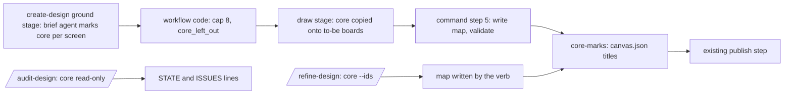
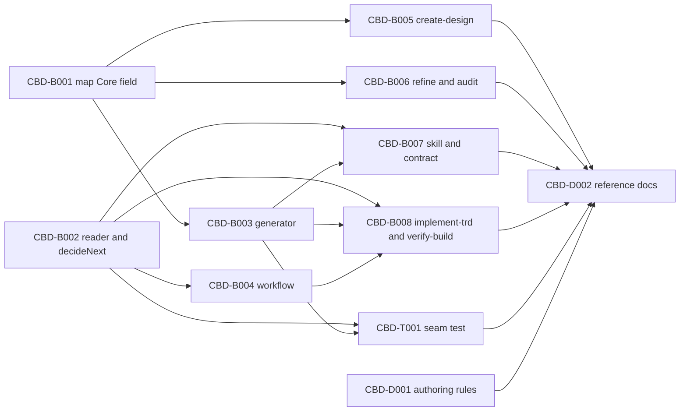

# TRD: core-boards-in-designs

**Version**: 1.1.1
**Status**: Draft
**Created**: 2026-11-16
**Last Updated**: 2026-11-16
**Author**: @technical-architect
**Source PRD**: `docs/plan/core-boards-in-designs.investigation.md` (investigation record for feature F-3 of workplan `storybook-framework-requests`; roadmap item 3, read from commit `bf2cf062` as `docs/plans/storybook-framework-requests/roadmap.md`)
**Kind**: change
**Weight**: medium
**Task ID Prefix**: CBD

---

## Changelog

| Version | Date | Changes | Author |
|---------|------|---------|--------|
| 1.0.0 | 2026-11-16 | Initial TRD, authored from the investigation record and roadmap item 3 | @technical-architect |
| 1.1.0 | 2026-11-16 | `/audit-trd` findings applied: `coreMustPass` carried through the decide-next payload, the workflow arg list and both dispatches (34 fields, not 33) (D13, D14, D16); evidence-only settling keyed on list membership, not the re-capture (D14); `isCore` ignores superseded boards (D2); custody named as a third reader of `must-pass-coverage` (D12); the `Board class` header added by §8.1b step 4 (D11, D17); `canvas.json` entries matched by file-name key (D19); `core-marks` moved to `/create-design` step 7 (D20); a legacy map converts only on a refine run that already changes something (D21); `/audit-design`'s readout rule names the Core lines (D22); the TRD author reads the Core set from `core --dir` (D23); the canvas convention is an unnumbered paragraph (CBD-D001); Could Not Verify rewritten | @technical-architect |
| 1.1.1 | 2026-11-16 | `/audit-build` descriptive corrections: D24 describes the fixture as built (14 entries, 12 screen boards, 8 Core; the 4 evidence-only rows are state frames); AC-F2.3 cited to `docs/PRD/design-stage.md`; `sync-design.js` given its path; Could Not Verify rewritten. No objective, criterion or task changed | @technical-architect |

## Objectives

O1 to O8 are the investigation record's objectives, verbatim, with its `Must pass` marks. O9 and
O10 are the constitution's quality gates, which every TRD in this repository carries.

| ID | Objective | Source | Must pass |
|----|-----------|--------|-----------|
| O1 | `design-map.json` carries a per-board Core flag; validation rejects more than 8 Core boards and a Core flag on a `part` or `flow` board | roadmap item 3 brief | yes |
| O2 | A map in which no board carries the Core flag (a design made before this change) reads every screen board as Core | roadmap item 3 brief ("count every board as Core until refined") | yes |
| O3 | The design-comparison criteria are generated deterministically from the map: the default-state frame of each Core board yields a must-pass criterion; every other frame (non-Core boards, and non-default states of Core boards) yields an evidence-only criterion. A 12-board fixture design with 8 Core boards yields exactly 8 must-pass and 4 evidence-only criteria | roadmap item 3 "How it will be checked" | yes |
| O4 | An evidence-only criterion never fails verification: its screenshot is captured and shown for review, but a `not_met` ruling on it is never an open gap, is never sent to Debug, never blocks the run's outcome and is left out of the coverage ratio | roadmap item 3 brief ("never fails verification") | yes |
| O5 | A Core criterion is must-pass whatever the project's blocking policy: it blocks under `Blocking: all` (today's default) and also under `Blocking: must-pass only` | roadmap item 3 brief ("Core boards stay must-pass") | yes |
| O6 | `/create-design` marks at most 8 Core boards (the main screens in their normal state) and, when there were more than 8 candidates, names the ones left out in its readout and in the brief; `/refine-design` can change the Core set and, on an older map, writes explicit flags (that is the "until refined" moment); `/audit-design` reports the Core set and flags a map over the cap | roadmap item 3 brief | |
| O7 | Each Core board carries a visible Core mark on the canvas: its `canvas.json` title carries a fixed Core marker, applied by code from the map, not typed by a drawing agent | roadmap item 3 brief ("a visible Core mark on the canvas") | |
| O8 | Evidence-only boards' behaviour is proven by forced-state component tests: the TRD-authoring rule for design-built work says a non-Core board's state is covered by a component test that forces that state, not by a pixel comparison | roadmap item 3 brief | |
| O9 | Tests pass, with unit coverage of at least 60% and integration coverage of at least 50% where integration tests apply | `constitution.md` Quality Gates | |
| O10 | Documentation is updated for every behaviour this change alters | `constitution.md` Quality Gates | |

## Intended Change

From the investigation record, condensed. **Today:** `design-map.json` boards have no Core
concept. `verify-design-comparison`'s Criteria section has the model append one `DC-<frame stem>`
row per frame, every row ordinary, with no code generating them. Under the default blocking
policy a `not_met` on any frame (an error state, a loading state, a second viewport) blocks
`satisfied`; under `Blocking: must-pass only` none of them block.

**After:** a board may carry `"core": true|false`; at most 8 are Core, and only `to-be` and
`as-is` boards may be. A map with no `core` key anywhere is a legacy map, and every screen board
in it reads as Core. A deterministic CLI generates the comparison rows from the map, each
carrying a class: `core` for the default-state frame of a Core board, `evidence-only` for every
other frame. The success definition records the class per row; the verification loop reads the
evidence-only ids from the definition file in code and never fails a run on one; a `core` row
is must-pass. `/create-design`, `/refine-design` and `/audit-design` carry the Core rule, and a
lib step writes the Core marker into each Core board's `canvas.json` title.

---

## 1. Overview

### 1.1 Technical Summary

Three code owners change, and the prose around them follows.

1. **`packages/core/lib/design-map.js`** owns the Core field: the cap, the kinds allowed to
   carry it, the map-wide legacy rule, two read helpers every caller uses, validation, a verb
   that sets the Core set, and a verb that writes the Core marker into `canvas.json` titles.
2. **A new `packages/core/lib/design-criteria.js`** generates the `verify-design-comparison`
   rows from a map, computing each board's frames from its id and states with
   `design-render.js`'s own slug rule, so the class of every row is decided by code.
3. **`packages/core/lib/functional-verification.js`** reads a new `Board class` column from the
   success definition. `must-pass-coverage` adds `core` rows to its must-pass `criteria` and
   returns the `evidence-only` ids; `decideNext` takes those ids as a required input and drops
   them from the gaps and from the coverage ratio. The `verify-functional` workflow passes them
   through, keeps them out of Debug and labels them in the report.

The commands (`/implement-trd`, `/verify-build`, `/create-design`, `/refine-design`,
`/audit-design`), the `create-design` workflow, the `verify-design-comparison` and
`designing-on-canvas` skills, the functional-verification contract and the TRD-authoring
contract are updated to use these, and nothing else is built.

### 1.2 Key Technical Decisions

| ID | Decision | Choice | Serves Objective | Rationale | Alternatives Considered |
|----|----------|--------|------------------|-----------|------------------------|
| D1 | Core is board-level, must-pass is frame-level | A Core board's default-state frame (`<id>.png`) is the must-pass comparison; its other states, and every frame of a non-Core board, are evidence-only | O3, O4 | Inherited from the investigation's Decision section: "main screens, normal state" | Every frame of a Core board must-pass: rejected (investigation) because it brings error, loading and empty states back into the pixel-perfect set the owner wants to shrink |
| D2 | Where the Core field and its rules live | In `design-map.js`: `CORE_CAP = 8`, `CORE_KINDS = ['to-be', 'as-is']`, `isLegacyCore(map)`, `isCore(map, board)`, `coreBoards(map)`, three new `validate()` rules (§3.1). No caller re-derives the rule. `isCore` is false for a `superseded` board on any map, so `coreBoards`, `coreReport.core` and `core-marks` never list or prefix a History-page board, matching the cap (D3) and the generator (D9) | O1, O2 | `design-map.js` is the one module that owns the map's shape (its header says so); the investigation names it | A top-level `core: [ids]` list in the map: rejected because it drifts from `boards` when a board is renamed or superseded, and `validate` would need a second cross-check; revisit if a design needs Core sets per canvas |
| D3 | The legacy rule | Map-wide: no board carrying a `core` key means legacy, and every non-superseded `to-be` and `as-is` board reads Core. Any `core` key anywhere makes the map explicit, and a missing key then reads `false`. The cap counts only explicit `core: true` on boards not `superseded`, so a legacy map of any size validates | O1, O2 | Inherited from the investigation | Per-board default `true`: rejected (investigation): a refined map that adds one board without the key would silently grow the Core set past the cap |
| D4 | Validation strictness | `core` present but not a boolean is an error; any `core` key on a `part` or `flow` board is an error (`false` included); more than 8 non-superseded `core: true` boards is an error naming them | O1 | O1 says "rejects"; the existing `validate()` pattern returns one error string per problem | Allow `core: false` on parts: rejected because a part with any `core` key would turn a parts-only legacy map explicit for no reason; revisit if a tool writes `core` on every board indiscriminately |
| D5 | How the Core set is changed after `/create-design` | A verb, `design-map.js core --dir <d> --ids a,b`: sets exactly those boards `core: true` and every other `to-be`/`as-is` board `core: false`, validates, writes atomically, and throws writing nothing on any error. Without `--ids` it is read-only and prints the Core report (§3.1) | O2, O6 | Same principle as `status` (never hand-edited, AC-F2.3 of `docs/PRD/design-stage.md`): the map is changed by one verb that validates before it writes | The refining session edits `design-map.json` by hand: rejected, an over-cap or wrong-kind edit would only be caught after the write |
| D6 | Who chooses the Core set in `/create-design` | The ground stage's brief agent returns `core: true\|false` on each screen and `core_left_out: [{ name, why }]`, and writes a `## Core boards` section in `brief.md` naming the chosen screens and the left-out ones. The workflow enforces the cap in code: more than 8 marked keeps the first 8 in returned order and moves the rest to `core_left_out` with the reason "over the cap of 8". The draw stage copies `core` from the screen onto its to-be board; every as-is board gets `core: false`; parts get no key | O6 | The brief agent already returns the screens and their states, and is where "main screen" is judged; the cap is code so a model's over-count cannot reach the map | Choose Core in the draw stage: rejected, the draw agents run one per board in parallel and none sees the whole set. Choose Core in the command after drawing: rejected, the brief is written in the ground stage and O6 requires the left-out ones there |
| D7 | Which board of a screen is Core | The to-be board. An as-is board is a candidate only on a screen that has no to-be board (a regression baseline the design did not redraw); `/create-design` draws a to-be board for every screen in scope, so it writes `core: false` on every as-is board | O1, O6 | The cap counts boards; marking both boards of one screen would halve the number of screens the 8 can cover, and the as-is board of a redrawn screen yields no comparison row anyway (D9) | Mark both boards of a Core screen: rejected for the reason given |
| D8 | The generator's home and frame naming | A new lib, `packages/core/lib/design-criteria.js`, CLI `comparison-rows --dir docs/ui/<slug>`. It requires `design-map.js` and `design-render.js`. Frames are computed from each board's `id` and `states` with `design-render.js`'s `stateSlugs()` and the same `reserved` list `render()` builds (a state with no `props` renders no frame), never by splitting file names on `--` | O3 | Board ids may themselves contain `--` (the fixture's `01-home--as-is`), so parsing a file name would read an as-is board as a state of `01-home`. `design-map.js` (744 lines) requires `design-render.js` lazily because `design-render.js` requires it at top level; a sibling module, as `design-covers.js` already is, keeps the load order one-way | A verb in `design-map.js`: rejected for the load-order reason. List `screens/png/` and classify file names: rejected for the `--` reason |
| D9 | Which frames yield rows (the skill's rules, now in code) | A `to-be` board with status `approved`, `building` or `shipped` yields one row per frame. An `as-is` board yields rows when its status is not `superseded`, its `screenshot_match` is not `false`, and no row-yielding to-be board shares its `route`, `platform` and `viewport` (that to-be board replaces it). `part` and `flow` boards, and `superseded` boards of any kind, yield none | O3 | Moves `verify-design-comparison` "Criteria" rules into code unchanged, and makes the one rule the skill leaves to judgement ("replaced by an in-scope to-be board") deterministic | Replacement by id convention (`<to-be id>--as-is`): rejected, no code validates that naming; revisit if an as-is board without a `route` appears. Keep superseded as-is boards as baselines: rejected, a superseded board is History (sync-design moves it there) |
| D10 | A frame the map requires but `screens/png/` lacks | The row is still emitted, and its path is listed in the output's `missing` array; the command puts one ISSUES line per missing frame | O3, O5 | A Core requirement must not disappear because a render was skipped; the missing frame then fails its own row, as the existing rule says (verification-artifacts D20) | Drop the row: rejected, a skipped render would silently remove a must-pass criterion |
| D11 | The class column | A `Board class` column in the success definition, the table's last column (after `Must pass` when the definition has one, else after `Parts`), valued `core`, `evidence-only` or blank (ordinary). Only `check:verify-design-comparison` rows produced by the CLI carry a value. The definition's writers (`spec-scope.js`, or the model) do not emit the header, and `readDefinitionRows` drops cells beyond the header, so `/implement-trd` §8.1b step 4, which already replaces every `check:` row, adds the `Board class` header and separator cells, and a blank cell on every other row, whenever it writes a row carrying a class into a table that lacks the column (D17's cross-check then catches a header that did not land). The value is `evidence-only`, never `evidence`, to keep it apart from the `evidence-gap` kind and the `Evidence that would prove it` column | O3, O4, O5 | Columns are read by header name (`readDefinitionRows`), so position is free; a blank or absent cell reads ordinary, as `Must pass` and `Tier 1` already do, so older definitions parse unchanged | Encode the class in the row id (`DC-core-…`): rejected, `design-covers.js` resolves a `DC-<stem>` id back to its board and stable ids keep resumed verdicts attached |
| D12 | Reading the classes in code | `mustPassCoverageFromFiles` reads `Board class`: a `core` row joins `criteria` (must-pass) with no objective id; an `evidence-only` row goes to a new `evidenceOnly` array; any other non-blank value stays ordinary and is reported in a new `classIssues` array; an `evidence-only` row whose `Must pass` cell names a declared must-pass objective stays must-pass (the strict direction) and is reported in `classIssues`. The pure `mustPassCoverage()` is unchanged. The `must-pass-coverage` CLI prints the two new fields beside the three it prints today, plus `coreCriteria` (the subset of `criteria` that is must-pass only because its class is `core`). **Core ids never switch on the must-pass-only waiver:** that policy stays inert, as today, unless some must-pass id is NOT a Core row (adversarial review finding 2: without this, a design feature with no must-pass objective would, under `Blocking: must-pass only`, start waiving every ordinary failure) A third reader takes the wider `criteria` too: `packages/core/lib/custody.js` `affectedIds()` runs the same CLI and uses `cov.criteria` as the must-pass set whose proofs a merge must keep, so Core `DC-` rows enter custody's re-proof scope and evidence-only rows stay out of it. That is wanted (a Core frame is must-pass, O5, so a merge that may have broken it must re-prove it); CBD-B002 rewrites custody's comment ("an id is must-pass only when the TRD declares it") to name `core` rows | O4, O5 | Both commands already call `must-pass-coverage` exactly where they need the must-pass ids; one read of one file keeps the two sets from coming from two versions of the definition. The investigation: "not by loosening its objective-id rule for ordinary rows" | A separate `board-classes` subcommand: rejected for the reason given; revisit if a caller needs one set without the other. Loosen `mustPassCoverage` to accept `core` in the `Must pass` cell: rejected (investigation) |
| D13 | `decideNext`'s new input | `evidenceOnly: string[]`, required (absent or not an array throws, validated after `awaitingRegression` so earlier fields' messages are unchanged). The ids are dropped from `gaps` and `previousGaps` up front, the way `settledEvidenceGaps` are; the coverage floor step counts `met` without them over `total - evidenceOnly.length`; an id that is in both `mustPass` and `evidenceOnly` throws. It also takes `coreMustPass: string[]` (required, validated after `evidenceOnly`; every id must be in `mustPass`), and step 3b's activation `mustPass.length > 0` becomes "some `mustPass` id is not in `coreMustPass`", so Core ids block under both policies but never make the waiver active. Because the Judge runs `decide-next` as a CLI on a payload it writes from the prompt's literals, both new fields are literals in that payload (D14), or every run throws at the decide-next call | O4, O5 | Inherited (investigation: "an absent list read as 'nothing is evidence-only' would make every state frame block again"). Dropping them up front keeps them out of `closed`, the stall rule, the cap and `nonBlocking` in one place | Filter in the workflow only: rejected, the decision would then depend on the Judge copying a filtered list correctly |
| D14 | The workflow's new arg | `verify-functional.js` takes `evidenceOnlyIds`, validated before any agent runs like `mustPassIds` (strings; each a criterion id in `criteria`; none in `mustPassIds`); absent defaults to `[]`, as `mustPassIds` does. It is written as a literal into the Judge's decide-next payload. It also takes `coreMustPassIds` (strings; each in `mustPassIds`; absent defaults to `[]`), written into the same payload as the `"coreMustPass"` literal, with the same "copy exactly as given; decide-next throws without it" sentence. **The workflow side goes through its one existing choke point, not per-site filters** (adversarial review finding 1): `reconcileJudgeKinds` (where the Judge's rulings are settled) gains a branch keyed on membership in `evidenceOnlyIds` whatever the kind: a `not_met` id in the list is settled `settled = 'evidence-only'` in the iteration it is ruled, a `build-defect` included (a pixel mismatch has no re-capture, so a branch tied to the re-capture would leave it open and sent to Debug), and is never put in `recaptureIds`; the existing `not-checkable-here` branch runs first and still makes it `not_verifiable`. As with `definition-problem`, a settled entry is carried forward and later rulings on it are not folded. The schema's `settled` enum (≈line 1448) and the three prompt sentences that name the settled values (≈lines 746, 999, 1066) gain `evidence-only`. `'evidence-only'` joins `definition-problem` and `regression-unchecked` in one shared settled-kind predicate read by `isOpenNotMet`, the `settledEvidenceGaps` literal and `foldRulings`; that keeps it out of `mustPassCheckState`, `openFailuresOf`, `applyBlockingPolicy`, `nonBlockingOf` (so it is never filed as a follow-up), Debug, and the result's `gaps`/`debugGaps`. The regression pass's `failing` list (≈line 3517) also skips evidence-only ids. `coverageOf`, `floorMissed` and `belowFloorText` use the reduced base (total minus evidence-only), with an `evidenceOnly` count reported beside it. `BLOCKING_ACTIVE` keys on must-pass ids that are not Core (the `coreMustPassIds` arg, from the CLI's `coreCriteria`). The two args take the workflow's read fields from 32 to 34. Evidence-only rows are still exercised, judged and shown | O4, O5 | The arg follows the `mustPassIds` path the investigation names. Defaulting to `[]` at the workflow boundary is the strict direction (rows block as they do today) and matches its sibling; `decideNext` itself still throws on an absent list | Required arg that throws: rejected here because every existing workflow test fixture would need it while gaining no safety the `decideNext` check does not already give; see OQ-2 |
| D15 | The report and the comparison page | `renderReport` takes an optional `evidenceOnly` list, labels those rows "evidence only, never blocks" and prints a `**Evidence only**: <n> frame(s)` line when there are any. The skill's Page section labels each card `Core` or `evidence only` from the criterion's `Board class` | O4 | O4 says the screenshot "is produced for review"; the label says why a red card did not fail the run | Leave them off the report: rejected, O4 keeps them for review |
| D16 | Where `/implement-trd` reads must-pass coverage | The `must-pass-coverage` call moves from §8.1 to the end of §8.1b (after step 4 writes the check rows), so its `criteria` include the `core` rows and its `evidenceOnly` exists; `evidenceOnly` is held as `evidenceOnlyIds` and `coreCriteria` as `coreMustPassIds`, and both are passed at §8.3. §8.1's column-to-field map gains `Board class` → `boardClass`. `/verify-build` already calls it after its step 3b and only adds the two new fields (and restricts both to the named ids under `--criteria`) | O4, O5 | Today §8.1 reads it before check rows exist, which was harmless only because check rows carried no mark | Call it twice (once in §8.1, once after §8.1b): rejected, two readings of one file in one run is how two answers appear |
| D17 | How the command writes the generated rows | §8.1b step 3, for `verify-design-comparison` with a `design-map.json`, runs `design-criteria.js comparison-rows` and writes its rows by header name, adding the `Board class` column first when the table lacks it (D11); after step 4 writes them, the `must-pass-coverage` output is compared with the CLI's `counts` (core rows in `criteria`, `evidenceOnly` length): a mismatch rewrites the rows once from the JSON, and a second mismatch is one ISSUES line | O3 | The CLI decides every class; the cross-check keeps the model's copy of a cell from silently changing a class | Have the CLI write into the definition file itself: rejected, the other checks' rows are still model-built from their Criteria sections and §8.1b step 4 owns replacing all `check:` rows at once; revisit if a second check gains a generator |
| D18 | Designs with no `design-map.json` | A design handoff of exported PNGs or Figma frames keeps today's Criteria rule, with `Board class` blank (ordinary) on every row | O3 | O3 is about the map; such a handoff has no Core flag to read | Treat every frame of a map-less handoff as Core: rejected, it would make every such frame must-pass, a stricter change nobody asked for |
| D19 | The Core marker | A fixed prefix, `CORE_MARK = '[Core] '`, on the `title` of each Core board's entry in its canvas's `canvas.json` (one file per canvas, found the way `boardPath` finds a board's canvas: `canvas.dir`, default `canvas/project`), written by a verb, `design-map.js core-marks --dir <d>`. The one real `canvas.json` seen (outside this repository, one sample, not the Design type's spec) holds `boards` as an object keyed by board file name (`"01-today.dc.html": {x, y, w, h, title, page, is_interactive}`) beside a top-level `title`, so an entry is matched by the board's `file` as the key and only `boards[<file>].title` is edited, never the top-level `title`. The verb adds the prefix to each board `isCore` reads true, strips it from every other board, is idempotent, writes nothing when nothing changes, and returns `{ marked, unmarked, missing }` (`missing`: Core boards with no `canvas.json` entry). No `canvas.json` is a no-op result, never an error | O7 | O7: "applied by code from the map". The title is where `designing-on-canvas` convention 6 puts a board's name, and the publish step already sends `canvas.json` | Let the drawing agent type it: rejected (O7). Apply it inside `refresh`: rejected, `refresh`'s contract is the three derived map fields and `/sync-design` calls it, which this feature does not change; revisit if a command is found publishing without the marks |
| D20 | When the marker is written | `/create-design` step 7 runs `core-marks` after the session has written this round's board entries into the mirror's `canvas.json` and before the publish call sends it (step 5 only writes `core` into the map: on a new design, or with publishing off, no `canvas.json` exists at step 5). With publishing off nothing runs, since no canvas exists to mark. A `missing` board in the result after `canvas.json` was written is one ISSUES line per board, never silent. `/refine-design` runs it after any `core` verb call and before its publish, with the same ISSUES rule | O7 | Both commands send `canvas.json` at their publish step, and that is the first point at which its board entries exist, so the mark reaches the canvas in the same round | Run it at step 5: rejected, on a new design it finds no file and the marker never reaches the canvas. Run it at publish time inside the contract's section 4: rejected, that section is shared with `/sync-design` and `/design-system` |
| D21 | `/refine-design` and the Core set | When feedback asks for a Core change, or the map is legacy (`core` read-only report says `legacy: true`) and the run is already changing something, the session chooses the set (main screens, normal state, at most 8; on a legacy map, from the boards that read Core today), runs `core --ids`, names the left-out boards in the readout and in the brief's `## Core boards` section, and records one DECISIONS line. Under `--auto` the same, unasked. **The "No feedback" rule wins:** a no-change run (no feedback, no `OD-n` answer, no comment, no hand edit) stays a no-change run on a legacy map, writes no `core` key, runs no `core-marks` and still ends "no change made, nothing to re-audit" | O2, O6 | O6: refining an older map is the "until refined" moment, and a run that refines nothing has not refined it. `refine-design.md` forbids inventing a change to fill the round, and a conversion writes the map and the canvas titles | Convert on every run, a no-change run included: rejected, it breaks the No feedback rule and its pinned completion line. Convert legacy maps only when the owner asks: rejected, O2's legacy rule would then outlive every refinement; see OQ-9 |
| D22 | `/audit-design` and the Core set | The command's step 2 runs `design-map.js core --dir` (read-only) and the readout's STATE names the Core set (or "legacy: every screen board reads Core"); over the cap, or any `core` validation error, is an ISSUES line pointing at `/refine-design`. The `audit-design` workflow is unchanged, so both lines are the command's own additions: the "One text, written once, printed as written" sentence ("the only addition is STATE lines about the report itself") is rewritten to name them beside the report-state lines, the way step 2 already names its own drift and `unsynced` ISSUES lines | O6 | O6 asks for a report and a flag; both are deterministic reads | A verifier axis that judges whether the Core boards are "main screens": rejected, it re-judges a choice the owner or `/create-design` made; revisit if audits find wrongly chosen Core sets |
| D23 | The forced-state test rule | `trd-authoring.md` "Design as a source" gains a rule: a task built from a non-Core board, or from a non-default state of a Core board, names in its acceptance criteria a component test that forces that state (from the board's `states.<name>.props` or tweak), because its comparison row is evidence only. A Core board's default state is proven by its comparison row. The author reads which boards are Core from `node .claude/lib/design-map.js core --dir docs/ui/<slug>` (its `core` list, which already applies the legacy rule), never from a board's `core` key: the `buildable` output the TRD author is shown lists only to-be boards in `draft`/`approved`, so it cannot tell a legacy map (no key means Core) from an explicit one (no key means not Core) | O8 | Inherited (investigation): a TRD-authoring rule, not new test machinery | Build a forced-state test runner: rejected (investigation) |
| D24 | The 12-board fixture | As built, `test/fixtures/design/core-boards/design-map.json` holds 12 screen boards plus one `part` and one `flow` (14 entries). The 8 Core boards are 6 `to-be` boards in `building`, `approved` or `shipped` and 2 `as-is` boards with no replacing to-be board; 3 of the Core to-be boards carry states with props, which render the 4 state frames. The 4 non-Core screen boards each yield no row and exercise one D9 exclusion: a `draft` to-be, a `superseded` to-be, an as-is with `screenshot_match: false`, and an as-is replaced by its to-be board (`01-home--as-is`). A placeholder PNG sits under `screens/png/` for every frame that yields a row. The generator yields 12 rows: 8 `core` (the default frames) and 4 `evidence-only` (the state frames) | O3 | The roadmap's check, as a fixture beside the existing `test/fixtures/design/walk/boards/trips-refresh/` one; the expected count stays exactly 8 + 4 while one fixture also covers the D9 exclusions. A row-yielding non-Core board's evidence-only row is proven on the trips-refresh copy (`01-home--as-is` with `core: false`, `design-criteria.test.js`) | Reuse the trips-refresh fixture: rejected, it has 8 boards with states and a check against it would not read as the roadmap's 12-board case |

### 1.3 Technology Stack

| Layer | Technology | Purpose | Notes |
|-------|------------|---------|-------|
| Libraries and CLIs | JavaScript, Node.js 18+ | `design-map.js`, `design-criteria.js`, `functional-verification.js` | `stack.md`; pure functions plus a thin CLI, JSON on stdout |
| Workflows | JavaScript workflow scripts | `verify-functional.js`, `create-design.js` | |
| Commands, skills, contracts | Markdown | prose the model follows | Prose tests pin wording |
| Tests | Jest ^29.7.0 | unit and seam tests | `stack.md` |

### 1.4 Integration Points

| System | Type | Direction | Notes |
|--------|------|-----------|-------|
| Claude Design canvas | `canvas.json` published through the Artifact tool | Out | The Core marker reaches the canvas only through the existing publish step; nothing here calls the Artifact tool |

---

## 2. System Architecture

### 2.1 Data flow: from the map to the run's outcome

```mermaid
sequenceDiagram
    participant Map as design-map.json
    participant Gen as design-criteria.js comparison-rows
    participant Cmd as /implement-trd §8.1b or /verify-build 3b
    participant Def as success-definition.md
    participant MPC as must-pass-coverage
    participant WF as verify-functional workflow
    participant DN as decideNext

    Map->>Gen: boards, core flags, states, statuses
    Gen-->>Cmd: rows with Board class (core / evidence-only), missing, counts
    Cmd->>Def: write check rows by header name
    Cmd->>MPC: --trd --definition
    MPC-->>Cmd: criteria (incl. core rows), evidenceOnly, classIssues
    Cmd->>Cmd: compare counts with the generator's
    Cmd->>WF: mustPassIds, evidenceOnlyIds
    WF->>DN: mustPass, evidenceOnly (literals in the decide-next payload)
    DN-->>WF: action; evidence-only ids never open, never in the ratio
    WF-->>Cmd: outcome; evidence-only rows still on the report and page
```

### 2.2 Design side



---

## 3. Technical Specifications

### 3.1 `design-map.js`: the Core field

```typescript
const CORE_CAP = 8;
const CORE_KINDS = ['to-be', 'as-is'];
const CORE_MARK = '[Core] ';

function isLegacyCore(map): boolean;            // no board in map.boards has an own `core` key
function isCore(map, board): boolean;           // false when board.status === 'superseded'; else legacy: CORE_KINDS.includes(board.kind); else board.core === true
function coreBoards(map): Board[];              // boards isCore reads true, in map order
function coreReport(map): {
  legacy: boolean,
  core: string[],                               // ids, map order
  cap: 8,
  over_cap: boolean,                            // explicit non-superseded core:true count > 8
  errors: string[],                             // the Core subset of validate()'s errors
};
function setCore(map, ids: string[]): Map;      // pure copy; throws on unknown id or wrong kind; result must validate
function coreMarks(dir): { marked: string[], unmarked: string[], missing: string[] };
```

**`validate()` additions** (one string each, in the existing `board <id>: …` style):
`core must be true or false`; `core is allowed only on to-be and as-is boards`; and once per
map, `<n> Core boards; at most 8 may be Core: <ids>`.

**CLI:** `core --dir <d>` prints `coreReport`; `core --dir <d> --ids a,b` runs `setCore`,
writes, and prints the report (an empty `--ids` value is an error); `core-marks --dir <d>`
prints the `coreMarks` result. Existing verbs (`transition`, `approve`, `refresh`,
`republished`) keep the `core` key untouched; they copy whole board objects today.

**Error handling:** `setCore` and `core --ids` throw, writing nothing, on an unknown id, a
`part`/`flow` id, or a result that does not validate. `coreMarks` never throws for a missing
`canvas.json` or a missing entry; malformed `canvas.json` JSON throws naming the file.

### 3.2 `design-criteria.js`: the comparison rows

```typescript
interface ComparisonRow {
  id: string;            // `DC-<frame stem>`; stem is `<board id>` or `<board id>--<state slug>`
  statement: string;     // "Screen `<stem>` renders as its design frame"
  cites: string;         // `docs/ui/<slug>/screens/png/<stem>.png`
  evidence: string;      // the skill's Capture artefacts for <stem>
  derivation: 'check:verify-design-comparison';
  tier1: string;         // `judge-only — a pictorial comparison against the design frame; no text assertion is possible`
  parts: '';
  mustPass: '';
  boardClass: 'core' | 'evidence-only';
  board: string;         // board id
  state: string | null;  // null for the default frame
}
function comparisonRows({ dir }): {
  rows: ComparisonRow[];               // map order, default frame first per board
  missing: string[];                   // frame paths required but absent from screens/png/
  counts: { core: number, evidenceOnly: number };
};
```

**Behaviour:** reads and validates the map (an invalid map throws, so an explicit over-cap map can never
yield nine must-pass rows; a legacy map yields one Core row per unreplaced screen board, however many, until refined); selects boards by D9; for each, frames are `<id>.png` plus
`<id>--<slug>.png` for each state with `props`, slugs from `design-render.js` `stateSlugs()`
with the same `reserved` list `render()` uses; class is `core` only for the default frame of a
board `isCore` reads true. Statement, Cites, Evidence and Tier 1 wording is the skill's table,
unchanged, so existing rows keep their ids and text.

**CLI:** `node .claude/lib/design-criteria.js comparison-rows --dir docs/ui/<slug>`; JSON on
stdout; exit 1 with the error on stderr for a missing or invalid map.

### 3.3 `functional-verification.js`

```typescript
// mustPassCoverageFromFiles(trdPath, definitionPath) and the must-pass-coverage CLI:
{
  criteria: string[],      // as today, plus every row whose Board class is `core`
  uncovered: {id, text}[], // as today
  unknown: {criterion, objective}[], // as today
  evidenceOnly: string[],  // rows whose Board class is `evidence-only` and that are not must-pass
  classIssues: {criterion, value, reason}[], // unknown values; an evidence-only row that is also must-pass
  coreCriteria: string[],  // the subset of `criteria` that is must-pass only because its class is `core`
}

// decideNext(input): new required fields
evidenceOnly: string[];
coreMustPass: string[];    // every id in `mustPass`; gates step 3b's waiver (D13)
```

**`decideNext` behaviour:** `dropped(id)` also covers `evidenceOnly`; the coverage floor step
uses `met.filter(id => !evidenceOnly.includes(id)).length` over `total - evidenceOnly.length`
(skipped when that denominator is not positive, as an absent `total` is today); an id in both
`mustPass` and `evidenceOnly` throws `TypeError`; an absent `coreMustPass`, or an id in it that
is not in `mustPass`, throws; step 3b activates only when some `mustPass` id is not in
`coreMustPass`. Nothing else in the evaluation order moves. Today's tests pass once they supply
`evidenceOnly: []` and `coreMustPass: []`.

**`renderReport`:** optional `evidenceOnly`; with a non-empty list, a `**Evidence only**:` line
and a per-row label. With an empty or absent list the report is byte-identical to today's.

### 3.4 `verify-functional.js`

New args `evidenceOnlyIds` and `coreMustPassIds` (D14). Validation errors name the arg and
throw before any agent runs: not an array of non-empty strings; an `evidenceOnlyIds` id not in
`criteria` or also in `mustPassIds`; a `coreMustPassIds` id not in `mustPassIds`. The
decide-next payload literal gains `"evidenceOnly": <ids>` and `"coreMustPass": <ids>`, each with
the same "copy exactly as given; decide-next throws without it" instruction `mustPass` carries.
`reconcileJudgeKinds` settles evidence-only `not_met` ids as described in D14, and the schema's
`settled` enum gains `evidence-only`. The result's `coverage` gains `evidenceOnly: <count>`.
`docs/TRD/functional-verification.md` §3.3 gains both fields so
`verify-functional-trd-sync.test.js` stays green, and the "32 fields" count (that test,
`/verify-build`, `verify-command-surface.test.js`, `verify-build-criteria.test.js`) becomes 34.

### 3.5 Prose surfaces

| File | Change | Decision |
|------|--------|----------|
| `packages/skills/verify-design-comparison/SKILL.md` | Criteria: with a map, run `comparison-rows`; rows carry `Board class`; without a map, today's rule, class blank. Page: `Core` / `evidence only` label per card | D9, D11, D15, D18 |
| `packages/core/contracts/functional-verification.md` | "Must pass" and "Check criteria": the `Board class` column, `core` rows must-pass with no objective id, `evidence-only` rows never block and leave the ratio; `Must pass` is no longer described as the last column | D11, D12, D13 |
| `packages/core/commands/implement-trd.md` | §8.1 column map; §8.1b step 3 uses the CLI and records `missing`; step 4 adds the `Board class` column when absent; the `must-pass-coverage` call moves after step 4 with the count cross-check; §8.3 passes `evidenceOnlyIds` and `coreMustPassIds`; §8.2 resume path unchanged in order | D11, D16, D17 |
| `packages/core/commands/verify-build.md` | Step 3c holds `evidenceOnly` and `coreCriteria`; `--criteria` restricts both; step 4's dispatch adds the two fields (34 fields) | D16 |
| `packages/core/commands/create-design.md` | Step 2/3 carry `core` on screens; step 5 writes `core`; step 7 runs `core-marks` after the session writes the `canvas.json` board entries and before the publish call; readout names the Core set and the left-out screens | D6, D7, D20 |
| `packages/core/commands/refine-design.md` | Step 3: Core changes, and legacy conversion on a run that already changes something, through `core --ids`, then `core-marks` before publish; the No feedback rule unchanged | D21, D20 |
| `packages/core/commands/audit-design.md` | Step 2 reads `core`; readout STATE and ISSUES lines; the "only addition" sentence names them | D22 |
| `packages/skills/designing-on-canvas/SKILL.md` | An unnumbered paragraph under `## Conventions` (the seven numbered conventions stay seven): Core boards carry `[Core] ` in their `canvas.json` title, added by `core-marks` after the agent writes the plain title; never typed by an agent | D19 |
| `packages/core/contracts/trd-authoring.md` | "Design as a source": the forced-state test rule, with the Core set read from `design-map.js core --dir` | D23 |
| `packages/core/lib/custody.js` | The `affectedIds()` comment names `core` rows as must-pass (no code change) | D12 |

Every file above and every lib file in §3.1 to §3.4 has a vendored copy under `.claude/` that
must stay byte-identical (`packages/full/` reaches `contracts/` and `skills-lib/` by symlink).

---

## 4. Master Task List

### 4.1 Task ID Convention

`CBD-[CATEGORY][SEQ]`: B = implementation (code and prompt files), D = documentation, T =
test across a seam no single task owns. Every task edits the `packages/` file AND its `.claude/`
copy byte-identically, and ships its own unit and prose tests.

### 4.2 Phase 1: Foundations

| Task ID | Description | Serves | Skills | Dependencies | Acceptance Criteria |
|---------|-------------|--------|--------|--------------|---------------------|
| CBD-B001 | `design-map.js`: `CORE_CAP`, `CORE_KINDS`, `CORE_MARK`, `isLegacyCore`, `isCore`, `coreBoards`, `coreReport`, `setCore`, `coreMarks`, the three `validate()` rules, the `core` and `core-marks` CLI verbs and the usage comment, all exported (§3.1). One task: everything lands in one file and one test file | O1, O2, O7, D2, D3, D4, D5, D19 | `jest` | None | `validate` rejects 9 non-superseded `core: true` boards naming them, a `core` key on a `part` or `flow` board, and a non-boolean `core`; accepts 8, and accepts a legacy map with 12 screen boards. `isCore` on a legacy map is true for every `to-be` and `as-is` board and false for parts and flows; on a map with one `core` key, a board with no key reads false. `core --ids` sets exactly the named set, writes nothing and exits 1 on a 9-id set, an unknown id or a part id. `core-marks` matches a board's `canvas.json` entry by its `file` as the key of `boards` (one `canvas.json` per canvas, found as `boardPath` finds it), edits only that entry's `title` and never the top-level `title`, adds `[Core] ` once to each Core title (run twice, the title is unchanged), strips it from a board that stopped being Core, lists a Core board with no entry under `missing`, and is a no-op with no `canvas.json`. Two boards sharing one `file` (a shipped Core to-be board and the as-is board `/sync-design` added for it, with no `core` key) leave that canvas entry marked whatever their order in the map. `isCore` reads a `superseded` board false on a legacy and an explicit map, so `coreBoards`, `coreReport.core` and `coreMarks` ignore it. `transition`, `approve` and `refresh` keep `core` on every board. Package and `.claude/` copies identical |
| CBD-B002 | `functional-verification.js`: `mustPassCoverageFromFiles` reads `Board class` (D12); the `must-pass-coverage` CLI prints `evidenceOnly`, `classIssues` and `coreCriteria`; `decideNext`'s required `evidenceOnly` and `coreMustPass` (D13); `renderReport`'s `evidenceOnly` label and line (D15); the `custody.js` `affectedIds()` comment names `core` rows as must-pass (D12, comment only). One task: one lib file and its test file, plus one comment in custody | O4, O5, D12, D13, D15 | `jest` | None | A definition with 2 `core`, 3 `evidence-only` and 1 blank-class `DC-` row and a TRD with no must-pass objective yields `criteria` of the 2 core ids and `evidenceOnly` of the 3. A value `Core-ish` is ordinary and listed in `classIssues`. An `evidence-only` row naming a declared must-pass objective in `Must pass` is in `criteria`, not in `evidenceOnly`, and is in `classIssues`. `decideNext` with only evidence-only ids in `gaps` returns `exit-satisfied` under `blocking: 'all'`; with a `core` id in `mustPass` and in `gaps` it returns `remediate`/`exit-stalled`/`exit-stuck` exactly as without the change under both policies; with that id `not_verifiable` (absent from `met`) it returns `exit-must-pass-unproven` under both. A floor of 0.5 with 2 of 4 ordinary criteria met and 6 evidence-only unmet does not re-label. Absent `evidenceOnly` throws `TypeError` naming it; an id in both lists throws. Existing tests pass once given `evidenceOnly: []` and `coreMustPass: []`, with no other change to their expectations. A report with an empty list is byte-identical to today's. Under `blocking: 'must-pass'` with `mustPass` = `coreMustPass` = one Core id and an ordinary id open, the result is not converted to satisfied (the waiver stays inert); `coreMustPass` absent throws, and a `coreMustPass` id not in `mustPass` throws. `must-pass-coverage` prints `coreCriteria`. `narrow-reproof.seam.test.js` gains a Core-row case (custody's re-proof set now includes Core `DC-` rows and excludes evidence-only ones), and custody's comment says so. Package and `.claude/` copies identical, `custody.js` included |
| CBD-D001 | Authoring rules: `trd-authoring.md` "Design as a source" gains the forced-state test rule (D23); `designing-on-canvas` gains the Core-marker convention and a "Never" bullet against typing it (D19). Merged: two short prose edits with one reviewer reading, no shared code | O7, O8, D19, D23 | | None | `trd-authoring.md` says a task from a non-Core board, or a non-default state of a Core board, names a component test that forces that state, that its comparison row is evidence only, and that the Core set is read from `design-map.js core --dir docs/ui/<slug>`, never from a board's `core` key. `designing-on-canvas` says, in an unnumbered paragraph under `## Conventions`, that the marker is `[Core] ` in the `canvas.json` title, added by `design-map.js core-marks` after the agent writes the plain title (convention 6), never by an agent; its `skill-md.test.js` (both copies) still counts exactly seven numbered conventions. `create-trd-design-prose.test.js` and the `designing-on-canvas` `skill-md.test.js` pin the new sentences and pass. Package and `.claude/` copies identical |

### 4.3 Phase 2: Generator, loop and design commands

| Task ID | Description | Serves | Skills | Dependencies | Acceptance Criteria |
|---------|-------------|--------|--------|--------------|---------------------|
| CBD-B003 | New `design-criteria.js` with `comparisonRows` and the `comparison-rows` CLI (§3.2), its test file, and the 12-board fixture (D24) | O3, D8, D9, D10, D24 | `jest` | CBD-B001 | On the fixture: 12 rows, 8 `core` and 4 `evidence-only`, ids `DC-<board id>`, `counts` `{core: 8, evidenceOnly: 4}`, `missing` empty. On the `trips-refresh` fixture (copied to a temp dir and given `core` keys): `01-home--as-is` yields no row (replaced by `01-home`, same route, platform, viewport) and is never read as a state of `01-home`; each Core to-be board yields one `core` row and one `evidence-only` row per state with props. A legacy copy (no `core` keys) makes every default frame `core`. A `draft` to-be board, a part, a flow, a `superseded` board and an as-is board with `screenshot_match: false` yield none. A deleted frame PNG still yields its row and is listed in `missing`. An over-cap map exits 1. Statement, Cites, Evidence and Tier 1 text match the skill's table. Package and `.claude/` copies identical |
| CBD-B004 | `verify-functional.js`: the `evidenceOnlyIds` and `coreMustPassIds` args, their validation, the `"evidenceOnly"` and `"coreMustPass"` decide-next payload literals, the `reconcileJudgeKinds` evidence-only branch and the `settled` enum and prompt sentences, the shared settled-kind predicate, `BLOCKING_ACTIVE`, the regression `failing` skip, `coverageOf`'s count, and the report input (§3.4, D14). Update `docs/TRD/functional-verification.md` §3.3 (the arg and the result's `coverage` field), header version and changelog row in the same task, because `verify-functional-trd-sync.test.js` compares them to this file | O4, D14 | `jest` | CBD-B002 | With a mocked Judge that rules one evidence-only id `not_met` as a build defect and lists it in `debugGaps`, Debug is not dispatched for it, it is not in the result's `gaps`, it is not filed as a non-blocking follow-up under `Blocking: must-pass only`, a met evidence-only id that regresses in the regression pass is not sent to Debug, and the run returns `satisfied`; the returned criterion carries `settled: 'evidence-only'` and is not in the next iteration's `recaptureIds`; the Judge prompt carries `"evidenceOnly":` and `"coreMustPass":` with the ids. Under `Blocking: must-pass only` with `mustPassIds` = `coreMustPassIds` = one Core id, an ordinary `not_met` still blocks (`BLOCKING_ACTIVE` false). A `coreMustPassIds` id not in `mustPassIds` throws before any dispatch. A `not_met` ordinary id beside it still goes to Debug. `coverage` reports proven and total over the other criteria plus `evidenceOnly: <n>`. An evidence-only id not in `criteria`, or also in `mustPassIds`, throws before any dispatch. Absent `evidenceOnlyIds` behaves as today on the existing fixtures. `verify-functional.test.js` and `verify-functional-trd-sync.test.js` pass. Package and `.claude/` copies identical |
| CBD-B005 | `/create-design`: the `create-design` workflow's brief schema gains `core` per screen and `core_left_out`, the brief prompt asks for the `## Core boards` section, the ground stage caps at 8 in code and returns `core_left_out`, and the draw stage copies `core` onto to-be records (explore path included) and `core: false` onto as-is records (D6, D7). `create-design.md` step 3/4 pass `core` through, step 5 writes it, step 7 runs `core-marks` after the session writes the board entries into `canvas.json` and before the publish call (nothing with publishing off), each `missing` board is an ISSUES line, and the readout names the Core set and the left-out screens (D20). Merged: the command writes exactly what the workflow returns, and one prose test plus one workflow test pin the pair | O6, O7, D6, D7, D20 | `jest` | CBD-B001 | `create-design.test.js`: a mocked brief returning 10 screens marked `core: true` yields a ground result with 8 marked and 2 in `core_left_out` with "over the cap of 8"; a draw run over screens with `core` set yields to-be records carrying it, as-is records with `core: false` and parts with no key. `create-design-prose.test.js` pins step 7's `core-marks` call (after the `canvas.json` entries are written, before the publish call, skipped with publishing off), the `missing` ISSUES line, and the readout's left-out line. Package and `.claude/` copies identical |
| CBD-B006 | `/refine-design` (D21) and `/audit-design` (D22) prose: refine uses `core --ids` for a Core change, or for a legacy map on a run that already changes something (a no-change run stays one), then `core-marks` before its publish; step 3 and "What this command must not do" gain the `core --ids` map write; and records the left-out boards in the readout and the brief; `sync-design.md` step 4 gains the sentence that the new as-is board carries no `core` key (pinned in `sync-design-prose.test.js`); audit reads `core` in step 2, adds the STATE and ISSUES lines, and rewrites the "One text, written once" sentence to name them as the command's own additions. Merged: both are a few lines calling the same two verbs, each pinned by its own prose test | O2, O6, D21, D22 | | CBD-B001 | `refine-design-prose.test.js` pins the legacy conversion on a run that changes something, the `core --ids` call, the `core-marks` call before step 4's publish, that it is done under `--auto` too, and that a no-change run on a legacy map writes no `core` key; its existing "no change made, nothing to re-audit" pin still passes. `audit-design-prose.test.js` pins the `core --dir` read, the over-cap ISSUES line naming `/refine-design`, and the rewritten "only addition" sentence naming the Core lines; its "never writes `design-map.json`" pin still passes. Package and `.claude/` copies identical |
| CBD-T001 | Seam test, `packages/core/lib/core-boards-seam.test.js`: generator (CBD-B003) to definition to `must-pass-coverage` (CBD-B002) to `decideNext`. Writes the fixture's rows into a temp success definition beside a minimal TRD, runs the `must-pass-coverage` CLI, and feeds its output to `decideNext` | O3, O4, O5 | `jest` | CBD-B002, CBD-B003 | The 12-board fixture yields `criteria` of exactly 8 ids and `evidenceOnly` of exactly 4. All 4 evidence-only `not_met` and all 8 core met ends `exit-satisfied` under `all` and under `must-pass`. One core `not_met` at the cap ends `exit-stuck` under both policies. The same with that core frame resolved `not_verifiable` ends `exit-must-pass-unproven` |

### 4.4 Phase 3: Wiring and documentation

| Task ID | Description | Serves | Skills | Dependencies | Acceptance Criteria |
|---------|-------------|--------|--------|--------------|---------------------|
| CBD-B007 | `verify-design-comparison` SKILL.md Criteria and Page (D9, D11, D15, D18) and the functional-verification contract's "Must pass" and "Check criteria" sections (D11, D12, D13). Merged: the contract states what the skill's rows mean, and both must describe the same column | O3, O4, O5, D11, D18 | | CBD-B002, CBD-B003 | The skill's Criteria section names `design-criteria.js comparison-rows` for a map design, the `Board class` values, and today's rule (class blank) for a map-less handoff; the rule list matches D9, including replacement by route, platform and viewport. Page labels cards `Core` / `evidence only`. The contract says a `core` row is must-pass with no objective id, an `evidence-only` row never blocks and is left out of the coverage ratio, and no longer calls `Must pass` the last column. `skill-md.test.js` and `contracts/functional-verification.test.js` pass with the new wording pinned. Package and `.claude/` copies identical |
| CBD-B008 | `/implement-trd` §8.1, §8.1b, §8.3 and `/verify-build` 3b, 3c, 4 (D16, D17). Merged: `verify-build.md` restates `implement-trd.md` §8, and both are pinned by `verify-command-surface.test.js` | O3, O4, O5, D16, D17 | | CBD-B002, CBD-B003, CBD-B004 | §8.1 maps `Board class` to `boardClass`. §8.1b step 3 runs `comparison-rows` for a map design and puts each `missing` frame in ISSUES. §8.1b step 4 adds the `Board class` header, separator and blank cells when the table lacks the column. The `must-pass-coverage` call appears once on the fresh path, after §8.1b step 4, with the count cross-check and its one rewrite. §8.3's dispatch block lists `evidenceOnlyIds` and `coreMustPassIds` (from `coreCriteria`), directly after `mustPassUncovered`, so `blockingNote` stays last. `verify-build.md` holds `evidenceOnly` and `coreCriteria`, restricts both under `--criteria` and its retry, and says 34 fields in all three places. `verify-command-surface.test.js` and `verify-build-criteria.test.js` pass with 34. Package and `.claude/` copies identical |
| CBD-D002 | `docs/reference/verification.md` (the definition's columns table gains `Board class`; the `decideNext` section gains the evidence-only drop and ratio rule) and `docs/reference/design.md` (the `core` field, the `core` and `core-marks` verbs, `/create-design` step 5, `/refine-design` and `/audit-design` Core lines, the Core marker) | O10 | | CBD-B001 to CBD-B008 | Both reference docs describe the field, the two classes and the verbs as built, with no claim the code does not support |
| AMEND-001 | state the full Core rule in /create-design: alongside the existing cap of 8, say that only to-be and as-is boards may be Core — never a part or flow board — in the same words /refine-design and /audit-design use; keep packages/core/commands/create-design.md and .claude/commands/create-design.md identical (`packages/core/commands/create-design.md`) — promoted from a gap discovery found by verify-build --fix [plan:B1 @ 2026-11-16T21:30:00Z] | plan blocker B1 |  | None | `/create-design` states the full Core rule (at most 8 boards are Core, and only to-be and as-is boards may be Core, never a part or flow board) in the same words `/refine-design` and `/audit-design` use; `create-design-prose.test.js` pins the sentence; packages/core/commands/create-design.md and .claude/commands/create-design.md are identical |

## Deferred by design

| Task ID | Why it cannot run now |
|---------|-----------------------|
| CBD-T002 | [LIVE] needs a design round on the live canvas service; the request itself defers the visible Core mark on a live canvas |

## 5. Execution Plan

### 5.1 Phase Overview

| Phase | Focus | Prerequisites | Parallelizable Sessions |
|-------|-------|---------------|------------------------|
| 1 | The map's Core field, the definition reader and `decideNext`, the authoring rules (each task ships its own tests) | None | CBD-B001, CBD-B002, CBD-D001 in parallel |
| 2 | The generator, the workflow, the design commands, the seam test | Phase 1 | CBD-B003, CBD-B005, CBD-B006 after CBD-B001; CBD-B004 after CBD-B002; CBD-T001 after CBD-B002 and CBD-B003 |
| 3 | The skill, the contract, the two verification commands, the reference docs | Phase 2 | CBD-B007 and CBD-B008 in parallel; CBD-D002 last |

### 5.2 Session Details

**Phase 1.** Session 1A: CBD-B001 (@backend-implementer). Session 1B: CBD-B002
(@backend-implementer). Session 1C: CBD-D001 (@backend-implementer, prose). No shared files.

**Phase 2.** Session 2A: CBD-B003, then CBD-T001 (@backend-implementer). Session 2B: CBD-B004
(@backend-implementer). Session 2C: CBD-B005 (@backend-implementer). Session 2D: CBD-B006
(@backend-implementer, prose). No shared files across sessions.

**Phase 3.** Session 3A: CBD-B007. Session 3B: CBD-B008. Then CBD-D002, which reads what every
other task built.

### 5.3 Parallelization Map



### 5.4 Critical Path

CBD-B002 → CBD-B004 → CBD-B008 → CBD-D002 (and, alongside, CBD-B001 → CBD-B003 → CBD-B008).

---

## 6. Quality Requirements

### 6.1 Testing Requirements

| Type | Coverage Target | Source | Scope |
|------|-----------------|--------|-------|
| Unit Tests | 60% | `constitution.md` Quality Gates | `design-map.js`, `design-criteria.js`, `functional-verification.js`, the two workflows |
| Integration Tests | 50% | `constitution.md` Quality Gates | the seam test CBD-T001 |

`constitution.md` sets `verification_level: unit-only`. The roadmap names Jest as the check
("jest tests on design-map.json handling and the verify-design-comparison criteria
generation"), so the assembled feature's end-to-end proof is the Jest seam test CBD-T001, and
no model-spending live run is planned beyond the deferred canvas check CBD-T002.

### 6.2 Code Quality Standards

Prose tests pin every command, skill and contract sentence this change adds, as the repository
already does for each of these files. The `.claude/` copy of every edited file stays
byte-identical to its `packages/` source (the existing mirror-parity tests).

### 6.3 Security Requirements

None: the change handles no credential, personal data, payment or tenancy boundary.

---

## 7. Risk Assessment

### 7.1 Risks Imported from PRD

| PRD Risk ID | Risk | Technical Mitigation |
|-------------|------|---------------------|
| Hazard 1 (investigation Grounding, inferred) | `verify-functional.js` is large and its `decideNext` input is assembled in a Judge prompt, so a bad evidence-only list could reach the prompt | D14 validates `evidenceOnlyIds` in the workflow before any agent runs; D13 has `decideNext` throw on an absent list or an id also in `mustPass` |
| Hazard 2 (investigation Grounding, inferred) | `/sync-design` reads `status` transitions and must not change beyond reading Core | D19 keeps the marker out of `refresh`; the only `sync-design.md` change is one sentence in step 4 (CBD-B006) so a new as-is board carries no `core` key; `packages/core/workflows/sync-design.js` is untouched; see OQ-7 |

### 7.2 Technical Risks

| ID | Risk | Likelihood | Impact | Mitigation |
|----|------|------------|--------|------------|
| TR1 | A Core row is now must-pass under `Blocking: all` too, so a Core frame that resolves `not_verifiable` (no Playwright, or preclassified not checkable here) ends the run `must-pass-unproven` where today it could end `satisfied` | Med | High | This is O5's stated behaviour, not a defect. The report's existing `**Must pass**:` line names the frame; CBD-D002 documents it; CBD-T001 pins it. Likewise a legacy design with many boards produces one must-pass row per screen board until refined |
| TR2 | The shape of a board's entry in `canvas.json` is not recorded anywhere in this repository (no `canvas.json` exists in the tree or its history), so `core-marks` may look for the title in the wrong place | Med | Med | `core-marks` reports Core boards it cannot find under `missing` and never throws for that; the implementer reads the Design type's format reference before writing the lookup; the live check CBD-T002 is where the visible result is proven |
| TR3 | Moving `/implement-trd`'s `must-pass-coverage` call after §8.1b could leave a path (a `not run` exit, the `--resume` composition) reading it twice or not at all | Low | High | CBD-B008's acceptance requires the call exactly once on the fresh path, after §8.1b step 4; the §8.2 resume path already calls it after §8.1b and keeps that order |

### 7.3 Contingency Plans

**TR1 Contingency:** an owner who wants a Core frame that cannot be captured here to stop
blocking takes it out of the Core set with `/refine-design`; nothing in the loop downgrades it.

---

## 8. Non-Goals (Scope Boundaries)

| PRD ID | Non-Goal | Rationale |
|--------|----------|-----------|
| Scope (investigation) | The other three roadmap items: audit before functional verification, a cap on verification runs per feature, per-kind artifact publishing | Built separately as their own features; referenced, never built here |
| Fence (roadmap) | Tolerances or lower priority for individual criteria | Separate request (open issue #126) |
| Fence (roadmap) | Any change to which criteria are must-pass outside design boards | The request changes design comparison rows only; ordinary rows' `Must pass` reading is untouched (D12) |
| Fence (roadmap) | Changes to another product's local copies of these items | Another product's files |
| Decision (investigation) | A forced-state component test runner | O8 is a TRD-authoring rule (D23), not test machinery |
| Hazard (investigation) | Changes to `/sync-design` beyond reading Core where it already reports boards | Its status moves are out of scope; one sentence about the `core` key is in scope (CBD-B006); see OQ-7 |

## Verification Artifacts

None apply — this change ships framework libraries and prose with no UI of its own, no
interaction diagram and no screen rendering data; the 12-board design under
`test/fixtures/design/core-boards/` is a test input to the criteria generator, not a design this
build must visually match, and no board in it is built.

## Verification Environment

**Environment**: local
**Refresh**: none declared
**Cannot be checked there**: the visible Core mark on a live canvas (deferred, CBD-T002); `claude --remote` sessions and runner-only failures (`verification.md` §5)

---

## 9. Task Grounding

### CBD-B001
- **Touches:** `packages/core/lib/design-map.js`, `packages/core/lib/design-map.test.js`, `.claude/lib/design-map.js`. `packages/full/lib/design-map.js` is already a symlink to `../../core/lib/design-map.js`, so it needs nothing [read: `ls -la packages/full/lib`].
- **Reuse:** [read]
  - `KINDS` / `REQUIRED_BOARD_FIELDS` / `STATUSES` constants, and the `validate(map)` loop `for (const b of map.boards)`, which guards every field test with `b &&` because a board entry can be null. Put the three Core rules in a private `coreErrors(map)` that `validate` pushes from and `coreReport` returns. Do not filter `validate()`'s strings by text to build `coreReport.errors`.
  - `transition(map, ids, to)` for the pure-copy shape (`JSON.parse(JSON.stringify(map))`, throws naming the board). `setCore` should look like it.
  - `republished()` for validate-then-write: `const errors = validate(map); if (errors.length) throw new Error('the map would not validate: ...'); write(dir, map)`. `core --ids` should do the same.
  - `boardPath(map, dir, b)` for the canvas lookup: a board's canvas is the entry whose `url === b.canvas`, else the first canvas, else `{}`, with `canvas.dir || DEFAULT_MIRROR_DIR`. `core-marks` must find each board's `canvas.json` the same way, one per canvas, not a single hard-coded `canvas/project/canvas.json`.
  - `write()`'s temp-file-then-rename pattern for the `canvas.json` write. `design-mirror.js` holds the `CANVAS_JSON = 'canvas.json'` literal but does not export it, and it requires `design-map` at top level, so `design-map` cannot require it back without a cycle. Repeat the literal.
  - `idList()` for `--ids` splitting.
- **Replaces:** nothing; greenfield additions to the module. The header usage comment (`CLI (run from the project root...)` verb list) and the `module.exports = { read, write, validate, ... KINDS, STATUSES }` line must gain the new names or `core`/`core-marks` are undocumented and unexported.
- **Follow:** [read]
  - `buildable` / `held` for the "pure function plus thin CLI case in `main()`" pattern.
  - The `buildable --items` handling in `main()`, which tests `opts.items === undefined` rather than truthiness. `parseArgs` accepts `--ids ""` as the value `''`, and `idList('')` returns `undefined` because `''` is falsy. "An empty `--ids` value is an error" therefore needs `opts.ids !== undefined && idList(opts.ids).length === 0`, not `if (!opts.ids)`. Otherwise `core --ids ""` falls through to the read-only report and exits 0.
- **Careful:**
  - **`canvas.json` shape (TRD risk TR2, and its Could Not Verify row).** No `canvas.json` exists in this repo or its fixtures [ran: `find`, `git ls-files`]. Real ones exist on this machine under other products' design folders (outside this repo; format owned by the Design type). One of them has top-level keys `v`, `title`, `pages`, `boards`, where `boards` is an object keyed by board FILE name (`"01-today.dc.html": {x,y,w,h,title,page,is_interactive}`) [read]. So `core-marks` should match `map.boards[].file` against `canvas.boards` keys, edit only `canvas.boards[file].title`, and never touch the top-level canvas `title`. `boards` is an object, not an array, so a lookup by `id` would report every Core board `missing`. Treat this as one sample, not the Design type's spec; keep `missing` as the safety valve.
  - **Reserialising.** Write `canvas.json` only when a title changed (the TRD already requires "writes nothing when nothing changes"). `design-mirror.js plan` compares whole-file hashes, so a gratuitous reformat shows as a repo-side change on the next sync [inferred from `plan()` hashing `canvas.json` like any mirrored file].
  - **Superseded boards.** `isCore` as specified (`CORE_KINDS.includes(board.kind)` on a legacy map; `board.core === true` otherwise) never looks at `status`, while the cap count (D3) and the generator (D9) exclude `superseded`. Resolved (audit, D2): `isCore` returns false for a `superseded` board on any map, so none of them lists or prefixes a History-page board.
  - **`validate()` callers.** Only `republished()` and the `validate` CLI verb call it [read: grep]. The new rules therefore take effect for `republished` and for the step-5 validate in `/create-design`, and nowhere else.
  - **Keys survive.** `refresh` (`Object.assign(b, derive(...))`), `transition` (deep copy plus `Object.assign`) and `approve` (calls `transition`) keep unknown board keys [read], so the TRD's "keep `core` on every board" criterion holds without code change; the test is still worth writing.
  - **Collision.** No other task lists `design-map.js` or `design-map.test.js`. CBD-B003, CBD-B005 and CBD-B006 consume its exports and verbs (declared after CBD-B001), not its file.
  - There is an existing "installed copy" test (`describe('installed copy')` in `design-map.test.js`) asserting `.claude/lib/design-map.js` equals the package copy [read]; it fails until both are edited together.

### CBD-B002
- **Touches:** `packages/core/lib/functional-verification.js`, `packages/core/lib/functional-verification.test.js`, `.claude/lib/functional-verification.js`. `packages/full/lib/functional-verification.js` is a symlink [read].
- **Reuse:** [read]
  - `readDefinitionRows(definitionText)` already folds headers (`Board class` becomes the key `'board class'`) and returns `{ id, cells }`. Read the class with `r.cells['board class'] ?? ''`, next to the existing `r.cells['must pass']` read in `mustPassCoverageFromFiles`.
  - `mustPassCoverage()` stays pure and unchanged (D12). `offHostDeclarations()` also calls it, and `offHostDeclarationsFromFiles` builds its own criteria list [read], so core rows correctly stay out of the off-host join.
  - `mustPassCellIds()` strips `**` and backticks before comparing. The class reader needs the same normalisation: `readDefinitionRows` strips only headers and the ID cell, so a model-written `` `core` `` or `**core**` cell would otherwise read as an unknown value.
  - In `decideNext`, extend the existing `dropped(id)` closure (`settledEvidenceGaps.includes(id) || awaitingRegression.includes(id)`) rather than adding a second filter pass.
- **Replaces:** nothing becomes unreachable. Stale text to update in the same task: the CLI header comment `(reads both files itself — not a JSON payload; prints {criteria, uncovered, unknown})` above `if (require.main === module)`; the `decideNext` JSDoc input list (`settledEvidenceGaps: string[]` ... `blocking?`); the `mustPassCoverage` JSDoc return shape if `mustPassCoverageFromFiles` gains fields.
- **Follow:** [read] the `decideNext` validation block: required array, `TypeError` whose message says what an absent value would have meant, placed after `awaitingRegression` and before the `blocking` check. The `renderReport` optional-input gating pattern (`awaitingMark(c)`, `caughtMark(c)`, "gated on the input carrying X so an older input renders byte-identically"). Append the evidence-only label to the Not Met row's Reason cell the way `awaitingMark(c)` is appended, and to the Met row.
- **Careful:**
  - **A second consumer you did not list.** `packages/core/lib/custody.js` `affectedIds()` runs `functional-verification.js must-pass-coverage` and uses `cov.criteria` as the must-pass set whose proofs a merge must keep (comment: "an id is must-pass only when the TRD declares it") [read]. Once core rows join `criteria` (D12), custody's re-proof scope covers Core `DC-` rows and ignores evidence-only ones. That follows from O5, but the comment is then false, and `narrow-reproof.seam.test.js` runs this CLI as a child process. Update the comment; run the seam test.
  - **Test churn.** `functional-verification.test.js` has 86 `decideNext(` calls and 43 `settledEvidenceGaps` literals, each needing `evidenceOnly: []` ("existing tests pass once given `evidenceOnly: []`" is a mechanical edit across all of them). The `describe('decideNext: the must-pass step')` block builds its input from a `clean` object, which is the cheap place for it.
  - **Output shape.** The existing CLI test `reads both files and returns the §3.3 shape` asserts fields individually, not with `toEqual` on the whole object, so adding `evidenceOnly` and `classIssues` does not break it [read].
  - **Report arithmetic.** `renderReport` prints `**Coverage**: ${met.length} of ${criteria.length} proven`, and the Diagnosis block counts every non-`met` criterion in `open`, both over all rows including evidence-only ones. D15 labels rows and adds a line but does not say these two move; they will disagree with the floor ratio `decideNext` now uses (OQ-10 answers it for the workflow's `coverage` only).
  - **`unbuilt`.** `decideNext`'s first branch is `unbuilt.length > 0`, not filtered by `dropped`. This is harmless for comparison rows, because the skill and contract say a missing frame is `not_met` with reason `not built:`, "never `unbuilt`" [read: `verify-design-comparison/SKILL.md` Rubric table, contract line "resolves `unbuilt`"], but it is the reason the filter must not be extended to `unbuilt`.
  - **Core row also named in `Must pass`.** A row can be both in `mustPassCoverage().criteria` (names an objective) and class `core`. Dedupe when appending core ids to `criteria`.
  - **Collision.** None in the lib and its test: CBD-B004 edits `workflows/verify-functional.js` and `docs/TRD/functional-verification.md`, CBD-B007 edits the contract `.md`, CBD-T001 and CBD-B003 add new files. Nothing forces a serial wave with CBD-B001 or CBD-D001.

### CBD-D001
- **Touches:** `packages/core/contracts/trd-authoring.md` and `.claude/contracts/trd-authoring.md` (byte-identical today [ran: `cmp`]; `packages/full/contracts` is a directory symlink), `packages/skills/designing-on-canvas/SKILL.md` and `.claude/skills/designing-on-canvas/SKILL.md` (identical [ran: `diff -r`]), `packages/skills/designing-on-canvas/__tests__/skill-md.test.js` and its `.claude/skills/designing-on-canvas/__tests__/` copy, `packages/core/commands/create-trd-design-prose.test.js`.
- **Reuse:** [read] the existing "Design as a source" bullet style (bold lead phrase, then one sentence) in `trd-authoring.md` under `### Design as a source`; the skill's `## Never` bullet list.
- **Replaces:** nothing; greenfield wording.
- **Follow:** [read] `create-trd-design-prose.test.js`, which slices the section with `contract.indexOf('### Design as a source')` to `'### Section 10: Task Grounding'` and pins phrases with `toContain` / `test.each`. Add the new sentence to its `test.each` list. Do not move or rename either heading.
- **Careful:**
  - **The skill test counts conventions.** `skill-md.test.js` test `lists exactly the seven AC-F7.1 conventions` takes `body.split(/^## Conventions$/m)[1].split(/^## /m)[0]` and asserts `(section.match(/^\d+\. /gm) || []).length).toBe(7)` [read]. TRD §3.5 says "A convention", and a numbered item 8 fails that test in both copies. Resolved (audit, §3.5): the marker rule is an unnumbered paragraph under `## Conventions`, so the count of seven stays and the test is not edited.
  - **Skill convention 6 vs the marker.** Convention 6 says the agent sets the `title` in `canvas.json`, and the existing `## Never` bullet says "Put `is_interactive` or a title inside the board file". The new text must say the agent writes the plain title and `core-marks` adds the prefix afterwards, or the two read as contradicting.
  - **What the TRD author actually sees.** `create-trd.js` splices `JSON.stringify(a.design.boards)` as the `DESIGN SOURCE`, and `a.design.boards` is the `buildable` output [read: `packages/core/workflows/create-trd.js`, `const DESIGN = ...`]. Full board objects are shown, so a `core` key is visible. But only the buildable subset is shown (to-be boards in `draft`/`approved`), so the author cannot evaluate `isLegacyCore(map)`. Resolved (audit, D23): the rule tells the author to read the Core set from `design-map.js core --dir`, which applies the legacy rule, never from a board's `core` key.
  - **Light path.** `commands/plan.md` (the 5a path) tells the author to read "Design as a source" in `.claude/contracts/trd-authoring.md` [read], so the new rule reaches `/plan` as well with no change to `plan.md`.
  - **Parity tests.** `waived-defect-wording.test.js` pairs `packages/core/contracts/trd-authoring.md` with `.claude/contracts/trd-authoring.md` [read]; `verify-command-surface.test.js` reads the core and full paths of the same file [read]. Change both copies together.
  - **Collision.** No other task lists these files. CBD-B005 edits the `create-design` command and workflow, not the skill; CBD-B007 edits a different skill (`verify-design-comparison`). The `core-marks` verb the new text names is created by CBD-B001; both are Phase 1, and prose naming a verb needs no import, so the missing edge is harmless.

### CBD-B003
- **Touches:** `packages/core/lib/design-criteria.js` (new), `packages/core/lib/design-criteria.test.js` (new), `.claude/lib/design-criteria.js` (new copy), **`packages/full/lib/design-criteria.js` (new symlink to `../../core/lib/design-criteria.js`)**, `test/fixtures/design/core-boards/design-map.json` (new) and 12 placeholder PNGs under `test/fixtures/design/core-boards/screens/png/`.
- **Reuse:** [read]
  - `designMap.read`, `designMap.validate` and (after CBD-B001) `isCore`, from `./design-map`.
  - `designRender.stateSlugs(names, reserved)`, exported from `./design-render`. Do not reimplement the slug rule or the `-2`, `-3` collision handling.
  - The frame rule inside `render()`: `const prefix = `${b.id}--`; const reserved = map.boards.filter((x) => x && typeof x.id === 'string' && x.id !== b.id && x.id.startsWith(prefix)).map((x) => x.id.slice(prefix.length)); const slugs = stateSlugs(Object.keys(b.states || {}), reserved);` then `if (!st || !st.props) continue;` and the file name `` `${b.id}--${slug}.png` ``. The default frame is `` `${b.id}.png` ``. `reserved` is computed over ALL boards in the map (superseded and every kind included).
  - Load order: `design-render.js` requires only node built-ins and `./design-map` at top level (playwright is resolved lazily), and `design-map.js` requires `design-render` lazily inside `approve`. A sibling that requires both is cycle-free, as `design-covers.js` is.
- **Replaces:** nothing in code. It supersedes the model-side enumeration in `verify-design-comparison/SKILL.md` "Criteria" (CBD-B007) and `implement-trd.md` §8.1b step 3 (CBD-B008); those tasks own the deletion, so this one deletes nothing.
- **Follow:** [read] `packages/core/lib/design-covers.js` for the layout: a header comment (WHY, rules, an Example), `'use strict'`, requires of `./design-map`, one exported function, `module.exports = { designCovers }`. Its `boardIdsFor` resolves a `DC-<stem>` id back to a board by `stem` or `stem.replace(/--[^-].*$/, '')`, so keep `DC-<frame stem>` exactly. For the CLI follow `design-map.js` `main()`: JSON on stdout, `design-criteria.js: <message>` on stderr, exit 1. Add an "installed copy" test like `design-map.test.js`'s `describe('installed copy')`.
- **Careful:**
  - **The symlink is missing from the TRD.** `copy_libs` in `scaffold-project.sh` copies from `packages/full/lib` when that directory holds `*.js` [read], and every module there is a per-file symlink [ran: `ls -la packages/full/lib`]; `comm` of `packages/core/lib` against `packages/full/lib` differs only by `__fixtures__`, `__tests__` and `plugin-config.sh` [ran]. Without `design-criteria.js` in `packages/full/lib`, scaffolded and refreshed projects never receive the generator that the commands will call as `node .claude/lib/design-criteria.js`. Precedent: commit `c9422bc2` added `packages/full/lib/design-covers.js` (one line, a link) in the same commit as the module.
  - **The fixture must validate.** `comparisonRows` calls `validate`, which requires `design_system.paths` as a non-empty array and `canvases` as an array [read: `validate`]. The 12-board fixture needs both, and each board needs `id, file, kind, platform, viewport [w,h], status`.
  - **The `trips-refresh` acceptance can pass for the wrong reason.** In that fixture the four as-is boards are `status: "draft"` with `screenshot_match: false`, and the four to-be boards are `building` with states `default|loading|empty|error|singular` (or `many`), every one with `props` [ran: node over the map]. `01-home--as-is` already yields no row because of `screenshot_match: false`. To prove the replacement rule (same route, platform and viewport as a row-yielding to-be board), the temp copy must delete `screenshot_match` from the as-is boards. Also note `01-home` has a state literally named `default` (OQ-1): it yields `01-home--default` as an evidence-only frame next to the `core` row `01-home`.
  - **`--` in board ids.** The as-is ids contain `--`; compute frames from `id` and `states`, never by splitting file names (D8). `stateSlugs` is told `reserved = ['as-is']` for `01-home`, so a state named `as-is` becomes `as-is-2`.
  - **Replacement needs a route.** Only treat an as-is board as replaced when its `route` is a non-empty string; two route-less boards would otherwise match each other (`undefined === undefined`). Compare `viewport` element-wise, not with `===` on the arrays.
  - **Row text must survive a markdown table.** The skill's Evidence cell contains `\|` ("the stitched design \| build \| diff image and manifest for `<stem>`, per this skill's Capture section") [read]. The CLI returns JSON fields, so the unescaped value belongs in `evidence`, and the caller that writes the table (CBD-B008) escapes it. Keep that split explicit in the docstring.
  - **`Cites` and `dir`.** `cites` is `<dir>/screens/png/<stem>.png` with `dir` as given (`approve` renders to `path.join(dirAbs, 'screens', 'png')` [read]). Build it with forward slashes whatever the platform, and decide whether a trailing slash on `--dir` is normalised.
  - **Collision.** Only new files plus the symlink and fixture directory, so no wave collision. CBD-T001 reads this fixture and CBD-B007/CBD-B008 name the CLI; all three are declared after it. Nothing else touches `test/fixtures/design/`.

### CBD-B004
- **Touches:** `packages/core/workflows/verify-functional.js` and its `.claude/workflows/verify-functional.js` copy (byte-identical today, `diff -rq` [ran]); `packages/core/workflows/verify-functional.test.js` (packages only, no `.claude/` copy); `docs/TRD/functional-verification.md` (§3.3 `interface VerifyFunctionalArgs`, line ~551, and `VerifyFunctionalResult.coverage`, line ~709; header `**Version**: 2.15.0`, `**Last Updated**` and a new changelog row); `packages/core/workflows/verify-functional-trd-sync.test.js` (not named in the TRD, but it hard-codes `expect(read).toHaveLength(32)` under "the workflow reads 32 fields" and compares `interfaceFields(section('3.3'), 'VerifyFunctionalArgs')` with the workflow's `a.*` reads, so adding `a.evidenceOnlyIds` and `a.coreMustPassIds` makes it 34 and fails until the test and the doc move together) [read]
- **Reuse:** the `mustPassIds` arg pattern: `const MUST_PASS_IDS = (() => { const raw = a.mustPassIds ... })()` (line 157) validates strings, defaults `[]`, throws before any agent runs; write `EVIDENCE_ONLY_IDS` beside it and add the "each id is in `CRITERIA`" and "none in `MUST_PASS_IDS`" checks there. The Judge literal pattern in `buildJudgePrompt` (line 733): `"mustPass":${JSON.stringify(MUST_PASS_IDS)}` plus the "copy them exactly as given ... decide-next throws without them" sentence; `"settledEvidenceGaps":<${JSON.stringify(settledEvidenceIds)}, ...>` is the model for dropping ids from a gap list. `isAwaiting(id)` in the `for (const g of judgeResult.debugGaps || [])` loop (line ~3855) is the model for an early `continue` with a `log(...)` line. Do not write a second gap filter: one `isEvidenceOnly(id)` helper used at every site below. [read]
- **Replaces:** nothing becomes unreachable. The `32` literals do change: `verify-functional-trd-sync.test.js` line 70-71 (`32` -> `34`: `evidenceOnlyIds` and `coreMustPassIds`). `verify-command-surface.test.js` (lines 266-312, 2623-2624) and `verify-build.md` ("All 32 fields", lines 337, 406, 603) also pin 32; those belong to CBD-B008 and stay green until it lands because the workflow reads the arg with a default. [read]
- **Follow:** the sibling tests for the arg: `verify-functional.test.js` `describe('verify-functional: must-pass enforcement')` (line 2801), its `run({args, judge})` helper (line 2816) and the table of invalid-arg cases at line 3054 (`['mustPassIds not an array', { mustPassIds: 'FS-2' }, /args\.mustPassIds/]`); the changelog-row style of `docs/TRD/functional-verification.md` (2.8.0 row, "Synced to ..."). The tests mock the Judge's returned JSON, so `decideNext` is never run by this task's tests. [read]
- **Careful:** D14 lists the sites to filter (payload literal, `buildGaps` loop, `replaceStalledExit`, `previousGaps`, `coverageOf`). Reading the workflow, these others also decide a run and each would still treat an evidence-only `not_met` as a live failure:
  1. `mustPassCheckState` (line 1777): `blocked = criteria.some((c) => (isOpenNotMet(c) && (!BLOCKING_ACTIVE || MUST_PASS_IDS.includes(c.id))) || c.status === 'unbuilt')`. Under the default `Blocking: all`, one evidence-only `not_met` makes `blocked` true, and `applyMustPassRecheck` returns early (`if (state.blocked) return unchanged`), so the deterministic backstop for an unproven Core frame is switched off exactly when an evidence-only frame fails. `upgradeOffHostExit` reuses the same state. [read]
  2. `nonBlockingOf` (line 1849): under `BLOCKING_ACTIVE` it returns `open.filter((id) => !MUST_PASS_IDS.includes(id))`, where `open` comes from `openFailuresOf` (every `isOpenNotMet` criterion plus every id in `judgeResult.gaps`). An evidence-only `not_met` is therefore returned as `nonBlocking` and `recordNonBlockingFollowups` (functional-verification.js line 1682) files it as a defect follow-up. TRD OQ-5 says the opposite ("dropped before nonBlocking is built (D13)"); D13 only covers `decideNext`'s own `nonBlocking`, not this script-side recomputation. `applyBlockingPolicy` (line 1824) also reads `openFailuresOf`. [read]
  3. `coverageOf` (line 1705) returns `{ proven: N - uncovered.length, total: N, uncovered }`, and three callers divide by the module constant `N`: `floorMissed` (`coverage.proven / N`, line 1788), `belowFloorText` (line 1794-1796) and `applyBlockingPolicy` (line 1839). If `coverageOf` reports proven and total over the non-evidence-only criteria (D14, OQ-10), those three must use `coverage.total`, or the script's floor test disagrees with `decideNext`'s `(met - evidenceOnly) / (total - evidenceOnly.length)`. [read]
  4. The regression pass is a second route to Debug: `regressionRound` builds `failing` (line 3516, every in-scope id re-ruled `build-defect`), `runRegressionPass` passes it to `regressionRepair(caught, iteration)` (line 3629), which dispatches `app-debugger`, and the exit `exit-stuck` reason names `last.failing`. An evidence-only criterion that was `met` and regresses reaches Debug there. The TRD's Could Not Verify row 4 ("no other gap list that reaches Debug") is answered: there is one, `failing`. [read]
  5. The Judge's return schema asks for `"gaps": [<not_met ids, the not re-checked ones included>]` (line ~1090) and `buildFinalResult` returns `gaps: judgeResult.gaps || []`; `decideNext` drops evidence-only ids from its own copy only, so the result's `gaps` and the state file would still list them on a `satisfied` run unless the prompt or the result builder filters them. [read]
  6. `reconcileOutcome` (line 2364) rewrites the report input's `mustPass`/`mustPassUncovered` "even if the Judge left them out" and re-renders; `evidenceOnly` needs the same treatment there, and in the STEP 5 report-input literal (line ~1050), or the label B002 adds to `renderReport` is lost on an overridden outcome. `buildStateSyncPrompt` carries `nonBlocking`. [read]
  Collisions: CBD-B002 owns `decideNext` in `functional-verification.js` (no shared file, but this task's literal is the only caller). CBD-B008 owns `verify-build.md` / `implement-trd.md` / `verify-command-surface.test.js`, which restate the 32-field count; no shared file. Runtime order: once CBD-B002 makes `evidenceOnly` required in `decideNext`, the current payload (no `evidenceOnly`) throws until this task lands; a payload with an extra key is harmless to the old `decideNext`. [read/inferred]

### CBD-B005
- **Touches:** `packages/core/workflows/create-design.js` and `.claude/workflows/create-design.js` (byte-identical, asserted by `create-design-prose.test.js`); `packages/core/workflows/create-design.test.js` (packages only); `packages/core/commands/create-design.md` and `.claude/commands/create-design.md`; `packages/core/commands/create-design-prose.test.js`. [read]
- **Reuse:** the brief agent's schema in the ground stage (`required: ['openDecisions', 'items', 'screens']`, line 260, and `screens.items` with `additionalProperties: false`, `required: ['name', 'route', 'platform', 'viewport', 'predecessor']`): add `core: boolean` to the screen properties and required list, and `core_left_out` as a new top-level array. The ground stage already returns `screens: brief.screens` (line 303) and maps `openDecisions` in code (`OD-${OD_NEXT + i}`, "in code" precedent for the cap); put the cap in the same `return`. `draws = SCREENS.map((s, i) => ({ ...s, n, key }))` (line 311) already spreads the whole screen, so `r.screen.core` is available where the records are built: `asIs.forEach` (line 371, record at line 374) and `toBe.forEach` (line 432, record at line 435). The explore branch pushes the same `rec` (line 603 `const rec = dirs.find(...).rec`), so setting `core` in the record at line 435 covers both paths. `design-map.js` verbs from CBD-B001 (`core-marks`, `validate`) are called by the command, never re-implemented. [read]
- **Replaces:** nothing. The `mapEntry` helper (line 449, `({ id, file, kind, platform, viewport, states })`) picks fields explicitly, so scratch maps for the visual critique drop `core` and need no change. [read]
- **Follow:** the `create-design.test.js` fixtures `screen(n, over)`, `BRIEF`, `plan(overrides)` and `describe('create-design stage ground')` (line 65) / `describe('create-design stage draw')` (line 168) / explore (line 507); `create-design-prose.test.js` pins step ordering with `text.indexOf(...)` on the whitespace-collapsed prose (see the step 5 `brief_items` before `validate` pin, line ~145): pin `core-marks` after `validate` and before the publish step the same way. [read]
- **Careful:** (a) the command's step 5 is "Seed `design-map.json` ... Add `canvases` and one entry per returned board ... run `refresh`, and `validate`". Nothing in `create-design.md`, `create-design.js`, `design-mirror.js` or `design-commands.md` writes board entries (title, page, `is_interactive`) into `docs/ui/<slug>/canvas/project/canvas.json`; `design-commands.md` §4 and step 7 say the command publishes `canvas.json`, so the entries are made by the main session at publish time. On a new design (no sync ran at step 1) `core-marks` at step 5 may find no `canvas.json` or no board entries and report every Core board under `missing`, and the marker would then never be written. Resolved (audit, D20): `core-marks` runs at step 7, after the session writes the board entries and before the publish call. TRD TR2 and its Could Not Verify row 1 name the shape risk, not this ordering risk. No `canvas.json` exists anywhere in the tree [ran: `find . -name canvas.json`]. (b) `/create-design` is also run on an existing design (step 1 "For an existing design, run the canvas sync"); step 5 adds boards to a map that may already hold `core` keys or none. D6's cap of 8 counts only this run's screens. Adding explicit `core` keys to a legacy map flips every older board to non-Core (D3's map-wide rule), and adding up to 8 to a map that already has Core boards can pass the cap at `validate`, after the drawing agents have run. (c) A missing `core` on a screen must not read as Core: treat only `core === true` as marked and make the field `required` in the brief schema so the model must answer; if it marks none, the design has no must-pass comparison row at all. (d) `core_left_out` screens stay in `screens` with `core: false` so they are still drawn (the draw stage draws every entry of `boardsInScope`). (e) Existing workflow tests return `BRIEF.screens = [screen(1)]` with no `core`; they pass if absence reads false. No other TRD task edits these four files. [read/inferred]

### CBD-B006
- **Touches:** `packages/core/commands/refine-design.md`, `packages/core/commands/audit-design.md`, `packages/core/commands/sync-design.md` (one sentence in step 4) and their `.claude/commands/` copies; `packages/core/commands/sync-design-prose.test.js`; `packages/core/commands/refine-design-prose.test.js`, `packages/core/commands/audit-design-prose.test.js` (packages only). `packages/core/workflows/audit-design.js` is not touched (D22). [read]
- **Reuse:** the verbs CBD-B001 adds to `design-map.js` (`core --dir`, `core --dir --ids`, `core-marks --dir`), same CLI shape as the existing `read`/`validate`/`approve` lines in both commands. In `refine-design.md` follow the `## Decisions taken by default` and DECISIONS conventions already described for `--auto` rather than inventing a new record. In `audit-design.md` step 2 already runs `design-map.js read`, `unsynced`, `stale` as read-only lines; add `core --dir docs/ui/<slug>` there, with no `--ids`. [read]
- **Replaces:** nothing. [read]
- **Follow:** pins by position, as the existing tests do: `refine-design-prose.test.js` slices `text.indexOf('5. **Approve**')` to `text.indexOf('6. **Commit**')` (line 86) and compares `indexOf` of two phrases (line 190); use the same slice style for "`core-marks` before step 4's publish". `audit-design-prose.test.js` pins "never writes `design-map.json`" (line 27) and the `unsynced` line (line 41); the new `core --dir` line must keep that sentence true (it is read-only without `--ids`). [read]
- **Careful:** (a) `refine-design.md` "No feedback" rule: no feedback, no `OD-n` answer, no comment and no hand edit "is a no-change run: ... no board changes, nothing is re-challenged or published ... Never invent a change to fill the round", and `refine-design-prose.test.js` line 232 pins the completion line "no change made, nothing to re-audit". D21 and OQ-9 have every run on a legacy map convert it to explicit flags, "even a run that asks nothing about Core". The two cannot both hold: a conversion writes the map and `core-marks` changes `canvas.json`, which then needs a publish. Resolved (audit, D21): the No feedback rule wins; a legacy map converts only on a run that already changes something. (b) `refine-design.md` says "this command draws no new board" and step 3 limits map writes to `brief_items` on redrawn boards; `core --ids` is a new map write and needs its own sentence in step 3 and in "What this command must not do". (c) `core-marks` changes the canvas, so it must run before step 4 (publish only "the files that changed") and `canvas.json` must be among them; step 1 adopts hand edits from the canvas first, so a title edited on the canvas arrives before `core-marks` overwrites it. (d) `audit-design.md`: "Print the readout character for character as the file holds it; the only addition is STATE lines about the report itself", and the readout is written by the `audit-design.js` reconcile agent from its args (`stale` is an arg; the Core set is not). D22 puts the Core set in the readout's STATE and ISSUES without changing the workflow, so the line would have to be a command-side addition, which that sentence limits. Resolved (audit, D22): the sentence is rewritten to name the Core lines as command-side additions. The over-cap ISSUES line is a command-side line only if the command is allowed to add ISSUES lines (it already adds the `unsynced` one, which is not in the workflow's args either). (e) Both prose tests read `.claude/commands/*.md` for byte-identity. No other TRD task edits these files. [read/inferred]

### CBD-T001
- **Touches:** `packages/core/lib/core-boards-seam.test.js` (new, packages only; `.claude/lib/` holds no test files, `diff -rq packages/core/lib .claude/lib` lists every `*.test.js` as "Only in packages" [ran]). It reads, by CLI or require, `packages/core/lib/design-criteria.js` and the 12-board fixture from CBD-B003, and `packages/core/lib/functional-verification.js` from CBD-B002. Greenfield. [read]
- **Reuse:** `packages/core/lib/narrow-reproof.seam.test.js` is the pattern to copy: temp dir under `os.tmpdir()` removed in `afterAll`, a minimal TRD (`## Objectives` table, `## 4. Master Task List` table), a success-definition table with `| ID | Functional statement | Cites | Evidence | Derivation | Tier 1 | Parts | Must pass |` plus the new `Board class` column, `cleanEnv()` that deletes `GIT_DIR`/`GIT_WORK_TREE`/`GIT_INDEX_FILE`, and `spawnSync(process.execPath, [script, ...args])` returning `JSON.parse(stdout)`. `functional-verification.js` exports `decideNext` and has the `must-pass-coverage` CLI (`--trd`, `--definition`); call the CLI for the reader and `require` `decideNext` for the decision, so the real reader output feeds the real decider. `readDefinitionRows` (line 847) finds columns by header name, so the test's column order is free. [read]
- **Replaces:** nothing; it is a new test. [read]
- **Follow:** the file-name convention of the two sibling seam tests, `<feature>.seam.test.js` (`narrow-reproof.seam.test.js`, `ship-build.seam.test.js`, `audit-docs.seam.test.js`), against the TRD's `core-boards-seam.test.js`; nothing in `package.json` or `jest.config.ci.js` matches on `seam`, so either name runs. A header comment naming the TRD task and the "Run with: npx jest ..." line, as the narrow-reproof test has. [read]
- **Careful:** (a) `decideNext` needs every required field: `iteration`, `gaps`, `unbuilt`, `previousGaps`, `met`, `total`, `mustPass`, `mustPassUncovered`, `refreshFailed`, `settledEvidenceGaps`, `causes`, `previousCauses`, `awaitingRegression`, plus the new `evidenceOnly`; pass `blocking: 'all'` and `'must-pass'`, and `cap` so "one core `not_met` ends `exit-stuck`" is reached by `iteration >= cap` with `previousGaps: null` (a non-null `previousGaps` with no closed gap would return `exit-stalled`). (b) `met` for the all-core-met case must contain the 8 core ids; for the `not_verifiable` case leave that id out of both `met` and `gaps`. (c) The fixture must pass `validate` (non-empty `design_system.paths`, `canvases` array, board viewport `[w, h]`) and carry the placeholder PNGs the generator checks for `missing`. (d) `custody.js` also reads `must-pass-coverage`'s `criteria` (`affectedIds`, line ~488), so Core rows become must-pass ids there too; this test does not cover it. (e) Dependencies: it consumes the generator and fixture (CBD-B003) and the reader and `decideNext` input (CBD-B002), so both edges are real; no shared file with a concurrent task. [read/inferred]

### CBD-B007
- **Touches:** `packages/skills/verify-design-comparison/SKILL.md` and its byte-identical copy `.claude/skills/verify-design-comparison/SKILL.md` [ran: `diff -rq packages/skills/verify-design-comparison .claude/skills/verify-design-comparison` printed nothing; the `.claude/` copy is a real directory, not a symlink]; `packages/skills/verify-design-comparison/__tests__/skill-md.test.js` and its copy under `.claude/skills/verify-design-comparison/__tests__/` [read: the copy exists]; `packages/core/contracts/functional-verification.md` and `.claude/contracts/functional-verification.md`; `packages/core/contracts/functional-verification.test.js`. The contracts test asserts `expect(mirrorText).toBe(coreText)` against the `.claude/contracts/` copy (`MIRROR_PATH`, "exists in both packages/core/contracts and .claude/contracts") [read]. No test file is mirrored under `.claude/contracts/` or `.claude/commands/` [ran: `ls .claude/contracts | grep -c test` = 0], only the skill's `__tests__` is.
- **Reuse:** the `design-criteria.js comparison-rows` CLI that CBD-B003 creates (not yet in the tree [read: no `design-criteria.js` under `packages/core/lib/`]); the skill must point at it and must not restate frame enumeration. Keep the seven rows of the skill's Criteria table (`ID`, `Functional statement`, `Cites`, `Evidence that would prove it`, `Derivation`, `Tier 1`, `Parts` under `## Criteria`) word for word: CBD-B003's generator is specified to emit exactly that text, and `skill-md.test.js` pins `DC-<frame stem>`, `check:verify-design-comparison`, `judge-only` and `no text assertion is possible` inside that section [read]. Frame naming is `design-render.js`'s (`NN-name.png`, `NN-name--<state>.png`), not the skill's to define. For the contract, keep the "Must pass" section's order of ideas (blank is ordinary; absent column reads blank; naming the objective makes coverage checkable).
- **Replaces:** for a map design, the model-enumeration sentence at the head of `## Criteria` in SKILL.md: "The orchestrator appends one row to `success-definition.md` per frame file that is **not** a spec page" (SKILL.md `## Criteria`, line 51+) stops being the instruction; it survives only as the map-less rule (D18). The contract sentence "The success-definition table's `Must pass` column is the **last** column, after `Parts`" (`## Must pass — the objectives a criterion proves`, line 261) becomes false once `Board class` follows it; so does "A check row leaves `Must pass` blank and never carries a mark" (line 266) in its "never carries a mark" half, and "A check row uses the same eight columns as any other row" (`## Check criteria`, line 292). Delete or rewrite all three, not just the first. [read]
- **Follow:** the contract's existing column-by-header-name convention (a blank or absent cell reads as the default, as `Tier 1` and `Must pass` do, `## Must pass`, line 261-266), and the skill's fixed section list (`REQUIRED_SECTIONS` in `skill-md.test.js`: When it applies, Inputs, Criteria, Capture, Rubric, Page, Safety, in that order).
- **Careful:**
  - **Contract text outside the two named sections goes false too.** `**Blocking: must-pass only.**` (contract line 696-700) ends "Check rows never carry a mark, so they never block under it." Core rows are check rows (`Derivation` `check:verify-design-comparison`) that are must-pass and, per objective O5, must block under that policy. The paragraph sits in the loop-exit section, not in "Must pass" or "Check criteria", so a task scoped to those two sections leaves a direct contradiction. The `must-pass-unproven` paragraph (line 682, "a criterion marked `Must pass` is not `met`") is worded for objective-named rows only and wants one clause for `core` rows. [read]
  - **Existing pins that the rewrite breaks and must be edited in the same task:** `functional-verification.test.js` lines 236-241: `uses the same eight\s*\n?columns`, `check row leaves \`Must pass\` blank`, `not.toMatch(/same seven columns/)`; line 231-234 is satisfied by a substring match of the header (`| Tier 1 | Parts | Must pass |`), so appending a `Board class` column to the example table at contract line 93 does not break it, but its test title says "as the last column". [read]
  - `sectionBody()` in `skill-md.test.js` cuts a section at the next heading of ANY level; a `###` sub-heading added inside `## Criteria` truncates the text the later pins (`approved`, `building`, `shipped`, `regression baseline`, `screenshot_match: false`, `parts`, `model judgement`) look at. Add prose or a table, not a sub-heading. [read]
  - `skill-md.test.js` "directory hygiene" requires `packages/skills/verify-design-comparison/` to hold only `SKILL.md` as a file; the CLI belongs in `packages/core/lib/`, never beside the skill. [read]
  - The skill's `## Rubric` maps `deviates` to `not_met`, "a gap for Debug" (loop status table). An evidence-only card that `deviates` is still ruled `not_met` and is then dropped from Debug by CBD-B004/CBD-B002 code; the Rubric/Page text should say so, or a reader of the skill alone expects a fix.
  - Same-basename trap: `docs/TRD/functional-verification.md` (edited by CBD-B004) is a different file from `packages/core/contracts/functional-verification.md` (this task). No other task in the roster names this task's files. [read: roster]

### CBD-B008
- **Touches:** `packages/core/commands/implement-trd.md` and `.claude/commands/implement-trd.md`; `packages/core/commands/verify-build.md` and `.claude/commands/verify-build.md` [ran: `diff -q` on both pairs printed nothing]; `packages/core/commands/verify-command-surface.test.js`; `packages/core/commands/verify-build-criteria.test.js`. Neither test is mirrored under `.claude/commands/` [ran]. Anchors: `### 8.1 Resolve the definition` (line 1655), the paragraph "**Then read the must-pass coverage — with the library, not by reading the `Must pass` column yourself (D11).**" (line 1716), `### 8.1b Append the check criteria` (line 1736), `### 8.2 The \`--resume\` composition` (line 1801), `### 8.3 Assemble the remaining args and dispatch` (line 2003) with the `Workflow({ name: "verify-functional", args: {` block ending `blockingNote,` (line 2117); `verify-build.md` `### 3b. Append the check criteria` (284), `### 3c.` (299), "**Must-pass coverage — identical to `/implement-trd` §8.1; read that section and follow it.**" (322), `### 4. Dispatch` with "All 32 fields" (335-337), `the list is the 32 fields, \`blockingNote\` last` (406), and the `--criteria` retry sentences at lines 595 and 603. [read]
- **Reuse:** the `must-pass-coverage` CLI exactly as invoked today (`node .claude/lib/functional-verification.js must-pass-coverage --trd <TRD> --definition ...`; `verify-command-surface.test.js` pins the shape with `/must-pass-coverage[\s\\]+--trd <TRD>[\s\\]+--definition/`) [read]; the `designMaps` bookkeeping pattern of §8.1b step 3 (a path list the command records for a later CLI call) as the model for recording the comparison check's `docs/ui/<slug>`; the existing `extractDispatchFields` / `flat` helpers in the two test files rather than new ones; `verify-build.md`'s habit of restating by reference ("identical to `/implement-trd` §8.1b").
- **Replaces:** (1) in §8.1 the `must-pass-coverage` fenced block and its two follow-on paragraphs (line 1716-1734) move to the end of §8.1b; delete them from §8.1, do not leave a second copy. (2) The sentence ending that paragraph, "Check rows appended to the definition after this step carry no `Must pass` cell, which the CLI reads as blank, so nothing here needs redoing once they are added" (line ~1732), becomes false (core rows now carry a class the CLI reads) and must go. (3) §8.2's "**After resolving `criteria` here, this path also runs §8.1's `must-pass-coverage` call**" (line 1824) points at a section that no longer holds the call; repoint to §8.1b. (4) `verify-build.md` 3c's "identical to `/implement-trd` §8.1" for must-pass coverage (line 322) likewise. (5) the "32 fields" prose in three places, not two: "All 32 fields" (337), "the list is the 32 fields" (406) and "with the same 32 fields except" (603). [read]
- **Follow:** the §8.1b step-3 habit "record the path ... as the `designMaps` list, empty when that check was not selected" for the new map path; the dispatch-block comment style (`name,  // §8.1b -- ...; [] when none`) for the `evidenceOnlyIds` line, which is a `//`-commented line in a 2-space-indented block (the extractor regex in `verify-build-criteria.test.js` is `^\s{2}([A-Za-z]+),?\s|^\s{2}([A-Za-z]+):`).
- **Careful:**
  - **Position of `evidenceOnlyIds` is pinned.** `verify-command-surface.test.js` asserts `fields.slice(-10)` equals `checks ... mustPassIds, mustPassUncovered, verificationDigest, preclassified, offHostProofs, blocking, blockingNote` and `slice(-3)` equals `offHostProofs, blocking, blockingNote` (lines 273 and 2617); `toHaveLength(32)` at 270; `verify-build-criteria.test.js` expects `v.length` 32 (77) and the 32-field prose (79, 123); `verify-command-surface.test.js` 312 and 2623-2624 pin "All 32 fields", "the list is the 32 fields, `blockingNote` last" and "with the same 32 fields except", and 2625 forbids "the 31 fields". Put `evidenceOnlyIds` then `coreMustPassIds` directly after `mustPassUncovered` (so `blockingNote` stays last; the count becomes 34) and edit the `slice(-10)` list, the lengths and the prose together. Also keep `verify-functional-trd-sync.test.js`'s "reads 32 fields" in mind: that is CBD-B004's file, and B008 depends on B004. [read]
  - **A pin forbids the obvious wording of the move.** `verify-command-surface.test.js` "§8.1's two not-run exits ..." takes the text between `### 8.1 Resolve the definition` and `### 8.1b Append the check criteria` and asserts `not.toMatch(/§8\.1b/)` (line ~390-397). Any sentence left in §8.1 saying where the call went ("now runs at the end of §8.1b") fails it. Either word the pointer without `§8.1b` or change that pin deliberately and say so. [read]
  - **verify-build 3b is "Identical to `/implement-trd` §8.1b — read that section and follow it" (line 286) and is skipped entirely under `--criteria` (line 291), but 3c still calls `must-pass-coverage` under `--criteria` (line 330).** Once the call and cross-check live at the end of §8.1b, "identical to §8.1b" would run it at 3b and again at 3c; add an explicit carve-out in 3b that the tail step is run at 3c. [read]
  - **`--criteria` and its retry must restrict `evidenceOnlyIds` as well as `mustPassIds`.** CBD-B004's workflow throws on an `evidenceOnlyIds` entry not in `criteria` (TRD D14). The three places that restrict `mustPassIds` today are step 3c (line 330), the step-4 override paragraph (line 399-403) and the retry sentences (line 595, 603). All three need the same clause. [read]
  - **Sweep file:** §8.1 says a sweep file has no TRD and skips the `must-pass-coverage` call, passing `[]` for both (line 1733-1734); `evidenceOnlyIds` and `coreMustPassIds` must be `[]` there too, and the D17 count cross-check cannot run (it needs the CLI). A TRD that selects `verify-design-comparison` can still have a map; a sweep cannot be assumed to.
  - **The cross-check compares sets, not counts.** `criteria` also holds rows that name a declared must-pass objective, so "core rows in `criteria`" must be the intersection of `criteria` with the generator's `core` row ids. The call must also run when §8.1b selected no check at all (steps 3-4 produce nothing) because `mustPassIds` is needed regardless.
  - **Which `design-map.json` the comparison check reads is unstated.** `designMaps` is recorded only from `verify-design-structure`'s Inputs row (`docs/ui/<slug>/design-map.json`, line 1768); `verify-design-comparison`'s Inputs name a frames directory and say a `/create-design` design's map "is that manifest" without a path. Define the rule (the folder holding `screens/png/` the TRD's row names, a map beside it) or `comparison-rows --dir` has no input.
  - `custody.js` (`affectedIds`) also runs `must-pass-coverage` and takes `cov.criteria` as its in-doubt id set [read: `const criterionIds = new Set(cov.criteria || [])`]; core rows now join that set. See the finding; B008 does not edit custody.
  - No other task in the roster edits `implement-trd.md`, `verify-build.md` or either test file. CBD-D002 reads this task's result and edits only `docs/reference/`.

### CBD-D002
- **Touches:** `docs/reference/verification.md` and `docs/reference/design.md`. No `.claude/` copy exists for either [ran: `find` for `verification.md`/`design.md` under any `reference` folder finds only `docs/reference/`]. Edit points, all [read]:
  - `verification.md`: the definition column table (row `| Must pass | The id or ids of the TRD ... by \`must-pass-coverage\`, not by the criteria parser |`, line 129, where `Board class` is added); §9 table row 2 "no `not_met` gaps (after removing `settledEvidenceGaps` and `awaitingRegression`, both required inputs)" (line 386) and "Missing `gaps`, `unbuilt`, `met`, `mustPass`, `mustPassUncovered` or `refreshFailed` throws rather than defaulting" (line 399-400), and the coverage re-label paragraph above it; the `decide-next` sequence-diagram line listing its inputs (line 242); the §10a verb row `| \`must-pass-coverage\` | Reads the TRD and the definition: must-pass criterion ids, ...` (line 497); the check-skills comparison table cells `One row per` / `Non-spec frame` and `Rubric` for `verify-design-comparison` (line 555 and the Rubric/Page rows); and `**Blocking: must-pass only and the defect issue.**` (line 436), which says check rows never carry a mark.
  - `design.md`: the `design-map.js` verb table (`### \`design-map.js\` — the map, its status moves and its checks`, line 378-392) for `core` and `core-marks`, and `validate`'s error list; step 5 of `/create-design` ("Write the map once", line 202), `/refine-design` step 3 (line 257) and `/audit-design` step 2 (line 285); a new library section for `design-criteria.js` beside `### \`design-render.js\` — boards to PNG frames` (line 432) under `## Library CLIs` (line 370); the board-kinds section (line 51) for the `core` field.
- **Reuse:** the reference docs' own conventions: every step names its kind (**code** / **model** / **you**) and a source `file` + section; CLI verbs sit in one table per library with Options and What-it-does columns. Describe each behaviour from the code CBD-B001 to CBD-B008 delivered, not from the TRD.
- **Replaces:** the three sentences above that say a check row or the `Must pass` column behaves the old way (line 129's "Blank ... means ordinary" stays true; line 436's check-row sentence, and line 386's list of what is removed from gaps, do not). Also any reference-doc sentence describing the DC-row generation as a model task (the `verify-design-comparison` rows in the table at line 555) now describes a generator for map designs only.
- **Follow:** the way the prior features documented a new lib (`design-covers.js`/`design-mirror.js` have their own short sections in `design.md` under `## Library CLIs`).
- **Careful:** (1) it is the last task and reads eight others; its acceptance ("no claim the code does not support") means each statement is checked against the delivered file, so do not copy a TRD decision that the build changed. (2) `docs/reference/implement-trd.md` has only a one-line §8.3 row (line 293) with no field list, so it needs no edit; do not add one. (3) Do not document `/sync-design` as carrying `core` (TRD OQ-7: left out of scope). (4) The visible Core mark on a live canvas is unproven until CBD-T002 runs: say "written to the `canvas.json` title by `core-marks`", not "shown on the canvas". (5) No other task edits either file.

### AMEND-001

- **Touches:** `packages/core/commands/create-design.md`, `.claude/commands/create-design.md`

## Open Questions

| ID | Question | What I assumed | Why it matters | If I'm wrong |
|----|----------|----------------|----------------|--------------|
| OQ-1 | A board can declare a state literally named `default` with props (the trips-refresh fixture does), which renders `<id>--default.png` beside `<id>.png`. Which is the Core frame? | `<id>.png` (the board file's own props) is the Core frame; `<id>--default.png` is a state frame and evidence-only, by the file-naming rule the investigation states | Two near-identical frames, only one must-pass | A Core screen's "normal state" drawn as a `default` state would be compared only as evidence |
| OQ-2 | The investigation says the evidence-only list is required (absent throws). Does that bind the workflow arg too? | `decideNext` throws on an absent list; the workflow arg `evidenceOnlyIds` defaults to `[]`, as `mustPassIds` does (D14) | A caller that forgets the arg gets today's behaviour (state frames block), not a silent pass | If it must throw, every existing workflow test fixture gains the field; the change is mechanical |
| OQ-3 | Do `superseded` boards yield comparison rows or count against the cap? | Neither (D3, D9): a superseded board is History | Changes the count after `/sync-design` supersedes an as-is board | A superseded baseline would stop being compared |
| OQ-4 | The skill's "an as-is board not replaced by an in-scope to-be board" is unstated in code. What replaces it? | A row-yielding to-be board with the same `route`, `platform` and `viewport` (D9) | Decides which as-is baselines keep a row | An as-is board would be compared, or dropped, against the design's intent |
| OQ-5 | Under `Blocking: must-pass only`, should an evidence-only `not_met` be filed as a follow-up defect like a non-blocking gap? | No: it is dropped before `nonBlocking` is built (D13); it shows on the report and the page only | Filing would put one issue per state frame in the tracker | The owner loses the tracker entry for a mismatching state frame |
| OQ-6 | Should a map-less design handoff (exported PNGs, Figma frames) get a Core concept? | No: its rows stay ordinary, class blank (D18) | Such handoffs keep today's blocking behaviour | If yes, a separate way to mark Core frames without a map is needed |
| OQ-7 | `/sync-design` adds a shipped to-be file as the screen's new as-is board; on an explicit map that new board has no `core` key and reads non-Core | Resolved by the adversarial review (finding 3): `sync-design.md` step 4 gains one sentence, "the new as-is board carries no `core` key" (copying the board object would duplicate `core: true` and break the cap inside `/sync-design`), and `core-marks` marks a canvas entry when any non-superseded board with that `file` reads Core (CBD-B001, CBD-B006) | The as-is baseline of a shipped Core screen becomes evidence-only on an explicit map | none |
| OQ-8 | What does the visible Core mark look like? | The prefix `[Core] ` on the canvas title (D19) | It is what the owner sees on the canvas | A different marker is a one-constant change |
| OQ-9 | Should every `/refine-design` run on a legacy map convert it to explicit flags, even a run that asks nothing about Core? | Resolved by `/audit-trd`: every run that already changes something converts it (with more than 8 screen boards it picks 8 and names the rest, recorded as a DECISIONS line); a no-change run does not, because `refine-design.md`'s No feedback rule forbids inventing a change (D21) | O2's legacy reading ends at the first refinement, not at a run that refines nothing | A legacy map an owner never refines stays legacy; an owner who wants it converted gives Core feedback |
| OQ-10 | Should the workflow's reported `coverage` (proven/total) also leave evidence-only rows out, or only the coverage-floor check? | Both (D13, D14), with the evidence-only count reported beside it | The readout's coverage line changes for a design feature | Readouts would show a lower proven ratio than the floor check uses |

## Could Not Verify

State after `/audit-build` (2026-11-16; 5 of 5 verifiers reported; 10 requirements and 13 tasks indexed; source: `docs/plan/core-boards-in-designs.investigation.md`, an investigation record standing in for a PRD, with no Could Not Verify section of its own and Open Questions "none"). Removed as confirmed built and tested: the Core flag, its validation and the legacy rule (`design-map.js`, `design-map.test.js`); the generator on the fixture, 12 rows, 8 `core` and 4 `evidence-only` (`design-criteria.js`, `design-criteria.test.js`, `core-boards-seam.test.js`); `core-marks` writing `[Core] ` into `boards[<file>].title` of a `canvas.json` (`design-map.test.js`).

| Claim | Why it is still unverified | How I'd check it |
|-------|----------------------------|------------------|
| A board's entry in `canvas.json` is `boards[<board file name>]` with a `title` key, beside a top-level `title` the verb must not touch (D19) | Out of reach of this audit: the code and its tests are written to that shape, but no `canvas.json` exists in this tree or its git history, and the shape rests on one sample read outside the repository, not on the Design type's format reference. `core-marks` reports unmatched Core boards under `missing`, and D20 makes each one an ISSUES line | read the Design type's format reference through a canvas (`Artifact read url=<canvas> path=artifact-type/reference/<file>`); the live check CBD-T002 proves the visible result |
| The Core marker is visible on a live canvas once `canvas.json` is published (O7) | Deferred by the request itself; needs a design round on the canvas service. The file edit that produces it is built and tested; the hosted display is not | CBD-T002 [LIVE] |
| Three `design-criteria.test.js` cases (a deleted frame keeps its row and is listed in `missing`; an over-cap map throws; the CLI exits 1 on it) | Not confirmed on the audit machine: each fails before its assertion, with `EPERM` from `fs.cpSync` copying the fixture's `screens/png` directory (Node 26.12; in this checkout that directory carries a setgid bit and a macOS provenance attribute, and copying a single file from it succeeds), not on a wrong result. The same behaviours pass elsewhere: the trips-refresh case "every frame of this fixture is missing ... and still has its row", and the cap in `design-map.test.js` | run `npx jest packages/core/lib/design-criteria.test.js` as the owner of the checkout, or on CI |

