# TRD: Design commands for orchestrated, multi-feature use

**Version**: 1.0.3
**Status**: Draft
**Created**: 2026-11-05
**Last Updated**: 2026-11-05
**Author**: @technical-architect
**Source PRD**: `docs/plan/design-orchestration.investigation.md` (the `/plan` investigation for GitHub issue #68; no PRD — kind change, weight medium)
**Task ID Prefix**: DORCH

---

## Changelog

| Version | Date | Changes | Author |
|---------|------|---------|--------|
| 1.0.0 | 2026-11-05 | Initial TRD from the issue #68 investigation | @technical-architect |
| 1.0.1 | 2026-11-05 | Adversarial review corrections (/plan step 6): unique item ids (D6); the brief's item list recorded in the map (D16); decisions uncapped in the workflow, ids assigned and section preserved by the command (D7, D8); refine may set `brief_items` only on boards it redrew, and a brief item with no board goes to `/create-design` (D11, D10); `--items` output names held boards (D5); `/sync-design --trd` scopes a pre-merge sync to one feature (D13) | /plan |
| 1.0.2 | 2026-11-05 | /audit-trd: `--items ""` rejected by the CLI, not `parseArgs` (D4, §3.1); one output shape `{ boards, unmatched, held }` everywhere (D4, D5); the audit's Index agent records the brief's own item ids, and the no-`brief_items` fallback drops the board side (D12); to-be draw agents must return `brief_items` (D12, B002); task grounding brought in line with D7 (the command assigns `OD-n`); D10 names the report headings it reads; D9 defines where an answer ends and creates the heading when absent; D15 and T001 state the working copy, the expected publish-step STUCK runs and two PRDs; B004 no longer depends on B002; D3's reason corrected; citations fixed (§6.2, §6.3, B005 grounding); must-pass on O3, O4, O6 and D13's `--trd` flag flagged for owner confirmation | /audit-trd |
| 1.0.3 | 2026-11-05 | AMEND-002: the workflow assigns `OD-n` ids from a new `odNext` arg the command counts (commit 152992e); D7, D8, §2.2.2, §3.2, DORCH-B002 and its grounding describe it instead of "no ids" | /amend |

## Objectives

O1–O9 are copied from the investigation's Objectives table, which traces each to a numbered
change in issue #68. O10 is the owner statement the investigation records in its Decision
section.

| ID | Objective | Source | Must pass |
|----|-----------|--------|-----------|
| O1 | `/create-trd <prd> --design docs/ui/<slug> --boards <ids>` builds and approves exactly the named boards, with the rules `/plan --design --boards` uses: a named board that is not buildable (not a to-be board in `draft`/`approved`, or not in the map) is STUCK naming it and its status, and a named board held by a draft part is STUCK naming the part. Without `--boards`, behaviour is unchanged (every buildable, unheld to-be board). | issue #68, change 1 (investigation O1) | yes |
| O2 | `/create-design` keeps item ids that arrive in its source (a brief listing `S1: Cart`, `S2: Address` keeps `S1`, `S2`); it assigns `BI-n` only when the source has none. | issue #68, change 2(a) (investigation O2) | |
| O3 | Each board in `design-map.json` records the brief items it serves as `brief_items` (an array of item ids), written by `/create-design` when it writes the map and kept current by `/refine-design`; `design-map.js validate` accepts the field and rejects a non-array. | issue #68, change 2(b) (investigation O3) | yes |
| O4 | `design-map.js` lists the boards that serve given items: `buildable --items S2,S3` returns the buildable to-be boards whose `brief_items` include any named item; an item no board serves is reported, not silently dropped. | issue #68, change 2(c) (investigation O4) | yes |
| O5 | `/audit-design`'s traceability verifier reads `brief_items` from the map, so "a brief item with no board" and "a board with no brief item" are decided from the recorded field rather than from a model's reading. | issue #68, change 2(d) (investigation O5) | |
| O6 | Under `--auto`, `/create-design` and `/refine-design` still produce their open decisions and record each in `brief.md` under the fixed heading `## Decisions taken by default`, each with an id (`OD-1`, ...), the question, the options, the option taken, and why. The readout lists them by id in DECISIONS (ISSUES when the default is weak). | issue #68, change 3(a)(b) (investigation O6) | yes |
| O7 | `/refine-design <slug> --auto "OD-2: <option>"` applies an answer to a recorded decision: it redraws the boards the decision affects and records the answer against that decision in `brief.md`. | issue #68, change 3(c) (investigation O7) | |
| O8 | `/refine-design --auto` with no other feedback takes the open findings from the latest `.trd-state/<slug>/audit-design-report.md` as its feedback. | issue #68, change 4 (investigation O8) | |
| O9 | `/audit-build` and `/close-feature` word the `/sync-design` NEXT step so that running it now, on the feature branch before merge, is allowed ("now, or once the PR has merged"), and `/sync-design` states it may run on a feature branch. | issue #68, change 5 (investigation O9) | |
| O10 | No shipped text added by this change names a particular product or orchestrator; every change is worded for any unattended caller. | owner statement recorded in the investigation's Decision section ("Ensemble must carry no awareness of any particular orchestrator") | |

**Must-pass is carried from the investigation and is unconfirmed for O3, O4 and O6.** Issue #68
ranks change 1 "(required)", change 2 "(strongly recommended)", change 3 "(recommended)",
change 4 "(nice to have)" and change 5 "(docs only)". O1 is must-pass because the issue says
required. O3 and O4 (change 2) and O6 (change 3) are marked must-pass by the investigation with
no stated reason, while O2 and O5 from the same change 2 are not. The owner confirms the three
marks or lowers them; until then they stand as the investigation wrote them (audit, 2026-11-05).

Each of O1–O9 fails on today's text (the investigation's "Each criterion must fail" paragraph):
`/create-trd` has no `--boards`, the brief prompt hard-codes `BI-n`, `buildable` has no
`--items`, `--auto` returns no decisions, and the NEXT wording says "once the PR has merged".

## 1. Overview

### 1.1 Technical Summary

Issue #68 asks for the design commands to work when something other than a watching person
drives them, and when more than one feature builds from one design. Today a design is built
all-or-nothing (`/create-trd --design` claims every buildable board), the link between a brief
item and the boards that answer it lives only in a model's reading, and `--auto` runs throw
their open decisions away as prose "Assumptions" that nothing can answer later.

The change has five parts, all inside existing owners:

1. `/create-trd` gains `--boards <ids>`, copying `/plan`'s named-board rules word for word.
2. Brief item ids survive from the source; every board in the map records `brief_items`;
   `design-map.js buildable --items` selects boards by item; `/audit-design` decides
   traceability from the recorded field in code.
3. Under `--auto`, open decisions are returned by the workflow, numbered `OD-n` and recorded
   under a fixed heading in `brief.md` by the command, and answerable later by
   `/refine-design --auto "OD-n: <option>"`.
4. `/refine-design --auto` with no feedback works from the latest audit report's open findings.
5. The `/sync-design` NEXT wording allows running it on the feature branch before merge.

No new command, verb or workflow is added. Three flags are: `--boards` on `/create-trd` and
`--items` on `buildable`, both of which the issue names, and `--trd <path>` on `/sync-design`
(D13), which the issue does not name: it is what keeps the pre-merge sync O9 permits from
capturing another feature's `building` boards against a build that lacks their code.

### 1.2 Key Technical Decisions

| ID | Decision | Choice | Serves Objective | Rationale | Alternatives Considered |
|----|----------|--------|------------------|-----------|------------------------|
| D1 | Document scope | One TRD for all five changes (inherited from the investigation's Decision) | O1–O9 | They share `create-design.js`, `refine-design.md` and `design-map.js`; two TRDs would put two plans on the same files | One TRD per change — rejected for the shared files; revisit if a change is dropped and the rest no longer overlap |
| D2 | `/create-trd --boards` wording | Reuse `/plan`'s "Design input (`--design`)" named-board rules verbatim (inherited): `buildable --ids` and `held --ids`, STUCK on a named board either way, only named ids reach the workflow, `approve` and `transition` | O1 | Both commands then STUCK identically on a bad name; one wording to maintain | A second wording in `create-trd.md` — rejected (drift between two commands that do the same thing); a shared contract section both cite — revisit if a third command gains `--boards` |
| D3 | `brief_items` in `validate` | Optional: accepted when absent; when present must be an array of strings, else an error naming the board. Not added to `REQUIRED_BOARD_FIELDS` (inherited) | O3, O4 | The current `/create-design` already writes `brief_items` on every board it returns (`create-design.js`: `brief_items: r.brief_items \|\| []`, parts `[]`), so maps it drew carry the field per board (40 of the 83 boards across the repository's 18 recorded maps, all arrays of `BI-n` strings); hand-made and fixture maps (the other 43) do not, and requiring it would fail them. No existing map has the top-level item list (D16). An absent field reads as "serves nothing recorded" | Required field — rejected for existing maps; revisit once every design in use has been re-drawn or refined |
| D4 | Selecting boards by item | A filter on `buildable` (`--items`, combinable with `--ids` as an intersection), not a new verb (inherited). New exported pure function `buildableByItems(map, items, ids)`; `buildable(map, ids)` keeps its signature and array return. CLI `buildable --items` prints `{ boards, unmatched, held }` (D5); plain `buildable` output is unchanged. The CLI branches on `opts.items !== undefined` and rejects an empty parsed list (`--items ""`, `--items ,`) itself: `parseArgs` accepts `""` as a value and `idList('')` returns `undefined`, so a truthiness test would fall through to plain `buildable` and return every buildable board | O4 | `buildable` already owns "what may be built"; existing callers (`create-trd.md`, `plan.md`) keep their parse | A `boards-for --items` verb — rejected (a second definition of buildable); changing `buildable`'s return shape — rejected (breaks two callers) |
| D5 | What `unmatched` carries | One entry per named item that no returned board serves: `{ item, served_by: [{ id, status }] }`, where `served_by` lists every board in the map (any kind or status) recording that item. Empty `served_by` = no board serves it; non-empty = served only by boards that cannot be built now (for example already `building`) Also `held: [{ id, draft_parts }]` for every returned board that embeds a draft part (the existing `held(map, dir, ids)` over the returned ids), and `known: false` on an `unmatched` entry whose item is not in the map's recorded item list (D16), so a mistyped item reads differently from an unserved one | O4 | The issue asks that an unserved item be reported, not dropped; telling "nothing serves it" from "its board is already being built by another feature" is what a multi-feature caller needs to decide its next step | A flat list of item ids — rejected (cannot tell the two cases apart); revisit if no caller reads `served_by` |
| D6 | Brief item ids | The brief prompt keeps any ids the source gives its items and assigns `BI-n` only to items without one; every item still cites its source (AC-F8.4 of `docs/PRD/design-stage.md`). **A source id is kept only when it labels exactly one brief item**: a PRD criterion such as `AC-F3.1` that yields several items (its empty, loading and error states) is cited, not used as an id, and those items get `BI-n`. Brief item ids are unique, and `validate` enforces it on the recorded list (D16) | O2 | The ids are how an outside caller names the work; renaming them breaks that caller's references | Mapping source ids to `BI-n` in a table — rejected (two ids per item); revisit never unless ids collide across sources |
| D7 | Decision record shape (workflow) | Keep the `openDecisions` schema and add `why`, `weak` (boolean) and `brief_items` (the item ids the decision affects; may be empty), returned by the brief agent. **The workflow returns every decision in both modes, with no cap and no `AUTO` branch**; the four-question cap belongs to the command's question round (`create-design.md` step 3 already caps it), because the command only learns at step 3 that nobody is present, after the workflow ran with `auto: false`. **The workflow assigns the ids** (amended 1.0.3): the command counts `odNext` (one more than the highest `OD-n` already in `brief.md`, `1` on a new brief) and passes it as a ground-stage arg; the workflow gives the k-th returned decision `OD-<odNext + k - 1>` in code, so the ids it returns are the ones the command records (D8). An invalid or absent `odNext` means `1`. The brief prompt stops asking the agent to write open decisions into `brief.md` itself, and on a re-run tells it to keep any existing `## Decisions taken by default` section word for word. **Departs from the investigation's "schema plus an `id`"**: O6 requires the record to say *why*, O6's DECISIONS/ISSUES split needs a weak/strong signal, and O7 needs to know which boards a decision affects | O6, O7 | One numbering rule (the command counts `odNext`, the workflow applies it) keeps ids stable across re-runs and lets an unattended caller answer a decision by id from the ground stage's return; the agent that weighed the material is the one that can say why and whether the default is weak | Schema plus `id` only, with the command inferring why/weak/affected boards — rejected (a second model guess after the material is gone); cap of four under `--auto` too — rejected (decisions beyond four would be dropped silently, see OQ-1) |
| D8 | Who records decisions | The command, not the workflow (inherited: the command decides whether to ask or record). `/create-design` step 3: with a person present and not `--auto`, asks at most four as today and writes the answers into the brief as today; **every returned decision nobody answered** (all of them under `--auto` or with no person present, the ones beyond the four asked, and any asked but not answered) is written into `brief.md` under `## Decisions taken by default` (format in §3.3), taking the `recommended` option, before step 4 draws. Each is recorded under the id the workflow returned for it, numbered from `odNext`, the next id after the highest `OD-n` already in `brief.md` (`OD-1` on a new brief), the same rule `/refine-design` uses (D9) | O6 | The draw stage reads `brief.md`, so the decisions must be in it before boards are drawn; keeping the ask/record choice in one place | The brief agent writes the heading itself — rejected (the workflow does not know whether a person is present; the command does) |
| D9 | `/refine-design --auto` decisions and answers | New open decisions met by a refine run are appended under the same heading, numbered from the highest `OD-n` already in `brief.md` plus one. An argument entry `OD-<n>: <option>` applies that answer. An entry runs from its `OD-<n>:` token to the next `OD-<m>:` token or the end of the argument, and is trimmed; the option is then matched case-insensitively against the recorded options (the `Options:` line, split on ` \| `). When `brief.md` has no `## Decisions taken by default` heading (a design created interactively, or before this change), the run creates it and numbers from `OD-1`; the boards whose `brief_items` include any item in the decision's `Affects` line are redrawn (when `Affects` names none, the boards the run judges affected, listed in DECISIONS); an `Answer:` line is added under the decision. An unknown id or an option not in the list is one ISSUES line naming what exists; the rest of the run continues | O6, O7 | Ids then never repeat inside one brief; affected boards come from recorded fields, not a fresh reading; a bad reference stops nothing else the run was asked to do | STUCK on a bad reference — rejected for `--auto` (other feedback in the same run would be lost; see OQ-2); accepting free-text answers not among the options — rejected (the recorded options are the contract) |
| D10 | Audit findings as feedback | `--auto` with no feedback in the argument (no text, no `OD-n` answer) reads `.trd-state/<slug>/audit-design-report.md` when it exists and takes its open findings as feedback. **Open findings are the `- ` lines under these headings only**: BOARDS WITH NO SOURCE, BRIEF ITEMS WITH NO BOARD, BOARDS SERVING NO BRIEF ITEM, BREAKS A CONVENTION, DRAWN BY HAND INSTEAD OF REUSED, RENDER ERRORS; a `- none` line is not a finding. Everything else is not taken: the VERDICT line, the header bullets, the `Sourced boards:` line, REJECTED THESE FINDINGS, the whole CAVEAT block and `## Could Not Verify
| D11 | Keeping `brief_items` current in `/refine-design` | The command edits `brief_items` in `design-map.json` directly (the same way `/create-design` step 5 seeds the map), **only on boards this run redrew**, then runs `refresh` and `validate`, which D3 and D16 make reject a malformed field or an id not in the brief. A traceability finding is never resolved by a map edit alone: the board's source must change in the same run | O3 | `refine-design` already runs in the main session and writes the map via `refresh`; no new surface needed | A `design-map.js set-items` verb — rejected (a verb for one field); deriving `brief_items` from a board-source attribute like `components` — rejected (adds a board-source convention the canvas rules do not have); revisit if hand edits produce invalid maps in practice |
| D12 | Traceability from the recorded field | In `audit-design.js`, after the Index stage, compute in code: **no-board** = brief item ids (from the map's recorded item list, D16; from the index only when the map has none) that no board's `brief_items` names; **no-brief-item** (new check value) = a non-superseded to-be board whose `brief_items` is empty, or that names an id the brief does not have. These join the verifier findings and go through Reconcile like any other. The traceability verifier keeps the board-to-source check (`no-source`) and is no longer asked for no-board. When **no** board in the map has a `brief_items` field (a hand-made map), the verifier decides no-source and no-board as today, the no-brief-item check is skipped, and a Could Not Verify row says it was skipped | O5 | Set differences in code are decided from the field, which is what O5 asks; Reconcile can still reject a finding caused by the index misreading the brief | Pass `brief_items` to the verifier prompt and let it judge — rejected (still a model's reading); compute board-side for parts, as-is and flow boards too — rejected (parts are recorded `[]` by construction and would always flag; see OQ-4) |
| D13 | `/sync-design` NEXT wording | `/audit-build` and `/close-feature` say to check the boards with `/sync-design` "now, or once the PR has merged" (the default-branch case is covered by "now"); `sync-design.md` gains one sentence that it may run on a feature branch before the PR merges, its commits landing on that branch, **and a `--trd <path>` flag that limits the run to `building` boards whose `trd` names that feature** (the command filters the map it passes the workflow, which compares every `building` board it is given). The NEXT step names `/sync-design <slug> --trd <trd-path>`, so a pre-merge sync on a branch where another feature's boards are also `building` does not capture those against a build that lacks their code. The unsynced check itself is unchanged | O9 | It is a wording change; the check already keys on `closed.json`, which exists on the feature branch | Teaching `/sync-design` to detect merge state — out of the issue's scope (see TR1) |
| D14 | Neutral wording | Every added sentence names "an unattended caller" or "a caller" and never a product or orchestrator; `--auto` text speaks of runs with nobody to ask | O10 | The owner's statement | none |
| D16 | The brief's item list is recorded | The brief stage returns its items (`[{ id, source }]`) in its schema; `/create-design` step 5 writes them to the map as a top-level `brief_items` list of `{ id, source }`. `validate` (when the list is present) rejects a duplicate item id and a board `brief_items` id not in the list. Absent on maps written before this change, which stay valid | O3, O4, O5 | Both sides of the item-to-board link are then recorded, so the audit's set difference reads two fields and `buildable --items` can tell a mistyped item from an unserved one; an invented id is caught when the map is written, not at audit | Item list read from `brief.md` by the audit's index agent (today) — rejected (one side stays a model's reading) |
| D15 | End-to-end proof | One `[LIVE]` task walks the multi-feature path in the existing fixture `test/fixtures/design/react-web/` with `ensemble.publishArtifacts: false` | O1, O6, O7 | O1 and O6 are command-prose behaviour no unit test can run; publishing off keeps the walk clear of unattended publishing (#65), which the issue puts out of scope | Unit and prose tests only — rejected (must-pass O1 and O6 would rest on pinned wording alone); a live run with publishing on — rejected (#65) |

### 1.3 Technology Stack

| Layer | Technology | Purpose | Notes |
|-------|------------|---------|-------|
| Library | Node.js 18+, CommonJS | `design-map.js` pure functions and CLI | `stack.md` |
| Workflows | Workflow scripts (ES module `export const meta`) | `create-design.js`, `audit-design.js` | existing |
| Commands | Markdown prompts | `create-trd.md`, `create-design.md`, `refine-design.md`, `audit-design.md`, `audit-build.md`, `close-feature.md`, `sync-design.md` | each with a byte-identical `.claude/` mirror |
| Tests | Jest ^29 | unit tests and prose tests | `stack.md` |

### 1.4 Integration Points

None outside this repository. The callers this change serves reach it only through command
arguments and the `design-map.js` CLI.

## 2. System Architecture

### 2.1 Architecture Overview

The flow below is the multi-feature use the issue describes: one design, two features, each
building only its own boards. It shows which part of this change each step uses.

```mermaid
sequenceDiagram
    participant C as Caller (person or unattended)
    participant CD as /create-design --auto
    participant RD as /refine-design --auto
    participant AD as /audit-design
    participant M as design-map.js
    participant CT as /create-trd --boards

    C->>CD: source with item ids S1..S4
    CD->>CD: brief keeps S1..S4 (O2); OD-1..n recorded in brief.md (O6)
    CD->>M: map with brief_items per board (O3)
    C->>AD: audit
    AD->>M: read brief_items; trace in code (O5)
    C->>RD: "OD-1: <option>" (O7) / no feedback = audit findings (O8)
    C->>M: buildable --items S1,S2 (O4)
    M-->>C: { boards, unmatched, held }
    C->>CT: feature A: --boards <A's ids> (O1)
    C->>M: buildable --items S3,S4
    C->>CT: feature B: --boards <B's ids> (O1)
```

### 2.2 Component Architecture

#### 2.2.1 `packages/core/lib/design-map.js`
**Responsibility**: the map's shape and selection. Gains the `brief_items` check in `validate`
and `buildableByItems` behind `buildable --items`.
**Interfaces**: CLI JSON on stdout; module exports.
**Dependencies**: none new.

#### 2.2.2 `packages/core/workflows/create-design.js`
**Responsibility**: ground stage keeps source ids (when each labels one item), returns its
item list and every open decision in both modes (numbered `OD-n` from the command's `odNext` arg); draw stage unchanged (it already returns `brief_items` per board).

#### 2.2.3 `packages/core/workflows/audit-design.js`
**Responsibility**: computes brief-item traceability from the map in code.

#### 2.2.4 Commands
`create-trd.md` (`--boards`), `create-design.md` (record decisions, write `brief_items`),
`refine-design.md` (decisions, answers, audit findings, `brief_items` upkeep), `audit-design.md`
(traceability row), `audit-build.md`, `close-feature.md`, `sync-design.md` (wording).

## 3. Technical Specifications

### 3.1 `design-map.js`

**Interface**:

```typescript
// unchanged
function buildable(map: DesignMap, ids?: string[]): Board[];

// new, exported
function buildableByItems(map: DesignMap, items: string[], ids?: string[]): {
  boards: Board[];                       // buildable(map, ids) whose brief_items include any of items
  unmatched: { item: string; served_by: { id: string; status: string }[] }[];
};
```

CLI:

```
node .claude/lib/design-map.js buildable --dir docs/ui/<slug> [--ids a,b]            # Board[] as today
node .claude/lib/design-map.js buildable --dir docs/ui/<slug> --items S2,S3 [--ids a,b]  # { boards, unmatched, held }
```

**Behavior**:
- `validate`: a board whose `brief_items` is present and not an array of strings yields
  `board <id>: brief_items must be an array of strings`. Absent is valid.
- `buildableByItems`: a board with no `brief_items` field serves no item. An item appears in
  `unmatched` when no returned board serves it; `served_by` lists every board in the map that
  records it, with its status; `known` is false when the map records an item list (D16) and the
  item is not in it. `unmatched` is empty when every item is served. The CLI adds
  `held: [{ id, draft_parts }]` from `held(map, dir, <returned ids>)` (D5).
- `validate` with a top-level `brief_items` list: a duplicate id, or a board `brief_items` id
  not in the list, is an error naming the board and id.
- An empty `--items` value (`--items ""`) is an error, never a fall-through to plain `buildable`.
- `--items` is parsed with the existing `idList`.

**Error Handling**: `parseArgs` accepts `""` as a value, so the CLI branches on
`opts.items !== undefined` and itself rejects a list that parses empty (`--items ""`,
`--items ,`) with exit 1, never falling through to plain `buildable`.

### 3.2 `create-design.js` (ground stage)

- Brief prompt: "Give every brief item a unique id. Keep the id the source gives it (for example
  `S1`, `S2`) when that id labels exactly one item; assign `BI-1`, `BI-2`, … to every other
  item, citing its source." Return the items as `items: [{ id, source }]` (D16).
- Open decisions, both modes: "Return every decision the material leaves with no reasonable
  default, with your recommended option, why, whether the default is weak, and the brief item
  ids it affects. Do not write open decisions into brief.md; if brief.md already has a
  `## Decisions taken by default` section, keep it word for word." Assumptions with a default
  still go under "Assumptions".
- Schema item: `{ question, options, recommended, why, weak, brief_items }`, all required; the agent returns no `id`. Arg `odNext` (integer >= 1, else 1): the workflow returns each decision as `{ id: 'OD-<odNext + k - 1>', ...decision }`.
- Return: `openDecisions: brief.openDecisions` (no cap, no `AUTO` branch; the workflow gives each decision its `OD-n` id from `odNext`) and
  `items: brief.items`.

### 3.3 `brief.md` record format (written by the commands)

```markdown
## Decisions taken by default

### OD-1: <question>
- Options: <option> | <option> | <option>
- Taken: <option>
- Why: <reason>
- Affects: S2, S3
- Answer: <option> (/refine-design --auto, YYYY-MM-DD)
```

`Affects` reads `none named` when the list is empty. `Answer` appears only once a decision has
been answered (D9); a later answer adds another `Answer` line rather than rewriting one. The
heading text is fixed so a later run finds a decision by id.

### 3.4 `/create-trd --design ... --boards <ids>`

- `argument-hint`: `"[path-to-prd] [--design docs/ui/<slug> [--boards <ids>]]"`.
- Strip `--boards` **and its value** with `--design` before reading the PRD path.
- With `--boards`: step 1 runs `buildable --ids <ids>` and `held --ids <ids>` with `/plan`'s
  STUCK rules (D2) instead of dropping held boards to ISSUES; only the named ids go to the
  workflow, `approve` and `transition`. Without `--boards`: steps 1–5 exactly as today.

### 3.5 `/refine-design --auto`

- Argument entries matching `OD-<n>: <option>` are answers (D9); the rest is feedback.
- No feedback text and no answer: audit findings (D10).
- Only boards this run redrew have `brief_items` updated in the map, before `refresh` and
  `validate` (D11); a brief item with no board is an ISSUES line naming `/create-design` (D10).
- Readout: DECISIONS lists each decision taken by default this run and each answer applied, by
  id; a weak default is in ISSUES instead.

### 3.6 `audit-design.js` traceability

- `FINDING_SCHEMA`'s `check` enum gains `no-brief-item`; the Reconcile readout's heading list
  gains BOARDS SERVING NO BRIEF ITEM.
- Code-computed findings carry `verifier: 'traceability-map'` and the same fields as verifier
  findings (`board`, `line`, `check`, `why`).
- `audit-design.md`'s verifier table row for `traceability` says the brief-item direction is
  decided from the map's `brief_items` when recorded.

### 3.7 Wording (`audit-build.md`, `close-feature.md`, `sync-design.md`)

Replace "once the PR has merged (or now, when the feature closed on the default branch, where
there is no PR)" with "now, or once the PR has merged" in both commands' unsynced-boards step.
Add to `sync-design.md`: "It may run on a feature branch before its PR merges; its commits land
on that branch." and the `--trd <path>` flag (D13): stripped with its value; only `building`
boards whose `trd` has that feature name are put in the map text passed to the workflow. The
NEXT step in both commands names `/sync-design <slug> --trd <trd-path>`.

**Every `packages/core/` file edited here is edited together with its byte-identical
`.claude/` mirror**, which existing tests require (investigation, Grounding [ran]).
**Add, do not reword**, around pinned phrases in `create-trd.md` and `audit-build.md`
(investigation hazard).

## 4. Master Task List

### 4.1 Task ID Convention

`DORCH-<category><seq>`: `B` build, `T` test, `D` documentation.

### 4.2 Phase 1: Library, workflows and independent commands

| Task ID | Description | Serves | Skills | Dependencies | Acceptance Criteria |
|---------|-------------|--------|--------|--------------|---------------------|
| DORCH-B001 | `design-map.js`: `validate` accepts an optional `brief_items` (array of strings) and rejects any other value; new `buildableByItems(map, items, ids)` and CLI `buildable --items` returning `{ boards, unmatched, held }` per §3.1 (D5); `validate` checks the top-level item list (D16); `--items ""` is an error; plain `buildable` unchanged; header comment documents `--items`; mirror updated | O3, O4, D3, D4, D5, D16 | `jest` | None | Unit tests: a board with `brief_items: "S1"`, `[1]` or `null` fails `validate` naming the board; absent and `[]` pass. `buildable --items S2` returns only buildable to-be boards recording `S2`; `--items S2 --ids x` intersects; an item recorded only by a `building` board appears in `unmatched` with that board and status in `served_by`; an item no board records has empty `served_by`; a board with no `brief_items` field is never returned for `--items`; a returned board embedding a draft part appears in `held`; with a top-level item list, an unknown item is `known: false`, and `validate` rejects a duplicate item id and a board id not in the list; `--items ""` exits 1; `buildable` without `--items` still prints an array (existing tests unchanged). `.claude/lib/design-map.js` byte-identical |
| DORCH-B002 | `create-design.js` ground stage: brief prompt keeps a source item id only when it labels exactly one item, else `BI-n`, ids unique (D6); returns `items: [{ id, source }]` (D16); returns every open decision in both modes with `why`, `weak`, `brief_items`, no cap, ids `OD-<odNext + k - 1>` assigned in code from the `odNext` arg (D7); prompt no longer writes open decisions into brief.md and keeps an existing `## Decisions taken by default` section; mirror updated | O2, O6, D6, D7, D16 | `jest` | None | `create-design.test.js`: the brief prompt contains the keep-source-ids sentence and no longer says "Give every brief item an id (BI-1, BI-2, ...)" unconditionally; the prompt carries the labels-exactly-one-item rule; six returned decisions come back as six in both auto and interactive mode, each with its `OD-n` id numbered from `odNext` (1 when absent or invalid) (replacing the tests that pin `[]` and the cap of four); the schema requires `why`, `weak`, `brief_items` and `items`; the result carries `items`; the prompt carries the keep-the-section sentence; the auto prompt contains no product or orchestrator name. Mirror byte-identical |
| DORCH-B005 | `audit-design.js`: after Index, compute no-board (from the map's top-level item list when recorded, D16, else the index) and no-brief-item findings from the map's `brief_items` in code (D12), fall back to the verifier when no board records the field (with a Could Not Verify row); add `no-brief-item` to the check enum and the readout headings; `audit-design.md` traceability row updated; mirrors updated | O5, D12 | `jest` | None | `audit-design.test.js`: with a map whose boards record `brief_items` and an index listing `S1,S2,S3`, an unserved `S3` yields a `no-board` finding and a to-be board with `brief_items: []` or `["S9"]` yields `no-brief-item`, both passed to Reconcile; part, as-is, flow and superseded boards yield none; the traceability verifier prompt no longer asks for no-board on that path; with no board recording the field, the verifier prompt asks for both directions as today and the Reconcile prompt carries the Could Not Verify instruction. `audit-design-prose.test.js` pins the updated row. Mirrors byte-identical |
| DORCH-B006 | `create-trd.md`: `--boards <ids>` per §3.4, `/plan`'s named-board rules reused verbatim (D2); `argument-hint` updated; flag and value stripped before the PRD path; mirror updated | O1, D2 | `jest` | None | `create-trd-design-prose.test.js` asserts: the new `argument-hint`; the strip sentence; `buildable --dir docs/ui/<slug> --ids <ids>` and `held --dir docs/ui/<slug> --ids <ids>` under `--boards`; STUCK naming the board and its status, and STUCK naming the part and `/refine-design <slug> --approve <part>`; only the named ids approved and moved; "Without `--boards`" keeps today's steps. Every existing assertion in that file still passes. Mirror byte-identical |

### 4.3 Phase 2: Commands that depend on the new fields

| Task ID | Description | Serves | Skills | Dependencies | Acceptance Criteria |
|---------|-------------|--------|--------|--------------|---------------------|
| DORCH-B003 | `create-design.md`: step 3 asks at most four (interactive) and records every unanswered decision under `## Decisions taken by default` in the §3.3 format before step 4, numbering from the highest existing `OD-n` (D8); step 5 names `brief_items` per board (from the draw stage's return; parts `[]`) and the top-level item list from the ground stage's `items` (D16), then `validate`; Readout lists decisions by id in DECISIONS and weak ones in ISSUES; mirror updated | O3, O6, O10, D8, D14, D16 | `jest` | DORCH-B002 | `create-design-prose.test.js` asserts: the fixed heading; the `OD-` id, Options, Taken, Why and Affects lines; recording happens before draw and covers decisions beyond the four asked and asked-but-unanswered ones; numbering from the highest existing `OD-n`; step 5 names `brief_items` and the top-level item list; the DECISIONS/ISSUES split for weak defaults; no product or orchestrator name. Existing assertions still pass. Mirror byte-identical |
| DORCH-B004 | `refine-design.md`: Modes row and `--auto` text per D9–D11 — new decisions appended with the next `OD-n`; `OD-<n>: <option>` answers applied (affected boards from `Affects` and the map's `brief_items`; `Answer:` line; bad reference is one ISSUES line); `--auto` with no feedback reads the audit report's open findings and re-checks each; `brief_items` set only on boards this run redrew, never to clear a finding by a map edit alone (D11); a brief item with no board is one ISSUES line naming `/create-design` (D10); Readout lists decisions and answers by id; mirror updated | O3, O6, O7, O8, O10, D9, D10, D11, D14 | `jest` | DORCH-B001 | `refine-design-prose.test.js` asserts: numbering from the highest existing `OD-n`; the `OD-<n>: <option>` form; case-insensitive match against recorded options; redraw of boards whose `brief_items` include the `Affects` ids; the `Answer:` line; an unknown id or option is an ISSUES line, not STUCK; `.trd-state/<slug>/audit-design-report.md` read only with no feedback, excluding REJECTED, CAVEAT and Could Not Verify; the re-check sentence; `brief_items` edited only on redrawn boards, before `refresh` and `validate`; the no-board finding goes to ISSUES naming `/create-design`; the "six steps" assertion and every existing assertion still pass; no product or orchestrator name. Mirror byte-identical |
| DORCH-B007 | `audit-build.md` and `close-feature.md` unsynced-boards step says "now, or once the PR has merged" and names `/sync-design <slug> --trd <trd-path>` (D13); `sync-design.md` states it may run on a feature branch and gains `--trd <path>`, limiting the boards passed to the workflow to that feature's `building` boards; mirrors updated | O9, D13 | `jest` | DORCH-B005 | `sync-design-prose.test.js` asserts "now, or once the PR has merged" and `/sync-design <slug> --trd` in both commands, the feature-branch sentence and the `--trd` filter in `sync-design.md`; the old parenthetical "(or now, when the feature closed on the default branch, where there is no PR)" is gone from both, and the existing assertion pinning it is rewritten to the new wording. Mirrors byte-identical |

### 4.4 Phase 3: Documentation and end-to-end

| Task ID | Description | Serves | Skills | Dependencies | Acceptance Criteria |
|---------|-------------|--------|--------|--------------|---------------------|
| DORCH-D001 | Update `docs/reference/design.md` (create-trd `--boards` steps, the `buildable --items` row, the decisions record and `OD-n` answers, audit traceability from the map) and `docs/guides/QUICK-REFERENCE.md` (`/create-trd` flags, `/refine-design --auto` answers); mark `docs/TRD/unsynced-boards.md` O2's "after the PR merges" wording superseded per the repository convention (struck through, italic "Superseded 2026-11-05: see `docs/TRD/design-orchestration.md` D13") | constitution.md Quality Gates ("Documentation updated"); D13 | | DORCH-B001, DORCH-B002, DORCH-B003, DORCH-B004, DORCH-B005, DORCH-B006, DORCH-B007 | Each named doc states the new flags and behaviour as built; `docs/reference/design.md`'s `buildable` row names `--items` and `{ boards, unmatched, held }`; the unsynced-boards supersession note is present; no product or orchestrator named |
| DORCH-T001 | [LIVE] Walk the multi-feature path in `test/fixtures/design/react-web/` with `ensemble.publishArtifacts: false`: `/create-design --auto` from a brief whose items carry ids `S1`…; `buildable --items` for two disjoint item sets; `/refine-design --auto "OD-1: <a non-default option>"`; `/audit-design`, then `/refine-design --auto` with no feedback; `/create-trd <prd> --design docs/ui/<slug> --boards <first set's ids>` then a second `/create-trd` with the second set; finally `--boards` naming a `building` board | O1, O2, O3, O4, O6, O7, O8, D15 | | DORCH-B001, DORCH-B002, DORCH-B003, DORCH-B004, DORCH-B005, DORCH-B006 | Recorded under `.trd-state/design-orchestration/evidence/live/DORCH-T001/`: `brief.md` keeps `S1`… and holds `## Decisions taken by default` with `OD-` entries; the map's to-be boards carry `brief_items`; `buildable --items` output for both sets; `brief.md` after the answer shows the `Answer:` line and the affected boards' diff; the second refine's readout names findings from the audit report; after the first `/create-trd`, only the first set's boards are `building` and the second set's are still `draft`/`approved`; the second `/create-trd` succeeds; the final run ends STUCK naming the board and `building` |
| AMEND-001 | create-design draw stage never gives to-be agents the recorded brief item ids, so a wrong id is only caught by validate at step 5, after the whole draw, with no recovery step (`packages/core/workflows/create-design.js`) — promoted from a gap discovery found by code-review (observed: end-of-run review finding #4) | amendment — no objective recorded |  | None | create-design draw stage never gives to-be agents the recorded brief item ids, so a wrong id is only caught by validate at step 5, after the whole draw, with no recovery step no longer holds |
| AMEND-002 | [defect] Workflow assigns OD-n ids from a new odNext arg (deliberate, commit 152992e, FS-17); TRD D7, D8, §3.2, the DORCH-B002 row and its grounding still say no ids / no id field. Code meets O6; amend the TRD text to describe odNext and add a changelog entry. Also strike through docs/TRD/design-stage.md:674 (old openDecisions shape) per the supersession convention. — promoted from a gap discovery found by audit-build — find and fix every instance of this weakness across the feature's touched files, and list each one fixed (observed: packages/core/workflows/create-design.js OD_NEXT; packages/core/commands/create-design.md step 2; packages/core/workflows/create-design.test.js:107-113; docs/TRD/design-orchestration.md D7, D8, §3.2; docs/TRD/design-stage.md:674) | amendment — no objective recorded |  | None | [defect] Workflow assigns OD-n ids from a new odNext arg (deliberate, commit 152992e, FS-17); TRD D7, D8, §3.2, the DORCH-B002 row and its grounding still say no ids / no id field. Code meets O6; amend the TRD text to describe odNext and add a changelog entry. Also strike through docs/TRD/design-stage.md:674 (old openDecisions shape) per the supersession convention. no longer holds |
| AMEND-003 | [test-gap] create-trd --boards STUCK rules and sync-design --trd filter are asserted only by toContain/toMatch on prompt text; add tests that fail if the named-board rules or the --trd filter wording were removed or contradicted (e.g. pin the full step sequence order and the filter sentence), as far as command prose allows — promoted from a gap discovery found by audit-build — find and fix every instance of this weakness across the feature's touched files, and list each one fixed (observed: packages/core/commands/create-trd-design-prose.test.js describe create-trd.md --boards (DORCH-B006); packages/core/commands/sync-design-prose.test.js) | amendment — no objective recorded |  | None | [test-gap] create-trd --boards STUCK rules and sync-design --trd filter are asserted only by toContain/toMatch on prompt text; add tests that fail if the named-board rules or the --trd filter wording were removed or contradicted (e.g. pin the full step sequence order and the filter sentence), as far as command prose allows no longer holds |

## Deferred by design

| Task ID | Why it cannot run now |
|---------|-----------------------|
| DORCH-T001 | Tagged [LIVE]: /implement-trd sets [LIVE] tasks aside unless run with --include-deferred; it needs headless command runs in the react-web fixture repo after B001-B006 land, so it is scheduled work rather than part of a normal run. |

## 5. Execution Plan

### 5.1 Phase Overview

| Phase | Focus | Prerequisites | Parallelizable Sessions |
|-------|-------|---------------|------------------------|
| 1 | Library, workflows, `/create-trd` and the sync wording (each task ships its own tests) | None | B001, B002, B005, B006, B007 touch disjoint files and run in parallel |
| 2 | `/create-design` and `/refine-design` prose (each task ships its prose tests) | B001, B002 | B003 and B004 in parallel |
| 3 | Documentation and the `[LIVE]` walk | Phases 1–2 | D001 and T001 in parallel |

### 5.2 Session Details

**Phase 1** — B001, B002, B005 (backend-implementer); B006, B007 (agent-implementer: command
prompts). No shared file.

**Phase 2** — B003 depends on B002's return shape; B004 on B001 (`validate` accepts the field)
and B002 (decision fields). Different files.

**Phase 3** — D001 documents what was built; T001 exercises it.

### 5.3 Parallelization Map

```mermaid
gantt
    title Execution Plan (No time scale - dependency order only)
    dateFormat X
    axisFormat %s

    section Phase 1
    B001 design-map.js: b1, 0, 1
    B002 create-design.js: b2, 0, 1
    B005 audit-design.js: b5, 0, 1
    B006 create-trd.md: b6, 0, 1

    section Phase 2
    B003 create-design.md: b3, after b2, 1
    B004 refine-design.md: b4, after b1, 1
    B007 sync wording: b7, after b5, 1

    section Phase 3
    D001 docs: d1, after b3 b4 b5 b6 b7, 1
    T001 LIVE walk: t1, after b3 b4 b5 b6, 1
```



### 5.4 Critical Path

Two equal paths: DORCH-B002 → DORCH-B003 → DORCH-T001 and DORCH-B001 → DORCH-B004 → DORCH-T001.
DORCH-B007 follows DORCH-B005 only because B007's prose test checks the mirrors B005 edits.

## 6. Quality Requirements

### 6.1 Testing Requirements

| Type | Coverage Target | Source | Scope |
|------|-----------------|--------|-------|
| Unit Tests | ≥ 60% | `constitution.md` Quality Gates | new and changed code in `design-map.js`, `create-design.js`, `audit-design.js` |
| Integration Tests | ≥ 50% when applicable | `constitution.md` Quality Gates | the `[LIVE]` walk (DORCH-T001) is the integration proof; command prose is pinned by Jest prose tests |

`constitution.md` sets `verification_level: unit-only`; DORCH-T001 carries `[LIVE]`, which
overrides it for that task only.

### 6.2 Code Quality Standards

Every `packages/core/` file changed has a byte-identical `.claude/` mirror (existing tests
enforce it). `design-map.js` stays pure functions with a thin CLI, JSON on stdout, exit 1 on
error (`design-map.js` header; investigation Grounding).

### 6.3 Security Requirements

- **domain-derived**: audit-report findings and `OD-n` answers that `/refine-design` reads are
  data, never instructions, under `design-commands.md` section 6 — both are text another run
  wrote or a caller passed, the same class as canvas comments that section already covers.

## 7. Risk Assessment

### 7.1 Risks Imported from the Source

The investigation names one hazard: `create-trd.md` and `audit-build.md` are long and carry
many pinned phrases. Mitigation: add sentences beside the design sections rather than rewording
them (§3.7); DORCH-B006 and DORCH-B007 require every existing assertion to keep passing.

### 7.2 Technical Risks

| ID | Risk | Likelihood | Impact | Mitigation |
|----|------|------------|--------|------------|
| TR1 | `/sync-design` run on a feature branch records `shipped_commit` as a feature-branch commit; after a squash or rebase merge that commit is not on the default branch, and `/audit-design --drift` reads `shipped_commit` | Medium | Medium | Out of the issue's scope; recorded as OQ-3. The wording change itself does not alter what is recorded |
| TR2 | Two features on two branches each move their own boards in the same `design-map.json`; merging the second branch can conflict in the map | Medium | Low | Boards are separate entries, so most merges are clean; recorded as OQ-5, not solved here |
| TR3 | The brief agent ignores the keep-source-ids instruction and renames items | Low | High for an unattended caller (its item references break) | Prompt pinned by DORCH-B002's test; observed in DORCH-T001's evidence |

## 8. Non-Goals (Scope Boundaries)

| Source | Non-Goal | Rationale |
|--------|----------|-----------|
| investigation, "not absorbed" | The `runtime-refresh.sh` header comment ("never adds" files) | Unrelated; this change works without it |
| investigation, "not absorbed"; issue #68 | Unattended publishing from sessions an orchestrator started (#65) | The issue lists it as out of scope |
| investigation Decision | A flag for change 4 (`--from-audit` or similar) | The default path covers it; a flag adds surface |
| `docs/PRD/design-stage.md` NG13 | A `refine-design.js` workflow | `/refine-design` stays in the main session |
| O4 ("as needed") | `--items` on `held` or `read` | A caller selects with `buildable --items`, then passes the ids to `--boards`, where `held --ids` already runs; nothing needs it yet |
| this TRD | Recording interactive-mode answers under `## Decisions taken by default` | O6 asks only for `--auto`; interactive answers are written into `brief.md` as today |
| this TRD | Changing what `/sync-design` records or teaching it merge state | O9 is a wording change (TR1) |

## Verification Artifacts

None apply — this change edits the design commands and their library; it builds no screen from
a design, adds no journey and renders no data.

## 9. Task Grounding

### DORCH-B001
- **Touches:** `packages/core/lib/design-map.js`, `packages/core/lib/design-map.test.js`, `.claude/lib/design-map.js` (byte-identical mirror; `packages/full/lib/design-map.js` is a symlink to the core file, so it needs no separate edit) [read: `ls -la` shows `packages/full/lib/design-map.js -> ../../core/lib/design-map.js`; the mirror test is `describe('installed copy'` in `design-map.test.js`]
- **Reuse:** `buildable(map, ids)` (`const buildable = (map, ids) =>` , ~l.220) is the definition of "may be built now" — `buildableByItems` must call it, then filter; do not restate the `kind === 'to-be' && ['draft','approved']` rule [read]. `idList()` (`const idList = (ids) =>`, ~l.410) parses `--items`, as `--ids` already does [read]. `validate()`'s per-board loop (`for (const b of map.boards)`) takes the new check beside the existing `states must be an object keyed by state name` check, same message style (`board ${name}: ...`) [read].
- **Replaces:** nothing. Additive; `buildable`'s signature and array return stay, and `create-trd.md` and `plan.md` keep parsing it [read: both call `design-map.js buildable --dir ... --ids`; `plan-design-prose.test.js` and `create-trd-design-prose.test.js` pin that call]. Greenfield apart from those two extension points.
- **Follow:** the existing pure-function-plus-thin-CLI shape: export the function in `module.exports` (add `buildableByItems` to the list at `module.exports = { read, write, validate, ... }`), dispatch in `main()`'s `case 'buildable':`, JSON on stdout, exit 1 on error [read]. Update the header comment's CLI block (the `[--ids a,b]` line) to document `--items` as the task says [read].
- **Careful:**
  - **`--items ""` does not hit the "needs a value" error the TRD (§3.1 Error Handling) relies on.** `parseArgs` throws only when the next token is missing or starts with `--`; an empty string is a value, and `idList('')` returns `undefined`, so a naive `opts.items ? ... : buildable(...)` silently falls back to plain `buildable` and returns EVERY buildable board [ran: `buildable --dir . --items ""` printed the full array, exit 0; `--items` with no value did give `--items needs a value`, exit 1]. A caller that computed an empty item list and passed it on would build everything. Branch on `opts.items !== undefined` and throw on an empty parsed list; add a CLI test for `--items ""` and `--items ,`.
  - `validate` must use `!== undefined` (not `!= null` as the `viewport`/`states` checks do) because the AC says `null` fails; the shared test fixture `board()` already carries `brief_items: []` and `trd: null`, so `[]` must keep passing [read: `design-map.test.js` l.13].
  - `refresh` does `Object.assign(b, derive(...))` for components/parts/links only and `transition` deep-copies, so neither drops `brief_items` [read].
  - Existing maps are safe: all 40 boards in the repository's recorded maps that carry `brief_items` hold arrays of strings, so the new `validate` error would not fire on any of them [ran: node script over every `design-map.json` found; one fixture, `.trd-state/unsynced-boards/evidence/fixture-fs13/docs/ui/x/design-map.json`, does not parse as JSON and is unaffected].
  - Same-file collision: none. DORCH-B004, DORCH-D001 and DORCH-T001 only call the CLI or document it. The mirror test for this file lives in `design-map.test.js`, which only this task edits.

### DORCH-B002
- **Decision:** audit 1.0.2 overrides any note below that conflicts: the workflow assigns `OD-n` ids from the `odNext` arg (amended 1.0.3, AMEND-002) and has NO four-decision cap and NO `AUTO` branch for decisions — return `brief.openDecisions` whole (D7); return `items: [{ id, source }]` (D16); the to-be draw schema now requires `brief_items` (an empty list is then the agent's answer, not a defaulted missing field). Keep a source id only when it labels exactly one item (D6).
- **Touches:** `packages/core/workflows/create-design.js`, `packages/core/workflows/create-design.test.js`, `.claude/workflows/create-design.js` (byte-identical mirror; `packages/full/workflows` is a symlink to `../core/workflows`) [read]
- **Reuse:** the existing Brief agent call (`label: 'brief'`, `phase: 'Brief'`) and its `openDecisions` schema — extend the schema's `items.properties` and `required`, do not add a second agent or a second return field [read]. The `AUTO` constant (`const AUTO = a.auto === true`) already gates the brief prompt's decision paragraph; reuse it for the cap too [read]. The draw stage's `BOARD_SCHEMA.properties.brief_items` and the to-be prompt line `Return the brief item ids this board answers (brief_items)` already carry the field to the map — draw stage needs no change [read].
- **Replaces:** (1) the AUTO prompt sentence `return an empty openDecisions list and write every assumption you made into brief.md under "Assumptions"` becomes unreachable as written — replace it, keeping the "other assumptions under Assumptions" half per §3.2 [read]. (2) The return expression `openDecisions: AUTO ? [] : brief.openDecisions.slice(0, 4)` is replaced [read]. (3) The test `'caps the round at four questions and returns none under --auto'` pins `[]` and must be rewritten, not left alongside [read: `create-design.test.js` l.95-101]; the `'returns the open decisions...'` test's `toEqual({ question, options, recommended })` also fails once `id` is added [read: l.81-88]. (4) The `BRIEF` fixture (l.25) has decisions without `why`/`weak`/`brief_items`; update it so it matches the new required schema. (5) Stale documentation of the old shape, owned by DORCH-D001 and not on its list: `docs/reference/design.md` l.198 and l.216 and `docs/TRD/design-stage.md` l.674 (`openDecisions: [{ question, options, recommended }]`) [read: grep].
- **Follow:** schema-forced agent returns with `additionalProperties: false` and an explicit `required` list, as the sibling `screens` schema in the same agent does [read]. Assign ids in workflow code, as D7 says, with `.map((d, i) => ({ id: `OD-${OD_NEXT + i}`, ...d }))`, where `OD_NEXT` is the validated `odNext` arg; `additionalProperties: false` stops the model returning its own `id` [read].
- **Careful:**
  - Keep the phrase `cite the PRD or issue source for each one` in the brief prompt: `create-design.test.js` l.90-93 pins it (AC-F8.4) [read].
  - The mirror assertion for this file is `create-design-prose.test.js` l.17 (`.claude/workflows/create-design.js` equals the core file). That test file is edited by DORCH-B003, not by this task; it will fail until the mirror is updated here, so update the mirror in the same change [read].
  - `create-design.md` step 3 (DORCH-B003's file) iterates the returned `openDecisions` with `AskUserQuestion`; extra fields are harmless there [read].
  - The draw stage records `brief_items: r.brief_items || []` and `BOARD_SCHEMA` has `required: ['id', 'file']`, so a to-be agent that omits `brief_items` yields `[]` silently; DORCH-B005's no-brief-item check will report that as a finding. Not in this task's scope; see the findings file [read].
  - Collision: no other task edits `create-design.js` or `create-design.test.js`.

### DORCH-B005
- **Decision:** the Index agent's prompt now tells it to copy the id the brief gives each item, not invent a heading or slug. No-board reads the map's top-level item list when present (D16), else the index; it counts boards of any kind or status as serving. An empty index skips the board side. On a map where no board records `brief_items`, decide no-source and no-board as today, skip no-brief-item, and add a Could Not Verify row saying so (D12).
- **Touches:** `packages/core/workflows/audit-design.js`, `packages/core/workflows/audit-design.test.js`, `packages/core/commands/audit-design.md`, `packages/core/commands/audit-design-prose.test.js`, and the mirrors `.claude/workflows/audit-design.js` and `.claude/commands/audit-design.md` (both pinned byte-identical by `audit-design-prose.test.js` l.15-18) [read]
- **Reuse:** the `index` agent's result (`index.brief_items`, each `{ id, statement, line }`) already lists the brief items; compute against it rather than adding an agent [read]. `BOARDS` (parsed from `args.map`) holds each board's `kind` and `status` [read]. The finding shape (`check`, `board`, `line`, `why`, `confidence`, `source_ref`) and the `verifier` tag added when verifier findings are flattened (`findings = alive.flatMap(... ({ ...f, verifier: w.verifier }))`) are the shape to match for `verifier: 'traceability-map'` [read]. For the fallback Could Not Verify row, follow the existing `COVERAGE` / `staleText` pattern, which already tells Reconcile to "add a Could Not Verify row" for a gap [read: `const COVERAGE`, `const staleText`].
- **Replaces:** on the map path, the `no-board:` paragraph of the traceability verifier prompt becomes unreachable — make it conditional rather than deleting it, because the fallback path (no board records `brief_items`) still needs it [read: `key: 'traceability'`]. `no-board` stays in the enum for that reason. The row `| \`traceability\` | A board with no source; a brief item with no board. |` in `audit-design.md` is rewritten, not added to [read]. Nothing else becomes dead.
- **Follow:** the verdict rule and heading list in the Reconcile prompt (`BOARDS WITH NO SOURCE / BRIEF ITEMS WITH NO BOARD / ...`) — add `BOARDS SERVING NO BRIEF ITEM` there, and decide whether `no-brief-item` joins `no-board` and `no-source` in the sentence `"do not proceed until" when a surviving no-board or no-source finding...` (the TRD is silent) [read].
- **Careful:**
  - **The Index prompt names ids as "its heading or a short slug"** (`BRIEF ITEMS: read ${BRIEF}. List every screen, state or flow it asks for as one item: an id (its heading or a short slug)`) and runs on `haiku`, `effort: 'low'` [read]. The map will carry the brief's own ids (`S1`, `BI-1`) after DORCH-B002/B003. Unless the Index prompt is changed to "the id the brief gives the item", the set difference compares two different id spaces and flags every item and every board. The TRD does not list this prompt change in B005; add it and a test that pins it.
  - Result keys are pinned: `audit-design.test.js` asserts `Object.keys(result).sort()` equals `accepted, could_not_verify, dir, findings, incomplete_coverage, readout, rejected, slug, verifiers_reporting` [read: l.143-145]. Do not add a result key for the fallback note; carry it in `could_not_verify` content or the Reconcile prompt.
  - `result.findings` is `findings.length`; code-computed findings added to the same array raise it only when the map records `brief_items`, so existing tests (maps with no field) keep their counts [read].
  - Detecting "records the field": use presence of an array on any board (`BOARDS.some(b => Array.isArray(b.brief_items))`). Maps written by the current `/create-design` already carry it: 40 of the 83 boards across the 18 `design-map.json` files in this repository (the live-run evidence under `.trd-state/design-stage/evidence/`) have `brief_items`, all arrays of `BI-n` strings; the other 43 are hand-made fixtures without it [ran: node script over `find . -name design-map.json`]. So both paths occur in practice, and the code path will run against `BI-n` ids from existing designs. As-is boards in those maps can carry items too (`home-trips` as-is board: `["BI-1","BI-14"]`), which is why counting every board kind as serving an item is the safe reading for no-board.
  - Guard an empty index: if `index.brief_items` is empty (a misread by the low-effort index agent), every named id on every board would be "an id the brief does not have". Skip the board side, and say so as a Could Not Verify row.
  - Say which boards count as serving an item for no-board: counting every board in the map (any kind, any status) is the reading that keeps a `shipped` board's items from reappearing as unserved. The TRD says only "no board's `brief_items` names".
  - The fallback manual path in `audit-design.md` step 3 ("If the workflow is unavailable, run the verifiers above as parallel read-only subagents") has no code step; the updated table row should say the map decision applies to the workflow only.
  - Collision: no other task edits these four files. `audit-design-prose.test.js` also holds the mirror test for the workflow, so one file covers both.

### DORCH-B006
- **Touches:** `packages/core/commands/create-trd.md`, `.claude/commands/create-trd.md` (byte-identical mirror), `packages/core/commands/create-trd-design-prose.test.js`. [read] `cmp` of the two command files reported them identical; the mirror is enforced by `verify-command-surface.test.js` (`'commands/create-trd.md'` in the `mirrors byte for byte` `test.each`, ~line 1030), not by `create-trd-design-prose.test.js`, which has no mirror assertion, so the byte-identity AC rests on that other file.
- **Reuse:** `/plan`'s "### Design input (`--design`)" paragraph in `packages/core/commands/plan.md` (~line 522; anchor `With \`--design docs/ui/<slug> --boards <ids>\`, the TRD is built from those boards and no others`). Copy only its STUCK rules: `design-map.js buildable --dir docs/ui/<slug> --ids <ids>` (a named board it does not list is STUCK naming it and its status) and `design-map.js held --dir docs/ui/<slug> --ids <ids>` (a listed board is STUCK naming the part and `/refine-design <slug> --approve <part>`). [read] Do not copy that paragraph's source-commit, approve and transition sentences: `create-trd.md` already has them (step 3 `**Record the source commit, before the workflow.**` and `## Design approval — after the TRD is written`), and the approve/transition steps already take "exactly the boards step 1 kept", so `--boards` flows through them unchanged. `design-map.js` needs no change: `buildable(map, ids)` and `held(map, dir, ids)` already take `--ids` through `idList` (`case 'buildable'` / `case 'held'` in the CLI switch). [read]
- **Replaces:** nothing becomes unreachable. The no-`--boards` path (step 1's "Drop those boards, and list each under ISSUES as held", step 2's zero-boards STUCK) stays as the default. The `argument-hint: "[path-to-prd] [--design docs/ui/<slug>]"` value (frontmatter line 5) is replaced in place. [read] After this lands, `docs/reference/authoring.md` line 23 (the `/create-trd` flags table row, same old hint) and line 150 (step "1a", which describes only the every-buildable-board behaviour) are stale; DORCH-D001 does not name that file (see findings). [read]
- **Follow:** the strip wording in `plan.md` Step 1 (`remove the flag **and its value**, or the path ends up in the subject`) and `create-trd.md`'s own existing sentence in "Design input": `The flag and its value are not part of the PRD path.` Extend that sentence to name `--boards <ids>`; do not add a second one elsewhere. [read] Test style: `plan-design-prose.test.js` already pins the `/plan` side of the same rules (`'--design docs/ui/<slug> --boards <ids>'`, `'remove the flag **and its value**'`); mirror its assertions for `create-trd.md`. [read]
- **Careful:** (1) `create-trd-design-prose.test.js` uses FIRST-occurrence `indexOf` on the whitespace-flattened command: `design-map.js buildable` must precede `Workflow({ name: "create-trd"`; `design-map.js held` must precede the first `source commit`, which must precede the Workflow call, which must precede the first `design-map.js approve ` (with trailing space), which must precede `--to building --trd`. [read, test lines ~19-37] The first `source commit` today is in step 3 (line 47-48). So any new `--boards` text placed before step 1 must not say "source commit" or "design-map.js approve " before `design-map.js held` appears; put the new rules inside or after step 1. (2) The same test requires `not.toContain('design-map.js approved')` and `not.toContain('--to approved')`: do not write either substring. [read] (3) "Add, do not reword" (TRD §3.7 hazard): the paragraph at line 30-33 says "every to-be board of that design still in `draft` or `approved`" is approved by invocation. With `--boards` that is no longer the set; add a clause after it ("with `--boards`, only the named boards"), do not rewrite it, because `test('AC-F9.4 ...')` pins `**Invocation is approval (AC-F9.4, D18).**` and `no canvas comment, no chat remark`. [read] (4) `--boards` appears nowhere in the file today (grep) and nothing parses `$ARGUMENTS` besides the prose; the strip is an instruction to the model, so it is tested by wording only. [ran: `grep -n -- '--boards' packages/core/commands/create-trd.md` returned nothing] (5) No other task edits `create-trd.md` or its test; DORCH-B003, B004 and B007 do not touch them. The prose test files read other commands only as text, so B006 can run in the same wave as B001, B002, B005 and B007. [inferred from the TRD's Touches columns]

### DORCH-B007
- **Decision:** the NEXT fence becomes `/sync-design <slug> --trd <trd-path>`; rewrite the existing `sync-design-prose.test.js` assertions that pin the old parenthetical and "`/sync-design <slug>` alone in its fenced block" to the new wording (the fence still holds only that command). Runs after DORCH-B005 so the mirror checks in the same test file see B005's files in step.
- **Touches:** `packages/core/commands/audit-build.md` (line 482, inside the long "Unsynced boards" paragraph), `packages/core/commands/close-feature.md` (line 112, same sentence), `packages/core/commands/sync-design.md`, their three `.claude/commands/` mirrors, and `packages/core/commands/sync-design-prose.test.js`. [read] `cmp` of all three pairs reported identical today. Mirror identity for all three is asserted in `sync-design-prose.test.js` (`'commands/sync-design.md', 'commands/audit-build.md', 'commands/close-feature.md'` in the first `test`). [read]
- **Reuse:** the existing `unsynced --all --trd <trd-path>` step as written; change only the parenthetical. The exact old text, identical in both commands: `once the PR has merged (or now, when the feature closed on the default branch, where there is no PR)`. New text: `now, or once the PR has merged`. [read]
- **Replaces:** (a) that parenthetical in both commands. (b) An existing assertion in `sync-design-prose.test.js`, inside `describe.each([['audit-build', ...], ['close-feature', ...]])` → `test('merged-PR and default-branch wordings')`: `expect(text).toMatch(/or now, when the feature closed on the default branch/)`. This will FAIL once the parenthetical is removed, so it must be rewritten to the new wording, not left to "still pass" (see findings). The sibling `expect(text).toMatch(/once the PR has merged/)` in the same test still passes with the new wording. [read] (c) Prose elsewhere that states the old timing and is not in this task's Touches: `docs/reference/other-commands.md` lines 329 and 449, `docs/reference/README.md` line 61, `docs/reference/design.md` line 98 (named by D001), `docs/guides/PROCESS.md` lines 277 and 323, `docs/guides/CONCEPTS.md` line 439, `docs/TRD/unsynced-boards.md` lines 32-33 (D001 handles O2 only). [read, via grep] `CHANGELOG.md` line 64 is history; leave it.
- **Follow:** where `sync-design.md` states what the command is for (`## What this command is for`, line 25) add the single feature-branch sentence after the table/ruling paragraph, using the TRD §3.7 text: "It may run on a feature branch before its PR merges; its commits land on that branch." The commit step it refers to is step 6 (`commit \`docs/ui/<slug>/\` and nothing else`). [read]
- **Careful:** (1) `sync-design-prose.test.js` pins, on the flattened `audit-build.md` and `close-feature.md`, `After \`closed.json\` is written, run \`node .claude/lib/design-map.js unsynced`, `one numbered step per design`, `` `/sync-design <slug>` alone in its fenced block ``, `With none, say nothing about syncing`, `failing check is one ISSUES line, never STUCK`, and `not.toMatch(/design-map\.json.*\`trd\`/)` (a greedy match across the whole flattened file: do not put the token `` `trd` `` anywhere after a mention of `design-map.json` in new text). Edit the parenthetical only. [read] (2) `audit-build.md` line 482 begins mid-sentence on line 481 and continues past the edit into `On \`do not proceed\` with nothing chained:`; use an exact-substring edit, not a line replace. [read] (3) Mirror collision with DORCH-B005: `sync-design-prose.test.js`'s first test also asserts `.claude/commands/audit-design.md` and `.claude/workflows/audit-design.js` are byte-identical to their `packages/core/` copies, and a later `describe` reads `packages/core/commands/audit-design.md` for the `--drift` prose. B005 edits all four of those files in the same wave (TRD §5.1 calls the wave "disjoint files"). If B007's test run lands between B005's edit of a package file and its mirror copy, B007's own test fails for a reason that is not B007's. Run B007's tests after B005's mirrors are in place, or serialize the two. [read] (4) The change is wording only: `design-map.js unsynced` and `closed.json` behaviour are unchanged (TRD TR1/OQ-3 record that a feature-branch `shipped_commit` may not survive a squash merge). [inferred]

### DORCH-B003
- **Decision:** the command numbers decisions (highest `OD-n` in brief.md plus one), records every decision nobody answered, and asks at most four in the interactive round (D8). Step 5 also writes the ground stage's `items` as the map's top-level `brief_items` list (D16).
- **Touches:** `packages/core/commands/create-design.md`, `.claude/commands/create-design.md` (byte-identical mirror), `packages/core/commands/create-design-prose.test.js`. [read] `cmp` reported the command mirror identical; the mirror is asserted in that test's first `test` (`expect(read('.claude/commands/create-design.md')).toBe(raw)`). [read]
- **Reuse:** the ground-stage return that DORCH-B002 extends: `openDecisions` and `screens` (return object at the end of the ground stage in `packages/core/workflows/create-design.js`, `openDecisions: AUTO ? [] : brief.openDecisions.slice(0, 4)`). B003 documents the new fields (`id`, `question`, `options`, `recommended`, `why`, `weak`, `brief_items`) and must match what B002 ships. [read for today's shape; the new fields are the TRD's spec, not built yet] The draw stage already returns `brief_items` on every board, as-is, to-be and part: `brief_items: r.brief_items || []` (to-be and as-is entries) and `brief_items: []` (the parts entry) in `create-design.js`. So step 5 only has to say "write `brief_items` from the returned board"; the workflow needs no change for that. [read] The draw agents read `${DIR}/brief.md` from disk (`answering the brief items for this screen in ${DIR}/brief.md`), so a decisions section the command appends between the stages is seen by the draw stage. [read] `design-map.js refresh` keeps unknown board fields (it only `Object.assign`s derived `components`/`parts`/`links`) and `validate` ignores unknown fields today, so `brief_items` survives step 5's `refresh` and `validate`. [read]
- **Replaces:** nothing unreachable. Line 25's "`--auto` asks nothing. Every assumption goes into `brief.md` instead (AC-F8.3)" stays true for assumptions that are not open decisions; add to it, do not replace. Step 3's last sentence "With no answer, apply the recommended option and record it." is the same idea as the new rule; extend it, do not leave two competing statements of where it is recorded. [read] The matching sentence in the workflow prompt (`write every assumption you made into brief.md under "Assumptions"`) is DORCH-B002's to change, not this task's. `docs/reference/design.md` lines 190 and 199 describe the old `--auto` and step 3 behaviour; DORCH-D001 covers that file. [read]
- **Follow:** the record format in TRD §3.3 (`## Decisions taken by default`, `### OD-n: <question>`, `Options` / `Taken` / `Why` / `Affects` lines). DORCH-B004 writes the same format in `refine-design.md`; keep the two worded identically (their tests assert the same heading). Readout wording: `packages/core/contracts/design-commands.md` section 7 defines DECISIONS/ISSUES for the design commands; `create-design.md`'s `## Readout` cites it. Add the OD split to the command's readout paragraph; do not edit the shared contract (not in any task's Touches). [read]
- **Careful:** (1) `create-design-prose.test.js` uses FIRST-occurrence `indexOf` on the flattened text for ordering: `stage: "ground"` < `The question round` < `stage: "draw"`. Line 25 (the `--auto` bullet) comes before step 2, so the new `--auto` sentence must not contain `stage: "ground"`, `stage: "draw"` or the phrase `The question round`. [read] (2) Keep verbatim: `Only with a person present and not \`--auto\``, `cannot be, treat the run as \`--auto\``, `at most four questions`, `"(Recommended)"`, `never a checkpoint`, `Write \`design-map.json\` from a drawing agent`, `Write the map once`, `` `status: "draft"` ``, and the publish-order phrases listed in the `AC-F8.9` test. Step 5's sentence "one entry per returned board with `status: \"draft\"`" can take `brief_items` as an added field, not a rewrite. [read] (3) "Recording happens before draw" is satisfied by putting it in step 3, which already precedes step 4; the new test should assert the heading and the `Options`/`Taken`/`Why`/`Affects` lines occur before the first `stage: "draw"`. [inferred] (4) Step 3 today is conditional on "a person present and not `--auto`"; the new recording rule has to cover the other branch (`--auto`, or no `AskUserQuestion` can be answered) in the same step so it is one rule, not a second step 3b. [read] (5) The `weak` split: DECISIONS lists each default by id; a default with `weak: true` goes to ISSUES instead. Contract section 7 says ISSUES holds "conflicts, drift, mismatching as-is boards..." and "DECISIONS never holds" those; adding weak defaults to ISSUES does not contradict it. [read] (6) DORCH-B002 is a real dependency: B003's prose and tests name fields and `OD-n` ids that only exist once B002 returns them, and `create-design-prose.test.js` also asserts the workflow mirror is byte-identical (`.claude/workflows/create-design.js` vs `packages/core/`), which B002 edits. B004 also documents the same record format in `refine-design.md` but touches different files, so B003 and B004 can share a wave. [read/inferred]

### DORCH-B004
- **Decision:** no dependency on DORCH-B002 (`/refine-design` runs no workflow). Answer parsing: an `OD-<n>:` answer runs to the next `OD-<m>:` or the end of the argument; options split on ` | `; create the `## Decisions taken by default` heading if brief.md has none (D9). Audit report: read only the finding headings the report uses, skip `- none` lines; SYSTEM OUT OF DATE and drift headings become one STATE line and nothing is redrawn; a report with no findings is one STATE line (D10). Set `brief_items` only on boards this run redrew; a brief item with no board is one ISSUES line naming `/create-design` (D10, D11).
- **Touches:** `packages/core/commands/refine-design.md`, `.claude/commands/refine-design.md` (byte-identical mirror; `refine-design-prose.test.js` asserts `read('.claude/commands/refine-design.md')` equals the source [read]), `packages/core/commands/refine-design-prose.test.js`
- **Reuse:** (1) Step 3's existing sentence "Run `design-map.js refresh` and `validate`" in `refine-design.md` [read]: put the `brief_items` edit immediately before it, not in a new step. `refresh()` in `packages/core/lib/design-map.js` does `Object.assign(b, derive(...))` per board and its header says "Touches no other field" [read], so a hand-edited `brief_items` survives it. (2) Step 1's "edited after approval" ISSUES convention and contract section 7's ISSUES list in `packages/core/contracts/design-commands.md` [read]. (3) The Modes table and the "Strip the flags first" paragraph: extend them, do not add a second parsing section. (4) Find the boards a decision affects with `node .claude/lib/design-map.js read --dir docs/ui/<slug>` and filter on `brief_items` in the command. Do NOT use `buildable`/`buildableByItems` for this: `const buildable` in `design-map.js` returns only `kind === 'to-be'` boards in `draft`/`approved` [read], so it would miss `building`, `shipped`, as-is and part boards a decision can affect.
- **Replaces:** nothing becomes unreachable [inferred]. One cell is made incomplete, not wrong: the Modes-table `--auto` row says "Nobody. Every assumption is recorded in `brief.md`" [read]; extend it to say decisions go under `## Decisions taken by default`, keeping the row's opening `| **`--auto`** |` (a pinned regex).
- **Follow:** the record format in TRD section 3.3 and the same heading/field lines DORCH-B003 writes into `create-design.md`; the existing "one ISSUES line and the run carries on" wording (Step 4, Step 5) for a bad `OD-n` reference [read]; `rules/command-status.md` readout (name the thing, then its id: "OD-2 (which currency to show)", never "OD-2" alone) [read].
- **Careful:**
  - **Pinned phrases in `refine-design-prose.test.js` that must survive** [read]: "every one of its six steps, on every run (including `--auto` and a run with no feedback)"; the rows `| **Interactive** (default)` and `| **`--auto`**`; `names? one option "(Recommended)"`; "`--auto` asks nothing"; "only the affected boards", "read-only reviewer", "only the files that changed", "before/after", "one ISSUES line"; the whole Step 5 block (the test slices from `5. **Approve**` to `6. **Commit**` and forbids `--to approved` / `design-render.js render` in it); "edited after approval", `approved_commit`; the "What this command must not do" bullets ("Edit `design.md`", "Chain into another command"). Add sentences beside these; do not reword them.
  - **Same record as DORCH-B003, different file.** B003 (`create-design.md`) writes `## Decisions taken by default` / `### OD-n:` / `- Options:` / `- Taken:` / `- Why:` / `- Affects:`; B004 reads and appends the identical lines. No file collision (B003 touches `create-design.md` and `create-design-prose.test.js`; no other task touches `refine-design.md`), but the heading and field names are one contract stated twice: copy them from TRD section 3.3 character for character.
  - **Heading may be absent.** Under TRD section 3.2 `OD-n` ids are assigned in code in both modes, but non-goal "recording interactive-mode answers" means a design created interactively has no such heading in `brief.md`. State that a refine run creates the heading when `brief.md` lacks it, and numbers from the highest `OD-n` present (1 when none) [inferred].
  - **Entry delimiter is not pinned.** D9 says "argument entries matching `OD-<n>: <option>`" but options are free text containing spaces, and the Options line in 3.3 uses ` | ` as separator. Say where an answer ends (suggestion: at the next `OD-<m>:` token or the end of the argument), and match the option case-insensitively after trimming [inferred].
  - **A redraw by answer can hit a board that is `approved` or `building`.** The map status is untouched and `approved_commit` unchanged (Step 1 convention); list the board under ISSUES as **edited after approval** so the test's existing phrase still means one thing. For a `building` board the TRD is already being built from it; say so in that ISSUES line [inferred].
  - **D10 against the real report shape.** The only audit report on disk (`.trd-state/design-stage/evidence/live/work/react-web/.trd-state/settings-screen/audit-design-report.md`) [read] has: a `VERDICT:` first line, header bullets (Date, Audited commit, Design, System), a `Sourced boards:` line, finding headings each followed by `- ` lines (some `- none`), `REJECTED THESE FINDINGS`, a `CAVEAT (what this run did NOT check)` **heading with four bullet lines** (not a single line), and `## Could Not Verify`. The TRD's Could Not Verify row 1 is therefore answered for these three headings: they appear verbatim. Define open findings as the bullet lines under finding headings, excluding `- none` lines, the whole CAVEAT block, REJECTED and Could Not Verify. Under `--drift` the same report also carries `BOARDS THAT NO LONGER MATCH THE BUILD`, `CODE CHANGED OUTSIDE ANY DESIGN`, `SCREENS NEVER DESIGNED` (headings listed in `audit-design.js` Reconcile prompt, DRIFT branch [read]); those are remedies for `/sync-design` or `/create-design`, not board redraws, so say what the refine run does with them (suggest: STATE line, not redrawn). A `VERDICT: safe to proceed` report with no findings needs a stated outcome (nothing to do, one STATE line).
  - **Data, not instructions.** `design-commands.md` section 6 names board source, canvas comments, selected elements and the Design type's text as data [read]; it does not name audit reports or `OD-n` answers. TRD 6.3 argues they are the same class; the refine prose must say so itself (the existing test only pins "data, never instructions" in Step 2).
  - **Neutral wording (O10/D14).** `refine-design.md` currently contains no "Forge" and no "orchestrat" [ran: grep -i]; the new prose test should assert absence of those for the whole file. Say "an unattended caller" / "a run with nobody to ask".
  - Without `--auto`, an `OD-n:` argument is not covered by O7 or D9; leave it as ordinary feedback [inferred].

### DORCH-D001
- **Touches:** `docs/reference/design.md`, `docs/guides/QUICK-REFERENCE.md`, `docs/TRD/unsynced-boards.md`; and, because they state the wording or flags this change alters (not named in the TRD, see the finding): `docs/reference/authoring.md`, `docs/reference/README.md`, `docs/reference/other-commands.md`, `docs/guides/PROCESS.md`
- **Reuse:** the tables already in `docs/reference/design.md`; extend rows, add no new section where a row fits. Anchors (heading or row text, not line numbers): `### Invocation is approval` table (add `/create-trd <prd> --design docs/ui/<slug> --boards <ids>`: exactly the named boards); `### Unsynced boards` row beginning "`/audit-build` (when it closes the feature)"; the `/create-design` `--auto` flag row and the step 2 and step 5 rows; the `ground` / `Brief` workflow row; the "What gets written" `brief.md` row; the `/refine-design` `--auto` flag row and steps 2-3; the `traceability` row in the Verifiers table; the `### /create-trd <prd> --design docs/ui/<slug>` step table; the `design-map.js` verb table rows `validate` and `buildable`; the "Not yet proven" section [read]. In `QUICK-REFERENCE.md`: the "Build from approved boards" row and the `/create-trd` and `/refine-design` rows of "Most-used flags" [read].
- **Replaces:** Statements that become false once B007/B006/B002/B003 land [read, each by grep]: (1) `docs/reference/design.md` Unsynced-boards table: "once the PR has merged (or now, on the default branch)"; the same wording in `docs/reference/README.md` (row 11: "to run once the PR has merged"), `docs/reference/other-commands.md` (the `/audit-build` step 8b row and the `/close-feature` paragraph: "to run once the PR has merged") and `docs/TRD/unsynced-boards.md` at three places (O2 cell, the Intended Change paragraph "once the PR has merged (or now, when the feature closed on the default branch, where there is no PR)", and USB-002's acceptance criterion "the merged-PR and default-branch wordings"). (2) `design.md` `/create-design` `--auto` row "every assumption goes into `brief.md`" and `/refine-design` `--auto` row "assumptions go into `brief.md`": now incomplete. (3) `design.md` `traceability` row "a brief item with no board": now decided in code from `brief_items` when recorded. (4) `docs/reference/authoring.md` `/create-trd` argument cell `[path-to-prd] [--design docs/ui/<slug>]` and its step 1a (add `[--boards <ids>]` and the named-board rules); `QUICK-REFERENCE.md` `/create-trd` flags cell. Edit these in place; do not leave both versions.
- **Follow:** the supersession convention, verified in `docs/TRD/verification-artifacts.md` D2: `~~old text~~ *Superseded 2026-09-27: <reason and pointer>. Struck through rather than deleted so ...*` [read]. Apply as `~~...~~ *Superseded 2026-11-05: see `docs/TRD/design-orchestration.md` D13*` to each of the three places in `unsynced-boards.md` above, not O2 only.
- **Careful:**
  - Write what the merged B-task files say, not what this TRD says: read the final `create-trd.md`, `refine-design.md`, `design-map.js` and `audit-design.js` before editing (the dependency on all of B001-B007 is what makes this possible). The `buildable --items` row must name `--items`, `{ boards, unmatched, held }` and `served_by`; note plain `buildable` still prints an array.
  - Do not describe any of this as proven live: DORCH-T001 runs in parallel and the "Not yet proven" section (which cites issue #65) should gain one line saying the multi-feature path awaits DORCH-T001's evidence.
  - No test pins these docs [ran: grep of packages, test, .claude/lib, scripts for the three file names returned nothing], so the only guard is the acceptance text; grep the touched docs for "Forge" and "orchestrator" before finishing (O10/D14).
  - `docs/guides/QUICK-REFERENCE.md` says "Version 4.15.0" while `package.json` is 4.15.1 [read]; that drift predates this change and belongs to a release, leave it.
  - Do not edit `docs/TRD/design-orchestration.md`; no other task touches any D001 file (checked against the task roster), so D001 serializes with nothing.

### DORCH-T001
- **Decision:** run in a scaffolded working copy of `test/fixtures/design/react-web/` (never the fixture itself), with two PRDs (one per feature); with publishing off the create and refine runs are expected to end STUCK at the publish step, which is not a failure of this walk. This TRD does have a Deferred-by-design section; T001 is set aside unless `--include-deferred`.
- **Touches:** no tracked source file [inferred]. Writes only `.trd-state/design-orchestration/evidence/live/DORCH-T001/**` and a throwaway working copy `.trd-state/design-orchestration/evidence/live/work/react-web/` (own `git init`). Both sit under the gitignored `.trd-state/*/evidence/` [read: `git check-ignore -v` on the DSGN-T002 work copy matched `.gitignore:78`]. It must NOT modify `test/fixtures/design/react-web/` itself.
- **Reuse:** the DSGN-T002 precedent [read: `.trd-state/design-stage/evidence/live/DSGN-T002/trust-prompt-blocker.txt` and the surviving copy `.trd-state/design-stage/evidence/live/work/react-web/`]: a scaffolded copy of the fixture, its own git repo, the vendored `.claude/` installed with `scaffold-project.sh --refresh --plugin-dir <ABSOLUTE path>` (a relative `--plugin-dir` installs nothing and still exits 0, per that file), `claude` launched in tmux in that folder; folder trust is keyed by exact path (owner has said I may accept the trust prompt for our own fixture folders; memory entry "Trust test folders"). Two PRDs already exist in that copy (`docs/PRD/home-trips.md`, `settings-notifications.md`). Record artifacts with `node .claude/lib/live-evidence.js record --state-dir .trd-state/design-orchestration --task DORCH-T001 --artifact <path> --covers <source files> --shows "<one line>" --environment local` as `implement-trd.md` prescribes for a `[LIVE]` task [read].
- **Replaces:** nothing; greenfield evidence.
- **Follow:** DSGN-T002/T004 live evidence layout [read]; headless/tmux launch with `--dangerously-skip-permissions` as in `trust-prompt-blocker.txt`.
- **Careful:**
  - **Work in a copy, not in place.** `design-map.js setup` reads `.claude/rules/design.md` (`DESIGN_RULES`) [read]; `test/fixtures/design/react-web/` has no `.claude/`, no `docs/`, only `design.md` at its root [read: ls], and the ensemble-vnext repo's own `.claude/rules/design.md` is the unfilled template. Run in place, step 1 of every design command ends STUCK "run `/design-setup`". The copy needs `design.md` placed at `.claude/rules/design.md` and `"ensemble": {"publishArtifacts": false}` in its `.claude/settings.json`. Scaffold it after phase 2 so the vendored commands carry B001-B006.
  - **Publishing off makes `/create-design` and `/refine-design` end `COMMAND STUCK` by design.** Contract section 5: write files, commit, record, end STUCK naming the publish step [read]; `create-design.md` step 1 repeats it ("ends STUCK naming step 7"). Expect STUCK banners on those runs with all files on disk, and tell them apart from the final expected STUCK by the `Reason:` line (publish step vs. board status `building`). Without a canvas there is also no render runtime, so `approve` reports `renderSkipped` (an ISSUES line, approval stands) [read: contract section 1 step 3, create-trd.md "Design approval"].
  - **Two features need two PRDs.** `create-trd` saves to `docs/TRD/<feature-name>.md` and `transition --trd docs/TRD/<feature>.md` records that path on each board [read]. A second run on the same PRD would overwrite the first TRD and re-point nothing useful. Use the copy's two existing PRDs (or two new ones) for the two `--boards` runs.
  - **The brief must have at least two screens.** One board answers one screen; item sets are disjoint only if they map to different boards. The fixture has three routes (`/`, `/trips`, `/settings`) [read: README]. Give each screen two or more `S<n>` items.
  - **Two outcomes depend on model output and must be made deterministic.** (a) `OD-1` exists only if the brief agent returns a decision; its prompt says "Return only a decision the material leaves with NO reasonable default" [read: `create-design.js`], so seed the source brief with one genuine open choice. (b) The no-feedback refine needs an open finding: if `/audit-design` says `VERDICT: safe to proceed` there is nothing to take. Seed one before auditing, for example empty one to-be board's `brief_items` in the copy's map and commit, so DORCH-B005's code-computed finding exists [inferred].
  - **Cost.** Two real `/create-trd` workflows plus `/create-design` and an audit; `[LIVE]` tasks are dispatched like any other unless listed under `## Deferred by design` (this TRD has no such section) [read: `trd-authoring.md`, `implement-trd.md` 4.1a]. The task starts `claude` sessions, so the implementer must launch them as DSGN-T002 did, not try to call slash commands from a subagent.
  - `/create-design --auto` headless is unproven live (CLAUDE.md "Known open" 4.15.0, issue #65); a failure here is evidence to record, not a reason to patch the commands inside this task.

### AMEND-001

- **Touches:** `packages/core/workflows/create-design.js`, `.claude/workflows/create-design.js`, `packages/core/workflows/create-design.test.js`, `packages/core/commands/create-design.md`, `.claude/commands/create-design.md`
- **Follow:** pass the ground stage's `items` into the draw stage (a new `items` arg the command passes at step 4) and put the recorded ids in each to-be agent's prompt as the only ids it may return; keep `brief_items` required in the draw schema. Step 5 states what to do when `validate` fails (correct or drop the unknown id on that board, listed under ISSUES) [inferred]

### AMEND-002

- **Touches:** `docs/TRD/design-orchestration.md`, `docs/TRD/design-stage.md`
- **Careful:** no `file` was recorded for this discovery, so no `Touches` field is written here — the file-conflict guard in `task-graph.js` cannot protect this task from a concurrent one until an owner fills in `Touches` by hand. Until then this task has no inferred conflict edges and may be scheduled alongside anything.

### AMEND-003

- **Touches:** `packages/core/commands/create-trd-design-prose.test.js`, `packages/core/commands/sync-design-prose.test.js`
- **Careful:** no `file` was recorded for this discovery, so no `Touches` field is written here — the file-conflict guard in `task-graph.js` cannot protect this task from a concurrent one until an owner fills in `Touches` by hand. Until then this task has no inferred conflict edges and may be scheduled alongside anything.

## Open Questions

| ID | Question | What I assumed | Why it matters | If I'm wrong |
|----|----------|----------------|----------------|--------------|
| OQ-1 | Should `--auto` cap open decisions at four like the interactive round? | No cap under `--auto`: AC-F8.3's "at most four" bounds a question round, and recording costs nothing | A cap would drop decisions silently, which O6 forbids | A capped list: change the `AUTO ? all : first four` branch in DORCH-B002 |
| OQ-2 | Is a bad `OD-n` reference (unknown id, option not listed) STUCK or an ISSUES line? | An ISSUES line naming the ids or options that exist; the run continues | STUCK would lose other feedback in the same unattended run | A caller relying on a non-zero end: switch D9 to STUCK |
| OQ-3 | When `/sync-design` runs on a feature branch, should `shipped_commit` be re-pointed after merge? | No; out of scope (TR1) | `--drift` reads `shipped_commit` | Drift checks on squash-merged designs point at unreachable commits; needs its own change |
| OQ-4 | Should the board side of traceability ("a board with no brief item") cover part, as-is and flow boards? | To-be boards only, not superseded | Parts are recorded `[]` by the draw stage and would always flag | An as-is board serving nothing goes unreported |
| OQ-5 | Should concurrent features coordinate writes to one `design-map.json`? | Not addressed (TR2) | Two branches edit one file | Merge conflicts in the map need a separate change |
| OQ-6 | What counts as a "weak" default? | The brief agent's own `weak` flag (D7), true when the material gives little reason to prefer the recommended option | Decides DECISIONS vs ISSUES | A caller wanting a stricter rule needs a stated threshold, which nobody has given |
| OQ-7 | Which lines of the audit report are "open findings"? | Every finding line except REJECTED THESE FINDINGS, the CAVEAT line and `## Could Not Verify` (D10) | The report is model-written prose | A finding under an unexpected heading is either missed or wrongly taken |

## Could Not Verify

State after `/audit-build` on the delivered code (5 of 5 verifiers reported; source checked:
`docs/plan/design-orchestration.investigation.md`; 16 requirements and 9 tasks indexed). The
row "must-pass O1 and O6 rest on prose tests" is no longer listed here: the audit confirmed
it, and it is reported as a finding (DORCH-T001 planned, not run). Everything the audit could
check in code and tests is in its report, not here. What remains is what no reading of this
repository can settle.

| Claim | How I'd check it | Why this audit did not check it |
|-------|------------------|---------------------------------|
| `/create-design --auto` runs headless to completion (to its expected publish-step STUCK) in a scaffolded copy of `test/fixtures/design/react-web/` with publishing off | run it; `CLAUDE.md` lists several design flows as unproven live (#65) | needs a live run; that is DORCH-T001, deferred by design and not run |
| The Index agent (haiku, low effort) copies the brief's own item ids exactly once told to (D12), and to-be draw agents return a correct `brief_items` once the field is required | run `/audit-design` on a design whose brief uses `S1`-style ids and read the index; read the map after `/create-design` | model behaviour; only a live run shows it (DORCH-T001, not run) |
| A model following `create-trd.md --boards` actually ends STUCK on a board that is not `approved`, and `/sync-design --trd` actually limits a pre-merge sync to one feature's boards | DORCH-T001's two `--boards` runs; one `/sync-design --trd` run in a working copy | command prose; its tests pin the wording, and only a live run shows a model obeys it |
| No caller outside `create-trd.md` and `plan.md` parses `buildable`'s CLI output | grep consuming projects; this repository was grepped (`functional-verification.js`'s matches are a different "buildable") | consuming projects are outside this repository |
| A board moved to `shipped` on a feature branch keeps its `shipped_commit` after merge only when the PR is merged with a merge commit; a squash merge rewrites the sha | merge one pre-merge-synced PR each way and read the map | needs real merges; out of scope (TR1, OQ-3) |
