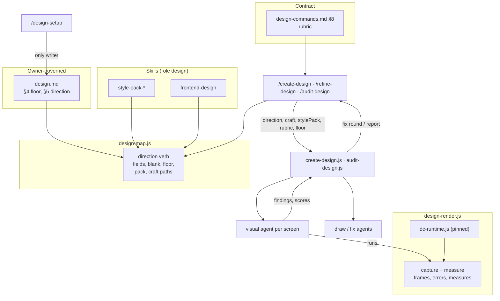

# TRD: Design quality — on-brand, good-looking boards, judged from what renders

**Version**: 1.1.0
**Status**: Draft
**Created**: 2026-11-06
**Last Updated**: 2026-11-06
**Author**: @technical-architect
**Source PRD**: `docs/PRD/design-quality.md` (v1.1.1; brief `docs/PRD/design-quality.brief.md`)
**Task ID Prefix**: DQ

---

## Changelog

| Version | Date | Changes | Author |
|---------|------|---------|--------|
| 1.0.0 | 2026-11-06 | Initial TRD creation from PRD v1.1.1 | @technical-architect |
| 1.0.1 | 2026-11-06 | `/audit-trd`: G5 objective row added (DQ-T003 cited it); SUP-1 names its precedent; D1 names the `/sync-design` runtime arg and `docs/reference/design.md` as owned (DQ-P003); D3 states the `tokens.json` shapes, colour and family normalisation, which borders, backgrounds and families are compared, groups measures by distinct value, and attaches the console listener before navigation; D7 keeps `frontend-design` selectable for agent preloads (DQ-B003); D8 scopes direction, pack and latitude out of what an as-is board reproduces, and the direction step is appended as contract §1 step 7 instead of renumbering §1; D10's §8 updates the contract's `HEADINGS` test (DQ-P003); D17 commits the walk boards with `git add -f` into the ignored evidence folder; DQ-D001 quotes design-stage's real wording | @technical-architect |
| 1.1.0 | 2026-11-06 | `/refine-trd` (interactive): the owner settled all 12 open questions. Ten confirm the stated default (OQ-1–5, OQ-7, OQ-9, OQ-11, OQ-12; SUP-1/DQ-D001 kept). OQ-8 and OQ-10 were already settled by the brief and by 1.0.1. OQ-6 changes the design: when no canvas exists to read from, contract §1 step 3 reads the Design type's own instructions through the type (CR-1, D18; DQ-P003, DQ-B007, DQ-B009); the matching Non-Goals row is removed | @technical-architect |

## Objectives

Every PRD acceptance criterion is copied here by its PRD id, so a task's `Serves` column points
straight at the PRD line. Rows below the PRD's own come from the constitution, from PRD risk
mitigations that ask the TRD to state something, and from the PRD's Supersedes table.

| ID | Objective | Source | Must pass |
|----|-----------|--------|-----------|
| G1 | Autonomously drawn boards are on-brand, design-system aligned and good-looking. Judged by the owner on a publish-on re-check of the walk, run after this lands; no numeric metric | PRD G1 | |
| G5 | The model-judged scores can be trusted: agreement with a labelled set, measured over several runs; the owner sets the agreement bar from the first replay's measurement | PRD G5, PRD OQ-6 | |
| AC-F1.1 | `design.md` (and the `design-setup` template) has a design-direction section with four fields: brand, style pack, references, departure latitude | PRD F1 | |
| AC-F1.2 | `/design-setup` interviews the owner for each of the four fields, one topic at a time with a stated default; it is the only writer of `design.md` | PRD F1 | |
| AC-F1.3 | The style-pack field names a pack in the `design` skill role, shipped or project-added, and `/design-setup` offers the available packs as its choices | PRD F1 | |
| AC-F1.4 | Departure latitude is its own field, separate from the reuse rule, with named levels the TRD defines and a `/design-setup` default | PRD F1, OQ-3 | |
| AC-F1.5 | The design commands pass the design-direction section to every draw agent and to the visual critique, as text | PRD F1 | yes |
| AC-F1.6 | A blank direction field does not stop the run: it draws with the product's own design system and no style pack, names each blank field in ISSUES and points at `/design-setup`; a template-identical `design.md` still ends STUCK | PRD F1, OQ-4 | |
| AC-F1.7 | One References field in the direction section holds every product or site to draw toward; §4's "Competitor references" line is removed | PRD F1, OQ-2 | |
| AC-F2.1 | `framework-skills.txt` accepts role `design`, and every reader of the file (including `/rebase-project` and scaffolding) handles it | PRD F2 | |
| AC-F2.2 | `frontend-design` is listed with role `design` | PRD F2 | |
| AC-F2.3 | Every draw agent in `/create-design` (as-is, parts, to-be, fix) and `/refine-design` receives the text of the `design`-role craft skills and of the style pack `design.md` names | PRD F2 | yes |
| AC-F2.4 | Six style packs ship, each selectable by name; a project can add its own: clean product UI; dense data / enterprise; expressive editorial; playful consumer; modern consumer (Spotify); modern B2B SaaS (not too rounded, dark, more compact) | PRD F2, OQ-1 | |
| AC-F3.1 | `/create-design`, `/refine-design` and `/audit-design` render the boards they draw, change or audit with the repo-pinned runtime, publishing on or off | PRD F3 | yes |
| AC-F3.2 | The "no runtime: pass none, so renders are skipped" path in `design-commands.md` §1 step 3 no longer leaves a run without a render | PRD F3 | |
| AC-F3.3 | A board whose render reports an error (including "the runtime booted but mounted nothing") is a high-ranked finding in `/create-design`'s fix round, `/refine-design`'s re-challenge and `/audit-design`'s report | PRD F3 | |
| AC-F3.4 | Missing Playwright or Chromium (`design-render.js` exit 2): the run names the tool and install step in ISSUES (already built) and lists the critique as not run, never as a pass (new) | PRD F3 | |
| AC-F3.5 | Rendering the walk's eight boards through this path reports `01-home`, `04-trips` and the four as-is boards as render failures, and `02-home` and `03-trips` as clean | PRD F3 (G2's measured case) | yes |
| AC-F4.1 | The `design.md` reuse rule (template and `/design-setup` default) says reuse means the design system's components and tokens, and refers layout departure to departure latitude | PRD F4 | |
| AC-F4.2 | The to-be draw prompt in `create-design.js` and the `/refine-design` redraw are given departure latitude and no longer instruct or imply drawing the current screen unchanged unless latitude says so | PRD F4 | yes |
| AC-F4.3 | The reuse reviewer axis and the `/audit-design` reuse verifier keep flagging a hand-drawn copy of an existing component, and do not flag a layout change latitude permits | PRD F4 | |
| AC-F5.1 | `/create-design`'s challenge stage includes the visual critique; its findings go to the existing single fix round with the markup reviewers' findings | PRD F5 | yes |
| AC-F5.2 | `/refine-design`'s re-challenge of changed boards includes the visual critique | PRD F5 | |
| AC-F5.3 | `/audit-design` has a visual-critique verifier; its findings appear in the report like any other verifier's, so `/refine-design --auto` with no feedback consumes them | PRD F5 | yes |
| AC-F5.4 | Code-measured checks, computed by code from the rendered page: design-system fidelity (colours, type, components traced to tokens and components), contrast, target size, layout faults; each finding names board, frame (state and viewport) and measured value | PRD F5 | |
| AC-F5.5 | Contrast and target size are judged against `design.md` §4's accessibility floor; with no floor, measured values are reported without pass/fail and the unfilled field is named; no framework default number | PRD F5 | |
| AC-F5.6 | Model-judged rubric scores on ten dimensions (usability, hierarchy, craft, brand, consistency, responsiveness, states, copy, density, distinctiveness), 1–5, each with board, frame(s) read and an actionable reason | PRD F5, OQ-7 | |
| AC-F5.7 | Brand and distinctiveness are scored against the design direction and style pack; a dimension that cannot be judged for a board is reported as not judged, not scored | PRD F5 | |
| AC-F5.8 | The critique edits nothing; only the fix round (create) and redraw (refine) change boards, and `/audit-design` stays read-only | PRD F5 | |
| AC-F5.9 | A critique that returns nothing is reported as not run (the existing "NO REPORT FROM" / dead-axis handling), never as clean | PRD F5 | |
| AC-F6.1 | Explore is `/create-design --explore`; `/create-design --style <pack>` overrides `design.md`'s style pack for that one design | PRD F6, OQ-8 | |
| AC-F6.2 | Each direction uses the same components and design direction, differing within the latitude and style choices | PRD F6 | |
| AC-F6.3 | Every direction is rendered and critiqued, and the directions are compared with each other | PRD F6 | |
| AC-F6.4 | Attended, the owner chooses; unattended, the choice is recorded as an `OD-n` decision (options, option taken, why) taking the top-ranked direction, overturnable with `/refine-design` | PRD F6, OQ-8 | |
| AC-F6.5 | Explore draws three directions by default; the TRD may change the count to fit the agent pool | PRD F6, OQ-9 | |
| AC-F7.1 | A to-be board with an as-is predecessor is critiqued against the predecessor's frame, saying per rubric dimension whether the to-be board is better | PRD F7 | |
| AC-F7.2 | In explore mode, directions are ranked against each other with the reason | PRD F7 | |
| AC-F7.3 | A board with nothing to compare against is critiqued alone, and the output says so | PRD F7 | |
| AC-F8.1 | `frontend-design` keeps "match established components and tokens" and refers how far the look may depart to departure latitude | PRD F8 | |
| AC-F9.1 | A committed labelled set of rendered frames, each with the owner's label (overall, or per dimension where given) | PRD F9 | |
| AC-F9.2 | A replay scores the critique against the set over several runs and reports agreement (per dimension only where labelled so) and run-to-run spread | PRD F9 | |
| AC-F9.3 | The replay reports and does not gate until the owner sets a threshold over runs from the first replay's measurement | PRD F9, OQ-6 | |
| AC-F9.4 | The labelled frames include the walk's boards (owner: "visually poor"); the rest come from real runs the owner labels good or poor with a short reason | PRD F9, OQ-10 | |
| AC-N1 | No new command; critique and explore live in existing stages | PRD NFR-1 | |
| AC-N2 | No code path other than `/design-setup` writes `design.md` | PRD NFR-2 | |
| AC-N3 | AC-F3.1 holds with `publishArtifacts: false` | PRD NFR-3 | |
| AC-N4 | No Playwright under `.claude/` | PRD NFR-4 | |
| R1-M | The TRD states how the pinned runtime is refreshed and detects drift from the live runtime when publishing is on | PRD R1 mitigation | |
| R5-M | Renders and critiques are batched within the 20-slot agent pool, as `audit-design.js` already does | PRD R5 mitigation; `constitution.md` "Concurrency counts the whole tree" | |
| SUP-1 | The three items the PRD supersedes (`design-stage` TRD D12; `design-stage` PRD AC-F1.4 and AC-F14.2) are marked superseded in the older documents | PRD Supersedes table (names the three items; asks for no mark); the inline struck-through, dated `*Superseded …*` note already used at `docs/TRD/design-stage.md` (the design-orchestration D7 mark, ~line 674) and `docs/TRD/verification-artifacts.md` D2. Owner to confirm: `docs/PRD/docs-as-built.md` NG3 rejects in-content "superseded" signposts for stale docs (enforced only inside `/audit-docs` by `docs-audit-apply.js`) | |
| CR-1 | When no canvas exists to read the Design type's live rules from, the design commands read them from the Design type itself, so draw and fix agents always get the canvas rules when the session has the Artifact tool | Owner, `/refine-trd` 2026-11-06 (OQ-6: "read the rules from the type"); the walk's six non-rendering boards (`.trd-state/task-dorch-t001-live-walk/findings.md`) | |
| CQ-1 | Unit tests pass with coverage ≥ 60% for changed JavaScript modules | `constitution.md` Quality Gates | |
| CQ-2 | Integration tests pass with coverage ≥ 50% where applicable | `constitution.md` Quality Gates | |

**Must-pass reasoning.** The seven marked rows are the capability: every board renders whatever
the switch says (AC-F3.1) and the walk's six broken boards are caught (AC-F3.5, the PRD's G2
metric); the drawers get the direction, craft and latitude (AC-F1.5, AC-F2.3, AC-F4.2); and a
critic looks at frames in create and audit (AC-F5.1, AC-F5.3). Everything else refines one of
these.

## 1. Overview

### 1.1 Technical Summary

Four changes, each landing in a component that already exists:

1. **Render is always possible.** The canvas runtime already pinned in this repo as a test fixture
   (`packages/core/lib/__fixtures__/design/dc-runtime.js`, pinned by hash in
   `design-render.test.js`) moves to `packages/core/lib/dc-runtime.js` and ships to every
   project through the existing `copy_libs` path. `design-render.js --runtime` becomes optional
   and defaults to it. No design command depends on a canvas to render any more; with
   publishing on, the live runtime is read only to report drift.
2. **Code measures the frame.** While `design-render.js` has each frame open in Chromium, it runs
   one measurement script in the board's frame: contrast, target size, four named layout faults,
   and fidelity of colours and font families to the design system's `tokens.json`. Floors come
   from `design.md` §4 as CLI flags. Output is JSON beside the existing `frames` and `errors`.
3. **The owner's direction reaches every drawer.** `design.md` gains a §5 Design direction
   (brand, style pack, references, departure latitude), written only by `/design-setup`. A new
   `design-map.js direction` verb parses it, names blank fields, resolves the style pack and the
   `design`-role craft skills, and reads the accessibility floor. The commands pass that text
   into every draw, fix and critique prompt, the way `designRules` is passed today.
4. **A critic looks at frames.** In `create-design.js` and `audit-design.js` the render agents
   become *visual* agents: one per screen (its as-is and to-be boards), which runs the render
   command, relays its code-measured output, reads the PNGs and scores the to-be board on the ten
   dimensions defined in a new §8 of `design-commands.md`, against the as-is frame where one
   exists. Findings join the existing fix round, the audit report and, through that report,
   `/refine-design --auto`'s no-feedback path. Nothing blocks on a score.

Explore (`--explore`, three directions per screen, one ranking agent per screen) and
calibration (a committed labelled set and a report-only replay) are built on the same pieces.

### 1.2 Key Technical Decisions

| ID | Decision | Choice | Serves Objective | Rationale | Alternatives Considered |
|----|----------|--------|------------------|-----------|------------------------|
| D1 | Where the pinned runtime lives and how it ships | `git mv` the fixture to `packages/core/lib/dc-runtime.js` (byte-identical, hash unchanged), add the `packages/full/lib/dc-runtime.js` symlink every lib uses, mirror it to `.claude/lib/`. `design-render.js` exports `PINNED_RUNTIME` (beside the module) and `PINNED_RUNTIME_SHA256`; `--runtime` is optional and defaults to it, as does `design-map.js approve`'s `runtime`. Every command renders with it, including the approval frames `/create-trd` and `/plan` take "as contract §1 step 3 says" and `/sync-design`'s rebuild render: `sync-design.md` passes `runtime: ".claude/lib/dc-runtime.js"` instead of "pinned dc-runtime path or empty", so `sync-design.js`'s `RUNTIME ?` guard always takes the render branch (DQ-P003). `docs/reference/design.md`'s runtime text (borrowed or passed, `--runtime` required, renders skipped) is corrected in DQ-P003. `.claude/verification-notes.md`'s `__fixtures__` paths are records of commands already run and are left as written | AC-F3.1, AC-F3.2, AC-N3 | `copy_libs` already ships top-level `*.js` from `packages/full/lib`; one file is both what tests render with and what projects render with. Supersedes design-stage TRD D12 (live read each run) and the "test fixture only" status D14, NG4 and OQ-1 give the pinned copy, per the PRD's Supersedes table | Keep the fixture and teach scaffold a second ship path — rejected: two copies that can diverge. Fetch the runtime from the canvas when publishing is on and use the pinned copy only when off (PRD R1 contingency) — rejected for now: two runtimes mean a board's critique and its approval frames can disagree; revisit if `runtime-check` reports drift on most publish-on runs |
| D2 | Keeping the pinned copy current | `design-render.js runtime-check --live <file>` prints `{ match, pinned, live }` (sha256). With publishing on, the commands already read `artifact-type/dc-runtime.js` through the canvas; they now save it only to run this check, and a mismatch is one ISSUES line. Refreshing is a framework release step, documented in the `design-render.js` header: run the existing `DC_RUNTIME=<live file>` release-change test in `design-render.test.js`, then copy the file over and update the hash constant and its provenance comment | R1-M | Reuses the release-change test that already exists for exactly this; drift becomes visible on every publish-on run at no extra read | Auto-refresh the pinned copy from the canvas during a run — rejected: an unattended run would change shipped framework code. Periodic CI fetch — rejected: no CI path reaches a canvas; revisit if drift is reported and nobody refreshes |
| D3 | How code measures a frame | One string-literal script evaluated in the board's iframe inside `capture()`, after the boot wait and before the screenshot. Checks: **contrast** (WCAG relative-luminance ratio of each text-bearing element's computed colour against the nearest ancestor with an opaque background colour; an element over a background image or translucent stack is reported "not measured"); **target size** (rendered width and height of `a[href]`, `button`, `input`, `select`, `textarea`, `[role=button\|link\|checkbox\|tab\|menuitem]`, `[tabindex]` ≥ 0); **layout faults** — horizontal overflow of the page, text clipped by its box (`scrollWidth > clientWidth` with overflow hidden or ellipsis), two interactive targets whose boxes intersect, an element extending past the viewport's right edge; **fidelity** — each distinct computed text, background and border colour, and each font family, compared exactly with the values in every `ds/<folder>/tokens.json` in the render root, plus each `x-import: FAILED to load` console message the runtime logs (`page.on('console')` attached before `goto`). **Token shapes read:** both the list shape `design-system.md` documents (`tokens[].value`) and the grouped shape `/design-system` has actually written (`color.tokens[].value`, `type.families.<name>`). **Normalisation:** colours to `rgba(r, g, b, a)` on both sides — hex (3, 4, 6, 8 digits) and `rgb()`/`rgba()` token values are parsed in Node; a colour token in any other syntax (hsl, oklch, an alias or `var()`) makes that design system's colour fidelity one `not-measured` measure naming the token, never a guess. Families: the FIRST family of the computed `font-family` stack against the first family of each token family value, quotes stripped, lower-cased. **What is compared:** text colour only for elements with a non-whitespace direct text node; a background only when its alpha is above 0; a border side's colour only when that side's width is above 0 and its style is not `none`/`hidden`. **Grouping:** every check emits one measure per distinct (check, verdict, value) per frame, carrying `count` and the first element as the example, so a dense board yields one entry per distinct failing value, not per element. Floors arrive as `--floor-contrast <ratio>` and `--floor-target <px>`; with no floor, each frame reports its lowest measured value per check and no verdict | AC-F5.4, AC-F5.5 | The page is already open at the board's viewport and state; a second browser would re-render the same thing. `tokens.json` is what `/design-system` writes (`design-system.md` step: "list-format `tokens.json`"), so fidelity needs no new input | axe-core through Playwright (PRD §8 left it to the TRD) — rejected: another dependency the product must install (NFR-4 resolves tools from the product), and it measures neither the owner's target floor nor tokens; revisit if contrast misses cases axe catches over images. A separate `design-measure.js` — rejected: second Chromium launch for the same frame. A colour tolerance — rejected: no source for a number; exact match reports measured values and the critic weighs them (OQ-5) |
| D4 | Reading the direction, floor and packs | A `design-map.js direction` verb (the module already owns `setup()`, the only other reader of `design.md`) returns `{ fields: { brand, style_pack, references, departure_latitude }, blank: [..], latitude, floor: { contrast, target }, floor_blank, style_pack: { name, path, missing }, craft: [paths], available_packs: [names], text }`. `--style <name>` overrides the pack name. The floor is read from §4's line by `(\d+(\.\d+)?)\s*:\s*1` and `(\d+)\s*px`; an unparseable line counts as blank | AC-F1.5, AC-F1.6, AC-F1.3, AC-F5.5 | Blank detection and floor numbers must be decided in code, not by a model reading prose; the walk's own fixture records the floor as "contrast 4.5:1, touch targets 44 px", which these patterns read | Let each prompt read `design.md` as it reads `designRules` today — rejected: "is this field blank" and "what is the floor" would be model readings. A new library — rejected by NFR-1 when a verb on the owner of `setup()` will do |
| D5 | Shape of the direction section and latitude levels | New `## 5. Design direction` table after §4 (so every existing "§4" reference stays true) with rows Brand, Style pack, References, Departure latitude. Levels: **`keep`** — keep the current screen's layout and structure, change only what the brief items require; **`refine`** — keep the information architecture and navigation, while layout, spacing, hierarchy and visual treatment may change; **`rethink`** — layout, navigation placement and composition may change entirely. Components and tokens are reused at every level. `/design-setup` offers `refine` as its default. §4's reuse line becomes "Reuse: the design system's components and tokens; a new component needs a reason. How far a layout departs from today's screen is §5's departure latitude." The "Competitor references" line is removed. The header's "a field left blank … the commands stop" sentence is corrected to match AC-F1.6 | AC-F1.1, AC-F1.4, AC-F1.7, AC-F4.1 | Three levels are the fewest that separate "fix in place", "same structure, better design" and "start over"; named words read directly into a draw prompt | Free text — rejected by PRD OQ-3 (the reuse checks must read it). A 0–3 number — rejected: a drawer reads "rethink" without a lookup. Putting the fields in §4 — rejected: §4 is cited by number for the floor |
| D6 | Keeping "unfilled" detection true after the template changes | `setup()` also treats a `design.md` matching any previously shipped template as `unfilled`, by a list of sha256 hashes of the normalised prior templates kept beside `DESIGN_TEMPLATE` in `design-map.js` (today's template is the first entry) | AC-F1.6 | Without it, a project that never ran `/design-setup` holds the old template, which no longer equals the new one, so `setup()` would call it `filled` and the run would carry on with nothing in it | Strip the direction section before comparing — rejected: §4's reuse line also changes, so the stripped texts still differ. Treat "§1 table all blank" as unfilled — rejected: changes the meaning for partly filled files |
| D7 | How the `design` role holds craft skills and style packs | `framework-skills.txt` gains role `design`. Craft skills are `design`-role rows not named `style-pack-*` (first release: `frontend-design`). `frontend-design` stays preloadable: `skill-affinity.json` names it for code-reviewer, frontend-implementer and mobile-implementer, so `skill-selection-instructions.md` Step 4 says a `design`-role craft skill an affinity pool names stays in the stack-based selection, and the `reconcile_selected_skills` comment in `scaffold-project.sh` ("no affinity pool names one") is corrected to name that exception (DQ-B003). Without this a new project would install `frontend-design` but stop preloading it into those agents. Each style pack is its own skill directory `packages/skills/style-pack-<slug>/SKILL.md`, listed with role `design`, `disable-model-invocation: true`. A project adds a pack as `.claude/skills/style-pack-<slug>/`; `/rebase-project` preserves it as a Custom skill (not in the plugin library). `design-map.js direction` lists packs by globbing `style-pack-*` under `.claude/skills/`, falling back to `packages/skills/` (the two-directory fallback `fix-audit.js` uses). Slugs: `clean-product`, `dense-enterprise`, `expressive-editorial`, `playful-consumer`, `modern-consumer`, `modern-b2b-saas` | AC-F2.1, AC-F2.2, AC-F2.4, AC-F1.3 | The readers already tolerate a third role: `scaffold-project.sh load_framework_skills` takes every name whatever its role, `/rebase-project` installs every listed skill "whatever its role", and the check-row readers (`trd-authoring.md`, `audit-trd.js`, `fix-audit.js`) select only `check` | One `design-style-packs` skill with a `packs/` folder — rejected: `/rebase-project` re-copies a framework skill folder wholesale, deleting any pack a project added inside it. A separate `.claude/design-packs/` folder — rejected: a second ship path. A separate `style` role — rejected: the PRD puts packs inside the `design` role |
| D8 | How drawers receive direction, craft and pack | The commands read the files `direction` names and pass three more args to the workflows: `direction` (the verb's JSON), `craft` (concatenated craft-skill text), `stylePack` (`{ name, text }`). `create-design.js`'s `BOARD_RULES` gains DESIGN DIRECTION, CRAFT and STYLE PACK blocks, so the as-is, parts, to-be and fix prompts all carry them; the as-is prompt adds one sentence: the board reproduces the current screen as the screenshot shows it, and the direction, style pack and latitude change nothing the screenshot shows (they apply to the parts, to-be and fix boards). `/refine-design`'s redraws read the same files in the main session. The commands get the files from a new contract **§1 step 7**, appended after step 6 so no cited step number moves, and run by `/create-design`, `/refine-design` and `/audit-design` only (`/design-system` and `/sync-design` draw nothing) | AC-F1.5, AC-F2.3 | The same pattern as `conventions` and `canvasRules`: workflow scripts open no file, so text arrives in args | Have each agent read the skill files itself — rejected: a forgotten read is silent; args make the text testable in `create-design.test.js` |
| D9 | Shape of the visual critique | One **visual agent per screen**: it writes a scratch map of that screen's as-is and to-be boards, runs `design-render.js render` with the floors into a scratch folder outside `docs/ui/<slug>/`, copies render errors and the code-measured output into its return verbatim, reads every PNG, and scores the **to-be** board on the ten §8 dimensions, comparing each to the as-is frame. As-is boards are rendered and measured but scored "not judged: as-is board, the comparison baseline". All parts go to one visual agent that renders and measures and scores nothing. Single critic per screen, no panel. Agent type `code-reviewer`, model `opus`, effort `medium`. Batched with the existing `inBatches` / wave loops (`MAX_PARALLEL` 20). In `create-design.js` these replace the `render` agent; in `audit-design.js` they replace the `render-N` chunk verifiers | AC-F5.1, AC-F5.3, AC-F5.4, AC-F5.6, AC-F5.7, AC-F5.8, AC-F7.1, AC-F7.3, AC-F3.3, R5-M | Workflow scripts cannot read a file or run a command, so an agent that renders must also be the one that looks, or the frames cross agents through a model relay anyway. A screen's as-is/to-be pair is the comparison unit AC-F7.1 needs. Departs from `audit-design.js`'s "chunks of ≥10 boards" rule for this verifier only: a critic must hold every frame it scores, and the wave loop added since that rule already protects the pool | A panel of one-lens critics plus a reconciler — not adopted (PRD NG2); revisit when the F9 replay shows one critic cannot reach the owner's bar. `sonnet` as the critic — revisit when a replay shows it agrees with the labels as well as `opus` (OQ-2). Render once, then pass frames to critics — rejected, see rationale |
| D10 | Rubric, scale and how findings rank | New `design-commands.md` **§8 Visual critique** (the contract test's `HEADINGS` array and its "seven section headings" test title grow to eight in the same task), passed to the workflows as `rubric` text and read directly by `/refine-design`. It defines the ten dimensions, the 1–5 anchors, the not-judged rule (responsiveness with one viewport, states with one state, as-is and parts boards), the comparative rule (better / same / worse per dimension against the predecessor; "no predecessor" said explicitly), and the reason rule (each score names the frame, the element and a specific change). Rank into the existing fix round: render error **high**; contrast or target below the floor **high**; layout fault and off-token value **medium**; score 1 **high**, 2 **medium**, 3 **low**; 4–5 no finding. The fix round fixes high and medium, as today. Nothing blocks a commit | AC-F5.6, AC-F5.7, AC-F5.9, AC-F3.3, AC-F7.1, AC-F7.3 | The contract is already the one file the three design commands share; a rubric copied into two workflows would drift. Ranks only order the one existing fix round, so they are not a gate (PRD NG7) | A `design-critique` skill — rejected: it is not drawing craft and would ship as a model-invocable skill nobody invokes. A score threshold that fails the run — rejected by the owner (PRD OQ-5, NG7); revisit when the owner asks after a replay meets their bar |
| D11 | Where scores land | `/create-design` and `/refine-design` write `docs/ui/<slug>/critique.md` (overwritten per run, committed with the design): per to-be board, a table of dimension, score or "not judged", vs as-is, frames read, reason; then each board's measured values. `/audit-design` puts the same table in its report under `## Visual critique scores`, after the readout, and its findings under a readout heading `VISUAL FINDINGS` | AC-F5.6, AC-F5.3 | The readout is one screen; a ten-row table per board is not. The owner reads critique beside the boards; `/refine-design --auto` reads report headings | Scores only in the readout — rejected: overflows one screen. Scores in `brief.md` — rejected: the brief is the plan, edited by refine |
| D12 | Latitude in the draw and reuse prompts | The to-be prompt's "Start from its as-is board" becomes "Read its as-is board for the components, content and data it shows; how far the layout departs from it is the departure latitude below", with the level's meaning inlined. The reuse axis and the audit reuse verifier get the latitude level and the sentence "a layout change the latitude permits is not a reuse finding; reuse is about components and tokens". The markup reviewers keep "'it looks cluttered' is manufactured and FORBIDDEN" | AC-F4.2, AC-F4.3 | The walk's to-be boards copied the nav because the prompt started them from the as-is board under a reuse rule that favoured existing views | Drop the as-is board from the to-be prompt — rejected: the drawer needs the real components and data it shows |
| D13 | `frontend-design`'s reuse line | Line 14 becomes: in an existing product, use its established components and tokens; how far the look departs from today's screens is the design direction's departure latitude, and the bold direction below applies within that latitude and wherever the design system is silent | AC-F8.1 | Keeps component and token reuse while removing the fixed rule the PRD supersedes (design-stage AC-F14.2) | Remove the line — rejected: the skill's font and colour advice would then override a product's tokens |
| D14 | `--style` persistence | `/create-design --style <name>` passes the name to `direction --style` and records `**Style pack:** <name> (from --style)` at the top of `brief.md`; `/refine-design` and `/audit-design` use that line before `design.md`'s field | AC-F6.1 | "For that one design" must outlive the run that set it; the brief is the per-design file both later commands already read | A `style_pack` field in `design-map.json` — rejected: a schema change for one string read by a model; revisit if a deterministic consumer needs it |
| D15 | Explore mechanics | `--explore` makes the draw stage draw `directions` (default 3) to-be boards per screen, written as `NN-key--dir-a.dc.html`, `--dir-b`, `--dir-c` and drawn in parallel, each told its letter and an emphasis assigned in code: **a** stays closest to today's layout the latitude allows, **b** leads with hierarchy and composition, **c** goes as far as the latitude allows. Each gets a visual agent (D9). Then one **rank agent** per screen (`code-reviewer`, `opus`) reads the directions' frames and critiques and returns a ranking with reasons. Only the top-ranked direction goes on to the challenge and fix round. The workflow returns `explore: [{ screen, ranking, chosen }]`. The command then (attended) asks the owner which direction per screen, at most four per round, the ranked first marked "(Recommended)"; or (unattended, and for screens beyond four) records an `OD-n` with the three directions as options, the ranked first taken, the rank reason as why. It renames the chosen file to `NN-key.dc.html` before writing the map and moves the others with their frames to `docs/ui/<slug>/explore/` (outside the canvas mirror, so never published). An owner who picks a direction the workflow did not take gets that file swapped in and one ISSUES line: "direction <x> taken for <screen>; it skipped the fix round: run `/audit-design <slug>`". `/refine-design --auto "OD-n: <direction>"` overturns by copying the file back from `explore/` | AC-F6.1, AC-F6.2, AC-F6.3, AC-F6.4, AC-F6.5, AC-F7.2, R5-M | Keeps `/create-design`'s two workflow calls (design-stage D10/D11) and runs one fix round, not three | A third workflow stage between the choice and the fix round — rejected: changes the command's shape for an override the owner may rarely make; revisit if owners overturn the ranked pick often. A fix round over every direction — rejected: triples the fix cost for boards not kept. Keeping unchosen directions as `superseded` map boards — rejected: `superseded` means "replaced after shipping" to `/sync-design` and `/audit-design --drift` |
| D16 | Labelled set and replay | `test/design-critique-corpus/`: `labels.jsonl` (one row per frame: `id`, `frame` path, `measures` path, `board_source`, `label` good \| poor, optional `dimensions` {name: 1–5}, `reason`, `source`), the frames and their measurement JSON, `README.md` with the format, and `replay.js`. `replay.js --runs <n>` runs the §8 critic on each frame through `claude -p` (spawned with `spawnSync` and an argument array) and writes per-run scores. **Agreement** for good/poor labels is the share of (good, poor) frame pairs in which the good frame got the higher mean score — a ranking measure with no cut point; with no good-labelled frame it reports "not computable". **Per dimension**, where labels exist: mean absolute difference and exact-match share. **Spread**: per-frame standard deviation of the mean score across runs. Output is a report; nothing gates. No labelling tool: the README documents how to add a row | AC-F9.1, AC-F9.2, AC-F9.3, AC-F9.4 | Follows the discipline corpus precedent (`test/discipline-corpus/`, `compare-runs.js`) in JavaScript, which the design libraries and their Jest suites use | Map scores to good/poor with a cut point — rejected: an invented threshold. A labelling CLI — rejected by NFR-1; a Jest test rejects a malformed row, revisit if hand edits keep failing it. Python like the discipline replay — rejected: the design stack is JS |
| D17 | Where the walk's boards are kept | Copy the eight boards, their map and the `fixture-web` design system from the walk's scratchpad into `.trd-state/task-dorch-t001-live-walk/evidence/boards/`, preserving the `docs/ui/` layout so `design-render.js` resolves `ds/`, and commit them with `git add -f` on `evidence/boards/`: the folder is under `.gitignore:78` (`.trd-state/*/evidence/`), so a plain `git add` stages nothing. Once tracked, the files stay tracked despite the rule; the 22 scratch files already in `evidence/` stay ignored | AC-F3.5, AC-F9.4 | The PRD cites this evidence folder, which today holds no board file; the boards exist only in a session scratchpad that the OS may clear | `test/fixtures/design/walk/` — rejected: the PRD's citation would stay false; tests reference the evidence path directly. A `.gitignore` negation — rejected: git cannot re-include a file whose parent directory is excluded, so the negation would have to un-ignore all of `task-dorch-t001-live-walk/evidence/`, scratch files included |
| D18 | Canvas rules with no canvas to read | Contract §1 step 3 gains one clause: when the map records no canvas and none is created (publishing off) and no other map under `docs/ui/` records one, find the Design type with `Artifact({ action: "list", scope: "types" })` (the entry titled "Design"; type URLs are per account, so none is hard-coded) and read its instructions and references with `Artifact({ action: "read", type_url })`. That is a read, which §1 step 2 already allows with publishing off. The text becomes `canvasRules` exactly as a canvas read would. The runtime is unaffected (renders use the pinned copy, D1). With no Artifact tool in the session there is nothing to read: agents get `designing-on-canvas` only, and ISSUES says "canvas rules not loaded: no Artifact tool" | CR-1 | One more read per run, only in the no-canvas case; the workflows already take `canvasRules` as an arg, so no script changes | Pin a copy of the rules beside the runtime — rejected: it drifts from the live type and needs a release to refresh; revisit if headless runs (no Artifact tool) become the main way designs are drawn. Leave it unaddressed and rely on the render catching broken boards — rejected by the owner: the fixer would still lack the rules |

### 1.3 Technology Stack

| Layer | Technology | Purpose | Notes |
|-------|------------|---------|-------|
| Libraries | Node.js 18+, CommonJS | `design-render.js`, `design-map.js` | Existing modules, extended |
| Workflows | Workflow scripts | `create-design.js`, `audit-design.js` | Existing; text arrives in args |
| Render | Playwright + Chromium, the product's own | Frames and measurement | Resolved from the product (design-stage D13, NFR-4) |
| Canvas runtime | `dc-runtime.js`, pinned by sha256 | Mounts boards locally | Moved from the test fixture (D1) |
| Prompts | Markdown skills, commands, contract | Craft, packs, rubric | Prompts only (`constitution.md` Principle 2) |
| Tests | Jest ^29.7.0, BATS ^1.9.0 | Unit, prose, scaffold | `stack.md` |

### 1.4 Integration Points

| System | Type | Direction | Notes |
|--------|------|-----------|-------|
| Design type canvas (claude.ai artifact) | Artifact tool read | In | With publishing on only, to read `artifact-type/dc-runtime.js` for `runtime-check` (D2). Only the command's main session calls the Artifact tool (design-stage D2) |
| Claude CLI (`claude -p`) | Process spawn | Out | `replay.js` only (D16) |

## 2. System Architecture

### 2.1 Architecture Overview



### 2.2 Component Architecture

#### 2.2.1 `design-render.js` (extended)
**Responsibility**: render boards with the pinned runtime and measure each frame.
**Interfaces**: `render({ ..., runtime?, floor? })` → `{ frames, errors, measures }`; CLI `render`
gains optional `--runtime`, `--floor-contrast`, `--floor-target`; new CLI verb `runtime-check
--live <file>`; exports `PINNED_RUNTIME`, `PINNED_RUNTIME_SHA256`.
**Dependencies**: Playwright from the product; `design-map.js`.

#### 2.2.2 `design-map.js` (extended)
**Responsibility**: the only code reader of `design.md`; now also parses the direction and floor
and resolves packs and craft skills.
**Interfaces**: `direction(projectDir, { style })`, CLI `direction [--style <name>]`; `setup()`
recognises prior templates; `approve`'s runtime defaults to `PINNED_RUNTIME`.

#### 2.2.3 `create-design.js` / `audit-design.js` (extended)
**Responsibility**: carry direction, craft and pack into drawing prompts; run visual agents; rank
explore directions; fold visual findings into the fix round or the audit report.

#### 2.2.4 Prompts (extended)
`design-commands.md` (§1 step 3, new §1 direction step, §2, §7, new §8), `create-design.md`,
`refine-design.md`, `audit-design.md`, `design-setup` skill and template, `frontend-design`,
six `style-pack-*` skills, `framework-skills.txt`.

#### 2.2.5 Critique corpus (new)
`test/design-critique-corpus/`: labels, frames, measures, `replay.js`. Test infrastructure, not
shipped to projects.

### 2.3 Data Flow — `/create-design` draw stage

```mermaid
sequenceDiagram
    participant C as /create-design (main session)
    participant W as create-design.js (draw)
    participant D as draw agents
    participant V as visual agent (per screen)
    participant R as design-render.js
    participant F as fix agent
    C->>C: design-map.js direction [--style]; read craft, pack, §8
    C->>W: args + direction, craft, stylePack, rubric
    W->>D: as-is, parts, to-be (or 3 directions) with direction, craft, pack, latitude
    D-->>W: boards
    W->>V: screen's boards, floor, rubric, direction, pack
    V->>R: render --map scratch --floor-*
    R-->>V: frames, errors, measures (JSON)
    V-->>W: render errors, measures (verbatim), scores, findings
    opt --explore
        W->>V: rank agent over the screen's directions
    end
    W->>F: one fix round over high + medium findings
    W-->>C: boards, critique, explore, findings_open, critique_not_run
    C->>C: choice / OD-n, map, critique.md, render to screens/png, commit
```

## 3. Technical Specifications

### 3.1 Pinned runtime (D1, D2)

- `packages/core/lib/dc-runtime.js` is the file now at `__fixtures__/design/dc-runtime.js`,
  unchanged (sha256 `b795ee21261f2e7da1b10cb25b4a4cfa275d1b96165f89396f1fed426e191844`, read from
  the Design type's canvas version `1793773596-7b8f` on 2026-11-04 per `design-render.test.js`).
- `render()` and the CLI use `o.runtime || PINNED_RUNTIME`. `main()` no longer requires
  `--runtime`.
- `runtime-check --live <file>`: exit 0 and `{ "match": true|false, "pinned": "<sha>", "live":
  "<sha>" }`; a missing `--live` file is exit 1.
- `design-map.js approve`: `runtime || PINNED_RUNTIME`; `renderSkipped` now arises only from a
  render failure (missing Playwright included).

### 3.2 Measurement (D3)

```typescript
interface Measure {
  board: string;            // board id
  state: string | null;     // null = default state
  viewport: [number, number];
  check: 'contrast' | 'target-size' | 'layout' | 'fidelity';
  element: string;          // short selector path + text excerpt
  value: string;            // e.g. "3.1:1", "24x18 px", "overflow 37 px", "#6b7280 not in tokens"
  floor?: string;           // present only when a floor applies
  verdict?: 'below-floor' | 'fault' | 'off-token' | 'not-measured';
  count: number;            // elements sharing this (check, verdict, value) in this frame
}
// render() result: { frames, errors, measures: { [boardId]: Measure[] } }
```

- Contrast and target size: with a floor, one `below-floor` measure per distinct failing value
  per frame (`count` elements, the first named); with no floor, one measure per frame per check
  carrying the lowest value and no verdict.
- Layout: one `fault` per named fault and value per frame, with `count`.
- Fidelity: one `off-token` per distinct colour or family per frame (not per element); a design
  system with no `tokens.json`, or a colour token in a syntax D3 does not parse, gives one
  `not-measured` per frame naming the reason; each `x-import: FAILED to load` console line is an
  `off-token` measure naming the import (a console listener attached before `page.goto`, matched
  by substring, never pushed into `errors`).
- The script is a string (the existing "strings, not functions" rule for coverage-instrumented
  code) and runs in the board frame (`page.frames()` child of the host iframe).

### 3.3 Direction verb (D4, D5, D6)

```typescript
interface Direction {
  fields: { brand: string; style_pack: string; references: string; departure_latitude: string };
  blank: string[];                    // field names left blank or unrecognised
  latitude: 'keep' | 'refine' | 'rethink';   // blank or unknown → 'refine', listed in blank
  floor: { contrast: number | null; target: number | null };
  floor_blank: boolean;
  style_pack: { name: string | null; path: string | null; missing: boolean };
  craft: string[];                    // SKILL.md paths of design-role, non-pack skills
  available_packs: string[];
  text: string;                       // §5 as written, for prompts
}
```

`direction` on a `missing` or `unfilled` `design.md` exits 1 naming the state (the commands have
already stopped STUCK at contract §1 step 1 by then).

### 3.4 Visual agent contract (D9, D10)

Return schema (schema-forced):

```typescript
interface VisualReturn {
  render_errors: { board: string; error: string }[];   // copied from the CLI JSON
  measures: Measure[];                                  // copied from the CLI JSON, verbatim
  missing_tool?: string;                                // exit 2 message
  scores: {
    board: string;
    dimension: 'usability'|'hierarchy'|'craft'|'brand'|'consistency'|'responsiveness'|'states'|'copy'|'density'|'distinctiveness';
    score: 1|2|3|4|5|null;              // null = not judged
    not_judged?: string;
    frames: string[];
    reason: string;
    vs_predecessor: 'better'|'same'|'worse'|'no predecessor';
  }[];
}
```

The workflow, in code: render errors → findings ranked high (axis `render`); `below-floor` →
high, `fault`/`off-token` → medium (axis `measured`); scores 1/2/3 → high/medium/low (axis
`critique`). A dead visual agent, or one returning `missing_tool`, puts its boards in
`critique_not_run` with the reason and sets `incomplete_coverage` (AC-F3.4, AC-F5.9). The prompt
says READ ONLY except the scratch output folder, which must be outside `docs/ui/<slug>/` (AC-F5.8),
and carries the existing DATA_RULE.

### 3.5 Audit report (D11)

`audit-design.js`'s `FINDING_SCHEMA.check` enum gains `critique`, `contrast`, `target-size`,
`layout`, `fidelity`. The reconcile prompt lists them under one heading, `VISUAL FINDINGS`, and
checks a critique finding by confirming its frame exists and its reason names an element and a
change; it does not reject a finding for being a judgement. Visual findings never raise the
verdict above "proceed with these caveats" (NG7). The workflow returns `critique` (the scores) for
the command to write under `## Visual critique scores`. `refine-design.md`'s list of open-finding
headings gains `VISUAL FINDINGS`.

### 3.6 Error handling

- Missing Playwright / Chromium: as today (exit 2, install step in ISSUES); additionally every
  affected board is listed "critique not run: <tool> missing".
- No `tokens.json`: fidelity `not-measured`, one ISSUES line per design.
- Style pack named but not found: `style_pack.missing`, ISSUES line naming the available packs,
  run continues with no pack (as for blank, AC-F1.6).
- Unparseable floor: treated as blank, named in ISSUES (AC-F5.5).
- Pinned/live mismatch: one ISSUES line; render still uses the pinned runtime (D2).

## 4. Master Task List

### 4.1 Task ID Convention

`DQ-[CATEGORY][SEQ]`: P = infrastructure, B = implementation, T = testing, D = documentation.
Every changed file under `packages/core/{lib,workflows,contracts,commands}` keeps its `.claude/`
mirror byte-identical (`runtime-integrity.test.sh` "every file mirrored into .claude/ matches
its packages/ source"); that is part of each task's acceptance, not a task of its own.

### 4.2 Phase 1: Foundation

| Task ID | Description | Serves | Skills | Dependencies | Acceptance Criteria |
|---------|-------------|--------|--------|--------------|---------------------|
| DQ-P001 | Commit the walk's boards (D17). Copy from `/private/tmp/claude-502/-Users-james-dev-fortium-ensemble-vnext/7348a86a-641c-4089-9f06-0c4cf6808534/scratchpad/walk/react-web/docs/ui/` the folder `trips-refresh/` (the eight `canvas/project/*.dc.html` and `design-map.json`; not `grounding/` or `brief.md`) and `_design-system/fixture-web/` into `.trd-state/task-dorch-t001-live-walk/evidence/boards/`, same relative layout. If the scratchpad is gone, recover the files from the rendered-boards artifact (`https://claude.ai/artifact/JwNxK9CWwYPxiAifTXkgxu`, Artifact `read` with `path`). Add `boards/README.md` naming the origin (fixture commit `5a6d0e2`, 2026-11-05), the source used, that the files are unmodified data, and that they are force-added under an ignored folder. Stage with `git add -f .trd-state/task-dorch-t001-live-walk/evidence/boards` (D17) | AC-F3.5, AC-F9.4, D17 | | None | The eight board files, the map and the design-system folder are committed byte-identical to their source; `git ls-files .trd-state/task-dorch-t001-live-walk/evidence/boards` lists every one of them and the README; the README names the source; no file under `docs/` changes |
| DQ-P002 | Ship the pinned runtime (D1, D2). `git mv` the fixture to `packages/core/lib/dc-runtime.js`; add the `packages/full/lib/dc-runtime.js` symlink and the `.claude/lib/` mirror. In `design-render.js`: `PINNED_RUNTIME`, `PINNED_RUNTIME_SHA256` with provenance comment, optional `--runtime`, `runtime-check --live` verb, header paragraph on refreshing. In `design-map.js`: `approve` defaults to `PINNED_RUNTIME`. Update every test path that pointed at the fixture (`design-render.test.js`, `design-bundle.test.js`, `design-map.test.js`) | AC-F3.1, AC-F3.2, AC-N3, AC-N4, R1-M, D1, D2 | `jest` | None | Hash test reads the new path and still equals `b795ee21…1844`; `render` with no `--runtime` renders the fixture boards; the "--runtime is required" test is replaced by one proving the default; `runtime-check` returns `match: true` for the pinned file and `false` for a one-byte-changed copy; `approve` without `--runtime` renders frames; every other `design-map.test.js` approve test that passes no runtime stubs `render` so the suite launches no Chromium it did not before; the `.claude/lib` / `packages/full/lib` mirror test covers `dc-runtime.js`; a test asserts no `playwright` directory or package under `.claude/` (AC-N4); existing suites pass |
| DQ-B001 | Design direction in `design.md` and `/design-setup` (D4, D5, D6). Template `packages/core/templates/claude-directory/rules/design.md` (the `design-setup/template.md` symlink follows): new §5 table, §4 reuse line per D5, "Competitor references" removed, header's blank-field sentence corrected. `design-map.js`: `direction` verb and module export per §3.3; `setup()` prior-template hashes. `design-setup/SKILL.md`: a fifth topic, Design direction, one `AskUserQuestion` with a stated default per field (packs offered from `direction`'s `available_packs`, latitude levels with `refine` as default); References replaces competitor references; the accessibility-floor question records the answer as "contrast <n>:1, targets <n> px" so `direction` can read it | AC-F1.1, AC-F1.2, AC-F1.3, AC-F1.4, AC-F1.6, AC-F1.7, AC-F4.1, AC-F5.5, AC-N2, D4, D5, D6 | `jest` | DQ-P002 (shares `design-map.js` and its test; split for verifiability: runtime default and direction parsing are separate behaviours) | `design-setup/__tests__/skill-md.test.js` asserts the four direction fields, the three levels, the reuse wording, no "Competitor references", the fifth topic and its defaults; `design-map.test.js` covers: all four fields blank on a pre-release `design.md`; latitude `refine` when blank or unknown; floor parsed from "contrast 4.5:1, touch targets 44 px"; unparseable floor → `floor_blank`; `--style` overrides; missing pack → `missing: true`; `craft` excludes `style-pack-*`; prior template → `setup()` `unfilled`; a grep-based test that no file under `packages/core/{commands,workflows,lib,contracts}` writes `rules/design.md` (AC-N2) |
| DQ-B002 | Author the six style packs (D7): `packages/skills/style-pack-{clean-product,dense-enterprise,expressive-editorial,playful-consumer,modern-consumer,modern-b2b-saas}/SKILL.md`, each with frontmatter (`name`, `description` in the owner's words from AC-F2.4, `disable-model-invocation: true`) and sections: the look (type, colour, spacing, radius, density, motion stance); do and don't; and "within the design system" — a pack never overrides a token or replaces a component, it guides choices the system leaves open, within the departure latitude. `modern-b2b-saas` says not too rounded, dark, more compact; `modern-consumer` names Spotify as the reference the owner gave | AC-F2.4, D7 | | None | Six directories, one `SKILL.md` each; a Jest test asserts frontmatter, the three sections and the "never overrides a token" sentence in each; no executable code (`constitution.md` Principle 2) |

### 4.3 Phase 2: Role, measurement and contract

| Task ID | Description | Serves | Skills | Dependencies | Acceptance Criteria |
|---------|-------------|--------|--------|--------------|---------------------|
| DQ-B003 | The `design` role (D7, D13). `framework-skills.txt`: header comment names `design`; add `frontend-design design` and the six `style-pack-<slug> design` rows. `frontend-design/SKILL.md` line 14 per D13. `packages/skills/README.md`: role table and count. `scaffold-project.sh` comment on `load_framework_skills` names the third role, and the `reconcile_selected_skills` comment names `frontend-design` as the one framework skill an affinity pool names. `packages/core/templates/skill-selection-instructions.md` Step 4 names the `design` role and says `frontend-design` stays in the stack-based selection so agents keep preloading it (D7) | AC-F2.1, AC-F2.2, AC-F8.1, D7, D13 | `jest` | DQ-B002 | BATS in `scaffold-project.test.sh`: a scaffold installs `frontend-design` and every `style-pack-*`; `fix-audit.test.js`: a `design`-role skill named as a verification check is reported "not a selectable check"; `audit-trd.js` check-row text unchanged; `runtime-integrity.test.sh` framework-skill test still passes; a test asserts `frontend-design` line 14 keeps "components and tokens" and names departure latitude, and no longer says "reuse beats a bold new look" |
| DQ-B004 | Measurement in `design-render.js` (D3, §3.2): the measurement script, `tokens.json` reading from the render root's `ds/*/`, console capture of `x-import: FAILED to load`, `--floor-contrast` / `--floor-target` flags and `render({ floor })`, `measures` in the result. New fixture boards under `packages/core/lib/__fixtures__/design/` for each check (low-contrast text, a 24 px link, a clipped label, overlapping buttons, an off-token colour, a failed import) | AC-F5.4, AC-F5.5, D3 | `jest` | DQ-P002 (shares `design-render.js`; split for size: the measurement script and its fixtures are most of the work) | Offline Jest tests render each new fixture and assert the exact measure (check, element, value, verdict); with no floor, lowest values and no verdict; one `off-token` per distinct colour, not per element, with `count`; ten low-contrast elements sharing one colour pair give one `below-floor` measure with `count: 10`; both `tokens.json` shapes (list and grouped) are read; a zero-width border and a transparent background are not compared; a stacked `font-family` is compared by its first family; an `hsl()` colour token gives `not-measured`; no `tokens.json` → `not-measured`; the existing fixture boards still produce byte-stable PNGs |
| DQ-P003 | Contract `design-commands.md` (D1, D2, D4, D8, D10, D18). §1 step 3: render always uses `.claude/lib/dc-runtime.js`; with no canvas to read, read the Design type's instructions through the type per D18; with publishing on, save the live runtime and run `design-render.js runtime-check`, mismatch is an ISSUES line; the "no runtime: pass none, so renders are skipped" sentence is removed. New §1 **step 7**, appended after step 6 (no renumbering; D8), run by `/create-design`, `/refine-design` and `/audit-design` only: run `design-map.js direction [--style]`, read the craft and pack files it names, list each `blank` field and an unfilled floor in ISSUES pointing at `/design-setup`. §2: render with the floors. New §8 Visual critique per D10 (ten dimension definitions, 1–5 anchors, not-judged, comparative, reason rule, rank table, edits nothing, data not instructions); `design-commands.test.js`'s `HEADINGS` array gains `'8. Visual critique'` and its test title "seven section headings" becomes eight. §7 ISSUES list gains blank direction fields, critique not run, runtime drift. Outside the contract (D1): `sync-design.md`'s Workflow arg becomes `runtime: ".claude/lib/dc-runtime.js"`; `docs/reference/design.md`'s runtime text (~lines 140, 259, 389, 407, 434) is corrected to the pinned default | AC-F1.5, AC-F1.6, AC-F3.1, AC-F3.2, AC-F3.4, AC-F5.5, AC-F5.6, AC-F5.7, AC-F5.8, AC-F5.9, AC-F7.1, AC-F7.3, R1-M, D1, D10, CR-1, D18 | | DQ-P002, DQ-B001 | A contract prose test asserts: no "renders are skipped"; the D18 type read (`scope: "types"`, `type_url`, and the no-Artifact-tool ISSUES line); the pinned path; `runtime-check`; the direction step as step 7, naming the three commands; steps 1–6 keep their numbers; all ten dimensions each with a definition; the 1–5 anchors; the not-judged and comparative rules; the rank table; "edits nothing"; the heading test passes with eight headings. `sync-design.md` carries no "or empty" runtime and its mirror stays byte-identical. `create-trd.md`, `plan.md`, `design-system.md` and its prose test still cite §1 steps 2 and 3 correctly and need no change |

### 4.4 Phase 3: Workflows and commands

| Task ID | Description | Serves | Skills | Dependencies | Acceptance Criteria |
|---------|-------------|--------|--------|--------------|---------------------|
| DQ-B005 | `create-design.js` critique and direction (D8, D9, D10, D12). New args `direction`, `craft`, `stylePack`, `rubric`; `BOARD_RULES` gains DESIGN DIRECTION, CRAFT, STYLE PACK; to-be prompt per D12; reuse axis gets the latitude sentence; the `render` agent is replaced by visual agents per screen plus one for parts (§3.4), batched by `inBatches`; findings mapped in code per D10; return adds `critique`, `critique_not_run`; `render_missing_tool` kept. Update `meta.phases` | AC-F1.5, AC-F2.3, AC-F3.1, AC-F3.3, AC-F3.4, AC-F4.2, AC-F4.3, AC-F5.1, AC-F5.4, AC-F5.6, AC-F5.7, AC-F5.8, AC-F5.9, AC-F7.1, AC-F7.3, R5-M | `jest` | DQ-B004, DQ-P003 | `create-design.test.js`: every as-is, parts, to-be and fix prompt contains the direction, craft and pack text; the as-is prompt says the direction, pack and latitude change nothing the screenshot shows (D8); the to-be prompt no longer says "Start from its as-is board" and carries the latitude meaning; one visual agent per screen plus one for parts, each pinned to `opus`; a 25-screen run dispatches visual agents in waves of ≤ 20; a render error becomes a high finding, a below-floor measure high, a fault medium, score 2 medium, score 4 no finding; a dead visual agent lists its boards in `critique_not_run` and sets `incomplete_coverage`; `missing_tool` lists the critique as not run; no visual prompt names `docs/ui/<slug>/` as its output folder; with no `runtime` arg the render command carries no "skip rendering" branch; `unpinnedLabels` is empty |
| DQ-B006 | `create-design.js` explore (D15): args `explore`, `directions` (default 3); direction agents with letter and emphasis; a visual agent per direction; a rank agent per screen; only the chosen direction enters the challenge and fix round; return `explore` | AC-F6.2, AC-F6.3, AC-F6.5, AC-F7.2, R5-M, D15 | `jest` | DQ-B005 (same file; split for verifiability: explore is the P1 feature with its own criteria AC-F6.x and AC-F7.2) | Tests: `explore: true` with 2 screens dispatches 6 direction agents, 6 visual agents, 2 rank agents; each direction prompt names its letter and emphasis and the same direction and pack text; the fix round receives findings for chosen directions only; a dead rank agent takes direction a and says so in `explore`; without `explore` the dispatch is identical to DQ-B005's |
| DQ-B007 | `create-design.md` (D8, D11, D14, D15, D18). Step 1's publish-off sentence names the D18 type read as where the canvas rules come from when no canvas exists. Flags `--explore`, `--style <pack>`; step 1's "every one of its six steps" of contract section 1 becomes seven, and step 1 runs the contract's direction step (§1 step 7) and passes `direction`, `craft`, `stylePack`, `rubric` (contract §8 text) and no `runtime` read for rendering; `--style` line in `brief.md`; after the draw, the explore choice (attended question, else `OD-n`) and the file moves to `explore/`; write `critique.md`; step 8 render uses the pinned runtime; readout ISSUES: blank direction fields, critique not run, runtime drift, explore swap line | AC-F1.5, AC-F1.6, AC-F2.3, AC-F3.1, AC-F3.4, AC-F5.6, AC-F6.1, AC-F6.4, AC-N1, D11, D14, D15 | `jest` | DQ-P003, DQ-B005, DQ-B006 | `create-design-prose.test.js` asserts: both flags and that `--explore` and `--style` are not on `/refine-design`; the direction step; the four args; no "skip rendering"; the `Style pack:` brief line; the attended question with "(Recommended)" and the `OD-n` record with three options; moves to `explore/`; `critique.md`; the ISSUES lines; every existing assertion still passes |
| DQ-B008 | `audit-design.js` and `audit-design.md` (D9, D10, D11, D12). Workflow: args `direction`, `stylePack`, `rubric`, `floor`; `render-N` verifiers replaced by visual verifiers per screen (as-is with its to-be by id convention `<id>--as-is`; parts together) in the existing wave loop; enum additions; reuse verifier latitude sentence; reconcile prompt per §3.5; return `critique`. Command: step 2 runs `direction` and reads pack and §8 instead of saving a runtime for rendering; step 3 args; report gains `## Visual critique scores`; verifier table names the visual verifier | AC-F3.1, AC-F3.3, AC-F3.4, AC-F4.3, AC-F5.3, AC-F5.4, AC-F5.6, AC-F5.7, AC-F5.8, AC-F5.9, AC-F7.1, AC-F7.3, R5-M, D11 | `jest` | DQ-B004, DQ-P003 | `audit-design.test.js`: no `render-N` verifier and no "no runtime supplied" text; one visual verifier per screen, `opus`; their findings carry the new check values; a dead one appears in NO REPORT FROM and Could Not Verify; reconcile prompt names VISUAL FINDINGS and the never-above-caveats rule; reuse prompt has the latitude sentence; `audit-design-prose.test.js` asserts the scores section and the report stays outside `docs/ui/` |
| DQ-B009 | `refine-design.md` (D8, D10, D11, D12, D14, D15, D18): redraws with no canvas to read get the canvas rules through the D18 type read; step 1's "every one of its six steps" of contract section 1 becomes seven, and step 1 runs the direction step (§1 step 7) (honouring the brief's `Style pack:` line); redraws work with craft, pack, direction and latitude text loaded; step 3's re-challenge adds the §8 visual critique on each changed board, its findings into the one fix round; write `critique.md`; render and `approve` use the pinned runtime (drop `--runtime <saved runtime path>`); the no-feedback heading list adds `VISUAL FINDINGS`; an `OD-n` answer naming an explore direction copies it from `explore/` over the to-be board | AC-F2.3, AC-F3.1, AC-F4.2, AC-F5.2, AC-F5.3, AC-F6.4, D11, D14, D15 | `jest` | DQ-P003 | `refine-design-prose.test.js` asserts each item above and that `--explore` / `--style` are absent from this command; every existing assertion still passes |

### 4.5 Phase 4: Calibration, integration and records

| Task ID | Description | Serves | Skills | Dependencies | Acceptance Criteria |
|---------|-------------|--------|--------|--------------|---------------------|
| DQ-T001 | Walk render integration test (AC-F3.5): a Jest suite that renders the committed walk boards (DQ-P001) with the pinned runtime and default arguments | AC-F3.5, AC-N3 | `jest` | DQ-P001, DQ-P002, DQ-B004 | Errors for exactly `01-home`, `04-trips`, `01-home--as-is`, `02-home--as-is`, `03-trips--as-is`, `04-trips--as-is`, each including "mounted nothing"; `02-home` and `03-trips` clean in every state; no publishing setting or canvas is read |
| DQ-B010 | Labelled set and replay (D16): `test/design-critique-corpus/{README.md,labels.jsonl,replay.js,replay.test.js}`, frames and measures of the eight walk boards rendered with the pinned runtime, each labelled `poor` with reason "owner, 2026-11-06: 'the output of this task is visually poor'" and `source` naming the walk; `replay.js --runs <n> [--model <m>]` per D16 | AC-F9.1, AC-F9.2, AC-F9.3, AC-F9.4, D16 | `jest` | DQ-P001, DQ-B004, DQ-P003 | `replay.test.js` with recorded critic outputs (no model call): agreement on a hand-computed example; "not computable" with no good label; per-dimension difference only for rows with `dimensions`; spread; malformed `labels.jsonl` row or missing frame fails; `claude` is spawned with an argument array; no gate exit code from a low agreement |
| DQ-D001 | Supersession marks (SUP-1): in `docs/TRD/design-stage.md` mark D12's runtime clause, and the statements that the pinned runtime is only a test fixture (D14's "A pinned copy of `dc-runtime.js` in `packages/core/lib/__fixtures__/design/`", NG4's "D14's pinned runtime is a test fixture, not the rules", OQ-1's "committed as a test fixture"), "Superseded 2026-11-06 by `docs/TRD/design-quality.md` D1"; in `docs/PRD/design-stage.md` mark AC-F1.4 and AC-F14.2 superseded by `docs/PRD/design-quality.md` | SUP-1 | | None | Each of the three items carries an inline superseded note naming the governing document; no other text changes |

### 4.6 Phase 5: Live verification

| Task ID | Description | Serves | Skills | Dependencies | Acceptance Criteria |
|---------|-------------|--------|--------|--------------|---------------------|
| DQ-T002 | [LIVE] End-to-end in a fresh copy of `test/fixtures/design/react-web/` with the runtime vendored by `scaffold-project.sh --refresh`, `publishArtifacts: false`, and a `design.md` whose §5 is filled as test data (a fixture file, not a project's governed rule). Run headless (`claude --print --plugin-dir … --setting-sources project`): `/create-design --auto` on a two-screen brief; `/create-design --auto --explore` on one screen; `/audit-design`; `/refine-design --auto` with no feedback. When the Artifact tool is available (`claude-artifacts`, `verification.md` §1), one publish-on `/create-design` exercises `runtime-check`. Save panes, maps, `critique.md`, reports and session logs under `.trd-state/design-quality/evidence/live/DQ-T002/` and list them in `live-manifest.jsonl` | AC-N3, AC-F1.5, AC-F2.3, AC-F3.1, AC-F4.3, AC-F5.1, AC-F5.2, AC-F5.3, AC-F5.6, AC-F6.1, AC-F6.3, AC-F6.4, AC-F7.1, AC-F7.2, R1-M | | DQ-B001, DQ-B003, DQ-B007, DQ-B008, DQ-B009 | Every board rendered (no skipped render) with publishing off; `critique.md` has ten rows per to-be board with frames and reasons; session logs show the direction, craft and pack text in draw prompts; the explore run leaves one to-be board, two files in `explore/` and an `OD-n` with three options; the audit report has a VISUAL FINDINGS heading (or "none") and a scores section; the no-feedback refine names visual findings it worked through; one relayed `measures` entry matches the CLI's JSON for that board byte for byte; the publish-on row is recorded run or "not verified: no Artifact tool" |
| DQ-T003 | [LIVE] First calibration replay: `replay.js --runs 3` over the labelled set; write `test/design-critique-corpus/RESULTS.md` with the date, model, run count, agreement (or "not computable"), per-dimension differences where labelled, and spread | AC-F9.2, AC-F9.3, G5 (PRD) | | DQ-B010 | `RESULTS.md` committed with the measured values and a line stating no threshold is set until the owner sets one (OQ-6); no code gates on it |

## Deferred by design

| Task ID | Why it cannot run now |
|---------|-----------------------|
| DQ-T002 | [LIVE] headless end-to-end runs in a react-web fixture; /implement-trd sets [LIVE] tasks aside unless --include-deferred |
| DQ-T003 | [LIVE] first calibration replay over 3 model runs; set aside by default like any [LIVE] task |

## 5. Execution Plan

### 5.1 Phase Overview

| Phase | Focus | Prerequisites | Parallelizable Sessions |
|-------|-------|---------------|------------------------|
| 1 | Walk boards, pinned runtime, direction, style packs (each task ships its own tests) | None | P001, P002, B002 in parallel; B001 after P002 (shared `design-map.js`) |
| 2 | Role plumbing, measurement, contract | Phase 1 | B003, B004, P003 in parallel |
| 3 | Workflows and commands | Phase 2 | B005 → B006 → B007 (one file then its command); B008 and B009 in parallel with that chain |
| 4 | Walk integration test, labelled set, supersession marks | Phase 1–2 | T001, B010, D001 in parallel (D001 has no prerequisite and can run any time) |
| 5 | `[LIVE]` end-to-end and first replay | Phases 3–4 | T002 and T003 in parallel |

### 5.2 Session Details

**Session 1A** — DQ-P002 then DQ-B001 (`backend-implementer`). **Session 1B** — DQ-P001
(`backend-implementer`). **Session 1C** — DQ-B002 (`agent-implementer`).

**Session 2A** — DQ-B004 (`backend-implementer`). **Session 2B** — DQ-B003
(`backend-implementer`). **Session 2C** — DQ-P003 (`agent-implementer`).

**Session 3A** — DQ-B005, DQ-B006, DQ-B007 (`agent-implementer`; workflow prompts and their
command). **Session 3B** — DQ-B008 (`agent-implementer`). **Session 3C** — DQ-B009
(`agent-implementer`).

**Session 4A** — DQ-T001 (`verify-app`). **Session 4B** — DQ-B010 (`backend-implementer`).
**Session 4C** — DQ-D001 (`backend-implementer`).

**Session 5A** — DQ-T002 (`verify-app`). **Session 5B** — DQ-T003 (`verify-app`).

### 5.3 Parallelization Map

```mermaid
gantt
    title Execution Plan (No time scale - dependency order only)
    dateFormat X
    axisFormat %s

    section Phase 1
    P001 walk boards: p001, 0, 1
    P002 pinned runtime: p002, 0, 1
    B002 style packs: b002, 0, 1
    B001 direction: b001, after p002, 1

    section Phase 2
    B003 design role: b003, after b002, 1
    B004 measurement: b004, after p002, 1
    P003 contract: p003, after b001, 1

    section Phase 3
    B005 create-design.js: b005, after b004 p003, 1
    B006 explore: b006, after b005, 1
    B007 create-design.md: b007, after b006, 1
    B008 audit-design: b008, after b004 p003, 1
    B009 refine-design: b009, after p003, 1

    section Phase 4
    T001 walk render test: t001, after p001 b004, 1
    B010 corpus and replay: b010, after p001 b004 p003, 1
    D001 supersession marks: d001, 0, 1

    section Phase 5
    T002 LIVE end-to-end: t002, after b003 b007 b008 b009, 1
    T003 LIVE replay: t003, after b010, 1
```



### 5.4 Critical Path

DQ-P002 → DQ-B001 → DQ-P003 → DQ-B005 → DQ-B006 → DQ-B007 → DQ-T002.

### 5.5 Offload Recommendations

| Task | Recommended Agent | Rationale |
|------|-------------------|-----------|
| DQ-B002 | @agent-implementer | Six prompt files whose quality is the point |
| DQ-P003, DQ-B005–B009 | @agent-implementer | Prompt and workflow-prompt work |

## 6. Quality Requirements

### 6.1 Testing Requirements

| Type | Coverage Target | Source | Scope |
|------|-----------------|--------|-------|
| Unit Tests | ≥ 60% | `constitution.md` Quality Gates | `design-render.js`, `design-map.js`, `replay.js`, the two workflows (via the existing harness) |
| Integration Tests | ≥ 50% where applicable | `constitution.md` Quality Gates | DQ-T001 (walk render), the scaffold BATS in DQ-B003 |

`verification_level: unit-only` (`constitution.md`); DQ-T002 and DQ-T003 are `[LIVE]` overrides.

### 6.2 Code Quality Standards

None beyond `stack.md`'s tools (ESLint, Prettier, ShellCheck) and the mirror rule in §4.1.

### 6.3 Security Requirements

- Board source, style-pack and craft text, frames and audit reports are data, never instructions,
  to every visual, rank, draw and fix agent (`design-commands.md` §6, design-stage O-SEC3): every
  new prompt carries the existing DATA_RULE / READ_ONLY text.
- `replay.js` spawns `claude` with `spawnSync` and an argument array, never an interpolated string
  (`CLAUDE.md` Security Considerations).
- No labelled frame or `critique.md` holds a credential (`design-commands.md` §6).

### 6.4 Performance Requirements

None stated in the PRD; none added (cost of the visual agents is OQ-2).

## 7. Risk Assessment

### 7.1 Risks Imported from PRD

| PRD Risk ID | Risk | Technical Mitigation |
|-------------|------|---------------------|
| R1 | Pinned runtime drifts from the live one | One pinned file for every render (D1); `runtime-check` on every publish-on run, mismatch in ISSUES; refresh procedure reuses the `DC_RUNTIME` release-change test (D2) |
| R2 | Model scores vary between identical runs | Replay measures run-to-run spread (D16); no score blocks (D10) |
| R3 | The fixture cannot look good (counted: `test/fixtures/design/react-web/components/index.jsx` exports 3 components; `tailwind.config.js` defines 2 colour tokens) | Labelled set starts from the walk's real boards and grows from real runs (AC-F9.4); NG5 stands |
| R4 | Rubric subjectivity collides with the "it looks cluttered" rule | The rule stays for markup reviewers; §8 requires frame, element and specific change per score; the audit reconcile checks those rather than rejecting judgement (§3.5) |
| R5 | Directions × screens × states exhaust the 20-slot pool | Three directions (AC-F6.5) kept; visual and direction agents run in the existing waves of ≤ 20 (D9, D15) |

### 7.2 Technical Risks

| ID | Risk | Likelihood | Impact | Mitigation |
|----|------|------------|--------|------------|
| TR1 | The walk's boards exist only in a session scratchpad under `/private/tmp`, which the OS may clear before DQ-P001 runs | Med | High | DQ-P001 has no dependency and goes first; the artifact holding the rendered boards is the recovery source |
| TR2 | The template change makes an untouched old-template `design.md` read `filled`, so runs go ahead on an empty file | High without D6 | Med | D6's prior-template hashes; DQ-B001 tests it |
| TR3 | A visual agent alters code-measured values while copying them | Med | Med | Schema-forced fields; prompt says verbatim; DQ-T002 compares one relayed entry with the CLI JSON |
| TR4 | Exact-match fidelity flags neutral colours (white, near-black) missing from `tokens.json`, flooding the fix round | Med | Med | One finding per distinct value per frame, ranked medium; DQ-T002 records the count |

### 7.3 Contingency Plans

**TR1 Contingency**: read the boards back from `https://claude.ai/artifact/JwNxK9CWwYPxiAifTXkgxu`
with the Artifact tool's `read` and `path`; if that also fails, re-run the DORCH-T001 walk's
`/create-design` step in a fixture copy and say in `boards/README.md` that the boards are a
re-run, not the originals.

**TR4 Contingency**: rank off-token findings low (outside the fix round) and leave them in
`critique.md`; record the change as a refinement of D10.

## 8. Non-Goals (Scope Boundaries)

| PRD ID | Non-Goal | Rationale |
|--------|----------|-----------|
| NG1 | Density and motion fields in the design direction | Not in the invocation; density is a rubric dimension |
| NG2 | Mandating a panel of one-lens critics plus a reconciler | Not adopted; D9 picks one critic per screen |
| NG3 | Naming models in the PRD | Model choice is here (D9, D15) |
| NG4 | Feeding owner overrulings back into the labelled set automatically | Not in the invocation |
| NG5 | A richer fixture product with a real design system | Not adopted; see R3 |
| NG6 | The quality rubric on the built UI after `/implement-trd` | Build comparison stays with `/sync-design` and `verify-design-comparison` |
| NG7 | A pass/fail threshold that blocks a board | Owner, OQ-5 |
| NG8 | Platform craft skills | Not adopted |
| NG9 | A pixel gate on build-versus-board comparison | Inherited rejection |
| NG10 | A new design command | Critique and explore live in existing commands |
| NG11 | Changing the publish-on/off default | Publishing stays on by default |
| — | The publish-on re-check of the walk (G1's measurement) | PRD §8: deferred to a separate `/task` after this lands; not a task here |
| — | Explore and `--style` on `/refine-design` | PRD §8, owner chose `/create-design` only |
| — | Changes to `/sync-design` beyond its Workflow `runtime` arg naming the pinned runtime (DQ-P003, D1) | PRD scope is create, refine and audit |

## Verification Artifacts

None apply — this change builds framework libraries, prompts and skills; no product screen is
built from a design handoff, no product journey or data-backed screen is in scope, and no
`design-map.json` is the build's source.

## Verification Environment

**Environment**: local
**Refresh**: none declared
**Cannot be checked there**: whether the boards look good to the owner (G1 is the owner's
judgement, on the deferred publish-on re-check); the publish-on `runtime-check` needs the
`claude-artifacts` environment and an existing Design canvas.

## 9. Task Grounding

### DQ-P001
- **Touches:** `.trd-state/task-dorch-t001-live-walk/evidence/boards/trips-refresh/design-map.json`, `.trd-state/task-dorch-t001-live-walk/evidence/boards/trips-refresh/canvas/project/{01-home,02-home,03-trips,04-trips}.dc.html` and `{01-home,02-home,03-trips,04-trips}--as-is.dc.html`, `.trd-state/task-dorch-t001-live-walk/evidence/boards/_design-system/fixture-web/**` (16 files), `.trd-state/task-dorch-t001-live-walk/evidence/boards/README.md` (all new). Nothing under `docs/`, `packages/` or `.claude/` changes.
- **Reuse:** the source tree still exists [ran]: `…/7348a86a-641c-4089-9f06-0c4cf6808534/scratchpad/walk/react-web/docs/ui/` holds `trips-refresh/{design-map.json,brief.md,grounding/,canvas/project/*.dc.html}` (8 board files, matched by `find`) and `_design-system/fixture-web/` (16 files, `find` count 24 for both trees together). Copy with `cp -R`, preserving `trips-refresh/` and `_design-system/` as siblings: `design-render.js` resolves the design system as `path.join(dirAbs, '..', '_design-system')` in `render()`, so the sibling layout is what makes `ds/fixture-web/` appear in the render root [read]. The scratch map has `"canvases": []`, which `render()` handles through `canvasDirOf` falling back to `'canvas/project'` [read], so no map edit is needed and none should be made ("unmodified data").
- **Replaces:** nothing; greenfield. The PRD's cited evidence folder holds no board file today [ran]: `ls .trd-state/task-dorch-t001-live-walk/evidence` lists 22 files, none a board.
- **Follow:** the existing evidence folder's flat, numbered naming for the README; keep `boards/` as its own subfolder so the `docs/ui/<slug>/` layout survives.
- **Careful:** **the destination is git-ignored.** `.gitignore` line 78 is `.trd-state/*/evidence/` [ran: `git check-ignore -v` on a path under `evidence/boards/` prints that rule], and `git ls-files .trd-state/task-dorch-t001-live-walk/evidence` prints nothing, so the 22 files already there are untracked-and-ignored [ran]. A plain `git add` of the new files stages nothing, and DQ-T001 and DQ-B010 read these paths, so on a clean checkout (CI) they would fail. The committing step must be `git add -f` on the boards folder (tracked files are not affected by the ignore rule), or the TRD must pick a tracked location (OQ-10's `test/fixtures/design/walk/` alternative). `design-map.json` carries a claude.ai artifact URL and a commit sha, not a credential [read: `design_system.url`, `code_commit`]; leave `brief.md`, `grounding/` and `_current/` behind as the task says. The same ignore rule covers DQ-T002's `.trd-state/design-quality/evidence/live/DQ-T002/`. No other task touches these paths; DQ-T001 and DQ-B010 only read them.

### DQ-P002
- **Touches:** `packages/core/lib/__fixtures__/design/dc-runtime.js` (`git mv` to `packages/core/lib/dc-runtime.js`), `packages/full/lib/dc-runtime.js` (new symlink `../../core/lib/dc-runtime.js`, git mode 120000 like its siblings [ran: `git ls-files -s packages/full/lib/design-render.js` prints `120000`]), `.claude/lib/dc-runtime.js` (new byte copy), `packages/core/lib/design-render.js`, `packages/core/lib/design-render.test.js`, `packages/core/lib/design-map.js`, `packages/core/lib/design-map.test.js`, `packages/core/lib/design-bundle.test.js`, and the `.claude/lib/design-render.js` and `.claude/lib/design-map.js` mirrors (byte-identical).
- **Reuse:** `copy_libs` in `scaffold-project.sh` already copies every top-level `*.js` of the lib dir except `*.test.js` with `cp -L` [read: `for l_path in "$src"/*.js` … `[[ "$l" == *.test.js ]] && continue`], so the moved file ships with no scaffold change; do not add a second ship path. The pin is already proven: `shasum -a 256` of the fixture is `b795ee21261f2e7da1b10cb25b4a4cfa275d1b96165f89396f1fed426e191844` [ran], and `design-render.test.js` `it('pins the runtime fixture by hash')` computes it with `crypto.createHash('sha256')` [read]; reuse that for `PINNED_RUNTIME_SHA256` and the `runtime-check` hashing. The release-change path is the existing `DC_RUNTIME` env switch (`const LIVE = Boolean(process.env.DC_RUNTIME)` in `design-render.test.js`) [read]; do not write a second one. CLI tests follow `cliRun` / `spawnSync(process.execPath, [cli, 'render', …])` in the "missing tools exit 2" describe [read].
- **Replaces:** (1) the fixture path `__fixtures__/design/dc-runtime.js`, referenced at `design-render.test.js` (`path.join(FIX, 'dc-runtime.js')` twice: the `RUNTIME` const and the hash test) and `design-bundle.test.js` (`const RUNTIME = path.join(FIX, 'dc-runtime.js')`); both must point at `../dc-runtime.js`. (2) In `design-render.js` `main()`: `for (const f of ['dir', 'runtime', 'out']) if (!opts[f]) throw …` and the usage string naming `--runtime R` as required; delete `'runtime'` from that list. The test `rejects bad arguments with exit 1` asserts `/--runtime is required/` and will then see `--out is required`; rewrite it. (3) In `design-map.js` `approve()`: `if (!runtime) throw new Error('no --runtime given: frames not rendered')` becomes unreachable once `runtime || PINNED_RUNTIME`; delete it. The test `it('with no runtime reports renderSkipped and still commits the map')` in `design-map.test.js` asserts exactly that message and must be replaced. (4) The header text in `design-render.js` (usage line `--runtime <dc-runtime.js>`; "pinned-runtime tests, D14") and the `--runtime <path>` doc line in `design-map.js`'s header describing it as needed. (5) Stale prose outside this task's files: `.claude/verification-notes.md` lines ~998, ~1110, ~1116 quote `packages/core/lib/__fixtures__/design/dc-runtime.js` as a command argument; `docs/reference/design.md` lines ~140 and ~434 say the runtime is borrowed or passed or "renders skipped". Contract text is DQ-P003's; these two files are owned by no task.
- **Follow:** other lib CLIs' verb switch in `design-map.js` `main()` for the `runtime-check` verb; exit codes: `ToolError` carries `exitCode` 2 and `main`'s catch prints `design-render.js: <message>` then `process.exit(e.exitCode || 1)` [read].
- **Careful:** `design-render.js` requires `./design-map` at top level and `design-map.js` `approve()` requires `./design-render` lazily ("Lazy: design-render requires this module at top level") [read]. Take the default as `require('./design-render').PINNED_RUNTIME` inside `approve()`, never at module load, or the pair deadlocks into a half-built export. Because `approve()` now always renders, every `design-map.test.js` approve test that passes no `runtime` and installs no `jest.spyOn(render, 'render')` (e.g. "keeps an approved board unless --reapprove", the `--commit` ones) will launch real Chromium instead of failing fast; add the spy to the shared `fixture()` setup or keep them fast some other way [inferred from `approve()` and the test file; not run]. `design-map.test.js` itself holds no fixture path [ran: grep], so the TRD's "update every test path that pointed at the fixture" does not apply to it. `design-render.test.js` `it.each(['design-render.js', 'design-bundle.js'])` mirror test is the mirror check the AC means; add `dc-runtime.js` to it (note it reads both files as UTF-8 strings, 189 KB, which is fine). The python mirror test in `runtime-integrity.test.sh` SKIPS a file with no `.claude/lib` twin (`not os.path.isfile(fb)` → `continue`) [read], so it will not catch a forgotten `.claude/lib/dc-runtime.js`. No ESLint or Prettier config exists at the repo root [ran: `ls -a`], so the 189 KB minified file needs no ignore entry. **Collisions:** `design-map.js`/`design-map.test.js` and their `.claude/lib` mirror with DQ-B001 (declared edge DQ-P002 before DQ-B001); `design-render.js`/`design-render.test.js` and mirror with DQ-B004 (declared edge). DQ-T001 and DQ-B010 only read the moved runtime.

### DQ-B001
- **Touches:** `packages/core/templates/claude-directory/rules/design.md` (the `packages/skills/design-setup/template.md` symlink follows [ran: `ls -la`]), `packages/skills/design-setup/SKILL.md`, `packages/skills/design-setup/__tests__/skill-md.test.js`, `packages/core/lib/design-map.js`, `packages/core/lib/design-map.test.js`, `.claude/lib/design-map.js` (mirror). Do not edit this repo's own `.claude/rules/design.md`: it is a byte copy of today's template [ran: `diff` reports identical] and is owner-governed; it becomes the worked example of the "prior template" case.
- **Reuse:** `setup()` and its `norm` helper (`s.replace(/\r\n/g, '\n').trim()`) in `design-map.js`: extend that function with the hash list rather than adding a second "is it unfilled" reader [read]. `DESIGN_RULES` / `DESIGN_TEMPLATE` path constants beside it. `parseArgs` already accepts `--style <name>` as a generic `--key value` pair [read]. The skill-directory fallback pair `SKILL_DIRS = ['.claude/skills', 'packages/skills']` and the `<name> <role>` line regex `/^(\S+)\s+(\S+)/` live in `fix-audit.js` `frameworkSkillRoles`, but that function and constant are NOT exported (`module.exports = { audit, isFatalWarning, KIND_SECTION }`) [read]. Either export them (which adds `fix-audit.js` and its `.claude/lib` mirror to this task's Touches) or copy the 8-line parse into `design-map.js`; the first is the smaller system. Test scaffolding: `skill-md.test.js` already has `parseFrontmatter`, `REQUIRED_SECTIONS`, `SHIPPED_TEMPLATE_PATH` [read]; `design-map.test.js` `describe('setup')` has a `proj(rules, tpl)` helper to extend.
- **Replaces:** the `- **Competitor references:**` line in the template and, as a consequence, the `'Competitor references'` entry in the field list of `skill-md.test.js` `test('template has the four sections …')`, which asserts it is present and must flip to absent [read]. `SKILL.md` Topics item 4 ("reuse, accessibility floor, competitor references, process rules"). The template's `- **Reuse:** an existing view beats a new one; a new component needs a reason.` line (D5 rewrites it) and its header sentence "A field left blank is unfilled; the commands stop and name it rather than guess." (contradicts AC-F1.6). Stale copies elsewhere that are NOT this task's: `test/fixtures/design/react-web/design.md` and `…/react-native/design.md` line "Competitor references: none." (fixture data; DQ-T002 says it will fill §5 in a copy). The `packages/core/contracts/design-commands.md` §1 step 1 phrase "identical to the `design-setup` template" is true but now incomplete (D6 adds prior templates); DQ-P003 owns that file.
- **Follow:** the template's `| Field | Value |` table shape from §1 and §3 for the new §5 rows; the `main()` pattern for verbs without `--dir`: `if (verb === 'setup') return setup(opts.dir || '.');` is placed BEFORE `if (!opts.dir) throw new Error('--dir is required')`, and `direction` must be placed the same way [read].
- **Careful:** (1) `setup()` reads the template from the PROJECT's `.claude/skills/design-setup/template.md`, and a `ENOENT` there is tolerated and yields `filled` [read]. This framework repo has no `.claude/skills/design-setup` [ran: `ls` fails], so any test of the prior-template hash must build a temp project like `proj()` does. D6's hash of "today's template" must be taken from the template BEFORE this task edits it; compute it first. (2) The floor regexes in D4 read the walk fixture's wording "contrast 4.5:1, touch targets 44 px" [read: `test/fixtures/design/react-web/design.md` line 31 area]; the unedited template line `- **Accessibility floor:** (the owner's answer, recorded by /design-setup)` has no digits, so it parses as blank, which is what AC-F5.5 wants. (3) `design-setup/__tests__/skill-md.test.js` also asserts `'4.5:1'`, `'44 px'` and `'records the owner'` appear in SKILL.md; keep those strings. The hygiene test requires exactly `SKILL.md` and `template.md` beside each other in that folder, so add no new file there. (4) For the AC-N2 grep test: files under `packages/core/{commands,workflows,lib,contracts}` that mention `rules/design.md` are `audit-design.md`, `rebase-project.md`, `create-design.js`, `design-map.js` and tests [ran: `grep -rIlE`], all reading; and `design-map.js` builds the path with `path.join('.claude', 'rules', 'design.md')` so a literal-string grep misses it. Grep for write calls on that path, not for the path. `scaffold-project.sh` copies the template on init but its `AUTHORED_RULES` guard refuses to refresh `design.md` [read], which is outside the grep's directories. (5) Pack discovery: `.claude/skills` exists in this repo with five unrelated skills and no packs, so a fallback written as "directory missing" never reaches `packages/skills`; make it "no `style-pack-*` found in this directory". **Collisions:** `design-map.js`, `design-map.test.js` and mirror with DQ-P002; `design-setup/SKILL.md` and its test with no other task.

### DQ-B002
- **Touches:** `packages/skills/style-pack-clean-product/SKILL.md`, `packages/skills/style-pack-dense-enterprise/SKILL.md`, `packages/skills/style-pack-expressive-editorial/SKILL.md`, `packages/skills/style-pack-playful-consumer/SKILL.md`, `packages/skills/style-pack-modern-consumer/SKILL.md`, `packages/skills/style-pack-modern-b2b-saas/SKILL.md` (all new), plus the Jest test(s) that assert them. No existing file is modified; the `framework-skills.txt` rows and `README.md` count belong to DQ-B003.
- **Reuse:** the frontmatter and test shape of the two sibling design skills: `packages/skills/designing-on-canvas/SKILL.md` and `design-grounding/SKILL.md` (`name`, folded `description: >`, `when_to_use: >`, `allowed-tools`) and their `__tests__/skill-md.test.js` (`parseFrontmatter`, `sectionHeadingIndexes`, js-yaml) [read]. `disable-model-invocation: true` is already used by `design-setup` and `verification-setup` [ran: grep], so it is a known frontmatter key. The six slugs come from D7 and the descriptions from AC-F2.4's wording; do not invent other names.
- **Replaces:** nothing; greenfield. (`frontend-design` stays; DQ-B003 edits one line of it.)
- **Follow:** `designing-on-canvas`: "holds our conventions only", short, no executable code (`constitution.md` Principle 2).
- **Careful:** (1) `scaffold-project.sh` `copy_framework_skills` uses `cp -RL "$src/$skill" "$dest/"`, which copies the whole skill folder including `__tests__/`, so a per-pack `__tests__` dir ships into every project (as `design-setup`'s does today) [read]. Prefer one test that loops the six directories, kept where it does not create a seventieth skill folder under `packages/skills/`. (2) `packages/skills/README.md` says "69 skills, one directory each" [read] and `ls -d packages/skills/*/ | wc -l` is 69 [ran]; this task takes it to 75, and DQ-B003 owns correcting the README, so B002's own tests must not assert the README. (3) Until DQ-B003 lists them in `framework-skills.txt`, `/init-project`'s description-based stack selection can see these six; `skill-selection-instructions.md` Step 4 says framework skills are "left out of the stack-based selection" and currently names only the check rows and `verification-setup` [read], so that sentence is already narrower than the list. Nothing to change here, but do not tell the selector to ignore them from inside the pack text. (4) `modern-consumer` names Spotify as the owner's reference: that is the owner's own stated example (AC-F2.4), keep it as a reference, not a brand asset. **Collisions:** none for B002 itself; DQ-B003 depends on it (consumes the directories).

### DQ-B003
- **Touches:** `packages/skills/framework-skills.txt`; `packages/skills/frontend-design/SKILL.md` (line 14, `**In an existing product, reuse beats a bold new look**: match its established components…` [read]); `packages/skills/frontend-design/__tests__/skill-md.test.js` (NEW: the skill folder holds only `SKILL.md` today [ran: `ls packages/skills/frontend-design`], and no test mentions "reuse beats" [ran: repo-wide grep, hits are docs only]); `packages/skills/README.md`; the comment above `load_framework_skills()` in `packages/core/scripts/scaffold-project.sh` (the "Only a check-selection reader … distinguishes "check" from "support"" sentence [read]); `packages/core/scripts/scaffold-project.test.sh`; `packages/core/lib/fix-audit.test.js`; `packages/core/templates/skill-selection-instructions.md` (Step 4, added by the 1.0.1 audit, D7; no `.claude/` mirror exists [ran: `ls .claude/templates/skill-selection-instructions.md` fails]). No `.claude/skills/` mirror is owed: this repo's `.claude/skills/` holds only developing-with-python, developing-with-typescript, jest, pytest, test-detector, and the mirror test `runtime-integrity.test.sh` "every file mirrored into .claude/" has no skills pair [read].
- **Reuse:** no logic change to any reader of the list. `load_framework_skills()` takes the first token of each line and ignores the role (`read -r name _ <<< "$line"`) [read], and `checkSkillRole()` in `packages/core/lib/fix-audit.js` already reports any role other than `check` as `<skill>: role is "<role>", not a selectable check` [read], so the new `design` rows need a test, not code. Do not touch `fix-audit.js`, `audit-trd.js` (the "VERIFICATION CHECKS. Read framework-skills.txt … for its "check" rows" paragraph) or `trd-authoring.md` ~line 660: they select `check` rows only and stay correct [read].
- **Replaces:** in `packages/skills/README.md`, the `frontend-design` entry in the "Languages and frameworks" stack row (line 42) moves to the framework table, or the skill is listed twice; "69 skills" (line 3; 69 skill directories today [ran: `ls -d packages/skills/*/ | wc -l`], 75 after DQ-B002); "The 8 named in `framework-skills.txt`" (line 12) becomes 15 (8 rows today [ran], plus `frontend-design` and the six packs); the sentence "Role `check` means … `support` means …" (line ~19) and step 3 of "Adding a skill" (`<check|support>`) both need the third role. Statements made false and owned by no task: `docs/guides/INSTALL.md` line ~83 ("plus eight that ship to every project … two the design commands read"), the framework-skills table in `docs/guides/ARCHITECTURE.md` (~line 271), and `CLAUDE.md` line ~321 ("marked `check` or `support`"). Update them here or the TRD must say `/audit-docs` owns them. [read]
- **Follow:** the `(frontmatter + section) skill-md.test.js` pattern in `packages/skills/design-setup/__tests__/skill-md.test.js` (js-yaml frontmatter parse) for the new frontend-design test; the temp-root pattern of the existing fix-audit test "a Skill row naming a skill whose framework-skills.txt role is not "check" is a finding (D14)" (writes `packages/skills/framework-skills.txt` into a temp root) for the `design`-role case; in `scaffold-project.test.sh`, `_make_fixture_plugin_dir` for a role-agnostic install and the "Skill copy" test, whose expected count is read from the list itself (`2 + framework`) so it scales. [read]
- **Careful:** (1) The "Skill copy" BATS test uses the real plugin dir (`packages/full`), so every row you add must name an existing directory: if a `style-pack-*` dir is missing, `copy_framework_skills` only warns "Framework skill not found" and the count assertion fails. This is why DQ-B003 truly depends on DQ-B002. [read] (2) `frontend-design` stays in `packages/core/agents/skill-affinity.json` (lines ~117, 153, 164), so it remains preloadable; `reconcile_selected_skills` never appends a framework skill to `selected-skills.txt`, so a project that never selected it would get it installed but not preloaded. D7 (1.0.1) keeps it preloaded by leaving it in the stack-based selection (Step 4 of `skill-selection-instructions.md`); an existing project's `selected-skills.txt` line is kept, since reconcile drops only a skill whose folder is gone. [read] (3) A project-added `.claude/skills/style-pack-<slug>/` is not in the plugin library, so `/rebase-project` classifies it Custom and preserves it (rebase-project.md skill-diff table, "Custom" row) [read]. (4) The design-stage documents quote the old line 14 (`docs/TRD/design-stage.md` AC-F14.2, `docs/PRD/design-stage.md` AC-F14.2); marking those superseded is DQ-D001's job, not this task's.

### DQ-B004
- **Touches:** `packages/core/lib/design-render.js`; its mirror `.claude/lib/design-render.js` (byte-identical, asserted by `design-render.test.js` "the libraries ship with their mirrors" and `runtime-integrity.test.sh`); `packages/core/lib/design-render.test.js`; new fixture boards in `packages/core/lib/__fixtures__/design/`. **Collides with DQ-P002** (same `design-render.js`, same test file, same mirror): the declared edge serialises them, and it is real because the test file's `RUNTIME` constant (`path.join(FIX, 'dc-runtime.js')`) moves in P002. DQ-T001 and DQ-B010 only consume the result. [read]
- **Reuse:** `capture()` (async function `capture(browser, { port, file, viewport, png, offline })`, ~line 213) already has the page open at the board's viewport and state, after the `waitForFunction` boot wait and before `page.screenshot`: add the measurement there; do not add a second browser or a `design-measure.js` (D3). `buildRoot()` already copies each `ds/<folder>/` into the render root, so `tokens.json` is read from `<root>/ds/*/tokens.json` inside `render()` before the `cleanup` loop deletes the root. `parseArgs()` already takes any `--key value` pair, so `--floor-contrast` / `--floor-target` arrive as `opts['floor-contrast']` and need mapping to `floor: { contrast, target }` and numeric validation in `main()`. The "strings, not functions" rule for in-page code is already stated in `capture()`; follow it. Real tokens shape to design against: `.trd-state/design-stage/evidence/live/work/react-web/docs/ui/_design-system/fixture-web/tokens.json` has `color.tokens[].value` (hex), `type.families.<name>` (a CSS font-family string) and `type.groups[].styles[]`; `shadow` and `radius` values also exist. [read]
- **Replaces:** nothing becomes unreachable. `capture()`'s return value changes from an `errors` array to errors plus measures, and `render()`'s result gains `measures`; the only callers are `render()` itself and, through the module, `design-map.js approve` (`const r = await require('./design-render').render({...}); rendered = r.frames; errors = r.errors || {}`), which ignores the new key. Update the usage string in `main()` ("usage: design-render.js render --dir D --runtime R …") and the header's CLI block. [read]
- **Follow:** the existing fixtures `plain.dc.html`, `stateful.dc.html`, `broken.dc.html` and the `mkDesign(boards, files)` / `run(d, o)` helpers in `design-render.test.js`, rendering offline (`OFFLINE`) so no test touches a CDN. [read]
- **Careful:** (1) The measurement must be read-only (no style or DOM writes) so the existing byte-identical-PNG test ("renders a known board to an identical PNG across two runs") still holds. (2) Wrap measurement per frame in try/catch: `design-map.js approve` turns any exception thrown by `render()` into `renderSkipped`, so a bug in the new script would silently stop `/create-trd` and `/plan` approval frames. (3) `page.evaluate` with a string takes no argument: embed floors and tokens as JSON in the string (`"(" + SCRIPT + ")(" + JSON.stringify(args) + ")"`), and run it in the iframe `#f` (the non-main frame of `host.html`; the board is same-origin, 127.0.0.1). (4) The import failure is `console.error("[dc-runtime] x-import: FAILED to load", d, "(" + u + ")", b)` in `dc-runtime.js`: listen with `page.on('console')` and match the substring, not the whole text. It is not a render error, so it must not be pushed into `errors` (the walk test expects errors for exactly six boards). (5) Computed colours are `rgb()/rgba()` and tokens are hex: normalise both sides, ignore fully transparent backgrounds, and expect the unstyled default text colour `rgb(0, 0, 0)` to be flagged off-token on boards with no design system unless the no-`tokens.json` branch returns `not-measured` first. (6) `states` frames render from a temp copy file named `<id>--<state>.dc.html`; `Measure.state` must come from the target, not the filename. (7) Measures can be large (one entry per failing element per frame, unbounded in D3); see the relay finding.

### DQ-P003
- **Touches:** `packages/core/contracts/design-commands.md` and its mirror `.claude/contracts/design-commands.md` (byte-identical, asserted by `design-commands.test.js` "exists and is mirrored byte-for-byte"); `packages/core/contracts/design-commands.test.js` (the TRD says "a contract prose test" but this file already exists and is where the assertions go). [read] Added by the 1.0.1 audit (D1): `packages/core/commands/sync-design.md` and its mirror `.claude/commands/sync-design.md` (the `runtime:` Workflow arg only; `sync-design-prose.test.js` pins the mirror byte-identical), and `docs/reference/design.md` (runtime text). Nothing else in the task roster touches the contract or these files: DQ-B007/B008/B009 edit other commands only.
- **Reuse:** the existing test helpers in `design-commands.test.js` (`section(n)` slicing by the `HEADINGS` array, `text.replace(/\s+/g, ' ')` for wrapped prose, the `test.each` needle table) and `lint-command-structure.js` (ordered lists must run 1,2,3 with no gap; fences balanced), which the test already runs on the contract. Write §8 in the contract's own style: a short "Implements AC-…" line first, as §§1–7 do. The step-3 runtime sentence to replace is "with publishing off, take the runtime from any canvas another map under `docs/ui/` records … there is no runtime: pass none, so renders are skipped, and list that under ISSUES" (contract line ~30–34). [read]
- **Replaces:** that sentence, and with it the "pass none" convention in four other prompts, owned by other tasks: `create-design.js` line ~304 (`<none supplied: skip rendering …>`, DQ-B005), the `render` agent's no-runtime branch (DQ-B005), `audit-design.js` ~line 268 "No render runtime was supplied" (DQ-B008) and `audit-design.md` ~lines 76–80 "pass an empty `runtime` only when neither exists, and list "render check not run"" (DQ-B008). Also stale after this task, with no task owning them: `create-design.md` lines ~40–47 ("contract section 1 step 3 says where the runtime comes from instead") (DQ-B007 owns the file) and `sync-design.js` line ~148, which still builds `--runtime ${RUNTIME}` behind an `RUNTIME ?` guard so a sync-design run without a runtime silently skips its rebuild render (no task touches `sync-design.js`/`sync-design.md`; either leave it as a known gap or name it). [read]
- **Follow:** `design-commands.test.js` `HEADINGS` array: it asserts the contract carries exactly seven `## ` headings, verbatim and in order ("carries the seven section headings verbatim, in order"), so adding `## 8. Visual critique` fails that test until `HEADINGS` and the test title are updated: part of this task, not mentioned in the TRD's acceptance. [read]
- **Careful:** (1) **Do not renumber §1** (settled in 1.0.1: the direction step is step 7, D8). Commands and one test cite §1's steps by number: `create-design.md` ("contract section 1 step 2", "step 3", "step 4"; "every one of its six steps"), `refine-design.md` ("step 4", "step 6"; "six steps"), `audit-design.md` ("section 1 step 3"), `design-system.md` ("step 2") pinned by `design-system-prose.test.js` (`/Read the publishing switch next\*\* \(contract section 1 step 2\)/`), `create-trd.md` ~line 1106 and `plan.md` ~line 546 ("section 1 step 3"), and the contract's own §5 ("read at §1 step 2"). Inserting the direction step "after step 1" breaks all of them, contradicting the TRD's claim that create-trd.md and plan.md need no change. Add it as a new last step (7), or as an unnumbered paragraph. (2) §1 is shared by five commands; `/design-system` and `/sync-design` are not drawing commands and must not be forced to run `design-map.js direction` (which exits 1 on a `missing`/`unfilled` `design.md`): scope the step to `/create-design`, `/refine-design` and `/audit-design`. (3) `design-commands.md` is the "complete, binding instruction set"; §2 currently says only "Run `design-render.js` for the boards the command wrote or changed", and its test needles are `AC-F3.6` and `local render pass`: keep both. (4) §7's ISSUES bullet must keep "edited after approval" and the unsynced-board sentence the existing tests pin. (5) The rubric text becomes the `rubric` arg of two workflows and is read directly by `/refine-design`; §6 already says board source and the viewer's text are data, so §8 should say the same of frame content. [inferred]

### DQ-B005
- **Touches:** `packages/core/workflows/create-design.js` and its mirror `.claude/workflows/create-design.js` (byte-identical; the test file is excluded from the mirror); `packages/core/workflows/create-design.test.js`. **Collides with DQ-B006** (same file and test: declared `depends_on`, serialised) and is read by DQ-B007 (`create-design.md`: args and return shape). [read]
- **Reuse:** `inBatches(items, fn)` (`MAX_PARALLEL = 20`) for the visual agents, with the parts agent added as one more item of the same list so a 25-screen run is waves of 20 and 6, not 20, 5 and an unbatched extra; `scratchMap(entries)`, `viewportOf()` and `statesOf()` for the visual agents' scratch map (build it from the `boards` array the AsIs/ToBe stages already fill, as the current `render` prompt does); the `FINDING_SCHEMA` / `RANK` sort / `findings` assembly (`renderFindings` is the pattern for mapping measured and critique findings in code); `deadAxes` and `incomplete_coverage` for the dead-agent handling; `DATA_RULE`, `SCOPE`, `BATCH` constants in every new prompt. Model pinning: `model: 'opus'` is used elsewhere (`audit-docs.js`, `verify-functional.js`); `agentType: 'code-reviewer'` carries no tool restriction (frontmatter has `model: opus`, no `tools:`), so it can write the scratch map, run the render command and read PNGs. [read]
- **Replaces:** (a) the `render` agent and `phase('Render')` block (~line 375: haiku, `missing_tool` schema) are replaced by the visual agents; delete the agent, its `failed.push('render')`, and the `render_missing_tool` / `!render` terms in the return unless the visual agents' `missing_tool` is mapped onto `render_missing_tool` (the command, `create-design.md` ~line 104, reads `render_missing_tool`; DQ-B007 changes that text). (b) `meta.phases` entry `{ title: 'Render', detail: 'render every board locally' }` and the 'ToBe' detail "starting from the as-is board". (c) The to-be prompt line `Start from its as-is board, …` (~line 354) and the existing test "draws the to-be board from its as-is board", which asserts it: rewrite. (d) The as-is prompt's `--runtime ${RUNTIME || '<none supplied: skip rendering and set screenshot_match false with a note>'}` (~line 304): `--runtime` becomes optional after DQ-P002, so drop the flag and the skip branch (the acceptance "with no `runtime` arg the render command carries no "skip rendering" branch" applies here too); delete the `RUNTIME` const and its args-header line if nothing else reads it. (e) Tests to rewrite, not just add: "runs the draw phases in order" (`['AsIs','Parts','ToBe','Render','Challenge']`), "writes one parts agent …" (`parallel.waves.filter(size===3)` length 2), "turns render errors into high findings and reports a missing Chromium" (the `render` label), "handles a dead agent of every kind …" (`render: undefined`, `failed` contains `'render'`), "batches a 44-board flow …" (4 waves of 20 becomes 6), "skips rendering when no runtime was supplied", "declares every phase it runs in meta". The shared `plan()` stub has no visual label, so every draw test would see dead visual agents and `incomplete_coverage: true` until the stub returns a `VisualReturn` for the new labels. [read]
- **Follow:** `audit-design.js`'s verifier loop (`VERIFIERS`, `deadKeys`, `NO REPORT FROM`) for the dead-agent handling and the wave loop; the existing `BOARD_RULES` template for the new DESIGN DIRECTION / CRAFT / STYLE PACK blocks (the existing pattern for passing text through args: `CANVAS_RULES`, `CONVENTIONS`, `DESIGN_RULES`). [read]
- **Careful:** (1) `BOARD_RULES` is shared by the as-is prompt too, but an as-is board must reproduce the CURRENT screen and match its screenshot (`screenshot_match`, "recapture … compare against the new image"): giving it a style pack and a departure latitude invites a restyled as-is board; AC-F2.3 asks that as-is agents receive the craft/pack text, so add one sentence to the as-is prompt saying they apply to nothing the screenshot shows. (2) The reviewers (`AXES`, `review:*`) do not use `BOARD_RULES`; the latitude sentence (D12) goes into the `reuse` axis text (~line 423) or the review prompt, not `BOARD_RULES`. (3) Scores and measures are taken before the fix round and the fixed boards are never re-rendered inside this script, so the returned `critique` describes pre-fix boards; the command's step 8 renders only PNGs. State this in the return docs so `critique.md` (DQ-B007) is not read as post-fix. (4) The fix round dedupes by `${board}|${why}`: measured and critique findings need stable `why` text per board, or a fixed finding is reported open. (5) Workflow scripts open no file and run no shell, so the code-measured values reach this script only as the visual agent's schema-forced return; map them to findings in code and never trust an agent-assigned rank. (6) `missing_tool` from any visual agent must also set `incomplete_coverage` and list the boards in `critique_not_run`. (7) Args are documented in the header comment block: add `direction`, `craft`, `stylePack`, `rubric`, `floor` and delete `runtime` there.

### DQ-B006
- **Touches:** `packages/core/workflows/create-design.js`, `packages/core/workflows/create-design.test.js`, mirror `.claude/workflows/create-design.js` [read: both copies identical, `diff -q` clean]
- **Reuse:** `inBatches(items, fn)` (`async function inBatches`, wave size `MAX_PARALLEL = 20`) for every fan-out; the `toBe` dispatch (`const toBe = await inBatches(draws, ...)`, label `tobe:${s.n}-${s.key}`, `TOBE_SCHEMA`) is what each direction agent is built from, not a second prompt; `slugOf`/`pad`/`viewportOf`/`statesOf` for ids and map shape; DQ-B005's visual-agent helper is what "a visual agent per direction" calls, do not write a second one [read; B005 is not yet built, so the helper name is [inferred]]
- **Replaces:** nothing becomes unreachable: without `explore` the dispatch stays DQ-B005's. Do not delete the single `toBe` path; the non-explore branch still runs it [read]
- **Follow:** the label-keyed `plan()` stub pattern in `create-design.test.js` (`function plan(overrides)`, `byLabel`, `withPrefix`, `parallel.waves`) for the "6 direction / visual / 2 rank" count tests; schema-forced returns as in `BOARD_SCHEMA`; the dead-agent handling `if (!r) { failed.push(...) }` already used by `toBe.forEach` [read]
- **Careful:**
  - Same file as DQ-B005 (both edit `create-design.js` and `create-design.test.js`): already serialized by the declared edge. DQ-B007 only reads the new args and return, never edits this file [read].
  - The draw stage's "Challenge" reviewers are told `Review the boards in ${DIR}/canvas/project/` (`const reviewed = await parallel(AXES.map(...`). At that point all three direction files per screen sit in `canvas/project/` (the command renames/moves them only after the workflow returns, D15). The `consistency` axis ("the same thing drawn two ways across boards") will fire on directions that differ on purpose. Pass the reviewers the chosen boards' ids/files and say "review only these"; filtering findings by board id afterwards is not enough [read].
  - `meta.phases` and the test `declares every phase it runs in meta` (`const declared = [...]`): any new `phase('Explore')`/`phase('Rank')` must be added to both, or use the existing `ToBe`/`Render` names. DQ-B006's description does not mention it; DQ-B005's does [read].
  - Emphasis exists for letters a, b, c only (D15). `directions` above 3 has no emphasis; clamp or define it. A `directions` arg arriving as a string needs the same coercion `odNext` gets (`OD_NEXT_RAW`) [inferred].
  - Return shape: D15's `explore: [{ screen, ranking, chosen }]` carries no per-direction board record. The command writes the map from `boards` (`design-map.js validate` requires `kind`, `viewport`; `states` and `brief_items` are recorded from the draw return and left as written by `refresh`), so a direction the owner picks that the workflow did not take has nothing to write the map from. Return every direction's board record (`id`, `file`, `brief_items`, `states`) [read: `validate`, `derive` in `packages/core/lib/design-map.js`].
  - Board links: `derive()` in `design-map.js` builds `links` from `<a href>` basenames matched to board files through `fileToId`. A direction file is named `NN-key--dir-a.dc.html` and renamed to `NN-key.dc.html` after the workflow, so an href in another board to the file by either name breaks at one of the two moments. Tell direction agents which name to link to (the final `NN-key.dc.html`) and tell the flow reviewer not to flag it [read].
  - Frames: visual agents render into a scratch folder outside `docs/ui/<slug>/` (D9) and the rank agent must open the directions' PNGs. `VisualReturn.scores[].frames` is a list of names; the rank prompt needs absolute paths, so the visual return must carry the render `--out` folder [read: `design-render.js` writes `<out>/NN-name--<state>.png`].
  - Test counts: "2 screens: 6 direction agents, 6 visual agents, 2 rank agents" disagrees with DQ-B005's "one visual agent per screen plus one for parts". State whether the parts visual agent still runs under `explore` (then 7) and whether the as-is frame is re-rendered by each of three direction visuals [read: TRD DQ-B005 and DQ-B006 acceptance].

### DQ-B007
- **Touches:** `packages/core/commands/create-design.md`, `packages/core/commands/create-design-prose.test.js`, mirror `.claude/commands/create-design.md` [read: identical]
- **Reuse:** the step-3 record format (`## Decisions taken by default` / `### OD-<n>:` / Options / Taken / Why / Affects) and the `odNext` counting rule in step 2 for the explore `OD-n`; do not invent a second decision format. The step 7 `mismatch_note` recapture and the publish-off `COMMAND STUCK` text stay as they are. `AskUserQuestion` with "(Recommended)" as in step 3 [read]
- **Replaces:** in `create-design.md`: step 1's sentences "Read the Design type's live `SKILL.md`, references and `artifact-type/dc-runtime.js` ..." and "With `publish: off` or no Artifact tool, create no canvas: contract section 1 step 3 says where the runtime comes from instead. Save the runtime to a working path" (the saved-runtime path is no longer used for rendering; with publishing on it is saved only for `runtime-check`, D2); the step 2 workflow arg `runtime: "<saved runtime path>"`; step 8's `--runtime <saved runtime path>`; step 4's "then a render, five read-only reviewers and one fix round" (the render agent is now visual agents, DQ-B005). Update the matching text, do not append beside it [read]
- **Follow:** the prose-test style of `create-design-prose.test.js` (`text = raw.replace(/\s+/g, ' ')`, `at(s)` ordering asserts, `describe('decisions taken by default (DORCH-B003)')`) [read]
- **Careful:**
  - Existing assertions that stay binding: `expect(fm).toContain('[--new] [--auto]')` (keep that substring in `argument-hint` and append the new flags after it); `'design-render.js render --dir docs/ui/<slug>'` and `'--out docs/ui/<slug>/screens/png'` (dropping only `--runtime ...` is safe); the step ordering list `['Commit adopted canvas edits first', ..., 'Render and export', 'Commit `docs/ui/<slug>/`', '--kind design']`; `expect(text).not.toMatch(/forge|orchestrator/i)` [read].
  - Step 1 says "every one of its six steps" of contract section 1 (also pinned for `/refine-design` by `refine-design-prose.test.js`). If DQ-P003 inserts a numbered direction step after step 1 the count and every "contract section 1 step N" citation here (steps 2, 3, 4) shift; see the finding on DQ-P003 [read].
  - Explore `OD-n` numbering: the explore records are written after the draw stage, when step 3 has already recorded the ground-stage decisions; recount "one more than the highest `OD-n` in `brief.md`" at that moment, not from the `odNext` computed in step 2 [inferred].
  - D15 moves unchosen directions "with their frames" to `docs/ui/<slug>/explore/`. The frames are in visual agents' scratch folders, not under `screens/png` (the step 8 render covers final boards only). Decide: move scratch frames named in the workflow return, or move only the board files [read].
  - Boards are renamed `NN-key--dir-x` to `NN-key` before the map is written: rename the board record's `id` and `file`, and the `board` field of every `findings_open` entry for that board, too. Other boards' hrefs: see DQ-B006 [inferred].
  - `critique.md` (D11) holds each board's measured values, so the workflow's `critique` return must forward `measures`; DQ-B005's description says the return adds `critique` and `critique_not_run` only [read: TRD DQ-B005].
  - Step 9 commits "brief, grounding, canvas, map, screens": extend the list to `critique.md` and `explore/`, or they sit uncommitted. `design-map.js approve` auto-commits dirty files under `docs/ui/<slug>/` (`git add -- rel`), so a missed file leaks into an unrelated commit [read].
  - The attended explore question has a default (the top-ranked direction). `autonomy.md` case 1 permits a question only where "no reasonable default exists", and its anti-pattern table lists "Multiple approaches are possible. Which do you prefer?". PRD AC-F6.4 requires the attended choice; say in the step which case it is, as step 3 does ("never a checkpoint") [read: `.claude/rules/autonomy.md`].
  - File collision: none. `create-design.md` is touched by this task only; contract text it cites is DQ-P003's.

### DQ-B008
- **Touches:** `packages/core/workflows/audit-design.js`, `packages/core/workflows/audit-design.test.js`, `packages/core/commands/audit-design.md`, `packages/core/commands/audit-design-prose.test.js`, mirrors `.claude/workflows/audit-design.js`, `.claude/commands/audit-design.md` [read: identical; `sync-design-prose.test.js` also pins both mirrors byte-identical]
- **Reuse:** the `VERIFIERS` array and wave loop (`for (let i = 0; i < VERIFIERS.length; i += MAX_PARALLEL)`), already sized for more than 20; the `dispatch` function (`label: \`verify:${v.key}\``) and per-verifier `model: v.model || VERIFIER_MODEL`; the dead-verifier path (`deadKeys`, `COVERAGE` "NO REPORT FROM", Could Not Verify) gives AC-F5.9 as is; `codeFindings` is the precedent for findings decided in code. Reuse `FINDING_SCHEMA` and extend its `check` enum [read]
- **Replaces:** the three `render-${i + 1}` chunk verifiers (`key: \`render-${i + 1}\``, haiku, `RUNTIME ? ... : 'No render runtime was supplied...'`); the `const RUNTIME = a.runtime || ''` constant and the `runtime` line in the header args comment; the `render` row of the verifier table in `audit-design.md`; step 2's paragraph "Save the render runtime to a working path ..." and `runtime: "<pinned dc-runtime path or empty>"` in the step 3 `Workflow` args. Tests to delete or rewrite: `sends render output to a scratch folder` (uses `verify:render-1`), `reports a design with no render runtime as a caveat finding` (`No render runtime was supplied`), and the `render-` label filter in `batches boards so a large design stays under the agent pool`. Keep `check: 'render'` in the enum: render errors still come out of the visual verifier, and `/refine-design` reads the `RENDER ERRORS` heading [read]
- **Follow:** `--drift` verifiers (`drift-boards`, `key`, `effort`, `model`, `prompt` objects pushed onto `VERIFIERS`) for how to add a verifier kind; the "scratch folder, MUST NOT be under ${DIR}" sentence already in the render and drift prompts [read]
- **Careful:**
  - `dispatch` hardcodes `agentType: 'backend-implementer'`. D9 wants `code-reviewer`, `opus`, `medium` for the visual verifier, so `dispatch` needs a per-verifier `agentType` (the tests `pins agentType or model on every agent() call` and `unpinnedLabels` must still hold) [read].
  - Existing tests that fail by design: `dispatches every verifier in one parallel wave` (expects `parallel.waves` length 1) and `batches boards ... agent.calls.length <= 20` (44 boards now produce about 22 visual verifiers plus conventions/reuse chunks and the index and reconcile agents, so more than one wave). Rewrite them to assert waves of at most 20 [read].
  - "Screen" has no field in the map: `design-map.js` has no predecessor link between an as-is and a to-be board. Pairing by `<id>--as-is` is only a prompt convention in `create-design.js` (the agent returns `r.id`). A hand-made or older map pairs nothing and silently critiques alone. Boards of kind `flow` (`KINDS` in `design-map.js`) fall outside "as-is with its to-be; parts together". Say what a `flow` board gets [read].
  - Findings schema requires `confidence`; D10's rank (score 1/2/3 to high/medium/low) is a `rank`, which this workflow does not have. State the confidence a critique, contrast, layout or fidelity finding carries [read].
  - The reconcile agent "confirms the frame exists": the frames are in a scratch folder, so the finding must carry the frame path (`source_ref` or `line`); the visual return must carry the render `--out` folder [inferred].
  - D14 names `/audit-design` as a reader of the brief's `**Style pack:**` line; DQ-B008's description lists `direction` only. Pass `--style <name from the brief line>` to `direction` in step 2 [read: TRD D14].
  - `audit-design.md` says the report's readout is "printed character for character"; the new `## Visual critique scores` section goes between the readout and `## Could Not Verify` in the report template, and `/refine-design`'s "Not taken" list must name it (DQ-B009) [read].
  - Report-only: the visual verifier writes a scratch map and frames outside `docs/ui/<slug>/`; `READ_ONLY` says "Do not edit, create or delete any file under ${DIR}", which that satisfies. The audit renders from the real map (`--dir docs/ui/<slug>`), no `--map` [read].
  - No other task edits these files. `audit-design.md` also cites contract section 1 step 3 for the runtime (the paragraph being removed) [read].

### DQ-B009
- **Touches:** `packages/core/commands/refine-design.md`, `packages/core/commands/refine-design-prose.test.js`, mirror `.claude/commands/refine-design.md` [read: identical]
- **Reuse:** the OD-n answer machinery in the `--auto` section (record format, `OD-<n>: <option>` extent, case-insensitive option match, `Answer:` line, "edited after approval" for `approved`/`building` boards); the step 3 re-challenge ("the axes `/create-design` uses, then one fix round"); the no-feedback heading list. Extend them; no second answer path [read]
- **Replaces:** in `refine-design.md` step 5: `--runtime <saved runtime path>` in the `design-map.js approve ... --reapprove` line (the verb defaults to `PINNED_RUNTIME` after DQ-P002). The existing test `AC-F9.4 (owner ruling R1)` pins that literal: `/design-map\.js approve --dir docs\/ui\/<slug> --ids <ids> --runtime <saved runtime path> --reapprove/`. It must be rewritten in this task, which the acceptance text ("every existing assertion still passes") does not allow for. Also step 1's live-canvas runtime handling is reduced to the `runtime-check` read when publishing is on [read]
- **Follow:** the no-feedback heading list pinned by `for (const h of ['BOARDS WITH NO SOURCE', ... 'RENDER ERRORS']) expect(text).toContain(h)`; add `VISUAL FINDINGS` to the command and to that list [read]
- **Careful:**
  - This command "runs in the main session, with no workflow (D10)". D9's visual-agent contract (scratch `--out` outside `docs/ui/<slug>/`, floors from `direction`, measures relayed verbatim, `code-reviewer`/`opus`, at most 20 at once, R5-M) is written for workflows. DQ-B009 cites D8, D10, D11, D12, D14, D15 and not D9, and DQ-P003's §8 defines the rubric, not the agent. Put the agent contract in the command or in §8 [read].
  - Explore overturn: an explore decision is recorded as an `OD-n` whose `Affects` line is brief item ids. The generic answer rule redraws "boards whose `brief_items` include any id in `Affects`", so an ordinary answer and an explore answer cannot be told apart, and an item served by two screens redraws both. The record needs a marker and a board/screen field (e.g. `Explore: <screen board id>`), and Options must name the files' letters. This is B007's record format as well [read].
  - A copied-in direction changes the board's source, so its `states`, `brief_items` and (after `refresh`) components may differ from the map entry. Re-record `brief_items` and `states` from the copied file; `refresh` re-derives only components, parts, links [read: `derive`, `refresh` in `design-map.js`].
  - `refine-design-prose.test.js` pins "every one of its six steps" for contract section 1; a seventh numbered step in DQ-P003 changes the truth of that phrase without failing the test. Also pinned: `step 1 of NEXT is /design-system --sync, ahead of a conflict hand-merge`, the `--approve` text, `names no product or orchestrator` (`not.toMatch(/forge/i)`, `/orchestrat/i`): do not use those words in new text [read].
  - `--explore` and `--style` must be absent from this command (DQ-B007 asserts it); the brief's `**Style pack:**` line is the only way `--style` reaches here (D14) [read].
  - No-feedback path: add `## Visual critique scores` to the "Not taken" list. Open findings are `- ` lines only, and a score table uses `|` rows, but the list should say so [inferred].
  - Redraw rule, `critique.md` (overwritten per run, committed with the design) and `docs/ui/<slug>/explore/` all land under `docs/ui/<slug>/`, which `design-map.js approve` commits wholesale when dirty [read].

### DQ-T001
- **Touches:** `packages/core/lib/design-render-walk.test.js` (new file). It reads, and never writes, the walk boards DQ-P001 commits under `.trd-state/task-dorch-t001-live-walk/evidence/boards/trips-refresh/` (`design-map.json`, `canvas/project/*.dc.html`) and the sibling `_design-system/fixture-web/`.
- **Reuse:** `render({ dir, out, offline })` exported by `packages/core/lib/design-render.js` (`async function render(o)`, line ~254) [read]; with no `runtime` argument once DQ-P002 lands (`PINNED_RUNTIME` default). Do not pass `runtime`: the task's point is the default path. The `describe('rendering the fixture boards ...')` scaffolding in `design-render.test.js`: `jest.setTimeout(90000)`, a `tmp()` helper, `beforeAll(async () => { first = await run(d); })` [read]. Test files do not export helpers, so copy the five-line `tmp` and `run` helpers rather than importing them.
- **Replaces:** nothing. Greenfield test over existing behaviour.
- **Follow:** `design-render.test.js` `it('reports a board whose logic throws, and no errors for clean boards', ...)`: assert on `result.errors[boardId]` (an object holding only boards that errored) [read].
- **Careful:**
  - **The boards path is gitignored.** `.gitignore:78` is `.trd-state/*/evidence/`; `git check-ignore -v .trd-state/task-dorch-t001-live-walk/evidence/boards/README.md` matches it [ran]. A suite that reads that path passes on this machine and fails on a fresh clone and on CI (`npx jest --runInBand --config jest.config.ci.js`, `.github/workflows/ci.yml:105` [read]). DQ-P001 must make the files trackable, or this test must read a tracked copy. See the finding.
  - **Do not add this to `design-render.test.js`.** DQ-P002 edits that file (hash test, the `--runtime is required` test) and DQ-B004 edits it (new measurement tests); a third task there serializes all three. A new file keeps DQ-T001 in a wave of its own.
  - **Assert `errors` only, by key set.** DQ-B004 adds `measures` to the result, so `toEqual` on the whole result breaks. Measured now with the pinned runtime and `offline: true` [ran]: `Object.keys(errors)` is exactly `01-home--as-is`, `02-home--as-is`, `03-trips--as-is`, `04-trips--as-is`, `01-home`, `04-trips`; `02-home` and `03-trips` have no key in any of their five states; 28 frames in all.
  - **State-prefixed messages.** A state's error is `"[loading] the runtime booted but mounted nothing"`, not the bare string [read: `result.errors[...].push(...errs.map((e) => (t.state ? `[${t.state}] ${e}` : e)))`]. Match with a substring or `some()`.
  - **The map has `"canvases": []`** [ran], so the mirror folder falls back to `canvas/project` (`canvasDirOf`) and `ds/` comes from `<dir>/../_design-system` [read]. Pass `dir` as the `trips-refresh` folder and no `repo` or `at`. No canvas or publishing setting is read on this path [read].
  - **Offline works for these boards** [ran]: the Could Not Verify row about `@babel/standalone` is settled for this fixture, since the same six boards error and the same two render clean with `offline: true` and with it off.
  - Needs Chromium; CI installs it (`ci.yml` line ~57, `npx playwright install --with-deps chromium`) [read].

### DQ-B010
- **Touches:** all new, under `test/design-critique-corpus/`: `README.md`, `labels.jsonl`, `replay.js`, `replay.test.js`, plus the committed frames and measures it points at (suggest `frames/<board>.png`, `measures/<board>.json`). No existing source file is modified. Only if the owner wants the discipline-corpus treatment (see Careful): `package.json` (both `testPathIgnorePatterns` and `modulePathIgnorePatterns`, which `jest.config.ci.js` extends) and its `test:tooling` script.
- **Reuse:** `design-render.js render` CLI (and DQ-B004's `measures`) to produce the frames and measures, once, with the pinned runtime; do not re-implement capture. The §8 rubric text from `packages/core/contracts/design-commands.md` (written by DQ-P003): read it at run time, never copy it into `replay.js`, or the replayed critic drifts from the shipped one. The `spawnSync('claude', ['-p', prompt, '--model', m, '--output-format', 'json'], { encoding, maxBuffer, timeout })` call shape and fence-stripping `JSON.parse` of `cliResponse.result` in `invokeClaude()` (`test/evals/framework/judge.js`, line ~701) [read].
- **Replaces:** nothing.
- **Follow:** `test/discipline-corpus/` layout (README, `corpus.jsonl`, scorer, test) [read]. Export pure functions from `replay.js` and guard the CLI with `if (require.main === module)` as `score.js` does (`module.exports = {` line ~465) [read], so `replay.test.js` imports `agreement`, `perDimension`, `spread`, `parseLabels` and feeds them recorded critic outputs. Do not copy `compare-runs.js`, which runs on import and calls `process.exit`, so its test has to drive it as a subprocess [read].
- **Careful:**
  - **Do not import `invokeClaude`.** It hard-codes `CLAUDE_MODEL = 'claude-opus-4-5-20251101'` and takes only `retries` [read], and D16 needs `--model <m>`. Copy the call shape.
  - **`stdDev` is not importable.** `compare-runs.js` `function stdDev(xs)` (line ~109, sample standard deviation, n-1) is inside a run-on-import script; reimplement it in four lines and say which definition you used in the README, since D16's "spread" does not.
  - **`replay.test.js` runs in the default battery.** `package.json` ignores `test/discipline-corpus/`, `test/evals/` and `test/integration/hooks/` [read] but not this new folder [ran: `git check-ignore` prints nothing for `test/design-critique-corpus/labels.jsonl`]. That is right for a model-free, Chromium-free test and gives CQ-1 coverage; if instead the folder is added to the ignore lists, CI stops running it (`jest.config.ci.js` extends the same block). Pick one and say so in the README. The test must never spawn `claude`.
  - **Frames.** `render` writes 28 PNGs for the walk (8 default frames plus 20 state frames) [ran]; the TRD says "the eight walk boards", so label the eight default frames, one row each. Six of the eight boards report "mounted nothing" under the pinned runtime and draw as unstyled text, not as the owner saw them published (`01-home.png` shows bare "You have 3 trips." and "See trips") [ran]. The label reason quotes the owner about the task's output; keep `source` precise about what these frames are.
  - **All eight rows are `poor`, none has `dimensions`**, so the first replay can report neither agreement nor a per-dimension difference. See the finding on DQ-B010 and the two related ones already recorded for DQ-T003 and DQ-B010 in `.trd-state/design-quality/findings/grounding.json`.
  - **The critic must be able to read PNGs under `claude -p`**; another grounding agent has recorded that the existing scorer disables tools. Not re-checked here [inferred].
  - **Generation reads the gitignored boards** (`.trd-state/*/evidence/`, see DQ-T001). That is a one-time step; commit the frames and measures under `test/` so nothing at test time reads `.trd-state/`.

### DQ-D001
- **Touches:** `docs/TRD/design-stage.md`: the D12 row (`| D12 | How the Design type's live material reaches agents |`, line ~297), the D14 row (`| D14 | The runtime the unit tests use |`, line ~299), the NG4 row (`| NG4 | Vendoring the Design type's canvas rules into a skill |`, line ~1002, text "D14's pinned runtime is a test fixture, not the rules") and the OQ-1 row (line ~1422, "May a copy of the Design type's `dc-runtime.js` be committed as a test fixture?"). `docs/PRD/design-stage.md`: `- [ ] AC-F1.4:` (line ~211) and `- [ ] AC-F14.2:` (line ~391). [read]
- **Reuse:** the supersession form already used in the same TRD, `~~old text~~ *Superseded 2026-11-05: see `docs/TRD/design-orchestration.md` D7 (...)*` at `docs/TRD/design-stage.md` line ~674 [read], and `docs/TRD/verification-artifacts.md` D2, which the design-orchestration TRD names as the convention. Strike only the clause that no longer holds; do not delete it.
- **Replaces:** nothing is deleted. What becomes stale and gets struck: D12's "saves the runtime to a working path for `design-render.js --runtime`" and "every render uses the current release"; the "test fixture only" statements in D14, NG4 and OQ-1; AC-F1.4's reuse sentence; AC-F14.2 as a whole.
- **Follow:** design-orchestration D7's mark at `design-stage.md` line ~674, one dated `*Superseded 2026-11-06: ...*` per place.
- **Careful:**
  - **The quoted text does not exist.** `grep -n "fixture for tests only" docs/TRD/design-stage.md` finds nothing [ran]; the words "test fixture" appear at NG4 and OQ-1, and D14 says only "A pinned copy ... in `packages/core/lib/__fixtures__/design/`". The phrase is the PRD's paraphrase ("the pinned copy is a test fixture only (D14, NG4)", `docs/PRD/design-quality.md` Supersedes table). See the finding.
  - **D12 is only half superseded.** It also governs how the Design type's rules and references reach agents (`canvasRules`), which design-quality still relies on (`docs/TRD/design-quality.md` D2 reads the runtime through the canvas for `runtime-check`; OQ-6; contract §1 step 3 stays). Mark the runtime-handling clause, not the row. See the finding.
  - **AC-F1.4 is only partly superseded.** It lists four things: reuse, an accessibility floor, competitor references, process rules [read]. The PRD's Supersedes row names the reuse rule only; competitor references go away under design-quality AC-F1.7, which that table does not list. Say which clause is superseded and by which AC (AC-F4.1, AC-F1.7), or a reader will think the accessibility floor is gone.
  - Each row is one Markdown table line: keep any added text free of `|` and newlines. Leave provenance notes elsewhere in the TRD that mention D12 or D14 (lines ~669, ~1139, ~1194, ~1224) alone: "no other text changes".
  - No other task in this TRD edits either file; DQ-P003 edits `design-commands.md`, not these. Tests that mention "design-stage" (`design-commands.test.js`, `plan-design-prose.test.js`, `create-trd-design-prose.test.js`) cite it in comments only [read], so no test pins this text.

### DQ-T002
- **Touches:** no repository source file. Writes `.trd-state/design-quality/evidence/live/DQ-T002/**` (panes, maps, `critique.md`, audit reports, session logs) and `.trd-state/design-quality/evidence/live-manifest.jsonl`. Both are under `.gitignore:78` (`.trd-state/*/evidence/`) [ran], which is the intended per-run-scratch treatment for live evidence, so they are not committed. The fixture copy lives outside the repository (the session scratchpad, its own git repo), as the DORCH-T001 walk's did [read: `findings.md` "Setup", `evidence/fixture-git-log.txt`].
- **Reuse:** `node .claude/lib/live-evidence.js record --state-dir .trd-state/design-quality --task DQ-T002 --artifact <file> --covers <source files> --shows "<one line>" --environment local` (`packages/core/lib/live-evidence.js`); never write manifest rows by hand. `record` rejects an empty `--covers` and a covered path that does not exist [read], so name the real `packages/core/{lib,workflows,commands,contracts}` files each artifact exercises. `packages/core/scripts/scaffold-project.sh` to vendor the project. The stream-json capture used by `.trd-state/design-approve-verb/evidence/live/A-session.jsonl` [read], which shows a headless session calling the `Workflow` tool.
- **Replaces:** nothing.
- **Follow:** the DORCH-T001 live walk (`.trd-state/task-dorch-t001-live-walk/findings.md`: per-step pane, brief and map after each step, a result-per-expectation table) and DSGN-T002 in `docs/TRD/design-stage.md` (a `[LIVE]` fixture run on this same `test/fixtures/design/react-web/`).
- **Careful:**
  - **`--refresh` cannot vendor a fresh copy.** `scaffold-project.sh --refresh --plugin-dir packages/full .` on a copy of `test/fixtures/design/react-web/` printed `REFRESH_SUMMARY commands=0 workflows=0 contracts=0 libs=0 ...`, "Skipped lib: not installed here (refresh never creates)", and created no `.claude/` [ran]. A plain `scaffold-project.sh --plugin-dir packages/full .` creates `.claude/{lib,workflows,commands,contracts,skills,rules}` [ran]; use that, then `--refresh` for later updates. See the finding.
  - **Publishing is on by default.** The scaffolded `.claude/settings.json` has `"publishArtifacts": true` (line ~161) [ran]; set `ensemble.publishArtifacts` to `false` in the copy before any command runs.
  - **Where the filled `design.md` goes.** The runtime reads `.claude/rules/design.md` (`DESIGN_RULES` in `design-map.js`) [read]. The scaffold writes the unfilled template there, which ends every design command STUCK. The fixture's root `design.md` is the pre-§5 format ("Competitor references: none.", no direction section) [read]; write a §5-filled file to `.claude/rules/design.md`, and a floor line `direction` can parse ("contrast 4.5:1, touch targets 44 px").
  - **Publishing off ends create and refine STUCK at the publish step, with files committed.** That is what the DORCH-T001 walk saw [read: `findings.md`, "ran headless to completion ... ended STUCK at the publish step"]. Assert on files (`critique.md`, `explore/`, `OD-n` in `brief.md`), not on a COMPLETE banner.
  - **Resolving Playwright.** The fixture copy has no Playwright; `design-render.js` resolves it from the project, then the global npm root [read: `resolveTool`]. Global `playwright` is present on this machine [ran: `npm root -g`]; say so in the evidence, or the run's ISSUES will name a missing tool.
  - **`[LIVE]` tasks are set aside unless `/implement-trd --include-deferred`** [read: `process.md` options table], and `implement-trd.md`'s check battery forbids starting `claude` sessions from a check [read], so this task is run by `verify-app` as the dispatcher, not as a battery step.
  - **`--plugin-dir` plus a vendored `.claude/`** would register the same commands twice [inferred]; vendor the development code with the scaffold and pass only `--setting-sources project`, or confirm the run uses one source. The prompts of agents a workflow dispatches may not be in the parent's session log [inferred]; check one before relying on "session logs show the direction, craft and pack text", and fall back to the saved sub-agent transcripts or the workflow's own record.

### DQ-T003
- **Touches:** `test/design-critique-corpus/RESULTS.md` (new file, the only file this task writes) [read: `ls test/design-critique-corpus` returns "No such file or directory" today; DQ-B010 creates the directory and its four files `README.md`, `labels.jsonl`, `replay.js`, `replay.test.js`, none of them `RESULTS.md`]. Raw per-run output, if kept, goes under `.trd-state/design-quality/evidence/live/DQ-T003/` and is recorded with `node .claude/lib/live-evidence.js record --state-dir .trd-state/design-quality --task DQ-T003 --artifact <file> --covers <files>` [read: `packages/core/lib/live-evidence.js` header CLI comment].
- **Reuse:** `replay.js` from DQ-B010, run as `node test/design-critique-corpus/replay.js --runs 3 --model <m>` — do not write a second scorer or compute agreement, spread or per-dimension differences by hand; copy the numbers `replay.js` prints [inferred: D16 puts all three measures in `replay.js`]. `live-evidence.js record` for the evidence manifest — do not hand-write `live-manifest.jsonl` [read: `packages/core/lib/live-evidence.js`, "record a record that cannot be stored faithfully is REJECTED"].
- **Replaces:** nothing. Greenfield file; no existing document, script or test becomes unreachable [read: grep for `design-critique-corpus` outside `docs/` and `.trd-state/` returns nothing].
- **Follow:** `test/discipline-corpus/RESULTS.md` — dated `## YYYY-MM-DD — <what was measured>` sections, each with the command that regenerates it, the raw per-run values (e.g. "`0.833 0.857 0.879 …`") and the consequence in prose, not a bare aggregate [read: headings at `## 2026-09-21 — the gate could not pass…`, `## A2/A3 distribution check — 3 consecutive full runs (2026-08-13)`]. The design-stage live-evidence layout `.trd-state/<feature>/evidence/live/<task-id>/` with `--covers` listing every source file the artifact depends on (`replay.js`, `labels.jsonl`, `design-commands.md`) [read: `.claude/contracts/trd-authoring.md` "4.1.1 Live Verification Marker"].
- **Careful:**
  - **The labelled set has no `good` frame, so agreement will read "not computable".** DQ-B010 labels exactly the eight walk boards, all `poor`, with no `dimensions` object [read: DQ-B010 row, `docs/TRD/design-quality.md`]; D16 defines agreement over (good, poor) pairs and says "with no good-labelled frame it reports 'not computable'" [read: D16]. The first replay can therefore yield only spread and the critic's mean scores for the eight poor boards. Write that into `RESULTS.md` plainly rather than leaving agreement blank; the "no threshold set" line is then trivially true (see the finding on AC-F9.2/AC-F9.3).
  - **Live, model-spending, serial after DQ-B010.** `/implement-trd` sets `[LIVE]` tasks aside unless run with `--include-deferred` [read: `.claude/rules/process.md` option table]. 3 runs x 8 frames = 24 critic calls on the model OQ-2 names (`opus`, medium effort) [read: OQ-2]; `claude --help` shows `--model` and `--effort <level>` exist [ran]. Record the exact model string and effort replay.js passed, not "opus".
  - **`replay.js` must be able to open PNGs.** The one existing `claude -p` scorer, `test/discipline-corpus/replay/score.py` (`def judge`), passes `'--tools', ''` and feeds text on stdin [read]; a critic that "reads every PNG" needs the Read tool allowed and the frame directory reachable (`--tools`/`--allowedTools` and `--add-dir` are real flags [ran: `claude --help`]). If the run returns scores without a frame being read, the numbers are meaningless; check one run's raw output names the frame before writing `RESULTS.md` [inferred].
  - **Evidence under `.trd-state/*/evidence/` is gitignored** (`.gitignore:78` `.trd-state/*/evidence/`; `git check-ignore -v` on `.trd-state/design-quality/evidence/live/DQ-T003/x.json` matches it [ran]). Only `RESULTS.md` is committed, so it must carry the per-run numbers itself, not point at an ignored folder.
  - **Collides with, or is ordered by, other tasks:** DQ-B010 owns the directory `test/design-critique-corpus/` and its README (which may name `RESULTS.md`); T003 follows it by declared dependency, so no wave conflict. DQ-T002 also appends to `.trd-state/design-quality/evidence/live-manifest.jsonl` if it records evidence; the manifest is append-only with one line under PIPE_BUF so parallel appends do not interleave [read: `live-evidence.js` header], and the two tasks write different `evidence/live/<task-id>/` folders.
  - **Do not add a gate.** The acceptance line says no code gates on the result; nothing in `package.json` `jest` ignore lists or `jest.config.ci.js` needs to change for this file, and `RESULTS.md` is not a test [read: `package.json` `jest.testPathIgnorePatterns`].
  - The acceptance line cites "(OQ-6)" for the threshold; in this TRD `OQ-6` is the canvas-rules question, and the threshold question is PRD OQ-6 (`docs/PRD/design-quality.md`, "What agreement with the labelled set counts as calibrated?"). Write "PRD OQ-6" in `RESULTS.md`.

## Open Questions

All twelve are settled: the owner answered ten in `/refine-trd` 1.1.0, and OQ-8 and OQ-10 were already settled by their sources. None is open.

| ID | Question | What I assumed | Why it matters | If I'm wrong | Settled (2026-11-06) |
|----|----------|----------------|----------------|--------------|---------|
| OQ-1 | What does a blank departure latitude mean? | `refine`, the level `/design-setup` offers as default, named in ISSUES as blank | Pre-release projects have no §5; `keep` would reproduce today's copying | Old projects draw more boldly than their owners expect until they run `/design-setup` | Owner: `refine` (default kept) |
| OQ-2 | Which model critiques, at what cost? | `opus`, medium effort, one agent per screen (and per direction under explore); cost unmeasured | It is the largest new spend per run | A replay may show `sonnet` agrees as well (D9's revisit condition) | Owner: `opus`, medium (default kept) |
| OQ-3 | How does an attended owner's different explore pick get challenged? | It is swapped in after the fix round and flagged for `/audit-design` | Keeps two workflow calls | Owners who often overturn get unchallenged boards; D15's revisit condition | Owner: swap after the fix round (default kept) |
| OQ-4 | How is the "components" part of design-system fidelity measured from a frame? | Code reports failed `x-import` loads; hand-drawn copies of components stay the markup reuse check's job, because the runtime marks no imported component in the DOM | AC-F5.4 lists components under fidelity | A runtime DOM marker, if one exists, would let code count hand-drawn elements | Owner: failed loads only (default kept) |
| OQ-5 | Should off-token colour matching tolerate near matches? | Exact match, no tolerance (no source for a number) | Noise risk TR4 | A tolerance would need an owner number | Owner: exact match (default kept) |
| OQ-6 | Should draw agents get the Design type's canvas rules with publishing off and no canvas anywhere? | Not addressed; contract §1 step 3 still reads them from another canvas when one exists | The walk's six non-rendering boards came from that gap | The render now flags such boards high and the fix round sees them, but the fixer also lacks the rules | Owner: read the rules from the type. Now CR-1 and D18 |
| OQ-7 | Are as-is and parts boards scored? | Rendered and measured, rubric "not judged" with the reason | Scoring the current screen or a fragment spends a critic on nothing the run can change | The owner may want the as-is board's scores as an explicit baseline table | Owner: measured, not scored (default kept) |
| OQ-8 | Should draw agents move to a stronger model? | Unchanged (`sonnet`) | Brief proposal, not adopted | Calibration may show drawing, not judging, limits quality | Settled by the brief ("Raised, not adopted"); not asked |
| OQ-9 | How many runs in the first replay? | 3, as the discipline corpus's first measured comparison used (`compare-runs.js` header) | Spread needs more than one | The owner may want 8, as the later discipline measurement used | Owner: 3 runs (default kept) |
| OQ-10 | Where do the walk's boards live? | The PRD's cited evidence folder (D17) | Tests read from `.trd-state/` | A reviewer may prefer `test/fixtures/` | Settled in 1.0.1 (D17, `git add -f`); not asked |
| OQ-11 | How do scores rank in the fix round? | 1 high, 2 medium, 3 low (D10) | Only high and medium are fixed | A score of 3 may deserve fixing | Owner: 1 high, 2 medium, 3 low (default kept) |
| OQ-12 | Style-pack slugs | The six names in D7, derived from the owner's words | `/design-setup` offers them by name | The owner may prefer other names | Owner: keep the slugs (default kept) |

## Could Not Verify

State after `/audit-trd` (1.0.1, 2026-11-06; 5 of 5 verifiers reported, source
`docs/PRD/design-quality.md`). Removed: the `tokens.json`-shape row. This audit found the claim
false as worded (`design-system.md` step 3 documents a list shape `{"tokens":[…]}`; the one real
file uses a grouped shape), and D3 now reads both. The rows below were not checked by this audit,
which reads documents and code and runs no render or model session; each needs one.

| Claim | How I'd check it |
|-------|------------------|
| The walk's boards render offline with the pinned runtime (`design-render.js`'s offline mode answers only the React and ReactDOM CDN URLs; the runtime also names `@babel/standalone` on jsdelivr). DQ-T001's grounding records a run in which the same six boards errored and the same two rendered clean both offline and online; not re-run by this audit | Render `.trd-state/task-dorch-t001-live-walk/evidence/boards/trips-refresh/` with `offline: true` (DQ-T001) |
| The measurement script can run in the board's iframe through `page.frames()` | A first test in DQ-B004 |
| Agents dispatched by a workflow can read PNG frames with the Read tool and judge them | One visual agent in DQ-T002's session log |
| A visual agent copies the grouped `measures` into its return unchanged (TR3) | DQ-T002 compares one relayed entry with the CLI's JSON |
| How often the Design type's live runtime changes (only one pinned version exists, from 2026-11-04) | `runtime-check` results across publish-on runs after this lands |
