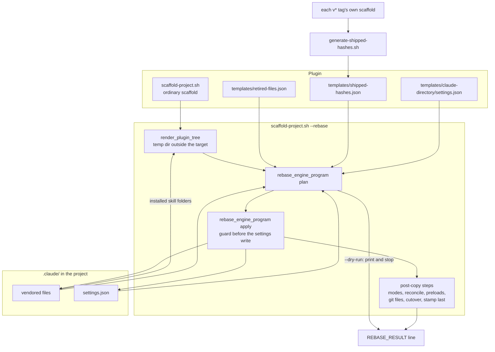
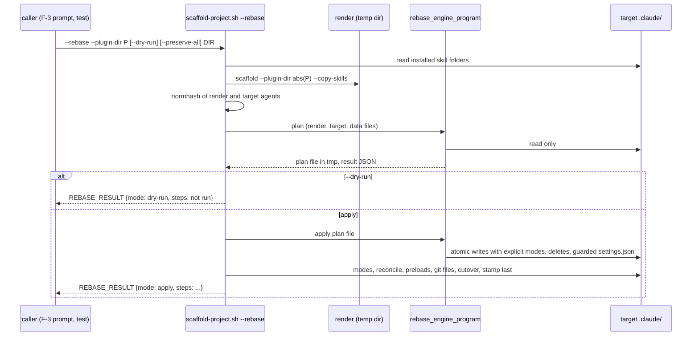

# TRD: Deterministic rebase engine

**Version**: 1.2.0
**Status**: Draft
**Created**: 2026-11-20
**Last Updated**: 2026-11-20
**Author**: @technical-architect
**Source PRD**: `docs/plan/deterministic-rebase-engine.investigation.md` (no PRD exists; this investigation, written for feature F-2 of workplan `rebase-project-fast`, carries the owner's instruction of 2026-11-20 as its objectives). Controlling workplan: `docs/plans/rebase-project-fast/roadmap.md`, item 2.
**Task ID Prefix**: RBE

---

## Changelog

| Version | Date | Changes | Author |
|---------|------|---------|--------|
| 1.2.0 | 2026-11-20 | `/audit-trd` revision (5 of 5 verifiers reported). (1) O11 now states the `hooks`-block exception under preserve-all in the objective and names its sources and the documented lines it departs from (D14). (2) D3's Python citation names `scaffold-project.sh`'s existing embedded Python as the precedent; `stack.md` scopes Python to the router hook. (3) D18 redesigned: both the merge-base and the branch battery run after `npm ci`; pass counts, which `test-baseline.js` does not store, are kept in `battery-counts.json` and compared by RBE-T001; the phase-gate baseline is no longer reused. (4) §6.1 no longer claims the coverage floors are met by a substitute: the Python program is measured with the standard library's `trace` (RBE-T001), the bash part and the integration figure are stated gaps (Could Not Verify). (5) §4.5 states why RBE-T001 stays a separate task. Items 1–4 are OWNER-CALLs recorded by Forge. | @technical-architect |
| 1.1.0 | 2026-11-20 | Review revision. Every change in this row is an OWNER-CALL: Forge decided it as a routine engineering choice and recorded it for the owner to review. (1) Owner-edit detection is one plugin file, `shipped-hashes.json`, seeded by rendering every `v*` release tag with that tag's own scaffold; the per-project record `.claude/ensemble-shipped.json` and the per-file git-history walk are removed (D6, D8). (2) The plugin's file set is a render of the plugin's own scaffold into a temp directory, compared tree against tree; `rebase_source_map()` and the lifting of copy-loop exclusions are removed (D4). (3) The strict version stamp runs last, after the git-files step and the records cutover, and every written file gets an explicit mode (D17). (4) The settings count guard is its own program mode, `guard`, tested directly (D12). (5) `--preserve-all` still regenerates the hooks block (D14). (6) Which hook registrations are the user's is defined exactly, and the current prompt hook is recognised by direct comparison (D11). (7) `AUTHORED_RULES` is read through a helper rather than lifted, so no existing test changes (D15). (8) Acceptance criteria rewritten so each fails when the implementation does nothing; "green battery" is measured against a pre-change baseline (D18). **Not yet proven, and not changed here:** `--refresh` already overwrites framework files at SessionStart without comparing bytes, so O7's conflict detection protects only edits made since the last plugin upgrade, or with refresh turned off (OQ-9). | @technical-architect |
| 1.0.0 | 2026-11-20 | Initial TRD creation. Two corrections to the investigation, both recorded where they land: O11 now follows the documented meaning of `--preserve-all` (the investigation misstated it), and O14 no longer claims byte-identity for the two timestamps the strict version stamp writes on every run (OQ-4, OQ-5). | @technical-architect |

## Objectives

O1–O15 are the investigation's objectives, which quote the owner's instruction of 2026-11-20
(relayed by the workplan PM as the `/plan --implement` text and restated in roadmap item 2).
O8, O11, O14 and O15 are corrected or clarified against the code, as noted in their rows. O16
is domain-derived.

| ID | Objective | Source | Must pass |
|----|-----------|--------|-----------|
| O1 | One `scaffold-project.sh` call (a new `--rebase` mode) copies every framework component — commands, agents, hooks, hook libs, hook prompts, workflows, libs, contracts, framework skills, installed library skills, framework-shipped rules — into the target's `.claude/`, adding files that are absent, replacing files whose bytes differ, and leaving byte-identical files alone | investigation O1; roadmap item 2: "copy every framework component ... adding new files and replacing differing ones by byte comparison" | yes |
| O2 | The same call removes retired framework files named in ONE declared retired list (a data file the script reads) covering retired agents, skills, hooks (including `hooks/lib/` and `hooks/prompts/` entries) and commands; a file neither on that list nor shipped by the plugin is preserved. A test keeps that list in step with the retired tables in `rebase-project.md` and with the plugin (no listed path is still shipped) | investigation O2; roadmap item 2: "remove retired files using one declared retired list (move the ... lists out of `rebase-project.md` prose into a data file the script reads, with a test that keeps it in step)" | yes |
| O3 | Library-skill selection uses the selection file and `reconcile_selected_skills()`; the engine reads no stack.md table and does no capability-word inference | investigation O3; roadmap item 2: "select skills through the existing `reconcile_selected_skills()` logic rather than a second stack.md table" | |
| O4 | The engine merges `.claude/settings.json`: the ensemble-owned `hooks` block is regenerated from the manifest-generated plugin default; every non-ensemble registration is carried forward on its own event, compared as a whole registration and never de-duplicated by filename; registrations pointing at retired hooks are dropped; every other local key is kept (a key only in the plugin is added; a key present locally keeps its local value) | investigation O4; roadmap item 2: "merge `.claude/settings.json` (regenerate ... carry forward non-ensemble registrations per event without deduplicating by filename, keep every other local key) ... drop registrations pointing at retired hooks" | yes |
| O5 | The engine refuses to write `settings.json` when the merged `hooks` block has fewer registrations, or fewer prompt-type entries, than the plugin default, and reports the refusal | investigation O5; roadmap item 2: "refuse to write if the merged block has fewer registrations or prompt-type entries than the plugin default" | yes |
| O6 | After copying, the engine sets the execute bit on every manifest hook, re-injects agent skill preloads, stamps the version through the existing strict stamp, and runs the existing git-files and records-cutover steps | investigation O6; roadmap item 2: "set hook file modes; re-inject agent skill preloads; stamp the version ...; run the git-files and records-cutover steps it already has" | |
| O7 | A vendored framework file the owner has edited is reported as a conflict and left byte-identical. It is told apart from an older shipped version by hash: a file whose hash matches a version of that path the framework shipped in a release is an older version (replaced); one that matches none is an owner edit (conflict) | investigation O7; roadmap item 2: "a vendored framework file the owner has edited (the script must tell an owner edit apart from an older shipped version, for example by recording the hashes of the files it ships)" | yes |
| O8 | A `settings.json` key the engine cannot merge (a shape it does not understand, such as a `hooks` value that is not an object of lists, or a local value whose JSON type differs from the plugin's object) is reported as a conflict and its local value is left as it was. When the unmergeable part is the `hooks` block, or the file is not JSON, the merge writes nothing to the file; the strict stamp, which runs last (O6), still writes its own `ensemble` fields unless the file is not JSON | investigation O8; roadmap item 2: "and a settings key it cannot merge". **Clarified:** "left untouched" applies to the key; the stamp's version and timestamp fields are O6's, and they land on every apply that reaches the stamp | |
| O9 | The engine prints one machine-readable result: per category (commands, agents, hooks, hook-libs, hook-prompts, workflows, libs, contracts, skills, rules, settings), the lists `added`, `replaced`, `removed`, `unchanged`, `preserved`, `conflicts` | investigation O9; roadmap item 2: "prints a machine-readable result (per category: added, replaced, removed, unchanged, preserved, conflicts)" | yes |
| O10 | Under a dry-run flag the engine computes and prints the same result and writes nothing: the target's file tree, file modes and git index are unchanged | investigation O10; roadmap item 2: "under a dry-run flag, writes nothing" | yes |
| O11 | Under the preserve-all flag the engine follows `--preserve-all`'s documented meaning (`rebase-project.md` usage header line 16 and Flag Behavior Summary line 1361): agents, skills and settings get new items added only, with one exception: the ensemble-owned `hooks` block in `settings.json` is still regenerated and ensemble-owned registrations are still dropped; commands, hooks, hook libs, hook prompts, workflows, libs and contracts are replaced when they differ; framework-shipped rules that exist are left alone; governance rules are never touched | roadmap item 2: "It honours the preserve-all flag"; roadmap fence: no change to `--preserve-all`'s meaning. **Corrected:** the investigation's O11 said preserve-all "replaces nothing", which the documented table contradicts (OQ-4). **The `hooks` exception departs from** line 16 ("keep existing ... settings as-is"), the line-1361 table ("Add new only") and §4.6's `settings_preserve` rule ("Do NOT modify any existing values", line 1038). It is sourced by `rebase-project.md` §4.6 3a (line 977: "`hooks` ... REPLACE ... Never preserve", which records the 4.1.11 rebase that lost three discipline hooks), by roadmap item 2, which asks for the block to be regenerated and retired registrations dropped with no mode exception, and by the investigation's preserve-all paragraph. Recorded as D14 (OWNER-CALL) | |
| O12 | The engine never writes constitution.md, stack.md, process.md, verification.md, design.md or ship.md, in any mode | investigation O12; roadmap item 2: "never writes constitution.md, stack.md, process.md, verification.md, design.md or ship.md" | yes |
| O13 | `--refresh` keeps its present contract: it never creates a component directory and never deletes a file; its existing tests stay green | investigation O13; roadmap item 2: "The refresh mode keeps its present contract (never creates, never deletes)" | yes |
| O14 | Running the engine a second time on its own output reports empty `added`, `replaced` and `removed` lists in every category, and changes no file's bytes or mode except the timestamp fields the strict version stamp writes (`ensemble.refreshed_at`, `ensemble.rebased_at`) | roadmap item 2 ("How it will be checked"): "a second run reports zero changes". **Corrected:** the investigation added "leaves the tree byte-identical", which the strict stamp it also requires (O6) cannot meet — it writes the current time on every run (`scaffold-project.sh:1641`, `:1647`) (OQ-5) | yes |
| O15 | New BATS cases prove O1, O2, O4, O5, O7, O8, O10, O12, O13 and O14, and the full battery (`npx jest`, the BATS suites, pytest) is green, read as: no test that passed on the pre-change code fails after the change, and no suite passes fewer tests | investigation O15; roadmap item 2 ("How it will be checked"). **Clarified:** this checkout, with no `node_modules`, already fails 19 Jest suites before any change (RBE-T001 grounding), so "green" is measured against a baseline taken under the same install (D18) | |
| O16 | Every path the engine writes or deletes resolves inside the target's `.claude/` directory, whatever a data file or a symlink in the target says | domain-derived: the engine deletes files named by a data file and replaces files in a tree it does not own; a bad entry or a planted symlink would otherwise delete or overwrite outside the project. `CLAUDE.md` "Path Traversal Prevention" states the same rule for this repository's scripts | yes |

## 1. Overview

### 1.1 Technical Summary

`scaffold-project.sh` gains one mode, `--rebase`, which does every deterministic part of a
rebase in one call and prints one JSON result line. It works in three stages.

1. **Render.** The engine runs this same script's ordinary scaffold
   (`--plugin-dir <absolute plugin dir> --copy-skills`) into a temp directory outside the
   target, with a selection file naming the skill folders the target already has installed.
   What lands under that temp `.claude/` is, by construction, what the plugin ships to this
   project: both plugin layouts, every copy-loop exclusion and every skill folder are the
   scaffold's own answer, not a second definition.
2. **Plan.** A Python program (`rebase_engine_program()`, printed from a bash function and run
   with `python3 -c`, the same pattern as `agent_skills_program()`) compares the render with
   the target's `.claude/`, tree against tree, reads two data files, merges `settings.json` in
   memory, and writes the complete plan to a temp file. Nothing in the target is written. Under
   `--dry-run` the plan is printed and the run ends.
3. **Apply.** The same program executes exactly that plan; bash then runs the existing
   post-copy steps, with the strict version stamp last.

Two data files in the plugin carry what prose and the model carry today:

- `packages/core/templates/retired-files.json` — the one retired list (O2).
- `packages/core/templates/shipped-hashes.json` — for each installed path, the hash of every
  version a release installed there, plus the hash of every prompt-type hook text a release's
  settings carried. Built by rendering each `v*` release tag with that tag's own scaffold; the
  current plugin's bytes are recognised by direct comparison with the render, so the list
  changes once per release (O7, O4).

Nothing is written into the project to remember what was installed. `--refresh` is not touched
(O13). The `/rebase-project` prompt is not rewritten here; that is F-3 (roadmap item 3).

### 1.2 Key Technical Decisions

| ID | Decision | Choice | Serves Objective | Rationale | Alternatives Considered |
|----|----------|--------|------------------|-----------|------------------------|
| D1 | Where the engine lives | A new `--rebase` mode in `packages/core/scripts/scaffold-project.sh`, with `--dry-run` and `--preserve-all` valid only beside it; `--rebase` is exclusive with every other mode and with `--force`, `--copy-skills` and `--new-only`, following the existing exclusivity checks (lines 145–203). Requires `--plugin-dir`, which the mode resolves to an absolute path before use. Dispatched from the bottom-of-file mode switch | O1, O13 | The scaffold that the render runs (D4) is this file; a second script would have to call into it anyway. Inherited from the investigation's Decision | A separate `rebase-engine.sh` (rejected: it would source or exec this file for the render and the post-copy steps; revisit if `scaffold-project.sh` is split into sourced modules). Extending `--refresh` (rejected: it runs unattended at SessionStart and must never delete, O13, OQ-2) |
| D2 | Dry-run safety | Plan-then-apply. The render and the plan file both live in `mktemp -d` directories outside the target, removed on exit by a `trap`; `--dry-run` prints the result from the plan and exits before the `apply` mode is ever invoked. No write site checks a dry-run flag | O10, O9 | Makes "dry-run writes nothing" structural: the only code that writes the target runs only after the dry-run exit. Inherited from the investigation | A `DRY_RUN` check at every write (rejected: one missed site breaks O10 silently). Running apply in a scratch copy and diffing (rejected: copies a whole `.claude/`, and git-index steps cannot be simulated) |
| D3 | Planner/applier language and packaging | One Python program printed by a new bash function `rebase_engine_program()` and run with `python3 -c "$(rebase_engine_program)" <mode> ...`, with modes `plan`, `apply` and `guard` (D12), as `agent_skills_program()` is | O1, O4, O5, O9 | Follows the file's existing convention for its Python parts (manifest parsing, preloads, stamp); keeps the engine inside the one file both plugin layouts reach. No new runtime: `scaffold-project.sh` already runs embedded Python 3 on every scaffold, refresh and stamp (`agent_skills_program()` ~1252, called at ~1509 and ~1579; `stamp_ensemble_version`'s `python3 -c` ~1741). `stack.md` lists Python 3.x as a required runtime dependency but scopes it to the router hook (lines 24 and 94); the precedent here is this file's existing use, not that scope | A separate `.py` in `packages/core/scripts/` (rejected: breaks the single-file convention of the file's other Python; revisit if the program grows past what a reviewer can read in one sitting). Bash only (rejected: JSON merge and hashing in bash is fragile) |
| D4 | What the plugin ships | A render. New bash function `render_plugin_tree <target> <render-dir>` writes `<render-dir>/.claude/selected-skills.txt` naming every folder under `<target>/.claude/skills/` (D13), runs `"$SCRIPT_DIR/scaffold-project.sh" --plugin-dir <absolute PLUGIN_DIR> --copy-skills <render-dir>` as a subprocess with its output on stderr and `GIT_CEILING_DIRECTORIES` set to the render directory's parent, removes the owner-governed rules from the render (D15), and fails the run when the scaffold exits non-zero or the render holds no command, agent or hook. The planner maps the render's `.claude/` into O9's categories by directory: `commands/`, `agents/`, `hooks/` (top-level files), `hooks/lib/`, `hooks/prompts/`, `workflows/`, `lib/`, `contracts/`, `skills/`, `rules/`. Files at the top of `.claude/` (`settings.json`, `selected-skills.txt`) belong to no category: settings are merged (D11), and the selection file is the render's own input | O1, O3, O13 | The scaffold already resolves both plugin layouts, applies every copy-loop exclusion (`init-project.md`, `rebase-project.md`, `*.test.js`, `test-harness.js`), copies skill folders with `cp -RL` and makes hooks executable; rendering it gives the same answer by construction, so there is no second definition of "what ships" to drift, and `--refresh`'s code is untouched. [ran] a render into `mktemp -d` exits 0 in about 1 s and holds 13 agents, 26 commands, 9 hooks, 2 hook libs, 1 hook prompt, 45 libs, 12 workflows, 21 contracts, the framework skills plus the selected ones, and no symlinks | A source map built from the resolvers, with the copy-loop exclusion literals lifted to shared globals (the 1.0.0 design; rejected in review: a second definition of what ships, and edits in `--refresh`'s copy loops, O13). Scaffolding into the target itself (rejected: writes into the target, breaks O10) |
| D5 | Byte comparison and hashing | Every file is identified by its git blob id (`sha1("blob <len>\0" + bytes)`), computed in Python without needing git. Equal blob ids = byte-identical = `unchanged`. Agents are compared on the blob id of their normalised text with the generated preload content stripped (D7) | O1, O7, O14 | A listed hash equals what `git hash-object` prints, so a false conflict can be traced to the release that shipped a version with `git log --find-object=<id>` | sha256 (rejected: no lookup into history when diagnosing a conflict). `cmp` only (rejected: comparison alone cannot classify a differing file, O7) |
| D6 | Owner edit vs older shipped version | A target file that differs from the render is **replaced** when its hash (agents: D7) is listed in `shipped-hashes.json` under that path, and is otherwise a **conflict** (`reason: "owner edit"`) left untouched. The current plugin's bytes are recognised by direct comparison with the render (`unchanged`), so the list never needs the release being built. Nothing is written into the project. A file installed from a build that was never tagged matches no listed hash and reads as a conflict: the fail-safe direction, since nothing is overwritten (TR1, NG10) | O7 | One plugin file covers every project, including those installed long before this feature, and its contents are exactly what each release installed | A per-project record `.claude/ensemble-shipped.json` written by every rebase and scaffold (the 1.0.0 design; rejected in review: one more file in every project, a change to `scaffold_project()`, and the hazard that recording a conflicted file's hash would make the next run replace the owner's edit). A per-file `git log --raw` walk over the sources (the 1.0.0 design; rejected in review: has to follow renames and symlinked sources by hand, reconstructs the install layout, and lists versions no release shipped). Treating every differing file as older, today's behaviour (rejected: fails O7). Asking the model per file (rejected: the roadmap moves this off the model) |
| D7 | Agent hashing | Add a `normhash <agents_dir>` mode to `agent_skills_program()` that prints `<name><TAB><blob id of normalise(strip(text))>` for every agent in the directory, using its existing `strip_skills`, `strip_body_block` and `normalise`. The engine calls it on the render's and the target's agent directories; the hash generator calls it on each tag's render. Neither reimplements the strip | O7, O6 | A preload-only difference must never read as an owner edit; the sibling TRD (`rebase-governance-and-agent-diff.md`) measured 13 of 13 agents identical to source once stripped and normalised. One copy of the strip logic, as that TRD decided | A second strip implementation in the planner (rejected by the sibling TRD for the same drift reason) |
| D8 | Building and keeping `shipped-hashes.json` | `packages/core/scripts/generate-shipped-hashes.sh`. **`--seed`**: for every `v*` tag, export the tag's tree to a temp directory (`git archive <tag>` piped to `tar -x`), render it with that tag's own `packages/core/scripts/scaffold-project.sh --plugin-dir <export>/packages/full --copy-skills <render>`, where the render's selection file names every folder in the tag's skill library so every library skill is covered; hash every file in the render's categories (D4's mapping, the current owner-governed rules left out, agents by the current script's `normhash`); and collect each `type: prompt` registration's `prompt` string from the render's `settings.json`. The union, plus the list of rendered tags, is the file. **`--append <tag>`**: render one more tag and add its hashes and its name; never removes a hash. A release appends the tag before it (the newest `v*` tag older than its HEAD). **`--check`**: structural, always (shape, sorted unique lists, relative paths with no `..`, 40-hex hashes, `v*` tag names), plus retired coverage, always (every listed path that a current render with every library skill does not contain is covered by `retired-files.json`); history, only when the clone is not shallow and has `v*` tags (the newest listed tag must equal the newest `v*` tag merged into HEAD, a tag on HEAD itself excluded). It prints `history: checked` or `history: skipped (<reason>)` | O7, O2 | Each tag's own scaffold installed what that release installed, so symlinked sources, renames and layout moves are resolved by construction. The list never needs current bytes (D6), so it changes once per release. Consequence: from the moment a tag is pushed until its append lands, the history check fails on a full clone; CI checks out shallow and skips it (TR4) | A per-file `git log --raw` walk (rejected; see D6). Regenerating on every framework edit with a `--check` that fails otherwise (the 1.0.0 design; rejected: needless once current bytes are compared directly). Generating in CI (rejected: shallow checkout, no tags) |
| D9 | Retired list | `packages/core/templates/retired-files.json`, one entry per retired installed path (a trailing `/` marks a directory entry), each with `category`, `retiredIn` (the release it was retired in, or `null` when it cannot be derived) and `replacedBy` (text, or `null`). Seeded from the three tables and one paragraph in `rebase-project.md` §2.1–§2.4 and from `git log --diff-filter=D` over the framework source directories, excluding paths that were never installed (`hooks/hooks.json`, `commands/init-project.md.bak`); extended by RBE-P002 wherever D8's coverage check finds a path a release installed that the plugin no longer ships. The planner rejects the file (exit 1, `error`) when an entry is absolute or contains `..`. The engine removes only listed paths, never "present in the target but absent from the plugin" | O2, O16 | One declared list; a user's own file can never be deleted by inference. Inherited from the investigation | Removing whatever the plugin no longer ships (rejected: deletes user files). Keeping the list in prose (rejected: the owner asked for a data file) |
| D10 | Retired-list test | Jest, `packages/core/lib/retired-files.test.js`: (a) every name in `rebase-project.md`'s retired tables and its retired-hooks paragraph is in the file; (b) no listed path is in a render of the current plugin with every library skill selected; (c) every entry is relative, has no `..` and names a known category. Completeness against what releases installed is D8's coverage check, which needs no git history | O2 | The test the owner asked for; (a) is removed by F-3 when the tables go | A BATS test (rejected: the checks are JSON and Markdown parsing, which Jest does with less code). A history assertion over `git log --diff-filter=D` (the 1.0.0 design; rejected: skips on CI's shallow clone and has to map source paths to installed paths; D8's coverage check does the same job from the renders) |
| D11 | Settings merge | In the planner. (1) The ensemble-owned block is the plugin default's `hooks` from `templates/claude-directory/settings.json`, which `generate-hooks-artifacts.sh` generates from `hooks.manifest.json` and its CI `--check` keeps equal; no second generator. (2) A target registration is ensemble-owned, and dropped, when it is (a) a `command` whose text references `.claude/hooks/<f>` where `<f>` is a manifest hook file or lies under a retired `hooks/` entry, on any event: a manifest file registered on an event the manifest does not give it is a stale framework registration and goes too; or (b) a `prompt` whose `prompt` string equals one in the plugin default, or whose hash is in `shipped-hashes.json` `promptHooks`. The hash input is the `prompt` value exactly as stored in `settings.json`: the decoded JSON string, as UTF-8, nothing added or stripped. (3) Every other registration is the user's and is carried forward on its own event and matcher, after the plugin's groups, in its original order, compared as a whole registration and never de-duplicated by filename; a user command naming a file that shares a manifest hook's name at another path (e.g. `bash scripts/formatter.sh`, where `formatter.sh` is a manifest hook) is the user's. (4) Every other top-level key: absent locally → added from the plugin; present → local value kept, recursing into objects so nested plugin keys absent locally are added (default mode; D14 for preserve-all). (5) Version keys are left to the strict stamp. (6) No `settings.json` in the target: the plugin default is written, every key listed in `added`. (7) A merge that changes nothing leaves the file's bytes alone; a changed file is written atomically, keeping its mode, as `stamp_ensemble_version` does | O4, O14 | Inherited from the investigation, with ownership made exact. The direct comparison in (2b) is what keeps the current prompt from being carried forward beside its regenerated copy whatever the list holds | De-duplicating by hook filename (rejected: the owner forbade it). Recognising ensemble prompts by a text marker (rejected: the v4.6.0 text and today's share no marker). Recognising the current prompt only through the list (rejected: a list missing it would add one prompt per run, and the D12 guard, which counts "at least", would not catch it) |
| D12 | Settings conflicts and the write guard | **Conflicts:** a `hooks` value that is not an object, an event value that is not a list of groups, or a file that is not JSON makes `settings.json` a conflict and the merge writes nothing; a key whose local and plugin values are both present but exactly one is an object is a conflict for that key, its local value kept, and the rest of the merge proceeds. **Guard:** `guard <plugin-settings> <merged-settings>`, a mode of the program, counts registrations (one entry of a group's `hooks` list, the unit `rebase-project.md` §4.6 step 4 counts) and `type: prompt` entries in each file's `hooks`, and exits 1, printing both pairs of counts, when either merged count is below the plugin's (10 and 1 today, read at run time). The apply's one settings-write function runs the same check first; on failure it writes nothing and sets `settings.refused` with the counts. The merge always contains the whole plugin block, so a correct merge cannot trip the guard: it is defence against a merge bug, and is tested through its own mode on crafted blocks. **Tests:** settings comparisons across an apply remove `ensemble.refreshed_at` and `ensemble.rebased_at` from both sides and use fixtures whose `ensemble.version` already equals the plugin's, because the strict stamp runs after the merge on every apply (D17) | O5, O8 | The guard is the owner's; a shape the engine does not understand is the model's job in F-3, not a guess here | Overwriting an unmergeable `hooks` with the plugin's (rejected: drops user registrations, O4). Failing the whole run on a settings conflict (rejected: the file copy is independent and should still land). A test-only switch that makes apply trip the guard (rejected: machinery in the shipped script for a test) |
| D13 | Library skills | The installed folder is the truth, as `reconcile_selected_skills()` already treats it: the render's selection names the target's installed skill folders, so the engine updates every installed folder the plugin library also holds and every framework skill from `framework-skills.txt` (adding missing files, replacing differing ones by D6), and adds no library skill the target has not installed, whatever `stack.md` or `selected-skills.txt` names. After the copy, `reconcile_selected_skills()` keeps `selected-skills.txt` in step | O3, O1 | Uses the existing selection logic and reads no stack table, as instructed | Re-selecting library skills from stack.md (rejected by the owner). Rendering with the target's `selected-skills.txt` (rejected: a listed name with no folder is one `reconcile_selected_skills()` drops as no longer installed, so the render would re-add a folder the owner deleted). Rendering every library skill and filtering in the planner (rejected: copies about 470 files to keep a few) |
| D14 | Preserve-all | **Files**, per the documented table: agents and skills → add new only (missing files and folders added, nothing replaced; agents keep their bodies, as `--sync-agents --new-only` does); commands, hooks, hook libs, hook prompts, workflows, libs, contracts → normal classification; framework-shipped rules → added if missing, never replaced; nothing removed in any category. **Settings:** the `hooks` block is still regenerated and ensemble-owned registrations, retired ones included, are still dropped; absent top-level keys are added; no other existing key's value changes, nested plugin keys included | O11 | Follows `rebase-project.md` line 16 and the line 1361 table, as the roadmap fence requires. The `hooks` block is ensemble-owned and never a user preference: §4.6 3a records the 4.1.11 rebase that preserved it and lost three discipline hooks. This departs from §4.6's `settings_preserve` line "Do NOT modify any existing values" for the `hooks` key only. Removing nothing keeps preserve-all the conservative escape hatch; a retired hook file left behind with no registration is inert | Preserving the `hooks` block too (rejected: repeats the 4.1.11 failure). The investigation's "replace nothing" (rejected: contradicts the documented meaning, OQ-4). Removing retired files under preserve-all (rejected: removal stays a default-mode act; revisit if F-3 wants preserve-all to clean up) |
| D15 | Owner-governed rules | Move the existing line `local AUTHORED_RULES=("constitution.md" "stack.md" "process.md" "verification.md" "design.md" "ship.md")`, unchanged in form, from `refresh_rules()` into a new function `authored_rules()` that prints the names one per line; `refresh_rules()` reads them from it. The rebase reads the same function: `render_plugin_tree` removes those six from the render, and the applier refuses any planned write or delete of `rules/<one of them>` and fails the run if one appears | O12 | One list, checked twice (defence in depth, as `refresh_rules()` already argues). The line keeps its exact `local AUTHORED_RULES=(` form, so the three greps that read it (`scaffold-project.test.sh` ~2323 and ~2363, `runtime-integrity.test.sh` ~55) and `owner-rules.test.js`'s first-match regex keep working with no test edit | Lifting it to a global (the 1.0.0 design; rejected: the three greps match `local AUTHORED_RULES=\(` and would return nothing, emptying the authored list in two test files). A separate list for the rebase (rejected: a second copy beside `owner-rules.js` `OWNER_GOVERNED`, which a test holds equal to this one) |
| D16 | Result format | The last stdout line is `REBASE_RESULT <json>`; every other message in the mode, the render's included, goes to stderr. JSON: `mode` (`apply` or `dry-run`), `preserveAll`, `pluginVersion`; `categories.<cat>` for the ten file categories with `added`, `replaced`, `removed`, `preserved` (path lists; skills per folder for `preserved` and `removed`, per file otherwise), `unchanged` (count) and `conflicts` (`{path, reason}` list); `settings` with the same six (`added`: keys added; `replaced`: `["hooks"]` when the block was regenerated; `removed`: dropped ensemble-owned registrations the plugin block does not restore; `preserved`: carried user registrations; `unchanged`: count of top-level keys left as they were; `conflicts`), plus `counts` (plugin and merged), `written` and `refused`; `steps` in the order they ran (`modes`, `selection`, `preloads`, `gitFiles`, `recordsCutover`, `stamp`), each `ok`, `skipped: <reason>` or `failed: <reason>`, and each `not run` under dry-run; `error`, present only when the run stopped before writing | O9 | Parsed the way `runtime-refresh.sh` parses `REFRESH_SUMMARY`; F-3's prompt reads one line. `unchanged` is a count because it is large and never acted on. Giving `settings` the same six lists settles the shape O9 asks for | Human-readable text (rejected: not machine-readable, O9). Lists for `unchanged` (rejected: hundreds of paths the caller never reads) |
| D17 | Apply order and writes | Order: files → `settings.json` → `ensure_hooks_executable` → `reconcile_selected_skills` → `inject_agent_skills` with conflicted agents excluded → `ensure_gitignore untrack` + `ensure_gitattributes` → `records_cutover` → `stamp_ensemble_version strict`, **last**. Each file write goes to a temp file in the destination directory, then `os.replace`; a symlink in the target is replaced, never written through; deletes unlink. `tempfile.mkstemp` creates files 0600, so every written file gets an explicit mode before the rename: **a replaced file keeps the mode it had** (a replaced symlink takes the source's), **an added file takes the source (rendered) file's mode**. Every planned path, and the real path of its parent directory, must lie under the real path of the target's `.claude/` before any write; otherwise exit 1 with `error` and nothing written. A failure partway exits non-zero with the result so far; git is the undo (the prompt keeps its clean-tree precondition). The stamp rewrites `ensemble.refreshed_at` and `ensemble.rebased_at` on every apply, so byte comparisons of `settings.json` across an apply leave those two keys out (O14, D12) | O6, O7, O10, O14, O16 | Stamp last is the existing convention: `refresh_project()` stamps only after every copy step (`scaffold-project.sh` ~2030–2039: "stamping first would make a half-applied refresh look complete"), and `rebase-project.md` runs §4.7a, then §4.7b, then §4.8 "last in Step 4"; the stamp is what the next version detection reads. Inject's exclude list is the one change to an existing step: it rewrites every agent with an affinity pool, which would move a conflicted agent's generated block (O7) | The 1.0.0 order, stamp before git files and cutover (rejected: a failed cutover would sit behind a stamp claiming a complete rebase). Leaving the mode to the temp file (rejected: 0600 everywhere). `--sync-agents` for the agent step (rejected: it replaces owner-edited agents, failing O7) |
| D18 | Battery baseline | "Green" (O15) is judged against the merge base (`git merge-base HEAD origin/main`), the code before any RBE task. RBE-T001 runs the battery's three commands twice under the **same install**: on the merge base in a detached `git worktree`, and on the branch in the working tree (so RBE-T001's own uncommitted case is measured), each after `npm ci` from its own `package-lock.json` (`node_modules/` is gitignored, so the install adds nothing to `git status`). Per suite it records (a) the command and failing test ids with `node .claude/lib/test-baseline.js record-baseline --state-dir .trd-state/deterministic-rebase-engine/battery-o15`, a state directory of its own so `/implement-trd`'s phase-gate baseline in the feature folder is neither read nor overwritten; and (b) the pass and fail counts, which `test-baseline.js` does not store (`recordBaseline` keeps `{command, durationSeconds, failures}` only), in `battery-o15/battery-counts.json` beside it, as `{suite: {base: {passed, failed}, branch: {passed, failed}}}`. Green = `test-baseline.js compare --state-dir .../battery-o15` reports no `newFailures` for any suite, **and** `battery-counts.json` shows no suite whose branch `passed` is below its base `passed`, a comparison RBE-T001 makes itself because `compare` reads failure ids only | O15 | This checkout has no `node_modules` and fails 19 Jest suites before any change (missing `js-yaml`, `mock-fs`, playwright). Those are install failures, not code failures, so both trees install the same way; the baseline still holds whatever fails on the merge base once installed (for example playwright browsers, which `npm ci` does not download). A merge-base baseline is pre-change by construction whenever it is taken. The pass-count check is what catches a suite that stopped gathering tests rather than failing them | Reusing `/implement-trd`'s first-phase-gate baseline (rule 4) (rejected: it records no pass counts, and it was taken under whatever install that gate had, so a branch run under `npm ci` would measure the install). Extending `test-baseline.js` to store pass counts (rejected: a change to a shared library for one task's check; revisit if another feature needs it). A first-wave task that runs the battery on the working tree before Phase 1 (rejected: Phase 1's two tasks edit the same tree in parallel). Requiring zero failures (rejected: fails on breakage this feature does not own) |

### 1.3 Technology Stack

| Layer | Technology | Purpose | Notes |
|-------|------------|---------|-------|
| Mode, render, steps | Bash | `--rebase` parsing, `render_plugin_tree`, post-copy steps | `set -euo pipefail`, as the file already runs |
| Planner, applier, guard, settings merge | Python 3 | `rebase_engine_program()`, run with `python3 -c` | standard library only |
| Hash generator | Bash + git + tar + Python 3 | `generate-shipped-hashes.sh` | `--seed` and `--append` need tags; `--check` runs anywhere |
| Tests | BATS ^1.9, Jest ^29.7 | `rebase-engine.test.sh`, `retired-files.test.js` | per `stack.md` |

### 1.4 Integration Points

| System | Type | Direction | Notes |
|--------|------|-----------|-------|
| `/rebase-project` prompt (F-3) | CLI + `REBASE_RESULT` line | Out | F-3 consumes it; this TRD does not change the prompt |
| `runtime-refresh.sh` / `--refresh` | none | — | Untouched (O13) |
| `scaffold_project()` (this file) | subprocess | In | The render (D4) |
| Each `v*` tag's own `scaffold-project.sh` | subprocess, generator only | In | The per-release renders behind `shipped-hashes.json` (D8) |
| `generate-hooks-artifacts.sh` | file | In | Its generated plugin `settings.json` is the ensemble-owned hooks block |
| git (target repo) | CLI | Both | Only through the existing git-files and records-cutover steps, apply only |

## 2. System Architecture

### 2.1 Architecture Overview



### 2.2 Component Architecture

#### 2.2.1 `render_plugin_tree()` (bash)
**Responsibility**: produce, in a temp directory, the `.claude/` the plugin would install into this target (D4, D13).
**Interfaces**: `render_plugin_tree <target> <render-dir>`; exit non-zero on a failed or empty render.
**Dependencies**: this script's ordinary scaffold, run as a subprocess; `authored_rules()`.

#### 2.2.2 `rebase_engine_program()` (Python: `plan`, `apply`, `guard`)
**Responsibility**: classify every path and merge settings (`plan`), execute the plan (`apply`), check counts (`guard`).
**Interfaces** (inputs, not a fixed argument order): `plan` takes the plugin templates directory, the render directory, the target directory, the render's and the target's `normhash` output, the owner-governed names, the plan output path and `--preserve-all`; `apply <plan-file> <target-dir>`; `guard <plugin-settings> <merged-settings>`. `plan` and `apply` print the result JSON (without the prefix) to stdout.
**Dependencies**: the two data files; `agent_skills_program normhash` output (D7).

#### 2.2.3 `generate-shipped-hashes.sh`
**Responsibility**: build `shipped-hashes.json` from release renders and keep it checked (D8).
**Interfaces**: `--seed`, `--append <tag>`, `--check` (with `--repo DIR` and `--list FILE` overrides for tests).
**Dependencies**: git and tar for tag exports; each tag's own scaffold; `render_plugin_tree()` and `normhash` from the current script (sourced after `set --`).

### 2.3 Data Flow



## 3. Technical Specifications

### 3.1 Command line

```text
scaffold-project.sh --rebase --plugin-dir DIR [--dry-run] [--preserve-all] [project-dir]
```

- `--dry-run` and `--preserve-all` without `--rebase`: exit 1 with an error naming the flag.
- `--rebase` with `--refresh`, `--force`, `--copy-skills`, `--agent-status`, `--sync-agents`, `--stamp-version`, `--git-files`, `--records-cutover`, `--no-push` or `--new-only`: exit 1.
- Missing `--plugin-dir`, unreadable plugin manifest, a failed or empty render, or a data file that does not parse or fails validation: exit 1 before any write, with a `REBASE_RESULT` carrying `error`. A relative `--plugin-dir` is accepted and resolved to an absolute path first.
- Exit 0 whenever the run completed, including runs that reported conflicts or a refused settings write.

### 3.2 Per-path classification (default mode)

| Target state | Action | Listed under |
|---|---|---|
| in the render, absent in the target | copy | `added` |
| in the render, same hash | none | `unchanged` (count) |
| in the render, differs, its hash listed for that path in `shipped-hashes.json` | replace | `replaced` |
| in the render, differs, its hash not listed | none | `conflicts` (`reason: "owner edit"`) |
| not in the render, matches a retired entry (file, or inside a retired directory) | delete (a directory entry deletes the directory) | `removed` |
| not in the render, not retired, inside a category directory | none | `preserved` |
| `rules/<owner-governed name>` | none, ever | `preserved` |
| the path, or its parent directory, resolves outside the target's `.claude/` | run stops before any write | `error` |

Skills are listed per folder for `preserved` and `removed`, per file otherwise. Agents use the
D7 hash for both the "same hash" and the "listed" tests.

### 3.3 Data files

```jsonc
// packages/core/templates/retired-files.json
{ "version": 1,
  "entries": [ { "path": "hooks/permitter/", "category": "hooks",
                 "retiredIn": "4.1.0", "replacedBy": null } ] }

// packages/core/templates/shipped-hashes.json
{ "version": 1, "hash": "git-blob-sha1",
  "tags": ["v4.2.0", "...", "v4.17.10"],
  "files":  { "commands/plan.md": ["<40 hex>", "..."] },   // agents: D7 hash
  "promptHooks": ["<40 hex of the prompt string as stored in settings.json>"] }
```

The `retiredIn` value in the example is illustrative of the field's shape; each real value is
derived by the seeding task, or `null`. Keys are sorted and lists sorted and unique, so an
append's diff is one release's worth of lines.

### 3.4 Error handling

- Malformed `settings.json` (not JSON): settings conflict, file not written, rest of the run proceeds; the strict stamp then reports `failed` in `steps`.
- A planned path resolving outside `.claude/`, or a retired entry that is absolute or contains `..`: exit 1 before any write (O16).
- A render that fails, or holds no command, agent or hook (for example a plugin dir that did not resolve): exit 1 before any write.
- An apply step failing: later steps still run where independent (git files, cutover); the failed step is `failed: <reason>` in `steps`; exit non-zero only when a file write or delete failed.

## 4. Master Task List

### 4.1 Task ID Convention

`RBE-[CATEGORY][SEQ]`: P = infrastructure/data, B = backend (scripts), T = cross-seam test, D = documentation.

All new BATS cases go in `packages/core/scripts/rebase-engine.test.sh` (picked up by
`check-test-suites.sh`'s `find test packages -name '*.test.sh'`), so
`scaffold-project.test.sh` does not grow further. Older-version fixtures live in
`test/fixtures/rebase-engine/`, which the plugin does not ship.

### 4.2 Phase 1: Foundations

| Task ID | Description | Serves | Skills | Dependencies | Acceptance Criteria |
|---------|-------------|--------|--------|--------------|---------------------|
| RBE-P001 | Create `packages/core/templates/retired-files.json` (D9), seeded from the three retired tables and the retired-hooks paragraph in `rebase-project.md` and from `git log --diff-filter=D` over the framework source directories, and its Jest test `packages/core/lib/retired-files.test.js` (D10) | O2, D9, D10 | `jest` | None | The file parses and holds every name in the §2.1–§2.3 tables and the §2.4 paragraph plus the history-only deletions (`create-prd-team.md`, `create-trd-team.md`, `implement-trd-proposed.md`, `implement-trd-tasklist.md`, `prompts/async-discipline.prompt.md`, `prompts/autonomy-discipline.prompt.md`); `hooks/hooks.json` and `commands/init-project.md.bak` are absent; the Jest test passes on the committed file, and fails on a temp copy with one prose name removed, on a temp copy listing `commands/plan.md` (shipped by the current plugin, found through a render with every library skill selected), and on a temp copy holding an entry with `..` |
| RBE-B001 | In `scaffold-project.sh`: parse `--rebase`, `--dry-run`, `--preserve-all` with the exclusivity rules of §3.1, resolve `--plugin-dir` to an absolute path for the mode, and add them to the usage text; add `authored_rules()` holding the unchanged `local AUTHORED_RULES=(...)` line and have `refresh_rules()` read it (D15); add `render_plugin_tree()` (D4, D13); add the `normhash` mode to `agent_skills_program()` and an optional exclude list to `inject` and `inject_agent_skills()` (D7, D17). The `--rebase` dispatch is a stub that renders and prints the rendered file count until RBE-B002. Kept apart from RBE-B002 because the hash generator (RBE-P002) needs the render and `normhash` before the planner exists | D1, D4, D7, D13, D15 | `developing-with-python` | None | BATS: every rejected flag combination in §3.1 exits 1; `authored_rules` prints the six names, and `owner-rules.test.js`, the `scaffold-project.test.sh` cases that grep `local AUTHORED_RULES=(` (~2323, ~2363) and `runtime-integrity.test.sh` (~55) pass with no edit to those files; for a target with `jest` installed and a `stack.md` naming `pytest`, the render holds `skills/jest/SKILL.md`, every skill in `framework-skills.txt`, every manifest hook, hook lib and hook prompt and every command except `init-project.md` and `rebase-project.md`, and holds no `skills/pytest/`, no symlink and none of the six owner-governed rules; `--rebase` with a relative `--plugin-dir` renders the same file list as with the absolute one; a cache-shaped plugin (`cp -RL packages/full`) renders the same file list as `packages/full`; the target's file list and hashes are unchanged by a render; `normhash` prints the same hash for an agent before and after `inject_agent_skills` and a different one after a one-line body edit; with an exclude list, the excluded agent is byte-identical after `inject` while another agent gains its preloads; every existing `scaffold-project.test.sh` case stays green |

### 4.3 Phase 2: Shipped hashes

| Task ID | Description | Serves | Skills | Dependencies | Acceptance Criteria |
|---------|-------------|--------|--------|--------------|---------------------|
| RBE-P002 | Write `packages/core/scripts/generate-shipped-hashes.sh` (`--seed`, `--append <tag>`, `--check`; D8); run `--seed` and commit `packages/core/templates/shipped-hashes.json`; add to `retired-files.json` every path the coverage check finds; commit older-version fixtures in `test/fixtures/rebase-engine/`: a command and an agent copied from an older tag's render, and that tag's Stop prompt string | O7, O2, D8 | | RBE-B001, RBE-P001 | `--check` exits 0 on the committed files, and on a `git clone --depth 1` copy of the repository runs its structural and coverage parts and prints `history: skipped (shallow clone)`; a BATS case builds its own full git repo (two commits, `v0.0.1` on the first) and asserts `--check --repo` prints `history: checked` and exits 0 with a list whose newest tag is `v0.0.1`, exits 1 naming `v0.0.2` once that tag exists in the repo but not in the list, and prints `history: skipped (shallow clone)` on a `--depth 1` clone of it, so the not-skipped path runs on CI too; `--check` exits 1 naming the path on a list copy holding a path no current render ships and no retired entry covers, and on a list copy holding a hash that is not 40-hex; the fixture command's blob id and the fixture agent's `normhash` are listed under their paths, and each differs from the current plugin's file; the fixture Stop prompt's hash is in `promptHooks` and differs from the current template's prompt; `tags` holds every `v*` tag merged into HEAD at seed time (48 today, `v4.2.0`–`v4.17.10`); where tags exist (skipped with that reason on a shallow clone), `--append` of an already-listed tag leaves a copy of the file byte-identical, and a live render of the fixture's tag yields hashes equal to the fixtures' |

### 4.4 Phase 3: Engine

All three tasks edit `scaffold-project.sh` and `rebase-engine.test.sh`, so they run in order.
They stay separate for verifiability: file classification, the settings merge and the
post-copy steps have separate acceptance criteria (O1/O2/O7/O10/O11/O12/O16, O4/O5/O8,
O3/O6/O14), and merged they would be too large for one implementer pass.

| Task ID | Description | Serves | Skills | Dependencies | Acceptance Criteria |
|---------|-------------|--------|--------|--------------|---------------------|
| RBE-B002 | Add `rebase_engine_program()` `plan` and `apply` for files (§3.2; D2, D3, D5, D6, D9's validation, D13, D14's file rules, D15, D16; D17's file writes, modes and path check) and the `REBASE_RESULT` line with all chatter on stderr, replacing RBE-B001's stub | O1, O2, O7, O9, O10, O11, O12, O16 | `developing-with-python` | RBE-P001, RBE-P002 | BATS, on scaffolded fixtures: a missing framework command is `added`; the RBE-P002 fixture command and agent copied over their vendored files are `replaced`; a listed retired file and a retired directory are `removed`; a user agent and a user skill are `preserved`; an owner-edited command and agent (a line appended) are `conflicts` and byte-identical after the run; the six governance rules, `verification.md` filled with distinctive text, are byte-identical after apply in default and `--preserve-all` modes; `--preserve-all` replaces the older command, leaves the older agent, a differing framework rule and a retired file in place, and adds a missing agent; on a fixture whose expected `added`, `replaced`, `removed`, `preserved` and `conflicts` lists are each non-empty, `--dry-run` prints the same category lists as an apply on an identical copy and leaves `git status --porcelain` empty and every file mode unchanged; a replaced file at mode 0640 is still 0640, an added hook lib is 0644 and an added hook 0755 (their rendered modes), and no written file is 0600; a retired entry containing `..` (in a cache-shaped plugin copy with an edited `retired-files.json`) and a target `.claude/commands` symlinked to a directory outside `.claude/` each exit 1 with `error` naming the path and leave the target and a sentinel directory outside it unchanged; the last stdout line parses as JSON with all ten file categories and their six lists; the render and plan temp directories are gone after the run |
| RBE-B003 | Add the settings merge (D11), its conflicts and the `guard` mode wired before the one settings write (D12), and preserve-all's settings rule (D14) to the planner and applier | O4, O5, O8, O11 | `developing-with-python` | RBE-B002 | BATS (settings comparisons remove `ensemble.refreshed_at` and `ensemble.rebased_at` from both sides; fixtures carry the plugin's `ensemble.version`): a user `command` registration on `PostToolUse` and `bash scripts/formatter.sh` on `PreToolUse` are carried forward on their own events, once each; `.claude/hooks/status.js` registered on an event the manifest does not give it, and `.claude/hooks/learning.sh` (retired), are dropped; the RBE-P002 fixture's old Stop prompt is dropped and the plugin's prompt appears exactly once; with a plugin copy whose `promptHooks` is emptied, the current prompt still appears exactly once after two applies; a local `env` value and `ensemble.openPullRequest: "auto"` survive; a removed top-level plugin key and a removed `permissions.allow` are added back; `hooks` set to a list is a conflict with `settings.written` false and the `hooks` value unchanged, while the same fixture with a valid `hooks` holding one user registration gives `settings.written` true and a file holding that registration; a key whose local value is a string where the plugin has an object is a conflict with the local value kept, while another change in the same file is written; `guard` exits 1 naming both counts on the plugin block with one command registration removed and on the plugin block with its prompt entry replaced by a command (registration count equal, prompt count below), and exits 0 on the plugin block alone and plus a user registration; a first apply on a fixture missing a plugin key gives `settings.written` true and a second apply gives `settings.written` false with the file equal; under `--preserve-all` the old Stop prompt and the retired registration are still dropped and a removed top-level key is added, while a `permissions` object lacking `allow` and a local `env` value are unchanged; with no `settings.json` the plugin default is written and every key is in `settings.added`; a `settings.json` that is not JSON is a conflict and its bytes are unchanged. Review: the program has one settings-write function and it calls the guard check first |
| RBE-B004 | Wire the post-copy steps in D17's order (hook modes, `reconcile_selected_skills`, `inject_agent_skills` excluding conflicted agents, git files, records cutover, `stamp_ensemble_version strict` last) and report each in `steps` | O3, O6, O7, O14 | | RBE-B003 | BATS on one fixture git repo (committed, no `origin`) scaffolded with `--copy-skills` and `jest` selected, then aged: every manifest hook `chmod -x`, `ensemble.version` set to `4.15.0`, every agent's preloads stripped (raw `agents-lib` copies), one agent owner-edited, one framework command deleted, `stack.md` naming `pytest`. The first apply: `steps` lists `modes`, `selection`, `preloads`, `gitFiles`, `recordsCutover`, `stamp` in that order, each `ok` (the cutover's `no-remote` push outcome reported inside its `ok`, the one skip a remote-less fixture cannot avoid); every manifest hook is executable; `selected-skills.txt` is non-empty and names `jest` and not `pytest`, and `.claude/skills/pytest/` is absent; every agent with an affinity pool carries its `skills:` preload again; the owner-edited agent is byte-identical; `ensemble.version` equals the plugin's and `previous_version` is `4.15.0`; `categories.commands.added` names the deleted command. A second apply then reports empty `added`, `replaced` and `removed` in every category and changes no file's bytes or mode except `settings.json`'s `ensemble.refreshed_at` and `ensemble.rebased_at` |

### 4.5 Phase 4: Assembled feature and documentation

RBE-T001 is not folded into RBE-B004, although they share a test file. It carries what no
engine task does: the `--refresh` half (O13), the whole-engine case across all three engine
tasks' code, and the battery and coverage measurement, which must measure the finished branch
and so cannot run inside a task that is still changing it. RBE-B004's criteria are already the
largest of the three engine tasks (§4.4).

| Task ID | Description | Serves | Skills | Dependencies | Acceptance Criteria |
|---------|-------------|--------|--------|--------------|---------------------|
| RBE-T001 | One aged-fixture BATS case across the whole engine, as the investigation's checkable outcomes describe (an older shipped file, a missing file, a retired file, a user agent, a user hook registration, an owner-edited framework file, an owner-filled `verification.md`): apply, dry-run on a copy made first, a second apply; plus `--refresh` on a tree with a retired file. Then run the full battery against the pre-change baseline (D18), and measure the coverage §6.1 asks for | O13, O14, O15, D18, `constitution.md` Quality Gates (coverage) | | RBE-B004 | The one apply lists every expected entry (`added`, `replaced` from the RBE-P002 fixtures, `removed`, `preserved`, a carried user registration, the owner edit under `conflicts`), with all six governance rules byte-identical; `--dry-run` on the copy prints the same, non-empty lists, with `git status --porcelain` empty and modes unchanged; the second apply reports zero added/replaced/removed and still lists the owner edit as a conflict with the owner's bytes; `--refresh` leaves the retired file in place. Battery: for `npx jest`, `./packages/core/scripts/check-test-suites.sh` and `pytest packages/router/tests`, both the merge-base run and the branch run follow `npm ci`; failing test ids are recorded in `.trd-state/deterministic-rebase-engine/battery-o15/` with `record-baseline` and pass/fail counts per suite in `battery-o15/battery-counts.json`, the merge base before the branch; `test-baseline.js compare --state-dir .../battery-o15` reports no `newFailures` for any suite, and no suite's branch `passed` count is below its merge-base count. Coverage: `.trd-state/deterministic-rebase-engine/evidence/coverage.md` gives, for `rebase_engine_program()`, the command run, covered and total lines and the percentage against 60%, marked met or not met (a shortfall is recorded with `discovered.record`, not fixed in this task), and names the bash part and the integration figure as not measured, with the reason in §6.1 |
| RBE-D001 | Add a CHANGELOG.md entry for the `--rebase` mode, its two data files, the generator and the release step contributors now run (`generate-shipped-hashes.sh --append <previous tag>`), with a Not-yet-proven list | constitution Quality Gates ("Documentation updated"), D8, OQ-9 | | RBE-B004 | The entry names the mode, its flags, the result line, `retired-files.json` and `shipped-hashes.json`, the generator's three modes and the release step; its `### Not yet proven` list says `/rebase-project` does not call `--rebase` yet (F-3), no headless `/rebase-project` run was made, `--refresh` still overwrites owner-edited framework files without comparing (OQ-9) so conflict detection protects only edits made since the last upgrade, and files installed from untagged builds read as conflicts |
| AMEND-001 | [test-gap] No test drives a --rebase run into the settings-write refusal and asserts settings.refused / written=false in REBASE_RESULT or the stamp step 'skipped: settings write refused by the guard'. D12 rejected a test-only switch, so closing it may need a design call. — promoted from a gap discovery found by audit-build — find and fix every instance of this weakness across the feature's touched files, and list each one fixed (observed: packages/core/scripts/scaffold-project.sh:2676 and :3082; grep -n refused packages/core/scripts/rebase-engine.test.sh returns nothing; guard covered only via `guard` mode (test 43) and source-order check (test 49).) | amendment — no objective recorded |  | None | [test-gap] No test drives a --rebase run into the settings-write refusal and asserts settings.refused / written=false in REBASE_RESULT or the stamp step 'skipped: settings write refused by the guard'. D12 rejected a test-only switch, so closing it may need a design call. no longer holds |
| AMEND-002 | [test-gap] §6.1 requires a met/not-met verdict for retired-files.test.js under npx jest --coverage; it was not run. Python half measured 86.9% (MET). — promoted from a gap discovery found by audit-build — find and fix every instance of this weakness across the feature's touched files, and list each one fixed (observed: .trd-state/deterministic-rebase-engine/evidence/coverage.md 'Not measured' last bullet; docs/TRD/deterministic-rebase-engine.md §6.1 first row (RBE-T001).) | amendment — no objective recorded |  | None | [test-gap] §6.1 requires a met/not-met verdict for retired-files.test.js under npx jest --coverage; it was not run. Python half measured 86.9% (MET). no longer holds |
| AMEND-003 | [test-gap] Post-steps test asserts only that gitFiles and recordsCutover report 'ok' (absence of a WARN line); no assertion on .gitignore/.gitattributes content or records refs. Low risk: the engine calls the same functions as the separately tested --git-files and --records-cutover modes. — promoted from a gap discovery found by audit-build — find and fix every instance of this weakness across the feature's touched files, and list each one fixed (observed: packages/core/scripts/rebase-engine.test.sh:851-908; scaffold-project.sh:3102-3103 (_rebase_git_files, _rebase_records_cutover).) | amendment — no objective recorded |  | None | [test-gap] Post-steps test asserts only that gitFiles and recordsCutover report 'ok' (absence of a WARN line); no assertion on .gitignore/.gitattributes content or records refs. Low risk: the engine calls the same functions as the separately tested --git-files and --records-cutover modes. no longer holds |

## 5. Execution Plan

### 5.1 Phase Overview

| Phase | Focus | Prerequisites | Parallelizable Sessions |
|-------|-------|---------------|------------------------|
| 1 | Retired list; mode parsing, render, `normhash`, owner-rules helper (each with its own tests) | None | 1A (RBE-P001) and 1B (RBE-B001) in parallel |
| 2 | Shipped-hash generator, data and fixtures | RBE-B001, RBE-P001 | one session |
| 3 | Engine: files, settings, post-copy steps | Phases 1 and 2 | sequential (one file) |
| 4 | Aged-fixture run across the whole engine and the battery; changelog | Phase 3 | 4A (RBE-T001) and 4B (RBE-D001) in parallel |

### 5.2 Session Details

- **1A**: RBE-P001, @backend-implementer. Parallel with 1B (no shared file).
- **1B**: RBE-B001, @backend-implementer.
- **2A**: RBE-P002, @backend-implementer. Blocked by 1A and 1B.
- **3A**: RBE-B002 → RBE-B003 → RBE-B004, @backend-implementer. Blocked by 2A.
- **4A**: RBE-T001, @verify-app or @backend-implementer. **4B**: RBE-D001. Both blocked by 3A.

### 5.3 Parallelization Map

```mermaid
gantt
    title Execution Plan (no time scale - dependency order only)
    dateFormat X
    axisFormat %s
    section Phase 1
    RBE-P001 retired list: p1, 0, 1
    RBE-B001 mode, render, normhash: b1, 0, 1
    section Phase 2
    RBE-P002 shipped hashes: p2, after b1 p1, 1
    section Phase 3
    RBE-B002 files: b2, after p2, 1
    RBE-B003 settings: b3, after b2, 1
    RBE-B004 post steps: b4, after b3, 1
    section Phase 4
    RBE-T001 aged fixture and battery: t1, after b4, 1
    RBE-D001 changelog: d1, after b4, 1
```



### 5.4 Critical Path

RBE-B001 → RBE-P002 → RBE-B002 → RBE-B003 → RBE-B004 → RBE-T001.

## 6. Quality Requirements

### 6.1 Testing Requirements

| Type | Coverage Target | Source | Scope |
|------|-----------------|--------|-------|
| Unit Tests | >= 60% | `constitution.md` Quality Gates | `retired-files.test.js`: measured by `npx jest --coverage`. `rebase_engine_program()` (the planner, applier and guard): measured by RBE-T001 with the Python standard library's `trace` module (`python3 -m trace --count --missing --summary`; no new dependency), over the program text extracted from its bash function and run in its `plan`, `apply` and `guard` modes on RBE-T001's fixture and on D12's crafted blocks; reported as met or not met. The bash in `--rebase`, `render_plugin_tree` and `generate-shipped-hashes.sh`: **not measured, and the floor is not claimed met for it.** No bash coverage tool is installed or listed (`stack.md` names none; `kcov` and `bashcov` are absent, as is `coverage.py`). This is a stated gap, recorded under Could Not Verify, not a substitute measure: the one-BATS-case-per-objective rule of O15 shows each objective is exercised, which is not a line percentage |
| Integration Tests | >= 50% when applicable | `constitution.md` Quality Gates | RBE-T001's aged-fixture case drives the whole `--rebase` mode as a child process. **Not measured, and not claimed met:** the integration path is bash calling the program as a subprocess, and no bash coverage tool is available (above). Stated gap, recorded under Could Not Verify |

"Green battery" means no new failure against the merge-base baseline (D18), not zero failures.

No `[LIVE]` task: the engine is a CLI with no service and needs no model session. The
assembled feature is exercised end to end by RBE-T001 on a local fixture. A headless
`/rebase-project` run belongs to F-3, which rewrites the prompt that would make one.

### 6.2 Code Quality Standards

ShellCheck and ESLint are the project's listed linters (`stack.md`); new shell and JS pass them.
CI runs ShellCheck at `--severity=warning` on every non-test `*.sh` in `packages/core/scripts`,
which includes the new generator.

### 6.3 Security Requirements

O16 (domain-derived): no write or delete outside the target's `.claude/`. Acceptance in RBE-B002.

## 7. Risk Assessment

### 7.1 Risks Imported from PRD

The investigation lists no risks.

### 7.2 Technical Risks

| ID | Risk | Likelihood | Impact | Mitigation |
|----|------|------------|--------|------------|
| TR1 | Projects installed from an untagged build hold bytes no tag rendered: the marketplace manifest points at `./packages/full` with no ref, so an install between a merge to `main` and the next tag carries them. Every such differing file reads as an owner edit | Med | Med — false conflicts, which the model resolves in F-3; nothing is overwritten | Fail safe by design (D6); each conflict is named in the result; NG10 |
| TR2 | The current strip code does not fully remove an older tag's preload format, so that tag's agents hash differently in the render and in a project installed from it | Low | Med — false agent conflicts for that release | D7 uses one strip for both sides; RBE-P002's fixture agent and its live-render check prove one older tag; Could Not Verify keeps the rest |
| TR3 | An old tag's own scaffold cannot render outside a work tree, or renders differently from what a real install of that tag received | Low | Med — that release's files read as conflicts | `--seed` stops and names a tag it cannot render (RBE-P002); a fixed render is added with `--append`; the file is append-only |
| TR4 | The history check fails on full clones from the moment a tag is pushed until `--append <tag>` lands | High | Low — one local test failure per release, naming the command; CI is shallow and skips it | Each release appends the previous tag; the message names the exact command |
| TR5 | Moving `AUTHORED_RULES` into a helper changes `refresh_rules()`'s behaviour | Low | High (O13) | The line keeps its form; every existing refresh case and the three greps stay green with no test edit (RBE-B001, RBE-T001) |

### 7.3 Contingency Plans

**TR3 Contingency**: fix the render invocation for the failing tag (an absolute path, a missing
fallback for its skill library) and run `--append <tag>`; the file is append-only, so adding a
tag never removes a hash.

## 8. Non-Goals (Scope Boundaries)

| ID | Non-Goal | Rationale |
|----|----------|-----------|
| NG1 | Rewriting `packages/core/commands/rebase-project.md` or its vendored copy, and removing its retired tables | Roadmap item 3 (F-3). The tables stay, held equal to the data file by RBE-P001's test, until F-3 removes them |
| NG2 | Resolving a conflict (merging an owner edit, fixing an unmergeable settings key) | The roadmap gives that to the model, in F-3; the engine only reports |
| NG3 | Baseline and after-change timing; any numeric speed target | Roadmap items 1 and 4; the fence rules out a target |
| NG4 | Any change to `--refresh` or the SessionStart refresh contract, including removing retired files there and skipping owner-edited files there | Roadmap fence; O13; OQ-2; OQ-9 |
| NG5 | Dropping vendoring | Roadmap fence |
| NG6 | `/init-project` and its skill selection, and adding library skills by stack inference | Roadmap fence; O3. A library skill newly relevant to a project's stack is not added by a rebase (OQ-7) |
| NG7 | Changing `/rebase-project`'s flags, their meaning, or its clean-tree precondition; the engine has no `--force` | Roadmap fence; the precondition stays in the prompt |
| NG8 | Rebasing this repository's own vendored `.claude/` | Investigation size note |
| NG9 | Telling an owner-edited retired file from an unedited one | The retired list is the owner's declared deletion list; git is the undo (OQ-8) |
| NG10 | Recognising files installed from an untagged build as older versions | D6's fail-safe direction; covering them would need a record of every build ever installed (TR1) |

## Verification Artifacts

None apply — this change has no UI design, no interaction diagram and renders no data.

## Verification Environment

**Environment**: local
**Refresh**: none declared
**Cannot be checked there**: failures that occur only on the GitHub Actions runner (verification.md §5). The shallow-clone behaviour of RBE-P002's history check is checked locally, on a throwaway repo and a `--depth 1` clone of it, so it runs the same way on CI.

## 9. Task Grounding

### RBE-P001
- **Touches:** `packages/core/templates/retired-files.json` (new), `packages/core/lib/retired-files.test.js` (new). Nothing else.
- **Reuse:** the prose is the seed: the skills table at `rebase-project.md` "Retired framework skills" (`verify-plan-recovery`, line ~394), the commands table "Retired framework commands" (7 rows, line ~468), the agents table "Retired framework agents" (one row, `*(none yet ...)*`, line ~289), and the paragraph `**Retired hooks.**` (line ~516) [read: `packages/core/commands/rebase-project.md`]. Parse or copy them; do not re-derive them from memory. For assertion (b), the plugin's own scaffold is the render: run `scaffold-project.sh --plugin-dir <absolute packages/full> --copy-skills <tmp>` with `spawnSync` and an argument array, after writing `<tmp>/.claude/selected-skills.txt` listing every folder under `packages/skills`; this needs nothing from RBE-B001. `packages/full/templates` is a directory symlink to `../core/templates`, so the new JSON reaches the plugin-cache layout with no new link [read: `ls -la packages/full`].
- **Follow:** `packages/core/lib/owner-rules.test.js` for Jest style (CommonJS, `spawnSync('git', ...)` helper, `tmpRoots` cleanup) and for a test that reads `scaffold-project.sh` as text and compares it with another source of truth [read]. The prose-versus-code guard already exists once in BATS: `rebase-project.md: framework rules named equal the template rules directory minus AUTHORED_RULES` in `scaffold-project.test.sh` (~line 2357) [read]. Write each assertion as a function of a file path, so the negative cases run it on a mutated temp copy.
- **Replaces:** nothing. The prose tables stay until F-3 (NG1) and this test holds them equal to the data file.
- **Careful:**
  - §2.1 (agents, empty), §2.2 (skills) and §2.3 (commands) are tables; §2.4's retired hooks are one prose paragraph (`**Retired hooks.** \`permitter/\`, \`learning.sh\`, ...`) with `lib/` and `prompts/` names inside it, so assertion (a) needs a backtick-name extractor for that paragraph, not a table parser [read].
  - Seed only installed paths. `git log --diff-filter=D` over the source directories also names files that were never installed: `packages/full/hooks/permitter.js` (a symlink to `../../permitter/hooks/permitter.js`), `packages/full/commands/router` and `packages/full/skills` (directory symlinks), `*.test.js` files and fixtures [ran: `git show <sha>^:<path>`]. This test carries no history assertion; completeness against what releases installed is RBE-P002's coverage check.
  - `retiredIn`: tags start at `4.1.9` and come in two styles (`4.1.9`–`4.1.23`, then `v4.2.0`–`v4.17.10`) [ran: `git tag | sort -V`], while the prose dates `permitter/`, `learning.sh` and `save-remote-logs.js` to 4.1.0, before any tag. Take the prose version where it states one, the first tag containing the deletion otherwise, `null` when neither exists.
  - The scaffold `cd`s into its target before copying and never makes `--plugin-dir` absolute, so the render for (b) must pass an absolute plugin directory: a relative `packages/full` renders only rules and `settings.json`, with exit 0 [ran].
  - The Jest tests under `packages/core/lib/` run from `package.json`'s `jest` key; `jest.config.ci.js` only adds an exclusion for `discovered.test.js`, so a new `*.test.js` is picked up on CI with no config change [read].
  - No collision with another task's files; it shares Phase 1 with RBE-B001.

### RBE-B001
- **Touches:** `packages/core/scripts/scaffold-project.sh`, `packages/core/scripts/rebase-engine.test.sh` (new; this task creates it and RBE-P002, B002, B003, B004 and T001 add to it).
- **Reuse:** the scaffold itself for the render. `scaffold_project()` (line 2058) already resolves both plugin layouts, applies every copy-loop exclusion (`copy_commands` 551 skips `init-project.md` and `rebase-project.md`; `copy_workflows` 485 and `copy_libs` 448 skip tests), copies skill folders with `cp -RL` (`copy_skills` 1090, `copy_framework_skills` 1031) and runs `ensure_hooks_executable` (876) [read]. Run it as a subprocess of this same file (`"$SCRIPT_DIR/scaffold-project.sh"`), so its globals (`FORCE`, `REFRESH`, `COPY_SKILLS`) start clean. For `normhash`: `strip_body_block()` (1232), `strip_skills()` (1240), `normalise()` (1287) and `read_agents()` (1302), at module level of `agent_skills_program()` (1192); the `status` mode (`if mode == "status":`, 1311) is the model for a read-only mode needing neither selection nor manifest [read]. For the exclude list: `inject_agent_skills()` (1410) and the program's `inject` branch.
- **Replaces:** nothing becomes unreachable. The `local AUTHORED_RULES=(...)` line (1746) moves, unchanged, out of `refresh_rules()` into `authored_rules()`; no second copy remains.
- **Follow:** the exclusivity block at lines 148–203: each strict mode lists the modes it cannot combine with, prints `Error: ...` to stderr, `exit 1`. The `--stamp-version`, `--git-files` and `--records-cutover` checks enumerate earlier modes by name, so each needs `--rebase` added; `--no-push` (only with `--records-cutover`) and `--new-only` (only with `--sync-agents`) already exit 1 beside `--rebase` [read]. `agent_skills_program()` modes dispatch on `sys.argv[1]`, so `normhash <agents_dir>` is added as `status` is.
- **Careful:**
  - The moved line must stay one line of the exact form `local AUTHORED_RULES=("constitution.md" ... "ship.md")`, and stay the only text in the file matching `AUTHORED_RULES=(` (no comment may contain it): `scaffold-project.test.sh` (`framework_rules()` ~2323 and the `rebase-project.md: framework rules named ...` case ~2363) and `runtime-integrity.test.sh` (`authored_rules()` ~55) grep `local AUTHORED_RULES=\(` and take the quoted names off that line, and `owner-rules.test.js` takes the first match of `AUTHORED_RULES=\(([^)]*)\)` [read]. Do not edit those tests.
  - Relative plugin dir: `scaffold_project()` `cd`s into the target (line 2070) before any copy and nothing in the script makes `PLUGIN_DIR` absolute, so a relative `--plugin-dir` renders only rules and `settings.json`, exit 0 [ran]. Resolve it once (`cd "$PLUGIN_DIR" && pwd`) for `--rebase`. Existing tests pass `_get_plugin_dir`, which is already absolute, so the relative case is new.
  - Outside a git work tree: `ensure_gitignore untrack` blanks `untrack` when `git rev-parse --is-inside-work-tree` fails (line 1836); `ensure_gitattributes` and `append_missing_line` only append to files in the current directory [read]. A render into `mktemp -d` exits 0 and writes `.gitignore`, `.gitattributes`, `CLAUDE.md`, `.trd-state/current.json` and `docs/` beside `.claude/`, all inside the temp directory [ran]. `TMPDIR` can point inside a repository; setting `GIT_CEILING_DIRECTORIES` to the render's parent means no enclosing repository is ever found, so nothing is untracked even then.
  - The render also runs the scaffold's non-strict stamp and preload injection on its own copies. Neither matters: settings come from the template (D11) and agents compare by `normhash` (D7).
  - A render [ran, `--copy-skills`, selection `jest` and `frontend-design`] holds 13 agents, 26 commands, 9 hooks, 2 hook libs, 1 hook prompt, 45 libs, 12 workflows, 21 contracts, the framework skills plus the selected ones, all six template rules and no symlinks (`find .claude -type l` empty); hooks are 755, and libs, commands, hook libs and prompts 644. About 1 s wall time [ran].
  - User skill names in the render's selection make `copy_skills` warn `Skill not found`: expected and harmless. The scaffold prints to stdout (`info`, `echo`), so the render's output goes to stderr (D16).
  - A cache-shaped plugin for the two-layout case: `cp -RL packages/full <tmp>` (symlinks resolved); `agents-lib` has no `../core` fallback (`packages/core/agents` holds only `skill-affinity.json`) [read, ran].
  - `inject_agent_skills` callers (`scaffold_project`, `refresh_project`, `sync_agents`) pass one argument; the exclude list is an optional second, and an empty list must not trip `set -u` (this file's convention is `${arr[@]+"${arr[@]}"}`).
  - Sourcing leaks positional parameters: `scaffold-project.sh` parses `$@` at top level, so a script run as `gen.sh --seed` that sources it exits `Unknown option: --seed` [ran]. RBE-P002 must `set --` before sourcing; the BATS cases source it inside `bash -c`, where `$@` is empty.
  - Collision: this task and RBE-B002, B003, B004 all edit `scaffold-project.sh` and `rebase-engine.test.sh`; they are serialized by their declared dependencies. RBE-P002 calls this task's `render_plugin_tree` and `normhash` and adds cases to the shared test file.

### RBE-P002
- **Touches:** `packages/core/scripts/generate-shipped-hashes.sh` (new), `packages/core/templates/shipped-hashes.json` (new, generated), `packages/core/templates/retired-files.json` (entries the coverage check finds), `test/fixtures/rebase-engine/` (new: older-version fixtures), `packages/core/scripts/rebase-engine.test.sh`.
- **Reuse:** `render_plugin_tree()` and `normhash` from RBE-B001 for the current render and every agent hash (source `scaffold-project.sh` after `set --`); each tag's own `packages/core/scripts/scaffold-project.sh` for that tag's render: the `v*` scripts sampled all accept `--plugin-dir` and `--copy-skills` and read `.claude/selected-skills.txt` [read: `git show <tag>:packages/core/scripts/scaffold-project.sh` for v4.2.0, v4.6.0, v4.10.0, v4.15.0]; `generate-hooks-artifacts.sh` for how a generator with a `--check` mode is written [read].
- **Replaces:** nothing.
- **Follow:** `generate-hooks-artifacts.sh` (`--check` exits non-zero and names what drifted). Sorted keys and lists, one hash per line when pretty-printed, so an append's diff is reviewable. ShellCheck at `--severity=warning` (`ci.yml`) [read].
- **Careful:**
  - Tags [ran: `git tag | sort -V`]: 48 `v*` tags, `v4.2.0`–`v4.17.10`, and 15 unprefixed ones, `4.1.9`–`4.1.23`; D8 renders the `v*` ones (OQ-10). The newest `v*` tag merged into HEAD is `v4.17.10`, and this worktree is not shallow [ran].
  - Export each tag with `git archive <tag>` piped to `tar -x -C <tmp>`: it keeps the `packages/full` → `../core` symlinks and writes nothing into this repository's `.git` (a `git worktree add` leaves `.git/worktrees` state behind on a crash).
  - The tag's skill library is `packages/full/skills-lib` (a symlink to `../skills`) at every tag sampled [ran: `git ls-tree`]; fall back to `packages/full/skills` if a tag lacks it. List every folder in it in the render's selection file.
  - Every render needs an absolute `--plugin-dir` and `GIT_CEILING_DIRECTORIES` (RBE-B001 Careful). The four sampled old scripts have no `ensure_gitignore` and no `git rm` at all [read]; later ones untrack, which the ceiling makes a no-op.
  - Prompt strings: read every `type: prompt` registration's `prompt` field from the render's `.claude/settings.json` as a decoded JSON string, hashed as UTF-8 with nothing added or stripped, the same value the planner hashes (D11). Every sampled `v*` template carries 10 registrations and 1 prompt [ran]; v4.6.0's text begins with an ANSI escape and "STOP HOOK FIRED", today's "Ensemble stop discipline:", so there are at least two distinct prompt hashes.
  - Category mapping and exclusions are D4's: files an old render puts outside the category directories are ignored, and the current owner-governed rules are never hashed.
  - Old renders hold files since retired (for example `hooks/async-discipline.js`, `hooks/prompts/autonomy-discipline.prompt.md`); the coverage check is what makes the retired list complete for every release since `v4.2.0`. Few framework files were deleted after `v4.2.0` [ran: `git log --diff-filter=D v4.2.0..HEAD` over the source directories lists `commands/investigate.md`, `skills/verify-plan-recovery/` and `hooks/hooks.json`, never installed], so expect few additions beyond the prose.
  - The coverage check renders the current plugin with every library skill selected and needs no history, so it runs on CI's shallow checkout.
  - Fixtures: choose a command and an agent that changed after the chosen tag (for example `commands/plan.md` and `agents/backend-implementer.md` from a `v4.15.0` render), copy them, and that tag's Stop prompt string, into `test/fixtures/rebase-engine/`. RBE-B002, B003 and T001 use them as "an older shipped version", so no test needs git history at runtime (CI is shallow: `actions/checkout@v4`, no `fetch-depth` [read]).
  - History-check test: build a throwaway repo inside the test and point `--check` at it with `--repo` and `--list`; a `git clone --depth 1 file://<repo>` of it is the shallow case. That is how the not-skipped path runs on CI.
  - `--seed` renders 48 tags with every library skill, a few hundred files each; it is a one-time local run. If a tag will not render, stop and report it as a scope conflict rather than dropping it: its installs would read as conflicts with no trace.
  - Untagged installs: `.claude-plugin/marketplace.json` points at `./packages/full` with no ref [read], so an install made between a merge and the next tag holds bytes no tag rendered (TR1).

### RBE-B002
- **Touches:** `packages/core/scripts/scaffold-project.sh` (new `rebase_engine_program()` `plan` and `apply`, the `--rebase` dispatch), `packages/core/scripts/rebase-engine.test.sh`.
- **Reuse:** `render_plugin_tree()`, `normhash` and `authored_rules()` (RBE-B001): run `normhash` on both the render's and the target's agent directories and pass both outputs to `plan`, because the planner is its own `python3 -c` program and cannot import `normalise()`; the `python3 -c "$(...)" <mode> args` convention (`inject_agent_skills`, ~1434) [read]; `stamp_ensemble_version`'s write (`tempfile.mkstemp(dir=directory)`, `os.chmod(tmp, mode)`, `os.replace`) for every file write [read]; `sync_agents` (1539) for the `>&2` redirection of chatty steps; `retired-files.json` and `shipped-hashes.json` read from `$TEMPLATES_DIR`.
- **Replaces:** the RBE-B001 stub dispatch (render and print a count); delete it rather than leave two code paths. The per-file "exists → skip unless `--force`" logic of the `copy_*` loops is NOT replaced: it still serves scaffold, the render and `--refresh` (O13).
- **Follow:** the `REFRESH_SUMMARY` last-line convention (`refresh_project()` echoes it as the final stdout line; `runtime-refresh.sh` parses it) for `REBASE_RESULT <json>` [read]; the path-traversal guard in `CLAUDE.md` (resolve, then prefix-check with the separator); `manifest_shippable_hooks`'s `validate_file`/`validate_source` style for rejecting `..` and absolute paths in the retired list [read].
- **Careful:**
  - Modes (D17): `mkstemp` creates 0600, which is why `stamp_ensemble_version` chmods its temp file ("mkstemp creates 0600", line 1686) [read]. A replaced file keeps its prior mode, an added file takes its rendered mode; after a scaffold, hooks are 755 and hook libs, commands and libs 644 [ran].
  - Symlinks: the render holds none [ran]; a target symlink is replaced by the rename, never written through. Compare `os.path.realpath` of each path's parent with the realpath of `.claude/` plus `os.sep`; on macOS `/tmp` is `/private/tmp` and `/var` is `/private/var`, so unresolved prefixes compare unequal.
  - Skills inside an installed folder: a file in an installed folder that the render lacks is `removed` only when a retired entry covers it, `preserved` otherwise. `--refresh`'s `copy_skills` `rm -rf`s and re-copies the whole folder (~1137–1143) [read], so the two modes differ here; the result lists such files.
  - Agents: an agent whose `normhash` matches the render's but whose preloads differ is `unchanged`; the preload step re-derives it (RBE-B004). The "listed" test uses the target agent's `normhash`.
  - Preserve-all (D14): agents and skills add only; commands, hooks, hook libs, hook prompts, workflows, libs, contracts classified normally; framework rules preserved; nothing removed [read: `rebase-project.md` Flag Behavior Summary].
  - The `..` and outside-symlink cases use a cache-shaped plugin copy (`cp -RL packages/full <tmp>`) for the edited `retired-files.json`, never the repository's own file.
  - CI's BATS job has `timeout-minutes: 10` and runs every suite through `check-test-suites.sh` [read]; each `--rebase` now also renders (about 1 s), so keep fixtures few.
  - Collision: shares `scaffold-project.sh` and `rebase-engine.test.sh` with RBE-B001 (before it) and RBE-B003, RBE-B004 (after it); already ordered by dependencies. RBE-B003 edits the same Python program.

### RBE-B003
- **Touches:** `packages/core/scripts/scaffold-project.sh` (only inside `rebase_engine_program()`: the `plan` branch computes the merged settings, the `apply` branch writes it, and the `guard` mode), `packages/core/scripts/rebase-engine.test.sh` (settings cases).
- **Reuse:**
  - The plugin default is `packages/core/templates/claude-directory/settings.json`, read through `$TEMPLATES_DIR`; its `hooks` holds 10 registrations, 1 of them `prompt`-type (the Stop prompt), over 7 events; top-level keys `$schema`, `env`, `permissions` (`allow`), `hooks`, `ensemble` [ran]. Do not regenerate the block from `hooks.manifest.json`: `generate-hooks-artifacts.sh` (`build_hooks_block`) owns that, and its CI step (`generate-hooks-artifacts.sh --check`) plus the T007 drift cases in `scaffold-project.test.sh` keep the template equal to the manifest [read].
  - The write pattern in `stamp_ensemble_version()`: load with `object_pairs_hook=collections.OrderedDict`, `copy.deepcopy` the original, leave the file alone when `data == original`, else `tempfile.mkstemp(dir=<settings dir>)`, `os.chmod(tmp, <original mode>)`, `os.replace`, `json.dump(data, fh, indent=2)` plus a trailing newline [read]. Match it so the later strict stamp and this write agree on formatting.
  - The registration count in `rebase-project.md` §4.6 step 4: `sum(len(g['hooks']) for ev in s['hooks'].values() for g in ev)` and the `type=='prompt'` count [read]. One registration is one entry in a group's `hooks` list, not one group; `guard` uses the same unit.
  - `manifest_shippable_hooks()` (674; already validates flat basenames) for the manifest's hook file names; `retired-files.json` (RBE-P001) and `shipped-hashes.json` `promptHooks` (RBE-P002) for ownership; the RBE-P002 fixture Stop prompt for the old-text case.
- **Replaces:** nothing in code becomes unreachable. The prose merge in `rebase-project.md` §4.6 (3a and the step-4 one-liner) is superseded in behaviour but stays untouched until F-3 (NG1). The `setdefault` backfills in `stamp_ensemble_version` (`ensemble.publishArtifacts`, `openPullRequest`, `records`, `verificationRunLimit`, `env.CLAUDE_CODE_STOP_HOOK_BLOCK_CAP`) overlap with the merge's "add absent plugin keys" rule; leave both, they agree.
- **Follow:** the "merge, never replace" comment block in `stamp_ensemble_version`: nested plugin keys are added, an owner's value is never overwritten.
- **Careful:**
  - Plan/apply split (D2): the merge result goes into the plan file; the apply branch only writes, through one function that runs the guard first.
  - Ownership by `.claude/hooks/<file>` (D11 2a): template commands look like `bash -c 'cd "${CLAUDE_PROJECT_DIR:-...}" && .claude/hooks/router.py'`, so extract the path with a regex over the command text, not a prefix match, and match the full `.claude/hooks/<file>` path, never the basename alone (`bash scripts/formatter.sh` is the user's). Retired entries are stored without the `.claude/` prefix and directory entries end in `/` (`hooks/permitter/`): match those by prefix. `discipline-stop.js` in the manifest is the entry id of a prompt hook, not a file in `.claude/hooks/` [read: `manifest_shippable_hooks` skips `hookType: prompt`].
  - Byte comparisons (D12): this task runs before RBE-B004 wires the stamp, but write every settings assertion in the form that survives it: the two timestamp keys removed from both sides, fixtures at the plugin's `ensemble.version`, plus `settings.written` from the result [ran: `--stamp-version` twice 1.2 s apart changed the file's SHA-1].
  - Compute the plugin's counts (10 and 1 today) from the template at run time; do not hard-code them.
  - A `settings.json` that is not JSON also makes the strict stamp fail later (`json.load` raises, reported as `Failed to stamp ... left unchanged`) [read]; that is a `failed:` entry in `steps` (RBE-B004), not an engine failure (§3.4). With no `settings.json`, writing the plugin default (D11 6) is also what lets the stamp, which errors on a missing file, succeed.
  - Collisions: `scaffold-project.sh` and `rebase-engine.test.sh` are also touched by RBE-B001, RBE-B002, RBE-B004 (and the test file by RBE-P002 and RBE-T001). All are serialized by the declared edges; none can share a wave with this task.

### RBE-B004
- **Touches:** `packages/core/scripts/scaffold-project.sh` (the bash `--rebase` function, its dispatch arm at the bottom of the file, and the assembly of the final result line), `packages/core/scripts/rebase-engine.test.sh`.
- **Reuse (call, do not reimplement):**
  - `ensure_hooks_executable "$dest" "$names"`, fed `manifest_shippable_hooks "$manifest" | cut -f1` with `manifest="$(find_plugin_json hooks hooks.manifest.json)"`, exactly as `copy_hooks()` does [read].
  - `reconcile_selected_skills "$target"`: reads only `selected-skills.txt`, the plugin skills directory and `framework-skills.txt`, never `stack.md` [read], which is what the `pytest` criterion needs. It returns 0 silently without a selection file or a skills directory.
  - `inject_agent_skills "$target" "$excluded"` with RBE-B001's optional exclude list, fed the agents the plan lists under `conflicts`. Its `inject` branch rewrites every `*.md` with an affinity pool when the text changes [read], which is why the exclude list exists.
  - `ensure_gitignore untrack` and `ensure_gitattributes`, which use relative paths: run them as `(cd "$target" && ensure_gitignore untrack && ensure_gitattributes)`, as the `--git-files` arm at the bottom of the file does.
  - `records_cutover "$target"`: it calls `ensure_gitignore` and `ensure_gitattributes` itself and then `cd`s into the target without returning [read], so run it in a subshell.
  - `stamp_ensemble_version "$target" strict`, last (returns 1 with an error on stderr for every failure).
- **Replaces:** nothing becomes unreachable. The standalone modes `--sync-agents`, `--stamp-version`, `--git-files` and `--records-cutover` are what `rebase-project.md` §4.7a, §4.7b, §4.8 and the agent step call until F-3 (NG1); keep every one.
- **Follow:** `sync_agents()` for stdout discipline (`inject_agent_skills "$target_dir" >&2`), `refresh_project()` for stamping only after every other step, and the `--git-files` arm for the subshell form.
- **Careful:**
  - `info` and `warn` write to stdout [read: `info() { echo -e ...}`], and `--records-cutover` prints `[INFO] Added to .gitignore: ...` and `[INFO] Records seed: {...}` there [ran]. Redirect every post-copy step to stderr, or "the last stdout line is `REBASE_RESULT`" holds only by accident. The `inject` Python also prints `AGENT_SKILLS_INJECTED ...` to stdout.
  - Step status cannot be read from return codes: `reconcile_selected_skills` and `inject_agent_skills` return 0 when they skip; `ensure_gitignore`, `ensure_gitattributes` and `records_cutover` warn and return 0 on a failed write or untrack; `ensure_hooks_executable` always returns 0. Derive `ok`/`skipped: <reason>`/`failed: <reason>` from each step's preconditions and its captured `[WARN]` lines, as `rebase-project.md` §4.7a/§4.7b tell the model to read them. Only `stamp_ensemble_version strict` returns non-zero; under `set -euo pipefail` capture with `if ! out="$(step 2>&1 >/dev/null)"` so a failed step does not abort the run.
  - `steps` is built after `apply` has printed its JSON, so the final line merges the two (a small Python call or a result file) rather than printing twice. RBE-B002 owns the emission; this task extends it.
  - `records_cutover` reads the global `NO_PUSH`, false in this mode because `--no-push` is exclusive with `--rebase`. With an `origin` it pushes the seeded record refs (best effort), as §4.7b does today; with none it exits 0 and prints `{"ok":true,"seeded":[],"skipped":[]}` [ran: `--records-cutover` in a fresh `git init` repo]; the `no-remote` outcome is in `record-ref.js`.
  - Strict stamp: the first stamp on a project with no version writes `refreshed_at` only; a later one adds `rebased_at`; `previous_version` is written only when the version changed [ran, read]. So a second apply moves only the two timestamps (O14).
  - Preserve-all: an older (not conflicted) agent is not excluded, so its generated block is re-derived, which matches `sync_agents` with `--new-only`.
  - Collisions: same files as RBE-B003; serialized by the edge.

### RBE-T001
- **Touches:** `packages/core/scripts/rebase-engine.test.sh` (the one new case plus fixture helpers; same file RBE-B001, RBE-P002, RBE-B002, RBE-B003 and RBE-B004 add cases to, so it waits for RBE-B004 as declared; it shares no file with RBE-D001, so the two can share a wave).
- **Reuse:**
  - The fixture pattern in `scaffold-project.test.sh`: `mktemp -d` in `setup()`, `_get_plugin_dir()` returning an absolute `packages/full`, `git init -q`, `git config user.email t@t`, `git config user.name t`, the `_cutover_fixture` shape [read]. Build the aged project with `scaffold-project.sh --plugin-dir <absolute> --copy-skills`, commit it, then mutate it.
  - The RBE-P002 fixtures in `test/fixtures/rebase-engine/` for the older shipped file; an owner edit is a line appended to another framework file.
  - `packages/core/scripts/check-test-suites.sh` runs every `*.test.sh` under `test` and `packages` and fails on a gather error, an empty file or a `setup_file` abort [read]; a new file is picked up with no registration.
  - `node .claude/lib/test-baseline.js record-baseline` and `compare` (D18) for the battery's failing ids, with `--state-dir .trd-state/deterministic-rebase-engine/battery-o15`, and `/implement-trd`'s battery rule 4 for the merge-base worktree procedure (`git worktree add --detach <tmp> <merge-base>`, `git worktree remove --force <tmp>` after) [read: `packages/core/commands/implement-trd.md` ~1374–1387]. `record-baseline` takes only `--suite`, `--base`, `--command`, `--duration` and `--failures-file`, and `compare` returns `{red, newFailures, baselineFailures, baselineKnown}` [read: `.claude/lib/test-baseline.js` `recordBaseline`, `compare`], so pass counts go in `battery-counts.json` and are compared by this task, not by the library.
  - Coverage (§6.1): extract the program with `bash -c 'set --; source packages/core/scripts/scaffold-project.sh; rebase_engine_program' > <tmp>/rebase_engine.py` and run it as `python3 -m trace --count --missing --summary --file <tmp>/counts --coverdir <tmp>/cover <tmp>/rebase_engine.py <mode> ...`, accumulating counts across the `plan`, `apply` and `guard` runs [ran: `python3 -m trace --help` works; `coverage`, `kcov` and `bashcov` are not installed]. Shortfalls are recorded with `node .claude/lib/discovered.js` (`record`), not fixed here.
  - The six governance rule names come from `authored_rules()`; compare bytes with `cmp`, and fill `verification.md` with distinctive text before the run, since the plugin ships a `verification.md` template.
- **Replaces:** none (greenfield test).
- **Follow:** `_cutover_fixture` and the "cutover:" cases for a git fixture; the `--refresh` case "Framework skills: refresh never deletes an installed framework skill" for the refresh half.
- **Careful:**
  - Make the fixture its own git repo under `mktemp -d`, committed, with no `origin`. `--rebase` cannot take `--no-push` and `records_cutover` seeds and pushes record refs, and `records-cutover.js` resolves the top level with `git rev-parse --show-toplevel`: a fixture nested inside this repository (for example under `.trd-state/.../evidence/live/work/`, which `verification.md` §1a uses for headless sessions) would act on this repository's refs.
  - The result line is the last stdout line and chatter goes to stderr (D16), so `run` (which merges the streams) cannot parse it; use `run --separate-stderr` and `${lines[-1]}`. No existing test does either [ran: no `separate-stderr` or `bats_require_minimum_version` in the repository]; `bats` is 1.13.0 locally and CI runs `npm install -g bats`, so add `bats_require_minimum_version 1.5.0`.
  - Second-apply comparison: hash every file and record every mode, except that `.claude/settings.json` is compared with `ensemble.refreshed_at` and `ensemble.rebased_at` removed (O14). Assert the owner-edited file is still a conflict with the owner's bytes on the second run.
  - Dry-run on a copy: copy the aged fixture (including `.git`) before the apply, run `--dry-run` on the copy, then check `git status --porcelain` empty and modes unchanged (`stat -f %Lp` on macOS, `stat -c %a` on Linux; or compare through one Python call).
  - The battery baseline [ran]: in this checkout `node_modules` is empty and `npx jest` reports 19 failed suites, 41 failed tests of 5,037 before any change: `Cannot find module 'js-yaml'` (`ci-baseline.test.js`, the `skill-md.test.js` suites), `'mock-fs'` (`status.test.js`), and `playwright is not installed` (`design-render*.test.js`). `pytest packages/router/tests` passes (136). A prior checkpoint (`5cadb7b5`) also records "18 suites already failing on main". Run the baseline and the branch battery under the same install state (`npm ci` in both), or the comparison measures the install, not the change.
  - CI's BATS job has a 10-minute timeout (`timeout-minutes: 10`) and runs every suite through `check-test-suites.sh`; keep the new case small (one apply, one dry-run, one second apply, one refresh).

### RBE-D001
- **Touches:** `CHANGELOG.md` (the empty `## [Unreleased]` heading at line 13; the entry goes under it). No file shared with another task.
- **Reuse:** no test asserts the changelog's content [ran: a search of the packages, test and workflow directories finds the name only as a doc basename in a custody rule and in unrelated prose]. The entry shape already used: a bold lead sentence per change with its issue number, `### Added`, and a `### Not yet proven` list [read: the 4.17.9 and 4.17.10 entries].
- **Replaces:** nothing.
- **Follow:** the 4.17.9 `Added` bullets. State the user-visible surface only: the `--rebase` mode and its `--dry-run` and `--preserve-all` modifiers, the `REBASE_RESULT` last-line JSON, the two data files (`packages/core/templates/retired-files.json`, `packages/core/templates/shipped-hashes.json`), the generator's `--seed`, `--append` and `--check` modes, and the release step (append the previous tag).
- **Careful:** do not bump `package.json` or plugin versions (release process; `check-version-sync.sh` is not involved). Under `### Not yet proven`: `/rebase-project` does not call `--rebase` yet (F-3 rewrites the prompt; NG1); no headless `/rebase-project` run was made (§6.1); `--refresh` still overwrites owner-edited framework files at SessionStart without comparing bytes, so conflict detection protects only edits made since the last upgrade (OQ-9); files installed from an untagged build read as conflicts (TR1). Contributors learn regeneration steps from `CLAUDE.md` today, which changes through `/update-project`; this task is scoped to `CHANGELOG.md`, so leave `CLAUDE.md`.

### AMEND-001

- **Touches:** `packages/core/scripts/rebase-engine.test.sh`, `packages/core/scripts/scaffold-project.sh` [read: the audit's evidence names these files]

### AMEND-002

- **Touches:** `.trd-state/deterministic-rebase-engine/evidence/coverage.md` [read: the audit's evidence names these files]

### AMEND-003

- **Touches:** `packages/core/scripts/rebase-engine.test.sh` [read: the audit's evidence names these files]

## Open Questions

| ID | Question | What I assumed | Why it matters | If I'm wrong |
|----|----------|----------------|----------------|--------------|
| OQ-1 | Is `autonomy.md` owner-governed? (roadmap open question 1; owner-only) | No: it stays framework-shipped and is replaced when it is an older shipped version; an owner-edited copy is a conflict and left untouched (the owner's recorded default) | Decides whether one more file joins `AUTHORED_RULES` | Add it to the one line in `authored_rules()` (D15) and to `owner-rules.js`, which a test keeps equal |
| OQ-2 | Should `--refresh` also remove retired files? (roadmap open question 3; owner-only) | No: only `--rebase` removes | O13 | A separate change to the refresh contract |
| OQ-3 | How an owner edit is told apart from an older shipped file | D6 and D8: one plugin list of the hashes every `v*` release installed, built by rendering each tag with its own scaffold; the current plugin's bytes by direct comparison; no per-project record (OWNER-CALL, recorded by Forge as a routine engineering choice in the 1.1.0 review) | O7 | Swap the mechanism inside the planner and generator; the result format is unchanged |
| OQ-4 | The investigation's O11 said preserve-all "replaces and removes nothing"; `rebase-project.md` documents that it still replaces commands, hooks, workflows, libs and contracts | Followed the documented table (the roadmap fences off changing the flag's meaning); preserve-all removes nothing in any category, and still regenerates the `hooks` block (D14, OWNER-CALL) | Preserve-all output differs between the two readings | Change D14's category table; one BATS case changes |
| OQ-5 | "A second run reports zero changes" vs the strict stamp writing `refreshed_at`/`rebased_at` every run | O14 allows those two fields to change; the stamp still runs on every apply, last, as `rebase-project.md` line 1166 documents | Strict byte-identity would require skipping the stamp on an empty plan | Skip the stamp when the plan is empty and the version is unchanged; RBE-B004's criterion tightens |
| OQ-6 | D8 asks each release to append the previous tag, and the history check fails on a full clone until it does | Accepted: once per release, the failing check names the command, and CI is unaffected (TR4) | A forgotten append makes the files of the newest release before the current one read as owner edits | Move the append into the release PR checklist, or drop the history part of `--check` |
| OQ-7 | Today's prose may add a library skill matching the stack; the engine never adds an uninstalled library skill | Accepted, as the owner ruled out the stack table; `/init-project` still selects | A project whose stack gained a language gets no new skill from a rebase | Add an explicit "add skill" path that reads `selected-skills.txt` lines with no folder |
| OQ-8 | An owner-edited retired file is deleted like an unedited one | Accepted (NG9): the list is a declared deletion list, and git is the undo | An owner's annotation on a retired file is lost from the tree (recoverable from git) | Classify retired files by D6 too and report edited ones as conflicts |
| OQ-9 | `--refresh` (run at SessionStart after every plugin upgrade) already replaces framework files without comparing bytes, so O7's conflict detection protects only edits made since the last upgrade, or with refresh turned off. Should refresh skip owner-edited files using the same hash list? (owner-only) | No change to refresh in this feature (out-of-scope fence; NG4, O13) | With refresh on, most owner edits are already gone by the time a rebase runs, so O7 rarely has one to protect | A separate change to `refresh_project()` that consults `shipped-hashes.json` before each replace |
| OQ-10 | Should the 15 unprefixed release tags (`4.1.9`–`4.1.23`) be rendered too? | No: D8 renders `v*` tags, per the review; installs from 4.1.x read their differing files as conflicts (fail safe) | Projects still on a 4.1.x install get conflicts instead of replacements | `generate-shipped-hashes.sh --append 4.1.23` (and earlier) adds them; the tag check compares `v*` tags only |

## Could Not Verify

State after the `/audit-build` run of 2026-11-20 (5 of 5 verifiers reported; source
`docs/plan/deterministic-rebase-engine.investigation.md`, no separate PRD; 19 requirements and 8
tasks checked). That audit read the delivered code, tests, data files and
`.trd-state/deterministic-rebase-engine/evidence/coverage.md`; it ran no tag render, no
marketplace install and no coverage tool. Gaps it found (an untested refusal report, an
unmeasured Jest coverage figure, unasserted git-file outcomes) are in its readout, not here.

Removed since the `/audit-trd` state: "every `v*` tag's own scaffold renders cleanly" is
confirmed by the delivered data. `generate-shipped-hashes.sh --seed` stops on the first tag that
fails to render, and the committed `packages/core/templates/shipped-hashes.json` lists all 48
`v*` tags (`v4.2.0` to `v4.17.10`, equal to `git tag -l 'v*'`).

| Claim | How I'd check it | Why the 2026-11-20 build audit did not check it |
|-------|------------------|-------------------------------------------------|
| `normalise(strip(...))` removes the preload block every `v*` tag's scaffold wrote, not just today's (13 of 13 current agents measured 2026-10-12 by the sibling TRD) | Render each tag twice with different skill selections and compare the two `normhash` outputs per agent (RBE-P002 proves one tag through its fixture) | `normhash` and the generator now exist, but the check needs 96 tag renders; the audit reads code and runs no render |
| What a tag's render installs equals what a real install of that tag received | Compare a render of `v4.15.0` with a project scaffolded from a `v4.15.0` marketplace install | Needs a marketplace install of an old tag, outside the audit's read-only scope |
| How many projects hold files from an untagged build (TR1) | Count `conflicts` across the first real `--rebase` runs in F-3 | Only observable once F-3 calls the engine on real projects |
| How many owner edits survive `--refresh` to reach a rebase at all (OQ-9) | Check projects with refresh on for vendored files that differ from every listed hash | Needs real projects; `shipped-hashes.json` is now committed, but no real project was available to the audit |
| A `cp -RL packages/full` copy behaves like a marketplace cache install for the render | Render from both and compare their file lists | Needs a real cache install; the audit runs no render |
| The constitution's 60% unit floor is met by the bash in `--rebase`, `render_plugin_tree` and `generate-shipped-hashes.sh` | Install a bash coverage tool (`kcov` or `bashcov`; neither is installed nor listed in `stack.md`) and run the BATS cases under it | No bash coverage tool exists here; `coverage.md` confirms it was not measured and not claimed met (§6.1 stated gap). The Python program measured 86.9% (345 of 397 lines), floor met |
| The constitution's 50% integration floor is met by RBE-T001's whole-mode case | As above: the integration path is bash driving the Python program as a subprocess | Same missing bash coverage tool; `coverage.md` confirms it was not measured |
