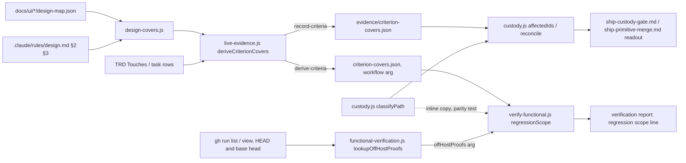

# TRD: Narrow re-proof scope

**Version**: 1.0.1
**Status**: Draft
**Created**: 2026-11-16
**Last Updated**: 2026-11-16
**Author**: @technical-architect
**Source PRD**: [docs/plan/narrow-reproof-scope.investigation.md](../plan/narrow-reproof-scope.investigation.md) (GitHub issues #153, #154, #155; owner ruling 2026-11-16: keep quality, no full re-runs that add no new value)
**Task ID Prefix**: NRS

---

## Changelog

| Version | Date | Changes | Author |
|---------|------|---------|--------|
| 1.0.0 | 2026-11-16 | Initial TRD creation from the narrow-reproof-scope investigation | @technical-architect |
| 1.0.1 | 2026-11-16 | `/audit-trd`: root-path rule settled for D2 (grounding agreed); D9 keeps `unresolved` always and updates one test; D13/D14 add `baseline` to the workflow validator and name no rerun for `missing`/`pending`; D15 prints scope at gate step 2, before the re-proof; D16 has each task mirror its own files; stale `relatedDirs`/§1.1/D12/TR4/OQ-2 text corrected; NRS-D001/D002 take the stale guide, contract and reference docs; NG7/NG8 record D3 and D10 narrowing less than O2/O5, pending owner confirmation; Could Not Verify rewritten | @technical-architect |

## Objectives

O1–O7 are the investigation's objectives, copied with their ids and must-pass marks. The source
carries `**Source spec**: none`, so the locked-scope rule does not bind; nothing was added to them.
O8 and O9 come from the constitution.

| ID | Objective | Source | Must pass |
|----|-----------|--------|-----------|
| O1 | Custody treats framework and housekeeping files as not shipped code: `.claude/**` except `.claude/rules/**`, `CLAUDE.md`, `.gitattributes`, `.gitignore`. `.claude/rules/**` and application source stay shipped. | investigation O1 (issue #153, owner decision 2026-11-16) | |
| O2 | When a merge-up changes a shipped-class file that no covers record names, custody puts in doubt only the criteria whose covers share that file's directory. A file nothing can be related to still widens to every must-pass criterion. | investigation O2 (issue #153) | yes |
| O3 | Before re-proving, custody states what changed since the anchor and the scope chosen (`none`, `targeted` or `full`) with the reason; the gate contracts say so. | investigation O3 (issue #153) | |
| O4 | Design criteria (`ST-<board id>` rows proved by verify-design-structure, `DC-<frame stem>` rows proved by verify-design-comparison) get covers built from `docs/ui/<slug>/design-map.json`: board route, the page file serving that route, and the files of the components the board names. A board that cannot be fully resolved stays without covers and is reported, never guessed. | investigation O4 (issue #154, owner decision 2026-11-16) | yes |
| O5 | The verification regression pass re-checks a criterion that has no covers record only when a changed file relates to it, not on any Debug edit; the report says how many criteria were re-checked and why, per reason, and names the scope (`none`, `targeted`, `full`). | investigation O5 (issue #154) | |
| O6 | A must-pass criterion proven by a named CI job is re-proved by re-running that job (or the run's failed jobs), never by dispatching the whole workflow; a job also red on the base branch head is reported as baseline, not as a failure of this feature. | investigation O6 (issue #155) | |
| O7 | The TRD authoring contract does not let a TRD declare a criterion whose only proof is a full manual CI run; the commands that handle a voided, missing or red declared proof name the single-job re-run. | investigation O7 (issue #155) | |
| O8 | The vendored runtime under `.claude/` and the `packages/full` distribution carry exactly the edited `packages/core` files (identical content). | `.claude/` half: `constitution.md` Architecture Invariants, "Vendored Runtime" (identical behaviour in local CLI and web sessions), and investigation Grounding hazard "`.claude/lib/custody.js` is a vendored copy". `packages/full` half: `stack.md` File Structure ("`full/` Complete plugin distribution") and this TRD's mirroring decision D16 | |
| O9 | Tests pass with unit coverage at or above 60% and integration coverage at or above 50% where integration tests apply. | `constitution.md` Quality Gates | |

**Must pass** is on O2 and O4 only, as the investigation marks them: a wrong narrowing there lets a
changed build through unverified. The rest is reporting and wording.

**Two decisions narrow less than O2 and O5 ask, and wait on the owner's confirmation** (audit
2026-11-16). D3 narrows custody only for a changed path ADDED since the anchor; a modified or
deleted unnamed path still widens to every must-pass criterion. D10 re-checks a no-covers criterion
on any code-class change, not only one related to it. Both err toward re-proving more than O2 and
O5 allow, and both are listed under Non-Goals (NG7, NG8) so the gap is not silent.

## 1. Overview

### 1.1 Technical Summary

Three deterministic narrowings, each widening back to today's behaviour whenever it cannot relate
a change to a criterion. No model call is added and nothing is shared with the separate
one-shared-rerun-scope-rule feature (#157); scope is reported with the same three words, `none`,
`targeted`, `full`.

1. **Custody (merge gate).** `custody.js classifyPath` files framework and housekeeping paths
   under the existing `docs` class, so a change to them moves the anchor with no re-proof.
   `affectedIds` stops widening to every must-pass criterion when a file ADDED since the anchor
   is merely unclaimed: it puts in doubt the criteria whose covers share the file's directory, and
   widens to `full` when no cover shares it, when the file sits at the repo root, or when the
   unclaimed path was modified or deleted rather than added (D3). `reconcile` reports the changed paths, the scope word and
   a one-line reason.
2. **Design covers.** A new library, `design-covers.js`, turns each design board into a covers
   list (the page file serving the board's route, plus each named component's file), resolved
   through `.claude/rules/design.md` sections 2 and 3. `live-evidence.js deriveCriterionCovers`
   uses it for `ST-` and `DC-` rows, which today never get a covers record.
3. **Regression pass and off-host proof.** `verify-functional.js regressionScope` re-checks a
   no-covers criterion only when a counting change record names a code-class file, so docs, test,
   framework, CI-config and lockfile edits no longer re-walk it (D10), and reports counts per
   reason with a scope word.
   `lookupOffHostProofs` also reads the named job on the base branch head and reports `baseline`
   when it is red there too, and returns the job id so every voided or red proof names
   `gh run rerun <run-id> --job <job-id>`. Commands and the TRD authoring contract say the same.

### 1.2 Key Technical Decisions

| ID | Decision | Choice | Serves Objective | Rationale | Alternatives Considered |
|----|----------|--------|------------------|-----------|------------------------|
| D1 | Class for framework and housekeeping paths | `classifyPath` returns `docs` for a path whose first segment is `.claude` and second is not `rules`, and for any path whose basename is `CLAUDE.md`, `.gitattributes` or `.gitignore`. The checks sit after the test/CI/lockfile checks and before the final `shipped`. | O1 | Investigation Decision: `docs` already means "not shipped code, default tier `none`", and `reconcile` already moves the anchor with no re-proof for it. | A new `framework` class with its own `ensemble.reproof` tier. Rejected in the investigation: more surface, same behaviour. Revisit if an owner needs framework edits re-proved while docs are not. |
| D2 | What "related" means | One pure rule, `relatedDirs(cover)`: a cover ending in `/` gives the directory itself; a glob cover gives the directory of its literal prefix (the segments before the first one holding `* ? [ {`); any other cover gives both `dirname(cover)` and the cover itself (it may name a directory without a trailing slash; a file path never equals a changed file's dirname, so the extra entry is harmless). A changed path relates to a criterion when `posix.dirname(path)` is one of its covers' related directories. **A related directory of `.` (a repo-root file) never relates anything**: root build config (`tsconfig.json`, `package.json`, `vite.config.ts`) can affect every criterion, so a root path is unrelatable and widens to `full`. (Adversarial review, 2026-11-16.) Pure string work, no filesystem read. Used by custody only: after D10 the workflow script carries no copy of it. | O2 | Investigation Decision "Related means the same directory". A path under a directory cover is already matched by `coverMatcher`; this rule only matters for paths under no cover. | (a) `fs.statSync` to tell a directory cover from a file cover. Rejected: the rule stays decidable from the recorded covers and the diff alone, like `coverMatcher`. (b) Ancestor directories (any shared prefix). Rejected: every path shares `.`, so it would widen back to everything. Revisit with data showing new files landing one level below covered files. |
| D3 | `affectedIds` widening | For the non-excused shipped paths no record names: **only a path ADDED since the anchor (`git diff --name-status`, status `A`) is narrowed**; a modified or deleted unnamed path keeps today's full widening, because another criterion's code may import it. For an added path, each one's related criteria (D2) are in doubt; if any such path relates to no criterion's covers, the result is the full set as today. Criteria with no record keep today's rule. Every other criterion is `reused`. `shippedAll` and promoted paths still return the full set first. | O2 | Investigation intended outcome 2. **Departs from** `docs/TRD/re-prove-only-what-a-change-can-affect.md`'s "unclaimed-path guard" (any unclaimed shipped path puts every must-pass criterion in doubt), by owner ruling 2026-11-16; that TRD gets a dated note (NRS-D002). | Keep the guard and narrow only through better covers. Rejected: the issue's case is a new file beside covered files, which no covers record can name in advance. |
| D4 | How scope is reported by custody | `affectedIds` returns `scope` and `scopeReason`. `full` when a widening branch decided it (`shipped: all`, a promoted path, an unrelatable path, naming that path); `targeted` when the narrowed set is non-empty; `none` when it is empty. `reconcile` puts `scope`, `scopeReason` and `changed` (every non-ignored path since the anchor with its class, `[{path, class}]`) on every result that compared the anchor with the head, including the early `moved` branches (tier-none, tier-ci, formatter, no success definition), which read `none`. | O3 | One field set on every compared result means the gate contracts can print it unconditionally. | Report scope only on `reverify`. Rejected: O3 asks for the scope *before* re-proving, and `none` is the answer the owner most needs to see stated. |
| D5 | Where design covers are computed | A new module `packages/core/lib/design-covers.js` exporting `designCovers({ cwd, rows })`. It reads maps with `design-map.js read`, tells a filled `design.md` from an unfilled one with `design-map.js setup`, and parses `design.md` tables with `trd-parser.js findTables`. | O4 | Investigation intended outcome 3 ("a new library"). `design-map.js` owns the map's shape and status lifecycle; resolving routes and component names against the product's source tree and `design.md` is a different concern that would add filesystem probing to every map read. `live-evidence.js` stays the one owner of the covers record and only calls this. | Add the resolver to `design-map.js` or `live-evidence.js`. Rejected: either grows a module with an unrelated concern. Revisit if a second caller of design-to-source resolution appears in `design-map.js`. |
| D6 | Resolution rules | Per the investigation Decision: route to page file through `design.md` §3 "Route list" (pair lines `/r -> p`, `/r: p`, `| /r | p |` in the cell text and, when the cell names an existing file, in that file; in that file also a line holding the route as a quoted literal, whose other quoted literals containing `/` or `.` are candidate paths). Candidates resolve with extension probing (`.tsx .ts .jsx .js .vue .svelte`, then `/index.*`), from the repo root, then from the route-list file's directory. Component to file through §2's "Component library paths" for the board's `platform` row, namespace prefix (up to and including the first `.`) stripped, matching `<Name>.<ext>`, `<Name>/index.<ext>` or a `<Name>/` directory, searched recursively (skipping `node_modules` and dot-directories). Every match becomes a cover (a directory as `<dir>/`). | O4 | Investigation Decision, "Route to page file and component to file are resolved through `design.md`". Taking every component match, not refusing on two, errs wide: more covers can only put a criterion in doubt more often. | Follow imports from the page file to every rendered file. Rejected in the investigation: needs a module graph (deferred, Non-Goal NG4). |
| D7 | All-or-nothing per board | A board yields covers only when its route resolves and every named component resolves. Otherwise the row gets no covers and an `unresolved` entry `{id, reason}`: board has no route, route has no page file, component `<Name>` not found, `design.md` missing or unfilled, board id found in more than one design, no board for the row (`ST-<design slug>` rows, and `DC-` stems that equal no board id). | O4 | Investigation Decision: a partial record would read a changed component as "unchanged". A row with no record falls back to custody's and the regression pass's conservative rules. | A partial record from the pieces that resolved. Rejected in the investigation. |
| D8 | Which rows, which designs | Rows whose definition `Derivation` cell is `check:verify-design-structure` (id `ST-<board id>`) or `check:verify-design-comparison` (id `DC-<frame stem>`; the board is the one whose id equals the stem, else the stem with a trailing `--<state>` removed, because a board's non-default states are rendered as `NN-name--<state>` frames). Boards are looked up in every `docs/ui/*/design-map.json` (the scan `design-map.js unsyncedAll` uses). Such rows take design covers with `source: 'design-map'`; task-derived covers do not apply to them. | O4 | The `Derivation` column is how `preclassifyNotCheckable` already recognises these rows, so an objective that happens to start `ST-` is not misread. | Read design paths from the TRD's Verification Artifacts inputs. Rejected for now: a TRD written before that section existed names none. Revisit if two designs commonly share board ids (D7 already refuses that case). |
| D9 | How unresolved boards are reported | `record-criteria` prints `{recorded, none, unresolved}`, with `unresolved` always present (`[]` when empty) so the commands read one stable shape; the existing `live-evidence.test.js` assertion `toEqual({ recorded: ['C-1'], none: ['C-4'] })` is updated to include `unresolved: []` (audit 2026-11-16: chosen over printing the key only when non-empty); `derive-criteria` keeps its stdout shape `{id: covers}` (the commands pass it to the workflow unchanged) and writes one stderr line per unresolved row. The commands put each `unresolved` entry in ISSUES. `recordCriterionCovers` keeps `'design-map'` as a source instead of rewriting it to `'touches'`. | O4 | "Reported, never guessed": the report has to reach the owner, and changing `derive-criteria`'s stdout would break the workflow argument it feeds. | A new CLI verb for design covers. Rejected: one more call per command for the same data. |
| D10 | Regression pass no-covers rule | In `regressionScope`, reason `no-covers` applies to a settled `met` criterion with no covers only when a counting record (`k >= p`, unchanged) names at least one code-class file. Code-class = what `custody.js classifyPath` returns `shipped` for after D1. The script gains a new inline copy `isCodeClass(path)` (NRS-B005 adds it; nothing by that name exists today) (it has no `require`, as with `globToRegex`). Other reasons, their order and the `k >= p` rule are unchanged. A criterion with no covers cannot be related to any particular file, so the rule does not try: it only stops docs, test, framework, CI-config and lockfile edits from re-walking it. | O5 | Investigation intended outcome 4, simplified after the adversarial review: the first draft re-checked an uncovered criterion only when the changed file sat beside some OTHER criterion's cover, which points the wrong way (an edit in a directory no cover names is where an uncovered criterion's files most likely live). **Departs from** `docs/TRD/one-full-regression-pass-at-the-end.md` D5 (`no-covers` on any non-empty counting record); that TRD gets a dated note (NRS-D002). | Keep D5 and rely on design covers alone. Rejected: a docs, test or framework edit by Debug would still re-walk every no-covers criterion. Directory sharing with another criterion's covers. Rejected after review (above). |
| D11 | Keeping the two copies equal | A table-driven Jest test runs the same paths through `custody.js classifyPath(...) === 'shipped'` and the workflow's `isCodeClass`, in the existing "D4: the inline matcher agrees with custody.js coverMatcher" block. | O5, O2 | The pattern this file already uses for `globToRegex`/`coverMatcher`. | A shared module. Rejected: the workflow script cannot `require`. |
| D12 | Regression scope reporting | `regressionScope` also returns `counts` (`{reason: n}` over its `scope`) and `scopeWord`: `none` when the scope is empty, `full` when any entry is `changes-unknown` else `targeted`. Each round in the record carries both; the log line and `renderReport`'s regression section print `Scope: <word> — re-checked <n>: <reason> <count>, ...`. An input without the fields renders as today. | O5 | Same three words as custody (D4). The reason names stay as they are, so existing report readers and tests keep working. | New reason names for the narrowed rules. Rejected: renames reasons other code keys on (`reasonsIn`, report readers); the per-reason counts and the scope word carry what the owner needs. Note: a pass that re-checks every no-covers criterion after one code edit reads `targeted`, since only `changes-unknown` makes it `full`. |
| D13 | Base-branch check for off-host proofs | `lookupOffHostProofs({ base })`; CLI `off-host-proofs --base <ref>`, else the open PR's `baseRefName` (`gh pr view --json baseRefName`), else `git symbolic-ref --short refs/remotes/origin/HEAD`, else no baseline check. The base commit is `git merge-base HEAD <ref>`, never the moving tip (custody compares against a base the same way); when it equals HEAD there is no baseline check (a run on the base branch itself would read every red job as baseline). the job is looked up there with the same run-list/run-view path as HEAD (one helper). A job concluding unsuccessfully on both gives status `baseline`; a missing or unfinished base run leaves `red`; red on HEAD and green on base stays `red`. Every entry gains `jobId` (the job's `databaseId`, or null). The workflow's input validator must accept the new status: `'baseline'` is added to `OFF_HOST_STATUSES` in `verify-functional.js` (today `['green', 'red', 'pending', 'missing', 'dirty', 'error']`, which throws on anything else before any agent runs), and `jobId` is optional there (null is legal). | O6 | Investigation Decision "Baseline needs a base ref". The job id is what `gh run rerun --job` takes. | Ask the commands to pass `--base` always. Rejected: the default ref is derivable and the commands do not know a better one. |
| D14 | What a non-green proof says | `settleOffHost` reasons keep their `declared off-host proof <workflow>#<job> is <status>` prefix. For `red` with a run id, name `gh run rerun <run-id> --job <job-id>` (or `gh run rerun <run-id> --failed` when the job id is unknown) and "never `gh workflow run`"; after a Debug edit, say only to push and wait for the run CI starts (the lookup's run id belongs to the earlier commit, so it is named only when the run's head is the current HEAD). `missing` and `pending` entries have no run to re-run (`build()` sets `runId` only from a found run, and a pending run has not completed): say to wait for, or push to start, the run, and name no `gh run rerun`. For `baseline`, say the job is red on the base branch head too and is not this feature's failure. A `baseline` proof does not settle the criterion `met`: it stays unproven, as any non-green proof does today. Reaching `settleOffHost` with `baseline` needs the validator change in D13. | O6 | Investigation intended outcome 5 and Decision "A voided proof after a Debug edit". Not proving a criterion with a red job keeps the off-host rules (green only) intact. | Settle `baseline` as `met`. Rejected: the job never succeeded, so nothing proved the criterion (Open Question OQ-1). |
| D15 | Command and contract wording | `verify-build.md` and `implement-trd.md` (the off-host lookup paragraphs) name `gh run rerun <run-id> --job <job-id>` / `--failed`, forbid `gh workflow run`, and put `record-criteria`'s `unresolved` in ISSUES. `trd-authoring.md` (the Off-host proof paragraph) says a criterion whose only proof is a full manual CI run is not declared, and a local or single-job proof is preferred. `ship-custody-gate.md` prints the `changed` paths, `scope` and `scopeReason` where the reconcile result is read, at the end of step 2 ("Read the one JSON line it prints."), so the print comes before step 3's `reverify` re-proof (`/verify-build ... --chained`); step 4 ("Report.") keeps the id lists. `ship-primitive-merge.md` has no report step of its own (its step 2 defers to the gate), so the gate's text reaches merge and release; the merge contract is edited only if a sentence there needs it. The contracts say `scope` is absent on a `refused` result returned before the anchor comparison. `contracts/functional-verification.md` and `docs/reference/verification.md` restate the `no-covers` rule and the off-host status list; `docs/guides/ship-build.md` restates the unclaimed-path guard: all three are brought in line with D3, D10 and D13. | O3, O5, O6, O7 | Investigation intended outcome 6 and O3 ("the gate contracts say so"). | Leave the wording to the code's reason strings. Rejected: O7 is about what an author and the commands are told, which only prose reaches. |
| D16 | Mirroring | Each task that edits a `packages/core` file copies it over its `.claude/` copy as its last step (`cp`, then `cmp`; never hand-edited), because mirror-parity tests sit inside the tasks' own acceptance commands (`functional-verification.test.js` "mirror parity", `verify-functional.test.js` "is byte-identical to the .claude/workflows/ copy", `record-criteria-prose.test.js` "mirrors are byte copies", `ship-primitives.test.js` "is byte-identical to its .claude/contracts copy") and fail from the first core edit otherwise. NRS-B002 adds `.claude/lib/design-covers.js` and the `packages/full/lib/design-covers.js` symlink to `../../core/lib/design-covers.js`, like its neighbours; `packages/full/workflows` and `packages/full/contracts` are directory symlinks and need nothing. NRS-I001 re-checks every copy with `cmp` and runs the full battery. (Audit 2026-11-16: copying moved from NRS-I001 into each task.) | O8 | The FIX-005 pattern of `docs/TRD/resume-re-proves-a-moved-pr-head.md`. | `scaffold-project.sh --refresh` over the whole tree. Rejected: it refreshes far more than this change touches. |

### 1.3 Technology Stack

| Layer | Technology | Purpose | Notes |
|-------|------------|---------|-------|
| Libraries | Node.js (18+), CommonJS | `custody.js`, `live-evidence.js`, `functional-verification.js`, new `design-covers.js` | per `stack.md` |
| Workflow script | Node.js, no `require` | `verify-functional.js` | inline copies of shared rules |
| Tests | Jest ^29.7.0 | unit and seam tests beside each module | per `stack.md` |
| External CLIs | `git`, `gh` | diff and CI run lookups, spawned with argument arrays | per `CLAUDE.md` command-injection rule |

### 1.4 Integration Points

| System | Type | Direction | Notes |
|--------|------|-----------|-------|
| GitHub Actions via `gh` | CLI (`gh run list`, `gh run view --json jobs`) | In | one more lookup per declared job, on the base head |
| `.claude/rules/design.md` | Markdown tables (§2, §3) | In | read only; owner-governed, never written |
| `docs/ui/*/design-map.json` | JSON | In | read only |

## 2. System Architecture

### 2.1 Data flow



## 3. Technical Specifications

### 3.1 `custody.js`

```javascript
// D1: added before the final `return 'shipped'`
//   segments[0] === '.claude' && segments[1] !== 'rules' && segments.length > 1  -> 'docs'
//   base === 'CLAUDE.md' || base === '.gitattributes' || base === '.gitignore'     -> 'docs'

/** D2. Directories a cover relates to. Pure; new. Used by affectedIds only (no workflow copy). */
function relatedDirs(cover: string): string[]

/** D3, D4 */
affectedIds(args) -> { ids: string[], reused: string[], scope: 'none'|'targeted'|'full', scopeReason: string } | { error }

/** D4: every result that compared anchor and head also carries */
reconcile(args) -> { ...existing, scope, scopeReason, changed: Array<{ path: string, class: string }> }
```

Behaviour:
- `classifyPath('.claude/commands/plan.md')`, `('.claude/workflows/x.js')`, `('CLAUDE.md')`,
  `('packages/x/CLAUDE.md')`, `('.gitattributes')`, `('.gitignore')` return `docs`;
  `('.claude/rules/constitution.md')` and `('src/app.ts')` return `shipped`.
- `affectedIds`: an unclaimed non-excused shipped path `p` ADDED since the anchor puts in doubt
  every criterion with covers where `relatedDirs` of one of its covers contains `posix.dirname(p)`
  (a `posix.dirname(p)` of `.` relates nothing, D2). If some unclaimed added `p` relates to no
  criterion, or any unclaimed path was modified or deleted (D3), the result is the full id set with
  `scope: 'full'` and `scopeReason: '<p> shares a directory with no recorded cover'` (or names the
  modified or deleted path).
- `scopeReason` examples, one line each: `ensemble.reproof.shipped is all`, `<path> is promoted by
  ensemble.reproof`, `2 of 5 must-pass criteria cover or sit beside a changed path`, `only docs
  changed (needs no re-proof)`.
- `classifyPath` is also read by `lookupOffHostProofs`' dirty check and `partitionChanges`; both
  follow D1 with no change of their own.

Error handling: unchanged; `scope` fields are absent on `refused` results returned before the
anchor/head comparison.

### 3.2 `design-covers.js` (new)

```javascript
/**
 * @param {{ cwd?: string, rows: Array<{ id: string, derivation: string }> }} args
 * @returns {{ covers: Map<string, string[]>, unresolved: Array<{ id: string, reason: string }> }}
 *   covers are repo-relative, forward-slash; a directory cover ends in '/'.
 */
function designCovers({ cwd, rows })
```

Behaviour per D6–D8. Rows with any other derivation are ignored (neither covered nor unresolved).
Throws only on an unreadable `design-map.json` that exists (malformed JSON), naming the file;
`live-evidence.js` turns that into the CLI's exit 2, as it does for an unreadable TRD.

### 3.3 `live-evidence.js`

- `deriveCriterionCovers` reads the definition's `Derivation` column; for design rows it calls
  `designCovers` and sets `source: 'design-map'`. The returned map's value type becomes
  `{covers, source: 'touches'|'task-row'|'design-map'}`. Unresolved rows come back through a new
  exported `deriveCriterionCoversReport(args) -> { covers: Map, unresolved: Array<{id, reason}> }`;
  `deriveCriterionCovers(args)` returns that call's `covers`, so its existing callers see the same
  return type and no new entries.
- `recordCriterionCovers` keeps `'design-map'`.
- CLI: `record-criteria` prints `{"recorded":[...],"none":[...],"unresolved":[{"id","reason"}]}`;
  `derive-criteria` stdout unchanged, one stderr line per unresolved row:
  `live-evidence: <id> has no covers: <reason>`.

### 3.4 `verify-functional.js`

```javascript
function isCodeClass(file)      // inline copy of custody classifyPath(file) === 'shipped' (D10)
function regressionScope(records, awaitingIds, sentIds)
  -> { scope, notRewalked, unclaimedChanges, counts: { [reason]: number }, scopeWord: 'none'|'targeted'|'full' }
```

- `no-covers` per D10. `unclaimedChanges` is unchanged and still lists every changed file no cover
  matches, so a code change the narrowed rule does not act on is still visible in the report.
- Each round in the regression record carries `counts` and `scopeWord`; the log line at the pass's
  start names both.
- `settleOffHost` reason text per D14, built from the lookup entry's `runId`, `jobId` and `status`.

### 3.5 `functional-verification.js`

- `lookupOffHostProofs({ declared, covers, cwd, trdPath, base })` per D13; status set gains
  `'baseline'`; entries gain `jobId`. CLI `off-host-proofs` accepts `--base <ref>`; a ref starting
  with `-` is refused, as `custody.js resolveRef` refuses one.
- `renderReport` regression section prints the scope line per round (D12) when the round carries
  `scopeWord`; an older input renders byte-identically.

## 4. Master Task List

### 4.1 Task ID Convention

`NRS-[CATEGORY][SEQ]`: B = backend (library and workflow code), D = documentation (commands,
contracts, sibling TRDs), T = cross-seam test, I = integration (mirroring and the full battery).
Unit tests ship inside each B task.

### 4.2 Phase 1: Libraries (independent files, run in parallel)

| Task ID | Description | Serves | Skills | Dependencies | Acceptance Criteria |
|---------|-------------|--------|--------|--------------|---------------------|
| NRS-B001 | `custody.js`: D1 classification, new `relatedDirs`, D3 directory narrowing in `affectedIds`, D4 `scope`/`scopeReason`/`changed` on `reconcile` results. One task: all of it is in one file and the scope fields are produced by the narrowing itself. | O1, O2, O3, D1, D2, D3, D4 | `jest` | None | `npx jest packages/core/lib/custody.test.js` passes with new cases in the existing blocks: `classifyPath (D10)` table covers every path in §3.1; in `shipped changes re-prove by covers` (real temp repo): with criterion A covering `src/a/x.ts` and B covering `src/b/y.ts`, a change adding `src/a/new.ts` returns `reverify` with `ids` `['A']`, `scope` `targeted` (fails today: returns A and B); a change adding `lib/z.ts` returns both, `scope` `full`, reason naming `lib/z.ts`; a change to `.claude/commands/plan.md` only moves the anchor with rule `tier-none` and `scope` `none`; a change to `.claude/rules/constitution.md` is still shipped; `shipped: all` gives `full`; every compared result carries `changed` with classes; a change adding a root-level `tsconfig.json` gives `scope` `full`; a change modifying an unnamed shipped file gives `full`. `custody.js` is copied over `.claude/lib/custody.js` (D16) and `cmp` reports no difference. |
| NRS-B002 | New `packages/core/lib/design-covers.js` (`designCovers`) with `design-covers.test.js`. | O4, D5, D6, D7, D8 | `jest` | None | `npx jest packages/core/lib/design-covers.test.js` passes, each case in a temp project with its own `design.md` and `docs/ui/<slug>/design-map.json` (shape copied from `test/fixtures/design/walk/boards/trips-refresh/design-map.json`): route pairs in each of the three line forms and through a named route file (pair line and quoted-literal line) resolve to the page file with extension and `/index.*` probing; namespaced components `FixtureWeb.Card` resolve to `Card.tsx`, `Card/index.tsx` and `Card/`; a `DC-<stem>` row equal to a board id gets that board's covers; unresolved with a reason, and no covers, for: no route, route without a page file, one missing component of three, unfilled `design.md`, missing `design.md`, a board id in two designs, `ST-<design slug>`, a `DC-` stem that is no board id; rows of other derivations are ignored. `.claude/lib/design-covers.js` is a byte copy and `readlink packages/full/lib/design-covers.js` is `../../core/lib/design-covers.js` (D16). |
| NRS-B003 | `functional-verification.js`: D13 base-head lookup, `baseline` status, `jobId`, CLI `--base`; D12 scope line in `renderReport`'s regression section. Merged because both are in one file and serialize anyway; the two have separate test blocks. | O5, O6, D12, D13 | `jest` | None | `npx jest packages/core/lib/functional-verification.test.js` passes; in the `off-host-proofs and off-host-proven verbs` block, with a fake `gh` on `PATH`: job red on HEAD and red on the base head gives `baseline`; red on HEAD and green on base gives `red`; red on HEAD with no base run, or an unfinished one, gives `red`; no `origin/HEAD` and no `--base` gives today's `red` with no base lookup; `--base -x` is refused; every entry carries `jobId` from `gh run view --json jobs`. `renderReport` with a round carrying `scopeWord: 'targeted'` and `counts` prints `Scope: targeted — re-checked 3: covers-changed 2, no-covers 1`; an input without them renders byte-identically to today. `functional-verification.js` is copied over its `.claude/lib/` copy first (D16), so the file's "mirror parity" block passes. |

### 4.3 Phase 2: Consumers

| Task ID | Description | Serves | Skills | Dependencies | Acceptance Criteria |
|---------|-------------|--------|--------|--------------|---------------------|
| NRS-B004 | `live-evidence.js`: design rows take covers from `designCovers` with source `design-map` (D8); `recordCriterionCovers` keeps the source; CLI `record-criteria` prints `unresolved`, `derive-criteria` writes them to stderr (D9). | O4, D8, D9 | `jest` | NRS-B002 | `npx jest packages/core/lib/live-evidence.test.js` passes: a definition with an `ST-<board>` row derived `check:verify-design-structure` and a `DC-<board>` row derived `check:verify-design-comparison` gets the board's covers with source `design-map`, and the record file keeps `design-map`; an unresolved board appears in `record-criteria`'s `unresolved` with its reason and not in `recorded`; `derive-criteria` stdout keeps the `{id: covers}` shape and stderr names the unresolved row; existing Touches and task-row cases are unchanged, except the test "CLI records only met ids and prints {recorded, none}", whose `toEqual` gains `unresolved: []` (D9). `live-evidence.js` is copied over `.claude/lib/live-evidence.js` (D16). |
| NRS-B005 | `verify-functional.js`: new inline `isCodeClass`; D10 `no-covers` rule; D12 `counts`/`scopeWord` in `regressionScope`, the record and the log line; `'baseline'` added to `OFF_HOST_STATUSES` with `jobId` optional in the validator (D13); D14 `settleOffHost` reason text. One task: one file, and the `isCodeClass` parity table sits beside the existing `globToRegex` parity block. | O5, O6, D10, D11, D12, D14 | `jest` | NRS-B001, NRS-B003 | `npx jest packages/core/workflows/verify-functional.test.js` passes in full (the constraint tests at the top of the file included). New cases: a no-covers `met` criterion is not re-checked when Debug changed only `docs/x.md`, `src/a.test.ts`, `.claude/commands/x.md` or `package-lock.json`; it is re-checked (`no-covers`) when Debug changed any code-class file such as `src/a/new.ts`;  the round record carries `counts` per reason. Parity: a table of at least the §3.1 paths gives the same answer from `custody.classifyPath(p) === 'shipped'` and the inline `isCodeClass`,  `settleOffHost`: a `red` proof's reason contains `gh run rerun <runId> --job <jobId>` and `never \`gh workflow run\``; a null `jobId` gives `--failed`; a `missing` or `pending` proof names no `gh run rerun` and says to wait for, or push to start, the run; a green proof voided by Debug says to push and wait for CI first; an `offHostProofs` entry with status `baseline` passes the input validator, and its reason says it is red on the base branch head and the criterion stays `not_verifiable`. `verify-functional.js` is copied over `.claude/workflows/verify-functional.js` (D16). |

### 4.4 Phase 3: Wording and the cross-seam test

| Task ID | Description | Serves | Skills | Dependencies | Acceptance Criteria |
|---------|-------------|--------|--------|--------------|---------------------|
| NRS-D001 | Verify-side wording (D15): `packages/core/commands/verify-build.md` and `implement-trd.md` off-host paragraphs name `gh run rerun <run-id> --job <job-id>` / `--failed`, forbid `gh workflow run`, and send `record-criteria`'s `unresolved` to ISSUES; `packages/core/contracts/trd-authoring.md` Off-host proof paragraph forbids a criterion whose only proof is a full manual CI run and prefers a local or single-job proof. Also brings the restated rules in line (D15): `packages/core/contracts/functional-verification.md` (~498, `no-covers` "no covers record and a debugger changed something") and `docs/reference/verification.md` (~309, the same `no-covers` clause; ~498 and ~526, the `off-host-proofs` flags and status list, which gain `--base` and `baseline`) state the D10 and D13 rules. Copies each edited `packages/core` file over its `.claude/` copy (D16). | O5, O6, O7, D10, D13, D15 | | NRS-B003, NRS-B004, NRS-B005 | `grep -c "gh run rerun"` is at least 1 in each of the three files; each forbids `gh workflow run` in words; `trd-authoring.md` contains the "full manual CI run" sentence; neither `contracts/functional-verification.md` nor `docs/reference/verification.md` still defines `no-covers` as "a debugger changed something" / "a Debug pass changed something", and the reference's `off-host-proofs` row names `--base` and `baseline`; any Jest test that pins these files' text (`npx jest packages/core/commands packages/core/contracts`) passes, mirror tests included. |
| NRS-D002 | Ship-side wording and sibling TRDs: `ship-custody-gate.md` prints `changed`, `scope` and `scopeReason` from the reconcile result at the end of step 2, before step 3's `reverify` re-proof (D15; `ship-primitive-merge.md` has no report step and defers to the gate, so it is edited only if a sentence there needs it); `docs/guides/ship-build.md` (~368-369, "A changed shipped path that no criterion's record names also puts every must-pass criterion in doubt") states the D3 rule; the amendment marker (bold `AMENDED <date> by <doc> <decision>`, original wording kept) in `docs/TRD/re-prove-only-what-a-change-can-affect.md` (unclaimed-path guard) and `docs/TRD/one-full-regression-pass-at-the-end.md` (D5 `no-covers`) saying the rule was narrowed on 2026-11-16 by this TRD's D3 / D10. Copies each edited contract over its `.claude/contracts/` copy (D16). | O3, D3, D10, D15 | | NRS-B001 | `ship-custody-gate.md` names `scope`, `scopeReason` and `changed` in step 2, before the `/verify-build ... --chained` call; `ship-build.md` no longer says any unnamed changed shipped path puts every criterion in doubt; each sibling TRD carries the dated amendment pointing at `docs/TRD/narrow-reproof-scope.md`; nothing else in either sibling changes; `npx jest packages/core/contracts/ship-primitives.test.js packages/core/commands/record-criteria-prose.test.js` passes, mirror tests included. |
| NRS-T001 | Cross-seam test, `packages/core/lib/narrow-reproof.seam.test.js`: in a temp git repo with a filled `design.md` and a design map, a met `ST-<board>` must-pass criterion goes through `record-criteria` (NRS-B004) into the covers record, then `custody.js reconcile` (NRS-B001) after a commit adding a sibling file beside one of the board's component files returns `reverify` naming that criterion with `scope: targeted`, and after a commit changing only `.claude/commands/x.md` moves with `scope: none`. Neither task owns the seam between the covers record and custody. | O2, O4 | `jest` | NRS-B001, NRS-B004 | `npx jest packages/core/lib/narrow-reproof.seam.test.js` passes; the same scenario with the board's `design.md` row left unfilled gives `scope: full` (no record, conservative path). |

### 4.5 Phase 4: Mirror and battery

| Task ID | Description | Serves | Skills | Dependencies | Acceptance Criteria |
|---------|-------------|--------|--------|--------------|---------------------|
| NRS-I001 | Re-check that every edited `packages/core` file matches its `.claude/` copy (each task made its own copy, D16) and re-copy any that drifted after a later task; CHANGELOG `[Unreleased]` entry naming #153, #154, #155; full battery. | O8, D16 | | NRS-B001, NRS-B002, NRS-B003, NRS-B004, NRS-B005, NRS-D001, NRS-D002, NRS-T001 | `cmp` of each edited core file against its `.claude/` copy and its `packages/full` path reports no difference; `readlink packages/full/lib/design-covers.js` is `../../core/lib/design-covers.js`; the full Jest battery shows no failing test file beyond those failing on `main` before the change; CHANGELOG `[Unreleased]` names #153, #154 and #155. |

## 5. Execution Plan

### 5.1 Phase Overview

| Phase | Focus | Prerequisites | Parallelizable Sessions |
|-------|-------|---------------|------------------------|
| 1 | Libraries, each with its unit tests | None | 1A, 1B, 1C in parallel (three different files) |
| 2 | Consumers, each with its unit tests | the Phase 1 task each depends on | 2A, 2B in parallel |
| 3 | Wording and the covers-to-custody seam test | Phase 2 | 3A, 3B, 3C in parallel (different files) |
| 4 | Mirror, CHANGELOG, full battery | Phase 3 | single session |

### 5.2 Session Details

- **1A** NRS-B001 (@backend-implementer). **1B** NRS-B002 (@backend-implementer). **1C** NRS-B003 (@backend-implementer).
- **2A** NRS-B004 (@backend-implementer), blocked by 1B. **2B** NRS-B005 (@backend-implementer), blocked by 1A and 1C.
- **3A** NRS-D001, blocked by 1C, 2A and 2B. **3B** NRS-D002, blocked by 1A. **3C** NRS-T001 (@verify-app or @backend-implementer), blocked by 1A and 2A.
- **4A** NRS-I001, blocked by everything above.

### 5.3 Parallelization Map

```mermaid
gantt
    title Execution Plan (no time scale, dependency order only)
    dateFormat X
    axisFormat %s
    section Phase 1
    NRS-B001 custody: b1, 0, 1
    NRS-B002 design-covers: b2, 0, 1
    NRS-B003 off-host and report: b3, 0, 1
    section Phase 2
    NRS-B004 live-evidence: b4, after b2, 1
    NRS-B005 regression pass: b5, after b1 b3, 1
    section Phase 3
    NRS-D001 verify wording: d1, after b3 b4 b5, 1
    NRS-D002 ship wording: d2, after b1, 1
    NRS-T001 seam test: t1, after b1 b4, 1
    section Phase 4
    NRS-I001 mirror: i1, after b5 d1 d2 t1, 1
```



### 5.4 Critical Path

NRS-B001/B003 → NRS-B005 → NRS-D001 → NRS-I001 (four steps; NRS-B002 → NRS-B004 → NRS-T001 → NRS-I001 is equal in length).

## 6. Quality Requirements

### 6.1 Testing Requirements

| Type | Coverage Target | Source | Scope |
|------|-----------------|--------|-------|
| Unit Tests | ≥ 60% | `constitution.md` Quality Gates | `custody.js`, `design-covers.js`, `live-evidence.js`, `functional-verification.js`, `verify-functional.js` changes |
| Integration Tests | ≥ 50% | `constitution.md` Quality Gates | the covers-record-to-custody seam (NRS-T001) |

No `[LIVE]` end-to-end task: the change is libraries and a workflow script with no service to run,
and `constitution.md` sets `verification_level: unit-only`. Each behaviour is exercised through
Jest with real temp git repos and a fake `gh` on `PATH`, the pattern the existing tests use.

### 6.2 Code Quality Standards

- `git` and `gh` are spawned with argument arrays, never a shell string (`CLAUDE.md` Security
  Considerations).

### 6.3 Security Requirements

- `--base <ref>` is external input reaching `git rev-parse`; a value starting with `-` is refused
  so it cannot be read as an option. Domain-derived: an argument-array spawn still passes option
  injection through, and `custody.js resolveRef` already guards the same way.

## 7. Risk Assessment

### 7.1 Risks Imported from PRD

The investigation states no risks section. Its Grounding names two hazards, carried below as TR1 and TR2.

### 7.2 Technical Risks

| ID | Risk | Likelihood | Impact | Mitigation |
|----|------|------------|--------|------------|
| TR1 | `verify-functional.js` is large and guarded by constraint tests at the top of its test file; an edit anywhere breaks them. | Med | Med | NRS-B005's acceptance runs the whole `verify-functional.test.js`, not a filtered subset. |
| TR2 | The inline `isCodeClass` copy drifts from `custody.js classifyPath` in a later change. | Med | High (a wrong narrowing in the regression pass) | D11 parity tests fail on any drift. |
| TR3 | D1 also changes `lookupOffHostProofs`' dirty check: an uncommitted `.claude/` edit no longer marks a no-covers off-host proof `dirty`. | High (by design) | Low | Intended under O1 (those files are not shipped code); NRS-B001 tests assert the class, and the off-host tests are rerun in NRS-B003. |
| TR4 | The narrowed `no-covers` rule (D10) skips a no-covers criterion that a non-code-class edit did break (for example a config file `classifyPath` files as `ci-config` or `deps`). | Low | Med | D10 still re-checks on every code-class change; the skipped file still appears under "Changed files no criterion covers" in the report, and design covers (O4) shrink the no-covers population. See OQ-2. |

### 7.3 Contingency Plans

**TR2 Contingency**: if a parity test fails after a later `custody.js` edit, copy the new rule into
the workflow script in the same change; never relax the test.

## 8. Non-Goals (Scope Boundaries)

| PRD ID | Non-Goal | Rationale |
|--------|----------|-----------|
| NG1 | The one shared rerun-scope rule of issue #157 | Separate feature; this change shares no code with it, only the words `none`, `targeted`, `full` (investigation preamble) |
| NG2 | Editing the ship-build primitive docs that mention `gh run rerun --failed` | Already correct; only the verify side lacks it (investigation "not absorbed") |
| NG3 | Changing `ensemble.reproof` defaults | Not asked (investigation "not absorbed") |
| NG4 | A module graph to find every file rendered at a route | Deferred (investigation Decision "Rendered at its route is carried by the design covers") |
| NG5 | A `reproof` setting to switch the narrowing off | Deferred: `ensemble.reproof.shipped: all` already forces full custody re-proof, and the regression pass has no setting today (investigation Decision) |
| NG6 | Changing `debugTouchedCovers` (off-host settle rule 3), which keeps its own no-covers rule | Not named by the investigation; see OQ-3 |
| NG7 | Narrowing custody for a MODIFIED or DELETED shipped path no covers record names (investigation O2 / intended outcome 2 covers any such path) | D3 narrows only added paths: another criterion's code may import a modified file. **Pending owner confirmation** (audit 2026-11-16) |
| NG8 | Relating a code-class change to a no-covers criterion by directory, so an unrelated code edit does not re-check it (investigation O5 / intended outcome 4) | D10: a criterion with no covers cannot be related to a file, and the source's "shares a directory with some recorded cover" points the wrong way. Any code-class change re-checks it. **Pending owner confirmation** (audit 2026-11-16) |

## Verification Artifacts

None apply — this change builds no screen, has no interaction diagram and renders no data; it reads
`design-map.json` files as input to a covers record, which is not a design this feature is built from.

## Verification Environment

**Environment**: local
**Refresh**: none declared
**Cannot be checked there**: a real GitHub Actions run on a base branch head (the `baseline` status is proven against a fake `gh`); failures that occur only on the GitHub Actions runner (`verification.md` §5)

## 9. Task Grounding

Audit note (2026-11-16): under D16 as amended, each task copies its own edited `packages/core`
files over their `.claude/` copies. Where a line below says NRS-I001 copies or mirrors a file,
read it as "this task copies it; NRS-I001 re-checks it".

### NRS-B001
- **Touches:** `packages/core/lib/custody.js`, `packages/core/lib/custody.test.js`
- **Reuse:** [read] `coverMatcher(cover)` in `custody.js` (exported; handles dir, glob and exact covers) stays the only matcher for "is this path named by a cover"; do not write a second one. `relatedDirs` is only for the *unclaimed* remainder. [read] `globToRegex` is already imported from `./ci-baseline`. [read] the test helpers `setup()` (custody.test.js ~line 73) and `twoCriteria({recA, recB, reproof, ...})` (inside `describe('reconcile: change classes and ensemble.reproof')`, ~line 411) build a real temp repo with a criterion-covers record; new `affectedIds` cases go in `describe('shipped changes re-prove by covers')` (~line 611) through `twoCriteria`, with file covers `['src/a/x.ts']` / `['src/b/y.ts']`.
- **Replaces:** [read] the unclaimed-path guard `if (shipped.some((p) => !allMatchers.some((m) => m(p)))) return { ids, reused: [] };` in `affectedIds` (custody.js ~line 501) is replaced by the directory rule; delete it, do not leave it beside the new branch. Update the three prose places that state the old rule so none still reads as live: the `affectedIds` JSDoc clause "(c) when a non-excused shipped path is named by no record of any criterion" (~lines 451-462), the module header's class list (`docs   first segment docs or doc, or a README/CHANGELOG... basename`, ~lines 21-23) which must now also name `.claude/**` outside `rules/`, `CLAUDE.md`, `.gitattributes`, `.gitignore`, and the `reconcile` JSDoc `@returns` shape (~line 565) which must gain `scope`, `scopeReason`, `changed`. [read] the existing row `['.claude/other.md', 'shipped']` in `describe('classifyPath (D10)')` (custody.test.js line 109) becomes false under D1 (`.claude/other.md` is now `docs`): change it to `docs` (or replace it with the §3.1 rows), otherwise the suite fails.
- **Follow:** [read] the `out(o)` wrapper in `reconcile` (`const out = (o) => (args.base ? { ...o, excused, ...} : o)`, ~line 671) is how fields are put on every post-compare result; extend it (or add a second wrapper) to attach `scope`, `scopeReason` and `changed` so no return site is missed. `changed` = `cmp.names` mapped to `{path, class: classifyPath(p, trdRel)}` minus class `ignored` ([read] `compare()` returns `names` = every differing path of every class, including ignored, so the filter is needed). Test pattern: real git repo per case, `reconcile(s.args())`, `toMatchObject`.
- **Careful:**
  - [read] `affectedIds` is module-private (not in `module.exports`, line ~909: `reconcile, check, detach, classifyPath, resolveCommit, compare, coverMatcher, trdRelative, main`). Test it through `reconcile`. `relatedDirs` is a new function (grep finds no definition today); no other task imports it, so export it only if a direct unit test wants it.
  - [read] `affectedIds` returns before reading any covers when `shippedAll || promoted.length > 0` (the `return { ids, reused: [] }` right after `must-pass-coverage`); `scope: 'full'` and its reason (`ensemble.reproof.shipped is all` / `<path> is promoted by ensemble.reproof`) must be set on that early return too.
  - [read] `posix.dirname('a.js')` is `'.'`. Per D2, a related directory of `'.'` relates nothing: a root-level new file (`tsconfig.json`, `package.json`) and a root-level cover or a glob with no literal prefix never narrow, and an unclaimed root-level added path widens to `full`. Make the match skip `'.'` explicitly (and never return `''`, which would match nothing by accident rather than by rule); test it with a root-level added file. (Audit 2026-11-16: this bullet previously asked for the opposite, the pre-review rule.)
  - [read] the existing test "a change to a file no record names re-proves A and B" (`src/c.js` beside covers `src/a.js` and `src/b.js`) still passes under D3 but for a different reason: `dirname('src/c.js')` is `src`, which is `dirname` of both covers. Its title now misdescribes it; give it `scope: 'targeted'`/rename it, and use `lib/z.ts` (no shared directory) for the `full` case as the AC does.
  - [read] criteria with NO covers record keep the old rule inside `affected` (`if (!matchers) return !criterionIds.has(id) || !proven.has(id) || shipped.length > 0`); keep it verbatim. `shipped` there is `shippedDiff` only; excused paths still go through the `changed` list, not the unclaimed check.
  - [read] `classifyPath` is also called by `ship-sequencer.js recordReproof` (`classes` of `differing`) and `ci-fix-route.js classifyFile` (only `ignored`/`test-only` matter there) and `functional-verification.js lookupOffHostProofs` (dirty check). None breaks on a path moving `shipped` -> `docs`; run `ship-sequencer.test.js`, `ship-build.seam.test.js`, `ci-fix-route.test.js` and `functional-verification.test.js` after the change, not only `custody.test.js`.
  - [read] `reconcile` output is passed whole as `--custody '<JSON line>'` to `ship-sequencer.js reproof`, which reads only `action`, `ids`, `differing`, `excused`; the new `changed` array repeats `differing` plus test-only paths, so a very large merge-up grows that command line. Adding the fields is safe; nothing validates the shape strictly.
  - [read] the AC's "`classifyPath (D10)` table" is the test block's name (a decision of the older ship-build TRD); it is not this TRD's D10.
  - Collision: none. `custody.js` and `custody.test.js` are touched by no other task in this TRD. NRS-I001 later copies `custody.js` over `.claude/lib/custody.js` ([ran: cmp] the two are identical today; `.claude/lib` holds no `*.test.js`).

### NRS-B002
- **Touches:** `packages/core/lib/design-covers.js` (new), `packages/core/lib/design-covers.test.js` (new)
- **Reuse:** [read] `design-map.js read(dir)` (exported; throws `<path> is not valid JSON` naming the file on malformed JSON, and a raw ENOENT when the map is absent, so test `fs.existsSync(path.join(dir,'design-map.json'))` first) and `design-map.js setup(projectDir)` (exported; returns `'missing' | 'unfilled' | 'filled'`). [read] `trd-parser.js` exports `findSection(lines, phrase)`, `findTables(lines, start, end)`, `splitRowCells`, `maskFencedLines`; use `findSection` to bound design.md's "Per platform" and "How to reach a screen" sections and `findTables` inside them (table header text keys the columns: `Platform`, `Component library paths`; the `Field | Value` table is found by a row whose first cell starts `Route list`). [read] the board-id convention already used by `functional-verification.js preclassifyNotCheckable`: row id minus one leading `ST-` compared whole to `boards[].id` (`c.id.replace(/^ST-/, '')`) and `derivation` matched by `/^check:([\w-]+)/`; copy that parse, do not invent another. [read] `live-evidence.js normalizeCoverPath` rejects absolute paths and `..`; return repo-relative forward-slash strings so its output survives it. [read] fixture shape for a map: `test/fixtures/design/walk/boards/trips-refresh/design-map.json` (boards have `id`, `route`, `platform`, `kind`, `status`, `components: ['FixtureWeb.Card', ...]`).
- **Replaces:** nothing; greenfield module. (No existing code resolves a board route or component name to a source file: grep for `design-map` in `packages/core/lib` finds only `design-map.js` itself, `design-render*`, `design-mirror.js` and `functional-verification.js preclassify`.)
- **Follow:** [read] the lazy-`require` comment pattern in `live-evidence.js deriveCriterionCovers` ("`functional-verification.js` requires this module at load, so a top-level require is a cycle"): NRS-B004 must `require('./design-covers')` inside the function; `design-covers.js` itself may require `./design-map` and `./trd-parser` at the top (neither requires `custody`, `live-evidence` or `functional-verification`; [read] `design-map.js` -> `fix-audit.js` -> `trd-parser.js` -> `agent-routing`). Module header and JSDoc style: the `design-map.js` header (WHY, CLI-free API, example). Directory scan for `docs/ui/*/design-map.json`: [read] mirror `design-map.js unsyncedAll` (readdir of `docs/ui`, skip entries with no `design-map.json` such as `_current`, `_design-system`); it is not exported as a scanner, so write the small loop.
- **Careful:**
  - [read] `design-map.js setup()` returns `unfilled` only when design.md equals `.claude/skills/design-setup/template.md` (or a prior-template hash). Without the template present in the test project it returns `filled` for an empty template copy, so a test for "unfilled design.md" must copy the template in (this is the last Could Not Verify row of the TRD, now confirmed). When setup says `filled` but the Route list cell is empty, the route simply fails to resolve: still safe.
  - [read] a table cell is one line. `design.md` §3's "Route list" cell cannot hold one `/r -> path` pair per line; the implementer must pick a separator (`;`, `,`, `<br>`) for several pairs in a cell and for several paths in "Component library paths" (and strip backticks). D6 does not say which; state the choice in the module header and test it.
  - [read] D6's component match is `<Name>.<ext>`, `<Name>/index.<ext>`, `<Name>/` only. This repo's own filled fixture `test/fixtures/design/react-web/components/index.jsx` exports `Button`, `Card`, `Chip` from one barrel file, so none of those boards would resolve (all-or-nothing leaves them unresolved, which is safe, but write the tests with per-component files and do not use that fixture as the happy path). That fixture's `design.md` is also bullet-style, not the §2/§3 tables the template carries.
  - [read] match on exact stem so `Card.test.tsx` and `Card.stories.tsx` are not covers for `Card` (stem would be `Card.test`).
  - [read] a board with an empty `components` list (a parts board) and a route would otherwise resolve vacuously ("every named component resolves"); `verify-design-structure` reports those rows `not_verifiable` anyway ([read] `packages/skills/verify-design-structure/SKILL.md`, parts board bullet), so decide and test one behaviour (the AC lists "no route" only).
  - [read] design.md is owner-governed and design commands can read the base-branch copy (`design-map.js setup(projectDir, {file})`, "e.g. `owner-rules.js path design.md`"); D5 reads the working-tree `.claude/rules/design.md`. Note the choice in the header.
  - See finding D8: `DC-` stems for non-default states are `<board id>--<state>`, so they will not equal any board id.
  - Collision: none while this task is being built. NRS-B004 (`live-evidence.js`) calls it; NRS-I001 adds the `packages/full/lib/design-covers.js` symlink and the `.claude/lib/` copy. [read] `packages/full/lib/` holds one symlink per `packages/core/lib/*.js` (e.g. `design-map.js -> ../../core/lib/design-map.js`), so the new file needs one or the scaffold never delivers it.

### NRS-B003
- **Touches:** `packages/core/lib/functional-verification.js`, `packages/core/lib/functional-verification.test.js`
- **Reuse:** [read] the existing run-list/run-view path inside `lookupOffHostProofs` (`gh run list --workflow=<basename> --commit=<sha> --json databaseId,status,conclusion,url,headSha,createdAt`, newest `headSha === commit` run, then `gh run view <id> --json jobs`, job matched by `name`): lift it into one helper taking a commit and returning `{status, run, job, reason}` and call it for HEAD and for the base head; do not copy the block. Reuse `runCmd(cmd, args, cwd)` (argument-array spawn). [read] `custody.js resolveRef` rejects a ref starting `-`; the function is not exported, so write the same one-line guard in the CLI branch (do not require custody at top level: it requires this module at load for `BUILD_TOKEN`; the existing code already `require('./custody')` lazily inside `lookupOffHostProofs`). [read] `renderReport`'s regression section (`if (regression) {` ... `### Round ...`, ~line 2105) already iterates `regressionRounds` and prints each round's `scope` table; the Scope line goes right after the `### Round` heading or after the table, gated on `r.scopeWord`.
- **Replaces:** [read] the inline per-declaration lookup body in `lookupOffHostProofs` (the `gh run list` .. `job.conclusion` block) is replaced by the shared helper; delete the inline copy once the helper serves HEAD. The `build` closure (`const build = (d, status, reason, run = {}) => ...`) must also gain `jobId` for every status, null when there is no job. Update the three CLI doc places for `--base`: the header comment line `//   node functional-verification.js off-host-proofs --trd ... [--ids ...]` (~line 2889), its status list ("green, red, pending, missing, dirty or error": add `baseline`), the usage-string line (~line 2915), and the JSDoc `@returns` status union above `lookupOffHostProofs`.
- **Follow:** [read] the test harness in `describe('off-host-proofs and off-host-proven verbs (D4, D5, D14)')` (~line 5190): temp git repo, fake `gh` shell script on `PATH` logging argv to `STUB_LOG`, replies from `.stub-list` / `.stub-view` files, `proofs(extra)` runs the CLI. [read] the test `an input with no regression key renders byte-identically` (functional-verification.test.js ~line 3572) shows how an old input must still render unchanged; follow it for a round without `scopeWord` (that block is for a missing `regression` key, a missing `scopeWord` is [inferred] to need its own case).
- **Careful:**
  - [read] that stub answers `gh run view` from ONE file whatever the run id (`"run view") cat "$STUB_VIEW"`), and `gh run list` from one file whatever `--commit`. The AC cases "red on HEAD, green on base" and "red on both" cannot be expressed with it as it is: extend the stub to read a per-run-id view file (e.g. `$STUB_VIEW.<id>`) and give the base run a different `databaseId` and `headSha`. The base needs a real second commit and ref in the temp repo (`git branch base <sha>`, then `--base base`). `jobOf()` must also carry `databaseId` for the `jobId` assertions.
  - [ran] `gh run rerun --help` says job IDs come from `gh run view <run-id> --json jobs --jq '.jobs[] | {name, databaseId}'` and that `--job` takes that `databaseId`; `gh run view --json` lists `jobs` as a field. That supports the TRD's `jobId` = job `databaseId` and `gh run rerun <run-id> --job <job-id>` claims by the CLI's own help; it is not a real run (the first two Could Not Verify rows stay open for `github-live-test`).
  - [read] with no `origin` remote (every existing test repo), `git symbolic-ref --short refs/remotes/origin/HEAD` exits non-zero: treat that as "no baseline check", so every existing expectation stays as is. Run the base lookup lazily, only for a job already `red` on HEAD (saves a `gh` call per green job).
  - See finding D13: when the base head equals HEAD (run on the default branch) the baseline lookup reads the same run and calls every red job `baseline`.
  - [read] a `runCmd` on `git rev-parse` of a user ref: use `--verify` and `^{commit}` as `custody.js resolveRef` does so a non-commit ref is not accepted.
  - [read] `renderReport` reads a round's `scope`, `caught`, `debug`; the new `counts` and `scopeWord` are written by NRS-B005 in `verify-functional.js`. An absent field renders as today, so a name that drifts between the two files fails silently: copy the field names exactly from D12 (`counts`, `scopeWord`) and add one test that renders a round shaped as B005 emits it.
  - Collision: no other task edits `functional-verification.js` or its test file. NRS-B005 (consumer of the `baseline`/`jobId` entry fields and the producer of `counts`/`scopeWord`) and NRS-D001 (wording that names `--job <job-id>`) are declared after this task.

### NRS-B004
- **Touches:** `packages/core/lib/live-evidence.js`, `packages/core/lib/live-evidence.test.js`. [read] Mirrored later by NRS-I001 to `.claude/lib/live-evidence.js`; `packages/full/lib/live-evidence.js` is already a symlink to `../../core/lib/live-evidence.js` [ran: `ls -la packages/full/lib/live-evidence.js`], so it needs nothing.
- **Reuse:** [read] inside `deriveCriterionCovers` the lazy `require('./trd-parser')` (`findTables`, `maskFencedLines`), the local `clean()` header normaliser, `table.headerCells` / `table.dataRows` and the row's `idCol`: add a `derivation` column lookup beside `idCol` (`findIndex((h) => clean(h) === 'derivation')`), do not write a second table parser. `normalizeCoverPath` for every cover `designCovers` returns (it drops absolute and `..` paths). `designCovers` from NRS-B002, required lazily inside the function (the file's own comment explains why top-level requires cycle: `functional-verification.js` requires this module). Match the derivation with the same shape `preclassifyNotCheckable` uses, `/^check:([\w-]+)/` (`packages/core/lib/functional-verification.js`, `function preclassifyNotCheckable`), so the two places agree on what a design row is.
- **Replaces:** [read] (a) in `recordCriterionCovers`, the literal `source: v.source === 'task-row' ? 'task-row' : 'touches'` collapses any other source to `touches`; it becomes a three-way keep, so `'design-map'` survives. (b) the JSDoc `@returns {Map<string, {covers: string[], source: 'touches'|'task-row'}>}` on `deriveCriterionCovers` and the file-header CLI comment `# prints {"recorded":[...],"none":[...]}` (near the top, `record-criteria` usage line): update both. (c) in the `record-criteria` branch of `main`, the single `out.write(JSON.stringify({ recorded, none: ... }))` becomes the three-key form. Nothing else becomes unreachable.
- **Follow:** [read] the `describe('criterion covers' ...)` fixtures in `live-evidence.test.js` (the `TRD` / `DEF` strings, `dir`, `state`, the `derive` helper) and the `run()` helper inside `describe('derive-criteria CLI')` for stdout/stderr capture. For the design fixtures, copy the board shape from `test/fixtures/design/walk/boards/trips-refresh/design-map.json` (board ids look like `01-home--as-is`, with `route`, `platform`, `components: ["FixtureWeb.Card", ...]`) [read].
- **Careful:**
  - **Existing test breaks as specified.** [read] `live-evidence.test.js` test `'CLI records only met ids and prints {recorded, none}'` asserts `toEqual({ recorded: ['C-1'], none: ['C-4'] })` (line ~295). D9 prints `{recorded, none, unresolved}`; an always-present `unresolved: []` makes `toEqual` fail. The task's "existing cases are unchanged" cannot hold for that line: either update that assertion or print `unresolved` only when non-empty. `commands/record-criteria-prose.test.js` only reads `out.recorded`, so it is unaffected [read].
  - **Derivation cells need cleaning.** [read] `deriveCriterionCovers` strips `**` and backticks from the id cell with `.replace(/\*\*|`/g, '')`; do the same on the derivation cell before the regex, since the skill docs write the value in backticks (`packages/skills/verify-design-structure/SKILL.md`, row `Derivation | \`check:verify-design-structure\``). A definition with no `Derivation` column (older runs) gives index -1: treat as no design rows, not an error.
  - **Only met ids reach `record-criteria`.** [read] it passes `ids: met`, so `unresolved` is naturally limited to proven rows. `derive-criteria` passes `ids: null`, so its stderr will also name never-met design rows (parts boards, the `ST-<design slug>` "no board in scope" row, which D7 lists as unresolved) on every run: expected noise, not a defect, but the command prose should not read it as a failure. [inferred from `verify-design-structure/SKILL.md` "No board in scope" row]
  - **Throw path.** [read] `deriveCriterionCovers` documents "Throws when the TRD or the definition cannot be read (the CLI turns that into exit 2)"; a malformed `design-map.json` is a third throw source (D3.2) and reaches the same `catch` in `main`.
  - **Callers keep the Map.** [read] `deriveCriterionCovers`'s two callers are both in `main`; the TRD's new `deriveCriterionCoversReport` is the only place unresolved rows surface, so `main` must call it, not `deriveCriterionCovers`, in both branches. Test imports at the top of `live-evidence.test.js` list the export names explicitly (line 8): add `deriveCriterionCoversReport` there.
  - **Collisions:** no other task touches these two files before NRS-I001 mirrors them; NRS-T001 only calls the CLI. No serialization conflict.

### NRS-B005
- **Touches:** `packages/core/workflows/verify-functional.js`, `packages/core/workflows/verify-functional.test.js`. [read] `packages/full/workflows` is a directory symlink to `../core/workflows` [ran: `ls -la packages/full`]; `.claude/workflows/verify-functional.js` is mirrored by NRS-I001.
- **Reuse:** [read] `coverMatches` + `globToRegex` + `REGEX_SPECIAL` (the "inline copy" precedent, comment "this script has no `require`"); `CRITERION_COVERS` (the Map the new rule reads); `normaliseChangedFiles` (already strips leading `./` and the state and pages folders, so `isCodeClass` receives clean repo-relative paths); the existing parity block `describe('D4: the inline matcher agrees with custody.js coverMatcher')` in `verify-functional.test.js` (uses `const { coverMatcher } = require('../lib/custody')` and the `journey(...)` / `reproven` helpers): put the `isCodeClass` parity table beside it (the workflow carries no `relatedDirs` copy after D10). In `settleOffHost` keep the existing `marker` / `baseReason` de-duplication and the `const job = \`${p.workflow}#${p.job}\``.
- **Replaces:** [read] in `regressionScope`, the branch `else if (covers.length === 0 && counting.some((r) => r.files.length > 0)) scope.push({ id: c.id, reason: 'no-covers' })` is replaced by the D10 condition; the comment block above `regressionScope` ("`no-covers` (no covers record, and a counting record changed something)" and "A criterion with no covers record is re-checked only when something really changed") describes the old rule: rewrite it. In `settleOffHost`, the generic `why = \`declared off-host proof ${job} is ${p.status}${p.reason ? ...\`` becomes status-specific text. `debugTouchedCovers`'s own no-covers rule (`covers.length === 0 ? r.files.length > 0`) is deliberately NOT replaced (NG6).
- **Follow:** [read] the existing log line in `runRegressionPass` (`iteration ${iteration}: regression pass round 1 re-checks ...; not re-walked: ...; changed files no criterion covers: ...`): append the scope phrase AFTER the `; not re-walked` clause. The round records are built at two sites, `rounds.push({ round: 1, ... })` and `rounds.push({ round: 2, ... })`: both need `counts` and `scopeWord` (round 2 uses `plan2`). The record flows to the report through the Judge's state-sync prompt (`JSON.stringify(regression)`), so new round fields travel without a schema change. [read, near `Set the file's top-level "regression" to this object`]
- **Careful:**
  - **`baseline` is rejected at the door.** [read] `const OFF_HOST_STATUSES = ['green', 'red', 'pending', 'missing', 'dirty', 'error']` and the validator throws `args.offHostProofs[i].status must be one of ...` for anything else. NRS-B003 makes the lookup emit `baseline`, so without adding it here the workflow throws before any agent runs and the AC "a `baseline` proof's reason says ..." cannot be reached. Add `'baseline'` to the list (and keep `jobId` optional in the validator: a null is legal, D14 uses it).
  - **Reason text must keep its prefix.** [read] `settleOffHost` cuts a prior clause with `entry.reason.indexOf('declared off-host proof ' + job + ' ')`, and `verify-functional.test.js` pins `/^r; declared off-host proof ci\.yml#read-aloud is red/` (line ~5539). New text must still begin `declared off-host proof <workflow>#<job> is <status>`; put the `gh run rerun ...` instruction after it.
  - **`runId` is null when there is no run.** [read] `lookupOffHostProofs`' `build()` sets `runId` only from the `run` argument; the `missing` result for "no run of ... exists for <sha>" passes none, so `gh run rerun <run-id>` has nothing to name; and a `pending` run has not completed. Rerunning an unfinished run is refused by GitHub [inferred, not run]. D14 lists `missing` and `pending` among the statuses that name the rerun; branch on `runId == null` (say push and wait for CI) and on `pending` (wait) rather than printing a command that cannot work.
  - **Source-level constraint tests apply to this file.** [read] top of `verify-functional.test.js`: `SOURCE` must not match `/\brequire\s*\(/`, `/\bfs\./`, `/child_process/`, `/\bTRD\b/`, `/\bwaves\b/i`, `Date.now(`, `Math.random(`, `new Date()`. New comments and reason strings must not contain the word `TRD` (write "the plan" / "this change"), nor cite this TRD by name in capitals.
  - **`isCodeClass` is bigger than "a small list".** [read] `custody.js classifyPath` returns non-`shipped` for: record files first (`isRecordFile`: `.claude/verification-notes.md`, root `OWNER-CALLS.md`, `.trd-state` and anything under `.trd-state/`), the TRD path (`trdRel`, not knowable here), `TEST_BASENAME` regexes, `TEST_SEGMENTS` (`__tests__`, `__fixtures__`, `__mocks__`), `CI_CONFIG_DIRS`/`CI_CONFIG_FILES`, `LOCKFILES`, a first segment `docs`/`doc`, `DOC_BASENAME`, plus NRS-B001's D1 additions. The parity table must include a record-file path and `OWNER-CALLS.md`, not only the §3.1 list, or the inline copy can drift on exactly the branch that runs first. `normaliseChangedFiles` only strips the feature's own state and pages folders, so another feature's `.trd-state/...` path can still arrive.
  - **Existing no-covers tests.** [read] `verify-functional.test.js` ~4732 (`'O1c: ...'`) and ~4750 use `criterionCovers: {}` plus `src/x.js` (no cover anywhere, so D10 still widens: they should keep passing); ~5172 expects `FS-3 (no-covers)` while FS-2 covers `src/z.js`, so it passes only if the repair's changed file sits in `src/` (check the `repairJourney` fixture's `filesChanged`). Run the whole file, as the task says.
  - **Log-line regex.** [read] `reasonsIn` matches `/regression pass round 1 re-checks ([^;\n]*)/`, so the scope phrase must come after the first `;`.
  - **Parity needs NRS-B001's D1.** The parity test imports `classifyPath` (already exported) from `custody.js` and needs its D1 behaviour; that is why the B001 edge is real.
  - **Collisions:** no other task edits these two files. NRS-B003's `renderReport` change reads the `counts` / `scopeWord` field names this task writes (D12), so keep the names exactly as D12 spells them.

### NRS-D001
- **Touches:** `packages/core/commands/verify-build.md`, `packages/core/commands/implement-trd.md`, `packages/core/contracts/trd-authoring.md`. [read] `.claude/commands/*.md` and `.claude/contracts/trd-authoring.md` are byte copies today [ran: `cmp`] and are re-copied by NRS-I001; `packages/full/commands/core` and `packages/full/contracts` are directory symlinks [ran: `ls -la packages/full`], so nothing else to edit. Edit sites: `verify-build.md` the paragraph "`offHostProofs` is looked up **fresh before every dispatch**" (~line 326) and the `record-criteria` paragraph ("It writes `<state-dir>/evidence/criterion-covers.json` and prints ...", ~416); `implement-trd.md` the "**Then look up the off-host proofs, immediately before the dispatch**" paragraph (~1994-2011) and the `record-criteria` paragraph (~2097-2103); `trd-authoring.md` the "**Off-host proof** is an optional fifth column" paragraph (~155).
- **Reuse:** [read] `packages/core/contracts/ship-primitive-wait-ci.md` step 3 already says "re-run the failed jobs once (`gh run rerun <run-id> --failed`)": copy its wording, do not invent a second phrasing. Keep the existing sentences each pinned by a test (below) and add to them.
- **Replaces:** [read] (a) `implement-trd.md` ~1988: "a criterion it cannot map (a check-derived row among them) is absent and is re-walked whenever a Debug pass changed anything" becomes false once NRS-B004 maps `ST-`/`DC-` rows and NRS-B005 narrows `no-covers`: rewrite it (the task description does not name it). (b) both commands' "prints `{"recorded":[...],"none":[...]}`" (`verify-build.md` ~416, `implement-trd.md` ~2101) gain `unresolved`. (c) `implement-trd.md` ~2010: "an entry reading `missing` is expected, not a defect" stays true; keep it.
- **Follow:** [read] the neighbouring sentence style "A failure is one ISSUES line, never STUCK" for the `unresolved` instruction (ISSUES, never STUCK), and `trd-authoring.md`'s existing "Only the TRD's author, or the owner through `/refine-verification`, writes it" for where to add the "no criterion whose only proof is a full manual CI run" sentence.
- **Careful:**
  - **Pinned text.** [read] these assertions read the three files and must keep passing: `verify-command-surface.test.js` ~280-300 (`off-host-proofs --trd <trd>` appears after `derive-criteria --state-dir` and before `Workflow({ name: "verify-functional"`; "fresh before every dispatch and never reuse an earlier output"; "on the fresh path and on the §8.2 `--resume` path alike"; "Put each `ignored` entry ... in ISSUES"; "A non-zero exit passes `[]` and is one ISSUES line, never STUCK"; verify-build "each fix round's step 4", "A sweep file has no TRD: pass `[]`"), ~2570 (`trd-authoring.md`: "**Off-host proof** is an optional fifth column", `<workflow file>#<job name>`, "on must-pass objectives only", "every** must-pass objective its `Must pass` cell names carries the same job", "Only the TRD's author, or the owner through `/refine-verification`, writes it"), and `record-criteria-prose.test.js` ("a failure is one ISSUES line, never STUCK", the `record-criteria` CLI line with `--state-dir <..> --trd <..> --definition <..>`). Add sentences; do not reword these.
  - **The mirror tests fail until NRS-I001 runs.** [read] `record-criteria-prose.test.js` `'mirrors are byte copies'` (implement-trd, verify-build, ship-custody-gate) and `verify-command-surface.test.js` ~1012 (`trd-authoring.md` byte-for-byte) and ~1060 compare `.claude/...` to `packages/core/...`. After this task edits only `packages/core`, `npx jest packages/core/commands packages/core/contracts` (the task's own acceptance) fails on those mirror tests, so per D16 this task copies its edited files (including `contracts/functional-verification.md`, also pinned byte-for-byte at `verify-command-surface.test.js` ~1011) over `.claude/` itself. `docs/reference/verification.md` has no `.claude/` copy.
  - **The prose is read by a model.** `implement-trd.md` is ~160 KB and the edit sits inside a long section; keep it to the few sentences D15 lists.
  - **Collisions:** NRS-D002 edits two different contract files (`ship-custody-gate.md`, `ship-primitive-merge.md`) and two sibling TRDs, no overlap with these three files. `contracts/functional-verification.md` (~498, `no-covers`) and `docs/reference/verification.md` (~309, ~498, ~526) describe rules this feature changes; the audit (2026-11-16) added them to this task.

### NRS-D002
- **Touches:** `packages/core/contracts/ship-custody-gate.md` (step 2 ends "Read the one JSON line it prints."; step 3's `reverify` bullet holds the `/verify-build <work.trd> --criteria <ids> --no-fix --chained` call; step 4 is "**Report.**") [read]; `docs/TRD/re-prove-only-what-a-change-can-affect.md` (the bullet "**Unclaimed-path guard:**" ~:51, the Decision bullet "**Unclaimed shipped paths fall back to all-criteria.**" ~:61, and FIX-003's acceptance clause "B is not affected only because the unclaimed-path guard is not triggered" ~:103) [read]; `docs/TRD/one-full-regression-pass-at-the-end.md` (the D5 row `| D5 | The scope rule |` ~:87, clause "**`no-covers`** when it has no covers record and a COUNTING record (`k >= p`, as above) has non-empty or unknown files"; restated in OQ-4 ~:520 and REGR-B004 acceptance (3) and (15) ~:261) [read]. `packages/core/contracts/ship-primitive-merge.md` is listed in the task but has **no report step**: its step 2 reads "**Run the custody gate**, as `ship-custody-gate.md` says, with `--head` set to the PR's `headRefOid`" and the file has no "Report" or "readout" line (grep -i report/readout: only `data.issues` hits) [read, ran grep]. The gate edit already reaches merge and release; edit the merge contract only if a sentence there needs it. The `.claude/contracts/` copies are NRS-I001's, not this task's.
- **Reuse:** the gate's existing readout wording ("one readout line each", `data.custody`) in step 4 and `ensemble.reproof` paragraph; the corpus's amendment marker for the two sibling TRDs: a bold `AMENDED <date> by <doc> <decision>` plus italic `*Amended: ...*` with the original wording kept (stated in `docs/TRD/one-full-regression-pass-at-the-end.md` REGR-D001 "Reuse:" and used at `docs/TRD/functional-verification.md` D8 row `**AMENDED 2026-11-11 by ...**`) [read]. Do not invent a new marker.
- **Replaces:** nothing in code. These sentences become false once NRS-B001/B005 land and must be marked amended, original wording kept (the convention is "amend in place, never fork"), not deleted: the three unclaimed-path statements in the re-prove TRD (:51, :61, :103); the D5 `no-covers` clause, OQ-4 and REGR-B004 acceptance (3)/(15) in the regression TRD [read]. Stale for the same reason and added to this task by the audit (2026-11-16): `docs/guides/ship-build.md` ~:368-369 ("A changed shipped path that no criterion's record names also puts every must-pass criterion in doubt") [read]; rewrite it to the D3 rule (it is a guide, not a TRD, so no amendment marker).
- **Follow:** the gate's own prose style (one sentence per fact, ids and fields in backticks). The `ship-custody-gate.md` text is pinned by `packages/core/contracts/ship-primitives.test.js` [read]: keep the phrase "repeat the reconcile above with `--reverified" intact and after `ship-sequencer.js reproof`; keep `/verify-build <work.trd> --criteria <ids> --no-fix --chained` after the first `custody.js reconcile`; keep the sentence matching /`reused` ids[^.]*`excused` paths[^.]*`data\.custody`/ free of a new period between the three terms; keep "Report." before `` `mergeBases` ``. `record-criteria-prose.test.js` also requires step 4 to keep `ensemble.reproof`, `tier-none`, `tier-ci` and /docs[^.]*`none`/ [read].
- **Careful:** (1) Step 4 comes AFTER step 3, and the re-proof (`/verify-build ... --chained`) is inside step 3's `reverify` bullet, so a step-4-only edit would print after the re-proof [read]. D15 (as amended by the audit) puts the print at the end of step 2, where the reconcile result is read; step 4 keeps the id lists. (2) These fields exist only after NRS-B001 (`reconcile` today returns no `scope`, `scopeReason` or `changed`) [read: `reconcile` return literals in `packages/core/lib/custody.js`]; the contract must say `scope` is absent on a `refused` result returned before the anchor comparison (TRD §3.1 Error handling). (3) Mirror parity tests: `packages/core/commands/record-criteria-prose.test.js` "mirrors are byte copies" compares `.claude/contracts/ship-custody-gate.md` with the core copy, and `ship-primitives.test.js` ~:69 "%s is byte-identical to its .claude/contracts copy" covers `ship-primitive-merge.md` [read]; per D16 this task copies each contract it edits over `.claude/contracts/`. (4) Collision: no other task touches these four files; NRS-I001 copies the two contracts afterwards and is already ordered after this task. NRS-D001 edits other contracts/commands, so D001 and D002 can share a wave.

### NRS-T001
- **Touches:** `packages/core/lib/narrow-reproof.seam.test.js` (new; greenfield [read: no such file, `ls packages/core/lib | grep seam` shows only `ship-build.seam.test.js`]). Jest picks it up by name (`*.test.js`; `jest` key in `package.json` ignores only worktrees, skills, evals, discipline-corpus, integration/hooks) [read].
- **Reuse:** the temp-repo scaffolding of `packages/core/lib/custody.test.js` `function setup()` (bare origin, `feature/x` branch, `.trd-state/f` stateDir, `commit()` helper) and `twoCriteria()` (anchor with a first `reconcile(s.args())` after the work commit, then `success-definition.md`, `verification-state.json`, covers record) [read]; neither is exported, so copy the minimal shape. `ship-build.seam.test.js` for driving the CLIs with `spawnSync(process.execPath, [CUSTODY|LIVE_EVIDENCE, ...])` and its `cleanEnv()` (deletes `GIT_DIR`, `GIT_WORK_TREE`, `GIT_INDEX_FILE`) [read]. The map shape from `test/fixtures/design/walk/boards/trips-refresh/design-map.json` (board keys `id`, `kind`, `platform`, `route`, `components: ["FixtureWeb.Card", ...]`, `status`, `brief_items`; top-level `design_system.paths` non-empty, `canvases`, `brief_items`, `boards`) [read, ran node]. The template for the unfilled case: `packages/skills/design-setup/template.md` (copied to `.claude/skills/design-setup/template.md` in the temp project, because `design-map.js setup()` reads `DESIGN_TEMPLATE` from the project) [read]. Do not re-implement covers derivation: drive `live-evidence.js record-criteria` and `custody.js reconcile` as the commands do.
- **Replaces:** nothing.
- **Follow:** `ship-build.seam.test.js`: header comment saying what is real and what is stubbed, `roots` array with `afterAll` cleanup, `fs.realpathSync(fs.mkdtempSync(...))` roots [read].
- **Careful:** (1) `record-criteria` runs `parseTrd` first and throws `No "Master Task List" heading found` (exit 2) on a TRD without one [ran]; `custody.test.js`'s `TRD_TEXT` has none, `ship-build.seam.test.js`'s `TRD_TEXT` does, so use the latter's shape. (2) The `ST-<board id>` row id (for example `ST-01-home--as-is`) is accepted as a must-pass criterion by `must-pass-coverage` when its Must pass cell names `O1` and the TRD marks O1 `yes` [ran]; its `Derivation` cell must start `check:verify-design-structure`. (3) Custody uses a recorded covers entry only when `verification-state.json` lists the id `met` (`proven` set in `affectedIds`) [read], and `record-criteria` records only `met` ids [read]: write that state file before the CLI call. (4) Run the CLIs with `cwd: <temp repo>` and relative `--state-dir/--trd/--definition`: `record-criteria` calls `deriveCriterionCovers` without `cwd`, which defaults to `process.cwd()` [read], and the page file and `design.md` are resolved against it. (5) `.claude/rules/design.md` is a `shipped`-class path even after D1 (`.claude/rules/**` stays shipped), so commit it, the page file, the component files and the design map BEFORE the first `reconcile` that sets the anchor, or they show as changes [read: `classifyPath`]. (6) `reverify` does not move the anchor, so the sibling-file scenario and the `.claude/commands/x.md` scenario need separate temp repos (or a reconcile with `--reverified` between them). (7) `.claude/commands/x.md` gives `scope: none` through the `tier-none` branch, which needs both the TRD file and `success-definition.md` on disk; without them reconcile takes the `no-success-definition` branch [read: `reconcile`]. (8) With a single must-pass criterion, today's code also returns `reverify` with `ids: ['ST-...']` for the sibling file, so only `scope: 'targeted'` discriminates; add a second must-pass criterion whose record names a file in another directory and assert it is in `reused`, otherwise the test cannot tell narrowing from widening. (9) "design.md row left unfilled" is not one state: `setup()` judges the whole file (`missing`, `unfilled`, `filled`), and every unresolved cause in D7 leaves the id without a record and gives `scope: full`; name the one the test uses. (10) Depends on NRS-B001 (`scope`, `scopeReason`) and NRS-B004 (design rows get covers); B004 pulls in NRS-B002 transitively.

### NRS-I001
- **Touches:** copy targets, each identical to its core file today [ran `cmp`]: `.claude/lib/custody.js`, `.claude/lib/live-evidence.js`, `.claude/lib/functional-verification.js`, `.claude/workflows/verify-functional.js`, `.claude/commands/verify-build.md`, `.claude/commands/implement-trd.md`, `.claude/contracts/trd-authoring.md`, `.claude/contracts/ship-custody-gate.md`, `.claude/contracts/ship-primitive-merge.md`, `.claude/contracts/functional-verification.md` (added by the audit with NRS-D001's scope); new `.claude/lib/design-covers.js`; new symlink `packages/full/lib/design-covers.js`; `CHANGELOG.md` (`## [Unreleased]` is empty today) [read, ran]. `packages/full/workflows` and `packages/full/contracts` are directory symlinks to `../core/...`, `packages/full/commands/core` links `../../core/commands`, and `packages/full/lib/{custody,live-evidence,functional-verification}.js` are already per-file symlinks (mode 120000 in git) [ran `ls -la`, `git ls-files -s`]; nothing to add for those.
- **Reuse:** plain `cp` then `cmp` (the scaffold copies libs with `cp -L` and skips test files: `copy_libs` in `scaffold-project.sh` [read]); the symlink pattern and its test of record, `packages/core/lib/flaky-ci.test.js` "mirrors" block (`readlinkSync(link)` equals `'../../core/lib/flaky-ci.js'`) [read]; CHANGELOG shape from `[4.17.8]`: a bold lead sentence, `### Fixed` bullets with the issue number in parentheses [read].
- **Replaces:** nothing. Do NOT copy `*.test.js` into `.claude/lib/`: it holds none (0 test files, 39 modules) and `copy_libs` skips them [ran, read]. New counts after this task: core non-test lib modules 39 to 40, `packages/full/lib` 40 to 41 entries (it also holds `plugin-config.sh`, a real file), `.claude/lib` 39 to 40 [ran].
- **Follow:** `flaky-ci.test.js`, `design-render.test.js` ~:457 and `owner-rules.wiring.test.js` ~:47 each pin "identical `.claude/lib` copy, `packages/full/lib` is a symlink" for their module; `design-covers.test.js` (NRS-B002) should carry the same block; it passes in NRS-B002 because that task adds the `.claude/lib` copy and the symlink (D16).
- **Careful:** (1) Mirror parity tests live inside earlier tasks' own acceptance commands, which is why D16 (as amended by the audit) has each task copy its own files; this task only re-checks them: `functional-verification.test.js` "mirror parity" ("the two copies are byte-identical", compares `.claude/lib/functional-verification.js`), `verify-functional.test.js` ~:5858 "is byte-identical to the .claude/workflows/ copy", `record-criteria-prose.test.js` "mirrors are byte copies", `ship-primitives.test.js` ~:69 [read]. NRS-B003, B005, D001 and D002 acceptance commands run those files. (2) `live-evidence.js` lazily requires `./trd-parser` and (after NRS-B004) `design-covers.js`, which requires `design-map.js` and `trd-parser.js`; all exist in `.claude/lib` [ran ls], so the new file needs no other copy. (3) `record-criteria-prose.test.js` "the CLI line, run against a copy of a finished feature" runs `.claude/lib/live-evidence.js record-criteria`, so it exercises the mirror, not core; it asserts `out.recorded` and ignores extra keys, so the new `unresolved` key is safe [read]. (4) This task collides with every other task's files in the sense that each `.claude/` copy mirrors one of theirs; it is already last. CHANGELOG is touched by no other task. (5) `[Unreleased]` entry must name #153, #154, #155 and say which of the three each narrowing closes (custody class and directory narrowing: #153; design covers and regression `no-covers`: #154; single-job rerun and baseline: #155) [read: TRD Objectives]. (6) The full-battery criterion "no failing test file beyond those failing on `main` before the change" needs a baseline run on `main` first: this machine already fails environment-only suites (recent checkpoint commit messages on `packages/full/lib` name 4 to 7 environment-only failing suites; `discovered.test.js` is excluded by `jest.config.ci.js`) [read].

## Open Questions

| ID | Question | What I assumed | Why it matters | If I'm wrong |
|----|----------|----------------|----------------|--------------|
| OQ-1 | Does a `baseline` off-host proof settle the criterion, or does it only change the reason? | It only changes the reason; the criterion stays `not_verifiable`, as any non-green proof does (D14). O6 says "reported as baseline, not as a failure of this feature", which I read as reporting, not proving. | Settling it `met` would prove a criterion with a job that never succeeded. | A must-pass criterion blocks a feature over a failure that is the base branch's; the fix is to let the blocking policy treat `baseline` as non-blocking. |
| OQ-2 | In the regression pass, should a code-class change in a directory no cover shares re-check no-covers criteria? | Yes: D10 re-checks a no-covers criterion on any code-class change, wider than investigation intended outcome 4 (see NG8). | The source's narrower rule could hide a regression in an uncovered directory. | If the owner wants the source's narrowing, D10 gains "and the file shares a directory with some recorded cover", accepting that risk. |
| OQ-3 | Should `settleOffHost`'s rule 3 (`debugTouchedCovers`), which also re-checks no-covers ids on any Debug edit, take the D10 rule? | No; it is out of scope (NG6) because the investigation names only `regressionScope`. | The two rules now differ for no-covers criteria. | A docs-only Debug edit still voids a green off-host proof for a no-covers criterion; a follow-up applies D10 there. |
| OQ-4 | O4 lists "board route" among a design criterion's covers. Is the route itself a cover? | No: a route is not a repository path. It is the key that finds the page file, which is the cover (D6). | A route string would be dropped as an absolute path by `normalizeCoverPath` anyway. | Nothing is lost unless a route file (a router config) is meant to be a cover too; then add the route-list file named in `design.md` §3 to each board's covers. |
| OQ-5 | Which candidate paths does a route-list file line holding the route as a quoted literal yield? | Its other quoted literals containing `/` or `.` (D6). The investigation says to read those lines but not what to take from them. | A router that names a component, not a file, yields nothing and the board is unresolved. | More boards stay unresolved than needed; the fix is a resolver for component names in those lines through §2. |
| OQ-6 | Where are design maps looked up? | Every `docs/ui/*/design-map.json`, refusing a board id found in two (D8, D7). | A product with several designs sharing board ids gets no design covers. | Read the designs the TRD's Verification Artifacts section names instead. |

## Could Not Verify

State after `/audit-trd` on 2026-11-16 (5 of 5 verifiers reported; source checked:
`docs/plan/narrow-reproof-scope.investigation.md`). Three earlier rows were settled and removed:
the `gh` stub question is answered (it serves `run view` from one file whatever the run id,
`functional-verification.test.js` ~5213, so NRS-B003 extends it); "no Jest test pins the D15
paragraphs" was false (`verify-command-surface.test.js` pins them at ~280, ~292 and ~2573, and
NRS-D001 already says so); `design-map.js setup()` reads the template from the project
(`design-map.js` ~426-439), confirmed.

| Claim | Why this audit did not check it | How I'd check it |
|-------|-------------------------------|------------------|
| `gh run view <id> --json jobs` returns a `databaseId` per job, usable as `gh run rerun --job <id>` | needs a real GitHub Actions run; `gh run rerun --help` supports it (NRS-B003 grounding) but no run was made | run `gh run view <id> --json jobs` against a real run in `github-live-test` |
| `gh run rerun <run-id> --job <job-id>` re-runs one job without re-dispatching the workflow | same: needs a real run | one rerun in `github-live-test` |
