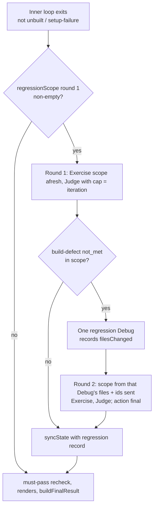
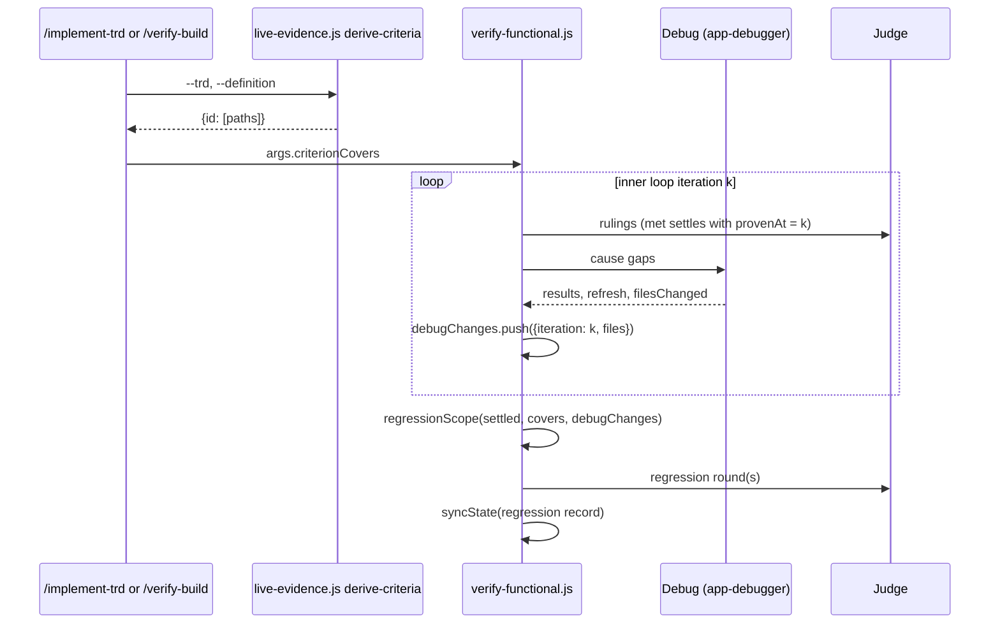

# TRD: One regression pass at the end, scoped by changed files

**Version**: 1.2.0
**Status**: Draft
**Created**: 2026-11-12
**Last Updated**: 2026-11-12
**Author**: @technical-architect
**Source PRD**: `docs/plan/one-full-regression-pass-at-the-end.investigation.md` (workplan `verification-targeted-loop`, roadmap item 3, `docs/plans/verification-targeted-loop/roadmap.md`; GitHub issue FortiumPartners/ensemble-vnext#113). Its objectives come from the PM's instruction of 2026-11-12, quoted in the `/plan` invocation. That instruction is newer than the roadmap's item 3 brief and overrides it on one point: the roadmap re-exercises every criterion at the end, the instruction scopes the pass by changed files and says plainly it is not a literal re-run (NG1).
**Task ID Prefix**: REGR

---

## Changelog

| Version | Date | Changes | Author |
|---------|------|---------|--------|
| 1.0.0 | 2026-11-12 | Initial TRD creation | @technical-architect |
| 1.1.0 | 2026-11-12 | /plan adversarial pass applied: D2 measures `filesChanged` with git (temporary-index tree diff) instead of recall; D5 applies the `k >= p` timing rule to `no-covers`; D8 points check-skill evidence at the round folder; D10 settles a round's evidence gap as `regression-unchecked`, not a definition problem; new D18 (a resumed interrupted run seeds an unknown change record; the exit Judge writes `outcome: null` while a pass is pending). NG6 narrowed; edits by `/verify-build` fix rounds recorded as a follow-up (NG8). | /plan |
| 1.2.0 | 2026-11-12 | /audit-trd findings applied: D14's Not Met wording drops the iteration number nothing records; D5 counts a `met` carried in from a resume snapshot, or one with a non-integer `provenAt`, as proven before this invocation's first change; D9 records the repair Debug's `refresh` in `lastDebugRefresh` so round 2's Judge sees a failed refresh; D8 normalises a claim's artifact path before the prefix test; D2 runs `git diff` with `core.quotePath=false` and treats a quoted path as unknown; REGR-D001's Follow line names CAUSE-D001; F-2 glossed on first use. Could Not Verify: two claims checked and removed. | /audit-trd |

## Objectives

O1–O9 are the investigation's objectives, carried with their wording and their Must pass
marks. O10–O13 come from the constitution or are domain-derived, and say so.

| ID | Objective | Source | Must pass |
|----|-----------|--------|-----------|
| O1 | When the inner loop exits with no build defect left, or at its cap, the verify-functional workflow runs one regression pass that re-exercises and re-judges exactly: (a) every settled-`met` criterion whose recorded covered files changed after its `provenAt`; (b) every member of each cause the inner loop fixed (the members awaiting regression); (c) every settled-`met` criterion with no covers record. | Investigation O1 (PM instruction, 2026-11-12) | yes |
| O2 | A settled-`met` criterion whose covered files did not change after its `provenAt` is not re-exercised or re-judged by the regression pass; its verdict, artifact and `provenAt` stand. | Investigation O2 (PM instruction, 2026-11-12, acceptance) | yes |
| O3 | A criterion met in an early iteration whose covered file a later Debug edit changes is re-checked by the regression pass and, when that edit broke it, is ruled not met (caught) rather than left `met`. | Investigation O3 (PM instruction, 2026-11-12, acceptance) | yes |
| O4 | The regression pass is the proof: for every criterion it re-checked, the verdict, artifact and `provenAt` recorded in `verification-state.json` and the report are the regression pass's, and those are what custody (`packages/core/lib/custody.js`) reads. | Investigation O4 (PM instruction, 2026-11-12) | yes |
| O5 | Build defects the regression pass surfaces, and only those, go back to the inner loop for one Debug round, followed by at most one more scoped regression pass. There is never a third pass. | Investigation O5 (PM instruction, 2026-11-12, acceptance) | yes |
| O6 | Evidence gaps and not-checkable results the regression pass produces are recorded with their kind and reason and are not looped on. | Investigation O6 (PM instruction, 2026-11-12) | |
| O7 | The existing full-deploy gate (`computeFinalRun`, `FULL_RUN_COMMAND`) is unchanged and runs once with the exit, alongside the regression pass. 4.17.5's re-proof retry and scoped re-proof at ship are unchanged and read the regression pass's verdicts. | Investigation O7 (PM instruction, 2026-11-12) | |
| O8 | The report shows the regression pass: which criteria it re-checked and why (covers changed, cause member, no covers), which it caught as broken, and that untouched met criteria were not re-walked. | Investigation O8 (PM instruction, 2026-11-12, acceptance) | |
| O9 | One headless fixture run (`fixtures` environment in `verification.md`) where a fix for one cause breaks an earlier-met criterion produces a report showing the regression pass catching it while untouched met criteria are not re-walked. | Investigation O9 (PM instruction, 2026-11-12, acceptance) | |
| O10 | Tests pass. Unit coverage is at least 60% and integration coverage at least 50% where integration tests apply. These are the constitution's floors and are not exceeded here. | `constitution.md` Quality Gates | |
| O11 | Every new input is validated where it enters: the `criterionCovers` workflow argument, Debug's `filesChanged` return, and the `regression` marker on a resumed `exercised` history. A malformed value fails loudly or falls back to a stated, logged default that widens the regression scope; it is never silently read as "nothing changed". | `constitution.md` Quality Gates ("Input validation present"); the investigation's Decision 2 ("a missing return widens scope, never narrows it") | |
| O12 | Documentation is updated. Sibling TRDs whose decisions this feature changes carry an inline amendment or supersession marker pointing here, and the contract the Judge reads describes the regression pass instead of the confirmation pass. | `constitution.md` Quality Gates ("Documentation updated"); convention `verification-convergence.md` D16 (amend a sibling in place, never fork it) | |
| O13 | State files and report inputs written before this change (an `exercised` history with `confirmation: true` entries, no `regression` keys) still load, resume and render. A report built from an older input is byte-identical to today's. | domain-derived: `.trd-state/` is git-tracked (`CLAUDE.md` and `stack.md` File Structure Reference: "Implementation tracking (git-tracked)"), so state files from earlier releases sit in every project's history and are read by `--resume`, `/verify-build` fix rounds and `/refine-verification`. Same reasoning as `targeted-inner-loop-by-shared-cause.md` O13. | |

## 1. Overview

### 1.1 Technical Summary

Today the workflow's `settled` map (`verify-functional.js` ~:2240) keeps a criterion ruled
`met` in iteration 1 for the rest of the run: `foldRulings` (~:2480) ignores any later Judge
entry for it. A later Debug edit can break it unseen, and custody, anchored after the audit,
never sees those edits either. At exit, F-2's bridge `confirmAwaiting` (~:2666; F-2 is the previous roadmap item, "Targeted inner loop by shared cause", `docs/TRD/targeted-inner-loop-by-shared-cause.md`) re-checks only
the members of closed causes still marked `awaiting: "regression"`.

This feature replaces `confirmAwaiting` with a **regression pass** that runs at exit (every exit
except `exit-unbuilt` and `exit-setup-failure`, the same two exceptions as today) and re-checks a
**scope the script computes from what changed**:

1. **What changed.** Debug returns a new field, `filesChanged`: the repo-relative paths it
   created, modified or deleted in that pass. The script records `{iteration, files}` per Debug
   pass. A pass that returned nothing, no array, or a path the script cannot match records
   `files: null`, which means "unknown" and widens the scope (D2).
2. **What each criterion depends on.** Both commands pass a new 29th argument,
   `criterionCovers` (criterion id → repo-relative covered paths), derived before dispatch by a
   new `live-evidence.js derive-criteria` CLI over the existing `deriveCriterionCovers`, the same
   derivation custody's covers record uses (D3).
3. **The scope** (D5): settled-`met` criteria whose covers a change at or after their `provenAt`
   touched; the members awaiting regression; and settled-`met` criteria with no covers, whenever
   something changed. Criteria outside the scope are not walked, and the report lists them as not
   re-walked (O2, O8).
4. **The proof.** In-scope settled criteria leave `settled`, are exercised afresh (into a
   per-round evidence folder, D8) and judged. A `met` ruling settles again with the regression
   pass's `provenAt` and a `regression` round marker (D7, D11). That is what the state file and
   report hold, and what custody reads (O4).
5. **One repair round.** Build defects the pass surfaces go to one Debug round outside the cap,
   then one more pass scoped against that Debug's own `filesChanged` plus the ids it was sent. The
   second pass's action is final; no third exists (D9, O5).

When no Debug pass in the invocation changed anything and nothing awaits regression, no pass
runs: a run satisfied first time costs nothing extra.

### 1.2 Key Technical Decisions

| ID | Decision | Choice | Serves Objective | Rationale | Alternatives Considered |
|----|----------|--------|------------------|-----------|------------------------|
| D1 | What the end pass re-checks | A scope computed from changed files (D5), not every criterion | O1, O2 | The PM instruction: a literal re-run "would cost about what today's three iterations cost and erase the gain". | Re-exercise every criterion (the roadmap item 3 brief). Rejected by the PM instruction (NG1). Revisit if fixture or field runs show the covers record missing regressions that a full re-run would have caught. |
| D2 | Where "what changed" comes from | `DEBUG_SCHEMA` gains a **required**, nullable `filesChanged: string[] \| null`; the Debug prompt has Debug MEASURE it, not recall it: as its first act it takes a tree id with a temporary index (`GIT_INDEX_FILE=<fresh temp path> git add -A && git write-tree`), as its last act (after the refresh) takes another the same way, and returns `git -c core.quotePath=false diff --name-only <before> <after>` as `filesChanged` (without the flag git prints a non-ASCII path as a double-quoted, octal-escaped string that matches no cover), excluding paths under the run's state folder (`STATE_DIR`) and pages folder (`PAGES_DIR`), which Render agents write concurrently; `null` when either git step fails. This needs no extra agent and catches new and deleted files. The script records `debugChanges: [{iteration, files, regression?}]`, one per Debug pass. It records `files: null` (unknown) when the agent returned nothing, `filesChanged` is absent, not an array, or holds a non-string; and also when any path is absolute, contains a `..` segment, or begins with a double quote (git still quotes a path holding a control character, a backslash or a quote), because the script cannot match it. A leading `./` is stripped. An empty array means "changed nothing". | O1, O3, O11 | The workflow has no shell and cannot run git; Debug already knows what it edited. Unknown widens the scope, never narrows it (investigation Decision 2). | (a) An extra agent per iteration that diffs the tree. Rejected: one more agent per iteration; Debug can run the same two git commands itself. (a2) Debug recalls what it edited. Rejected by the /plan adversarial pass: recall under-reports (TR1), measurement costs nothing. (b) An optional field. Rejected: a required one makes the schema ask on every pass, so an absent value is a malfunction, not a habit. |
| D3 | Where each criterion's covered files come from | New workflow argument `criterionCovers: Record<string, string[]>`, placed directly after `liveEvidence` in both dispatch blocks (29 fields). The commands derive it with `node .claude/lib/live-evidence.js derive-criteria --state-dir <state-dir> --trd <trd> --definition <definitionPath>`, which prints `{id: [paths]}` for every criterion in the definition that maps. `deriveCriterionCovers` accepts `ids: null` meaning every row of the definition's id column. Validated before any agent runs: not a plain object, or a value that is not an array of non-empty strings, throws naming the id. An id not in `criteria` is ignored (under `--criteria` the definition is wider than the subset). An empty array counts as no covers record. Absent means `{}`. A sweep file has no TRD and passes `{}`. A failed derive (non-zero exit) passes `{}` and is named in the command's ISSUES. | O1, O2, O11 | The covers record custody writes after the run (`criterion-covers.json`) is written only for `met` criteria and only after the workflow returns, so it is absent on a first run (investigation Decision 3). `{}` makes every met criterion "no covers", which widens the scope rather than narrowing it. | (a) Read `criterion-covers.json`. Rejected for that reason. (b) Also use the live-evidence artifact covers custody prefers (`custody.js` `affectedIds` ~:477). Rejected: manifest covers are absolute paths with hashes and the workflow cannot resolve paths. Revisit if a fixture shows a criterion proven by a reused `[LIVE]` artifact going un-rechecked. |
| D4 | Matching a changed path to a cover | An inline `coverMatches(cover, path)` in `verify-functional.js` with the exact semantics of `custody.js` `coverMatcher` (~:505): a cover with `* ? [ {` is a glob through an inline copy of `ci-baseline.js` `globToRegex`; otherwise exact match or directory prefix (trailing slashes ignored). `custody.js` exports `coverMatcher` (export only, no behaviour change) so one table-driven parity test runs the same cases through both. | O1, O2 | The workflow has no `require` (investigation Decision 3). A parity test keeps the copies from drifting. | Pass precomputed matches from the command. Rejected: the changed files are not known until Debug runs inside the workflow. |
| D5 | The scope rule | Computed by one pure function `regressionScope` in the script, for a round `r` scored against a set of change records `R`. Round 1's `R` is every in-loop Debug record of this invocation; round 2's is the regression Debug's record (D9). For each criterion in `settled` with status `met` and `provenAt = p`, a record `{iteration: k}` in `R` counts against it when `k >= p` (Debug at iteration k runs after iteration k's Judge). `p` is the iteration at which THIS invocation settled the entry: an entry seeded from `resume.criteria` and not re-settled since, or one whose `provenAt` is not a positive integer, counts as `p = 0` (proven before any change this invocation recorded). A `/verify-build` fix-round run restarts iteration numbering at 1 while carrying `met` entries with their original `provenAt` (`RESUME_ITERATION` is 0, `verify-functional.js` ~:2211-2258), so comparing the raw number would leave a carried criterion out of scope for an edit this invocation made after it; and `1 >= null` is true in JavaScript only by accident. Reasons: **`covers-changed`** (with the matching files) when it has covers and a counting record's files match one; **`changes-unknown`** when a counting record has `files: null`; **`no-covers`** when it has no covers record and a COUNTING record (`k >= p`, as above) has non-empty or unknown files — so a no-covers criterion proven after every change is not re-walked; **`cause-member`** for each id `isAwaiting` (round 1); **`sent-to-debug`** for each id the regression Debug was sent (round 2). One reason per id, first match in that order. The pass runs only when the scope is non-empty. The function also returns `notRewalked` (settled-`met` ids outside the scope) and `unclaimedChanges` (changed files no criterion's covers match). | O1, O2, O3, O8 | One rule for both rounds, deterministic and testable through the harness. `k >= p` is what "changed after its `provenAt`" means in iteration units. | (a) Literal (c): re-check every no-covers criterion whenever a pass runs, even when nothing changed. Rejected: when nothing changed nothing can have broken it, and the investigation's own "a run satisfied first time costs nothing extra" rules that out (OQ-4). (b) Mirror custody's rule that a changed file nobody claims puts every criterion in doubt. Rejected: O2 forbids re-walking a criterion whose covered files did not change. The unclaimed files are listed in the report instead (OQ-6). |
| D6 | What replaces the bridge | `confirmAwaiting` and its call site (~:2865) are replaced by `runRegressionPass(exitResult, iteration, exitPreviousCauses)`, at the same position (after the exit, before `recheckAndReconcile` and the renders). It keeps the bridge's guarantees: the Judge's `decide-next` `cap` is the iteration, so it cannot return `remediate` (a `remediate` that arrives anyway becomes `exit-stuck`); round 1 reuses the exit's `previousGaps`, `causes` and `previousCauses`, so a real stall still reads `stalled`; the false "iteration cap (N)" wording is corrected; and an `exit-stuck` reason names the criteria that still fail and the run's real cap. `confirmedIteration`, the `confirmation` parameters of `buildExercisePrompt` / `buildJudgePrompt` and the `-confirm` file suffix become the regression round (D11). | O1, O4, O5, O7 | F-2 D15 was explicitly a bridge "until the end-of-run pass of the roadmap's third item". One end pass, not two over overlapping sets. | Keep `confirmAwaiting` and add the regression pass after it. Rejected: two end passes, two report inputs, and the awaiting members re-walked twice. |
| D7 | Re-opening a settled `met` | Before a round, each in-scope id is taken out of `settled` and its prior entry is stashed. It is then judged as open. A `met` ruling settles again through `foldRulings` with `provenAt` = the exit iteration and `regression: <round>`. A `not_met` build-defect ruling is a regression: the Judge gives it a cause key (F-2 D1) and it joins the cause map. An in-scope id the Judge returned no entry for is recorded `not_met`, kind `evidence-gap`, reason "the regression pass returned no ruling", and settled (D10). It is never left `met` without a regression ruling. The inner loop is unchanged and stays monotonic; this departs from `verification-convergence.md` D2 ("settled within one invocation") only at exit, and D2 gets an inline amendment (D16). | O3, O4 | O4 makes the pass's verdict the proof, so a re-checked criterion cannot keep an older one. | Keep the earlier `met` when the pass produced no ruling. Rejected: a criterion whose covered file changed would then stand on a proof that predates the change, which is the defect this feature closes. |
| D8 | Fresh evidence | The regression-round Exercise prompt tells each slice to capture every criterion anew into `<evidenceDir>/regression-<round>/` and says an artifact captured earlier in the run predates a fix and does not count. In a regression round the prompt's `Evidence directory:` line names `<evidenceDir>/regression-<round>` and says that `<evidenceDir>` in any embedded check-skill text means that folder, so a check skill's fixed paths (`<evidenceDir>/<skill>/...`) land inside it. The prompt asks for every artifact path written as `<evidenceDir>/regression-<round>/<rest>`, using the folder string exactly as given. Before the Judge, the script normalises each claim's artifact path (a leading `./` is stripped from it and from the folder) and replaces any claim for a criterion that is not judge-only whose path neither starts with `<folder>/` nor, when the folder is relative and the path absolute, contains `/<folder>/`, with a stand-in claim (artifact null, reason "not captured in the regression pass"). This matches the Judge prompt's own rule that an absolute path to the same place counts as inside (`verify-functional.js` ~:779), without a filesystem. | O3, O4 | The checker's freshness floor `since` is the loop start, so an iteration-1 artifact passes it. Reusing that artifact would re-prove a broken criterion, and the pass would catch nothing. A path prefix is a check the script can make without a filesystem. | Trust the exerciser to capture afresh. Rejected for that reason. Revisit if the checker gains a per-round freshness floor. |
| D9 | The one repair round | After round 1, when its action is neither `exit-unbuilt` nor `exit-setup-failure` and it ruled at least one in-scope id `not_met` build-defect, the script dispatches **one** `app-debugger` (same `buildDebugPrompt`, refresh included) outside the cap. It gets one gap per cause key holding such an id, with members restricted to those ids; other open members of the same key stay carried. Its `filesChanged` is recorded as `{iteration: <exit>, files, regression: 1}`. Its `refresh` is recorded in `lastDebugRefresh` exactly as the loop records it (~:2961), so round 2's Judge prompt carries `refreshFailed` and, when the refresh failed, `decide-next` returns `exit-setup-failure` as the final action instead of ruling the caught ids unfixed against the old build (round 2 runs no setup check: `exercisePass` does not call `runSetupCheck`). Its `addressed`, `unbuilt` and `preCheck` fields are logged and gate nothing: round 2 always runs, scoped by D5 against that one record plus `sent-to-debug` for every id sent. Round 2's action is final and is never followed by Debug. A dead regression Debug records `files: null`, so round 2 re-checks every settled `met` (D2). | O5 | The PM instruction: "only those go back to the inner loop, followed by at most one more scoped regression pass; never a third." A fixed structure (two rounds, one Debug) enforces "never a third" without a counter that could drift. | Re-enter the main loop with one more iteration of budget. Rejected: the inner loop would re-walk its own open set and could stall or hit the cap on unrelated causes. |
| D10 | Evidence gaps and not-checkable results from a round | A `not_met` evidence gap ruled in a round (including D7's no-ruling path and a dead slice's stand-ins) is settled at once with its own marker, `settled: "regression-unchecked"` — NOT `definition-problem`, which means "still a gap after its one re-capture" and sends the owner to `/refine-verification` for an owner ruling on the criterion. The marker is added wherever `definition-problem` is treated as settled-not-open (`settledEvidenceIds` in `buildJudgePrompt`, the open-gap test in `applyMustPassRecheck`, the Judge schema's `settled` enum), so `decide-next` does not count it as an open gap; the report renders it in the Regression pass section, not the definition-problems list. A `not-checkable-here` result is re-statused `not_verifiable` as today. Neither is sent to Exercise or Debug again. Neither is counted in `caught`. | O6 | "Recorded, not looped" (PM instruction), without mislabelling a capture failure on a criterion that produced valid evidence earlier in the run as a definition problem (/plan adversarial pass). | (a) Give each its one re-capture in round 2. Rejected: looping, which O6 forbids. (b) Reuse `definition-problem`. Rejected: its readers (`verify-build.md` NEXT, `refine-verification.md` owner rulings, the report's definition-problems list) would act on it. |
| D11 | Numbering and markers | Both rounds keep the exit iteration's number (outside the cap, as F-2's confirmation did). Criteria entries a round ruled and `exercised` history entries carry `regression: 1 \| 2`. The round's report input is `judge-report-input-<n>-regression-<round>.json`; `reportInputFileFor` returns the latest round's file. `confirmation: true` is no longer written. A resumed `exercised` history may hold `confirmation: true` (older files, O13) or `regression: 1 \| 2`; anything else is dropped with a log line, as today. `STATE_KEYS` gains `regression`. | O4, O8, O11, O13 | `provenAt` is an iteration number and custody and the report read it as one (investigation OQ-2). | Number the rounds `<exit>+1`, `<exit>+2`. Rejected: they would read as iterations past the cap, and `iterations` would no longer be the run's budget spent. |
| D12 | The full-environment gate | Unchanged: the exit Judge runs `FULL_RUN_COMMAND` once, as today (`verification-convergence.md` D14), and every regression round's Judge copies the exit's `finalRun`. When a gate command is declared and a regression Debug ran, the report's Regression pass section says the gate ran before that round's edits. | O7 | O7: the gate "runs once with the exit". Saying so in the report keeps a gate that measured pre-fix code from passing unseen. | Re-run the gate on round 2's Judge after a regression Debug. Rejected: O7 and convergence D14 (OQ-3). Revisit if a project with a declared full deploy reports a regression fix that broke the deploy. |
| D13 | Recording the pass | After the last round, the script always runs one `syncState` (exiting): it writes the whole state with a new top-level `regression` record and per-entry `regression` markers, sets the report input's top-level `regression` and per-entry markers, and re-renders the report (`buildStateSyncPrompt` gains the top-level key). Record shape in §3.2. The workflow result gains `regression` (the same record, or `null` when no pass ran) on every return path. `resume` does not forward `regression`. | O4, O8 | The script is the authority on scope and on what was caught; one sonnet agent per run that ran a pass. A run with no pass writes no key and dispatches no agent. | Hand the record to the round's Judge as a literal to copy (F-2 D13). Rejected: `caught` is known only after the ruling. |
| D14 | The report | `renderReport` gains a `## Regression pass` section, rendered only when the input carries `regression`: per round, the ids re-checked with their reason (and files for `covers-changed`), the ids caught, the Debug round's causes and files; then the settled-`met` ids not re-walked and the changed files no criterion covers. A row in the Met table proven by a round reads its `Proven at` as `iteration <n> (regression pass <r>)`. A Not Met row caught by a round adds "caught by the regression pass (was met earlier in the run)". It names no iteration: the prior `provenAt` lives only in the script's stash (D7) and is not in the record, and a carried entry's number belongs to an earlier invocation (D5). | O8, O13 | Gated on the key, so an older input renders byte-identically. | A separate report file. Rejected: the report is the one artifact the owner reads. |
| D15 | Custody | No behaviour change. `custody.test.js` pins that `reconcile --reverified` and `affectedIds` read the regression pass's entries: a criterion the pass caught (`not_met`, `regression: 1`) is refused and its old covers record is not used; one it re-proved is accepted. | O4, O7 | Custody already reads `status` and `artifact` per id from the state file and never reads `provenAt` (`custody.js` ~:450-500, ~:720-733), so making the state file hold the pass's verdicts is the whole change (investigation OQ-1). The re-proof retry runs at `cap: 1` with no Debug, so no regression pass can run inside it and it is unchanged by construction. | Teach custody to read `provenAt`. Rejected: no custody rule needs it. |
| D16 | Sibling documents | Amend in place, per `verification-convergence.md` D16: `targeted-inner-loop-by-shared-cause.md` D15 marked SUPERSEDED by this TRD, and its NG1 marked built here; `functional-verification.md` §3.3 (`criterionCovers`, 29 fields; result `regression`; state key `regression`; `exercised` entry shape), §3.3a (the regression-mode Judge), §3.5 (Debug returns `filesChanged`), §3.6 (the report section); `verification-convergence.md` D2 (a settled `met` can be re-opened once, at exit). The contract (`packages/core/contracts/functional-verification.md`) and `docs/reference/verification.md` describe the regression pass instead of the confirmation pass. | O12 | Convention of this corpus. | Fork new sections. Rejected by D16 of the convergence TRD. |
| D17 | The fixture run | New opt-in scenario `test/smoke/scenarios/verify-regression-pass.sh`, built on the pattern of `verify-inner-loop-causes.sh`: a pre-seeded definition and a fixture TRD whose tasks carry grounding Touches, so `derive-criteria` maps every criterion. A fix for one cause must change a file an earlier-met criterion covers; other met criteria cover only files nothing edits. A live Judge or Debug that does not produce the setup (for example Debug fixes the cause without breaking the earlier criterion) is reported as a named INCONCLUSIVE, not a pass. | O9 | Same approach F-2 took (its D23): the seed fixes which criteria exist, not how a live model behaves. | Seed the broken state directly. Rejected: it would not show a Debug fix being caught. |
| D18 | Interruption | (a) On a resume whose `RESUME_ITERATION >= 1` (an interrupted `--verify --resume` run, whose last iteration was `remediate` and whose last Debug pass is in no record), the script seeds `debugChanges` with `{iteration: RESUME_ITERATION, files: null}`, so every resumed `met` proven at or before it is in round 1's scope as `changes-unknown`. A `/verify-build` fix-round snapshot (`iteration: 0`) seeds nothing (NG8). (b) When `debugChanges` is non-empty at the time an exit Judge prompt is built, that Judge is told to write `outcome: null` to the state file in STEP 4, and D13's sync runs on every such exit (even when the scope turns out empty) to write the real outcome. | O1, O3, O4 | (a) Unknown widens scope (D2's rule); treating "no record" as "nothing changed" contradicts it. (b) An exit Judge writes a non-null outcome before the pass runs; a session that dies in between would leave a finished-looking state holding a `met` the pass would have overturned, which `--resume` will not re-enter and custody would read. | (a) Accept the gap (the former NG6). Rejected: one line closes it. (b) Leave the window. Rejected for the reason given. |

### 1.3 Technology Stack

| Layer | Technology | Purpose | Notes |
|-------|------------|---------|-------|
| Workflow | JavaScript workflow script (`packages/core/workflows/verify-functional.js`) | The loop and the regression pass | No filesystem, shell or `require`; every input arrives in `args` |
| Library | Node.js 18+ (`packages/core/lib/`) | `live-evidence.js` CLI, `functional-verification.js` report, `custody.js` | `stack.md` |
| Tests | Jest ^29.7.0, BATS ^1.9.0 | Unit and harness tests; smoke registration | `stack.md` |

### 1.4 Integration Points

| System | Type | Direction | Notes |
|--------|------|-----------|-------|
| `/implement-trd` §8.3, `/verify-build` §4 | Workflow dispatch | Out | Both pass `criterionCovers` (29 fields) |
| `custody.js` | Reads `verification-state.json` | In | Reads the regression pass's entries; no code change (D15) |
| `/verify-build --criteria` re-proof and its retry | Workflow dispatch at `cap: 1` | Out | Passes `criterionCovers` too; no Debug, so no regression pass runs |

## 2. System Architecture

### 2.1 Exit sequence



### 2.2 Data flow for scope



### 2.3 State

New in-memory state in the script: `debugChanges` (one record per Debug pass in this
invocation, including the regression Debug) and the stash of prior entries for in-scope ids.
On disk: the state file and report input gain the top-level `regression` record and per-entry
`regression` markers; `exercised` entries carry `regression: 1 | 2` instead of
`confirmation: true`. `debugChanges` is not persisted: a resumed invocation scopes only against
its own Debug passes (NG6).

## 3. Technical Specifications

### 3.1 Inputs and Debug return (`verify-functional.js`)

```typescript
interface VerifyFunctionalArgs {
  // ...the 28 existing fields...
  criterionCovers?: Record<string, string[]>; // NEW (D3), after liveEvidence. id -> repo-relative covers.
}

interface DebugReturn {
  refresh: { ran: boolean; exitCode: number | null };
  results: Array<{ cause: string; addressed: boolean; result: string; unbuilt?: boolean;
                   preCheck?: { command: string; exitCode: number | null } }>;
  filesChanged: string[] | null; // NEW (D2), required; null = cannot tell
}

interface DebugChange { iteration: number; files: string[] | null; regression?: 1 }
```

**Validation** (before any agent runs): `criterionCovers` that is not a plain object, or has a
value that is not an array of non-empty strings, throws
`verify-functional: args.criterionCovers[<id>] must be an array of non-empty path strings`.

### 3.2 The regression record

```typescript
interface RegressionRecord {
  rounds: Array<{
    round: 1 | 2;
    iteration: number;  // the exit iteration; both rounds keep it (D11)
    scope: Array<{ id: string;
                   reason: 'covers-changed' | 'changes-unknown' | 'cause-member' | 'no-covers' | 'sent-to-debug';
                   files?: string[] }>;   // files: covers-changed only
    caught: string[];   // in-scope ids ruled not_met build-defect in this round
    debug?: { causes: string[]; filesChanged: string[] | null }; // round 1, when the repair round ran
  }>;
  notRewalked: string[];       // settled-met ids no round re-checked
  unclaimedChanges: string[];  // changed files no criterion's covers match
  gateBeforeEdits: boolean;    // D12: a gate command is declared and a regression Debug ran after it
}
```

It sits at the top level of `verification-state.json`, of the last round's report input, and
of the workflow result (`null` when no pass ran).

### 3.3 Behaviour

- **No pass** on `exit-unbuilt` or `exit-setup-failure`, or when round 1's scope is empty.
- **Round 1** exercises the scope through `exercisePass` (lane slicing, batching and dead-slice
  handling unchanged) with the D8 prompt, applies the D8 claim filter, then one Judge in
  regression mode: `decide-next` `cap` = iteration; `previousGaps`, `causes` and `previousCauses`
  as at the exit; `gaps` = the exit's gaps outside the scope plus the Judge's own `not_met`
  rulings; `awaitingRegression: []`; the Judge assigns a cause key to each `not_met`
  build-defect ruling (today's confirmation branch says the opposite, "adding no cause key",
  `verify-functional.js` ~:823; the regression branch replaces that sentence); `recaptureIds` = the whole scope (D10); `finalRun` copied from the exit
  (D12). Then `reconcileJudgeKinds`, `foldRulings`, `refreshCauseMap`.
- **Repair round** per D9. **Round 2** as round 1, with `previousGaps` = round 1's gaps.
- **Final action**: the last round's action replaces the exit's. `remediate` becomes
  `exit-stuck`. An `exit-stuck` reason is rewritten to name the criteria the pass caught that
  still fail and the run's real cap. The false "iteration cap (<exit>)" wording is corrected on
  any other action.
- **Then** D13's sync, and the existing must-pass recheck, renders and `buildFinalResult`.

**Error handling**:
- Exercise slice dead: its in-scope ids get the existing "exerciser returned nothing" stand-in
  claim, the Judge rules them, and D10 settles them as evidence gaps.
- Judge returns nothing: the round's Judge goes through `required()`, as the loop's does.
- Sync agent returns nothing: logged, as `syncState` does today.

## 4. Master Task List

### 4.1 Task ID Convention

`REGR-[CATEGORY][SEQ]`: B backend (lib, workflow, command prose), D documentation, T testing
(`[LIVE]` fixture run).

### 4.2 Phase 1: Library

| Task ID | Description | Serves | Skills | Dependencies | Acceptance Criteria |
|---------|-------------|--------|--------|--------------|---------------------|
| REGR-B001 | `live-evidence.js`: `deriveCriterionCovers` accepts `ids: null` meaning every id in the definition's id column; new CLI subcommand `derive-criteria --state-dir D --trd T --definition P` prints `{id: [paths]}` (covers only, no `source`) for every criterion that maps; usage line updated. Mirror to `.claude/lib/`. | D3, O11 | `jest` | None | `npx jest packages/core/lib/live-evidence.test.js`: (1) `derive-criteria` on a fixture TRD and definition prints a map with one entry per mappable criterion, including ones not `met` anywhere; (2) a criterion that maps to nothing is absent; (3) a missing `--trd` or an unreadable TRD exits 2 with a message; (4) `ids: []` still returns an empty map (existing behaviour). Mirror parity passes. |
| REGR-B002 | `functional-verification.js` `renderReport`: the `## Regression pass` section and the `Proven at` / Not Met row wording (D14), from the record in §3.2. Mirror. | D14, O8, O13 | `jest` | None | `npx jest packages/core/lib/functional-verification.test.js`: (1) an input with a two-round record renders each round's scope with reasons, the caught ids, the repair round's causes and files, the not-re-walked ids and the unclaimed files; (2) `gateBeforeEdits: true` renders the D12 sentence; (3) a met row with `regression: 1` reads `iteration <n> (regression pass 1)`; (4) an input with no `regression` key renders byte-identically to a fixture rendered before this change; (5) an entry settled `regression-unchecked` is listed in the Regression pass section as a capture the pass could not make, and not in the definition-problems list (D10). |
| REGR-B003 | `custody.js`: export `coverMatcher` (no behaviour change). `custody.test.js`: a reverified state written in the regression pass's shape (one id `met` at iteration 1 then caught, `not_met` with `regression: 1`; one re-proven `met` with `provenAt` = the exit iteration and `regression: 1`). | D4, D15, O4, O7 | `jest` | None | `npx jest packages/core/lib/custody.test.js`: (1) `reconcile --reverified` refuses, naming the caught id; (2) with the caught id fixed to `met` by a round-2 entry, it moves; (3) `affectedIds` treats the caught id as not proven, so its old `criterion-covers.json` record is not used; (4) existing custody tests pass unchanged. |

### 4.3 Phase 2: Workflow

Both tasks edit `verify-functional.js`, its test and its mirror, so they run one after the
other. They stay split for **size** (a 3,029-line file and a 4,596-line test) and
**verifiability**: B004 is proven by round 1 alone (O1–O4), B005 by the repair round and the
record (O5, O6, O8).

| Task ID | Description | Serves | Skills | Dependencies | Acceptance Criteria |
|---------|-------------|--------|--------|--------------|---------------------|
| REGR-B004 | Inputs, scope and round 1. `criterionCovers` read and validated (D3); `filesChanged` in `DEBUG_SCHEMA` and `buildDebugPrompt`, and `debugChanges` recorded per in-loop Debug pass with the D2 normalisation; inline `coverMatches` + `globToRegex` (D4); `regressionScope` (D5); `confirmAwaiting` replaced by round 1 of `runRegressionPass` (D6, D7, D8, D10, D11 for round 1), with `confirmation` renamed to the regression round in both prompt builders, the `-regression-1` file suffix and `reportInputFileFor`. Rewrite F-2's "D15: the confirmation pass" tests (~:4484) to the regression pass and keep each guarantee they pin; update the resume `exercised` validation test (~:4169) to accept `regression: 1 \| 2` and still accept `confirmation: true`. Amend `docs/TRD/functional-verification.md` §3.3 `VerifyFunctionalArgs` with `criterionCovers`, and move `verify-functional-trd-sync.test.js`'s count from 28 to 29. Mirror to `.claude/workflows/`. | D2, D3, D4, D5, D6, D7, D8, D10, D11, D18, O1, O2, O3, O4, O6, O11, O13 | `jest` | REGR-B003 | `npx jest packages/core/workflows/verify-functional.test.js packages/core/workflows/verify-functional-trd-sync.test.js`: (1) a criterion `met` at iteration 1 whose covered file iteration 1's Debug lists in `filesChanged` is in round 1's Exercise prompt and Judge; ruled `not_met` there, it ends `not_met` in the result and the synced state (O3). (2) A `met` criterion whose covers no Debug record touches appears in no round-1 prompt and keeps its artifact and `provenAt` (O2). (3) A `met` criterion with no `criterionCovers` entry is re-checked when a Debug pass changed any file, and not when every Debug pass returned `[]` (O1c). (4) A Debug pass that returned nothing, omitted `filesChanged`, or listed an absolute path puts every `met` proven at or before it in scope with reason `changes-unknown`. (5) A criterion proven at iteration 2 is not in scope for a Debug change recorded at iteration 1. (6) Awaiting members are in round 1 with `cause-member` (O1b), and no pass runs when no Debug changed anything and nothing awaits. (7) A re-proven criterion's entry has `provenAt` = the exit iteration and `regression: 1` (O4). (8) A claim whose artifact is outside `<evidenceDir>/regression-1/` reaches the Judge as a stand-in; a claim written `./<evidenceDir>/regression-1/x.png`, or as an absolute path containing `/<evidenceDir>/regression-1/` when `evidenceDir` is relative, reaches it unchanged (D8). (9) A round-1 evidence gap is settled, not re-exercised (O6). (10) Parity: a table of directory, trailing-slash, exact and glob covers (`*`, `**`, `{a,b}`) gives the same match through the inline matcher (via scope) and `custody.js` `coverMatcher`. (11) `criterionCovers` malformed throws naming the id; an id not in `criteria` is ignored. (12) The F-2 guarantees still hold: no Debug in round 1 when nothing regressed, `cap` = iteration, gate command absent from regression prompts, `exit-stuck` names the failing ids and the real cap, no pass on `exit-unbuilt` / `exit-setup-failure`. (13) Mirror parity and the trd-sync count of 29 pass. (14) The Debug prompt instructs the temporary-index `git write-tree` before and after and `git -c core.quotePath=false diff --name-only` between them, excluding the state and pages folders; a returned path beginning with a double quote records `files: null` (D2). (15) A no-covers `met` proven at iteration 2, with Debug changes recorded only at iteration 1, is not in round 1 (D5). (16) A `check:verify-flow-as-built` criterion whose claim artifact is under `<evidenceDir>/regression-1/verify-flow-as-built/` reaches the Judge unchanged, and the round-1 Exercise prompt's evidence-directory line names `regression-1` (D8). (17) A round-1 evidence gap is settled `regression-unchecked`, not `definition-problem`, and is not an open gap for `applyMustPassRecheck` (D10). (18) A resume with `iteration >= 1` puts every resumed `met` in round 1 as `changes-unknown`; a resume with `iteration: 0` seeds nothing (D18a). (19) When a Debug pass ran, the exit Judge prompt tells it to write `outcome: null`, and the sync runs even when the scope is empty (D18b). (20) A fix-round resume (`iteration: 0`) carrying a `met` with `provenAt: 2` whose covered file this invocation's iteration-1 Debug changes is in round 1 as `covers-changed`; a carried `met` with `provenAt: null` is treated the same way, by rule rather than by `1 >= null` (D5). |
| REGR-B005 | Repair round, round 2, record. The D9 Debug round and round 2 (`-regression-2` suffix, `previousGaps` = round 1's gaps, final action); the `regression` record (§3.2) with `notRewalked`, `unclaimedChanges` and `gateBeforeEdits`; the D13 sync (`buildStateSyncPrompt` sets the top-level `regression` key and per-entry markers); `STATE_KEYS` gains `regression`; the result's `regression` on every return path (`null` where no pass ran). Amend `functional-verification.md` §3.3 `VerifyFunctionalResult` with `regression` so the trd-sync result test passes. Mirror. | D9, D11, D12, D13, O4, O5, O6, O8 | `jest` | REGR-B004 | `npx jest packages/core/workflows/verify-functional.test.js packages/core/workflows/verify-functional-trd-sync.test.js`: (1) a round-1 regression dispatches exactly one `app-debugger` whose gaps hold only the caught ids, then exactly one more Exercise and Judge; a round-2 failure dispatches no further Debug, Exercise or Judge (O5: never a third). (2) Round 2's scope is the regression Debug's `filesChanged` matches plus every id sent; a `met` criterion untouched by that Debug is not re-walked. (3) A dead regression Debug puts every settled `met` in round 2's scope. (4) An evidence gap or not-checkable ruling in round 1 is not sent to the Debug round or to round 2 (O6). (5) The final state-sync prompt carries a `regression` record whose rounds, reasons, `caught`, `notRewalked` and `unclaimedChanges` match the stubbed run, and the result carries the same record; a run with no pass carries `regression: null` and dispatches no sync for it (O8). (6) `gateBeforeEdits` is true only when `fullRunCommand` is non-empty and the repair round ran; no regression Judge prompt carries the gate command (O7). (7) `exercised` holds `regression: 1` and `regression: 2` entries at the exit iteration. (8) Mirror parity and the trd-sync result test pass. (9) A repair Debug returning `refresh: {ran: true, exitCode: 1}` puts `"refreshFailed":true` in round 2's Judge prompt, and that round's `exit-setup-failure` is the run's final action (D9). |

### 4.4 Phase 3: Commands and documentation

| Task ID | Description | Serves | Skills | Dependencies | Acceptance Criteria |
|---------|-------------|--------|--------|--------------|---------------------|
| REGR-B006 | Commands: `implement-trd.md` §8.3 and `verify-build.md` §4 add `criterionCovers` after `liveEvidence` with its derive step (`derive-criteria`; `{}` for a sweep file; `{}` plus an ISSUES line on a non-zero exit) — 29 fields; `verify-build.md` "All 28 fields" and "the list stays the 28 fields" become 29, and the `--criteria` retry's "same 28 fields" becomes 29; `implement-trd.md` ~:1723 names the `exercised` entry shape `{ iteration, ids, confirmation?, regression? }`. Mirror to `.claude/commands/`. Update `verify-command-surface.test.js` and `verify-build-criteria.test.js` to 29. | D3, D11, O1, O11 | `jest` | REGR-B001, REGR-B004 | `npx jest packages/core/commands/verify-command-surface.test.js packages/core/commands/verify-build-criteria.test.js`: (1) both dispatch blocks list the same 29 fields in the same order, `criterionCovers` directly after `liveEvidence`, the last seven unchanged; (2) both name the `derive-criteria` command, the sweep-file `{}` and the failure fallback; (3) command mirror tests pass. |
| REGR-D001 | Documentation (D16): the contract's "`awaiting`" and "When a cause closes" paragraphs describe the regression pass (scope reasons, fresh capture, one repair round) instead of the confirmation pass, keeping the `` `awaiting: "regression"` `` text the contract test pins; mirror. Inline markers with changelog rows: `targeted-inner-loop-by-shared-cause.md` D15 SUPERSEDED and NG1 built here; `functional-verification.md` §3.3 state keys paragraph and `exercised` shape, §3.3a, §3.5, §3.6; `verification-convergence.md` D2. `docs/reference/verification.md` ~:307 paragraph. | D16, O12 | | REGR-B005 | (1) `npx jest packages/core/contracts/functional-verification.test.js` passes. (2) No remaining sentence in the contract or `docs/reference/verification.md` describes a "confirmation pass" as current behaviour. (3) Each amended sibling decision carries a marker naming this TRD and keeps its original wording. |

### 4.5 Phase 4: Assembled-feature verification

| Task ID | Description | Serves | Skills | Dependencies | Acceptance Criteria |
|---------|-------------|--------|--------|--------------|---------------------|
| REGR-T001 [LIVE] | Add `test/smoke/scenarios/verify-regression-pass.sh` (D17); register it in `test/smoke/run-smoke.sh` (`LLM_OPT_IN_SCENARIOS` and a `SCENARIO_TIMEOUT` entry) and `test/smoke/README.md` (table row and tree line). In `verify-inner-loop-causes.sh`, exclude `regression` entries wherever it excludes `confirmation` entries (~:313-328). Run the new scenario once in a `fixtures` slot; record the report, state file and transcript under `.trd-state/one-full-regression-pass-at-the-end/evidence/live/REGR-T001/` and in `live-manifest.jsonl`. | O9, D17 | | REGR-B002, REGR-B005, REGR-B006, REGR-D001 | (1) `bats test/integration/tests/smoke-registration.test.sh` passes. (2) In the recorded state, the earlier-met criterion appears in the `regression: 1` `exercised` entry with reason `covers-changed` and in `regression.rounds[0].caught`. (3) The untouched met criteria appear in no `regression` `exercised` entry and are listed in `regression.notRewalked`. (4) There are at most two `regression` `exercised` entries. (5) The rendered report's `## Regression pass` section shows the catch and the not-re-walked ids. A run where the live model does not produce the setup is a named INCONCLUSIVE, recorded with its evidence. |
| AMEND-001 | Add a Jest case proving the regression pass runs when the Judge exits at the iteration-cap iteration (FS-1): journey(reproven,{args:{cap:2},middle:exitWith("exit-stuck",[bd("FS-3","k")],{gaps:["FS-3"]}),files:["src/a.js"]}); assert 3 Judge calls, first regression exercise ["FS-1"] reason covers-changed, regression.rounds[0]={round:1,iteration:2} (full instruction: verification-plan.md Owner ruling (`packages/core/workflows/verify-functional.test.js`) — promoted from a gap discovery found by verify-build --fix [plan:R1 @ 2026-11-12T11:47:00.000Z] | plan blocker R1 |  | None | Add a Jest case proving the regression pass runs when the Judge exits at the iteration-cap iteration (FS-1): journey(reproven,{args:{cap:2},middle:exitWith("exit-stuck",[bd("FS-3","k")],{gaps:["FS-3"]}),files:["src/a.js"]}); assert 3 Judge calls, first regression exercise ["FS-1"] reason covers-changed, regression.rounds[0]={round:1,iteration:2} (full instruction: verification-plan.md Owner ruling no longer holds |
| AMEND-002 | Add a custody test (FS-12) in describe("a state written by the regression pass..."): give the FS-2 regression entry a real artifact recorded with liveEvidence.record covering src/c.js, commit src/c.js, assert reconcile returns reverify ["FS-2"] and reuses ["FS-1"] (full instruction: verification-plan.md Owner rulings R2) (`packages/core/lib/custody.test.js`) — promoted from a gap discovery found by verify-build --fix [plan:R2 @ 2026-11-12T11:47:00.000Z] | plan blocker R2 |  | None | Add a custody test (FS-12) in describe("a state written by the regression pass..."): give the FS-2 regression entry a real artifact recorded with liveEvidence.record covering src/c.js, commit src/c.js, assert reconcile returns reverify ["FS-2"] and reuses ["FS-1"] (full instruction: verification-plan.md Owner rulings R2) no longer holds |
| AMEND-003 | Rework the FS-19 live smoke scenario: remove FROZEN markers; point FR-1/RGX-001 at shared formatter fmt in format.js (two decimals); restate FS-2 as receipt.line(12345).length <= 8; replace the frozen-file check with a named INCONCLUSIVE when invoice.js changed but format.js did not; covers mapping unchanged (full instruction: verification-plan.md Owner rulings R3) (`test/smoke/scenarios/verify-regression-pass.sh`) — promoted from a gap discovery found by verify-build --fix [plan:R3 @ 2026-11-12T11:47:00.000Z] | plan blocker R3 |  | None | Rework the FS-19 live smoke scenario: remove FROZEN markers; point FR-1/RGX-001 at shared formatter fmt in format.js (two decimals); restate FS-2 as receipt.line(12345).length <= 8; replace the frozen-file check with a named INCONCLUSIVE when invoice.js changed but format.js did not; covers mapping unchanged (full instruction: verification-plan.md Owner rulings R3) no longer holds |
| AMEND-004 | [defect] REGR-T001/AMEND-003: test/smoke/README.md verify-regression-pass row still lists "edits a frozen file" as an INCONCLUSIVE case; reword it to the scenario's current cases (invoice.js or receipt.js changed but format.js did not; format.js unchanged) — promoted from a gap discovery found by audit-build — find and fix every instance of this weakness across the feature's touched files, and list each one fixed (observed: test/smoke/README.md:48; test/smoke/scenarios/verify-regression-pass.sh:345,350 (no frozen check)) | amendment — no objective recorded |  | None | [defect] REGR-T001/AMEND-003: test/smoke/README.md verify-regression-pass row still lists "edits a frozen file" as an INCONCLUSIVE case; reword it to the scenario's current cases (invoice.js or receipt.js changed but format.js did not; format.js unchanged) no longer holds |
| AMEND-005 | [test-gap] REGR-B006 acceptance check 2: add assertions to packages/core/commands/verify-command-surface.test.js and verify-build-criteria.test.js that implement-trd.md and verify-build.md name the derive-criteria command, pass {} for a sweep file, and fall back to {} (with an ISSUES line) on a non-zero exit — promoted from a gap discovery found by audit-build — find and fix every instance of this weakness across the feature's touched files, and list each one fixed (observed: implement-trd.md:1936-1947, verify-build.md:300-305 state all three; the two tests pin only field order/count (:268, :79)) | amendment — no objective recorded |  | None | [test-gap] REGR-B006 acceptance check 2: add assertions to packages/core/commands/verify-command-surface.test.js and verify-build-criteria.test.js that implement-trd.md and verify-build.md name the derive-criteria command, pass {} for a sweep file, and fall back to {} (with an ISSUES line) on a non-zero exit no longer holds |

## 5. Execution Plan

### 5.1 Phase Overview

| Phase | Focus | Prerequisites | Parallelizable Sessions |
|-------|-------|---------------|------------------------|
| 1 | Library: covers CLI, report, custody pin (each task ships its unit tests) | None | 1A, 1B, 1C in parallel |
| 2 | Workflow: round 1, then repair round and record | REGR-B003 | Serial (one file) |
| 3 | Commands; documentation | Phase 2 (B006 also needs B001) | 3A and 3B in parallel |
| 4 | `[LIVE]` fixture run | Phase 3 | 4A alone |

### 5.2 Session Details

- **1A**: REGR-B001, @backend-implementer. **1B**: REGR-B002, @backend-implementer. **1C**:
  REGR-B003, @backend-implementer. No shared files.
- **2A**: REGR-B004 → REGR-B005, @backend-implementer, in order.
- **3A**: REGR-B006, @backend-implementer. **3B**: REGR-D001, @backend-implementer.
  `functional-verification.md` is edited by B004, B005 and D001; the dependency chain already
  serializes them.
- **4A**: REGR-T001, @verify-app. No deploy: the fixture is scaffolded from the working tree.

### 5.3 Parallelization Map

```mermaid
gantt
    title Execution Plan (No time scale - dependency order only)
    dateFormat X
    axisFormat %s
    section Phase 1
    REGR-B001: b1, 0, 1
    REGR-B002: b2, 0, 1
    REGR-B003: b3, 0, 1
    section Phase 2
    REGR-B004: b4, after b3, 1
    REGR-B005: b5, after b4, 1
    section Phase 3
    REGR-B006: b6, after b1 b4, 1
    REGR-D001: d1, after b5, 1
    section Phase 4
    REGR-T001: t1, after b2 b5 b6 d1, 1
```



### 5.4 Critical Path

REGR-B003 → REGR-B004 → REGR-B005 → REGR-D001 → REGR-T001.

## 6. Quality Requirements

### 6.1 Testing Requirements

| Type | Coverage Target | Source | Scope |
|------|-----------------|--------|-------|
| Unit Tests | ≥ 60% | `constitution.md` Quality Gates | Changed lib functions; workflow behaviour through `test-harness.js` |
| Integration Tests | ≥ 50% when applicable | `constitution.md` Quality Gates | Workflow-harness suites, command pin tests, smoke registration |

End-to-end: REGR-T001 is the single `[LIVE]` walk (O9). The PM's acceptance command,
`npx jest packages/core/workflows/verify-functional.test.js packages/core/lib/custody.test.js`,
covers REGR-B003–B005; the full set is that plus
`packages/core/lib/live-evidence.test.js`, `packages/core/lib/functional-verification.test.js`,
`packages/core/workflows/verify-functional-trd-sync.test.js`,
`packages/core/commands/verify-command-surface.test.js`,
`packages/core/commands/verify-build-criteria.test.js`,
`packages/core/contracts/functional-verification.test.js` and
`bats test/integration/tests/smoke-registration.test.sh`.

### 6.2 Code Quality Standards

None beyond the constitution's quality gates (O10–O12).

### 6.3 Security Requirements

None. The feature handles no credentials, personal data, payments or tenancy. `filesChanged`
paths are only compared as strings against covers; nothing reads or writes them.

## 7. Risk Assessment

### 7.1 Risks Imported from PRD

The investigation names one hazard: a Debug agent under-reporting `filesChanged` (Decision 2),
carried as TR1. Its grounding also names the size of `verify-functional.js` and the F-2 tests
that must be updated, not deleted, carried as TR3.

### 7.2 Technical Risks

| ID | Risk | Likelihood | Impact | Mitigation |
|----|------|------------|--------|------------|
| TR1 | Debug edits a file and returns `filesChanged: []`, so a criterion it broke is not re-checked. | Low | High | The field is required and measured with a git tree diff, not recalled; `null` when git fails (D2). Custody still re-proves must-pass criteria at ship against what the merge changed. Residual; the fixture run (REGR-T001) is the first live measurement. |
| TR2 | Covers under-cover: Touches list what a task planned to edit, not everything a criterion depends on, so a criterion that depends on a changed file it does not list is not re-checked. | Med | Med | `unclaimedChanges` in the report shows each changed file no criterion covers (D5, D14); OQ-6 asks whether to widen instead. |
| TR3 | `verify-functional.js` is 3,029 lines and its test 4,596. F-2's confirmation tests (~:4484) pin guarantees that carry over. | High | Low | REGR-B004 AC 12 requires those guarantees to keep their tests. Split B004/B005 for size. |
| TR4 | The exerciser writes its fresh capture outside `regression-<round>/` and every claim becomes a stand-in, so the pass records evidence gaps instead of verdicts. | Low | Med | The prompt names the folder explicitly; harness test (B004 AC 8). The stand-ins are visible as evidence gaps in the report, not as passes. |

### 7.3 Contingency Plans

**TR1 Contingency**: if fixture or field runs show regressions missed because `filesChanged`
under-reports, switch D2 to treat any Debug pass that `addressed` a cause and returned `[]` as
unknown. That widens scope and needs a `/refine-trd` decision.

## 8. Non-Goals (Scope Boundaries)

| PRD ID | Non-Goal | Rationale |
|--------|----------|-----------|
| NG1 | A literal re-run of every criterion at the end | The roadmap item 3 brief did this. The PM instruction of 2026-11-12 overrides it: "about what today's three iterations cost" (investigation header) |
| NG2 | Roadmap items 4–6: accepted gaps for not-checkable must-pass criteria, materiality, follow-up ranking | To come, built separately (investigation header) |
| NG3 | Changing the full-deploy gate, the 4.17.5 re-proof retry, scoped re-proof at ship or custody's rules | Kept as shipped (roadmap fence; PM instruction; O7) |
| NG4 | The `custody.test.js` flake on all-digit commit hashes | Investigation "not absorbed": a separate fix |
| NG5 | Re-checking a criterion because a file no criterion covers changed | O2; listed in the report instead (D5, OQ-6) |
| NG6 | Knowing WHICH files an earlier, interrupted invocation's last Debug pass changed | Not recorded anywhere; D18(a) treats it as unknown, which widens the scope instead |
| NG8 | Edits `/verify-build`'s fix rounds make between workflow runs (`/implement-trd --reconcile --chained`, then a new run carrying `met` entries forward with their original `provenAt`, `verify-build.md` ~:632-648) | Outside the workflow and outside this feature's mechanism (Debug edits within a run). Follow-up: have the fix loop drop from its resume snapshot every `met` entry whose covers the round's `git diff` touches (/plan adversarial pass, Finding 1) |
| NG7 | Editing `.claude/rules/verification.md`, `constitution.md` or `stack.md` | Owner-governed (`CLAUDE.md` Approval Requirements). The O9 fixture writes its own `verification.md` inside its slot |

## Verification Artifacts

None apply — this change has no UI design, no interaction diagram, and renders no data from
an API or store: it changes the verification loop's own workflow, library and commands.

## Verification Environment

**Environment**: local, for every criterion except O9. O9 uses `fixtures` (REGR-T001).
**Refresh**: local: none declared. fixtures: `packages/core/scripts/scaffold-project.sh --refresh --plugin-dir packages/full <slot folder>`.
**Cannot be checked there**: `claude --remote` sessions and failures that occur only on the GitHub Actions runner (`verification.md` §5). This feature adds none.

## 9. Task Grounding

### REGR-B001
- **Touches:** `packages/core/lib/live-evidence.js`, `packages/core/lib/live-evidence.test.js`, `.claude/lib/live-evidence.js` (mirror; byte-identical today [ran: `diff -q` silent]). `packages/full/lib/live-evidence.js` is a symlink to `../../core/lib/live-evidence.js` [read], so it needs no copy.
- **Reuse:** `deriveCriterionCovers` (`function deriveCriterionCovers({ trdPath, definitionPath, ids, cwd })`, live-evidence.js:259) [read] is the one derivation; the CLI and `record-criteria` both call it, do not write a second. `parseFlags` (:342) and `main(argv, out, err)` (:353) for the subcommand and its exit-2 path [read]. In the tests, the `describe('criterion covers')` fixtures (`TRD`, `DEF` with C-1..C-4, the `derive(ids)` helper, and the `process.chdir(dir)` pattern of the `record-criteria` CLI test) [read].
- **Replaces:** nothing becomes unreachable. One semantic changes: `ids` null/undefined used to mean "none" (`const want = new Set(ids || [])` then `if (want.size === 0) return result`, :260-261) and will mean "every row of the id column"; `ids: []` must still return an empty map. The only existing call site passes an array (`ids: met`, :363) [read; grep shows no other caller in `packages/` or `.claude/` outside the mirror].
- **Follow:** the `record-criteria` branch of `main` (:358-367): flag check that throws a plain `Error` (turned into exit 2 by the catch at the bottom of `main`), result written as one JSON line to `out`.
- **Careful:** (1) `if (!f['state-dir']) throw new Error('--state-dir is required')` (:357) runs before any subcommand, so `derive-criteria` keeps requiring `--state-dir` even though it never uses it; the TRD's command line already passes it. [read] (2) The task-row fallback (`backtickedExistingPaths`) tests files against `cwd` = `process.cwd()`, so the command must run from the project root and the tests must `chdir` as the existing CLI test does. [read] (3) The early return and the `if (!want.has(id)) continue` (:281) both need the null case; do not turn `ids: []` into "all". (4) Output is `{id: covers}` only, no `source`; a definition with no `id` column table returns an empty map, not an error (`if (!table) return result`). (5) Update the header usage comment (:22-30) and the `usage:` string (:393). (6) No other task in the roster touches these files; REGR-B006 only consumes the CLI by name.

### REGR-B002
- **Touches:** `packages/core/lib/functional-verification.js`, `packages/core/lib/functional-verification.test.js`, `.claude/lib/functional-verification.js` (mirror; byte-identical, pinned by `describe('mirror parity')` at functional-verification.test.js:2443) [read]. `packages/full/lib` is a symlink farm, no copy.
- **Reuse:** `renderReport(input)` (:1294) and its helpers `escapeCell`, `KIND_LABEL`, `kindOf`; the gate idiom already used for `kindGate` and `causeRows` (`Array.isArray(input.causes)`) so an older input renders byte-identically [read]. The `## Met` row loop (:1581-1600, `Proven at` column from `c.provenAt`) and the `## Not Met` row loop (:1603-1631) are where the wording goes. Test fixtures: `input()` / `crit()` in `describe('renderReport: the must-pass line and outcome (D13)')` and the causes D19 test (functional-verification.test.js:3175) [read].
- **Replaces:** nothing. The existing `awaitingMark` text ("awaiting the regression pass, not re-checked", :1330) stays correct for the two exits that run no pass.
- **Follow:** causes D19 (`## Causes` section, gated on the input key, test asserts equality with the key-less rendering).
- **Careful:** (1) Place `## Regression pass` before `## Evidence gaps (definition problems)` and `## Evidence`: `## Evidence` is the report's last section because `/verify-build` step 6 appends `## Fix run` after it and `report-publish-plan` scans lines under it (:1627-1649) [read]. (2) The report input is hand-composed by the Judge and sync agents and is not covered by `JUDGE_SCHEMA` (comment at :1305-1313), so treat `regression.rounds`, `scope`, `caught` as untrusted: tolerate non-arrays, run every id/file/reason through `escapeCell`. (3) A non-regression `Proven at` cell must stay the bare number. (4) D14's Not Met wording is "caught by the regression pass (was met earlier in the run)", with no iteration number: the §3.2 record (`caught: string[]`, scope items `{id, reason, files?}`) and an open `not_met` entry (its `provenAt` is `null`, `stateEntryOf`) carry none (resolved in 1.2.0). (5) No other roster task edits these files; REGR-B005 writes the record this renders but only declares it through the workflow.

### REGR-B003
- **Touches:** `packages/core/lib/custody.js`, `packages/core/lib/custody.test.js`, `.claude/lib/custody.js` (mirror, byte-identical today [ran: `diff -q` silent]).
- **Reuse:** `function coverMatcher(cover)` (custody.js:505) already has the exact semantics REGR-B004's parity test needs; export it, add no second copy in `lib/`. The `reconcile` describe `'with a success definition'` (custody.test.js:288) with its `withDefinition()` and `reverified(s, status)` helpers, and the test at :334 (`a manifest whose covered file changed: reverify; --reverified met moves, not met is refused`), are the pattern to extend [read].
- **Replaces:** nothing. `module.exports` is `{ reconcile, check, detach, classifyPath, resolveCommit, compare, main }` (:890); add `coverMatcher` only.
- **Follow:** the :334 test (liveEvidence.record + `s.commit` + `reconcile(s.args({ reverifiedPath }))`).
- **Careful:** (1) `affectedIds` is not exported, so this task's acceptance check (3) ("`affectedIds` treats the caught id as not proven") can only be shown through `reconcile`. [read] (2) `coversOf` in `affectedIds` prefers live-evidence manifest covers keyed by the state entry's `artifact` regardless of status (`const coversOf`, :477), and only falls back to `criterion-covers.json` when the id is `met`. A caught fixture whose `artifact` still names a manifest-recorded file would be matched by covers, not by "not proven", so the caught entry must carry `artifact: null` or a path outside the manifest. [read] (3) Custody never reads `provenAt` (grep of custody.js: no hit), and `--reverified` reads only `criteria[].id` and `.status` (`const statusOf`, :727) [read], so AC 1 and 2 pin status handling, and AC 3 is the only test here that reads the regression-shaped `verification-state.json`. (4) The unclaimed-path guard (`shipped.some(p => !allMatchers.some(...))`) puts everything in doubt, so AC 3's changed file must be claimed by another id's covers or the caught/old-record distinction is masked. (5) The `custody.test.js` all-digit-hash flake (NG4) is out of scope. No roster task shares these files.

### REGR-B004
- **Touches:** `packages/core/workflows/verify-functional.js`, `packages/core/workflows/verify-functional.test.js`, `packages/core/workflows/verify-functional-trd-sync.test.js` (count 28 to 29, :70), `docs/TRD/functional-verification.md` (§3.3 `interface VerifyFunctionalArgs {`, :549; add `criterionCovers?` after `liveEvidence?`, :605), `.claude/workflows/verify-functional.js` (mirror, byte-identical, pinned at verify-functional.test.js:4591). `packages/full/workflows` is a symlink to `../core/workflows` [ran: `ls -la`], so no third copy.
- **Reuse:** `exercisePass(iteration, exerciseCriteria, regressionRound)` (:2679) for lane slicing, batching, dead-slice stand-ins and `recaptureIds`; `reconcileJudgeKinds(raw, iteration, recaptureIds)` (:1815) for kind, settle-as-definition-problem and the `criterion:<id>` fallback key; `foldRulings`, `refreshCauseMap`, `carriedView`, `causeContextFor(new Set())`, `settledList`, `required()`, `syncState`. The `LIVE_EVIDENCE` IIFE (:91-108) is the validation style for `criterionCovers` (throw naming the offender before any agent runs). `custody.js` `coverMatcher` (:505) and `ci-baseline.js` `globToRegex` (:398, with its `REGEX_SPECIAL` const at :395) are the semantics to copy inline; the workflow cannot `require`. Test helpers in `describe('verify-functional: shared-cause targeting')`: `run`, `debugOk`, `exitWith`, `remediate`, `bd`, `met`, `labelsOf`, `exercisedIdsOf`, `syncedState` [read, :3897-3990, :4346].
- **Replaces:** (delete, do not leave alongside) `async function confirmAwaiting` (:2666) and its call site `judgeResult = await confirmAwaiting(judgeResult, iteration, causeContext.previousCauses)` (:2865); `let confirmedIteration` and the `'-confirm'` branch of `reportInputFileFor` (now :1786); the `confirmation` parameter and branches of `buildExercisePrompt` (now :547, parameter `regressionRound`) and `buildJudgePrompt` (:629; branches at :642 `sfx`, :660 `fullRunGate`, :703-708, :792-798, :822-826, :884-886), including the strings "confirmation pass at the end of iteration", "CONFIRMATION pass at the end of iteration" and the `-confirm` file names; the `confirmation: true` writers (`{ iteration, ids, confirmation: true }` at :2675 and :2696); the "NEW (causes D15)" comment blocks (:513-514, :624-628, :1666-1669, :2656-2665) and the stale sentence in `exerciseSetOf` ("the confirmation pass at exit is the only thing that re-checks it", :2349-2350). Keep `confirmation?: true` acceptance in the resume `exercised` validator (:2157-2163) for older files (O13). Tests: `describe('D15: the confirmation pass')` (verify-functional.test.js:4484) is rewritten, not deleted; its `judge-claims-2-confirm.json` / `-confirm` assertions and the `confirmation: true` expectation at :4524 change to the regression names.
- **Follow:** F-2's own `confirmAwaiting` for sequencing (exercise, judge, reconcile, fold, refresh, `exit-stuck` rewrite, false-cap rewrite); the `LIVE_EVIDENCE` validator for the new arg; `debugAttempts.push` placement for the Debug record.
- **Careful:** (1) Source-level tests (`describe('verify-functional: source-level constraints')`, verify-functional.test.js:94) fail the file if its text matches `/\brequire\s*\(/`, `/\bfs\./`, `child_process`, `Date.now(`, `Math.random(`, `new Date()`, `/\bTRD\b/` or `/\bwaves\b/i`: no comment or log in the workflow may say "TRD" or "wave". [read] (2) `verify-functional-trd-sync.test.js` counts the distinct matches of `/\ba\.([A-Za-z_]\w*)/g` over the whole workflow text, comments included (:68-70, `const read = sorted(`): `criterionCovers` makes 29, and any new prose such as "a.k.a." or "a.b" adds a phantom field. [read] (3) The Debug record must be pushed on every path after Debug dispatches, including the dead-agent branch (`if (!debugResult) { ... continue }`, :2948-2957) as `files: null`; `causeGaps.length === 0` (no Debug) records nothing. (4) `DEBUG_SCHEMA` has `additionalProperties: false` and `required: ['results', 'refresh']` (:1337-1343): `filesChanged` goes in both `properties` and `required`, as `{ type: ['array', 'null'], items: { type: 'string' } }` (the schema already uses `['integer','null']` for `exitCode`). The test harness does not validate schemas [read test-harness.js], so the live platform is the only enforcement. (5) The N === 0 branch (:2190-2204) returns before `settled`, `openEntries` and every later `const` exist; declare new module state before first use and keep any new `buildFinalResult` input a defaulted parameter. (6) In-scope ids must leave `settled` before `reconcileJudgeKinds` and `foldRulings` run: both skip an entry whose id is in `settled` ("the carried-forward entry wins", :1696 and :2486). (7) `settled.set` in `foldRulings` (`provenAt: iteration`, :2499) and in the resume seed (`provenAt: c.provenAt ?? null`, :2258) build a fixed key set; add `regression` only when set (so older bytes are unchanged), and note the resume seed would drop a prior `regression` marker, which loses the "Proven at ... (regression pass n)" wording on a later invocation. A resumed `provenAt` can be `null` (`c.provenAt ?? null`): `k >= null` is `k >= 0` in JS, so write the comparison explicitly. (8) Both regression Judges must read the exit's un-suffixed `judge-report-input-<iteration>.json` for the gate copy (the `fullRunGate` text at :660-664); do not derive that path from the new `reportInputFileFor`, which returns the latest round's file. (9) D8's prefix check compares strings: `EVIDENCE_DIR` can be relative (baseArgs uses `.trd-state/example/evidence`) while an exerciser may claim an absolute path; word the regression Exercise prompt as the screenshot instruction already does ("written in full, starting `${EVIDENCE_DIR}/`"). (10) `decide-next`'s `causes` literal for a regression Judge is the pre-ruling `[...causeMap.keys()]` ("adding no cause key", :822-826), so a newly keyed regression is not in it; that is consistent with D6's "a real stall still reads stalled" but means round 1 cannot be read as a new cause. (11) The Judge's cause-key instruction is not gated on `confirmation` (the "also return its causeKey" paragraph, :758-759), so the open Could Not Verify item is settled: a regression Judge is already asked for a key. (12) About 35 inline Debug stubs in verify-functional.test.js return `{ results: [...] }` with no `filesChanged`, and `debugOk` (:3936) does too; under D2 each now yields `files: null`, so any of those tests whose exit has a `met` settled at or before the Debug iteration will gain a round-1 pass (extra Exercise and Judge calls). The AC names only the D15 block and the resume test; plan to add `filesChanged: []` to `debugOk` and those stubs. (13) Collisions: REGR-B005 edits the same four files (declared dependency); `docs/TRD/functional-verification.md` is also edited by B005 and REGR-D001 (both declared after B004). REGR-B003 is a real dependency (the parity test needs the `coverMatcher` export).

### REGR-B005
- **Touches:** `packages/core/workflows/verify-functional.js`, `packages/core/workflows/verify-functional.test.js`, `.claude/workflows/verify-functional.js` (byte-identical mirror, pinned by `describe('verify-functional: mirror parity')` near the end of the test file [read]; `packages/full/workflows` is a symlink to `packages/core/workflows`, so nothing else to copy [ran: `ls -la packages/full`]), `docs/TRD/functional-verification.md` (`interface VerifyFunctionalResult {` ~:649 [read]: add `regression: {...} | null` at two-space indent).
- **Reuse:** (all [read] in `verify-functional.js`; do not reimplement)
  - B004's `runRegressionPass`, `regressionScope`, `debugChanges` and its `filesChanged` normaliser: the repair Debug's return goes through the same normaliser (D2), and round 2's scope is the same `regressionScope` call (D5).
  - `buildCauseGap(key, repGap, memberIds)` (`function buildCauseGap(`, ~:983) for the repair Debug's per-cause gaps, and `buildDebugPrompt(causeGaps)` (~:1040, refresh and pre-check steps included), dispatched with the loop's own call shape (`label: 'debug'`, `phase: 'Debug'`, `agentType: 'app-debugger'`, `schema: DEBUG_SCHEMA`, ~:2930). Not `buildCauseGaps` (see Careful).
  - `exercisePass(iteration, criteria, <round marker>)` (~:2520) for round 2, `reconcileJudgeKinds`, `foldRulings` (~:2480), `refreshCauseMap` (~:2400), `reportFixOf` (~:1805).
  - `syncState(judgeResult, iteration, exiting, reportFix)` (`async function syncState(`, ~:1871) and `buildStateSyncPrompt(...)` (~:1822): extend them with the `regression` record; do not add a second writer agent. `STATE_KEYS` (`const STATE_KEYS = [`, ~:1853) is where the per-entry marker goes.
  - `buildFinalResult` (~:1541) for the result key; `mustPassSummary` is the precedent for a key that is "on EVERY return path" (`function mustPassSummary(`, ~:1585).
- **Replaces:** (a) B004's round-1-only conditional `if (needsSync) await syncState(...)` at the tail of the old `confirmAwaiting` (~:2741 [read]) stops being the writer: the single always-run sync after the last round supersedes it, so fold the two into one call (a pass that stops after round 1 must still produce exactly one sync). (b) Any `confirmedIteration` / `-confirm` leftover that B004 renames: `let confirmedIteration` (~:1670) and the `-confirm` ternary in `reportInputFileFor` (~:1671) must end up with one meaning (the latest round), not two. Grep `confirm` in the file at the end; `pendingConfirmation` (a different concept: a cause whose representative departed, ~:1020, ~:2358) is NOT part of this and stays.
- **Follow:** `confirmAwaiting`'s own shape for the round body (exercise, then Judge via `required(await agent(buildJudgePrompt(...), {label:'judge', phase:'Judge', model:'opus', schema: JUDGE_SCHEMA}), 'Judge')`, then `reconcileJudgeKinds`, `foldRulings`, `refreshCauseMap`, `result = {...result, finalRun: exitResult.finalRun}`) [read, ~:2666-2743]; the dead-Debug handling at ~:2943 (`if (!debugResult) { log(...) ...}`) for D9's "dead Debug records `files: null`"; `mustPass` as the model for a key carried by the three literal returns.
- **Careful:**
  - **Collides with REGR-B004** (same three files plus `functional-verification.md` §3.3 and `verify-functional-trd-sync.test.js` reads); the declared `depends_on` serializes them. `docs/TRD/functional-verification.md` is also edited by REGR-D001, which is declared after B005 (serialized).
  - **Five return sites, not one** [read]: `buildFinalResult` (called from the `N === 0` branch ~:2203 and the loop exit ~:2874), the literal in `endOnSetupFailure` (~:2013), the resume-no-budget literal (`if (iteration > CAP)`, ~:2284) and the cap fall-through literal (~:3011). The trd-sync test only checks `buildFinalResult`'s keys, so the other three literals need `regression: null` by hand. Declare the module-level record beside `let confirmedIteration` (~:1670), NOT beside `settled` (~:2240): the `N === 0` branch (~:2190) runs first, and `carriedCriteria`'s comment (`function carriedCriteria(`, ~:1576) records the TDZ trap this avoids.
  - **Trd-sync keys on the source text** [read]: `verify-functional-trd-sync.test.js` extracts result keys with `/^ {4}([A-Za-z_]\w*)\s*[:,]/` from `buildFinalResult`'s first `return {` (so `regression:` must sit on its own four-space line) and counts args with `/\ba\.([A-Za-z_]\w*)/g` over the WHOLE file including comments (B004 makes 29). Any new code or comment containing `a.<word>` (a `(a, b) =>` sort callback with `a.id`, or prose like "a.k.a") changes that count.
  - **Do not reuse `buildCauseGaps` (~:1014) for the repair Debug**: it iterates every open cause in `causeMap` with all `cause.members` and the cause's own representative, so it would send causes outside the pass (an exit-stalled cause, say) and members that were not regressed. D9 needs one gap per cause key holding a caught id, members restricted to those ids, and a representative that is one of them: build it with `buildCauseGap` directly. A freshly caught id has no recorded `gap` (the regression Judge runs at `cap` = iteration so it never returns `debugGaps`), so its `repGap` is synthesised from `openEntries` (statement, reason, artifact) and `entry.files` may be empty; `JUDGE_CRITERION_SCHEMA` allows but does not require `files`.
  - **Every new `agent()` call must carry `agentType` or `model`** (test `unpinnedLabels(agent)` toEqual `[]`, ~:2832 and ~:2379): the repair Debug `agentType: 'app-debugger'`, the sync `model: 'sonnet'`, rounds' Judge `model: 'opus'`, Exercise via `exercisePass` (`verify-app`).
  - **`JUDGE_CRITERION_SCHEMA` is `additionalProperties: false` and has no `regression` property** (~:1243-1292) [read], so the Judge cannot write the per-entry marker: the script stamps it (open entries from `reconcileJudgeKinds`/`foldRulings`, settled ones in the `settled.set` object, which copies a fixed key list) and `syncState`'s `patches` (`kind`, `settled`, `causeKey`, `awaiting` today; `const patches = exiting` ~:1893) plus the sync prompt's "or delete those keys" sentence (~:1829) need `regression` added, or the report input never gets the marker REGR-B002 renders.
  - **The repair Debug's `refresh` result goes to `lastDebugRefresh`** (D9, as amended 1.2.0): `lastDebugRefresh` (set ~:2961, read by `refreshFailed()` ~:1087 and put in every Judge prompt as `"refreshFailed"` ~:803) is the only channel that tells round 2's Judge the repair never reached the running build; `exercisePass` does not call `runSetupCheck` (that is in the loop, ~:2782).
  - **Round 2's `previousCauses` is unspecified**: round 1 passes `exitPreviousCauses` (`causeContext.previousCauses`, captured in the loop before the exit's `refreshCauseMap` changes `previousCauseKeys`, declared ~:2336); for round 2 the natural value is `previousCauseKeys` as left by round 1's `refreshCauseMap()`; reusing the exit's would let a cause closed before the exit read as progress in round 2 (`decideNext` `closedCauses`, `functional-verification.js` ~:408).
  - **Test blast radius carried from B004**: the test file has 45 `label === 'debug'` stubs [ran: `grep -c`], most returning `{ results }` with no `filesChanged`; under D2 a missing field is `files: null`, so any such test that ends with a settled `met` proven at or before that Debug now enters a regression round and meets a stub that did not expect an extra Exercise/Judge. Budget for repairing those; B004 AC 12 only names the F-2 confirmation tests.
  - `debugAttempts` (result field) is not mentioned by D9; decide once whether the repair Debug is pushed to it (the loop pushes `{iteration, gaps, result}` per pass, ~:2965) and test that choice.
  - Mirror parity is byte-exact: copy the file after the last edit.

### REGR-B006
- **Touches:** `packages/core/commands/implement-trd.md` (the dispatch block `Workflow({ name: "verify-functional", args: {` ~:1937-1969, with the `liveEvidence,` line ~:1958; the `exercised` sentence ~:1722-1724 reading `{ iteration, ids, confirmation? }`), `packages/core/commands/verify-build.md` (`All 28 fields §3.3` ~:297, the dispatch block ~:301-338 with `liveEvidence,` ~:322, `No field is added or removed: the list stays the 28 fields.` ~:340, `with the same 28 fields except:` ~:508), mirrors `.claude/commands/implement-trd.md` and `.claude/commands/verify-build.md` (identical to the core copies today [ran: `cmp`]; pinned by the "mirror parity" tests in `verify-command-surface.test.js` ~:49; `packages/full/commands/core` is a symlink to `packages/core/commands` [ran]), `packages/core/commands/verify-command-surface.test.js` (~:263-281), `packages/core/commands/verify-build-criteria.test.js` (~:71-79 and ~:114-117).
- **Reuse:** the `record-criteria` call already written in both commands (`node .claude/lib/live-evidence.js record-criteria --state-dir <state-dir> --trd <trd> --definition <state-dir>/success-definition.md`, implement-trd ~:2017, verify-build ~:369) [read]: write the new `derive-criteria` line in exactly that flag form, and its failure rule ("A failure is one ISSUES line, never STUCK") is the precedent for the `{}` fallback. `deriveCriterionCovers` (`live-evidence.js` ~:256) is reached only through B001's CLI; do not describe a second derivation in the command text.
- **Replaces:** the strings "All 28 fields" / "the list stays the 28 fields" / "same 28 fields" in `verify-build.md` and the `28` pins in the three test locations; the `confirmation?` in the `exercised` entry shape sentence (~:1723) becomes `{ iteration, ids, confirmation?, regression? }` (older state files still carry `confirmation: true`, so `confirmation?` stays). Nothing is left unreachable beyond these literals.
- **Follow:** the existing comment style of the dispatch lines (`name, // §ref -- meaning; [] when none`), and `liveEvidence`'s "what [LIVE] tasks recorded; [] when none" phrasing for the fallback.
- **Careful:**
  - Both test extractors read the code block between `Workflow({ name: "verify-functional", args: {` and `} })` by matching `^([A-Za-z_]\w*)\s*[,:]` per trimmed line (`extractDispatchFields`, `verify-command-surface.test.js` ~:250) and, in `verify-build-criteria.test.js` ~:71, `^\s{2}([A-Za-z]+),?\s`. Put `  criterionCovers,` directly after `  liveEvidence,` at two-space indent, and keep derive prose OUTSIDE the block (or no line in it may begin with an identifier followed by `,` or `:`).
  - `verify-build-criteria.test.js` ~:79 pins the literal sentence `No field is added or removed: the list stays the 28 fields`, and ~:117 pins `the list stays the 28 fields`; the sentence is now odd (one field IS added). Rewrite the sentence and both regexes together; `verify-command-surface.test.js` ~:278-285 also lists "All N fields" negatives (add 28 to the not-list).
  - `implement-trd.md` ~:1982 lists the result shape ending `pages, setup }`, pinned by `verify-command-surface.test.js` ~:2073 (`/pages, setup \}/`). B005 adds a `regression` result key; no command consumes it and the TRD schedules no edit to that list, so leave the list alone or update the pin with it.
  - Derive step placement: after the definition exists (verify-build step 3 or 3a) and after check rows are appended (3b), before step 4; `--trd` is the TRD, `--definition` is `.trd-state/<feature>/success-definition.md`; the CLI requires `--state-dir` even though derivation does not use it [read: `main` throws if absent]. A sweep file has no TRD (verify-build 3a: dispatch is `cap: 1`, feature `<slug>-sweep`) so it passes `{}`. Under `--criteria` derive over the whole definition (ids outside the subset are ignored by the workflow, D3) and pass the same value on the retry dispatch (~:508).
  - Criteria the CLI cannot map (check-derived rows from 3b among them) are simply absent, so they count as "no covers" and are re-walked whenever a Debug pass changed anything (D5); that is O1(c), not a bug.
  - File collisions: none with REGR-D001 (it edits the contract, `docs/reference/verification.md` and sibling TRDs). `verify-command-surface.test.js` is touched by no other task.

### REGR-D001
- **Touches:** `packages/core/contracts/functional-verification.md` (paragraphs `**When a cause closes.**` ~:470 and `**`awaiting`.**` ~:477-482 [read]), `.claude/contracts/functional-verification.md` (identical today [ran: `cmp`]; `packages/full/contracts` is a symlink), `docs/reference/verification.md` (paragraph at ~:307 [read]), `docs/TRD/targeted-inner-loop-by-shared-cause.md` (D15 row ~:106, NG1 row ~:463, changelog table ~:14-20), `docs/TRD/functional-verification.md` (§3.3 `resume.exercised?:` type ~:574 and the state-keys block ~:745-756; §3.3a ~:879 with the existing marker ~:895; §3.5 ~:1035 with the existing marker ~:1045; §3.6 ~:1078 with the existing marker ~:1115), `docs/TRD/verification-convergence.md` (D2 row ~:112).
- **Reuse:** the corpus's marker convention, already used on every one of these targets [read]: a bold `AMENDED <date> by <doc> <decision>` in the row's first cell or as a `> **AMENDED ...**` block, then italic `*Amended: ...*` and "the text below is the original wording". `verification-convergence.md` D2 already carries one (by triage D5/D8) and `functional-verification.md` §3.3a/§3.5/§3.6 already carry F-2's: extend those blocks, do not stack a second competing prefix. D16 of convergence ("amend a sibling in place, never fork") is the rule.
- **Replaces:** the contract sentence "one confirmation pass at the end of the run re-checks them, and a member that still fails keeps the run from `satisfied`" (~:480) and the same sentence in `docs/reference/verification.md` ~:307; both describe `confirmAwaiting`, which B004 removes. Keep the `` `awaiting: "regression"` `` and "never rule it" text: `functional-verification.test.js` ~:116-124 pins `/`awaiting: "regression"`/`, `/never rule it/`, `/representative/`, `/does not start with `check:`/`. Also stale after D13: `docs/reference/verification.md` ~:456 "has exactly six keys" (and ~:457 "plus `causeKey` and `awaiting`") once a pass has run (see finding), and the contract's debugger `**Returns**` paragraph (~:541-546), which lists what Debug returns and does not name `filesChanged` (see finding).
- **Follow:** F-2's own documentation task, CAUSE-D001 in `docs/TRD/targeted-inner-loop-by-shared-cause.md` (~:356, markers with changelog rows); keep original wording, add the marker.
- **Careful:**
  - "Confirmation" survives in two unrelated places that D001 AC 2 must not delete: `pendingConfirmation` (a cause whose representative departed; `verify-functional.js` ~:1020, ~:2358) and the contract/reference phrases "awaiting its confirmation" / "awaiting confirmation" (contract ~:471, reference ~:268) that describe the Exercise set. AC 2's check is for "confirmation pass" as current behaviour only; other sentences in the contract (~:628-634 "carries `met` ... forward as settled") and reference (~:309 "A later Judge entry for a settled id is ignored, so the open set only shrinks") remain true inside the loop; add that at exit a settled `met` can be re-opened once (convergence D2 marker) rather than rewriting them.
  - `docs/TRD/functional-verification.md` is edited by B004 and B005 as well; D001 runs after both, and the trd-sync test (`verify-functional-trd-sync.test.js`, `interfaceFields(section('3.3'), ...)`) reads two-space `name:` lines inside the `interface` blocks: change the `exercised?:` line's type in place, and add no new two-space member lines to `VerifyFunctionalArgs`.
  - The F-2 TRD has more "confirmation pass" mentions than D15 (~:168 summary, ~:293 exit sequence, ~:349 CAUSE-B004 row, ~:448 TR1, ~:463 NG1, ~:541 grounding line); the D15 SUPERSEDED marker is the place that makes them read as historical; do not rewrite them.
  - The contract text is passed into the live run as the workflow's `contract` argument (implement-trd.md §8.3 `contract,`; the Debug prompt ends `Contract:\n${CONTRACT}`, ~:1073), so these edits change what the live model reads in REGR-T001: re-run `npx jest packages/core/contracts/functional-verification.test.js` and copy the file to `.claude/contracts/`.

### REGR-T001
- **Touches:** `test/smoke/scenarios/verify-regression-pass.sh` (new), `test/smoke/run-smoke.sh` (the one-line `LLM_OPT_IN_SCENARIOS=(...)` ~:191 and a `[verify-regression-pass]=NNNN` line in `declare -A SCENARIO_TIMEOUT` ~:57-140), `test/smoke/README.md` (table row beside `verify-inner-loop-causes` ~:47 and tree line ~:118), `test/smoke/scenarios/verify-inner-loop-causes.sh` (the three jq filters ~:313, ~:321, ~:328), and, as run output, `.trd-state/one-full-regression-pass-at-the-end/evidence/live/REGR-T001/` plus `live-manifest.jsonl` via `live-evidence.js record`.
- **Reuse:** `verify-inner-loop-causes.sh` as the template [read, whole file]: `smoke_scaffold_project`, `smoke_claude "/verify-build <trd>" <secs> <dir> <session>`, `smoke_final_text`, `smoke_file_hash`, `assert_*`, `smoke_finish`, `save_evidence` (honours `SMOKE_EVIDENCE_DIR`), the `SMOKE_PROJECT_DIR` override that lets the run sit in a `fixtures` slot (`.trd-state/<feature>/evidence/live/work/slot-1`), the INCONCLUSIVE-as-`assert_fail_raw` idiom, and the `key_of` jq helper over `.causes`. The fixture `verification.md` generator (python `replace` over `packages/core/templates/claude-directory/rules/verification.md`; both target strings exist in the template [ran: `grep -c` = 2]). Do not write a second evidence recorder: use `node .claude/lib/live-evidence.js record --state-dir .trd-state/one-full-regression-pass-at-the-end --task REGR-T001 --artifact <file> --covers <existing repo files> --shows ... --environment fixtures` as implement-trd.md ~:644 instructs.
- **Replaces:** nothing becomes unreachable. The `verify-inner-loop-causes.sh` filters `((.confirmation // false) | not)` become incomplete (the new entries are `regression`, not `confirmation`): at the exit iteration they would count a regression entry as the iteration-2 entry (`HAS_ITER2 != 1` then reads as INCONCLUSIVE). Extend all three, keep the `confirmation` clause (older state files).
- **Follow:** the scenario header block (purpose, fixture, "Evidence:", "opt-in ... skips when `claude`, `jq` or `python3` is unavailable"), `TIMEOUT_RUN` sized in the scenario with the `run-smoke.sh` budget above it ("Raise both together").
- **Careful:**
  - The fixture TRD must be one `derive-criteria` can map, which the F-2 fixture is not [read]: `deriveCriterionCovers` needs an `## Objectives` table (ids read by `objectiveRows`, `spec-scope.js` ~:388), definition rows whose text contains the objective id (or task id), Master Task List rows whose `Serves` names the objective, and a `## Task Grounding` section with `### <TASK-ID>` blocks and `- **Touches:**` lines (`parseGrounding`, `trd-parser.js` ~:522). The F-2 fixture's rows cite only `FR-n`, which no objective table declares, so `derive-criteria` would print `{}` and every criterion would be "no covers", which would defeat the "untouched met criteria are not re-walked" assertion (they would all be re-checked whenever Debug changed a file).
  - Registration is machine-checked [read, `smoke-registration.test.sh`]: the name must be in exactly one roster, the file must exist, and `SCENARIO_TIMEOUT` needs a line matching `^\s*\[name\]=[0-9]+`; the rosters are parsed with `sed 's/^LLM_OPT_IN_SCENARIOS=(\(.*\))$/\1/p'`, so keep the array on ONE line. A scenario containing `smoke_claude` must not enter `ALL_SCENARIOS`. File mode must be executable like its siblings (`-rwxr-xr-x` [ran]).
  - Budget: the F-2 scenario's 1500 s run / 1800 s runner budget was sized for three iterations; this run adds up to two Exercise+Judge pairs, one Debug and one sync after the loop. Size the new budgets above those, in both places.
  - `.gitignore` line 83 ignores `.trd-state/**/evidence/`, so the recorded run, `live-manifest.jsonl` and the slot folder are local to this checkout, not committed. Say where the evidence is in the task's report rather than assuming a later clone has it. Also, `live-evidence.js record` rejects a line over 2,048 bytes and any `--covers` path that is not an existing file: cover the scenario and the workflow file, not a directory.
  - `verification.md` here lists `fixtures` as the environment for this run, with slot folders per `verification.md` §1a (4 may exist, 1 per slice): use `slot-1`. Never touch this repo's own `verification.md` (NG7); the scenario writes its own copy inside the slot.
  - Dependencies: the live run reads the contract (REGR-D001), the commands' `criterionCovers` derive step (REGR-B006, which needs B001's CLI) and renders the report section (REGR-B002), so each declared edge is real [inferred from `implement-trd.md` §8.3 and `renderReport`].

### AMEND-001

- **Touches:** `packages/core/workflows/verify-functional.test.js`

### AMEND-002

- **Touches:** `packages/core/lib/custody.test.js`

### AMEND-003

- **Touches:** `test/smoke/scenarios/verify-regression-pass.sh`

### AMEND-004

- **Careful:** no `file` was recorded for this discovery, so no `Touches` field is written here — the file-conflict guard in `task-graph.js` cannot protect this task from a concurrent one until an owner fills in `Touches` by hand. Until then this task has no inferred conflict edges and may be scheduled alongside anything.

### AMEND-005

- **Careful:** no `file` was recorded for this discovery, so no `Touches` field is written here — the file-conflict guard in `task-graph.js` cannot protect this task from a concurrent one until an owner fills in `Touches` by hand. Until then this task has no inferred conflict edges and may be scheduled alongside anything.

## Open Questions

| ID | Question | What I assumed | Why it matters | If I'm wrong |
|----|----------|----------------|----------------|--------------|
| OQ-1 | The acceptance says "custody reads `provenAt` from the regression pass", but custody reads `status` and `artifact`, never `provenAt` (`custody.js` ~:450-500, ~:720-733). | No custody behaviour change; a custody test pins that it reads the regression pass's entries (D15). Carried from the investigation. | A custody change nobody needs would be built | A custody rule that should read `provenAt` is missing |
| OQ-2 | How are the two rounds numbered, since `provenAt` is an iteration number? | Both keep the exit iteration's number, marked `regression: 1 \| 2` (D11). Carried from the investigation. | Readers that sort by iteration | A reader needs distinct numbers |
| OQ-3 | When a regression Debug edits code, the gate the exit Judge ran measured the code before that edit. | The gate stays once, with the exit (O7, D12), and the report says it ran before the edits. | A deploy broken by the repair round is reported as passing the gate | The gate should re-run after a repair round; reverses convergence D14 for that case |
| OQ-4 | A no-covers criterion (O1c): re-checked whenever the pass runs, or only when something changed? | Only when a Debug record the round is scored against has non-empty or unknown files (D5). The investigation's "a run satisfied first time costs nothing extra" supports it. | Rounds re-walk criteria nothing could have broken | A no-covers criterion goes un-rechecked after a round that only had awaiting members |
| OQ-5 | O1(b) "every member of each cause the inner loop fixed": awaiting members only, or representatives too? | Awaiting members, as the investigation's O1 says in parentheses. A representative is a settled `met` and is covered by (a) or (c). | Double-walking representatives | A representative proven at the exit iteration with no later change is not re-walked; that is O2's behaviour |
| OQ-6 | Custody, at ship, puts every criterion in doubt when a changed file is claimed by no covers record. Should the regression pass do the same? | No: O2 forbids re-walking a criterion whose covered files did not change. The files are listed in `unclaimedChanges` (D5, NG5). | Covers that under-cover hide regressions (TR2) | The owner wants custody's stricter rule here; that changes O2 |
| OQ-7 | A met criterion whose regression capture fails as an evidence gap loses its `met` (D7, D10). | Yes: O4 makes the pass's verdict the proof and O6 forbids a retry. | Coverage can drop and must-pass can block on a capture problem | A failed re-capture should keep the earlier `met`; that weakens O3 |
| OQ-8 | The roadmap item 3 brief and the PM instruction disagree on scope. | The instruction wins (investigation header); NG1 records the brief's version. | — | — |

## Could Not Verify

State after `/audit-build` round 1 (2026-11-12, source
`docs/plan/one-full-regression-pass-at-the-end.investigation.md` supplied; objectives O1–O13 and
11 tasks checked against the delivered code). One earlier row was checked and removed: `derive-criteria` now exists
(REGR-B001), and run on this feature's own TRD and success definition it maps 12 of 19
criteria (FS-7, FS-8 and FS-15 to FS-19 get no covers). So the no-covers group, part (c) of O1,
is not rare: on a definition this size about a third of the criteria fall into it. That costs
extra re-checks whenever a Debug pass changed any file (OQ-4); it does not make the pass miss
anything, so no requirement changes.

Whether the end-to-end fixture run (O9, REGR-T001) shows a catch is not a row here: it is a
reported gap in the audit readout, because the scenario is built and its one recorded run was
INCONCLUSIVE.

The rows below were not checked by this audit. Each needs a run (a harness run or a live
session), and this audit only reads code, tests and recorded evidence.

| Claim | How I'd check it | Why this audit did not |
|-------|------------------|------------------------|
| Under `--criteria` (`cap: 1`) no Debug runs, so no regression pass can run inside a re-proof or its retry (D15) | inferred from `verify-build.md` ~:490-512 and `decideNext`'s cap rule; check with a harness run at `cap: 1` | needs a harness run, out of scope for a read-only audit |
| A live Debug reliably reports `filesChanged` (TR1) | the Debug agent's structured return in a live run of `verify-regression-pass.sh` | the one recorded run (`.trd-state/one-full-regression-pass-at-the-end/evidence/live/REGR-T001/`, 03:26) stalled before any regression pass, and its transcript is the outer `/verify-build` session, which holds the prompt text but no Debug return; the reworked scenario (AMEND-003) never ran because the fixture slot could not be scaffolded in this sandbox (`cp: chmod: Operation not permitted`) |
| A fixture can make a live Debug fix break an earlier-met criterion often enough to be useful (D17) | repeated live runs of the AMEND-003 scenario; an INCONCLUSIVE result is the signal it cannot | one run of the earlier scenario, INCONCLUSIVE (Debug left `src/money/format.js` unchanged); the reworked scenario has no run, for the scaffolding reason above |
