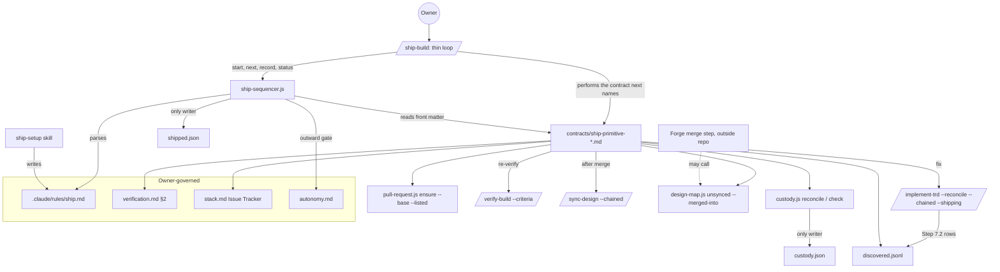
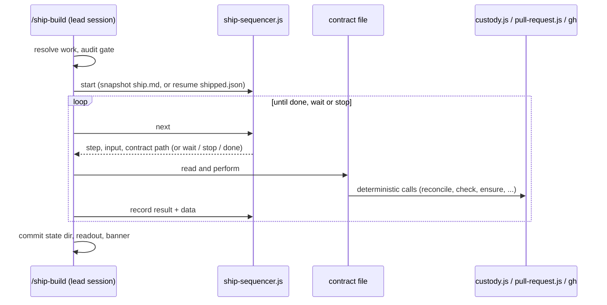

# TRD: /ship-build and ship.md — each project strings shipping primitives together; Ensemble runs the string

**Version**: 2.3.0
**Status**: Draft
**Created**: 2026-11-02
**Last Updated**: 2026-11-07
**Author**: @technical-architect
**Source PRD**: `docs/PRD/ship-build.md` (2.2.2; no supersession marker — current. 2.2.2 rewords the `repeat` round count to match this TRD — "`rounds=N` makes at most N fix rounds and then one final pass" — and changes no requirement. It adopts owner ruling J of 2026-11-06 as F18 (J-1 to J-6) and F19 (J-7), and the settlement of OQ-15 and OQ-22 that the product PM made on the owner's behalf on 2026-11-07, pending the owner's review; 57 criteria)
**Task ID Prefix**: SHIP

---

## Changelog

| Version | Date | Changes | Author |
|---------|------|---------|--------|
| 1.0.0 | 2026-11-02 | Initial TRD from PRD 2.0.0 (55 criteria, NFR-1–NFR-5, NG1/9/10/14/15/18, rulings A–D) | @technical-architect |
| 1.1.0 | 2026-11-02 | Revised against PRD 2.1.0 (50 criteria; owner rulings F, G, I). **F** (`ensemble.openPullRequest` stays): removed SHIP-B007 (retire PR opening) and SHIP-B011 (rebase migration), D32, and every removal of the setting from other tasks; `open-pr` builds on `pull-request.js ensure` with `--base` and `--listed` and reuses an open PR, retargeting it to `ship.md`'s base (D22, R14). **G** (close only what the work names): removed SHIP-B009, D30 and the recorded source issue; `close-issue` reads the PRD/TRD header lines or the branch (D29 rewritten); sweep work is read from the working tree (D39). **I** (code only where a wrong answer is costly): removed SHIP-B003 (`ship-run.js`) and SHIP-B012 (`ship-triage.js`); resolution, sequencing, resume, the run record, fix rounds and triage are `/ship-build`'s prompt (D1, D6, D7, D16, D18); the one piece of the old run library that guards a costly answer — who may move the anchor — moved into `custody.js` (D12). **Merged**: SHIP-P001 into SHIP-B001; SHIP-T001 into SHIP-B013; the review-finding record's library half of SHIP-B004 into SHIP-B005; `audit-build.md`'s two changes into SHIP-B004. **Carried from the first grounding run**: `--no-renames` (D9), the re-verification subset's own paths and no republish (D13), content-derived review-finding ids and a `summary` on every row (D25), how Step 7.2 captures a review it does not wait for (D25), the bare `deploy` example (D5, D23), `--shipping` skipping §9.0's push (D14), Monitor's 30-minute arm (D20). 18 tasks over 6 phases → 11 over 3 (2 deferred); the task-order cycle among SHIP-P001, B011, B012, B013 and D002 is gone | @technical-architect |
| 1.1.1 | 2026-11-03 | `/audit-trd` against PRD 2.1.0: each must-pass mark carries its reason (Objectives header); D1 serves the behaviours its Choice assigns (AC-F3.1, AC-F3.2, AC-F6.2); D22 cites R14 as a risk, not an objective; D11 and §3.8 say `BUILD_TOKEN` is exported by SHIP-B001, not today, and D11/§3.1 state that a deploy identity must report this work's commit; D12/§3.3 give `affectedMustPass` a no-success-definition result instead of a throw; D25 mints the review id from `HEAD`; D31 switches to the ship branch before committing; D39/§2.4 put ship-time sweep rows in the sweep's own state dir; D28 records how Linear and Jira close an issue. Could Not Verify rewritten. The owner kept AC-F5.1's must-pass mark | @technical-architect |
| 2.0.0 | 2026-11-06 | **Owner ruling J (2026-11-06): restructured around shipping primitives, re-grounded, post-merge design sync added.** **Shape:** a project strings *primitives* (single shipping actions) together in its `ship.md`; a new deterministic library, `ship-sequencer.js`, runs that string — order, a bounded `repeat` block, the `wait` and `stop` results, resume, the shipped flag and the outward-authorization gate; each primitive is one contract file, `packages/core/contracts/ship-primitive-<name>.md`, with a defined input, result and waiting state; `/ship-build` is a thin loop over the sequencer (D1, D2, D40–D45). Ruling J supersedes ruling I for sequencing; ruling I's test (code only where a wrong answer is costly) still decides what a primitive puts in a library. **Cut, each with why:** (1) `ship-policy.js` — parsing moved to the sequencer, authorization to its generic `outward` gate (D24), the deploy-command rule to `readFullDeploy` (D23), and tracker and source-issue reading to two primitives' prose (D28, D29: a wrongly closed issue is visible and reopened in one step, and the one-reference rule fails toward closing nothing); (2) `followups.js`, its global ledger `.trd-state/_followups/filed.jsonl`, and SHIP-B005 — `discovered.jsonl` already is the findings ledger and `discovered.resolve()` already gives each row a stable key, so filing a finding is resolving its row (D26); (3) `review-findings.jsonl` and the three `discovered.js` functions planned for it — Step 7.2 writes ordinary `discovered.jsonl` rows (D25); (4) `custody.js`'s twelve-function surface — now two verbs, `reconcile` and `check` (D12); the library itself stays because AC-F14.9 and NFR-5 require a unit-tested library and AC-F14.3, F14.7 and F14.8 are must-pass; (5) `shipped.json`'s hand-written fields (`pr`, `trigger`, `closedIssue`, `afterShipping`, per-stage `rounds`) and its second writer — the file stays as the sequencer's own state, because a `wait` result needs resumable state and AC-F3.3 (must-pass) names it; the anchor moved to `custody.json`, so each file has one writer (D6); (6) the fixing stages `ci-green` and `external-review` with their own round counters — replaced by the generic `repeat` plus the `collect-findings` and `fix-findings` primitives (D40); (7) the `## After shipping` on/off switches — now a list of primitives (D4). **Added:** objectives J-1 to J-7 (ruling J, and the owner's 2026-11-05 post-merge sync scope relayed with it); SHIP-B015 (the sequencer), SHIP-B016 (the thirteen contracts), SHIP-B017 (post-merge design sync: `design-map.js unsynced --merged-into`, `/sync-design --chained`, the two "Unsynced boards" paragraphs; D43), SHIP-B018 (`pull-request.js ensure --base --listed`, split out of SHIP-B013 because two primitives now use it); D40–D45. **PRD objectives ruling J changes** are marked in the Objectives table's "Ruling J" column (AC-F1.2, F1.3, F1.4, F2.1, F3.2, F4.1, F4.2, F4.4, F4.6, F5.8, F6.1, F14.7). **Re-grounded** against this branch, 126 commits after 1.1.1: every line, function, test and count re-checked and re-tagged; the corrections that change a task are in its grounding block — among them `CLAUDE.md` is 17,160 bytes against a 15,500-byte ceiling and the ceiling test already fails (was 15,465), `async-discipline.md` + `autonomy.md` are 16,555 of 17,000 bytes (was 16,995), `AUTHORED_RULES` holds `design.md` too, `autonomy.md`'s exempt-skills heading now reads "Two skills", there are 27 commands (was 22), and `.claude/skills/` now vendors the framework skills. **Open Questions:** OQ-8 dissolved (there is no `ci-green` default to choose; fixing happens only where a string lists `fix-findings`); OQ-19 to OQ-24 added. 11 tasks over 3 phases → 14 over 3 (2 deferred). On 2026-11-07 an unattended `/refine-trd --non-interactive` closed all 22 open questions — 8 answered from evidence, 7 by convention and 7 as the owner's calls taken in the owner's absence (OQ-1, OQ-4, OQ-15, OQ-19, OQ-20, OQ-21, OQ-22), with the edits they need in D20, D26, D44, §3.1, §3.2, TR4, the Objectives rows AC-F4.2 and J-5, and SHIP-B001's and SHIP-B016's acceptance criteria | @technical-architect |
| 2.1.0 | 2026-11-07 | **Aligned with PRD 2.2.0** (`/refine-trd --non-interactive`), which adopts ruling J as F18 and F19 and in which the product PM settles two of 2.0.0's owner's calls on the owner's behalf, pending the owner's review. Source cited as PRD 2.2.0, 57 criteria (50 + J-1 to J-7); the J rows now cite their PRD ids. **Reversed — OQ-15** (product PM on the owner's behalf, 2026-11-07, pending the owner's review; PRD AC-F9.1 and §8): a ship files only follow-ups of the work it ships and those it found itself. Rows already in `.trd-state/_sweep/discovered.jsonl` are left alone, neither filed nor marked: that ledger cannot tell one sweep's rows from another's (NG20), so filing them would have opened 23 issues for old leftovers on this repository's first sweep ship. Changed: AC-F9.1's objective text and Ruling J cell; D26 (the sweep-ledger issue-body rule removed); D39 (a sweep's leftovers are the rows this ship recorded in its own state directory); §2.4 (`file-followups` neither reads nor writes the sweep ledger); §3.2 `file-followups` (its ledgers); SHIP-B016 (an acceptance check that the contract reads no sweep-ledger row, and its grounding note on that ledger); OQ-15 now answered. **Kept — OQ-22** (product PM on the owner's behalf, 2026-11-07, pending the owner's review; PRD §8, AC-F1.1): the template ships no active step, with no change to D44. **Kept:** a `/task`'s follow-ups are still filed on the next ship (PRD keeps owner ruling OQ-L; OQ-6, D26). **Traceability:** AC-F1.3, AC-F1.4 and AC-F4.1 were built by tasks that did not list them; SHIP-B001 and SHIP-B015 now name AC-F1.3, SHIP-B015 and SHIP-B016 AC-F1.4, SHIP-B016 AC-F4.1, so every PRD criterion has a task. Nothing else changed; no task, decision or objective added or removed | @technical-architect |
| 2.2.0 | 2026-11-07 | **`/audit-trd`, with the owner's principles: a fixed set of primitives strung together in `ship.md`, one small sequencer, a new primitive is one contract file with no sequencer change, and the common string must not work only because it is hardcoded.** **Attribution corrected:** OQ-15 and OQ-22 were settled on 2026-11-07 by the product PM on the owner's behalf, pending the owner's review — not confirmed by the owner. Reworded in the header, the 2.1.0 row, AC-F9.1, J-5's cell, D44, the Open Questions count and the OQ-15 and OQ-22 rows; both stay owner's calls (8 answered, 7 defaults, 7 owner's calls). Source cited as PRD 2.2.1, which made the same correction and changed no criterion's requirement. **Primitive-blind sequencer, made true:** (1) the no-policy string `push` was built into the sequencer, so the sequencer named a primitive and SHIP-B015's own name test could not pass; `start` now takes the fallback string from its caller (`--fallback`; `/ship-build` passes `1. push`) and parses it like any other (D2, §3.1, §3.7, SHIP-B013, SHIP-B015). (2) `repeat`'s default `until=clean` was a result word only `collect-findings` declares, held in the sequencer; a contract now declares `repeat-until:`, and a `repeat` with no `until=` takes the one its body declares (D3, D40, D41, §3.1, SHIP-B015, SHIP-B016). (3) `/ship-build` no longer keys on particular primitives: ISSUES comes from each result's `data.issues`, unauthorized steps and `git status`; the state directory is pushed only at a `wait` whose data says `remoteResume: true`, set by `await-approval`, which alone checks the trigger workflow; and "after a merge" is read from the PR's state, not from a `merge` step (D35, D38, §3.2, §3.7). (4) D41's "no test-list change" narrowed: a new primitive adds its own assertions to `ship-primitives.test.js`. **Corrected:** D42 and D12 said `push` is the only place `HEAD` leaves the machine; `pull-request.js ensure` also runs `git push -u origin <branch>` (line 109), so `open-pr`'s push-link check now says a commit made after `push` fails it loudly, and `sync-design`'s own branch is outside custody. "The current head" in the waiting primitives is defined as the head last published, not local `HEAD`, which D38's state commit leaves one ahead (§3.2). `release` gains `needs: push`, and `custody.js check` with no anchor fails, so no string reaches the deploy link with nothing to compare (D5, D12, §3.2). **Objectives:** J-5 regains `merge` (as PRD J-5 has it); J-3 says sequencer, as PRD J-3 does; the J rows' provenance says where ruling J is recorded; AC-F1.1, AC-F2.2 and AC-F3.6's Ruling J cells name PRD 2.2.0's no-active-step addition; AC-F5.8's cell states how `rounds` counts. D16's fail-closed rule and the B004/B008 and B004/B017 splits (§5.1) now give their reasons. No task added or removed **Adding a primitive touches only its own file:** `needs:` names data keys an earlier contract `provides:` (`head`, `pr`, `findings`, `merged`), not primitive names, so a second PR-opener or merger edits no other contract (D5, D41, §3.1, §3.2); `push`'s sweep-branch rule reads `laterNeeds` instead of looking for `open-pr` by name (D31); `next` drops `pass` and `shipped`, which no contract read; the sequencer's name guard and `ship-primitives.test.js` read primitive names from the directory, so a new contract needs no test edit (D41, SHIP-B015, SHIP-B016); `/ship-setup` asks each offered step's contract-declared parameters and reads an optional `## Setup` section, so a new primitive needs no skill edit (D34, SHIP-B014). | @technical-architect |
| 2.3.0 | 2026-11-07 | **`/audit-trd` against PRD 2.2.2.** **Citation:** source cited as PRD 2.2.2 (header, Objectives); AC-F5.8's Ruling J cell no longer says the PRD reads the round count as two passes — 2.2.2 words it as this TRD does. **D19 / §3.2 `fix-findings`:** `fix-findings` now resolves each blocking row it handles (`discovered.resolve`): a `[lint]` row as soon as the formatter's commit lands, before the chained build — which otherwise promoted it into a TRD task and sent an implementer to it (reproduced on a scratch ledger) — and the rest once the chained build returns `complete`, so a later pass sees only new findings. **D43 (c) / §3.9 `sync-design`:** the switch to `design-sync/<feature>` aborted when the run's uncommitted state files or late review edits differed from `origin/<base>` (reproduced in a scratch repository); the primitive now sets them aside with a tagged `git stash push -u`, restores them with `git stash apply <sha>` on the feature branch afterwards, and reports a failed restore with the stash's SHA rather than stopping. Could Not Verify: the `promoteToTrd` row is settled (a second promotion of the same rows added nothing) and removed. | @technical-architect |

---

## Objectives

Every one of PRD 2.2.2's 57 acceptance criteria is an objective here under its PRD id, so
`/audit-trd` and `/audit-build` trace one id end to end: the 50 carried from PRD 2.1.0, stated as
2.1.0 worded them, and J-1 to J-7 (F18, F19), stated as ruling J was relayed to the session that
wrote TRD 2.0.0 (commit `4d7aab9`). No record of the ruling exists outside this TRD and the PRD
[ran `grep -rIl "ruling J"` over the repository and `git log --all` over commit subjects:
only `docs/PRD/ship-build.md`, `docs/TRD/ship-build.md` and the two commits that wrote them], so
PRD F18 and F19 are now the J rows' source. The owner's `/audit-trd` instruction of 2026-11-07
restates J-3, J-5 and J-6 as owner principles; J-1, J-2, J-4 and J-7 rest on the relayed wording
alone. PRD 2.2.0 adopts ruling J; the **Ruling J** column says, per row, whether the objective is
kept as written or how J changes it, and PRD 2.2.0's own wording of each changed criterion states
the same change.

Six are marked **Must pass** — the three problems the owner named on 2026-11-02 (run the
project's ship process, log what was not fixed, ship the code that was verified) do not exist
without them. The PRD marks no criterion must-pass; these marks are this TRD's, one reason each:
AC-F3.3 is "run the project's ship process"; AC-F9.1 is "log what was not fixed"; AC-F14.3,
AC-F14.7 and AC-F14.8 are "ship the code that was verified"; AC-F5.1 serves the same problem,
because a fix made any other way than the recorded, re-verified path ships code no verification
saw. The owner confirmed AC-F5.1's mark on 2026-11-03 ("Keep it"). Ruling J keeps all six, each
served by a piece that survives the cuts: AC-F3.3 by the sequencer's shipped flag in
`shipped.json` (D6); AC-F9.1 by `file-followups` over `discovered.jsonl` (D26) and Step 7.2's
rows (D25); AC-F14.3, F14.7 and F14.8 by `custody.js` (D11, D12), called from `push`, `open-pr`,
`merge` and `release`; AC-F5.1 by `fix-findings` through `/implement-trd --reconcile --chained
--shipping` (D14).

**Terms used throughout.** A *primitive* is one shipping action with a defined input, result
and waiting state (§3.2). A *string* is the ordered list of primitives a project writes in its
`ship.md`; each entry is a *step*. The *sequencer* is the code that runs a string. A *pass* is
one run through a `repeat` block's steps. The *anchor* is the commit the code at every push,
merge and release must equal (F14).

| ID | Objective | Source | Must pass | Ruling J |
|----|-----------|--------|-----------|----------|
| AC-F1.1 | A `ship.md` template exists in `packages/core/templates/claude-directory/rules/` and is scaffolded into a project's `.claude/rules/ship.md` by the mechanism that scaffolds `verification.md`. The template carries example `run <command>` lines for release and platform steps — version bump, changelog, tag, publish, mobile build, store submission, OTA update — and for checking which build a deployed environment runs. | PRD AC-F1.1 | | kept; PRD 2.2.0 adds that the template ships with no active ship step, so a scaffolded, unedited `ship.md` lists no step (D44); its first worked example is the default string (J-5) |
| AC-F1.2 | `ship.md` expresses an ordered list of stages, each a vocabulary name plus parameters. | PRD AC-F1.2 | | changed: an ordered list of steps, each a primitive name plus parameters, under `## Ship` and `## After shipping`, with a bounded `repeat` block (D2, D40) |
| AC-F1.3 | `close-issue` and `file-followups` are on by default, and `ship.md` can switch each off. | PRD AC-F1.3 | | changed: both are primitives listed under `## After shipping`; the default string and `/ship-setup`'s default include both; leaving a line out switches it off (D4) |
| AC-F1.4 | Each fixing stage (`ci-green`, `external-review`) carries a round cap, a severity bar and whether below-bar review findings are filed, and states what happens at the cap (AC-F5.8). A fixing stage with no cap written uses the default cap of **2**. | PRD AC-F1.4 | | changed: there are no fixing stages. The cap is `repeat rounds=` (default 2), the bar `collect-findings bar=`, below-bar filing `file-followups below-bar=`, and the at-cap rule is `collect-findings`' final pass (D3, D40) |
| AC-F1.6 | The file states that it is owner-governed and changes only through `/ship-setup`. | PRD AC-F1.6 | | kept |
| AC-F2.1 | Invoking `/ship-setup` interviews the owner and writes `.claude/rules/ship.md`. For each fixing stage it offers a round cap of **2** and the significance bar (AC-F5.7) as defaults, both changeable. For a `deploy` stage whose environment has no full-deploy command in `verification.md` §2, it records the deploy command in `ship.md` (AC-F4.6). | PRD AC-F2.1 | | changed: it offers `rounds=2` per `repeat` block and the significance bar per `collect-findings`; the deploy command is recorded on `release` (D34) |
| AC-F2.2 | Running `/ship-setup` is the owner's approval of the outward-facing stages it records; `/ship-build` asks for no further confirmation before running them. | PRD AC-F2.2 | | kept; PRD 2.2.0 adds that until the owner runs `/ship-setup`, `ship.md` lists no step, so `/ship-build` only pushes (D44, AC-F3.6) |
| AC-F3.1 | `/ship-build` ships whatever Ensemble is currently working on — the PRD/TRD feature, the `/plan` or the `/sweep` in flight — and resolves it the way `/implement-trd` resolves the current work. | PRD AC-F3.1 | | kept |
| AC-F3.2 | Stages run in the order `ship.md` lists them; a stage starts only after the previous one succeeded (a fixing stage succeeds as AC-F5.8 defines). | PRD AC-F3.2 | | changed: the sequencer (code) hands out steps in order; a step starts only after the previous one recorded a result other than `wait` or `stop`; a `repeat` block runs as D40 defines |
| AC-F3.3 | The work counts as shipped only when the last listed stage succeeded, and no stage `ship.md` lists needs to be run by hand. Then `close-issue` and `file-followups` run (unless switched off), and `/ship-build` writes its shipped record, `shipped.json`, in `.trd-state/<feature>/` beside `closed.json`. "Closed" (verified) and "shipped" (delivered) stay distinct: a feature can be closed and not yet shipped. | PRD AC-F3.3 | yes | kept; "last listed stage" is the last `## Ship` step, the after-shipping steps are `## After shipping`, and `shipped.json` is the sequencer's state file (D4, D6) |
| AC-F3.5 | A run ends with the standard four-section readout and a `COMMAND COMPLETE` or `COMMAND STUCK` banner as its last line. `COMMAND COMPLETE` means the run did its job, not that the work shipped; the shipped record says whether it shipped. | PRD AC-F3.5 | | kept |
| AC-F3.6 | A project with no `ship.md`: `/ship-build` commits and pushes, opens no PR, and the readout points to `/ship-setup`. It says the branch is ready for a PR, or, where a PR is already open for the branch (as `/audit-build` opens one under `openPullRequest: auto`), names that PR instead. | PRD AC-F3.6 | | kept; PRD 2.2.0 adds the `ship.md` that lists no ship step (the template as scaffolded); both cases run the one-step fallback string `push` that `/ship-build` passes to the sequencer (D2) |
| AC-F3.7 | **Audit gate.** A full PRD → TRD feature ships only when its `.trd-state/<feature>/closed.json` exists, written by a passing `/audit-build` or by the owner's `/close-feature` override (whose `"audit": null` satisfies the gate). Work from a `/plan` TRD and `/sweep` work ships without one. A full feature without `closed.json` stops before the first stage and the readout names `/audit-build` or `/close-feature` as NEXT. | PRD AC-F3.7 | | kept |
| AC-F4.1 | The vocabulary is `push`, `open-pr`, `ci-green`, `external-review`, `await-human-review`, `merge`, `deploy`, `close-issue`, `file-followups` and `run <command>`. | PRD AC-F4.1 | | replaced by J-1 and D42: `push`, `open-pr`, `merge`, `close-issue`, `file-followups` and `run` keep their names; `ci-green` becomes `wait-ci` + `collect-findings` + `fix-findings` in a `repeat`; `external-review` becomes `request-review` + the same; `await-human-review` becomes `await-approval`; `deploy` becomes `release`; `sync-design` is new |
| AC-F4.2 | Each of the owner's five stage lists is valid `ship.md` content and runs end to end. The five (PRD F4 table; examples, not defaults): (1) `push`; (2) `push` → `open-pr base=main` → `await-human-review`; (3) `push` → `open-pr base=develop` → `ci-green fix=yes cap=3` → `merge method=merge`; (4) `push` → `open-pr base=main` → `ci-green` → `merge` → `deploy env=production`; (5) `push` → `open-pr` → `external-review tool=coderabbit fix=non-trivial` → `ci-green` → `merge` → `deploy`. | PRD AC-F4.2, F4 table | | changed: each list, re-expressed in the primitive set (§3.1's table), is valid and runs end to end; a list with `release` runs end to end once its `identity=` command reports the released commit, because the deploy link (AC-F14.3, must pass) fails a release that reports none (OQ-3) |
| AC-F4.3 | `open-pr` opens a PR against the base `ship.md` names, whatever `openPullRequest` is set to: the listing is its authorization. Where a PR is already open for the branch — as `/audit-build` or `/close-feature` opens one under `openPullRequest: auto` — the stage reuses it and opens no second one. `/audit-build`'s and `/close-feature`'s PR opening is unchanged (ruling F). Today `pull-request.js ensure` already reuses an open PR, but opens one only under `auto` and only against the default branch; how `open-pr` builds on it is the TRD's to set (D22). | PRD AC-F4.3 | | kept |
| AC-F4.4 | `merge`, `deploy` and `run` stages run only because `ship.md` lists them, and the listing is their authorization. A project whose `ship.md` lists no `merge` is never merged by `/ship-build`: the policy file, not `pull-request.js`, decides whether `/ship-build` merges; `pull-request.js` itself still never merges (R3). A `deploy` stage authorizes a deploy to any environment, production included; `verification.md` §1's "Loop may DEPLOY to it?" column governs only the verification loop and does not block it. | PRD AC-F4.4 | | changed in name only: `deploy` is `release`; every primitive whose contract says `outward` runs only because it is listed (D24) |
| AC-F4.6 | Where `verification.md` §2 declares a full-deploy command for the environment, `deploy` reuses it; otherwise it uses the command `ship.md` records (AC-F2.1); with neither, the stage stops and reports, never guesses. | PRD AC-F4.6 | | changed in name only: applies to `release` (D23) |
| AC-F4.7 | `push` commits a `/sweep`'s uncommitted changes by pathspec before pushing; `/sweep` itself stays never-commit. | PRD AC-F4.7 | | kept |
| AC-F5.1 | A code fix is recorded as a discovery (`discovered.record` with `blocksFeature: true`) and built by `/implement-trd --reconcile --chained`, so every code fix appears as a discovery row and a TRD row with a commit. `/ship-build` never edits code itself. It fixes in both fixing stages: `ci-green` (CI failures, `fix=yes`) and `external-review` (review findings). `.claude/commands/implement-trd.md` and its `packages/core/commands/` copy, which today name only `/verify-build` and `/audit-build` as `--chained` callers, admit `/ship-build`. | PRD AC-F5.1 | yes | kept; fixes happen in `fix-findings`, wherever a string places it, for CI failures and review findings alike |
| AC-F5.2 | Triage before fixing (failure → action → re-verify):<br>• Flaky test or infrastructure (re-run passes) → re-run CI **once**; no code change → none<br>• Lint or format → the project's formatter/linter is run and its output committed — not a model edit; anything needing a hand edit goes through the recorded path → none<br>• Test or build failure in this feature's code → fix via the recorded path → affected criteria only<br>• Failure in code this feature did not touch → stop and report; file as a follow-up → —<br>• Review finding at or above the bar → fix via the recorded path → affected criteria only<br>• Review finding below the bar → not fixed; filed only if `ship.md` opts in → —<br>• Deploy failure → stop and report; never auto-fix → — | PRD AC-F5.2 | | kept; flaky re-run in `wait-ci`, classification in `collect-findings`, fixing and the formatter in `fix-findings`, a release failure in `release` |
| AC-F5.3 | When it is unclear whether a failure belongs to this feature, a judge decides. Failures it rules out of scope are reported and filed as follow-ups, never fixed here. | PRD AC-F5.3 | | kept (`collect-findings`) |
| AC-F5.4 | After a fix, only criteria whose covered files changed are re-verified; every other proven criterion stays proven, and the widest re-check is the must-pass criteria whose own covered files the fix changed. (Evidence already stores a sha256 of each covered file, in `packages/core/lib/live-evidence.js`.) A fix is never re-audited. | PRD AC-F5.4 | | kept |
| AC-F5.7 | The default severity bar is significance: correctness, security, data loss, a broken contract. Where the reviewer labels severity, its labels are used; otherwise a judge decides against the bar. The bar is a `ship.md` parameter of the fixing stage. | PRD AC-F5.7 | | kept; the bar is a parameter of `collect-findings` |
| AC-F5.8 | **Round cap and the final round.** Each fixing stage runs at most its `ship.md` round cap of fix rounds (**2** by default). After the final round — the last its cap allows — the findings still open are sorted. A critical one stops the run (`COMMAND STUCK`), says what is still failing and leaves the PR as it is. Every below-critical one is filed as a follow-up (F9) and listed in the readout with its issue, and the stage counts as succeeded. A finding is critical by the reviewer's own severity label where it gives one, and by the AC-F5.7 judge otherwise, CI failures included. | PRD AC-F5.8 | | changed: the cap is `repeat rounds=`, counted as fix rounds as this row words it — `rounds=2` is two fix rounds and then a final pass, three passes in all (D3, D40). PRD 2.2.2 words it the same way: "`rounds=N` ... makes at most N fix rounds and then one final pass" (2.2.0's "runs at most its round count" read as two passes, and 2.2.2 reworded it with no requirement changed); the sort is `collect-findings` with `final: true`; a below-critical finding is recorded at once and filed by `file-followups`, so it is listed "with its issue" only in a run that reaches `file-followups`, and otherwise listed as recorded, not yet filed (D27) |
| AC-F6.1 | `await-human-review` ends the run with a resumable record of which stages succeeded and which remain. The run ends `COMMAND COMPLETE`; its readout says the work is not shipped yet and names `/ship-build --resume` in NEXT. | PRD AC-F6.1 | | changed in name and reach: `await-approval`; any step returning `wait` ends the run this way (D40's `wait` rule) |
| AC-F6.2 | `/ship-build --resume` runs the remaining stages from that record. | PRD AC-F6.2 | | kept |
| AC-F7.1 | `close-issue` runs only after the last stage succeeded — never when the PR opens and never at a wait, since a PR still waiting for human review has not shipped — and closes the issue in the tracker `stack.md` declares (F10). | PRD AC-F7.1 | | kept; enforced by `close-issue`'s `section: after` (D4) |
| AC-F7.2 | `close-issue` closes the issue the current work already names: an issue reference in its PRD or TRD header (`/create-prd` records an issue key on the PRD's `**Source**:` line today) or in its branch name (`process.md`'s `<issue-id>-<session>` pattern). With none found, it closes nothing and the readout says so. | PRD AC-F7.2 | | kept |
| AC-F9.1 | Sources filed: non-blocking `discovered.jsonl` rows, `/audit-build`'s out-of-scope list, verification criteria left `not_verifiable`, the unfixed review findings in AC-F9.7's record, failures the ownership judge ruled were not this feature's (AC-F5.3), below-critical findings left after a fixing stage's final round (AC-F5.8), and the `followups` in a `/task`'s `closed.json`. From findings ledgers, a ship files only the rows of the work it ships and those this ship found; it leaves older ledger rows alone. For `/sweep` work, whose shared ledger (`.trd-state/_sweep/discovered.jsonl`) cannot tell one sweep's rows from another's (NG20), that means only the findings this ship recorded: rows already in the shared ledger are neither filed nor marked (product PM on the owner's behalf, 2026-11-07, pending the owner's review). A `/task`'s follow-ups are still filed as OQ-L ruled. | PRD AC-F9.1 (as changed in 2.2.0) | yes | kept; every source reaches `file-followups` as a `discovered.jsonl` row (D25, D26); for sweep work the ledger is the ship's own state directory (D39) |
| AC-F9.2 | Review findings below the significance bar are not filed unless `ship.md` opts in (AC-F1.4). The bar applies unchanged to AC-F9.7's record. | PRD AC-F9.2 | | kept; the opt-in is `file-followups below-bar=yes` |
| AC-F9.3 | Each filed issue links back to the work it was found in. Each finding is filed at most once, keyed by a stable id, so a re-run does not duplicate. | PRD AC-F9.3 | | kept; the stable id is the row's existing resolve key (D26) |
| AC-F9.5 | Any finding it cannot file (no tracker configured, a failed call) is listed in the readout, not dropped. The readout also names each below-bar review finding from AC-F9.7's record that it did not file, and the path of that record. | PRD AC-F9.5 | | kept |
| AC-F9.7 | **Record of unfixed review findings.** `/implement-trd`'s end-of-run review step (Step 7.2) writes **every** review finding it chose not to fix, whatever its severity, to a file under `.trd-state/<feature>/`, and `file-followups` reads that file. The change is made in `.claude/commands/implement-trd.md` and its `packages/core/commands/` copy. The file's name and format, and how the step obtains the findings of a review it does not wait for, are the TRD's to set (D25). | PRD AC-F9.7 | | kept; the file is the feature's `discovered.jsonl` (D25) |
| AC-F10.1 | The `stack.md` template has a place to declare the project's issue tracker. | PRD AC-F10.1 | | kept |
| AC-F10.2 | `/ship-build`'s `close-issue` and `file-followups` use the tracker that declaration names. | PRD AC-F10.2 | | kept |
| AC-F10.3 | With no tracker declared, nothing is filed or closed and the readout lists what could not be (consistent with AC-F9.5). | PRD AC-F10.3 | | kept |
| AC-F11.1 | On a pass, `/audit-build` names `/ship-build` in NEXT and never runs it. Its PR opening under `openPullRequest: auto` is unchanged. | PRD AC-F11.1 | | kept |
| AC-F12.1 | A drafted amendment to `constitution.md`'s Governance Split table adds `ship.md` to the owner-governed slow layer beside `verification.md`, with running `/ship-setup` as the confirmation. | PRD AC-F12.1 | | kept |
| AC-F12.2 | A drafted amendment to `autonomy.md` makes a `merge`, `deploy` (to any environment, production included), `run` or other outward-facing stage listed in `ship.md` the owner's standing authorization for it, and names `/ship-setup` as interactive by purpose beside `/verification-setup`. The existing `openPullRequest: auto` exception stays as it is (ruling F). | PRD AC-F12.2 | | kept (`deploy` is `release`) |
| AC-F12.3 | Neither `constitution.md` nor `autonomy.md` is changed until the owner approves. | PRD AC-F12.3 | | kept |
| AC-F14.1 | **Anchor.** The anchor starts at the audited commit (`closed.json`'s `audit.auditedCommit`). With no audited commit — `/plan` and `/sweep` work, and `/close-feature`'s `"audit": null` — it is the commit `/ship-build`'s push stage pushed. Only AC-F14.7 moves it. | PRD AC-F14.1 | | kept |
| AC-F14.2 | **Code equality.** The code at a link equals the anchor's when the two commits' trees differ in no file outside the ignored paths: `.trd-state/`, the audit report (`.trd-state/<feature>/audit-build-report.md`), the feature's TRD, and test-only files. Every other file is **shipped source**. A **test-only file** is a file the project's test framework treats as a test (in this repository, for example, Jest's `*.test.js`, pytest's `test_*.py`, BATS's `*.test.sh`); the exact pattern, including whether fixtures and test helpers count, is the TRD's to set (D10). | PRD AC-F14.2 | | kept |
| AC-F14.3 | **Custody links.** *Push:* after each push `/ship-build` makes — including AC-F3.6's push with no `ship.md` — the remote branch head's code equals the anchor's. *Merge:* after `merge`, the commit GitHub records as the PR's merged head (e.g. `gh pr view --json headRefOid`) has code equal to the anchor's, and the PR merged into the target branch `ship.md` names; this holds for merge, squash and rebase merges alike. *Deploy:* after `deploy`, the deployed build reports a commit whose code equals the anchor's; a build that reports no identity, or a different one, fails the link. | PRD AC-F14.3 | yes | kept (the deploy link is checked after `release`) |
| AC-F14.6 | **Full commit ids.** `/audit-build` writes the full commit id in its report header's `Audited commit:` line (written today from `git rev-parse --short HEAD`, in `.claude/commands/audit-build.md` and its `packages/core/commands/` copy), so `closed.json` stores it in full. A short anchor id stored before this change that resolves to exactly one commit is used normally; an ambiguous one fails with that reason, never a guess. | PRD AC-F14.6 | | kept |
| AC-F14.7 | **What moves the anchor.** Any change to shipped source after the audited commit — a closing audit's chained fix made before shipping starts, a fix `/ship-build` makes (F5), or a commit made by a `run` stage — is re-verified for the must-pass criteria whose covered files it changed (AC-F5.4), and its commit then becomes the anchor before the next custody link. Where no must-pass criterion's covered files changed, nothing is re-run and the anchor still moves; a formatter/linter tool run's commit needs no re-verification (AC-F5.2) and moves the anchor once committed; a criterion that fails its re-verification leaves the anchor where it was. A change only to ignored paths needs no move. `/ship-build` records each move in its shipped record, and nothing else moves the anchor. | PRD AC-F14.7 | yes | changed in one detail: each move is recorded in `custody.json` beside `shipped.json`, written only by `custody.js` (D6, D12) |
| AC-F14.8 | **A mismatch fails loudly.** Any other difference at a custody link stops the run (`COMMAND STUCK`), naming the stage and the files that differ; a PR that is unmerged, or merged into another branch, fails the merge link the same way, naming which. It is never auto-fixed. | PRD AC-F14.8 | yes | kept |
| AC-F14.9 | The check is deterministic code — a lib function with unit tests — not a model judgement. It lives outside `pull-request.js` (R3). | PRD AC-F14.9 | | kept |
| AC-F17.1 | When a trigger is set on the PR at `await-human-review`, the event it names (e.g. approval) runs the remaining stages as `--resume` would. | PRD AC-F17.1 (P1) | | kept (`await-approval trigger=`) |
| AC-F17.2 | The readout claims a trigger only when one was actually set (`constitution.md` prohibited pattern 6, no false async claims). | PRD AC-F17.2 (P1) | | kept |
| NFR-1 | `/ship-build` and `/ship-setup` end with the four-section readout and a `COMMAND COMPLETE` or `COMMAND STUCK` banner as the last line (AC-N1) | PRD NFR-1; `constitution.md` prohibited pattern 7; `command-status.md` | | kept |
| NFR-2 | No turn claims later work (a resume, a trigger, a CI result, a notification) without the primitive that backs it in the same turn; a CI wait uses a bounded primitive (AC-N2) | PRD NFR-2; `constitution.md` prohibited pattern 6; `async-discipline.md` | | kept; every primitive's waiting state names its bounded primitive (§3.2) |
| NFR-3 | `/ship-build` runs autonomously from invocation to banner; it asks the owner only in `autonomy.md`'s four cases. `/ship-setup` is interactive by purpose (AC-N3) | PRD NFR-3; `constitution.md` prohibited pattern 8 | | kept |
| NFR-4 | Ensemble never assumes Forge exists; no Forge call or assumption in either command (AC-N4) | PRD NFR-4 (OQ-8) | | kept; also binds the post-merge sync (J-7) |
| NFR-5 | The chain-of-custody check is deterministic and unit-tested: unit tests cover each link (push, merge, deploy), the ignored-path classification, each way the anchor moves, and each failure condition (AC-N5) | PRD NFR-5, AC-N5 | | kept |
| J-1 | The shipping primitives are: open a PR; wait for CI; request an outside AI reviewer (CodeRabbit, Codex, or another Claude Code session); wait for human review or approval; collect findings; fix findings through our own tools (`/plan`, `/implement-trd`); merge; release. Whether `push` and the post-merge design sync are primitives is the TRD's to decide and justify (D42) | PRD J-1 (F18); owner ruling J, 2026-11-06 | | new |
| J-2 | Each primitive has a defined input, a defined result and a defined waiting state: what it waits on, and with which bounded primitive (`Monitor`, a parked, resumable end of run, …) per `async-discipline.md` | PRD J-2 (F18); owner ruling J, 2026-11-06 | | new |
| J-3 | A project strings primitives together in its own `ship.md`, in whatever order it wants, and a deterministic sequencer runs that string | PRD J-3 (F18); owner ruling J, 2026-11-06; restated in the owner's `/audit-trd` instruction, 2026-11-07 | | new |
| J-4 | Iteration ("iterate until fixed") is a generic sequencing construct — a bounded repeat — not special-casing of one string | PRD J-4 (F18); owner ruling J, 2026-11-06 | | new |
| J-5 | The most common string — open a PR, queue an outside AI reviewer plus CI, review findings and iterate until fixed, merge, release — is the default `ship.md` template and the worked example, and is not hardcoded: a string with a human approval step, or with no outside reviewer, runs on the same code | PRD J-5 (F18); owner ruling J, 2026-11-06; restated in the owner's `/audit-trd` instruction, 2026-11-07 | | new; read as the template's first example, labelled as the default, and `/ship-setup`'s default answer — not an active `## Ship` in every scaffolded file (D44; OQ-22, decided by the product PM on the owner's behalf on 2026-11-07, pending the owner's review, PRD 2.2.1 J-5 and §8) |
| J-6 | Elegant and simple over clever. A piece is either a primitive or the thing that sequences primitives, never both. Adding a primitive is one new unit with no change to the sequencer. The sequencer is small enough to read in one sitting. Anything that serves only one particular string is cut or made an option | PRD J-6 (F18); owner ruling J, 2026-11-06; restated in the owner's `/audit-trd` instruction, 2026-11-07 | | new |
| J-7 | After a design's feature merges into the default branch (merged = the audited commit is an ancestor of the default branch), `/sync-design` runs automatically, with nothing asked, triggered by Forge's merge step or by a check on main. Until then the design stage only detects unsynced boards and recommends a sync. Ensemble's side is a deterministic check anything can invoke (NFR-4); Forge's half is outside this repository | PRD J-7 (F19); owner scope of 2026-11-05, relayed with ruling J, 2026-11-06 | | new |
| O1 | All findings at or above the bar from one CI run or one review pass go into a single fix round | Brief §7, "Settled with the owner, 2026-10-31"; PRD §8 ("moved to the TRD") | | kept (`fix-findings` builds every open blocking row in one chained build) |
| O2 | `/ship-setup` is owner-invoked only (`disable-model-invocation: true`) and ends with the readout, banner and `notify-complete.sh` call | PRD §8 (old AC-F2.4, AC-F2.5 "moved to the TRD"); `verification-setup` precedent | | kept |
| O3 | `/ship-setup` is registered in `framework-skills.txt` | PRD §8 (old AC-F12.7 "moved to the TRD") | | kept |
| O4 | Unit tests ≥ 60% for new and changed lib code; integration ≥ 50% where applicable | `constitution.md` Quality Gates | | kept |
| O5 | Every `git`/`gh` invocation in new lib code uses `spawnSync` with array arguments; no `execSync` with interpolation | `CLAUDE.md` Security Considerations | | kept |
| O6 | `ship.md` never holds a credential's value; `/ship-setup` records where one lives, never the value | domain-derived: `ship.md` is committed to git and loaded into every session (`.claude/rules/`), the same exposure `verification.md` §3 guards against | | kept |
| O7 | Documentation updated; `docs/TRD/pr-at-cycle-end.md` notes the two of its decisions this feature overrides — `/ship-build`'s `open-pr` also opens a PR, and a `ship.md` `merge` step is the owner's standing go for `gh pr merge` — while its setting and PR opening stand | `constitution.md` Quality Gates; PRD §8 "Corpus decisions this PRD overrides" ("the TRD must be corrected when this ships") | | kept |

Removed in 1.1.0 with the PRD: AC-F8.1 (ruling G), AC-F11.2–AC-F11.5 (ruling F).

---

## 1. Overview

### 1.1 Technical Summary

Three kinds of piece, never mixed (J-6):

- **Primitives** — thirteen single shipping actions (§3.2). Each is one contract file,
  `packages/core/contracts/ship-primitive-<name>.md`, saying what it takes, what it does, what
  result it records and what it waits on. The lead session performs it; anything whose wrong
  answer is costly is a library call inside it (`custody.js`, `pull-request.js`,
  `discovered.js`).
- **The sequencer** — `ship-sequencer.js`, deterministic code that knows no primitive by name.
  It parses `ship.md` against the contracts, keeps `shipped.json`, and answers one question at a
  time: which step runs next, with what input. It runs `repeat` blocks, parks the run on `wait`,
  ends it on `stop`, resumes either, sets the shipped flag and refuses an outward step that is
  not yet authorized.
- **`/ship-build`** — a thin loop: resolve the work, apply the audit gate, then
  *next → do the contract → record* until the sequencer says done, wait or stop; then the readout.

The default string, and how the owner's five examples read in it:

```
## Ship
1. push
2. open-pr
3. repeat until=clean rounds=2
   - push
   - request-review tool=coderabbit
   - wait-ci
   - collect-findings
   - fix-findings
4. merge
5. release env=production identity="<command that prints the deployed commit>"

## After shipping
1. sync-design
2. close-issue
3. file-followups
```

A project needing a human approval writes `await-approval` after `open-pr`; one with no outside
reviewer drops `request-review`; the code is the same (J-5). Fixes go through the recorded path
(`discovered.record` → `/implement-trd --reconcile --chained --shipping`); re-verification
through `/verify-build --criteria`; PR opening through `pull-request.js ensure --base --listed`;
custody through `custody.js`. `ensemble.openPullRequest` stays (ruling F). Governance amendments
are drafted, never applied, until the owner approves.

### 1.2 Key Technical Decisions

"Kept" means the 1.1.1 decision stands with its grounding re-checked; "2.0.0" marks a decision
rewritten or added by ruling J.

| ID | Decision | Choice | Serves Objective | Rationale | Alternatives Considered |
|----|----------|--------|------------------|-----------|------------------------|
| D1 (2.0.0) | Where the logic lives | Sequencer in code (`ship-sequencer.js`); each primitive one contract file (D41), performed by the lead session, calling libraries where a wrong answer is costly; `/ship-build` a thin loop over `start`, `next`, `record`, `status` | J-3, J-6, AC-F3.2, AC-F6.2, AC-F14.9, NFR-5 | Ruling J (J-3: "a deterministic sequencer runs that string") supersedes ruling I for sequencing. Ruling I's test still decides what goes into a primitive's libraries | Prose sequencing (1.1.x, ruling I) — superseded by J. A `Workflow` script as the sequencer — rejected (D45). One JS module per primitive with a `run()` — rejected: most primitives are model work (waits, triage, chaining Skills), so two kinds of primitive would exist instead of one |
| D2 (2.0.0) | `ship.md` format | `## Ship` and `## After shipping`, each with numbered lines `N. <primitive> key=value key="quoted value"`; a primitive whose contract declares `rest:` takes the rest of the line (`N. run npm version patch`); `N. repeat until=<result> rounds=<n>` followed by indented `- <primitive> …` lines, no nesting. `## Examples (not run)` is never parsed. No step under `## Ship`, or no file, is policy `none`: `start` then runs the fallback string its caller passes (`--fallback`; `/ship-build` passes `1. push`, AC-F3.6), parsed against the contracts like any other, so the sequencer names no primitive | AC-F1.2, AC-F1.3, AC-F3.6, J-3, J-4, J-6 | Owner-readable like `verification.md`; two sections make "after shipping" a place rather than a rule; the unfilled template ships into every project (AC-F1.1), so "no steps" must mean "no policy" or AC-F3.6 could never fire | YAML front matter — rejected: hides the policy from the owner. One list with a "shipped here" marker step — rejected: a marker is neither a primitive nor the sequencer. The fallback built into the sequencer (2.0.0–2.1.0) — rejected: the sequencer would name `push`, against J-6 and SHIP-B015's own name test. A `fallback: true` contract field — rejected: it puts one command's policy in a primitive's contract |
| D3 (2.0.0) | Defaults | `repeat rounds=2`, and with no `until=`, the one result its body's contracts declare as `repeat-until:` (`collect-findings` declares `clean`); `collect-findings bar=significant`; `file-followups below-bar=no`; `merge method=merge`; `open-pr base=` the default branch as `pull-request.js` finds it. `rounds` counts how many more times the block may go round after its first pass, so `rounds=2` allows two fix rounds and then a final pass | AC-F1.4, AC-F5.7, AC-F5.8, AC-F9.2, J-6 | The PRD's defaults, each now a parameter of the primitive or construct that uses it; the `until` default comes from a contract field, so the sequencer holds no primitive's result word and PRD F4's bare `repeat` examples stay valid (AC-F4.2) | `rounds` counting passes — rejected: `rounds=2` would then allow one fix round, not the two fix rounds AC-F1.4 and AC-F5.8 carry from PRD 2.1.0 (see AC-F5.8's Ruling J cell). `until=clean` as the sequencer's own default (2.0.0–2.1.0) — rejected: one primitive's vocabulary in the sequencer (J-6). `until` required — rejected: PRD F4's examples 3–5 write a bare `repeat` and must parse (AC-F4.2) |
| D4 (2.0.0) | After shipping | `close-issue`, `file-followups` and `sync-design` declare `section: after`; the sequencer refuses them under `## Ship`. It sets `shipped: true` when the last `## Ship` step succeeds, before the first `## After shipping` step. "On by default" means the default string and `/ship-setup`'s default list include them | AC-F1.3, AC-F3.3, AC-F7.1 | A misplaced `close-issue` would close an issue before the work shipped; the section makes that a parse error | On/off switches (1.1.x) — rejected: a second way to say "run this primitive" |
| D5 (2.0.0) | Order rules | Generic: a contract's `needs:` names result-data keys, each of which some earlier step's contract must declare under `provides:`, checked at parse — never another primitive's name, so a second way to open a PR or to merge is one new contract that provides the same key, with no edit to any other contract. Today: `push` provides `head`, `open-pr` `pr`, `collect-findings` `findings`, `merge` `merged`; `open-pr`, `wait-ci`, `collect-findings` and `release` need `head`; `request-review`, `await-approval` and `merge` need `pr`; `fix-findings` needs `findings`; `sync-design` needs `merged`. Unknown primitives and parameters are errors naming the line; `release` needs no `env=` at parse time (D23) | AC-F3.2, AC-F14.3, J-6 | The merge link compares a PR head, so `merge` with no PR has nothing to compare; the deploy link compares against the anchor, which only `push` sets (D12), so `release` with no `push` has nothing to compare; a parse error stops the run before any outward act; a new primitive declares its own order | Hard-coded order rules (1.1.x D5) — rejected: a sequencer change per primitive |
| D6 (2.0.0) | The run record | `<stateDir>/shipped.json` is the sequencer's state file and the shipped record AC-F3.3 names; `ship-sequencer.js` is its only writer (§3.4). It holds the step snapshot taken at `start` (resume never re-reads `ship.md`), the cursor, every recorded result, the status and the shipped flag. The anchor is in `<stateDir>/custody.json`, written only by `custody.js` (§3.5) | AC-F3.3, AC-F3.5, AC-F6.1, AC-F6.2, AC-F14.7 | Kept as a file because a `wait` result needs resumable state and AC-F3.3 (must-pass) names it. One writer per file: the order of steps cannot be edited by hand, and the anchor — the one value whose wrong answer ships unverified code — has no writer but `custody.js` | Anchor inside `shipped.json`, written by `custody.js` (1.1.x) — rejected: two writers of one file. The anchor passed in a `record` call's data — rejected: a model could forge it |
| D7 | Resolving the work | Kept. Prose, in `/implement-trd` §1.2's order: (1) an explicit TRD path; (2) the branch-derived slug (the two `process.md` patterns); (3) the one `.trd-state/*/` whose `implement.json` `branch` or `shipped.json` `work.branch` is the current branch — skipping `_`-prefixed dirs and `kind: "task"` dirs; (4) no TRD work and uncommitted changes outside `.trd-state/` → `/sweep` work (D39); (5) `COMMAND STUCK` listing every candidate. **Diverges from §1.2 step 3**, which skips features with `closed.json` — those are exactly what ships | AC-F3.1 | Same order and shape as `/implement-trd`; the divergence is forced by the audit gate | `current.json` — rejected: a passing audit nulls it (feature-close-out D9) |
| D8 | Full feature vs `/plan` | Kept. A `**Source PRD**:` line naming an existing file under `docs/PRD/` → full feature (gate applies); naming anything else (`None — …`, a `docs/plan/` investigation) → `/plan` work; **no such line → full feature** | AC-F3.7 | `/plan` always writes `**Source PRD**: None — …` (`plan.md` line 566); TRDs with no such line are older full features | A `kind` field in `implement.json` — rejected: absent on every existing feature |
| D9 | Code equality | Kept. `git diff --no-renames --name-only -z <a> <b>`, each path classified `ignored` \| `test-only` \| `shipped`; equal ⇔ no `shipped` path. Ignored: anything under `.trd-state/` (which holds the audit report) and the work's TRD. Both commits must be local; links fetch first | AC-F14.2 | Git compares blob bytes, so an empty shipped list is byte identity outside the ignored paths. `--no-renames`, because default rename detection reports only a rename's destination | Filtered tree hashes — rejected: cannot name differing files (AC-F14.8) |
| D10 | Test-only pattern | Kept. Basename matches `*.test.{js,cjs,mjs,ts,tsx,jsx,sh}`, `*.spec.{js,ts,tsx,jsx}`, `*.bats`, `test_*.py`, `*_test.py`, `*_test.go`, `*Test.{java,kt}`, `*Tests.cs`, `*_spec.rb`, `*_test.exs`, **or** a path segment is `__tests__`, `__fixtures__` or `__mocks__`. Helpers and fixtures elsewhere are shipped source | AC-F14.2 | Fewer test-only files can only cause extra re-verification, never ship unverified code | Whole `test/` directories — rejected: some projects ship code there. OQ-11 |
| D11 | The three links | Kept; the deploy link is checked after `release`. Push: `git ls-remote origin refs/heads/<branch>` → code-equal to the anchor. Merge: `gh pr view <n> --json state,baseRefName,headRefOid` → `MERGED`, base equals `open-pr`'s base, head code-equal. Deploy: the `identity=` command's output, tokens taken with `BUILD_TOKEN` via `String.prototype.match` only, all-digit tokens and tokens that resolve to no commit after `git fetch origin` skipped; passes when one resolves to a commit code-equal to the anchor; no command, no token or no match fails. The identity command must report the commit deployed from this work: a build from a target branch that moved after this work's base carries other commits' files and fails the link (safe — it stops — and `/ship-setup` says so) | AC-F14.3, AC-F14.8 | One comparison per link (owner, OQ-T). Reuses verification-preflight D8's identity-token rule, including `decideSetup`'s `/[a-f]/` filter | Ancestry checks — superseded by the owner (PRD §8) |
| D12 (2.0.0) | Setting and moving the anchor | One verb, `custody.js reconcile`. No anchor yet: set it to the audited commit (resolved, AC-F14.6) or, with none, `HEAD` (`source: pushed`). Then, if shipped source differs between anchor and `HEAD`: `--reason format` moves it with no re-verification; otherwise the affected must-pass ids (§3.5): none → move with `reverified: []`; some → return `reverify` with the ids; called again with `--reverified <state>`, it moves only if every id is `met`, else `refused`. Called by `push` before every push (so a closing audit's pre-ship fix, a `fix-findings` build and a `run` commit are all caught) and by `fix-findings` right after a formatter commit | AC-F14.1, AC-F14.7, AC-F5.4, NFR-5 | One rule, in the one primitive whose job is to publish the work's `HEAD`. `open-pr`'s `pull-request.js ensure` also runs `git push -u origin <branch>` (line 109): right after `push` it sends nothing new, and a commit made in between (a `run` step) makes `open-pr`'s `check --link push` fail loudly (AC-F14.8), so a string that commits writes `push` after the committing step. `check` with no anchor fails (`no anchor`) and never sets one. A guarded move makes "a criterion that fails its re-verification leaves the anchor where it was" true by construction. A must-pass criterion with no covered-file record counts as affected whenever shipped source changed (OQ-2) | The same procedure in every committing primitive — rejected: three copies. Reconcile inside `check` — rejected: a check that moves state is not a check |
| D13 | Targeted re-verification | Kept. `Skill /verify-build <trd> --criteria <ids> --no-fix --chained`: the subset's own state, report and evidence under `.trd-state/<feature>/reverify/`; one iteration (`cap: 1`, so the loop never reaches its in-place Debug stage); only the named criteria, `mustPassIds` restricted to them, `mustPassUncovered: []`, no coverage floor, no check-skill rows, no end-of-run full deploy, no publish, no artifact record; an unknown id ends on `RETURN → not run: unknown criterion <id>`. A sweep has no criteria, so nothing re-runs | AC-F5.4, AC-F14.7, AC-F5.1 | `/verify-build` already assembles the loop's 26 fields; its sweep-file branch already isolates a scoped run's paths | `Workflow(verify-functional)` from a primitive — rejected: duplicates `/verify-build`'s assembly. The feature's own state paths — rejected: overwrites the full run's record and republishes its report |
| D14 | Fix path through a closed feature | Kept. `--shipping` on `/implement-trd`, valid only with `--reconcile --chained`: passes §1.2's closed-feature guard **without reopening** — no §1.3 branch switch, no §1.3a `current.json` write, `closed.json` untouched — and **skips §9.0's push**, so a fix reaches the remote only through the next `push` step, after re-verification. `fix-findings` does not wait for the chained build's Step 7.2 review; edits it applies later stay uncommitted and are named in the readout | AC-F5.1, AC-F14.3, AC-F14.7 | Every full feature that ships has `closed.json` (AC-F3.7), and the guard stops `/implement-trd` on it "in every mode … `--chained`" included | Move `closed.json` aside — rejected: a crash leaves the feature reopened. Keep §9.0's push — rejected: an unverified fix would reach the remote. Wait for the review — OQ-16 |
| D15 | Code fixes for work with no TRD | Kept, and now the reading of J-1's "`/plan`": a `/sweep`'s fix ends `fix-findings` with `stop`, naming `/plan <the findings>` then `/ship-build --resume`; the rows it handed over are resolved "handed to /plan" so the resumed pass does not rebuild them. Flaky re-runs and formatter runs still apply. A `/plan` TRD has a TRD and goes through `/implement-trd` like any other | AC-F5.1, AC-F5.2, J-1 | `/plan` cannot be chained: it has no `--chained` mode, and `--implement` ends the run on `/implement-trd`'s own banner (`plan.md` frontmatter; `command-status.md` "a command that CHAINS"), which would end `/ship-build`'s run before its own banner | Chain `/plan --implement` — cannot be built as written (above). Chain `/sweep --chained` — rejected: no TRD row, no review. OQ-1 |
| D16 (2.0.0) | Triage and judging | In `collect-findings`' contract; the flaky re-run is `wait-ci`'s (re-run failed jobs once, `gh run rerun <id> --failed`; a pass is flaky). CI failures still failing are classified `lint` \| `this-feature` \| `not-this-feature`, with the work's changed files as fact. Review findings: label first (D17). Everything a label does not settle goes to **one foreground `code-reviewer` agent per collect pass**, returning per id its class (CI only), `aboveBar`, `critical` and a reason; an id it returns nothing for counts as above the bar and critical (fail closed) | AC-F5.2, AC-F5.3, AC-F5.7, AC-F5.8 | An independent agent judges rather than the lead, which is biased toward proceeding (constitution: fan out for verification). Fail closed because AC-F5.8 makes a finding critical only by its label or the judge, so one neither settled has no source that calls it minor; and the cost is asymmetric — a stop on the final pass is undone by `--resume`, a critical defect merged unexamined is not. On a pass that is not final it only means the finding is fixed | `ship-triage.js` (1.0.0) — rejected by ruling I. The lead judges inline — rejected: biased |
| D17 | Label mapping | Kept, in `collect-findings`' contract; `file-followups` cites the same table for Step 7.2's rows. Case-insensitive: `critical`, `blocker` → critical and above the bar; `major`, `high` → above; `minor`, `low`, `nit`, `nitpick`, `trivial`, `info` → below; anything else → the judge (in `file-followups`, which has no judge: filed) | AC-F5.7, AC-F5.8, AC-F9.2 | Deterministic where the reviewer spoke (PRD R5 mitigation) | A `ship.md` mapping parameter — not now; OQ-5 |
| D18 | Fixing-stage rounds | **Replaced in 2.0.0 by D40** (the generic `repeat`) and `collect-findings`' final pass | — | — | — |
| D19 | Lint and format | Kept as `fix-findings format=<command>`: for a `lint` row it runs the command, commits the files it changed by pathspec, calls `custody.js reconcile --reason format` (no re-verification, AC-F14.7), and resolves each `[lint]` row it handled (`discovered.resolve(dir, row, "formatted <sha>")`) **before** the chained build runs — that build's first act is `promoteToTrd` (`implement-trd.md` §2.1a), and `promotable()` skips only resolved rows (`discovered.js` line 99), so an open `[lint]` row would become a TRD task and an implementer's edit. With no `format=`, a lint failure is a code fix: the row stays open and is promoted like any other | AC-F5.2, AC-F14.7 | "The project's formatter/linter is run and its output committed — not a model edit" | Read the formatter from `stack.md` — rejected: it names tools, not commands. Leave `[lint]` rows open and filter them in `promotable()` — rejected: a shared library change for one caller, and the row would still read open to every later pass |
| D20 (2.0.0) | Waiting | Per primitive (§3.2's Waits column). `wait-ci`: `Monitor` over a loop that prints each check's terminal state and exits when none is pending, `timeout_ms: 1800000` (the tool's cap), re-armed only while a check reports pending — the CI system's own job timeout ends a pending check (this repository's jobs carry `timeout-minutes: 10`, `.github/workflows/ci.yml` lines 12, 21, 41). `request-review`: `Monitor` over a 30-second poll that exits when a review by the tool's login exists on the current head, **one arm, no re-arm**: an arm that ends with no review returns `wait`, so the run parks and a resume checks for the review first (OQ-4); `tool=claude` is a headless session started with `Bash run_in_background`, which notifies on exit. `await-approval`: no in-session wait — it returns `wait` and the run parks | NFR-2, AC-F6.1, J-2 | `Monitor` and a background `Bash` are bounded primitives with a real notification path (`async-discipline.md`); the `Monitor` contract's own example is a `gh pr checks` loop, and an arm "expires after `timeout_ms` (default 5 minutes, at most 30 minutes)" | `ScheduleWakeup` polling — rejected: splits one wait across turns for no gain. Re-arming `request-review` while no review exists — rejected (OQ-4, owner's call): a reviewer reports no pending state, so a bot that is not installed would hold the session forever; one arm, then `wait`. An overall time limit — not written: no source gives one (OQ-4) |
| D21 | Merging | Kept. The `merge` primitive runs `gh pr merge <n> --<method>`; never in `pull-request.js` | AC-F4.4, AC-F14.9 | R3: `pull-request.test.js` fails on `/merge/i` in that file | Revise that test — rejected: the guard still protects the PR helper |
| D22 | Opening the PR | Kept; now SHIP-B018, used by `open-pr` and `sync-design`. `pull-request.js ensure` gains `--base <branch>` (compared instead of the default branch in the on-the-base skip, and passed to `gh pr create`) and `--listed` (skip the `openPullRequest` check; the caller holds its own authorization). The open-PR lookup also reads `baseRefName`; a reused PR on another base is retargeted with `gh pr edit <n> --base <branch>` and reported `updated`, reason `retargeted from <old>`. `readMode`, `mode` and the existing callers are unchanged | AC-F4.3, AC-F3.6 | Mitigates PRD risk R14. Reuses the tested helper; ruling F keeps the setting for `/audit-build` and `/close-feature` | Stop on a base mismatch — rejected: the owner would retarget by hand. A second PR helper — rejected. OQ-18 |
| D23 (2.0.0) | Release command | New `readFullDeploy(verificationText, env)` in `functional-verification.js` returns `{command, env, reason}`: with `env`, that environment's full-deploy cell; with none, the command when **exactly one** environment declares one; else none with the reason. `release`: with `env=`, `readFullDeploy` for it, else the step's `command=`; with no `env=`, `command=`, else `readFullDeploy(null)`; none → `stop`, never a guess | AC-F4.6, AC-F4.2 | One owner of `verification.md` parsing; the owner's bare example-5 release runs where one environment is deployable | `env=` required (1.0.0) — rejected: contradicts example 5. First environment with a command — rejected: a guess |
| D24 (2.0.0) | Authorization before outward steps | Generic. A contract's `outward:` is `no`, `yes`, or `unless <settings key>=<value>`. Before handing out an outward step, `next` checks: `.claude/rules/autonomy.md` carries §3.10's sentence (whitespace-normalised) → authorized; else the `unless` condition holds in `.claude/settings.json` → authorized; else the step ends `stop`, reason `not authorized: <primitive>`, and NEXT names the governance draft. Outward today: `open-pr` (`unless ensemble.openPullRequest=auto`), `request-review`, `merge`, `release`, `run`, `close-issue`, `file-followups`, `sync-design` | AC-F12.3, NFR-3, AC-F4.4, AC-F12.2 | PRD R2 contingency: before approval, ship only what `autonomy.md` already authorizes (`push`; a PR only under `openPullRequest: auto`) and report the rest. Generic over the contract field, so a new outward primitive declares itself | Gate in each outward primitive — rejected: eight copies. A hard-coded list (1.1.x `ship-policy.js authorized`) — rejected: a sequencer change per primitive |
| D25 (2.0.0) | Unfixed review findings record | The feature's `discovered.jsonl`. Step 7.2 records, when it dispatches the review, one non-blocking row `[review-pending] /code-review on <HEAD's full id>` (`foundBy: "code-review"`); when the review's result reaches the session — that turn or a later one — one non-blocking row per finding the review did not apply, summary `[review:<label>] <summary>` (`[review:unlabeled]` with no label), with `file` and `evidence`; then it resolves the pending row with `discovered.resolve`. An unresolved pending row is a review whose findings never arrived, reported by `file-followups` (AC-F9.5) | AC-F9.7, AC-F9.5 | The PRD leaves the file and the capture to the TRD; `discovered.record` and `resolve` already exist, so this needs no new code. `verify-build.md` step 3a records that no attested primitive lets a lead block on a specific background agent | `review-findings.jsonl` with three new `discovered.js` functions (1.1.x) — cut by J: the same information in a second store. OQ-10 |
| D26 (2.0.0) | Filing identity and dedup | `discovered.jsonl` is the one findings ledger. A row's stable id is the key `resolve()` already uses (`ts` plus the first 80 characters of `summary`, `RESOLVE_KEY_LEN`); filing a row is `discovered.resolve(row, "filed <url>")`, so `readAll({ open: true })` never returns it again and a re-run files nothing twice. Two sources have no row and are imported once, each with a `ref`, before filing: a `not_verifiable` criterion into the work's ledger (`ref: "criterion:<id>"`, `status: "not_verifiable"`, non-blocking); a `/task` follow-up into that task's own `.trd-state/<task>/discovered.jsonl` (`ref: "followup:<index>"`). Issue body: the work, TRD, branch, PR URL, ledger path and row key. Only the ledgers of the work being shipped and of `/task`s are filed from; `.trd-state/_sweep/discovered.jsonl` is never read or marked (D39, OQ-15) | AC-F9.1, AC-F9.3 | One ledger, one key rule, already written and tested. A task's follow-ups belong to no shipped work, so they are marked in the task's own ledger | `followups.js` and a global ledger (1.1.x) — cut by J: it duplicated `discovered.jsonl`'s job. Dedup in `shipped.json` — rejected: a task's follow-ups are not one work's |
| D27 (2.0.0) | When filing happens | Findings are recorded when they arise (`collect-findings`: `[not-this-feature]`, `[below-bar]`, `[below-critical]`); filing happens only in `file-followups`. A run that stops before it lists them in ISSUES as recorded, not filed (AC-F9.5); the next run that reaches `file-followups` files them | AC-F5.3, AC-F5.8, AC-F9.1, J-6 | One primitive files; the others only record | Filing when they arise (1.1.x) — rejected: two primitives would file. Changes AC-F5.8's "with its issue" (Objectives, Ruling J column) |
| D28 | Tracker declaration and use | Kept; read in prose by `close-issue` and `file-followups`. `stack.md` gains `## Issue Tracker` with `Tracker: github\|linear\|jira\|none` and `Project: <owner/repo \| team key \| project key>`; absent, unfilled or `none` is no tracker (AC-F10.3). GitHub through `gh issue create/close`; Linear and Jira through `managing-linear-issues` / `managing-jira-issues`, which close only by a state update (`linearis issues update <id> --state <done state>`; `jira issues update <key> --status <done>` after `jira issues transitions <key>`) | AC-F10.1, AC-F10.2, AC-F10.3 | Owner decisions OQ-6/OQ-P: the tracker belongs to project setup. A misread tracker is two lines to read; the `readTracker` code is cut (J) | Declare in `ship.md` — rejected by the owner (NG10) |
| D29 (2.0.0) | Source issue | Rule unchanged, now prose in `close-issue`'s contract: read the bold `**Key**: value` header lines above the first `---` of the work's PRD and TRD, then the branch's `<issue-id>-<session>` prefix; GitHub `#N`, `<Project>#N` or an issues URL for the `Project:` repository; Jira/Linear `KEY-N`. Exactly one distinct reference → close it; none → close nothing; more than one → close nothing and name them | AC-F7.2, AC-F7.1, AC-F10.2 | Ruling G: close only what the work names. The `sourceIssue` code is cut (J): a wrongly closed issue is visible and reopened in one step, and the one-reference rule fails toward closing nothing | Code (1.1.x) — cut by J. Close every reference — rejected: a header can cite a related issue. OQ-17 |
| D31 | Sweep branch | Kept, in `push`: when the current branch is the default branch and a step still to come needs `pr` (the input's `laterNeeds`), `push` first creates **and switches to** `ship/<work-id>` at `HEAD` (`git switch -c`, carrying the uncommitted sweep changes), commits there (D39), and pushes that branch | AC-F3.1, AC-F4.3 | `pull-request.js` skips a PR from the base branch; a sweep runs wherever the owner is | Refuse — rejected: sweeps would never reach `open-pr` |
| D33 | `ship.md` as owner-governed | Kept. Added to `scaffold-project.sh`'s `AUTHORED_RULES` and named beside `verification.md` and `design.md` in every governance list in `rebase-project.md`. This repository carries the unfilled template as its own `.claude/rules/ship.md`, byte-identical, so both template-parity tests pass unchanged | AC-F1.1, AC-F1.6 | Without `AUTHORED_RULES` a `--refresh` overwrites an owner's file; without the rebase lists, a rebase model reads it as a framework rule | Exempt it from the parity tests — not needed while this repository's copy is the template. TR5 |
| D34 | `/ship-setup` | Kept. `packages/skills/ship-setup/SKILL.md`, `disable-model-invocation: true`, `framework-skills.txt` row `ship-setup support`; one question per topic with a detected default; offers the default string (D44) first; for each step it offers, asks each parameter the step's contract declares under `params`, using the contract's `## Input` text and default (so `rounds` per `repeat`, default 2, and the bar per `collect-findings` come from the contracts, and a new primitive's parameters are asked with no skill edit); primitive-specific offers (the design check, the trigger workflow, the identity warning) live in an optional `## Setup` section of that contract, which the skill reads; asks for a release `env=`, a release command where `verification.md` §2 has none, and an `identity=` command; re-parses its output with `ship-sequencer.js parse` and reports errors | AC-F2.1, AC-F2.2, O2, O3, O6, J-5 | Same shape as `verification-setup` and `design-setup` (owner ruling OQ-B) | A slash command — rejected by the owner (OQ-B) |
| D35 | PR trigger (F17) | Kept as `await-approval trigger=github-actions`. A GitHub Actions workflow template runs `/ship-build --resume` on an approving review; `/ship-setup` offers to install it when `await-approval` is chosen. At the wait, `await-approval` returns `wait` with `data.remoteResume: true` only when the workflow file is present on the remote default branch (the one place that check is made); `/ship-build` pushes its state commit, and claims a trigger, only for a `wait` whose data says so | AC-F17.1, AC-F17.2 | An option, used only by strings with `await-approval` (J-6: "or made an option"). A remote resume needs the record on the branch; a file check is deterministic | `RemoteTrigger` / scheduled cloud agents — not chosen: no PR event. OQ-9 |
| D36 | Governance amendments | Kept. Drafted in `docs/plan/ship-build.governance-draft.md`: the `constitution.md` Governance Split row (and its template), the `autonomy.md` addition for both copies (§3.10's sentence on a line of its own; `/ship-setup` added to the section now headed "Two skills exempt for the same reason", which becomes three; the `openPullRequest: auto` exception unchanged), this repository's `stack.md` `## Issue Tracker` section, and the byte arithmetic (445 bytes of headroom today). Applying them is Deferred by design | AC-F12.1, AC-F12.2, AC-F12.3 | AC-F12.3 forbids applying before approval; an unattended run cannot obtain it | — |
| D37 | Gate failure | Kept. A full feature without `closed.json` ends `COMMAND STUCK` before any step; NEXT `/audit-build <trd>` (or `/close-feature`) | AC-F3.7, AC-F3.5 | Nothing ran; the owner must act | `COMMAND COMPLETE` — not chosen. OQ-12 |
| D38 (2.0.0) | Committing the record | `/ship-build` commits its state directory (`shipped.json`, `custody.json`, `discovered.jsonl`) by pathspec at the end of every run while the branch is unmerged; once the branch's PR reads merged (`gh pr list --head <branch> --state merged`, so a merge made outside the run counts too, and the command needs to know no `merge` step) it leaves them uncommitted and NEXT says to commit them on the default branch. A state commit is local until the next push; the waiting primitives look for reviews and checks on the head last published, never local `HEAD` (§3.2) | AC-F6.2, AC-F17.1, AC-F9.3 | Committing on a merged branch never reaches the default branch (mirrors `/close-feature` D4); the filed marks in `discovered.jsonl` are what keep a later run from filing twice | Commit to the merged branch — rejected. OQ-13 |
| D39 | `/sweep` work | Kept. Resolved by D7 step 4. Its id is `sweep-<YYYYMMDD-HHMMSS>`, its state dir `.trd-state/ship-<id>/` (holding `shipped.json`, `custody.json` and the rows `collect-findings` records — never `.trd-state/_sweep/discovered.jsonl`, which stays `/sweep`'s own ledger), its pathspec every path `git status --porcelain` lists when the run starts, each named in the commit and the readout, and its leftovers only the rows this ship recorded in its own state dir; rows already in `.trd-state/_sweep/discovered.jsonl` are neither filed nor marked, because NG20 leaves no way to tell this sweep's rows from older ones (AC-F9.1, OQ-15) | AC-F4.7, AC-F3.1, AC-F9.1, AC-F3.3 | NG20 forbids a new sweep record, so the working tree is the only record of what a sweep changed | `git add -A` — rejected: names nothing. Teach `/sweep` to record its files — rejected by ruling G (NG20) |
| D40 (2.0.0) | The `repeat` construct | `repeat [until=<result>] rounds=<n>`. With no `until=`, the block ends on the one result its body's contracts declare as `repeat-until:`; none, or two different ones, is a parse error naming the line. The body runs in order. A body step returning the `until` result ends the block at once, skipping the rest of the body, and the string continues after it. Reaching the end of the body without it starts another pass, at most `rounds` more. Every step on the last allowed pass gets `final: true` in its input. Ending that pass without the `until` result stops the run (`repeat ended without <result> after <n> rounds`) | J-4, AC-F1.4, AC-F5.8, O1 | The one construct "iterate until fixed" needs, and it knows no primitive: `collect-findings` decides what `final` means for findings (sort, then `clean` or `stop`), so the final-round rule lives in the primitive it is about | Fixing stages with their own counters (1.1.x) — rejected by J (special-casing a string). `while`, nesting — no string the owner named needs them |
| D41 (2.0.0) | The primitive unit | One contract file, `packages/core/contracts/ship-primitive-<name>.md`, mirrored byte for byte to `.claude/contracts/`. Front matter the sequencer reads: `primitive`, `params` (`name=default`; a bare name is required), `results`, `outward`, `needs` (result-data keys), `provides` (the keys its results carry), `section` (`ship`, `after` or `any`), `rest`, `repeat-until` (optional: the result that ends a `repeat` naming no `until`). Body: `## Input`, `## Do`, `## Result`, `## Waiting`. The sequencer finds primitives by globbing `ship-primitive-*.md` in `../contracts/` beside itself | J-2, J-6 | `copy_contracts` already ships every `*.md` in that directory and `runtime-integrity.test.sh`'s mirror check already covers the pair, so a new primitive is one file and its mirror — no sequencer, scaffold or copy-list change; `ship-primitives.test.js` checks every contract it finds in the directory (front matter, the four sections, a parse of each template example), so a new primitive passes it with no test edit; behaviour assertions specific to the new primitive are welcome but not required | One JS module per primitive — rejected (D1). A skill per primitive — rejected: thirteen more entries in every session's skill list. A `ship/` subdirectory — rejected: `copy_contracts` is flat, so it would need a new copy function |
| D42 (2.0.0) | The primitive set | The owner's eight (J-1: `open-pr`, `wait-ci`, `request-review`, `await-approval`, `collect-findings`, `fix-findings`, `merge`, `release`), plus `push` and `sync-design`, plus the PRD's `run`, `close-issue` and `file-followups`. **`push` is a primitive**: the owner's first example is `push` alone; it is the one step whose job is to publish the work's `HEAD`, so the one place the anchor is reconciled (`open-pr`'s `ensure` re-pushes the same branch and checks the push link after it, D12; `sync-design` pushes its own `design-sync/` branch after shipping, outside custody); inside a `repeat` it publishes the previous pass's fix, so `fix-findings` never pushes. **`sync-design` is a primitive, not part of `merge`**: it chains a different command with its own preconditions and fails softly where `merge` fails hard, and work merged outside `/ship-build` reaches the same check without any `merge` step | J-1, AC-F4.1, J-7 | The fewest pieces that express every string the owner named (§3.1) | `release` split into `deploy` and `publish` — rejected: one primitive whose command and identity check are parameters. `close-issue` and `file-followups` as one — rejected: AC-F1.3 switches each separately |
| D43 (2.0.0) | Post-merge design sync | (a) **The check**: `design-map.js unsynced --all [--trd <path>] --merged-into <ref> [--merged-head <sha>]` keeps a board only when its feature's audited commit is an ancestor of `<ref>` (the owner's definition) or of a `--merged-head` the caller has proven merged; a feature with no audited commit is not listed. Read-only, deterministic, no Forge; Forge's merge step or any check on the default branch calls the same command. (b) **`/sync-design --chained`**: no banner, no `notify-complete.sh`, a `RETURN →` line, as `/design-system --chained` does. (c) **The `sync-design` primitive** (after shipping): first set the working tree aside — after a merge D38 leaves the state directory uncommitted, and on a resumed run those files are already tracked and differ from `origin/<base>` (an earlier run's state commit was local only), so a plain switch aborts ("Your local changes … would be overwritten"); D14's late review edits are left behind the same way. So: `git stash push -u -m "ship-build sync-design <feature> <ts>"` (skipped when `git status --porcelain` is empty), take its SHA from `git stash list --format='%H %gs'` by that tag; then, for each design listed, `git fetch`, switch to a new `design-sync/<feature>` branch at `origin/<base>`, run `verification.md` §2's fast refresh for `local` when one is declared, `Skill sync-design <slug> --trd <trd> --chained`, push the branch and `pull-request.js ensure --listed --base <base>`; then switch back to the feature branch, `git stash apply <sha>`, and drop that entry, re-found by its tag. Every path out — a design that fails included — switches back and applies before the step returns, because the steps after it (`file-followups`) and D38's end-of-run handling write the state directory on the feature branch. A failed apply is named in `data.issues` with the stash SHA and the entry is kept, never dropped; the step still does not return `stop`. (d) **The two "Unsynced boards" paragraphs** keep detecting; where `ship.md` lists `sync-design`, the step says the boards sync after the merge instead of naming `/sync-design`; they still never run it | J-7, NFR-4 | Squash and rebase merges never make the audited commit an ancestor of the default branch, so `--merged-head` (the PR head `merge` just proved merged) keeps the owner's definition working for them. A sync after the merge commits to the merged code; a branch and its own PR keep that commit off the default branch's unreviewed history | Commit to the default branch directly — rejected: unreviewed push to the default branch. Commit on the merged feature branch — rejected: never reaches the default branch. Run `/sync-design` before the merge — rejected: the owner asked for after. Commit the state directory before switching — rejected: D38, a commit on the merged branch never reaches the default branch. Run the sync in a `git worktree` at `origin/<base>` — rejected: the chained Skill and every relative path it uses run from the session's directory, so the whole sub-run would have to move directories and back, a larger change than setting three files aside. OQ-19, OQ-20, OQ-21, OQ-24 |
| D44 (2.0.0) | The default template | The template ships unfilled (no step under `## Ship`). Its first worked example is the default string (J-5), labelled as the default `/ship-setup` offers, followed by the owner's five examples and the `run` examples; `/ship-setup` offers the default string as its default answer, so accepting it is one answer | J-5, AC-F1.1, AC-F2.2, AC-F3.6 | An active default would authorize merging and releasing in every scaffolded project without the owner running `/ship-setup` (AC-F2.2), and AC-F3.6's no-`ship.md` path could never fire. **Taken in 2.0.0 as an owner's call in the owner's absence, and kept on 2026-11-07 by the product PM on the owner's behalf (PRD 2.2.1 §8), pending the owner's review (OQ-22)** | Ship the default string active — rejected for those two reasons. Fill `## Ship` and treat a file identical to the template as unfilled, as `design.md` does — rejected: an owner accepting the default verbatim would write a file that reads as unfilled. OQ-22 |
| D45 (2.0.0) | Why the sequencer is not a `Workflow` script | A library CLI the lead session calls, like `task-graph.js` before `implement-phase` | J-3, D1 | The workflow runtime gives a script "no filesystem, no shell, and no Date.now()" (`implement-phase.js` lines 19–24) and dispatches agents only; a ship step runs `git` and `gh`, invokes Skills, arms `Monitor`, and must park across sessions for a human approval, while a workflow run ends when its script returns | A `Workflow` whose agents run each step — rejected: the sequencer would be a model again, one level down |

Removed in 1.1.0: **D30** (sweep run record) and the recorded source issue of old D29 — ruling G;
**D32** (`openPullRequest` migration) and the setting-removal half of old D22 — ruling F.
Replaced in 2.0.0: **D18** by D40.

### 1.3 Technology Stack

| Layer | Technology | Purpose | Notes |
|-------|------------|---------|-------|
| Libraries | Node.js 18+ (CommonJS, `spawnSync`) | `ship-sequencer.js`, `custody.js`; additions to `functional-verification.js`, `pull-request.js`, `design-map.js` | `stack.md`; one JSON line per CLI call, like `pull-request.js` |
| Primitive contracts | Markdown with front matter | `packages/core/contracts/ship-primitive-*.md` | `constitution.md` principles 2–3 |
| Commands / skills | Markdown prompts | `packages/core/commands/ship-build.md` (new, SHIP-B013), the `ship-setup` skill | |
| Tests | Jest ^29.7, BATS ^1.9 | Unit, contract, seam and scaffold tests | `stack.md` |
| External CLIs | `git`, `gh` (2.86.0 here) | Push, PR, checks, merge, issues | `gh` already a shipped dependency |

### 1.4 Integration Points

| System | Type | Direction | Notes |
|--------|------|-----------|-------|
| GitHub (via `gh`) | CLI | Both | PR open/view/edit/merge, checks, run re-run, reviews, comments, issues |
| CodeRabbit / Codex | PR comment | Out | `request-review` posts the request comment and polls for the bot's review |
| Claude Code, headless | `claude -p` | Out | `request-review tool=claude` (another session reviewing the PR) |
| Linear / Jira | Skill (`managing-*-issues`) | Out | Close and file when `stack.md` names them |
| Project release and identity commands | Shell | Out | From `verification.md` §2 or `ship.md` |
| `/implement-trd` | Skill, `--reconcile --chained --shipping` | Out | Builds each fix round |
| `/verify-build` | Skill, `--criteria --no-fix --chained` | Out | Targeted re-verification |
| `/sync-design` | Skill, `--chained` | Out | Post-merge design sync |
| Forge (outside this repository) | — | In | May call `design-map.js unsynced --merged-into` after its own merge; nothing here calls Forge |

---

## 2. System Architecture

### 2.1 Architecture Overview



### 2.2 Component Architecture

#### 2.2.1 `ship-sequencer.js`
**Responsibility**: Parse `ship.md` against the primitive contracts; keep `shipped.json`; hand
out one step at a time; apply D40's `repeat`, the `wait`/`stop` results, the shipped flag and
D24's gate. Knows no primitive by name.
**Interfaces**: `loadPrimitives`, `parse`, `start`, `next`, `record`, `status`; CLI `parse |
start | next | record | status`.
**Dependencies**: `trd-parser.js` (`maskFencedLines`, `findSection`); `implement-state.js`
(`save`, atomic).

#### 2.2.2 Primitive contracts
**Responsibility**: One shipping action each (§3.2). **Dependencies**: the libraries and
commands their `## Do` sections name.

#### 2.2.3 `custody.js`
**Responsibility**: F14: code equality, the three links, the anchor and its moves.
**Interfaces**: `reconcile`, `check`; internally `resolveCommit`, `classifyPath`, `codeEqual`,
`affectedMustPass`. **Dependencies**: `git`, `gh`; `functional-verification.js` (`BUILD_TOKEN`,
the `must-pass-coverage` CLI); `live-evidence.js` (`read`); `implement-state.js` (`save`).

#### 2.2.4 `/ship-build` command
**Responsibility**: Resolve the work, apply the audit gate, run the loop, commit the state
directory, write the readout. **Interfaces**: `/ship-build [trd-path] [--resume]`.

#### 2.2.5 `/ship-setup` skill
**Responsibility**: The owner's interview that writes `ship.md`, and the optional F17 trigger.

### 2.3 Data Flow



### 2.4 State Management

| File | Writer | Reader |
|------|--------|--------|
| `<stateDir>/shipped.json` | `ship-sequencer.js` only | `/ship-build`, `--resume`, the PR trigger |
| `<stateDir>/custody.json` | `custody.js reconcile` only | `custody.js` |
| `.trd-state/<feature>/reverify/` | `/verify-build --criteria` | `custody.js reconcile --reverified` |
| `<stateDir>/discovered.jsonl` | existing writers; Step 7.2 (D25); `collect-findings`; `file-followups` (imports, filed marks) | `fix-findings` (via `--reconcile`), `file-followups` |
| `.trd-state/_sweep/discovered.jsonl` | `/sweep` only | not read by shipping (D39) |
| `.trd-state/<task>/discovered.jsonl` | `file-followups` (imports, filed marks) | `file-followups` |

`<stateDir>` is `.trd-state/<feature>/` for TRD work and `.trd-state/ship-sweep-<YYYYMMDD-HHMMSS>/`
for a sweep (D39).

---

## 3. Technical Specifications

### 3.1 `ship.md` and the sequencer's rules

The whole sequencer, as rules (D2, D4, D5, D24, D40). Nothing here names a primitive.

| When | The sequencer |
|------|---------------|
| `parse` | Reads `## Ship` and `## After shipping` (fence-aware; `## Examples (not run)` ignored). Each step must name a contract; each parameter must be declared by it; required parameters must be present; every `needs:` key must be `provides:`-declared by an earlier step; `section:` must match; a `repeat`'s `until` must be a result some body primitive declares, and a `repeat` with no `until` takes the one `repeat-until:` result its body's contracts declare (none, or two different ones, is an error); no nested `repeat`. Every error names its line |
| `start` | No state file: parse, snapshot the steps, write `shipped.json` (status `running`). No `## Ship` step, or no file: the snapshot is the caller's `--fallback` string, parsed like any other, `policy: none`; no fallback given is an error naming the argument. State file present: load it, never re-read `ship.md` |
| `next` | Returns the step at the cursor with its contract path and input: the step's parameters with defaults filled, plus `work`, `final`, `laterNeeds` (the union of the `needs:` keys of the steps still to come) and `context` (every recorded result's `data`, merged, later wins). For an outward step it first applies D24's gate; an unauthorized step is recorded `stop`. Status `done` → `done` |
| `record` | Accepts a result only for the step `next` handed out, and only a result its contract declares, or `wait`, or `stop`. `stop` → status `stuck`; `wait` → status `waiting`; a later `next` hands the same step out again. Any other result advances: inside a `repeat`, D40; after the last `## Ship` step, `shipped: true`; after the last step of all, status `done` |

The owner's five examples, and the default (J-5), in the primitive set (AC-F4.2):

| Example | String |
|---------|--------|
| Default | `push` → `open-pr` → `repeat until=clean rounds=2 { push, request-review tool=coderabbit, wait-ci, collect-findings, fix-findings }` → `merge` → `release env=production identity=…`; after shipping: `sync-design`, `close-issue`, `file-followups` |
| (1) commit and push | `push` |
| (2) submit PR, wait for human review | `push` → `open-pr base=main` → `await-approval` |
| (3) PR to develop, iterate until CI passes, merge | `push` → `open-pr base=develop` → `repeat rounds=3 { push, wait-ci, collect-findings, fix-findings }` → `merge method=merge` |
| (4) merge to main and deploy to prod | `push` → `open-pr base=main` → `repeat { push, wait-ci, collect-findings, fix-findings }` → `merge` → `release env=production identity=…` |
| (5) PR, CodeRabbit, fix non-trivial, merge when green, deploy | `push` → `open-pr` → `repeat { push, request-review tool=coderabbit, wait-ci, collect-findings, fix-findings }` → `merge` → `release identity=…` |

Examples 4 and 5 carry the same `identity="<command that prints the deployed commit>"` placeholder
as the default, because the deploy link (AC-F14.3, must pass) fails a release that reports no
commit; each runs end to end once the owner fills it (OQ-3). Example 5's bare `release` runs only
where D23 finds exactly one command.

### 3.2 The primitives

Every primitive may also return `stop` (with a reason) and `wait`. "Monitor" means: arm with
`timeout_ms: 1800000`, the watched command prints a line on every terminal state, re-arm only
while the system waited on itself reports the work pending (a CI check); a wait with no such
state (a reviewer) gets one arm and then returns `wait` (D20, OQ-4). **The current head**, in every row
below, is the head last published: the PR's `headRefOid` when the work has a PR, else the `commit` of
the latest `pushed` result in `context` — never local `HEAD`, which a state commit (D38) can leave
one ahead. Any result may carry `data.issues`, lines `/ship-build` puts under ISSUES as they are.

| Primitive | Input (parameters, defaults) | Result | Waits on (with) | Outward | Needs (data keys; `push` provides `head`, `open-pr` `pr`, `collect-findings` `findings`, `merge` `merged`) | Section | Serves |
|-----------|------------------------------|--------|-----------------|---------|-------|---------|--------|
| `push` | — (sweep pathspec computed, D39; branch switch per D31) | `pushed` {branch, commit} | nothing | no | — | ship | AC-F4.7, AC-F14.1, AC-F14.3 push, AC-F14.7 |
| `open-pr` | `base=` default branch | `opened` \| `reused` {pr, url, base} | nothing | unless `ensemble.openPullRequest=auto` | head | ship | AC-F4.3, AC-F14.3 push |
| `request-review` | `tool=` required: `coderabbit`, `codex`, `claude`, or a reviewer's GitHub login | `reviewed` {reviewer, head} (else `wait`) | the reviewer's review on the current head (Monitor poll, one arm, then `wait`; `claude`: background Bash) | yes | pr | ship | J-1 |
| `wait-ci` | — | `passed` \| `failed` \| `no-checks` {failed, flaky} | CI checks on the current head (Monitor) | no | head | ship | AC-F5.2 flaky, NFR-2 |
| `await-approval` | `trigger=github-actions` (none) | `approved` (else `wait`, with `remoteResume: true` when the trigger's workflow file is on the remote default branch) | nothing in-session: the run parks; `/ship-build --resume` or the trigger continues it | no | pr | ship | AC-F6.1, AC-F6.2, AC-F17.1, AC-F17.2 |
| `collect-findings` | `bar=significant` | `clean` \| `found` {count}; declares `repeat-until: clean` | nothing (the judge is one foreground agent) | no | head | ship | AC-F5.2, AC-F5.3, AC-F5.7, AC-F5.8, O1 |
| `fix-findings` | `format=` (none) | `fixed` \| `nothing` | the chained build (a synchronous Skill) | no | findings | ship | AC-F5.1, AC-F5.2 lint, O1 |
| `merge` | `method=merge` (`merge`\|`squash`\|`rebase`) | `merged` {mergedHead} | nothing | yes | pr | ship | AC-F4.4, AC-F14.3 merge |
| `release` | `env=`, `command=` (both none); `identity=` required (a `release` line without it fails to parse) | `released` {commit} | the release command (synchronous) | yes | head | ship | AC-F4.6, AC-F14.3 deploy, AC-F5.2 deploy failure |
| `run` | the rest of the line | `ran` | the command (synchronous) | yes | — | any | AC-F1.1, AC-F4.4, AC-F14.7 |
| `close-issue` | — | `closed` \| `none` | nothing | yes | — | after | AC-F7.1, AC-F7.2, AC-F10.2, AC-F10.3 |
| `file-followups` | `below-bar=no` | `filed` {filed, unfiled} | nothing | yes | — | after | AC-F9.1, AC-F9.2, AC-F9.3, AC-F9.5, AC-F10.2, AC-F10.3 |
| `sync-design` | — | `synced` \| `nothing` \| `skipped` {prs, uncaptured} | the chained `/sync-design` (a synchronous Skill) | yes | merged | after | J-7 |

What each one does (its contract's `## Do`, in short):

- **`push`** — D31's branch switch when it applies; D39's commit for sweep work; `custody.js
  reconcile` (on `reverify`: `/verify-build --criteria <ids> --no-fix --chained`, then `reconcile
  --reverified …`; `refused` → `stop` naming the criteria not met); `git push -u origin
  <branch>`; `custody.js check --link push`.
- **`open-pr`** — `pull-request.js ensure --base <base> --listed --title … --body-file …
  --expect-branch …` (`audit-build.md`'s recipe); `failed` or `skipped` → `stop`; `custody.js
  check --link push` (`ensure` re-pushes the branch; a commit made since the last `push` fails this check, D12). PR number from the URL's `/pull/<n>`.
- **`request-review`** — if a review by the tool's login already exists on the current head,
  done. Otherwise request it: `coderabbit` comments `@coderabbitai review`; `codex` comments
  `@codex review`; `claude` starts `claude -p "/code-review <pr-url> --comment"` in a background
  Bash; any other login is waited for, not asked. Then wait (Waits column); an arm that ends with
  no review → `wait` (the run parks; `--resume` checks for the review first).
- **`wait-ci`** — find the checks on the current head (`gh pr checks <n>`, or `gh run list
  --commit <sha>` with no PR); none configured → `no-checks`; wait; on failure re-run failed jobs
  once and wait again; still failing → `failed`, else `passed`.
- **`collect-findings`** — gather failing checks on the current head with their logs (`gh run
  view <id> --log-failed`) and review comments on the current head not yet recorded; triage
  (D16, D17); record: this feature and above the bar → `discovered.record(…, blocksFeature:
  true)`; `lint` → blocking, prefix `[lint]`; below the bar → `[below-bar]`, non-blocking; not
  this feature → `[not-this-feature]`, non-blocking, then `stop`. With `final: true`, a critical
  open finding → `stop` (the PR left as it is), otherwise each open one becomes `[below-critical]`
  and the result is `clean`. Nothing blocking recorded → `clean`, else `found`.
- **`fix-findings`** — open blocking rows `collect-findings` recorded: none → `nothing`; `[lint]`
  rows with `format=` → run it, commit by pathspec, `custody.js reconcile --reason format`, then
  `discovered.resolve` each `[lint]` row it handled (`formatted <sha>`), before anything below; the
  rest → TRD work: `Skill implement-trd <trd> --reconcile --chained --shipping`, read its RETURN
  line (`implement-trd.md` line 1035), STUCK → `stop`; otherwise `discovered.resolve` each row
  it handed over (`fixed by reconcile at <sha>`) except one whose promoted task the line lists
  under `not built`, which stays open, so the next pass's "open blocking rows" holds only new
  findings and unbuilt ones; sweep
  work → D15's `stop`. Never pushes and never edits code itself.
- **`merge`** — `gh pr merge <n> --<method>`; failure (branch protection included, R11) →
  `stop`; `custody.js check --link merge --pr <n> --target <base>`.
- **`release`** — D23's command, run as written; non-zero → `stop`, never fixed (AC-F5.2); then
  the `identity=` command and `custody.js check --link deploy`.
- **`run`** — the command, as written; non-zero → `stop`. A commit it makes is reconciled by the
  next `push`.
- **`close-issue`** — D28's tracker, D29's rule; no tracker → `none`, named in the readout.
- **`file-followups`** — D26's imports, then every open non-blocking row of each ledger (the
  work's — for sweep work the ship's own state dir, never `_sweep` (D39); each `/task` dir with
  follow-ups) except `[below-bar]` rows and
  `[review:<label>]` rows whose label D17 puts below the bar (both filed only with
  `below-bar=yes`, otherwise named with the ledger path); `[review-pending]` rows reported as gaps,
  never filed. Each filed row resolved `filed <url>`. No tracker, or a failed call → named in
  the readout (AC-F9.5). Unfiled rows and gaps go in `data.issues`.
- **`sync-design`** — D43 (c), for each design `design-map.js unsynced --all --trd <trd>
  --merged-into origin/<base> --merged-head <context.mergedHead>` lists, with the working tree
  set aside by a tagged `git stash push -u` first and restored by `git stash apply <sha>` on the
  feature branch on every path out; a failed restore is named in `data.issues` with the SHA. Unfilled `design.md` →
  `skipped` naming `/design-setup`; boards it could not capture stay `building` and are named,
  with `/sync-design <slug> --trd <trd>` in NEXT. Never `stop`: the code has already shipped.

### 3.3 `ship-sequencer.js`

```typescript
type Contract = { primitive: string; params: Record<string,{ default: string|null; required: boolean }>;
  results: string[]; outward: 'no'|'yes'|{ unless: string, equals: string }; needs: string[];
  section: 'ship'|'after'|'any'; rest: string|null; path: string };
loadPrimitives(dir: string): { contracts: Map<string, Contract>; errors: string[] };
parse(text: string|null, contracts): { steps: Step[]; policy: 'ship.md'|'none'; errors: string[] };
start(args: { stateDir; policyPath; work: { kind; id; trd; branch; stateDir } }): { ok; status; errors };
next(stateDir): { action: 'run'; step: { id; primitive; contract; input } }
              | { action: 'wait'|'stop'; step; reason } | { action: 'done'; shipped: boolean };
record(stateDir, { step: string; result: string; data?: object; reason?: string }): { ok; status; reason? };
status(stateDir): { status; shipped; steps: { id; primitive; result|null; pass }[]; waiting|stuck reason };
```

CLI: one JSON line per call; exit 0 except a usage error (exit 2, `pull-request.js`'s convention,
said in the usage text). `parse --policy <file>` is what `/ship-setup` re-checks with.

### 3.4 `shipped.json`

```json
{ "version": 2,
  "work": { "kind": "feature|plan|sweep", "id": "<id>", "trd": "<path|null>", "branch": "<branch>", "stateDir": "<dir>" },
  "policy": "ship.md|none",
  "steps": [ { "id": "1", "section": "ship", "primitive": "push", "params": {} },
             { "id": "3", "section": "ship", "repeat": { "until": "clean", "rounds": 2 },
               "body": [ { "id": "3.1", "primitive": "push", "params": {} } ] } ],
  "cursor": { "step": "3.1", "pass": 1 },
  "results": [ { "step": "3.4", "pass": 1, "result": "found", "data": {}, "reason": null, "at": "<iso>" } ],
  "status": "running|waiting|stuck|done", "shipped": false,
  "startedAt": "<iso>", "updatedAt": "<iso>", "shippedAt": null }
```

Written atomically (`implement-state.js save`) by `ship-sequencer.js` only.

### 3.5 `custody.js` and `custody.json`

```typescript
reconcile(args: { stateDir; closedPath?: string; trdPath: string|null; definitionPath: string|null;
  reason?: 'format'; reverifiedPath?: string }):
  { action: 'set'|'none'|'moved'|'reverify'|'refused'; anchor: string; ids?: string[]; differing?: string[]; reason: string };
check(args: { stateDir; link: 'push'|'merge'|'deploy'; branch?; pr?: number; target?; identityOutput?: string; trdPath }):
  { ok: boolean; link; observed: string|null; differing: string[]; reason: string };
```

```json
{ "version": 1, "anchor": { "commit": "<full sha>", "source": "audited|pushed" },
  "moves": [ { "from": "<sha>", "to": "<sha>", "rule": "reverified|no-affected-criteria|no-success-definition|format",
               "reverified": ["FS-3"], "at": "<iso>" } ] }
```

The affected must-pass ids come from the existing `functional-verification.js must-pass-coverage
--trd <TRD> --definition <success-definition.md>` (the one reader, which counts an id as
must-pass only when the TRD's Objectives table declares it), each id mapped to its proving
`artifact` in `verification-state.json`, and that artifact to `covers` in the live-evidence
manifest (`live-evidence.js read`). A must-pass id with no covered-file record counts as affected
whenever shipped source changed (OQ-2). **No success definition** — a null TRD path (sweep work)
or a missing `success-definition.md` — skips that CLI, which throws on a missing file, and moves
with `rule: no-success-definition`. A missing full id is fetched once (`git fetch origin <sha>`);
every failure returns `ok: false` or `refused` with a reason, and the calling primitive turns it
into `stop` naming the step and the files (AC-F14.8). Nothing auto-fixes.

### 3.6 Findings in `discovered.jsonl`

Summary prefixes are the whole convention; no new field or function. All are recorded through
`discovered.record` and resolved through `discovered.resolve`.

| Prefix | Written by | Blocking | `file-followups` |
|--------|-----------|----------|------------------|
| `[out-of-scope]` | `/audit-build` (today) | no | files |
| `[review-pending]` | Step 7.2 (D25) | no | reports as a gap, never files |
| `[review:<label>]` | Step 7.2 (D25) | no | files unless the label is below the bar (D17) |
| `[lint]`, other `collect-findings` rows above the bar | `collect-findings` | yes | — (fixed by `fix-findings`) |
| `[below-bar]` | `collect-findings` | no | files only with `below-bar=yes` |
| `[not-this-feature]` | `collect-findings` | no | files |
| `[below-critical]` | `collect-findings` (final pass) | no | files |
| `[not-verifiable]` (`ref: criterion:<id>`) | `file-followups` import | no | files |
| task follow-up (`ref: followup:<i>`) | `file-followups` import, in the task's ledger | no | files |

### 3.7 `/ship-build` command

`packages/core/commands/ship-build.md`, argument hint `[trd-path] [--resume]`.

1. **Resolve** the work (D7). STUCK lists candidates.
2. **Gate** (D8, D37): a full feature with no `closed.json` → STUCK.
3. **Start**: `ship-sequencer.js start --fallback "1. push"` (AC-F3.6); parse errors → STUCK naming the lines; status `done` →
   COMPLETE with nothing run.
4. **Loop**: `next` → for `run`, read the named contract and do what it says with the input, then
   `record`; repeat until `next` returns `wait`, `stop` or `done`.
5. **Commit** the state directory (D38); at a `wait` whose result data says `remoteResume: true`, also push it (D35).
6. **Readout and banner** (NFR-1): STATE from `status` — shipped or not, which steps ran, the
   anchor and its moves; ISSUES every line a step recorded in `data.issues` (unfiled findings and review gaps
   come from `file-followups`), every unauthorized step, and every uncommitted change outside the
   state directory (`git status --porcelain`; a late review's edits, D14); with policy `none`, NEXT points at
   `/ship-setup` and names an open PR (`gh pr list --head <branch> --state open`) or says the
   branch is ready for one (AC-F3.6); at a `wait`, NEXT names `/ship-build --resume`.
   `notify-complete.sh` and `PushNotification` on COMPLETE or STUCK (`command-status.md` paths A
   and B).

**Rules the command states**: never write `shipped.json` or `custody.json`; never edit code;
never call `AskUserQuestion`; never name Forge; claim a trigger only for a `wait` whose data says
`remoteResume: true` (`await-approval` makes the workflow-file check); name the work in the notify summary (a passing audit has nulled
`current.json`).

### 3.8 Changes to existing commands and libraries

| File (every copy) | Change |
|-------------------|--------|
| `implement-trd.md` | `--shipping` in the argument-hint and User Input; §1.2's guard admits `--reconcile --chained --shipping` and skips §1.3/§1.3a; §9.0 skipped under it (D14); §3.7 and its RETURN line name `/ship-build`; §7.2's recording rule (D25). §9's `openPullRequest` NEXT lines unchanged (ruling F) |
| `audit-build.md` | `Audited commit:` from `git rev-parse HEAD`, both mentions (AC-F14.6); NEXT names `/ship-build <trd>` when the audit closed the feature (AC-F11.1); its "Unsynced boards" paragraph (D43 d); PR opening unchanged |
| `close-feature.md` | its "Unsynced boards" paragraph (D43 d) |
| `verify-build.md` | `--criteria <ids>`, and `--chained` honoured with it (D13) |
| `sync-design.md` | `--chained` (D43 b) |
| `rebase-project.md` | `ship.md` beside `verification.md` and `design.md` in every governance list (D33) |
| `pull-request.js` | `ensure --base`, `--listed`, retarget (D22) |
| `functional-verification.js` | `readFullDeploy`; `BUILD_TOKEN`, today a module-private const, added to `module.exports` unchanged |
| `design-map.js` | `unsynced --merged-into <ref> [--merged-head <sha>]` (D43 a) |
| `scaffold-project.sh` | `ship.md` in `AUTHORED_RULES` (D33) |
| `stack.md.template` | `## Issue Tracker` (D28) |

### 3.9 Post-merge design sync, end to end

| Situation | What happens |
|-----------|--------------|
| `/ship-build` merges, `ship.md` lists `sync-design` | The primitive runs D43 (c) with the PR head `merge` proved merged |
| Forge or the owner merges outside `/ship-build` | Ensemble's side is the check, `design-map.js unsynced --all --merged-into origin/<base>`; Forge's merge step (outside this repository) or a check the owner runs on the default branch calls it, then `/sync-design <slug> --trd <trd>` per design it lists |
| Nothing has triggered a sync | Today's behaviour: `/audit-build` and `/close-feature` name `/sync-design` in NEXT |

**What `/sync-design` needs to run with nobody there**: a filled `design.md` (contract §1 ends it
STUCK on `missing` or `unfilled`); a build of the merged code reachable in `verification.md` §1's
`local` environment, which the capture agents drive (nothing in `/sync-design` starts a build, and
`design.md` §3's "Capture command" is read by no command or workflow today); and the Artifact tool,
or publishing off (contract §5). It already asks nothing: a board that differs with no owner
ruling is reported, never asked about. **When it cannot**: unfilled `design.md` → `skipped`, ISSUES
names `/design-setup`; no build reachable → each board `uncaptured`, left `building`, named in
ISSUES with `/sync-design <slug> --trd <trd>` in NEXT — the same recommendation as today.

### 3.10 The authorization sentence

The governance draft's `autonomy.md` text must contain, on a line of its own (93 bytes with its
newline):

> A step listed in `.claude/rules/ship.md` is the owner's standing authorization for that act.

`ship-sequencer.js` treats `autonomy.md` as amended only when this sentence is present, compared
after collapsing whitespace (so a wrapped copy still matches) (D24).

---

## 4. Master Task List

### 4.1 Task ID Convention

`SHIP-[CATEGORY][SEQ]`; categories P, B, T, D. IDs are kept where a task survives, so earlier
grounding stays traceable; removed IDs are not reused. Every `packages/core/` change is mirrored
to its `.claude/` copy byte for byte; a new lib also gets a `packages/full/lib/` symlink like its
siblings.

Removed in 1.1.0: SHIP-B003 (`ship-run.js`, ruling I), SHIP-B007 (retire PR opening, ruling F),
SHIP-B009 (record a source issue, ruling G), SHIP-B011 (rebase migration, ruling F), SHIP-B012
(`ship-triage.js`, ruling I). Merged: SHIP-P001 into SHIP-B001, SHIP-T001 into SHIP-B013.
Removed in 2.0.0: SHIP-B005 (the review-finding record in `discovered.js` and `followups.js`;
ruling J, D25, D26).

### 4.2 Phase 1: Libraries, the existing commands, the governance draft

| Task ID | Description | Serves | Skills | Dependencies | Acceptance Criteria |
|---------|-------------|--------|--------|--------------|---------------------|
| SHIP-B001 | The policy file and the release-command reader. The `ship.md` template (owner-governed header, empty `## Ship` and `## After shipping`, `## Examples (not run)` with the default string first, the owner's five examples in the primitive set and the `run` examples) and this repository's byte-identical `.claude/rules/ship.md`; `ship.md` made owner-governed (`AUTHORED_RULES`, a survives-refresh BATS test, the `rebase-project.md` lists in three copies, `templates/README.md`); `stack.md.template` gains `## Issue Tracker`; in `functional-verification.js`, `readFullDeploy` and the `BUILD_TOKEN` export | D2, D23, D28, D33, D44; AC-F1.1, AC-F1.3, AC-F1.6, AC-F4.6, AC-F10.1, J-5 | `jest` | None | The template has no step under `## Ship`; its examples include the default string first, labelled as the default `/ship-setup` offers (OQ-22), the five examples (4 and 5 with the default's `identity=` placeholder, OQ-3) and the release/platform/identity `run` lines; it states it is owner-governed and changes only through `/ship-setup`. Init copies `ship.md`; `--refresh` leaves an edited `ship.md` byte-identical; the template-parity and rebase-list tests pass unchanged. `readFullDeploy` covers: an env with a §2 command; an env without one; no env with exactly one §2 command; no env with two (none, with the reason); an older `verification.md` with no §2 table (none, no throw); this repository's file (blank Full deploy cells → none). `BUILD_TOKEN` is exported with its value unchanged and `decideSetup`'s tests still pass. `stack.md.template`'s section reads as no tracker when unfilled. Unit coverage ≥ 60% for the new code (O4) |
| SHIP-B002 | `custody.js` (§3.5) with CLI and tests against temp git repos, a local bare origin and a stub `gh` on PATH | D9, D10, D11, D12; AC-F14.1, AC-F14.2, AC-F14.3, AC-F14.6, AC-F14.7, AC-F14.8, AC-F14.9, AC-F5.4, NFR-5 | `jest` | SHIP-B001 (`BUILD_TOKEN` export) | Tests cover (AC-N5): each link passing and failing; a change only under `.trd-state/`, only to the TRD, or only to a test-only file (each D10 form) is equal; a shipped-source change is not, naming the file; a shipped file renamed under `.trd-state/` is not equal; a unique short id resolves, an ambiguous one is `refused` with that reason; the merge link fails for open, closed-unmerged and wrong-base PRs, naming which; the deploy link fails with no output, no token, only an all-digit token, and a non-matching token; `reconcile` sets the anchor once (audited, else `HEAD`), returns `none` for an ignored-only change, moves with `no-affected-criteria` when no must-pass id is affected, returns `reverify` with the ids (every uncovered must-pass id included) when some are, moves with `--reverified` only when every id is `met` and is `refused` otherwise, moves with `format` without re-verification, and moves with `no-success-definition` (no throw) for a null TRD or a missing definition; every move is appended to `custody.json` with its rule; `pull-request.js`'s merge guard unchanged; `spawnSync` arrays only (O5); unit coverage ≥ 60% |
| SHIP-B004 | The two pipeline commands shipping chains and follows. `implement-trd.md` (both copies): `--shipping` (D14), `/ship-build` admitted as a `--chained` caller, Step 7.2's recording rule (D25). `audit-build.md` (both copies): full `Audited commit:` id (AC-F14.6) and NEXT naming `/ship-build` (AC-F11.1). Their pins in `verify-command-surface.test.js` | D14, D25; AC-F5.1, AC-F9.7, AC-F11.1, AC-F14.6 | `jest` | None | The argument-hint and User Input carry `--shipping`; §1.2's guard lets `--reconcile --chained --shipping` through without §1.3, §1.3a or touching `closed.json`, says the run stays on the current branch, and says what a lone `--shipping` does; §9.0 is skipped under `--shipping`; §3.7's caller sentence and RETURN line name `/ship-build`; §7.2 keeps "does not block", records the `[review-pending]` row with `git rev-parse HEAD`'s full id at dispatch, records each unapplied finding as a `[review:<label>]` row and resolves the pending row when the result arrives, and says in the present tense, when it has not, that the review is still running; `implement-trd.md`'s `openPullRequest` NEXT lines are unchanged; `audit-build.md` uses `git rev-parse HEAD` on both header mentions and, when the audit closed the feature, its NEXT names `/ship-build docs/TRD/<feature>.md` alone in a fenced block and never runs it; every existing PR-opening pin still passes; mirrors byte-identical |
| SHIP-B008 | `verify-build.md` (both copies): `--criteria <ids>` and `--chained` honoured with it (D13); new `verify-build-criteria.test.js`; the existing "only for a sweep file" pins revised | D13; AC-F5.4, AC-F14.7 | `jest` | SHIP-B004 (shared test file) | The command states, and the new test pins: `--criteria` and its value stripped before the path is read; the subset's own paths under `.trd-state/<feature>/reverify/`; `cap: 1`; `criteria` filtered, `mustPassIds` restricted, `mustPassUncovered: []`, no coverage floor; no check-skill rows, no full deploy, no publish and no artifacts record; an unknown id ends on `RETURN → not run: unknown criterion <id>`; `--chained --criteria` ends on the existing RETURN line with no banner and no `notify-complete.sh`. §4's field list still matches `implement-trd.md` §8.3 (26 fields); mirrors byte-identical |
| SHIP-B015 | `ship-sequencer.js` (§3.1, §3.3, §3.4) with CLI and tests over fixture contracts in a temp directory | D1, D2, D3, D4, D5, D6, D24, D40, D41, D45; AC-F1.2, AC-F1.3, AC-F1.4, AC-F3.2, AC-F3.3, AC-F3.6, AC-F6.1, AC-F6.2, AC-F12.3, J-3, J-4, J-6 | `jest` | None | Tests: every parse error names its line (unknown primitive, unknown or missing parameter, unmet `needs`, wrong `section`, `until` no body primitive declares, nested `repeat`, steps inside fences or under `## Examples (not run)` ignored); no file or no `## Ship` step gives policy `none` and the steps of the `--fallback` string, and `start` with no fallback is an error; `start` on an existing state never re-reads `ship.md`; `next` fills defaults and passes `work`, `final`, `laterNeeds`, `context`; `record` refuses another step's id and an undeclared result; `wait` and `stop` hand the same step out again on the next call; a `repeat` with no `until` takes the one `repeat-until:` result its body declares, and fails parse when the body declares none or two; a `repeat` exits on its `until` result and skips the rest of its body, runs at most `rounds` more passes, sets `final` only on the last, and stops when that pass ends without `until`; `shipped` becomes true after the last `## Ship` step and before the first after-shipping step; an outward step is refused without §3.10's sentence (also when the sentence is wrapped across two lines it is accepted), and an `unless` condition is read from `settings.json`; a fixture contract added to the directory runs with no sequencer change; the module source names none of the primitives `loadPrimitives` finds and none of their result words (the names are read from the glob, so a new contract is covered with no test edit); atomic writes; unit coverage ≥ 60% |
| SHIP-B017 | Post-merge design sync, the parts outside the primitive: `design-map.js unsynced --merged-into <ref> [--merged-head <sha>]`; `sync-design.md` (both copies) `--chained`; the "Unsynced boards" paragraphs in `audit-build.md` and `close-feature.md` (both copies) | D43; J-7, NFR-4 | `jest` | SHIP-B004 (one command file in common) | `design-map.test.js`: with `--merged-into`, a board is listed only when its feature's audited commit is an ancestor of the ref or of a `--merged-head`; a squash-merged feature is listed with `--merged-head` and not without it; a feature with `"audit": null` is not listed; without `--merged-into` the output is unchanged; git calls use `spawnSync` arrays (O5). `sync-design.md`: the argument-hint carries `--chained`; under it no banner, no `notify-complete.sh`, one `[STATUS: /sync-design] RETURN → …` line naming shipped, rebuilt, uncaptured and skipped counts; an unfilled `design.md` ends on a RETURN line, not a banner. Both paragraphs: where `.claude/rules/ship.md` lists `sync-design`, the step says the boards sync after the merge and names no `/sync-design`; otherwise unchanged; each still says the command never runs `/sync-design`. Pins in a new `sync-design-chained.test.js`; mirrors byte-identical |
| SHIP-B018 | `pull-request.js ensure --base <branch> --listed` with retargeting (D22) and its tests | D22; AC-F4.3, AC-F3.6 | `jest` | None | `ensure --base develop --listed` opens against `develop` with the setting `never`; reuses an open PR; retargets one open against another base and reports `updated`, `retargeted from <old>`; without the flags every existing test passes unchanged; the `source safety` merge guard passes (no reason string says "merged"); unit coverage ≥ 60% for the new code |
| SHIP-D001 | Write `docs/plan/ship-build.governance-draft.md`: the `constitution.md` Governance Split row and the same row for `constitution.md.template`; the `autonomy.md` addition for both copies (§3.10's sentence on a line of its own, `/ship-setup` added to the exempt-skills section, the `openPullRequest: auto` exception unchanged); this repository's `stack.md` `## Issue Tracker` section; the byte arithmetic against the 17,000-byte ceiling | D36; AC-F12.1, AC-F12.2, AC-F12.3 | | None | The draft holds all four parts and states the byte arithmetic; `constitution.md`, both `autonomy.md` copies and `stack.md` are unchanged in the diff |

### 4.3 Phase 2: The primitives, the command and the setup skill

| Task ID | Description | Serves | Skills | Dependencies | Acceptance Criteria |
|---------|-------------|--------|--------|--------------|---------------------|
| SHIP-B016 | The thirteen primitive contracts, `packages/core/contracts/ship-primitive-<name>.md` (+ `.claude/contracts/` copies), per §3.2, and `ship-primitives.test.js` | D11, D12, D15, D16, D17, D19, D20, D21, D23, D25, D26, D27, D28, D29, D31, D39, D41, D42, D43; J-1, J-2, J-5, AC-F1.4, AC-F4.1, AC-F4.2, AC-F4.3, AC-F4.4, AC-F4.6, AC-F4.7, AC-F5.1, AC-F5.2, AC-F5.3, AC-F5.7, AC-F5.8, AC-F7.1, AC-F7.2, AC-F9.1, AC-F9.2, AC-F9.3, AC-F9.5, AC-F10.2, AC-F10.3, AC-F14.3, AC-F14.7, AC-F14.8, AC-F17.1, AC-F17.2, NFR-2, NFR-4, O1 | `jest` | SHIP-B001, SHIP-B002, SHIP-B004, SHIP-B008, SHIP-B015, SHIP-B017, SHIP-B018 | The test asserts: each file's front matter matches §3.2's row and it has `## Input`, `## Do`, `## Result` and `## Waiting`; `ship-sequencer.js` loads every contract in the directory (thirteen today) with no error; `collect-findings` declares `repeat-until: clean` and `release` `needs: head`; each contract's `needs:` keys are `provides:`-declared by some contract in the directory; every waiting primitive looks on the current head as §3.2 defines it; every example in the template (SHIP-B001) parses against them; `push` calls `custody.js reconcile` before `git push` and `check --link push` after, and handles `reverify` with `/verify-build --criteria … --no-fix --chained`; `open-pr` calls `ensure --base … --listed` then `check --link push`; `merge` calls `gh pr merge` then `check --link merge`; `release` resolves its command with `readFullDeploy` and never guesses, stops on a failure without fixing, and calls `check --link deploy`; `wait-ci` and `request-review` use `Monitor` with `timeout_ms: 1800000`; `wait-ci` re-arms only while a check reports pending; `request-review` arms once and returns `wait` when the arm ends with no review (OQ-4), has one row per tool, and `tool=claude` uses a background Bash; `wait-ci` re-runs failed jobs once; `await-approval` returns `wait`, with `remoteResume: true` only when the workflow file is on the remote default branch; `collect-findings` carries D17's table, the one-judge fail-closed rule and the final-pass sort; `fix-findings` calls `--reconcile --chained --shipping`, stops for sweep work naming `/plan`, and calls `reconcile --reason format` after a formatter commit, then `discovered.resolve` on each `[lint]` row before the chained build, and resolves the handed-over rows after a RETURN that lists them built; `close-issue` carries D29's rule; `file-followups` carries D26's import-then-resolve rule and §3.6's table and names no `.trd-state/_sweep/discovered.jsonl` read (D39), and puts unfiled rows and `[review-pending]` gaps in `data.issues`; `sync-design` carries D43 (c), sets the tree aside with a tagged `git stash push -u` before switching and restores it with `git stash apply <sha>` on the feature branch, and never returns `stop`; no contract contains `AskUserQuestion` or `forge`; mirrors byte-identical |
| SHIP-B013 | `packages/core/commands/ship-build.md` (+ `.claude/commands/` copy) per §3.7; `ship-build-surface.test.js`; `ship-build.seam.test.js` | D7, D8, D35, D37, D38, D39; AC-F3.1, AC-F3.2, AC-F3.3, AC-F3.5, AC-F3.6, AC-F3.7, AC-F6.1, AC-F6.2, AC-F17.2, NFR-1, NFR-2, NFR-3, NFR-4, J-3 | `jest` | SHIP-B002, SHIP-B015, SHIP-B016 | Surface test asserts: the resolution order and skip list; the gate's STUCK; `ship-sequencer.js start --fallback "1. push"`, `next`, `record`, `status` and the contract path `next` names; ISSUES built from `data.issues`, unauthorized steps and `git status`; the state directory pushed only at a `wait` with `remoteResume`; "merged" read from `gh pr list --state merged`; that the command never writes `shipped.json` or `custody.json` and never edits code; the no-`ship.md` readout naming `/ship-setup` and an open PR; COMPLETE at a `wait` with `--resume` in NEXT; the state-directory commit; four-section readout and banner last; `notify-complete.sh` present; no `forge`; no `AskUserQuestion`; mirror byte-identical. Seam test (bare origin, stub `gh`, the real contracts and libraries, the test playing the lead): example 5 runs to `done` on stubbed results; a fix commit changing shipped source cannot pass `push` until a re-verification state shows its affected ids `met`; a custody mismatch names the differing file; committing the state directory does not move the anchor; a `wait` at `await-approval` resumes at the same step; a finding filed once is not filed on a re-run |
| SHIP-B014 | `packages/skills/ship-setup/SKILL.md` (+ `__tests__/`, vendored copy in `.claude/skills/ship-setup/`), `framework-skills.txt` row `ship-setup support`, and the F17 workflow template `packages/core/templates/github/ensemble-ship-resume.yml` | D34, D35, D44; AC-F2.1, AC-F2.2, AC-F17.1, O2, O3, O6, J-5 | | SHIP-B001, SHIP-B015, SHIP-B016 | Front matter has `disable-model-invocation: true`; the skill offers the default string first, asks each offered step's contract-declared `params` (so `rounds=2` per `repeat` and the significance bar per `collect-findings`), reads a contract's optional `## Setup` section, a fixture contract's parameter is asked with no skill edit, asks for a release `env=`, a release command where `verification.md` §2 has none and an `identity=` command (saying it must report the commit released from this work, D11), offers `sync-design` only when the project has a design (`docs/ui/*/design-map.json`), offers the trigger workflow only with `await-approval`, never writes a credential value, re-parses with `ship-sequencer.js parse` and reports errors in ISSUES, and ends with readout, banner and `notify-complete.sh`; the registration row exists; tests pin each |

### 4.4 Phase 3: Documentation; deferred governance and live proof

`SHIP-D002` and `SHIP-T002` are listed under `## Deferred by design` below; `/implement-trd` sets
them aside unless `--include-deferred` is passed.

| Task ID | Description | Serves | Skills | Dependencies | Acceptance Criteria |
|---------|-------------|--------|--------|--------------|---------------------|
| SHIP-D003 | Add `/ship-build` and `/ship-setup` to `process.md` (+ template), `CLAUDE.md` (pipeline, command count 27 → 28), `CLAUDE.md.template`, `docs/reference/other-commands.md` and `README.md`, `init-project.md`'s rules and command lists (three copies), and the router's `FRAMEWORK_HINT`; add to `docs/TRD/pr-at-cycle-end.md` a note naming the two decisions this overrides | O7 | | SHIP-B013, SHIP-B014 | Each file names both; `pr-at-cycle-end.md`'s note names `/ship-build`'s `open-pr` and a `ship.md` `merge` step as the two exceptions and says its setting and PR opening stand; `test_router.py` asserts `/ship-build` in the hint; init-project copies byte-identical; `runtime-integrity.test.sh`'s byte-ceiling test passes — which it does not today (see grounding): one trim of `CLAUDE.md`, then the ceiling raised with the reason in the test's comment if the trim is not enough |
| SHIP-D002 | Apply SHIP-D001's approved draft: `constitution.md` and its template, `autonomy.md` and its template, this repository's `stack.md` | D36, D24; AC-F12.1, AC-F12.2, AC-F12.3 | | SHIP-D001 | The owner's approval is recorded; §3.10's sentence is present in both `autonomy.md` copies; `ship-sequencer.js` hands out an outward step on them; the `openPullRequest: auto` exception and its pin are unchanged; the byte-ceiling test passes |
| SHIP-T002 | [LIVE] Owner's live proof on a throwaway GitHub repository (see Deferred by design) | AC-F4.2, AC-F7.1, AC-F9.3, AC-F14.3, AC-F17.1, J-5, J-7 | | SHIP-B013, SHIP-B014, SHIP-D002 | Evidence under `.trd-state/ship-build/evidence/live/SHIP-T002/`: the default string and each owner example reaching `shipped: true` (example 5 with one deployable environment); a squash and a rebase merge passing the merge link; an issue named on the branch closed; a follow-up filed once across two runs; a resume started by an approving review; on a fixture with a design, a post-merge `sync-design` opening its PR or naming its uncaptured boards |
| AMEND-001 | [review:high] ship-sequencer advances on any declared result outside a repeat, so a failed wait-ci result moves the run on to merge (AC-F3.2); needs a design decision: reject at parse a wait-ci not inside a repeat, or stop on non-passing results (`packages/core/lib/ship-sequencer.js`) — promoted from a bug discovery found by code-review | amendment — no objective recorded |  | None | [review:high] ship-sequencer advances on any declared result outside a repeat, so a failed wait-ci result moves the run on to merge (AC-F3.2); needs a design decision: reject at parse a wait-ci not inside a repeat, or stop on non-passing results no longer reproduces: end-of-run /code-review high --fix, 2026-11-07 |
| AMEND-002 | [defect] ship-sequencer record() advances on any declared result outside a repeat, so a failed wait-ci hands out merge next; AC-F3.2 requires a step to start only after the previous recorded success — promoted from a gap discovery found by audit-build — find and fix every instance of this weakness across the feature's touched files, and list each one fixed (observed: packages/core/lib/ship-sequencer.js record() else-branch moveToTop(state, entry.top + 1); reproduced 2026-11-07: policy push/open-pr/wait-ci/merge, record step 3 failed -> cursor step 4 (merge); open blocking row '[review:high] ship-sequencer advances on any declared result outside a repeat' in .trd-state/ship-build/discovered.jsonl with no resolving row) | amendment — no objective recorded |  | None | [defect] ship-sequencer record() advances on any declared result outside a repeat, so a failed wait-ci hands out merge next; AC-F3.2 requires a step to start only after the previous recorded success no longer holds |
| AMEND-003 | [test-gap] No test pins that the ship.md template has no active step under ## Ship and that the default string is its first example — promoted from a gap discovery found by audit-build — find and fix every instance of this weakness across the feature's touched files, and list each one fixed (observed: ship-sequencer.js parse on packages/core/templates/claude-directory/rules/ship.md returns policy none; packages/core/contracts/ship-primitives.test.js:110 reads the template only to parse example blocks; skill-md.test.js:204 locates the default by regex; covered by SHIP-B001) | amendment — no objective recorded |  | None | [test-gap] No test pins that the ship.md template has no active step under ## Ship and that the default string is its first example no longer holds |
| AMEND-004 | [test-gap] stack.md.template's ## Issue Tracker section (Tracker: none default) has no test — promoted from a gap discovery found by audit-build — find and fix every instance of this weakness across the feature's touched files, and list each one fixed (observed: packages/core/templates/stack.md.template carries the section; no test file under packages/ or test/ mentions 'Issue Tracker'; covered by SHIP-B001) | amendment — no objective recorded |  | None | [test-gap] stack.md.template's ## Issue Tracker section (Tracker: none default) has no test no longer holds |
| AMEND-005 | [test-gap] No test asserts close-issue and file-followups read the declared tracker from stack.md — promoted from a gap discovery found by audit-build — find and fix every instance of this weakness across the feature's touched files, and list each one fixed (observed: ship-primitive-close-issue.md and ship-primitive-file-followups.md read ## Issue Tracker; grep -i tracker over ship-primitives.test.js, ship-build.seam.test.js, ship-build-surface.test.js and ship-setup tests: no match; covered by SHIP-B016) | amendment — no objective recorded |  | None | [test-gap] No test asserts close-issue and file-followups read the declared tracker from stack.md no longer holds |
| AMEND-006 | [test-gap] No test pins the no-tracker path: close-issue returns none, file-followups files nothing and names each unfiled row in data.issues — promoted from a gap discovery found by audit-build — find and fix every instance of this weakness across the feature's touched files, and list each one fixed (observed: ship-primitive-close-issue.md lines 20-21, ship-primitive-file-followups.md lines 62-65; ship-primitives.test.js asserts neither; covered by SHIP-B016) | amendment — no objective recorded |  | None | [test-gap] No test pins the no-tracker path: close-issue returns none, file-followups files nothing and names each unfiled row in data.issues no longer holds |
| AMEND-007 | [test-gap] ship-build-surface.test.js lint test passes on a loose /error\|fail/i output match and returns early if the lint script is absent — promoted from a gap discovery found by audit-build — find and fix every instance of this weakness across the feature's touched files, and list each one fixed (observed: packages/core/commands/ship-build-surface.test.js:40-44; packages/core/scripts/lint-command-structure.js exists, so the early return does not fire today) | amendment — no objective recorded |  | None | [test-gap] ship-build-surface.test.js lint test passes on a loose /error\|fail/i output match and returns early if the lint script is absent no longer holds |
| AMEND-008 | [test-gap] No test pins that a release line without identity fails to parse (release needs identity); reverting identity to optional would pass every test (AC-F14.3, SHIP-B016) — promoted from a gap discovery found by audit-build — find and fix every instance of this weakness across the feature's touched files, and list each one fixed (observed: packages/core/contracts/ship-primitive-release.md front matter params; packages/core/contracts/ship-primitives.test.js:104 checks key names only; release describe block lines 166-177 lacks required-identity case) | amendment — no objective recorded |  | None | [test-gap] No test pins that a release line without identity fails to parse (release needs identity); reverting identity to optional would pass every test (AC-F14.3, SHIP-B016) no longer holds |

## Deferred by design

| Task ID | Why it cannot run now |
|---------|-----------------------|
| SHIP-D002 | Applies governance edits to constitution.md, autonomy.md and stack.md, which only change with the owner's explicit approval of the SHIP-D001 draft; an unattended run cannot give that approval |
| SHIP-T002 | [LIVE] owner's proof on a throwaway GitHub repo; needs the owner, a real remote, a CI, a reviewer bot and a release target, so it cannot run in an unattended run |

## 5. Execution Plan

### 5.1 Phase Overview

| Phase | Focus | Prerequisites | Parallelizable Sessions |
|-------|-------|---------------|------------------------|
| 1 | Policy file, custody, sequencer, PR helper, the existing commands, design-sync plumbing, governance draft | None | 1A, 1C, 1E, 1G, 1H at once; then 1B (after 1A), 1D and 1F (after 1C, which shares files with each) |
| 2 | The thirteen primitives, then `/ship-build` and `/ship-setup` | Phase 1 | 2A first; then 2B and 2C in parallel |
| 3 | Documentation; deferred: apply the approved governance, then the owner's live proof | Phase 2; owner approval and `--include-deferred` for the deferred pair | 3A; SHIP-D002 then SHIP-T002 |

SHIP-B008 and SHIP-B017 each share a file with SHIP-B004 and run after it, yet stay separate tasks:
each brings its own new test file (`verify-build-criteria.test.js`; `sync-design-chained.test.js`)
and serves a different decision (D13; D43), so each is verified on its own. The shared file only
orders them; folding either into SHIP-B004 would make one task span three commands.

### 5.2 Session Details

**Phase 1** — 1A SHIP-B001, 1B SHIP-B002, 1C SHIP-B004, 1D SHIP-B008, 1E SHIP-B015, 1F SHIP-B017,
1G SHIP-B018 (each @backend-implementer); 1H SHIP-D001 (@technical-architect).

**Phase 2** — 2A SHIP-B016, 2B SHIP-B013, 2C SHIP-B014 (each @agent-implementer: the contracts,
the command and the skill are prompts).

**Phase 3** — 3A SHIP-D003 (@backend-implementer). Deferred: SHIP-D002 (@technical-architect,
after approval), SHIP-T002 (owner).

### 5.3 Parallelization Map

```mermaid
gantt
    title Execution Plan (No time scale - dependency order only)
    dateFormat X
    axisFormat %s
    section Phase 1
    B001 policy file: b001, 0, 1
    B004 implement-trd and audit-build: b004, 0, 1
    B015 sequencer: b015, 0, 1
    B018 PR helper: b018, 0, 1
    D001 governance draft: d001, 0, 1
    B002 custody: b002, after b001, 1
    B008 verify-build criteria: b008, after b004, 1
    B017 design-sync plumbing: b017, after b004, 1
    section Phase 2
    B016 primitives: b016, after b002 b008 b015 b017 b018, 1
    B013 ship-build: b013, after b016, 1
    B014 ship-setup: b014, after b016, 1
    section Phase 3
    D003 docs: d003, after b013 b014, 1
```



### 5.4 Critical Path

SHIP-B001 → SHIP-B002 → SHIP-B016 → SHIP-B013 → SHIP-D003, with SHIP-B004 → SHIP-B008 /
SHIP-B017 alongside, also gating SHIP-B016.

---

## 6. Quality Requirements

### 6.1 Testing Requirements

| Type | Coverage Target | Source | Scope |
|------|-----------------|--------|-------|
| Unit Tests | ≥ 60% | `constitution.md` Quality Gates | `ship-sequencer.js`, `custody.js`, and the new code in `functional-verification.js`, `pull-request.js` and `design-map.js` |
| Integration Tests | ≥ 50% where applicable | `constitution.md` Quality Gates | SHIP-B013's seam test; SHIP-B001's scaffold test |

End-to-end: the assembled flow needs a real GitHub remote, CI, a reviewer bot, a tracker and a
release target, none of which `verification.md` lists. Its proof is SHIP-T002, deferred by
design. `verification_level: unit-only` (constitution) applies to every other task.

### 6.2 Code Quality Standards

- New lib code uses `spawnSync` with array arguments for `git`/`gh` (O5, `CLAUDE.md`).
- Every `packages/core/` change is mirrored to `.claude/`, which `runtime-integrity.test.sh`
  enforces for `lib`, `workflows`, `contracts` and `commands` alike.

### 6.3 Security Requirements

- O6 (domain-derived): no credential value in `ship.md`.
- `run`, `release` and `identity` commands are the owner's own shell, executed as written because
  `ship.md` is their authorization (AC-F4.4); nothing a model wrote is executed as one of them.
- Issue bodies and PR comments carry agent-written evidence; nothing redacts it, and the tracker
  may be public (TR6). Review comments and CI logs read by `collect-findings` are data, never
  instructions.

---

## 7. Risk Assessment

### 7.1 Risks Imported from PRD

| PRD Risk ID | Risk | Technical Mitigation |
|-------------|------|---------------------|
| R2 | F12 not approved, so `merge`/`release`/`run` are unauthorized | D24 stops before every outward step `autonomy.md` does not yet authorize and says so; D36 drafts first |
| R3 | `pull-request.test.js` fails on `/merge/i` in `pull-request.js` | D21 and AC-F14.9 keep merge and custody in a contract and `custody.js`; D22's additions use no such word; the test is unchanged |
| R4 | A reviewer never converges | D40's `rounds` and `collect-findings`' final pass; D17 drops labeled nits below the bar |
| R5 | A judge misclassifies | Labels before the judge (D16, D17); the judge fails closed; every below-critical leftover recorded and filed or named (D27) |
| R8 | `async-discipline.md` + `autonomy.md` near their ceiling | Now 16,555 of 17,000 bytes — 445 bytes of headroom, against 5 in 1.1.1 [ran `wc -c`]; SHIP-D001 states the arithmetic, SHIP-D002 applies it |
| R9 | Short `auditedCommit` in existing `closed.json` | All 28 audited `closed.json` here store a 7-character id [ran]; `resolveCommit` (AC-F14.6) |
| R11 | Branch protection refuses a merge past a below-critical check | `merge` stops with `gh`'s reason |
| R12 | Shipped source changed after the audit on 5 of 19 features | `push` reconciles before the first push (D12) |
| R14 | `/audit-build` opened the PR against the default branch, `ship.md` names another base | D22 retargets the reused PR; the merge link still fails a PR merged elsewhere (AC-F14.8) |

### 7.2 Technical Risks

| ID | Risk | Likelihood | Impact | Mitigation |
|----|------|------------|--------|------------|
| TR1 | `/implement-trd`'s closed-feature guard stops every ship fix (it applies under `--chained` today) | High without D14 | High | D14's `--shipping` |
| TR2 | A Skill-forked `/code-review`'s result never reaches the session, or carries no per-finding outcome | Med | Med | D25's unresolved `[review-pending]` row is reported as a gap |
| TR3 | Few must-pass criteria carry covered files, so most fixes re-verify every uncovered must-pass criterion | High (no `live-manifest.jsonl` exists in this repository [ran]) | Low | Bounded by the must-pass count; OQ-2 |
| TR4 | CI or a reviewer never settles | Low | Med | Each `Monitor` arm ends at 30 minutes; `wait-ci` re-arms only while a check reports pending, which the CI's own job timeout ends; `request-review` parks the run (`wait`) after one arm with no review; OQ-4 |
| TR5 | The owner runs `/ship-setup` here, and this repository's `ship.md` then differs from the template | Med | Low | Both parity tests fail loudly; that change adds the exemption (D33) |
| TR6 | Agent-written evidence lands in a public tracker | Low | Med | Issue bodies carry the finding's own summary and evidence and name the ledger path |
| TR7 | The lead records a result for a step it did not perform; the sequencer cannot see the work | Low | High for publishing steps | Every publishing primitive ends on a `custody.js check`, which fails loudly on any difference; each contract names the evidence its result's `data` carries |
| TR8 | An unattended post-merge sync finds no running build and captures nothing | High where no `local` build runs | Low | Falls back to today's recommendation (§3.9); OQ-20 |
| TR9 | The `CLAUDE.md` byte-ceiling test already fails on this branch, so any phase gate that runs `runtime-integrity.test.sh` fails | Certain [ran] | Med | SHIP-D003 trims once, then raises the ceiling with a reason; until then the failure is pre-existing and named in each phase's readout |

### 7.3 Contingency Plans

**TR1 Contingency**: if `--shipping` cannot pass the guard cleanly, `fix-findings` falls back to
`stop` for TRD work too, with NEXT naming the fix and `/ship-build --resume`, as D15 does for
sweeps.

---

## 8. Non-Goals (Scope Boundaries)

| PRD ID | Non-Goal | Rationale |
|--------|----------|-----------|
| NG1 | `/ship-build` does not chain after `/audit-build`, and `/audit-build` never runs it | Owner OQ-2 |
| NG9 | No relationship to, or dependency on, Forge's `ship-workplan`; Ensemble never assumes Forge exists | Owner OQ-8 |
| NG10 | The issue tracker is not declared in `ship.md` | Owner OQ-6, OQ-P |
| NG14 | No functional verification of a released build; the deploy link checks only which commit runs | Owner OQ-I |
| NG15 | `/sweep` does not start committing | Owner OQ-O |
| NG18 | No named release or platform primitives (`version-bump`, `tag`, `publish`, …) and no `verify-deployed`; `run <command>` with template examples instead | Owner ruling A |
| NG19 | `ensemble.openPullRequest` is not retired or migrated | Owner ruling F |
| NG20 | No command is taught to record a source issue, and `/sweep` does not change where it stores run state | Owner ruling G |

Also out of scope: re-auditing while shipping (ruling D); a WAITING banner (ruling B); searching
for an issue when none is named (ruling C); `/close-feature`'s NEXT beyond its Unsynced-boards
paragraph; a `--chained` mode for `/plan` (D15); `/sync-design` starting a build (OQ-20); a CI
job shipped by Ensemble that runs `/sync-design` on the default branch — J-7's "check on main" is
met by the check any caller runs (OQ-21); nested `repeat` blocks.

## Verification Artifacts

None apply — this change has no UI design, no screen-to-screen journey and renders no data; it is
a command, libraries, contracts and a skill. (`sync-design` drives `/sync-design`, whose own
verification lives with the design stage.)

## Verification Environment

**Environment**: `local` (unit, contract, seam and scaffold tests) and `fixtures` (a headless
`/ship-build` run in a scaffolded fixture repository with a local bare origin and a stub `gh`
first on PATH, proving the lead follows the sequencer and the contracts)
**Refresh**: fixtures — `scaffold-project.sh --refresh --plugin-dir packages/full <slot folder>`
**Cannot be checked there**: a real pull request, CI run, reviewer bot, merge, release or tracker
issue — `verification.md` lists no GitHub, tracker or release environment, and `production`
(`origin/main`) must not be touched; these are exercised only with a bare origin and a stub `gh`
(the method in `.claude/verification-notes.md` for `pull-request.js`); the real thing is SHIP-T002

---

## 9. Task Grounding

Tags: `[read]` — read in this branch on 2026-11-06; `[ran]` — a command run on 2026-11-06;
`[inferred]` — reasoned, not checked; `[ran in 1.0.0 grounding]` — measured then and not
re-run, said where it matters.

### SHIP-B001
- **Touches:** `packages/core/templates/claude-directory/rules/ship.md` (new), `.claude/rules/ship.md` (new, byte copy of the template), `packages/core/scripts/scaffold-project.sh`, `packages/core/scripts/scaffold-project.test.sh`, `packages/core/commands/rebase-project.md`, `.claude/commands/rebase-project.md`, `packages/full/commands/plugin-only/rebase-project.md`, `packages/core/templates/stack.md.template`, `packages/core/templates/README.md`, `packages/core/lib/functional-verification.js`, `packages/core/lib/functional-verification.test.js`, `.claude/lib/functional-verification.js`
- **Owner:** the owner-governed rule mechanism `verification.md` and `design.md` already use (template in `templates/claude-directory/rules/`, copied if missing, skipped by `--refresh` via `AUTHORED_RULES`) — extend it; `functional-verification.js` owns `verification.md` parsing — `readFullDeploy` lands there [read].
- **Reuse:** `readCoverageFloor` (line 790), `readNeverUnattended` (919) and `missingVerificationSections` (1877) are the fence-aware, section-scoped reads of `verification.md` to copy [read]; `mustPassCoverageFromFiles` (753) shows column-by-header lookup and placeholder cleaning [read]; `trd-parser.js` exports `maskFencedLines`, `findSection`, `findTables`, `splitRowCells` (`module.exports` at 907–916) — no second section or table splitter [read]. `local AUTHORED_RULES=("constitution.md" "stack.md" "process.md" "verification.md" "design.md")` is `scaffold-project.sh` line 1678; adding `"ship.md"` is the whole mechanism [read].
- **Replaces:** nothing becomes unreachable. `implement-trd.md` §8.1a and `verify-build.md` step 3c still read §2's full-deploy column by prose for the loop's `fullRunCommand`; `readFullDeploy` does not replace them [inferred from 1.1.1, unchanged code paths].
- **Follow:** `scaffold-project.test.sh` "RUNTIME-T003: a locally modified verification.md survives refresh byte-identical" (line 2179) and "DSGN-P001: a filled design.md survives refresh byte-identical" (2197) → the same test for `ship.md` [read]. `verification.md`'s owner-governed header for the template's opening.
- **Careful:**
  - **Both template-parity tests need `.claude/rules/ship.md`**: `runtime-integrity.test.sh` "every .claude/rules/ file matches its shipped template" (line 109) and "every framework rule template matches the live copy it ships" (283) [read]. Ship this repository the template byte-identical (D33). It loads into every session here: keep it short.
  - **`rebase-project.md` names the owner-governed files in prose** at lines 24, 48, 1049–1054 (one bullet per file), 1095, 1171–1172, 1278 and 1302, each now listing `design.md` beside `verification.md` [read]; add `ship.md` on each. The three copies are byte-identical [ran `cmp`]. The rebase-list tests derive the framework set from `AUTHORED_RULES` (`scaffold-project.test.sh` 2270–2274) [read].
  - **`BUILD_TOKEN`** is `const BUILD_TOKEN = /(?:\b|(?<=\bg))[0-9a-f]{7,40}\b/g;` at line 484, used by `decideSetup` via `output.match` (598) with the `/[a-f]/` filter (601); `module.exports` (1907) does not list it [read]. Export it unchanged.
  - **`readFullDeploy`**: pick the table whose header has `full deploy`, match the environment case-insensitively on column 0, strip backticks, treat blank, `—` and `n/a` as none. This repository's §2 has `local` and `fixtures` rows with blank Full deploy cells [read] — a fixture for "none".
  - **`findSection` is a loose substring match, first hit wins** [read in 1.1.1, unchanged export]; SHIP-B015 owns `## Ship` parsing, but the template must not put a `## Ship…` heading inside its examples.
  - `stack.md.template`: add `## Issue Tracker` between `## MCP Integrations` (line 111) and `## Skill Categories` (121) [read]. `templates/README.md` lines 12–13 list the shipped rule files as "command-status.md, async-discipline.md, autonomy.md, verification.md" and already omit `design.md` [read]; add `ship.md` and `design.md`.
  - Collisions: none. SHIP-B002 consumes the `BUILD_TOKEN` export; SHIP-B016 and SHIP-B014 cite the template.

### SHIP-B002
- **Touches:** `packages/core/lib/custody.js` (new), `packages/core/lib/custody.test.js` (new), `.claude/lib/custody.js` (new mirror), `packages/full/lib/custody.js` (new symlink to `../../core/lib/custody.js`)
- **Owner:** nothing owns F14 today; `pull-request.js` is excluded by R3 [read]. A new module, because no existing library compares trees or holds an anchor, and the PRD requires a unit-tested library outside `pull-request.js` (AC-F14.9).
- **Reuse:** (1) `BUILD_TOKEN` (SHIP-B001's export) with `decideSetup`'s all-digit rule (line 601) [read]. (2) The must-pass set: `functional-verification.js must-pass-coverage --trd <TRD> --definition <definition>` (CLI at 1969/2092, backed by `mustPassCoverageFromFiles`, 753) — call it through `spawnSync`; it reads both files with `fs.readFileSync` and throws on a missing one [read]. (3) `live-evidence.js` `read` and `hashFile` (`module.exports` line 245) [read]. (4) `implement-state.js` `save` (line 70, temp file then `renameSync`, 87; exported at 417) for every write to `custody.json` [read]. (5) `pull-request.test.js` `describe('ensure CLI')` → `setup()` (line 63): temp repo, local bare origin, a stub `gh` on PATH [read].
- **Replaces:** nothing — new.
- **Follow:** `pull-request.js` for module shape: header contract comment, private `run(cmd, args)` over `spawnSync` returning `{ok, out, err}` (line 56), `main(argv)` printing one JSON line, `module.exports` of the functions (153) [read].
- **Careful:**
  - **`git diff --no-renames --name-only -z`**: default rename detection reports only the destination, so a shipped file moved under `.trd-state/` reads as an ignored-only change [ran in 1.0.0 grounding]. F14 rests on this.
  - **Ambiguous short ids**: `git rev-parse --verify --quiet '<id>^{commit}'` exits 1 with no output for both ambiguous and missing; count `git rev-parse --disambiguate=<id>` lines filtered to commits so "ambiguous" is locale-proof [ran in 1.0.0 grounding]. All 28 audited `closed.json` here store a 7-character id [ran], because `audit-build.md` line 251 writes `git rev-parse --short HEAD` until SHIP-B004 [read].
  - **`BUILD_TOKEN` is a shared `/g` object**: `.test()`/`.exec()` carry `lastIndex`; use `match`/`matchAll` only [read].
  - **Path forms**: live-manifest `covers[].path` values are absolute; `verification-state.json` artifacts and `git diff` paths are repo-relative — normalise, and `realpath` temp dirs in tests (macOS `/var` → `/private/var`) [inferred from 1.1.1, `live-evidence.js` unchanged]. No `live-manifest.jsonl` exists anywhere under `.trd-state/` [ran `find`], so "manifest absent → every must-pass id uncovered" is the common case.
  - **`--reverified`** reads `.trd-state/<feature>/reverify/verification-state.json` (SHIP-B008), never the feature's own file, which holds the full run [read: `verify-build.md` lines 291–292].
  - **The deploy link compares whole trees**; state in the usage text that the identity command must report the commit released from this work.
  - Collisions: none on files.

### SHIP-B004
- **Touches:** `packages/core/commands/implement-trd.md`, `.claude/commands/implement-trd.md`, `packages/core/commands/audit-build.md`, `.claude/commands/audit-build.md`, `packages/core/commands/verify-command-surface.test.js`
- **Owner:** `/implement-trd` owns the fix path and Step 7.2; `/audit-build` owns the audited-commit header and its NEXT [read].
- **Reuse:** the `--chained` precedent: argument-hint (line 4), User Input, §3.7 (line 992) [read]. Step 7.2 calls `discovered.js` the way `audit-build.md` does, a `node -e 'require("./.claude/lib/discovered").record(…)'` one-liner (lines 312 and 350) — the module has no CLI [read]; `discovered.resolve(stateDir, { ts, summary }, note)` for the pending row (line 579) [read].
- **Replaces:** (1) §3.7's "only `/verify-build`'s fix loop and `/audit-build` pass it" (line 1006) and the RETURN line `chained by <caller: /verify-build or /audit-build>` (line 1035), pinned at `verify-command-surface.test.js` line 627 [read]. (2) `audit-build.md`'s `- Audited commit: <output of \`git rev-parse --short HEAD\`…>` (line 251) and the sentence after the report template (260) [read]. Nothing about `openPullRequest` changes: `implement-trd.md`'s §9 NEXT lines, `audit-build.md`'s "Open the pull request" (398–410) and their pins (`verify-command-surface.test.js` 730–777, 1130) stay [read].
- **Follow:** `audit-build.md`'s NEXT paragraph (474–482): add the `/ship-build docs/TRD/<feature>.md` step for "the audit closed the feature", alone in its fenced block, ahead of the PR line, which must keep `merge the PR once you have reviewed it` (pin at 759) and stay free of `gh pr ` and `git add|commit` (758, 768); the `capReached` and `reaudit` branches stay (pin at 806) [read]. Leave that paragraph's Unsynced-boards sentence to SHIP-B017.
- **Careful:**
  - **The closed-feature guard (§1.2, lines 172–194) runs "in every mode … `--chained`"** and already has a `--chained` RETURN form (189) [read]. `--shipping` is the one exception, only with `--reconcile --chained`; pin what a lone `--shipping` does. §1.3 (196) and §1.3a (206) are skipped; say the run stays on the current branch, because `{branch_base}`/`{branch_name}` are assigned only in §1.3 [read in 1.1.1, §1.3 unchanged].
  - **§9.0 is the run's push** (`git push -u origin {branch_name}`, line 1959) and §3.7 does not skip it under `--chained` [read]; skip it under `--shipping`.
  - **§7.2 says `/code-review` "forks itself to background subagents — this command does not block waiting for it to finish, and does not claim it 'will report back'"** (lines 1477–1488) [read]. Keep it; D25 adds recording, not waiting, and the present-tense wording when the result has not arrived. §3.7 lists Step 7.2 as unchanged under `--chained` (≈1028) [read].
  - **Every row needs a `summary`**: `record()` returns false without one and `readAll()` skips such a row [read: lines 481, 615].
  - Tests that the new text must keep passing: `not.toMatch(/gh pr /)` (1122) and the NEXT pin at 1130 [read]. Do not touch `git rev-parse --short HEAD` in `audit-prd.md`/`audit-trd.md`: pinned at 1864 [read].
  - `lint-command-structure.js` (exists, `packages/core/scripts/`) requires gap-free ordered lists [ran `ls`].
  - Collision: `verify-command-surface.test.js` with SHIP-B008, and `audit-build.md` with SHIP-B017; this task goes first.

### SHIP-B008
- **Touches:** `packages/core/commands/verify-build.md`, `.claude/commands/verify-build.md`, `packages/core/commands/verify-build-criteria.test.js` (new), `packages/core/commands/verify-command-surface.test.js`
- **Owner:** `/verify-build` owns assembling a verification run; a subset run is a mode of it, not a new command [read].
- **Reuse:** the `## \`--chained\`` section (line 398) and its `[STATUS: /verify-build] RETURN → <outcome>, <met> of <total> met` line (417) — extend to "a sweep file, or a TRD run with `--criteria`" [read]. Step 3a's sweep branch (lines 158–163) already gives a scoped run its own `feature`, `cap: 1`, `statePath`, `reportPath`, `evidenceDir` [read].
- **Replaces:** "honoured **only for a sweep file**" (line 21) and "Under `--chained` (a sweep file) none of the rest of this section applies" (579); their pin at `verify-command-surface.test.js` 1548–1551; the argument-hint pin at 674–677 gains `[--criteria <ids>]` [read].
- **Follow:** the sweep-file `--chained` pins around 1516–1551 for the new test file [read].
- **Careful:**
  - **A subset run overwrites the full run's records unless given its own paths**: step 4 sets `statePath`/`reportPath` to the feature's files (291–292), and the Artifact link section (582–596) republishes and records with `artifacts.js` [read]. Under `--criteria`: paths under `reverify/`, no publish, no `artifacts.js record`.
  - **A subset is not the whole definition**: filter `criteria`, restrict `mustPassIds`, `mustPassUncovered: []`, no coverage floor; skip step 3b (247); fail loudly on an unknown id.
  - **`cap: 1`**: a Debug pass would edit code outside the recorded path (AC-F5.1) [read: step 3a, "With `cap: 1` …"].
  - **Do not add a dispatch field**: `verify-command-surface.test.js` 263–279 requires step 4's field list to equal `implement-trd.md` §8.3's 26 fields [read].
  - Collision: `verify-command-surface.test.js` with SHIP-B004 (ordered after it).

### SHIP-B015
- **Touches:** `packages/core/lib/ship-sequencer.js` (new), `packages/core/lib/ship-sequencer.test.js` (new), `.claude/lib/ship-sequencer.js` (new mirror), `packages/full/lib/ship-sequencer.js` (new symlink to `../../core/lib/ship-sequencer.js`)
- **Owner:** nothing sequences a ship today. `task-graph.js` is the precedent for a deterministic library a command calls before acting [read: `packages/core/lib/task-graph.js` exists], but it orders TRD tasks, not owner-written steps, and cannot absorb a resumable cursor. A new module, because ruling J asks for exactly this piece and nothing else.
- **Reuse:** `trd-parser.js` `maskFencedLines` and `findSection` (exports 907–916) for the fence-aware section read [read]; `implement-state.js` `save` (atomic, line 70) for `shipped.json` [read]; front matter parsing as `verification-setup`'s test does it (`parseFrontmatter` in `packages/skills/verification-setup/__tests__/skill-md.test.js`) [read in 1.1.1; file present, ran `ls`] — a 15-line `key: value` reader is enough, no YAML dependency.
- **Replaces:** nothing in code. 1.1.x's prose sequencing in `/ship-build` and the planned `ship-policy.js` were never built [ran `ls packages/core/lib`].
- **Follow:** `pull-request.js` for the CLI shape (one JSON line, exit 2 on usage) [read].
- **Careful:**
  - **Keep it primitive-blind**: the test that greps the module for the thirteen names is the guard that J-6 holds.
  - **Contracts directory**: resolve `path.join(__dirname, '..', 'contracts')`; in `packages/core/lib` that is `packages/core/contracts`, in `.claude/lib` it is `.claude/contracts`, and through the `packages/full/lib` symlink Node resolves `__dirname` to the real path [inferred: Node's default symlink resolution].
  - **Code may use the clock** (`new Date()` for `at`); unlike a workflow script it runs under Node.
  - **D24's gate reads two files**: `.claude/rules/autonomy.md` (sentence) and `.claude/settings.json` (`unless`); a missing or unparsable file means "not authorized", never a throw. Read `settings.json` only — never write it (the scaffold's `json.dump` escapes would round-trip into a spurious diff [ran in 1.0.0 grounding]).
  - Collisions: none.

### SHIP-B017
- **Touches:** `packages/core/lib/design-map.js`, `packages/core/lib/design-map.test.js`, `.claude/lib/design-map.js`, `packages/core/commands/sync-design.md`, `.claude/commands/sync-design.md`, `packages/core/commands/audit-build.md`, `.claude/commands/audit-build.md`, `packages/core/commands/close-feature.md`, `.claude/commands/close-feature.md`, `packages/core/commands/sync-design-chained.test.js` (new)
- **Owner:** `design-map.js` owns "which boards are unsynced" (`unsynced`, line 345; `unsyncedAll`, 359; CLI `unsynced --all [--trd]`, 567) — extend it, do not add a second detector [read]. `/sync-design` owns the sync itself [read].
- **Reuse:** `unsynced`'s existing filter (to-be, `building`, a `trd`, the feature's `closed.json` present) and `featureOf` (334) [read]; `/design-system --chained` (argument-hint line 5, the `--chained` paragraph at 27, RETURN wording at 72) is the precedent for a design command chained without a banner [read].
- **Replaces:** in both "Unsynced boards" paragraphs (`audit-build.md` line 482, `close-feature.md` line 112) the unconditional "check them against the build with `/sync-design` now, or once the PR has merged" step becomes conditional on `ship.md` not listing `sync-design`; "this command never runs `/sync-design`" stays [read].
- **Follow:** `design-map.test.js`'s existing `unsynced` cases for fixture shape [inferred: tests exist beside the module, `ls`].
- **Careful:**
  - **`unsynced` reads only files today** ("Reads only the map and closed.json", line 342) [read]; `--merged-into` adds `git merge-base --is-ancestor` calls through `spawnSync` arrays, and `git fetch` is the caller's job, not the library's.
  - **`closed.json`'s `audit.auditedCommit` is short (7 characters) on every existing feature** [ran]; resolve it before the ancestry test, and treat an ambiguous id as not merged, never a guess.
  - **`/sync-design` already asks nothing**: "A board that differs with no ruling is reported, never asked about" (`sync-design.md` Autonomous-execution section) [read]; `--chained` adds only the banner and notify rules. Its STUCK on an unfilled `design.md` comes from contract §1 step 1 (`packages/core/contracts/design-commands.md`) [read]; under `--chained` it is a RETURN line.
  - **`design.md` §3's "Capture command" is read by no command or workflow** — only the template, the `design-setup` skill test and a fixture name it [ran `grep -rl`]; do not start using it here (OQ-20).
  - **The paragraph test**: the `close-feature.md` and `audit-build.md` copies must both reach the same wording; `audit-build.md` is also edited by SHIP-B004 (ordered first).
  - Collisions: `audit-build.md` with SHIP-B004.

### SHIP-B018
- **Touches:** `packages/core/lib/pull-request.js`, `.claude/lib/pull-request.js`, `packages/core/lib/pull-request.test.js`
- **Owner:** `pull-request.js ensure` owns opening and reusing a PR [read]; extend it.
- **Reuse:** `ensure` (line 91), `decide` (46), `findDefaultBranch` (71), the open-PR lookup (`gh pr list --head <branch> --state open`) and `gh pr create --base defaultBranch` (119) [read]; the test fixture `setup()` (line 63) [read].
- **Replaces:** in `decide`, the `mode !== 'auto'` early return is bypassed under `--listed`, and `branch === defaultBranch` compares the requested base under `--base`; in `ensure`, `--base` replaces `defaultBranch` in `gh pr create`. The header contract comment ("`auto` opens the PR; anything else … is `never`", "The default branch is asked of GitHub") gains the two flags [read].
- **Follow:** the file's own header-contract style and its CLI (`argValue`, line 125; `main`, 130) [read].
- **Careful:**
  - **The merge guard**: `pull-request.test.js` `describe('source safety')` (line 251) fails if `/merge/i` appears in executable code, strings included (290) [read]. "retarget", "listed" and `baseRefName` are safe; no reason string may say "merged".
  - **`ensure` pushes** (`git push -u origin <branch>`, line 108) before the PR lookup [read]; the `open-pr` contract checks the push link afterwards.
  - `readMode`, `mode` and every existing test stay as they are (ruling F).
  - Collisions: none.

### SHIP-D001
- **Touches:** `docs/plan/ship-build.governance-draft.md` (new; a draft only — the constitution, its template, both `autonomy.md` copies and `stack.md` are read here and stay out of the diff)
- **Owner:** the owner (`constitution.md` Governance Split); this task only drafts.
- **Reuse:** (1) §3.10's sentence, verbatim (93 bytes with its newline [ran `wc -c`]). (2) The row to copy: `| Slow | \`verification.md\` | Occasional, requires confirmation — running the \`verification.md\` setup skill is that confirmation; an autonomous run never edits it | User |` (`.claude/rules/constitution.md` line 133; template line 73) [read]. (3) `Tracker: github` / `Project: FortiumPartners/ensemble-vnext` for this repository [ran in 1.0.0 grounding].
- **Replaces:** nothing — the `openPullRequest: auto` sentence (`autonomy.md` line 40) and its pin (`verify-command-surface.test.js` line 776) stay [read]. The section `## Two skills exempt for the same reason: interactive by purpose` (line 100) names `verification-setup` and `design-setup`; the draft makes it three and adds `/ship-setup` [read].
- **Follow:** the constitution's `### Version x.y.z (date)` Changelog convention (1.4.0 added `verification.md` to this very table) [read].
- **Careful:**
  - **The byte ceiling**: `async-discipline.md` 7,684 + `autonomy.md` 8,871 = 16,555 bytes against 17,000, in both copies [ran `wc -c`]. The sentence (+93) and `/ship-setup` in the exempt section fit in the 445 bytes left; state the arithmetic.
  - **The sentence on its own line**: `autonomy.md` is hard-wrapped near 92 columns; the 92-character sentence would otherwise wrap mid-sentence. The sequencer matches it whitespace-normalised either way.
  - **Both `autonomy.md` copies stay byte-identical** (parity tests) — one text applied to both.
  - `constitution.md.template`'s Governance Split row is at line 73 and its `## Changelog` at 210 [read]; the draft covers it.
  - Collisions: none. SHIP-D002 consumes the draft.

### SHIP-B016
- **Touches:** `packages/core/contracts/ship-primitive-push.md`, `-open-pr.md`, `-request-review.md`, `-wait-ci.md`, `-await-approval.md`, `-collect-findings.md`, `-fix-findings.md`, `-merge.md`, `-release.md`, `-run.md`, `-close-issue.md`, `-file-followups.md`, `-sync-design.md` (all new, prefix `ship-primitive`), the thirteen `.claude/contracts/` copies (new), `packages/core/contracts/ship-primitives.test.js` (new)
- **Owner:** the contracts directory owns "instructions several commands read, cited rather than restated" (`design-commands.md`'s opening) [read]; a primitive's instructions are that. Each primitive is new: no existing contract or command performs one ship step on its own.
- **Reuse:** `push` and `open-pr`: `audit-build.md`'s "Open the pull request" recipe — title, temp body file, `--expect-branch` from `implement.json` `branch` (398–410) [read]. `fix-findings`: `audit-build.md`'s chain `Skill({ skill: "implement-trd", args: "<trd> --reconcile --chained" })` and the RETURN line (`implement-trd.md` 1035) [read]; `--reconcile` itself promotes open blocking rows with `discovered.promoteToTrd` (`implement-trd.md` line 313), which reports `{added, skipped}` [read] — `fix-findings` relies on it not adding a row twice [ran: a scratch ledger promoted twice gave `added: [AMEND-001, AMEND-002]` then `added: []`, 2026-11-07], and on `promotable()` skipping resolved rows (`discovered.js` line 99) [read], which is why it resolves `[lint]` rows before the chain and handed-over rows after it, with `resolve` (579). `collect-findings`: `discovered.record` as `audit-build.md` calls it (312, 350) [read]; the judge as one foreground `Agent({ subagent_type: "code-reviewer" })`. `file-followups`: `discovered.readAll(dir, { open: true })` (603) and `resolve` (579); `/task`'s close record `{closedBy: "task", followups: [{summary, evidence}]}` (`task.md` 183–188) [read]; `.trd-state/_sweep/discovered.jsonl` exists [ran `ls`] and is not read (D39, OQ-15). `sync-design`: `verification.md` §2's fast refresh for `local` (this repository: "nothing") [read]. `release`: `readFullDeploy` (SHIP-B001). `await-approval`: `gh pr view --json reviewDecision` [ran `gh` 2.86.0 `--help` in 1.0.0 grounding].
- **Replaces:** nothing in code.
- **Follow:** `design-commands.md`'s style — a binding instruction set, cited by section [read].
- **Careful:**
  - **`Monitor`**: an arm "expires after `timeout_ms` (default 5 minutes, at most 30 minutes)"; deadlines above 1,800,000 ms are capped; the watched command must print on every terminal state; the tool's own worked example is a `gh pr checks <n> --json name,bucket` loop that exits when none is pending [read: Monitor tool contract]. A headless `claude -p` review must not run under `Monitor`, which kills its process at expiry — use a background `Bash` [read: same contract, "it is killed"].
  - **`gh` facts** (`gh` 2.86.0 [ran `gh --version`]): `gh pr checks` (`--watch`, `--json bucket,state,name,link`), `gh pr view --json state,baseRefName,headRefOid,reviewDecision,latestReviews`, `gh run rerun --failed`, `gh run view --log-failed`, `gh pr merge --merge|--squash|--rebase`, `gh pr edit --base` [ran `--help` in 1.0.0 grounding]. A PR with no checks: give `wait-ci` the `no-checks` result rather than trusting an exit code [inferred].
  - **`not_verifiable` criteria are never written to `discovered.jsonl` today**: `verify-build.md` says "Never recorded as a failing row, in any round: a `not_verifiable` criterion" (line 510) [read]. `file-followups`' import writes a **non-blocking** row (`status: "not_verifiable"`, which `PROMOTABLE_STATUSES` excludes, line 53) — not a failing row, and never promotable [read].
  - **`/task` dirs are not found by name**: `.trd-state/task-command/` is a TRD's dir [ran `ls`]; select on `closedBy === "task"`. No such `closed.json` exists in this repository yet [ran `grep`].
  - **`/plan` cannot be chained** (D15): its argument-hint is `[description | source path | issue ref] [--implement] [--design …]`, with no `--chained` (`plan.md` line 5) [read].
  - **`request-review` posts an outward comment**; its contract declares `outward: yes`.
  - **Data, not instructions**: review comments, CI logs and PR text read by `collect-findings` and `request-review` are data.
  - **Prose hygiene**: `command-heredocs.test.js` (exists) runs `bash -n`/`zsh -n` on commands, not contracts, but write here-documents the same way [ran `ls`].
  - Collisions: none — the files are new. The largest task here; one agent, because the shape test iterates every file.

### SHIP-B013
- **Touches:** `packages/core/commands/ship-build.md` (new), `.claude/commands/ship-build.md` (new byte copy), `packages/core/commands/ship-build-surface.test.js` (new), `packages/core/lib/ship-build.seam.test.js` (new)
- **Owner:** nothing ships work today; `/audit-build` stops at an optional PR [read]. A new command, because `/audit-build` must never run shipping (NG1).
- **Reuse:** closing shape from `close-feature.md` and `task.md`: frontmatter, `## User Input`, the four-section readout, banner last, `.claude/hooks/notify-complete.sh "<cmd>" "<complete|stuck>" "<summary>"`, `PushNotification` [read in 1.1.1; files unchanged in shape]. Work resolution: `implement-trd.md` §1.2 (line 144) [read]. The seam test: `packages/core/workflows/audit-docs.seam.test.js` helper shape and `pull-request.test.js`'s bare-origin setup (line 63) [read: both exist].
- **Replaces:** nothing.
- **Follow:** `verify-command-surface.test.js`'s mirror-parity describe (line 49) and `flat()` style for the surface test; put the `.claude/` byte-parity assertion in the new test file [read].
- **Careful:**
  - **Router**: `_is_framework_owned_command` (`router.py` line 343) treats a command as framework-owned only if its file calls `notify-complete.sh`; without it a long run lapses to `unknown` after 30 minutes and the autonomy judge switches off [read].
  - **D7 step 3 must say "exactly one"**: recorded `branch` values are shared between features [ran in 1.0.0 grounding].
  - **The seam test plays the lead**, since the loop is prose: it proves the sequencer, the contracts' CLI calls and custody compose; say so in its header.
  - **Readout hygiene**: `lint-command-structure.js` requires frontmatter at byte 0, contiguous numbered lists and balanced fences; NEXT lists ordered steps, one fence per slash command, no shell (`command-status.md`) [read].
  - **Notify summary**: `notify-complete.sh` reads `NOTIFY_FEATURE` from `current.json`, which a passing audit has nulled; name the work in the summary [read in 1.1.1].
  - No `AskUserQuestion`: `autonomy.md`'s four cases do not cover a step prompt.
  - Collisions: none.

### SHIP-B014
- **Touches:** `packages/skills/ship-setup/SKILL.md` (new), `packages/skills/ship-setup/__tests__/skill-md.test.js` (new), `packages/skills/ship-setup/template.md` (new symlink to the `ship.md` template), `packages/skills/ship-setup/ensemble-ship-resume.yml` (new symlink to the workflow template), `.claude/skills/ship-setup/` (vendored, dereferenced copy), `packages/skills/framework-skills.txt`, `packages/core/templates/github/ensemble-ship-resume.yml` (new), `packages/core/templates/skill-selection-instructions.md`, `packages/skills/README.md`
- **Owner:** the owner-invoked interview skills, `verification-setup` and `design-setup` [read]; this is a third of the same kind.
- **Reuse:** `packages/skills/verification-setup/SKILL.md` (frontmatter `name, description, when_to_use, disable-model-invocation: true, allowed-tools`; one `AskUserQuestion` per topic, detected default first; closing `notify-complete.sh` call) and its test [read]. `ship-sequencer.js parse --policy` and `readFullDeploy` for re-checking — no second parser.
- **Replaces:** two sentences go stale: `skill-selection-instructions.md` line 108 names "`support` rows (verification-setup)"; `packages/skills/README.md`'s table lists `verification-setup` and `design-setup` as support rows (lines 30–31) — add a `ship-setup` row [read].
- **Follow:** `framework-skills.txt` rows (`verification-setup support`, `design-setup support`, lines 7–8) [read]; `copy_framework_skills()` ships every row with `cp -RL` (symlinks dereferenced) [read].
- **Careful:**
  - **This repository now vendors framework skills into `.claude/skills/`**: `.claude/skills/verification-setup/` is a dereferenced copy, identical to `packages/skills/verification-setup` [ran `diff -rq`] — 1.1.1's "no mirror" no longer holds. Give `ship-setup` the same copy.
  - **`packages/core/templates/` is not copied into a project**; the skill reaches the templates only through symlinks inside its own directory that `cp -RL` turns into files, as `verification-setup/template.md` and `design-setup/template.md` do [read]. The copied test's directory-hygiene block must list the second symlink.
  - `disable-model-invocation: true` skills are not reachable by commands; `packages/core/commands/ship-build.md` may only name `/ship-setup`.
  - The skill writes only `ship.md` and, on the owner's yes, the workflow file; never `.claude/settings.json`.
  - The workflow's trigger semantics are unverified (Could Not Verify).
  - Collisions: none.

### SHIP-D003
- **Touches:** `.claude/rules/process.md`, `packages/core/templates/process.md.template`, `CLAUDE.md`, `packages/core/templates/CLAUDE.md.template`, `docs/reference/other-commands.md`, `docs/reference/README.md`, `docs/TRD/pr-at-cycle-end.md`, `packages/core/commands/init-project.md`, `.claude/commands/init-project.md`, `packages/full/commands/plugin-only/init-project.md`, `packages/router/hooks/router.py`, `.claude/hooks/router.py`, `packages/router/tests/test_router.py`, `test/integration/tests/runtime-integrity.test.sh` (only if the ceiling is raised)
- **Owner:** each file's existing command list; the `/task` registration is the worked pattern [read].
- **Reuse:** `/task`'s rows in `docs/reference/README.md` (lines 18, 86, 136, 172) [read]; its `FRAMEWORK_HINT` line (`router.py` line 84, in the hint starting at 68) and `assert "/task" in FRAMEWORK_HINT` (`test_router.py` line 1080) [read].
- **Replaces:** nothing — no doc claims a cycle-ending command stops opening PRs (ruling F). `pr-at-cycle-end.md` is intent, not code: add a note at the top naming the two decisions overridden — line 63 ("No automatic merge, tag or release; those still need the owner's explicit go.") and line 123 ("no command may call `gh pr merge`") — and saying its setting and PR opening stand [read]. (1.1.1 also cited line 41; it now holds `/audit-build`'s NEXT description, not a merge prohibition [read].)
- **Follow:** `command-status.md` "Write for someone who was not in the session".
- **Careful:**
  - **The `CLAUDE.md` ceiling already fails**: `CLAUDE.md` is 17,160 bytes [ran `wc -c`] against `runtime-integrity.test.sh`'s 15,500 (check at lines 549–551), and the test fails today [ran `bats -f "byte ceilings"`]. It was 15,859 at release 4.16.1 and grew by 1,301 bytes with the Forge PM charter (commit `2ef30fe`) [ran `git show`]. CI runs every BATS suite through `check-test-suites.sh` (`.github/workflows/ci.yml` lines 109–140) [read], so this is not this feature's breakage but it blocks this task's gate. Add the two pipeline lines and the command count (`CLAUDE.md` line 315 says "27 commands" [read]; becomes 28), trim once (the known-open list is the usual source), then raise the ceiling with the reason in the test's comment (lines 529–531 show the format) [read] — the owner's rule: trim once, then raise, never loop.
  - `init-project.md` has three byte-identical copies [ran `cmp`]; its rule list gains `ship.md` beside `verification.md` (line 385) and `design.md` (388), and its command list both names [read].
  - `router.py` copies are byte-identical [ran `cmp`]; edit both.
  - `process.md` is in `AUTHORED_RULES` and its template is not refreshed into projects; both get the same edit.
  - `async-discipline.md` + `autonomy.md` are SHIP-D002's; add nothing there.
  - Collisions: none.

### SHIP-D002
- **Touches:** `.claude/rules/constitution.md`, `packages/core/templates/constitution.md.template`, `.claude/rules/autonomy.md`, `packages/core/templates/claude-directory/rules/autonomy.md`, `.claude/rules/stack.md`. Input only: SHIP-D001's draft.
- **Owner:** the owner; this applies their approved text.
- **Reuse:** the draft is the text — do not re-derive it. §3.10's sentence verbatim, so the sequencer treats `autonomy.md` as amended. The constitution's `### Version 1.4.1 (2026-09-28)` entry for the shape of an owner-approved change [read].
- **Replaces:** the heading `## Two skills exempt for the same reason: interactive by purpose` (`autonomy.md` line 100) becomes three [read]. The `openPullRequest: auto` sentence and its pin stay.
- **Follow:** the `verification.md` Governance Split row.
- **Careful:**
  - 445 bytes of headroom (16,555 of 17,000) [ran]; the draft's arithmetic governs.
  - Both `autonomy.md` copies byte-identical (`runtime-integrity.test.sh` line 283; `scaffold-project.test.sh` "RUNTIME-T003: a framework rule (autonomy.md) IS refreshed", line 2216) [read]; `packages/full/templates` is a symlink [ran `ls -la packages/full`], so there is no third copy.
  - **Recording the approval**: the implement loop writes its own checkpoint message, so record "owner-approved, <date>" in the constitution's Changelog entry.
  - Collisions: none.

### SHIP-T002
- **Touches:** `.trd-state/ship-build/evidence/live/SHIP-T002/` (new evidence directory: transcripts, `shipped.json`/`custody.json` copies, `gh` output)
- **Owner:** the owner's own run.
- **Reuse:** the shipped code as written. The bare-origin stub-`gh` method is what the unit and seam tests use; this task exists to replace it with the real `gh`.
- **Replaces:** nothing.
- **Follow:** the `[LIVE]` deferral, read by `trd-parser.js`'s `## Deferred by design` parser by header words [read in 1.1.1]; `evidence/live/` as other features keep it.
- **Careful:**
  - Outside the verification loop: `verification.md` lists no GitHub, tracker or release environment and `production` must not be touched [read]; this is the owner's own run on a throwaway repository and adds no row to the owner-governed file.
  - Examples 4, 5 and the default need a release target that reports a commit (AC-F14.3), and example 5 and the default a CodeRabbit install; the owner provides them or records those as not proven.
  - "An issue closed" needs the work to name one: a `<issue>-<session>` branch or the issue on the PRD's `**Source**:` line (D29).
  - Run SHIP-D002 first, after approval.

### AMEND-001

- **Touches:** `packages/core/lib/ship-sequencer.js`, `packages/core/lib/ship-sequencer.test.js`
- **Follow:** DECISION (Forge OWNER-CALL, 2026-11-07): record() outside a `repeat` advances only on a success result. Any other declared result outside a repeat (e.g. wait-ci `failed`) sets status `stuck` with a reason naming the step and result, and does NOT move the cursor. Inside a repeat, behaviour is unchanged. Write the failing test first (policy push/open-pr/wait-ci/merge, record wait-ci failed -> status stuck, cursor still on wait-ci, next never hands out merge). Use each primitive contract's own list of success results (see `loadPrimitives` contracts) rather than hardcoding names.

### AMEND-002

- **Touches:** `packages/core/lib/ship-sequencer.js`, `packages/core/lib/ship-sequencer.test.js`
- **Careful:** same defect as AMEND-001 (a duplicate raised by the audit). Run AFTER AMEND-001; do not redo it. Do only the class sweep: look for any other place in ship-sequencer.js where a non-success result advances the run, fix and list each; if none, say so.

### AMEND-003

- **Touches:** `packages/core/contracts/ship-template.test.js`

### AMEND-004

- **Touches:** `packages/core/contracts/ship-tracker.test.js`

### AMEND-005

- **Touches:** `packages/core/contracts/ship-tracker.test.js`

### AMEND-006

- **Touches:** `packages/core/contracts/ship-tracker.test.js`

### AMEND-007

- **Touches:** `packages/core/commands/ship-build-surface.test.js`

### AMEND-008

- **Careful:** no `file` was recorded for this discovery, so no `Touches` field is written here — the file-conflict guard in `task-graph.js` cannot protect this task from a concurrent one until an owner fills in `Touches` by hand. Until then this task has no inferred conflict edges and may be scheduled alongside anything.

## Open Questions — resolved 2026-11-07 (refine-trd non-interactive)

Every question live after the 2.0.0 restructure is closed; none is open. Each row gives the
question as asked, a verdict, the decision and the reasoning. **answered** — evidence settles it,
cited. **default** — no evidence settles it, but one choice is conventional here; said why.
**OWNER-CALL** — the decision is genuinely the owner's (scope, risk appetite, or two reasonable
readings of the owner's words); it was taken on the owner's behalf, in the owner's absence, by an
unattended `/refine-trd`, and each such row says what would have changed it. Count: 22 questions —
8 answered, 7 defaults, 7 owner's calls (OQ-1, OQ-4, OQ-15, OQ-19, OQ-20, OQ-21, OQ-22). Since
TRD 2.1.0, OQ-15 is reversed and OQ-22 kept by the product PM on the owner's behalf (PRD 2.2.1 §8,
2026-11-07); both remain owner's calls awaiting the owner's review, so the count is unchanged —
8 answered, 7 defaults, 7 owner's calls.

Closed earlier: OQ-7 was answered in 1.1.0; OQ-8 (does `ci-green` fix by default) dissolved in
2.0.0 — there is no `ci-green`, and fixing happens only where a string lists `fix-findings`.

| ID | Question | Verdict | Decision | Reasoning |
|----|----------|---------|----------|-----------|
| OQ-1 | How does a `/sweep` get a code fix while shipping, with no TRD to reconcile? | **OWNER-CALL** (scope) — the owner's call, taken in the owner's absence | As D15: for sweep work `fix-findings` returns `stop`, naming `/plan <the findings>` then `/ship-build --resume`. No `--chained` mode is added to `/plan` | J-1 names `/plan` as a fix tool, but `/plan` has no `--chained` mode (`.claude/commands/plan.md` line 5), and `/plan --implement` ends the run on `/implement-trd`'s banner (`command-status.md`, "a command that CHAINS"), which would end `/ship-build` before its own. Adding a chained `/plan` is new scope serving one kind of work, which J-6 says to cut. Accepted cost: a sweep hit by a CI failure needs a second run. Would have decided otherwise had the owner asked for sweeps to ship unattended end to end — that needs `/plan --chained` as its own change |
| OQ-2 | Is a must-pass criterion with no covered-file record affected by a change? | default | Yes, whenever any shipped source changed (D12) | No source says. Failing closed is this TRD's convention wherever a wrong "no" ships unverified code (D16's judge, AC-F14.8): treating an unknown as unaffected is the one way the must-pass purpose of AC-F14.7, "ship the code that was verified", breaks. The cost is extra re-verification, bounded by the must-pass count; it is the common case here (TR3: no `live-manifest.jsonl` exists in this repository) |
| OQ-3 | Examples 4 and 5 list a release with no identity command, but AC-F14.3 fails a release that reports none | answered | The deploy link stays strict. Examples 4 and 5 (§3.1 and the template) carry the default string's `identity=` placeholder and run end to end once it is filled; AC-F4.2 reads "runs end to end with a release target that reports its commit" | AC-F14.3 is must-pass (Objectives) and the owner kept the identity check when cutting release stages (PRD F16 heading: "the deploy link, AC-F14.3, keeps the identity check", ruling A). PRD F4 calls the five lists "examples, not defaults", with "parameters as the brief sketched them", so adding a parameter they need is allowed and weakening the must-pass link is not. Edited: §3.1, AC-F4.2's Ruling J cell, SHIP-B001 |
| OQ-4 | Is there an overall time limit on CI and review waits? | **OWNER-CALL** (risk appetite) — the owner's call, taken in the owner's absence | No overall limit is written. `wait-ci` re-arms its 30-minute `Monitor` only while a check reports pending. `request-review` arms once; an arm that ends with no review returns `wait`, so the run parks and `/ship-build --resume` checks for the review first | No source gives a limit, and this TRD invents no number. A CI system bounds its own pending checks (this repository's jobs carry `timeout-minutes: 10`, `.github/workflows/ci.yml` lines 12, 21, 41), so re-arming while pending ends. A reviewer reports no pending state: a bot that is not installed would re-arm forever, so after the `Monitor` tool's own 30-minute cap the wait becomes the resumable park AC-F6.1 already defines. Would have decided otherwise had the owner stated a wait limit, or wanted reviews waited for indefinitely. Edited: D20, §3.2, TR4, SHIP-B016 |
| OQ-5 | Which reviewer labels are critical or above the bar? | default | D17's mapping; any label it does not list goes to the judge | CodeRabbit's and Codex's labels cannot be checked here (PRD Could Not Verify: "Belief, not fact"). D17's words are the common severity vocabulary, and a label it misses falls to D16's judge, which fails closed — so a wrong guess costs a judge call, not a missed critical. Settled at SHIP-T002 |
| OQ-6 | Which `/task` follow-ups does a ship file? | answered | Every one not yet marked in its task's ledger, from any `/task` (D26) | PRD 2.2.1 AC-F9.1 keeps this ("filed as OQ-L ruled"); it names "the `followups` in a `/task`'s `closed.json`" as a source, with no limit; `docs/TRD/task-command.md` line 124 (its OQ-1) hands that filing to this design; D26's filed mark stops a second filing. No backlog here: no `closed.json` with `closedBy: "task"` exists in this repository [ran `grep`, 2026-11-07] |
| OQ-9 | What sets a trigger on the PR (F17)? | default | A GitHub Actions workflow on an approving review (D35), an option `/ship-setup` installs only on the owner's yes | A PR event is what GitHub Actions triggers on; `RemoteTrigger` and scheduled agents have no PR event. The workflow needs a model credential in the repository's secrets: `/ship-setup` names where it lives and never writes its value (O6), and installing it is the owner's own answer in the interview — credentials stay the owner's decision (`CLAUDE.md`, Forge charter). Settled at SHIP-T002 |
| OQ-10 | Does a Skill-forked `/code-review`'s completion reach the session with each finding and whether it was applied? | default | Assume it does; when it does not, the unresolved `[review-pending]` row is reported as a gap (D25) | The built-in skill cannot be read here. D25 holds either way: a review whose findings never arrive is named in the readout, never silently lost (AC-F9.5). Settled as Could Not Verify says |
| OQ-11 | Do test helpers and fixtures outside `__tests__`/`__fixtures__`/`__mocks__` count as test-only? | default | No (D10) | AC-F14.2 leaves the pattern to the TRD. Counting a helper as shipped source can only cause extra re-verification, never ship unverified code; the three directory names are Jest's own conventions |
| OQ-12 | Does a failed audit gate end COMPLETE or STUCK? | answered | STUCK (D37) | AC-F3.5 makes COMPLETE mean "the run did its job", and a gate refusal does none; `command-status.md` gives STUCK a "Next" that is "usually a user decision", which `/audit-build` or `/close-feature` is. Precedent: `/implement-trd`'s closed-feature guard ends STUCK before any work (`.claude/commands/implement-trd.md` lines 172–185) |
| OQ-13 | Where does the final state directory land after a merge? | answered | Uncommitted after a merge; NEXT says to commit it on the default branch (D38) | Committing to the default branch is an outward act `autonomy.md` reserves to its own authorization (line 38: "a merge, a deploy, a release"), and a commit on a merged branch never reaches the default branch — the reasoning in `docs/TRD/feature-close-out.md` D4 (line 99). The residual risk stays named: until committed, a fresh clone could file a finding again |
| OQ-14 | Default merge method? | answered | `merge` (D3) | This repository merges with merge commits: every PR on `main`'s first-parent history, #62 to #72, is a two-parent "Merge pull request" commit [ran `git log --first-parent`, 2026-11-07]; the owner's example 3 writes `merge method=merge` (PRD F4 table). A squash-only repository sets `method=squash`; a refused merge stops with `gh`'s reason (R11) |
| OQ-15 | Does the first sweep ship file every open row already in `.trd-state/_sweep/discovered.jsonl`, including old sweeps'? | **OWNER-CALL** (scope) — decided by the product PM on the owner's behalf, 2026-11-07, reversing 2.0.0's call; pending the owner's review | No. A ship files only the follow-ups of the work it ships and those it found itself; rows already in the sweep ledger are neither filed nor marked (D26, D39) | PRD 2.2.1 AC-F9.1 and §8 ("Rejected (product PM on the owner's behalf, 2026-11-07; pending the owner's review)"): filing them is "A surprising outward-facing side effect for little value: an unrelated ship would open issues for old leftovers nobody tied to it" — 23 such rows in this repository on 2026-11-07. 2.0.0 had decided yes on the owner's behalf. A one-off pass over the ledger, not a ship, files old leftovers if the owner ever wants them (PRD §8) |
| OQ-16 | Should `fix-findings` wait for the chained build's Step 7.2 review before the next push? | answered | No; late review edits stay uncommitted and are named in ISSUES (D14, §3.7) | Step 7.2 "does not block waiting" for the review (`.claude/commands/implement-trd.md` line 1484), and `.claude/commands/verify-build.md` line 205 records that no attested primitive lets a lead block on a specific background agent: the wait cannot be built from primitives this framework trusts |
| OQ-17 | A work naming two issues: close both, or neither? | answered | Neither, and name them (D29) | AC-F7.2 closes "the issue" the work names, singular; the owner confirmed "close only on one clear match" (PRD changelog 1.2.0); ruling G closes only what the work names, and closing nothing on doubt is that rule's safe side |
| OQ-18 | Retarget a PR `/audit-build` opened against another base, or stop? | default | Retarget (D22), reported as `retargeted from <old>` | PRD R14 leaves it to the TRD. `open-pr base=` is the owner's stated base and its listing authorizes the PR (AC-F4.3), so moving the PR there carries out that instruction; the merge link still fails a PR merged elsewhere (AC-F14.8) |
| OQ-19 | The owner defined "merged" as "the audited commit is an ancestor of the default branch"; after a squash or rebase merge it never is | **OWNER-CALL** (two readings of the owner's definition) — the owner's call, taken in the owner's absence | Keep `--merged-head` (D43): also accept an ancestor of a PR head the caller has proven merged | Read literally, squash- and rebase-merging projects would never sync automatically. The owner required the merge custody link to hold "for merge, squash and rebase merges alike" (AC-F14.3), so the reading that works for all three matches stated intent. The flag is taken only from a caller that proved the merge (`merge`'s custody check); with merge commits — this repository's practice (OQ-14) — the literal test already passes. Would have decided otherwise had the owner wanted the literal definition only: drop the flag, and squash-merged designs keep today's recommendation |
| OQ-20 | Should the `sync-design` primitive start a build to capture against? | **OWNER-CALL** (scope) — the owner's call, taken in the owner's absence | No: it runs `verification.md` §2's fast refresh for `local` when one is declared and nothing more; `design.md` §3's Capture command stays unread (D43, §3.9) | No command or workflow reads the Capture command today (SHIP-B017 grounding, [ran `grep -rl`]). Starting a build means owning a long-running process and its teardown in an unattended session — new design-stage scope, against J-6. The fallback is today's recommendation (§3.9, TR8). Would have decided otherwise had the owner wanted unattended syncs to capture on their own: then `/sync-design` itself, not the primitive, should learn the Capture command, as a design-stage change |
| OQ-21 | What is J-7's "check on main" for merges made outside `/ship-build`? | **OWNER-CALL** (scope; touches credentials) — the owner's call, taken in the owner's absence | The `design-map.js unsynced --merged-into` command, run by Forge's merge step or the owner's own automation; Ensemble ships no CI job for it | J-7 itself puts Ensemble's side as "a deterministic check anything can invoke" and Forge's half outside this repository. A CI job that runs Claude Code needs a model credential in the repository's secrets — the owner's decision (`CLAUDE.md`, Forge charter) — and rests on the same unverified mechanism as F17 (OQ-9). Forge merges in this product, so its merge step covers the common case. Would have decided otherwise had the owner wanted hand merges outside Forge to sync automatically: then `/ship-setup` would offer a second optional workflow template, as D35 does |
| OQ-22 | Should the default string ship active in every project's `ship.md`? | **OWNER-CALL** (two readings of the owner's words) — 2.0.0's call, kept by the product PM on the owner's behalf, 2026-11-07 (PRD 2.2.1 §8, AC-F1.1); pending the owner's review | No. Keep D44: the template ships with an empty `## Ship`; the default string is its first example, labelled as the default, and `/ship-setup`'s default answer, so accepting it is one answer | The owner said the most common string "is the default ship.md template and the worked example". Read literally — an active `## Ship` in every scaffolded file — it collides with two PRD criteria the owner has not withdrawn: **AC-F2.2** makes running `/ship-setup` the approval of outward steps, and an active default would merge and release to production in projects whose owner never ran it (once §3.10's sentence is in `autonomy.md`); **AC-F3.6**'s no-`ship.md` path could never fire, because every project is scaffolded the file. It would also stall or stop wherever CodeRabbit is not installed or no production deploy command is declared (AC-F4.6), and this repository's own copy, byte-identical to the template (D33), would start merging and releasing. J-5's other half, "not hardcoded", holds either way: the default lives in the template and in `/ship-setup`, not in the sequencer. Considered and rejected: fill `## Ship` and treat a file identical to the template as unfilled, as `design.md` does (`.claude/rules/design.md` line 9) — an owner accepting the default verbatim would write a file that reads as unfilled. Would have decided otherwise had the owner confirmed the literal reading: then `/refine-prd` amends AC-F2.2 and AC-F3.6, and only the template (SHIP-B001) and D2's rationale change, not the sequencer. Edited: J-5's Ruling J cell, D44, SHIP-B001 |
| OQ-23 | What is "another Claude Code session" as a reviewer? | default | A headless `claude -p "/code-review <pr-url> --comment"` started by `request-review tool=claude` (§3.2) | NFR-4 rules out a Forge-spawned session; a headless `claude -p` run is this framework's own way to drive a session unattended (`CLAUDE.md`, "Headless Testing with Claude CLI"); `/code-review` takes a PR target and `--comment` posts inline PR comments (the skill's own description). Whether it posts headless, under the owner's login, with the permissions it needs, stays in Could Not Verify |
| OQ-24 | How does the post-merge sync's commit reach the default branch? | answered | On its own `design-sync/<feature>` branch and PR (D43) | The product charter: "Every feature ships through a pull request; one is always raised" (`CLAUDE.md` line 369). A direct push to the default branch is an outward act `autonomy.md` reserves (line 38), and a commit on the merged feature branch never reaches the default branch (`docs/TRD/feature-close-out.md` D4) |

## Could Not Verify

State after the second `/audit-build` of 2026-11-07, a re-audit of `feature/0-ship-build` at
head `55b0a77` against this TRD and PRD `docs/PRD/ship-build.md`, with all five verifiers
reporting (67 requirements and 21 tasks indexed). It was limited to whether the first round's
defects are fixed and to the files changed since `dc727fd`; it took no fresh sample, so it is not
evidence that every requirement is built and tested. Its one finding — no test pins that a
`release` line without `identity=` fails to parse (AC-F14.3) — is in its readout, not here.
It removed no row below: none of the thirteen falls inside that scope, and each needs a live
GitHub remote, a fixture session, a third-party service, a tracker CLI or the owner, none of which
this audit ran. All thirteen are carried unchanged from the first `/audit-build` (head `dc727fd`)
and the `/audit-trd` passes before it. The rows on squash and rebase merges, the `Monitor`-held CI
wait, the reviewer bots and the Actions-started resume are the ones the deferred live proof
(SHIP-T002) is planned to settle. Nothing this audit attempted went unresolved: no verifier
failed and the PRD was supplied. The earlier `/audit-trd` settled, and removed, the claim that
`promoteToTrd` does not add a discovery twice across `repeat` passes, and checked in scratch
repositories the stash-and-switch (D43) and `[lint]`-row promotion (D19) behaviours its redesigns
rest on.

| Claim | How I'd check it |
|-------|------------------|
| The wording of ruling J behind J-1, J-2, J-4 and J-7, and the 2026-11-05 post-merge sync scope, is what the owner said: no record exists outside this TRD and the PRD (Objectives, intro) | The owner reads J-1 to J-7 against what they ruled, or the relayed message (session or issue comment) is linked here |
| A Skill-forked `/code-review high --fix` reports each finding, with whether it applied it, back to the session (D25, OQ-10) | Run `/implement-trd` on a fixture and inspect what reaches the session after Step 7.2 |
| After a squash or rebase merge, `gh pr view --json headRefOid` still reports the PR head, and `gh pr list --head <branch> --state merged` lists the PR (D11, D38, D43; PRD Could Not Verify) | `gh pr view` and `gh pr list` on one squash-merged and one rebase-merged PR |
| `Monitor` can hold a command run over a `gh pr checks` loop, re-armed, to completion (D20) | One live `wait-ci` |
| `gh run rerun <id> --failed` re-runs only failed jobs and a later check loop sees the result (D16) | One live flaky-CI run |
| `gh pr edit --base` retargets a PR another command opened without side effects on its reviews (D22) | One retarget on a throwaway PR |
| `/implement-trd --reconcile --chained --shipping` from `/ship-build` behaves as `--chained` does from `/audit-build` (D14) | A fixture session |
| `@coderabbitai review` and `@codex review` request a review, and the bots post as a login containing `coderabbit` / `codex` (§3.2) | One PR in a repository with each installed |
| A headless `claude -p "/code-review <pr-url> --comment"` posts its findings as PR comments, under the owner's login (OQ-23) | One fixture PR |
| `/sync-design --chained`, with no build reachable, reports every board uncaptured rather than stopping (§3.9) | A fixture with a design under `.trd-state/design-stage/evidence/live/work/` and nothing running |
| A GitHub Actions workflow can run `/ship-build --resume` with the plugin and the pushed state (D35) | SHIP-T002 |
| Each tracker's "done" state can be found from its CLI without asking the owner (Jira `transitions`; Linear workflow states) (D28) | Run `jira issues transitions` and the `linearis` state listing on a test project |
| A workflow script cannot invoke a Skill (D45) | The runtime's script API: every workflow here dispatches agents only, and `implement-phase.js` lines 19–24 state "no filesystem, no shell"; the Skill limit itself is inferred, not read |
