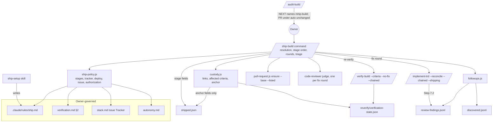
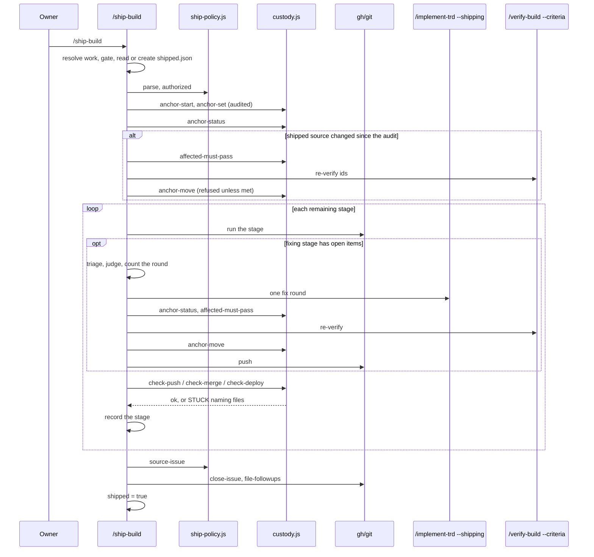

# TRD: /ship-build and ship.md — the project defines "shipped", Ensemble delivers each piece of work there

**Version**: 1.1.1
**Status**: Draft
**Created**: 2026-11-02
**Last Updated**: 2026-11-03
**Author**: @technical-architect
**Source PRD**: `docs/PRD/ship-build.md` (2.1.0; no supersession marker — current)
**Task ID Prefix**: SHIP

---

## Changelog

| Version | Date | Changes | Author |
|---------|------|---------|--------|
| 1.0.0 | 2026-11-02 | Initial TRD from PRD 2.0.0 (55 criteria, NFR-1–NFR-5, NG1/9/10/14/15/18, rulings A–D) | @technical-architect |
| 1.1.0 | 2026-11-02 | Revised against PRD 2.1.0 (50 criteria; owner rulings F, G, I). **F** (`ensemble.openPullRequest` stays): removed SHIP-B007 (retire PR opening) and SHIP-B011 (rebase migration), D32, and every removal of the setting from other tasks; `open-pr` builds on `pull-request.js ensure` with `--base` and `--listed` and reuses an open PR, retargeting it to `ship.md`'s base (D22, R14). **G** (close only what the work names): removed SHIP-B009, D30 and the recorded source issue; `close-issue` reads the PRD/TRD header lines or the branch (D29 rewritten); sweep work is read from the working tree (D39). **I** (code only where a wrong answer is costly): removed SHIP-B003 (`ship-run.js`) and SHIP-B012 (`ship-triage.js`); resolution, sequencing, resume, the run record, fix rounds and triage are `/ship-build`'s prompt (D1, D6, D7, D16, D18); the one piece of the old run library that guards a costly answer — who may move the anchor — moved into `custody.js` (D12). **Merged**: SHIP-P001 into SHIP-B001; SHIP-T001 into SHIP-B013; the review-finding record's library half of SHIP-B004 into SHIP-B005; `audit-build.md`'s two changes into SHIP-B004. **Carried from the first grounding run**: `--no-renames` (D9), the re-verification subset's own paths and no republish (D13), content-derived review-finding ids and a `summary` on every row (D25), how Step 7.2 captures a review it does not wait for (D25), the bare `deploy` example (D5, D23), `--shipping` skipping §9.0's push (D14), Monitor's 30-minute arm (D20). 18 tasks over 6 phases → 11 over 3 (2 deferred); the task-order cycle among SHIP-P001, B011, B012, B013 and D002 is gone | @technical-architect |
| 1.1.1 | 2026-11-03 | `/audit-trd` against PRD 2.1.0: each must-pass mark carries its reason (Objectives header); D1 serves the behaviours its Choice assigns (AC-F3.1, AC-F3.2, AC-F6.2); D22 cites R14 as a risk, not an objective; D11 and §3.8 say `BUILD_TOKEN` is exported by SHIP-B001, not today, and D11/§3.1 state that a deploy identity must report this work's commit; D12/§3.3 give `affectedMustPass` a no-success-definition result instead of a throw; D25 mints the review id from `HEAD`; D31 switches to the ship branch before committing; D39/§2.4 put ship-time sweep rows in the sweep's own state dir; D28 records how Linear and Jira close an issue. Could Not Verify rewritten. The owner kept AC-F5.1's must-pass mark | @technical-architect |

---

## Objectives

Every PRD 2.1.0 acceptance criterion is an objective here, stated in full under its PRD id, so
`/audit-trd` and `/audit-build` trace one id end to end. Six are marked **Must pass** — the three
problems the owner named on 2026-11-02 (run the project's ship process, log what was not fixed,
ship the code that was verified) do not exist without them. The PRD marks no criterion must-pass;
these marks are this TRD's, one reason each: AC-F3.3 is "run the project's ship process"; AC-F9.1
is "log what was not fixed"; AC-F14.3, AC-F14.7 and AC-F14.8 are "ship the code that was
verified"; AC-F5.1 serves the same problem, because a fix made any other way than the recorded,
re-verified path ships code no verification saw. The owner confirmed AC-F5.1's mark on
2026-11-03 ("Keep it").

| ID | Objective | Source | Must pass |
|----|-----------|--------|-----------|
| AC-F1.1 | A `ship.md` template exists in `packages/core/templates/claude-directory/rules/` and is scaffolded into a project's `.claude/rules/ship.md` by the mechanism that scaffolds `verification.md`. The template carries example `run <command>` lines for release and platform steps — version bump, changelog, tag, publish, mobile build, store submission, OTA update — and for checking which build a deployed environment runs. | PRD AC-F1.1 | |
| AC-F1.2 | `ship.md` expresses an ordered list of stages, each a vocabulary name plus parameters. | PRD AC-F1.2 | |
| AC-F1.3 | `close-issue` and `file-followups` are on by default, and `ship.md` can switch each off. | PRD AC-F1.3 | |
| AC-F1.4 | Each fixing stage (`ci-green`, `external-review`) carries a round cap, a severity bar and whether below-bar review findings are filed, and states what happens at the cap (AC-F5.8). A fixing stage with no cap written uses the default cap of **2**. | PRD AC-F1.4 | |
| AC-F1.6 | The file states that it is owner-governed and changes only through `/ship-setup`. | PRD AC-F1.6 | |
| AC-F2.1 | Invoking `/ship-setup` interviews the owner and writes `.claude/rules/ship.md`. For each fixing stage it offers a round cap of **2** and the significance bar (AC-F5.7) as defaults, both changeable. For a `deploy` stage whose environment has no full-deploy command in `verification.md` §2, it records the deploy command in `ship.md` (AC-F4.6). | PRD AC-F2.1 | |
| AC-F2.2 | Running `/ship-setup` is the owner's approval of the outward-facing stages it records; `/ship-build` asks for no further confirmation before running them. | PRD AC-F2.2 | |
| AC-F3.1 | `/ship-build` ships whatever Ensemble is currently working on — the PRD/TRD feature, the `/plan` or the `/sweep` in flight — and resolves it the way `/implement-trd` resolves the current work. | PRD AC-F3.1 | |
| AC-F3.2 | Stages run in the order `ship.md` lists them; a stage starts only after the previous one succeeded (a fixing stage succeeds as AC-F5.8 defines). | PRD AC-F3.2 | |
| AC-F3.3 | The work counts as shipped only when the last listed stage succeeded, and no stage `ship.md` lists needs to be run by hand. Then `close-issue` and `file-followups` run (unless switched off), and `/ship-build` writes its shipped record, `shipped.json`, in `.trd-state/<feature>/` beside `closed.json`. "Closed" (verified) and "shipped" (delivered) stay distinct: a feature can be closed and not yet shipped. | PRD AC-F3.3 | yes |
| AC-F3.5 | A run ends with the standard four-section readout and a `COMMAND COMPLETE` or `COMMAND STUCK` banner as its last line. `COMMAND COMPLETE` means the run did its job, not that the work shipped; the shipped record says whether it shipped. | PRD AC-F3.5 | |
| AC-F3.6 | A project with no `ship.md`: `/ship-build` commits and pushes, opens no PR, and the readout points to `/ship-setup`. It says the branch is ready for a PR, or, where a PR is already open for the branch (as `/audit-build` opens one under `openPullRequest: auto`), names that PR instead. | PRD AC-F3.6 | |
| AC-F3.7 | **Audit gate.** A full PRD → TRD feature ships only when its `.trd-state/<feature>/closed.json` exists, written by a passing `/audit-build` or by the owner's `/close-feature` override (whose `"audit": null` satisfies the gate). Work from a `/plan` TRD and `/sweep` work ships without one. A full feature without `closed.json` stops before the first stage and the readout names `/audit-build` or `/close-feature` as NEXT. | PRD AC-F3.7 | |
| AC-F4.1 | The vocabulary is `push`, `open-pr`, `ci-green`, `external-review`, `await-human-review`, `merge`, `deploy`, `close-issue`, `file-followups` and `run <command>`. | PRD AC-F4.1 | |
| AC-F4.2 | Each of the owner's five stage lists is valid `ship.md` content and runs end to end. The five (PRD F4 table; examples, not defaults): (1) `push`; (2) `push` → `open-pr base=main` → `await-human-review`; (3) `push` → `open-pr base=develop` → `ci-green fix=yes cap=3` → `merge method=merge`; (4) `push` → `open-pr base=main` → `ci-green` → `merge` → `deploy env=production`; (5) `push` → `open-pr` → `external-review tool=coderabbit fix=non-trivial` → `ci-green` → `merge` → `deploy`. | PRD AC-F4.2, F4 table | |
| AC-F4.3 | `open-pr` opens a PR against the base `ship.md` names, whatever `openPullRequest` is set to: the listing is its authorization. Where a PR is already open for the branch — as `/audit-build` or `/close-feature` opens one under `openPullRequest: auto` — the stage reuses it and opens no second one. `/audit-build`'s and `/close-feature`'s PR opening is unchanged (ruling F). Today `pull-request.js ensure` already reuses an open PR, but opens one only under `auto` and only against the default branch; how `open-pr` builds on it is the TRD's to set (D22). | PRD AC-F4.3 | |
| AC-F4.4 | `merge`, `deploy` and `run` stages run only because `ship.md` lists them, and the listing is their authorization. A project whose `ship.md` lists no `merge` is never merged by `/ship-build`: the policy file, not `pull-request.js`, decides whether `/ship-build` merges; `pull-request.js` itself still never merges (R3). A `deploy` stage authorizes a deploy to any environment, production included; `verification.md` §1's "Loop may DEPLOY to it?" column governs only the verification loop and does not block it. | PRD AC-F4.4 | |
| AC-F4.6 | Where `verification.md` §2 declares a full-deploy command for the environment, `deploy` reuses it; otherwise it uses the command `ship.md` records (AC-F2.1); with neither, the stage stops and reports, never guesses. | PRD AC-F4.6 | |
| AC-F4.7 | `push` commits a `/sweep`'s uncommitted changes by pathspec before pushing; `/sweep` itself stays never-commit. | PRD AC-F4.7 | |
| AC-F5.1 | A code fix is recorded as a discovery (`discovered.record` with `blocksFeature: true`) and built by `/implement-trd --reconcile --chained`, so every code fix appears as a discovery row and a TRD row with a commit. `/ship-build` never edits code itself. It fixes in both fixing stages: `ci-green` (CI failures, `fix=yes`) and `external-review` (review findings). `.claude/commands/implement-trd.md` and its `packages/core/commands/` copy, which today name only `/verify-build` and `/audit-build` as `--chained` callers, admit `/ship-build`. | PRD AC-F5.1 | yes |
| AC-F5.2 | Triage before fixing (failure → action → re-verify):<br>• Flaky test or infrastructure (re-run passes) → re-run CI **once**; no code change → none<br>• Lint or format → the project's formatter/linter is run and its output committed — not a model edit; anything needing a hand edit goes through the recorded path → none<br>• Test or build failure in this feature's code → fix via the recorded path → affected criteria only<br>• Failure in code this feature did not touch → stop and report; file as a follow-up → —<br>• Review finding at or above the bar → fix via the recorded path → affected criteria only<br>• Review finding below the bar → not fixed; filed only if `ship.md` opts in → —<br>• Deploy failure → stop and report; never auto-fix → — | PRD AC-F5.2 | |
| AC-F5.3 | When it is unclear whether a failure belongs to this feature, a judge decides. Failures it rules out of scope are reported and filed as follow-ups, never fixed here. | PRD AC-F5.3 | |
| AC-F5.4 | After a fix, only criteria whose covered files changed are re-verified; every other proven criterion stays proven, and the widest re-check is the must-pass criteria whose own covered files the fix changed. (Evidence already stores a sha256 of each covered file, in `packages/core/lib/live-evidence.js`.) A fix is never re-audited. | PRD AC-F5.4 | |
| AC-F5.7 | The default severity bar is significance: correctness, security, data loss, a broken contract. Where the reviewer labels severity, its labels are used; otherwise a judge decides against the bar. The bar is a `ship.md` parameter of the fixing stage. | PRD AC-F5.7 | |
| AC-F5.8 | **Round cap and the final round.** Each fixing stage runs at most its `ship.md` round cap of fix rounds (**2** by default). After the final round — the last its cap allows — the findings still open are sorted. A critical one stops the run (`COMMAND STUCK`), says what is still failing and leaves the PR as it is. Every below-critical one is filed as a follow-up (F9) and listed in the readout with its issue, and the stage counts as succeeded. A finding is critical by the reviewer's own severity label where it gives one, and by the AC-F5.7 judge otherwise, CI failures included. | PRD AC-F5.8 | |
| AC-F6.1 | `await-human-review` ends the run with a resumable record of which stages succeeded and which remain. The run ends `COMMAND COMPLETE`; its readout says the work is not shipped yet and names `/ship-build --resume` in NEXT. | PRD AC-F6.1 | |
| AC-F6.2 | `/ship-build --resume` runs the remaining stages from that record. | PRD AC-F6.2 | |
| AC-F7.1 | `close-issue` runs only after the last stage succeeded — never when the PR opens and never at a wait, since a PR still waiting for human review has not shipped — and closes the issue in the tracker `stack.md` declares (F10). | PRD AC-F7.1 | |
| AC-F7.2 | `close-issue` closes the issue the current work already names: an issue reference in its PRD or TRD header (`/create-prd` records an issue key on the PRD's `**Source**:` line today) or in its branch name (`process.md`'s `<issue-id>-<session>` pattern). With none found, it closes nothing and the readout says so. | PRD AC-F7.2 | |
| AC-F9.1 | Sources filed: non-blocking `discovered.jsonl` rows, `/audit-build`'s out-of-scope list, verification criteria left `not_verifiable`, the unfixed review findings in AC-F9.7's record, failures the ownership judge ruled were not this feature's (AC-F5.3), below-critical findings left after a fixing stage's final round (AC-F5.8), and the `followups` in a `/task`'s `closed.json`. | PRD AC-F9.1 | yes |
| AC-F9.2 | Review findings below the significance bar are not filed unless `ship.md` opts in (AC-F1.4). The bar applies unchanged to AC-F9.7's record. | PRD AC-F9.2 | |
| AC-F9.3 | Each filed issue links back to the work it was found in. Each finding is filed at most once, keyed by a stable id, so a re-run does not duplicate. | PRD AC-F9.3 | |
| AC-F9.5 | Any finding it cannot file (no tracker configured, a failed call) is listed in the readout, not dropped. The readout also names each below-bar review finding from AC-F9.7's record that it did not file, and the path of that record. | PRD AC-F9.5 | |
| AC-F9.7 | **Record of unfixed review findings.** `/implement-trd`'s end-of-run review step (Step 7.2) writes **every** review finding it chose not to fix, whatever its severity, to a file under `.trd-state/<feature>/`, and `file-followups` reads that file. The change is made in `.claude/commands/implement-trd.md` and its `packages/core/commands/` copy. The file's name and format, and how the step obtains the findings of a review it does not wait for, are the TRD's to set (D25). | PRD AC-F9.7 | |
| AC-F10.1 | The `stack.md` template has a place to declare the project's issue tracker. | PRD AC-F10.1 | |
| AC-F10.2 | `/ship-build`'s `close-issue` and `file-followups` use the tracker that declaration names. | PRD AC-F10.2 | |
| AC-F10.3 | With no tracker declared, nothing is filed or closed and the readout lists what could not be (consistent with AC-F9.5). | PRD AC-F10.3 | |
| AC-F11.1 | On a pass, `/audit-build` names `/ship-build` in NEXT and never runs it. Its PR opening under `openPullRequest: auto` is unchanged. | PRD AC-F11.1 | |
| AC-F12.1 | A drafted amendment to `constitution.md`'s Governance Split table adds `ship.md` to the owner-governed slow layer beside `verification.md`, with running `/ship-setup` as the confirmation. | PRD AC-F12.1 | |
| AC-F12.2 | A drafted amendment to `autonomy.md` makes a `merge`, `deploy` (to any environment, production included), `run` or other outward-facing stage listed in `ship.md` the owner's standing authorization for it, and names `/ship-setup` as interactive by purpose beside `/verification-setup`. The existing `openPullRequest: auto` exception stays as it is (ruling F). | PRD AC-F12.2 | |
| AC-F12.3 | Neither `constitution.md` nor `autonomy.md` is changed until the owner approves. | PRD AC-F12.3 | |
| AC-F14.1 | **Anchor.** The anchor starts at the audited commit (`closed.json`'s `audit.auditedCommit`). With no audited commit — `/plan` and `/sweep` work, and `/close-feature`'s `"audit": null` — it is the commit `/ship-build`'s push stage pushed. Only AC-F14.7 moves it. | PRD AC-F14.1 | |
| AC-F14.2 | **Code equality.** The code at a link equals the anchor's when the two commits' trees differ in no file outside the ignored paths: `.trd-state/`, the audit report (`.trd-state/<feature>/audit-build-report.md`), the feature's TRD, and test-only files. Every other file is **shipped source**. A **test-only file** is a file the project's test framework treats as a test (in this repository, for example, Jest's `*.test.js`, pytest's `test_*.py`, BATS's `*.test.sh`); the exact pattern, including whether fixtures and test helpers count, is the TRD's to set (D10). | PRD AC-F14.2 | |
| AC-F14.3 | **Custody links.** *Push:* after each push `/ship-build` makes — including AC-F3.6's push with no `ship.md` — the remote branch head's code equals the anchor's. *Merge:* after `merge`, the commit GitHub records as the PR's merged head (e.g. `gh pr view --json headRefOid`) has code equal to the anchor's, and the PR merged into the target branch `ship.md` names; this holds for merge, squash and rebase merges alike. *Deploy:* after `deploy`, the deployed build reports a commit whose code equals the anchor's; a build that reports no identity, or a different one, fails the link. | PRD AC-F14.3 | yes |
| AC-F14.6 | **Full commit ids.** `/audit-build` writes the full commit id in its report header's `Audited commit:` line (written today from `git rev-parse --short HEAD`, in `.claude/commands/audit-build.md` and its `packages/core/commands/` copy), so `closed.json` stores it in full. A short anchor id stored before this change that resolves to exactly one commit is used normally; an ambiguous one fails with that reason, never a guess. | PRD AC-F14.6 | |
| AC-F14.7 | **What moves the anchor.** Any change to shipped source after the audited commit — a closing audit's chained fix made before shipping starts, a fix `/ship-build` makes (F5), or a commit made by a `run` stage — is re-verified for the must-pass criteria whose covered files it changed (AC-F5.4), and its commit then becomes the anchor before the next custody link. Where no must-pass criterion's covered files changed, nothing is re-run and the anchor still moves; a formatter/linter tool run's commit needs no re-verification (AC-F5.2) and moves the anchor once committed; a criterion that fails its re-verification leaves the anchor where it was. A change only to ignored paths needs no move. `/ship-build` records each move in its shipped record, and nothing else moves the anchor. | PRD AC-F14.7 | yes |
| AC-F14.8 | **A mismatch fails loudly.** Any other difference at a custody link stops the run (`COMMAND STUCK`), naming the stage and the files that differ; a PR that is unmerged, or merged into another branch, fails the merge link the same way, naming which. It is never auto-fixed. | PRD AC-F14.8 | yes |
| AC-F14.9 | The check is deterministic code — a lib function with unit tests — not a model judgement. It lives outside `pull-request.js` (R3). | PRD AC-F14.9 | |
| AC-F17.1 | When a trigger is set on the PR at `await-human-review`, the event it names (e.g. approval) runs the remaining stages as `--resume` would. | PRD AC-F17.1 (P1) | |
| AC-F17.2 | The readout claims a trigger only when one was actually set (`constitution.md` prohibited pattern 6, no false async claims). | PRD AC-F17.2 (P1) | |
| NFR-1 | `/ship-build` and `/ship-setup` end with the four-section readout and a `COMMAND COMPLETE` or `COMMAND STUCK` banner as the last line (AC-N1) | PRD NFR-1; `constitution.md` prohibited pattern 7; `command-status.md` | |
| NFR-2 | No turn claims later work (a resume, a trigger, a CI result, a notification) without the primitive that backs it in the same turn; a CI wait uses a bounded primitive (AC-N2) | PRD NFR-2; `constitution.md` prohibited pattern 6; `async-discipline.md` | |
| NFR-3 | `/ship-build` runs autonomously from invocation to banner; it asks the owner only in `autonomy.md`'s four cases. `/ship-setup` is interactive by purpose (AC-N3) | PRD NFR-3; `constitution.md` prohibited pattern 8 | |
| NFR-4 | Ensemble never assumes Forge exists; no Forge call or assumption in either command (AC-N4) | PRD NFR-4 (OQ-8) | |
| NFR-5 | The chain-of-custody check is deterministic and unit-tested: unit tests cover each link (push, merge, deploy), the ignored-path classification, each way the anchor moves, and each failure condition (AC-N5) | PRD NFR-5, AC-N5 | |
| O1 | All findings at or above the bar from one CI run or one review pass go into a single fix round | Brief §7, "Settled with the owner, 2026-10-31"; PRD §8 ("moved to the TRD") | |
| O2 | `/ship-setup` is owner-invoked only (`disable-model-invocation: true`) and ends with the readout, banner and `notify-complete.sh` call | PRD §8 (old AC-F2.4, AC-F2.5 "moved to the TRD"); `verification-setup` precedent | |
| O3 | `/ship-setup` is registered in `framework-skills.txt` | PRD §8 (old AC-F12.7 "moved to the TRD") | |
| O4 | Unit tests ≥ 60% for new and changed lib code; integration ≥ 50% where applicable | `constitution.md` Quality Gates | |
| O5 | Every `git`/`gh` invocation in new lib code uses `spawnSync` with array arguments; no `execSync` with interpolation | `CLAUDE.md` Security Considerations | |
| O6 | `ship.md` never holds a credential's value; `/ship-setup` records where one lives, never the value | domain-derived: `ship.md` is committed to git and loaded into every session (`.claude/rules/`), the same exposure `verification.md` §3 guards against | |
| O7 | Documentation updated; `docs/TRD/pr-at-cycle-end.md` notes the two of its decisions this feature overrides — `/ship-build`'s `open-pr` also opens a PR, and a `ship.md` `merge` stage is the owner's standing go for `gh pr merge` — while its setting and PR opening stand | `constitution.md` Quality Gates; PRD §8 "Corpus decisions this PRD overrides" ("the TRD must be corrected when this ships") | |

Removed in 1.1.0 with the PRD: AC-F8.1 (ruling G), AC-F11.2–AC-F11.5 (ruling F).

---

## 1. Overview

### 1.1 Technical Summary

`/ship-build` is a prose command. It resolves the work, runs `ship.md`'s stages in order, keeps
its own run record (`shipped.json`), counts fix rounds and triages what shipping finds — all as
instructions to the model, checked afterwards by the record it writes (owner ruling I). Code is
written only where a wrong answer is costly:

- **`ship-policy.js`** reads `ship.md` into a validated stage list, reads the tracker from
  `stack.md`, resolves a deploy command, finds the issue the work already names, and reports
  which listed stages `autonomy.md` currently authorizes.
- **`custody.js`** is the chain-of-custody check (F14): code equality outside the ignored
  paths, the push/merge/deploy links, which must-pass criteria a change affects — and the only
  writer of the anchor, refusing a move whose re-verification did not pass. It lives outside
  `pull-request.js` (R3).
- **`followups.js`**, with a review-finding record added to **`discovered.js`**, collects every
  finding seen and not fixed, gives each a stable id and files it once.

Fixes go through the existing recorded path (`discovered.record` → `/implement-trd --reconcile
--chained`, with a new `--shipping` flag past the closed-feature guard); re-verification through
`/verify-build --criteria`, a subset run with its own state; PR opening through the existing
`pull-request.js ensure`, which gains `--base` and `--listed` and otherwise behaves exactly as
today for `/audit-build` and `/close-feature`. `ensemble.openPullRequest` stays (ruling F).
Governance amendments are drafted, never applied, until the owner approves.

### 1.2 Key Technical Decisions

| ID | Decision | Choice | Serves Objective | Rationale | Alternatives Considered |
|----|----------|--------|------------------|-----------|------------------------|
| D1 | Where the logic lives | `ship-build.md` owns resolution, stage order, resume, run-record bookkeeping, fix-round counting and triage. Code: `ship-policy.js`, `custody.js`, `followups.js` + `discovered.js`'s review-finding record, and two flags on `pull-request.js ensure` | AC-F3.1, AC-F3.2, AC-F6.2, AC-F14.9, NFR-5, AC-F9.3, AC-F1.2 | Owner ruling I (PRD §8): code only where a wrong answer is costly — parsing `ship.md`, the custody check, filing once. Stages chain other commands as Skills, which only the lead session can do | `ship-run.js` and a `ship-triage.js` workflow (1.0.0) — rejected by ruling I. **Revisit** when a run record shows a stage run out of order, a lost resume point or a mis-triaged finding (PRD §8) |
| D2 | `ship.md` format | Markdown. `## Stages`: numbered lines `N. <name> key=value key="quoted value"`, or `N. run <command>`. `## After shipping`: `close-issue: on\|off`, `file-followups: on\|off`. Examples sit under `## Examples (not run)` and are never parsed. **A file with no stage line under `## Stages` is treated as no `ship.md`** | AC-F1.1, AC-F1.2, AC-F1.3, AC-F3.6 | Matches `verification.md`'s owner-readable shape; the unfilled template ships into every project (AC-F1.1), so "no stages" must mean "no policy" or AC-F3.6 could never fire | YAML front matter — rejected: hides the policy from the owner. **Revisit** if parsing errors become common |
| D3 | Stage parameters and defaults | §3.1 table. Fixing stages: `cap=2`, `bar=significant`, `file-below-bar=no`; `ci-green fix=yes`; `merge method=merge`; `open-pr base=` the repo default branch. The owner's five examples parse verbatim (`fix=non-trivial` ≡ `fix=yes` with the significance bar) | AC-F1.4, AC-F4.2, AC-F5.7 | Cap 2 and the significance bar are PRD defaults; `fix=yes` matches the owner's "Both, as written" ruling that `ci-green` fixes | `ci-green` default `fix=no` — not chosen; OQ-8 |
| D4 | `close-issue`, `file-followups` placement | On/off switches under `## After shipping` only; a Stages line naming either is a parse error pointing at the switch | AC-F1.3, AC-F7.1 | They must run after the last stage; a Stages position could put them before `merge` | Allow them at the end of Stages — rejected: two ways to say one thing |
| D5 | Parse-time order rules | `external-review`, `await-human-review` and `merge` require an earlier `open-pr`; unknown stage names and unknown params are errors naming the line. `deploy` needs no `env=` at parse time (D23 resolves its target) | AC-F3.2, AC-F4.1, AC-F4.2, AC-F14.3 | The merge link compares a PR head, so `merge` without a PR has nothing to compare; errors at parse stop a run before any outward act. The owner's fifth example is a bare `deploy`, which AC-F4.2 requires to be valid | `deploy` requires `env=` (1.0.0) — rejected: makes the owner's fifth example a parse error |
| D6 | The run's record | `<stateDir>/shipped.json` (§3.4), created when the run starts. The command writes it by read–change–write of the fields it updates, never by rewriting the whole file from memory. `custody.js` is the **only** writer of `anchor` and `anchorMoves`. `--resume` and a plain re-run continue from the record's stage snapshot, never re-reading `ship.md` mid-run | AC-F3.3, AC-F3.5, AC-F6.1, AC-F6.2, AC-F14.7 | The record is the check ruling I relies on; AC-F14.7 records anchor moves in it before shipping completes, so it exists from the start and says whether the work shipped. The anchor decides what custody compares against — the one field whose wrong value ships unverified code | A record API in code (1.0.0) — rejected by ruling I. The command writing the anchor — rejected: an unchecked anchor move is the costly wrong answer |
| D7 | Resolving the work | Prose, in `/implement-trd` §1.2's order: (1) an explicit TRD path; (2) the branch-derived slug (the two `process.md` patterns); (3) the one `.trd-state/*/` whose `implement.json` `branch` or `shipped.json` `work.branch` is the current branch — skipping `_`-prefixed dirs and `kind: "task"` dirs; (4) no TRD work and uncommitted changes outside `.trd-state/` → `/sweep` work (D39); (5) `COMMAND STUCK` listing every candidate. **Diverges from §1.2 step 3**, which skips features with `closed.json` — those are exactly what ships | AC-F3.1 | Same order and shape as `/implement-trd`; the divergence is forced by the audit gate | `current.json` — rejected: a passing audit nulls it (feature-close-out D9) |
| D8 | Full feature vs `/plan` | Read from the TRD header: a `**Source PRD**:` line naming an existing file under `docs/PRD/` → full feature (gate applies); a line naming anything else (`None — …`, a `docs/plan/` investigation) → `/plan` work; **no `**Source PRD**:` line → full feature** | AC-F3.7 | `/plan` always writes `**Source PRD**: None — …` (`plan.md` line 528); the TRDs with no such line are older full features. Defaulting a missing line to `/plan` would waive the gate | A `kind` field in `implement.json` — rejected: absent on every existing feature |
| D9 | Code equality | `git diff --no-renames --name-only -z <a> <b>`, each path classified `ignored` \| `test-only` \| `shipped`; equal ⇔ no `shipped` path. Ignored: anything under `.trd-state/` (which holds the audit report) and the work's TRD path. Both commits must be local; links fetch first | AC-F14.2 | Git compares blob bytes, so an empty shipped list is byte identity outside the ignored paths. `--no-renames` because default rename detection reports only a rename's destination: a shipped file moved under `.trd-state/` would read as an ignored-only change | Compare filtered tree hashes — rejected: same answer, cannot name differing files (AC-F14.8) |
| D10 | Test-only pattern | A path is test-only when its basename matches `*.test.{js,cjs,mjs,ts,tsx,jsx,sh}`, `*.spec.{js,ts,tsx,jsx}`, `*.bats`, `test_*.py`, `*_test.py`, `*_test.go`, `*Test.{java,kt}`, `*Tests.cs`, `*_spec.rb`, `*_test.exs`, **or** any path segment is `__tests__`, `__fixtures__` or `__mocks__`. Helpers and fixtures elsewhere are shipped source | AC-F14.2 | Fewer test-only files can only cause extra re-verification, never ship unverified code. Covers the frameworks Ensemble ships skills for | Whole `test/`/`tests/` directories — rejected: some projects ship code there. OQ-11 |
| D11 | The three links | Push: `git ls-remote origin refs/heads/<branch>` → code-equal to anchor. Merge: `gh pr view <n> --json state,baseRefName,headRefOid` → `MERGED`, base equals the `open-pr` stage's `base` (or the repo default), head code-equal. Deploy: run the stage's `identity=` command, take tokens with `BUILD_TOKEN` (a module-private const in `functional-verification.js` today; SHIP-B001 exports it) via `String.prototype.match` only, skip all-digit tokens and tokens that resolve to no commit after `git fetch origin`, pass when one resolves to a commit code-equal to the anchor; no command, no token or no match fails. Code equality compares whole trees, so the `identity=` command must report the commit deployed from this work: a deploy built from the target branch after a squash or merge onto a branch that has moved since this work's base carries other commits' files and fails the link (safe — it stops the run — but it is the usual outcome on a busy target; `/ship-setup` says so when it asks for `identity=`) | AC-F14.3, AC-F14.8 | One comparison per link (owner, OQ-T). Reuses the identity-token rule verification-preflight D8 settled, including `decideSetup`'s `/[a-f]/` filter for numeric tokens | Ancestry checks — superseded by the owner (PRD §8) |
| D12 | Anchor reconciliation and moves | Before every custody link and after every stage the command runs `custody.js anchor-status`. If shipped files changed: `affected-must-pass` → re-verify those ids (D13) → `custody.js anchor-move`, which **refuses** unless the re-verification state shows every affected id `met` (reasons `fix`, `run`, `pre-ship`), or the reason is `format`. A must-pass criterion with no covered-file record counts as affected whenever any shipped file changed. Work with no success definition (a sweep; a `/plan` or overridden feature never verified) has no criteria, so no id is affected and the move proceeds with `reverified: []` (§3.3). `anchor-set` writes the first anchor once: the audited commit at the start, or, with none, the commit the first push pushed | AC-F14.1, AC-F14.7, AC-F5.4, NFR-5 | One rule catches every source of change (pre-ship chained fix, ship fix, `run` commit). A guarded move is what makes "a criterion that fails its re-verification leaves the anchor where it was" true by construction. Few criteria carry covered files (`live-evidence.js` manifests are rare), and unknown-as-unaffected would ship unverified code | Moves recorded by the prompt, unchecked — rejected (ruling I keeps custody in code). Unknown covers = unaffected — rejected for G3; OQ-2 |
| D13 | Targeted re-verification | `Skill /verify-build <trd> --criteria <ids> --no-fix --chained`. The subset run writes its own state, report and evidence under `.trd-state/<feature>/reverify/`; runs one iteration (`cap: 1`, so the loop never reaches its in-place Debug stage); passes only the named criteria, `mustPassIds` restricted to them, `mustPassUncovered: []`, no coverage floor; appends no check-skill rows; runs no end-of-run full deploy; publishes and records no artifact; ends the run on `RETURN → not run: unknown criterion <id>` for an id not in `success-definition.md`. A sweep has no criteria, so nothing re-runs | AC-F5.4, AC-F14.7, AC-F5.1 | `/verify-build` already assembles the loop's 26 fields; its sweep-file branch already shows the separate-paths isolation. Separate paths keep the feature's full run and its published report untouched (`custody.js` reads `verification-state.json` for proving artifacts). `cap: 1` because a Debug pass edits code outside the recorded path (AC-F5.1) | `Workflow(verify-functional)` from `/ship-build` — rejected: duplicates §8.3's assembly. The feature's own state paths — rejected: overwrites the full run's record and republishes its report |
| D14 | Fix path through a closed feature | `--shipping` on `/implement-trd`, valid only with `--reconcile --chained`: passes §1.2's closed-feature guard **without reopening** — no §1.3 branch switch (the run stays on the current branch), no §1.3a `current.json` write, `closed.json` untouched — and **skips §9.0's push**, so `/ship-build` pushes a fix only after it is re-verified and the anchor moved. `/ship-build` does not wait for the chained build's Step 7.2 review; edits that review applies after `/ship-build` has moved on stay uncommitted and are named in the readout | AC-F5.1, AC-F14.3, AC-F14.7 | Every full feature `/ship-build` handles has `closed.json` (AC-F3.7), and today's guard stops `/implement-trd` on it even under `--chained`. Custody compares commits, so late review edits cannot ship unverified | Move `closed.json` aside — rejected: a crash leaves the feature reopened (feature-close-out D13). Keep §9.0's push — rejected: an unverified fix would reach the remote before the push link. Wait for the review — OQ-16 |
| D15 | Code fixes for `/sweep` work | A sweep has no TRD to reconcile, so a needed code fix ends the run `COMMAND STUCK` naming the failure; NEXT names `/plan <the failure>` then `/ship-build --resume`. Flaky re-runs and formatter runs still apply | AC-F5.1, AC-F5.2 | The recorded path needs a TRD row; inventing one forks a plan the owner did not ask for | Chain `/sweep --chained` on the failure — rejected: no TRD row, no review. OQ-1 |
| D16 | Triage and judging | Prose in `/ship-build`. CI: re-run failed jobs once (`gh run rerun <id> --failed`); a passing re-run is flaky. Still failing → classify each `lint` \| `this-feature` \| `not-this-feature`, with the work's changed files as fact. Review findings: reviewer label first (D17). Everything a label or the flaky re-run does not settle goes to **one foreground `code-reviewer` agent per fix round**, given all unsettled items, returning for every id its class (CI only), `aboveBar`, `critical` and a reason. An id it returns nothing for counts as above the bar and critical (fail closed) | AC-F5.2, AC-F5.3, AC-F5.7, AC-F5.8 | Ruling I makes triage the prompt's. An independent agent judges rather than the orchestrator, which is biased toward proceeding (constitution: fan out for verification). Fail-closed because a dropped item would otherwise be filed below the bar and let the stage succeed | `ship-triage.js` workflow (1.0.0) — rejected by ruling I. The lead session judges inline — rejected: biased toward proceeding |
| D17 | Label mapping | Case-insensitive, in the command: `critical`, `blocker` → critical and above the bar; `major`, `high` → above the bar; `minor`, `low`, `nit`, `nitpick`, `trivial`, `info` → below the bar; anything else → the judge | AC-F5.7, AC-F5.8 | Deterministic where the reviewer spoke (PRD R5 mitigation) | A `ship.md` mapping parameter — not now; OQ-5. **Revisit** once real CodeRabbit labels are seen |
| D18 | Fixing-stage rounds | Prose rules, the count kept in `shipped.json` `stages[i].rounds`: no open items → succeed; rounds < cap → fix every own and above-bar item **in one round** (O1), then rounds + 1; rounds == cap → final sort: any critical → `COMMAND STUCK`, PR left as is; else file the rest and succeed. Below-bar items are filed only with `file-below-bar=yes`. A not-this-feature CI failure is filed and stops the stage (CI cannot go green) | AC-F5.8, O1, AC-F5.2, AC-F3.2 | Ruling I; the record makes a miscount visible | `decideFixingStage` in code (1.0.0) — rejected by ruling I. **Revisit** when a run record shows a miscounted round |
| D19 | Lint and format | `ci-green format=<command>`; for a `lint` failure the command runs it, commits the files it changed by pathspec, and moves the anchor with reason `format` (no re-verification, AC-F14.7). With no `format=`, a lint failure is a code fix | AC-F5.2, AC-F14.7 | "The project's formatter/linter is run and its output committed — not a model edit" | Read the formatter from `stack.md`'s Code Quality table — rejected: it names tools, not commands |
| D20 | Waiting | CI: `Monitor` over `gh pr checks <n> --watch` (no PR: `gh run watch <id> --exit-status`), armed with `timeout_ms: 1800000` (the tool's maximum) and re-armed while checks are still pending; the watched command prints a line on every terminal state. External review: `Monitor` over a poll that exits when a review by a login containing the stage's `tool` exists on the current head, same re-arm rule. Human review: no wait — `reviewDecision` `APPROVED` succeeds, anything else ends the run (AC-F6.1) | NFR-2, AC-F6.1 | `Monitor` is a bounded primitive (`async-discipline.md`): each arm ends at its timeout or when its process exits | `ScheduleWakeup` polling — rejected: splits one stage across turns for no gain. OQ-4 |
| D21 | Merging | Command prose runs `gh pr merge <n> --<method>`; never in `pull-request.js` | AC-F4.4, AC-F14.9 | R3: `pull-request.test.js` fails on `/merge/i` in that file | Revise that test — rejected: the guard still protects the PR helper |
| D22 | Opening the PR | `pull-request.js ensure` gains `--base <branch>` (compared instead of the default branch in the on-the-base skip, and passed to `gh pr create`) and `--listed` (skip the `openPullRequest` check; the caller holds its own authorization). The open-PR lookup also reads `baseRefName`; a reused PR on another base is retargeted with `gh pr edit <n> --base <branch>` and reported `updated`, reason `retargeted from <old>`. `readMode`, `mode` and the existing callers are unchanged | AC-F4.3, AC-F3.6 | Mitigates PRD risk R14 (a PR `/audit-build` opened against the default branch while `ship.md` names another base). Reuses the tested helper; ruling F keeps the setting for `/audit-build` and `/close-feature`. Retargeting serves G1 (no listed stage run by hand); the merge link still fails a PR merged elsewhere (AC-F14.8) | Stop on a base mismatch — rejected: the owner would retarget by hand. A second PR helper — rejected: duplicates `ensure`. **Revisit** if retargeting a PR another command opened surprises an owner (OQ-18) |
| D23 | Deploy command | New `readFullDeploy(verificationText, env)` in `functional-verification.js`. `ship-policy.js deployCommand`: with `env=`, `verification.md` §2's full-deploy cell for that environment, else the stage's `command=`; with no `env=`, the stage's `command=`, else §2's command when **exactly one** environment declares one; else none, and the stage stops and reports | AC-F4.6, AC-F4.2 | One owner for `verification.md` parsing; lets the owner's bare `deploy` run when the project has one deployable environment, and never guesses between two | `deploy` requires `env=` (1.0.0) — rejected: contradicts AC-F4.2's fifth example. First environment with a command — rejected: a guess |
| D24 | Authorization before outward stages | `ship-policy.js authorized` reports per listed stage whether `autonomy.md` as it stands authorizes it. Before the approved amendment (detected by §3.9's sentence, whitespace-normalised): `push` yes; `open-pr` only under `openPullRequest: auto` (the existing exception, read with `pull-request.js readMode`); `merge`, `deploy`, `run`, `close-issue`, `file-followups` no. After: every listed stage. The run stops before the first unauthorized stage, naming it, and NEXT names the governance draft. `ci-green`, `external-review` and `await-human-review` only read; their fixes travel by `push` | AC-F12.3, NFR-3, AC-F4.4, AC-F12.2 | PRD R2 contingency: "ship only the stages that are not outward-facing acts under `autonomy.md` (`push`; a PR only where `openPullRequest: auto` … already authorizes one) and report the rest as not authorized". Filing and closing tracker issues are outward-facing (AC-F12.2's "other outward-facing stage") | Gate only `merge`/`deploy`/`run` (1.0.0) — narrowed by the R2 text. `open-pr` ungated — rejected: before approval its only authorization is the `auto` exception |
| D25 | Unfixed review findings record | `.trd-state/<feature>/review-findings.jsonl`, written only through new `discovered.js` functions (§3.6). Step 7.2 **does not wait** for the review (unchanged). When it starts the review it records a `dispatched` row with a review id it mints itself — `HEAD`'s full commit id at dispatch, which names the diff reviewed and can be recomputed in a later turn — never an id taken from the tool, since Step 7.2 gets a session reference only "if the tool returns one" (when it does, it is stored on the row as `ref`); when the review's result reaches the session — in that turn or a later one — it records one row per finding the review did not apply, then a `captured` row for that review id. A finding's id is derived from its content (file plus normalised summary), so the same finding recorded again in a later fix round stays one finding. `readReviewFindings` returns the latest row per id and every review id dispatched but never captured, which `file-followups` reports as a gap (AC-F9.5). Every row carries a `summary` | AC-F9.7, AC-F9.5, AC-F9.3 | The PRD leaves "how the step obtains the findings of a review it does not wait for" to the TRD; `verify-build.md` step 3a records that no attested primitive lets a lead block on a specific background agent. The markers turn a lost result into a named gap instead of silence | Step 7.2 awaits the review (1.0.0) — rejected: no attested way to block. A SubagentStop hook scraping output — rejected: fragile, invisible. Caller-supplied ids — rejected: re-recording across rounds would file one finding twice. OQ-10 |
| D26 | Follow-up identity and dedup | `followups.js`: stable id = first 12 hex of sha256 of `<source>:<key>`. Keys: discovered row → `ts` + first 80 chars of summary (`discovered.js`'s resolve-key length, pinned equal in a test); criterion → feature + id; review finding → its content-derived id (D25); task follow-up → task dir + index. Global ledger `.trd-state/_followups/filed.jsonl`. Issue body: work, TRD, branch, PR URL, record path and `<!-- ensemble-followup:<id> -->`. Not-this-feature failures and below-critical leftovers are recorded by `/ship-build` as non-blocking `discovered.jsonl` rows (`foundBy: "ship-build"`, summary prefixed `[not-this-feature]` / `[below-critical]`), so they are ordinary discovered candidates | AC-F9.1, AC-F9.3 | `/task` follow-ups belong to no shipped work, so dedup cannot live in one work's record. `discovered.jsonl` is already the findings ledger; a second store for ship-time leftovers would need its own key rule | Dedup in `shipped.json` — rejected. A separate ship-leftovers file — rejected: duplicates `discovered.jsonl` |
| D27 | When filing happens | Not-this-feature failures and below-critical leftovers are filed when they arise, so the readout names their issue (AC-F5.8); everything else after the last stage. Same function, same ledger | AC-F5.3, AC-F5.8, AC-F9.1 | AC-F5.8 lists each leftover "with its issue" | All filing at the end — rejected: a STUCK run would name leftovers with no issue |
| D28 | Tracker declaration and use | `stack.md` gains `## Issue Tracker` with `Tracker: github\|linear\|jira\|none` and `Project: <owner/repo \| team key \| project key>`; `ship-policy.js tracker` reads it. GitHub through `gh issue create/close`; Linear and Jira through `managing-linear-issues` / `managing-jira-issues`, which create issues and close one only by a state update (`linearis issues update <id> --state <done state>`; `jira issues update <key> --status <done>` after `jira issues transitions <key>` lists a done one) — neither CLI has a close verb. `/init-project`'s stack detection (`stack-detection-instructions.md`) has no tracker signal, so the template ships the section unfilled and `readTracker` reads it as no tracker (AC-F10.3) until the owner fills it | AC-F10.1, AC-F10.2, AC-F10.3 | Owner decisions OQ-6/OQ-P: the tracker belongs to project setup | Declare in `ship.md` — rejected by the owner (NG10) |
| D29 | Source issue | `ship-policy.js sourceIssue` reads the header lines (`**Key**: value` lines above the first `---`) of the work's PRD and TRD, then the branch's `<issue-id>-<session>` prefix. GitHub: `#N`, `<Project>#N` or an issues URL for the `Project:` repo; Jira/Linear: `KEY-N`. Exactly one distinct reference → close it; none → close nothing; more than one → close nothing and name them | AC-F7.2, AC-F7.1, AC-F10.2 | Ruling G: close only what the work names. `/plan` TRDs carry their source on `**Source PRD**: None — …`, so all header lines are read, not only `**Source**:`. Code, because closing the wrong issue is outward and easy to miss | A recorded `source-issue.json` (1.0.0) — rejected by ruling G. Close every reference found — rejected: a header can cite a related issue. OQ-17 |
| D31 | Sweep branch | When the current branch is the PR's base and `ship.md` lists `open-pr`, `push` first creates **and switches to** `ship/<work-id>` at HEAD (`git switch -c`, which carries the uncommitted sweep changes with it), then makes D39's commit there, and updates `shipped.json` `work.branch` to `ship/<work-id>` before pushing — so the commit never lands on the base branch and a resume from the ship branch matches D7 step 3 | AC-F3.1, AC-F4.3 | `pull-request.js` skips a PR from the base branch; a sweep runs wherever the owner is | Refuse — rejected: sweeps would never reach `open-pr` |
| D33 | `ship.md` as owner-governed | Added to `scaffold-project.sh`'s `AUTHORED_RULES` and named beside `verification.md` in every governance list in `rebase-project.md`. This repository carries the unfilled template as its own `.claude/rules/ship.md`, byte-identical, so both template-parity tests pass unchanged | AC-F1.1, AC-F1.6 | Without `AUTHORED_RULES` a SessionStart `--refresh` overwrites an owner's file; without the rebase lists, a rebase model reads it as a framework rule. This repository keeps `openPullRequest: auto` (ruling F) and needs no filled `ship.md` | Exempt `ship.md` from the parity tests (1.0.0) — not needed while this repo's copy is the template. **Revisit** when the owner runs `/ship-setup` here (TR5) |
| D34 | `/ship-setup` | `packages/skills/ship-setup/SKILL.md`, `disable-model-invocation: true`, `framework-skills.txt` row `ship-setup support`; one question per topic with a detected default; asks for a deploy `env=`, a deploy command where `verification.md` §2 has none, and an `identity=` command; re-parses its output with `ship-policy.js parse` and reports errors | AC-F2.1, AC-F2.2, O2, O3, O6 | Same shape as `verification-setup` (owner ruling OQ-B) | A slash command — rejected by the owner (OQ-B) |
| D35 | PR trigger (F17) | A GitHub Actions workflow template that runs `/ship-build --resume` on an approving review; `/ship-setup` offers to install it when `await-human-review` is chosen and records `trigger=github-actions`. At the wait `/ship-build` commits and pushes `shipped.json`, and claims the trigger only when the workflow file is present on the remote default branch | AC-F17.1, AC-F17.2 | A remote resume needs the record on the branch; a file check is deterministic | `RemoteTrigger` / scheduled cloud agents — not chosen: no PR event. OQ-9 |
| D36 | Governance amendments | Drafted in `docs/plan/ship-build.governance-draft.md`: the `constitution.md` Governance Split row (and the same row in its template), the `autonomy.md` addition for both copies (§3.9's sentence on a line of its own; `/ship-setup` beside `/verification-setup`; the `openPullRequest: auto` exception unchanged), this repo's `stack.md` `## Issue Tracker` section, and the byte arithmetic. Applying them is Deferred by design | AC-F12.1, AC-F12.2, AC-F12.3 | AC-F12.3 forbids applying before approval; an unattended run cannot obtain it | — |
| D37 | Gate failure | A full feature without `closed.json` ends `COMMAND STUCK` before any stage; Next `/audit-build <trd>` (or `/close-feature`) | AC-F3.7, AC-F3.5 | Nothing ran; the owner must act | `COMMAND COMPLETE` — not chosen. OQ-12 |
| D38 | Committing the record | `shipped.json` is committed by pathspec at the end of every run while the branch is unmerged; after a merge it is left uncommitted and NEXT says to commit it | AC-F6.2, AC-F17.1 | Mirrors `/close-feature` D4 on the default branch | Commit to the merged branch — rejected: never reaches the default branch. OQ-13 |
| D39 | `/sweep` work | With no sweep run record (NG20), sweep work is resolved by D7 step 4. Its id is `sweep-<YYYYMMDD-HHMMSS>`, its state dir `.trd-state/ship-<id>/` (holding `shipped.json` and, when shipping finds any, the `[not-this-feature]` / `[below-critical]` rows D26 writes to `<stateDir>/discovered.jsonl` — never `_sweep/discovered.jsonl`, which stays `/sweep`'s own ledger, NG20), its pathspec every path `git status --porcelain` lists as changed or untracked when the run starts — each named in the commit command and the readout — and its leftovers the open rows of `.trd-state/_sweep/discovered.jsonl` | AC-F4.7, AC-F3.1, AC-F9.1, AC-F3.3 | NG20 forbids a new sweep record, so the working tree is the only record of what a sweep changed; naming each path keeps the commit by pathspec and makes an unrelated file visible | `git add -A` — rejected: not a pathspec, names nothing. Teach `/sweep` to record its files — rejected by ruling G (NG20) |

Removed in 1.1.0: **D30** (sweep run record) and the recorded source issue of old D29 — ruling G;
**D32** (`openPullRequest` migration) and the setting-removal half of old D22 — ruling F.

### 1.3 Technology Stack

| Layer | Technology | Purpose | Notes |
|-------|------------|---------|-------|
| Libraries | Node.js 18+ (CommonJS, `spawnSync`) | `ship-policy.js`, `custody.js`, `followups.js`; additions to `discovered.js`, `functional-verification.js`, `pull-request.js` | `stack.md`; one JSON line per CLI call, like `pull-request.js` |
| Commands / skills | Markdown prompts | `ship-build.md`, `ship-setup` skill | `constitution.md` principles 2–3 |
| Tests | Jest ^29.7, BATS ^1.9 | Unit, seam and scaffold tests | `stack.md` |
| External CLIs | `git`, `gh` | Push, PR, checks, merge, issues | `gh` already a shipped dependency (`pull-request.js`) |

### 1.4 Integration Points

| System | Type | Direction | Notes |
|--------|------|-----------|-------|
| GitHub (via `gh`) | CLI | Both | PR open/view/edit/merge, checks, run re-run, reviews, issues |
| Linear / Jira | Skill (`managing-*-issues`) | Out | Close and file when `stack.md` names them |
| Project deploy and identity commands | Shell | Out | From `verification.md` §2 or `ship.md` |
| `/implement-trd` | Skill, `--reconcile --chained --shipping` | Out | Builds each fix round |
| `/verify-build` | Skill, `--criteria --no-fix --chained` | Out | Targeted re-verification |

---

## 2. System Architecture

### 2.1 Architecture Overview



### 2.2 Component Architecture

#### 2.2.1 `ship-policy.js`
**Responsibility**: Parse and validate `ship.md`; read the tracker; resolve a deploy command; find the issue the work names; report which listed stages are authorized.
**Interfaces**: `parsePolicy`, `readTracker`, `deployCommand`, `sourceIssue`, `authorized`; CLI `parse | tracker | deploy-command | source-issue | authorized`.
**Dependencies**: `functional-verification.js` (`readFullDeploy`), `pull-request.js` (`readMode`), `trd-parser.js` (section and table helpers).

#### 2.2.2 `custody.js`
**Responsibility**: F14, all of it, including the only writes of the anchor.
**Interfaces**: `resolveCommit`, `anchorStart`, `classifyPath`, `codeEqual`, `checkPush`, `checkMerge`, `checkDeploy`, `anchorStatus`, `affectedMustPass`, `readAnchor`, `setAnchor`, `moveAnchor`; CLI one subcommand each.
**Dependencies**: `git`, `gh`; `functional-verification.js` (`BUILD_TOKEN`, the `must-pass-coverage` CLI); `live-evidence.js` (`read`); `implement-state.js` (`load`, `save`).

#### 2.2.3 `followups.js` and the review-finding record
**Responsibility**: Every finding seen and not fixed, identified, filed once; the record of unfixed review findings it reads.
**Interfaces**: `followups.js` `collect`, `stableId`, `readLedger`, `markFiled`, `issueBody`, CLI `collect | mark-filed | body`; `discovered.js` `recordReviewFinding`, `readReviewFindings`, `reviewFindingsPath`.
**Dependencies**: `discovered.js` (`readAll`).

#### 2.2.4 `/ship-build` command
**Responsibility**: The run — resolution, gate, stage order, waits, triage, fix rounds, resume, the record's non-anchor fields, readout.
**Interfaces**: `/ship-build [trd-path] [--resume]`.
**Dependencies**: the three libraries, `pull-request.js`, `/implement-trd`, `/verify-build`, `gh`, `git`, `Monitor`.

#### 2.2.5 `/ship-setup` skill
**Responsibility**: The owner's interview that writes `ship.md`, and the optional F17 trigger.
**Dependencies**: `ship-policy.js parse`, `functional-verification.js` (`readFullDeploy`).

### 2.3 Data Flow



### 2.4 State Management

| File | Writer | Reader |
|------|--------|--------|
| `<stateDir>/shipped.json` | `/ship-build` (every field but the anchor's); `custody.js` (`anchor`, `anchorMoves`) | `/ship-build`, `--resume`, the PR trigger |
| `.trd-state/<feature>/reverify/` | `/verify-build --criteria` | `custody.js anchor-move` |
| `.trd-state/<feature>/review-findings.jsonl` | `/implement-trd` Step 7.2 via `discovered.js` | `followups.js` |
| `<stateDir>/discovered.jsonl` | existing writers (TRD work); `/ship-build` (`[not-this-feature]`, `[below-critical]`), for sweep work too (D39) | `followups.js` |
| `.trd-state/_sweep/discovered.jsonl` | `/sweep` only | `followups.js` (sweep work) |
| `.trd-state/_followups/filed.jsonl` | `followups.js` | `followups.js` |

`<stateDir>` is `.trd-state/<feature>/` for TRD work and `.trd-state/ship-sweep-<YYYYMMDD-HHMMSS>/`
for a sweep (D39).

---

## 3. Technical Specifications

### 3.1 `ship.md` stages and parameters

| Stage | Parameters (default) | Succeeds when |
|-------|----------------------|---------------|
| `push` | — | commit (sweep pathspec only, AC-F4.7) and push done, push link holds |
| `open-pr` | `base=` (repo default branch, as `pull-request.js` finds it) | `ensure` returns `opened` or `updated`, then the push link holds (`ensure` pushes) |
| `ci-green` | `fix=yes\|no` (yes), `cap=N` (2), `bar=<text>` (significant), `file-below-bar=yes\|no` (no), `format=<command>` (none) | checks pass, or the final-round sort succeeds (D18) |
| `external-review` | `tool=<name>` (required), `fix=yes\|no\|non-trivial` (yes; `non-trivial` ≡ yes), `cap`, `bar`, `file-below-bar` as above | the latest review on the current head has no open above-bar finding, or the final-round sort succeeds |
| `await-human-review` | `trigger=github-actions` (none) | `reviewDecision` is `APPROVED`; otherwise the run ends (AC-F6.1) |
| `merge` | `method=merge\|squash\|rebase` (merge) | `gh pr merge` succeeds and the merge link holds |
| `deploy` | `env=` (none; D23), `command=` (none), `identity=` (none) | deploy command exits 0 and the deploy link holds |
| `run <command>` | the rest of the line | exits 0; then anchor reconciliation (D12) |

`## After shipping`: `close-issue: on|off` (on), `file-followups: on|off` (on).

The owner's five examples each parse with no error. Examples 4 and 5 have no `identity=`, so
their deploy link fails until `/ship-setup` records one (OQ-3); example 5's bare `deploy` runs
only where D23 finds exactly one command. An `identity=` command must report the commit deployed
from this work: the link compares whole trees, so a build from a target branch that moved after
this work's base fails it (D11).

### 3.2 `ship-policy.js`

```typescript
type Stage = { name: string; params: Record<string,string>; command?: string; line: number };
parsePolicy(text: string | null): {
  present: boolean;               // false when the file is absent or has no stage line (D2)
  stages: Stage[];
  afterShipping: { closeIssue: boolean; fileFollowups: boolean };
  errors: string[];               // each names the line (D4, D5)
};
readTracker(stackText: string | null): { tracker: 'github'|'linear'|'jira'|null; project: string|null; errors: string[] };
deployCommand(args: { stage: Stage; verificationText: string | null }):
  { command: string|null; env: string|null; source: 'verification.md'|'ship.md'|null; reason: string };   // D23
sourceIssue(args: { tracker: string|null; project: string|null; headerTexts: string[]; branch: string }):
  { ref: string|null; from: 'header'|'branch'|null; candidates: string[]; reason: string };              // D29
authorized(args: { autonomyText: string|null; settingsPath: string; stages: string[] }):
  { amended: boolean; byStage: Record<string, boolean> };                                                // D24
```

CLI prints one JSON line and exits 0, except a usage error (exit 2, the `pull-request.js`
convention; say so in the usage text — `functional-verification.js`'s CLI exits 1).

### 3.3 `custody.js`

```typescript
resolveCommit(ref: string): { ok: boolean; sha?: string; reason?: string };   // ambiguous short id → ok:false naming it (AC-F14.6)
anchorStart(args: { closedJson: object|null }): { commit: string|null; source: 'audited'|null; reason?: string };
classifyPath(p: string, opts: { trdPath: string|null }): 'ignored'|'test-only'|'shipped';   // D9, D10
codeEqual(a: string, b: string, opts): { equal: boolean; differing: string[] };
checkPush(args: { anchor; branch; trdPath }): LinkResult;
checkMerge(args: { anchor; pr: number; target: string; trdPath }): LinkResult;
checkDeploy(args: { anchor; identityOutput: string|null; trdPath }): LinkResult;
type LinkResult = { ok: boolean; link: 'push'|'merge'|'deploy'; observed: string|null; differing: string[]; reason: string };
anchorStatus(args: { anchor; head; trdPath }): { changedShipped: string[]; changedIgnoredOnly: boolean };
affectedMustPass(args: { trdPath; definitionPath; stateDir; changedFiles: string[] }): { ids: string[]; uncovered: string[] };  // uncovered ⊆ ids (D12)
readAnchor(recordPath): { commit: string|null; source: 'audited'|'pushed'|null; moves: object[] };
setAnchor(recordPath, { commit, source: 'audited'|'pushed' }): { ok: boolean; reason: string };   // refuses when one is set
moveAnchor(recordPath, { to; reason: 'pre-ship'|'fix'|'run'|'format'; trdPath; definitionPath; stateDir;
  reverifyStatePath?: string }): { ok: boolean; from: string; to: string; reverified: string[]; reason: string };
```

`affectedMustPass` takes the must-pass set from the existing
`functional-verification.js must-pass-coverage --trd <TRD> --definition <success-definition.md>`
(the one reader, which counts an id as must-pass only when the TRD's Objectives table declares
it), maps each id to its proving `artifact` in `verification-state.json`, and that artifact to
`covers` in the live-evidence manifest (`live-evidence.js read`).

**No success definition.** That CLI reads both files with `fs.readFileSync` and throws on a
missing one (`mustPassCoverageFromFiles`, `functional-verification.js` line 753). So
`affectedMustPass` checks first: when `trdPath` is null (sweep work, D39) or
`definitionPath` does not exist (a `/plan` TRD run with `--no-verify`, a `/close-feature`
override with no verification run), it does not call the CLI and returns
`{ ids: [], uncovered: [], reason: 'no success definition' }`. With no criteria there is nothing
to re-verify (as D13 says of a sweep), so `moveAnchor` then accepts any reason without a
re-verification state, and records `reverified: []` with that reason on the move; the command
names it in the readout. Custody links still compare against the moved anchor.

`moveAnchor` computes the shipped files changed from the current anchor to `to`, then
`affectedMustPass` over them; for any reason but `format`, every affected id must be `met` in
`reverifyStatePath`'s `criteria[]`, or the move is refused with the ids that are not. On success
it appends `{from, to, reason, reverified, at}` to `anchorMoves` and sets `anchor.commit`, by
read–change–write that preserves every other key (atomic, `implement-state.js save`).

**Error handling**: a missing full id is fetched once (`git fetch origin <sha>`), then reported;
every failure returns `ok:false` with a reason — the command turns it into `COMMAND STUCK`
naming the stage and files (AC-F14.8). Nothing auto-fixes.

### 3.4 `shipped.json` — the run record

Written by the command (D6); `custody.js` owns `anchor` and `anchorMoves`.

```json
{ "version": 1,
  "work": { "kind": "feature|plan|sweep", "id": "<id>", "trd": "<path|null>", "branch": "<branch>" },
  "shipped": false, "status": "running|waiting|stuck|shipped",
  "stages": [ { "name": "ci-green", "params": {}, "status": "pending|succeeded|failed|not-authorized", "rounds": 0 } ],
  "afterShipping": { "closeIssue": true, "fileFollowups": true },
  "anchor": { "commit": "<full sha>", "source": "audited|pushed" },
  "anchorMoves": [ { "from": "<sha>", "to": "<sha>", "reason": "fix", "reverified": ["FS-3"], "at": "<iso>" } ],
  "pr": { "number": 0, "url": "" }, "trigger": null, "closedIssue": null,
  "startedAt": "<iso>", "updatedAt": "<iso>", "shippedAt": null }
```

The command updates a field with a `node -e` read–change–write of that field only. `stages` is a
snapshot taken when the record is created; resume reads it, never `ship.md`.

### 3.5 `followups.js`

```typescript
type Candidate = { id: string; source: 'discovered'|'not-verifiable'|'review'|'task'|'review-gap';
  summary: string; evidence: string; record: string; label: string|null; needsBar: boolean };
collect(args: { stateDir; root; trdPath; sweep?: boolean }): Candidate[];
stableId(source: string, key: string): string;          // D26
readLedger(root): Map<string, { url; tracker; work; at }>;
markFiled(root, { id, url, tracker, work }): boolean;   // false is reported, never swallowed
issueBody(c: Candidate, work: { id; trd; branch; prUrl }): string;
```

Sources (AC-F9.1): open, non-blocking rows of `<stateDir>/discovered.jsonl` — `/audit-build`'s
`[out-of-scope]` rows and `/ship-build`'s `[not-this-feature]` / `[below-critical]` rows among
them, one candidate per row; `not_verifiable` criteria in `verification-state.json`;
`readReviewFindings` (`needsBar: true`), and each uncaptured review id as a `review-gap`
candidate that is reported, never filed; the `followups` of every `.trd-state/*/closed.json`
whose `closedBy` is `"task"`; for sweep work, open rows of `.trd-state/_sweep/discovered.jsonl`.
Candidates already in the ledger are dropped.

### 3.6 `discovered.js` additions

```typescript
reviewFindingsPath(stateDir): string;   // <stateDir>/review-findings.jsonl
recordReviewFinding(stateDir, entry, nowIso?): string | null;   // returns the row's id, null on failure
  // entry: { event: 'dispatched'|'captured', reviewId, summary, ref? }   // reviewId = HEAD's full sha at dispatch (D25)
  //     or { reviewId, file?, line?, summary, label?, outcome }   (a finding the review did not apply)
readReviewFindings(stateDir): { findings: object[]; uncaptured: string[] };
```

A finding's id is the first 12 hex of sha256 of `<file or ''>\n<summary, lower-cased, whitespace
collapsed>`; `line` is not part of it, because fixes move lines. Fields are capped like
`record()` (`file` 200, `summary` 400, `label` 40, `outcome` 30) and the row checked once
against `MAX_LINE_BYTES`. `readReviewFindings` skips malformed lines, keeps the latest row per
finding id, and lists review ids with a `dispatched` row and no `captured` row. Commands call
these from a `node -e` one-liner, as they call `record` today; there is no CLI.

### 3.7 `/ship-build` command

`packages/core/commands/ship-build.md`, argument hint `[trd-path] [--resume]`.

1. **Resolve** the work (D7). STUCK lists candidates.
2. **Gate** (D8, D37): a full feature with no `closed.json` → STUCK.
3. **Policy**: `ship-policy.js parse .claude/rules/ship.md`; errors → STUCK naming the lines; not
   present → the AC-F3.6 path (push, then the readout points at `/ship-setup` and names an open
   PR, if `gh pr list --head <branch> --state open` finds one).
4. **Record**: read `shipped.json`, or create it with the stage snapshot; already `shipped` →
   COMPLETE with nothing run. `custody.js anchor-start` → `anchor-set` (audited) when there is an
   audited commit.
5. **Authorization** (D24): `ship-policy.js authorized` for every listed stage; the run will stop
   before the first stage it reports false, marking it `not-authorized`.
6. **Reconcile the anchor** (D12) before the first custody link.
7. **Stages**, from the first not `succeeded`:
   `push` (sweep: D31's switch to `ship/<work-id>` when it applies, then D39's commit on the current branch; `git push`; `anchor-set` pushed when no anchor; `check-push`);
   `open-pr` (`pull-request.js ensure --base <base> --listed --title … --body-file … --expect-branch …`;
   `check-push`); `ci-green` / `external-review` (D20 wait, D16–D17 triage, D18 rounds; a fix round
   is one `discovered.record(…, blocksFeature: true)` per item → `implement-trd <trd> --reconcile
   --chained --shipping` → D12 → `git push` → `check-push`; D19 formatter);
   `await-human-review` (D20; not approved → status `waiting`, D38/D35, COMPLETE with
   `/ship-build --resume` in NEXT); `merge` (D21, `check-merge`); `deploy` (D23, then the
   `identity=` command, `check-deploy`); `run` (then D12). Each stage's result goes into the
   record before the next starts.
8. **After shipping**: `shipped = true`; `close-issue` (D29, D28); `file-followups` (D26, D27).
9. **Readout and banner** (NFR-1): STATE says whether the work shipped; ISSUES names every
   unfiled finding (AC-F9.5), every uncaptured review, every unauthorized stage and any
   uncommitted edit left in the tree (D14). Commit the record (D38); `notify-complete.sh` and
   `PushNotification` on COMPLETE or STUCK (`command-status.md` paths A and B).

**Rules the command states**: never write `anchor` or `anchorMoves`; never edit code; never call
`AskUserQuestion`; claim a trigger only when the workflow file is on the remote default branch.

**Error handling**: deploy failure → STUCK, never fixed (AC-F5.2); not-this-feature CI failure →
filed and STUCK; custody mismatch → STUCK naming stage and files; refused anchor move → STUCK
naming the criteria not met; `gh` missing or unauthenticated → STUCK at the first stage that
needs it; a chained build's `RETURN → STUCK` → STUCK with its reason.

### 3.8 Changes to existing commands and libraries

| File (every copy) | Change |
|-------------------|--------|
| `implement-trd.md` | `--shipping` in the argument-hint and User Input; §1.2's guard admits `--reconcile --chained --shipping` and skips §1.3/§1.3a; §9.0 skipped under it (D14); §3.7 and its RETURN line name `/ship-build`; §7.2's capture rule (D25). §9's `openPullRequest` NEXT lines unchanged (ruling F) |
| `audit-build.md` | `Audited commit:` from `git rev-parse HEAD`, both mentions (AC-F14.6); NEXT names `/ship-build <trd>` when the audit closed the feature (AC-F11.1); PR opening unchanged |
| `verify-build.md` | `--criteria <ids>`, and `--chained` honoured with it (D13) |
| `rebase-project.md` | `ship.md` beside `verification.md` in every governance list (D33) |
| `pull-request.js` | `ensure --base`, `--listed`, retarget (D22) |
| `functional-verification.js` | `readFullDeploy`; `BUILD_TOKEN`, today a module-private const, added to `module.exports` with its value unchanged (SHIP-B001) |
| `discovered.js` | review-finding record (§3.6) |
| `scaffold-project.sh` | `ship.md` in `AUTHORED_RULES` (D33) |

### 3.9 The authorization sentence

The governance draft's `autonomy.md` text must contain, on a line of its own:

> A stage listed in `.claude/rules/ship.md` is the owner's standing authorization for that act.

`ship-policy.js authorized` returns `amended: true` only when this sentence is present, compared
after collapsing whitespace (so a wrapped copy still matches) (D24).

---

## 4. Master Task List

### 4.1 Task ID Convention

`SHIP-[CATEGORY][SEQ]`; categories P, B, T, D as in the contract. IDs are kept from 1.0.0 where a
task survives, so earlier grounding stays traceable; removed IDs are not reused. Every
`packages/core/` change is mirrored to its `.claude/` copy byte for byte; a new lib also gets a
`packages/full/lib/` symlink like its siblings.

Removed in 1.1.0: SHIP-B003 (`ship-run.js`, ruling I), SHIP-B007 (retire PR opening, ruling F),
SHIP-B009 (record a source issue, ruling G), SHIP-B011 (rebase migration, ruling F), SHIP-B012
(`ship-triage.js`, ruling I). Merged: SHIP-P001 into SHIP-B001, SHIP-T001 into SHIP-B013.

### 4.2 Phase 1: Libraries, the existing commands, the governance draft

| Task ID | Description | Serves | Skills | Dependencies | Acceptance Criteria |
|---------|-------------|--------|--------|--------------|---------------------|
| SHIP-B001 | The policy file and its reader. `ship-policy.js` (§3.2) with CLI and tests; in `functional-verification.js`, `readFullDeploy` and `BUILD_TOKEN` exported. The `ship.md` template (owner-governed header, empty `## Stages`, `## After shipping` switches, `## Examples (not run)` with the owner's five lists and the release, platform and identity `run` lines) and this repository's byte-identical `.claude/rules/ship.md`. `ship.md` made owner-governed: `scaffold-project.sh` `AUTHORED_RULES`, a survives-refresh BATS test, and `ship.md` beside `verification.md` in `rebase-project.md`'s governance lists (three copies). `stack.md.template` gains `## Issue Tracker` | D2, D3, D4, D5, D23, D24, D28, D29, D33; AC-F1.1, AC-F1.2, AC-F1.3, AC-F1.4, AC-F1.6, AC-F4.1, AC-F4.2, AC-F4.6, AC-F7.2, AC-F10.1 | `jest` | None | Each of the owner's five lists parses with no error, the bare `deploy` included; the template parses `present:false`; `close-issue` in Stages, `merge` with no earlier `open-pr`, an unknown stage and an unknown param each give an error naming the line; defaults per §3.1. `deployCommand` covers env with a §2 command, env with only `command=`, no env with `command=`, no env with exactly one §2 command, no env with two (none, with the reason), and an older `verification.md` with no §2 table (none, no throw). `readTracker` reads each value and returns null with no section and for the template's unfilled section. `sourceIssue` finds `#53` on a `**Source**:` line and on a `**Source PRD**: None — …` line, a `KEY-12` branch prefix, returns none for none and none-with-candidates for two references. `authorized` is false for `merge`, `deploy`, `run`, `close-issue`, `file-followups` without §3.9's sentence and true with it (also when wrapped across two lines); `open-pr` follows `readMode` before the amendment. Init copies `ship.md`; `--refresh` leaves an edited `ship.md` byte-identical; the template-parity and rebase-list tests pass unchanged. `spawnSync` arrays only (O5); unit coverage ≥ 60% (O4) |
| SHIP-B002 | `custody.js` (§3.3) with CLI and tests against temp git repos, a local bare origin and a stub `gh` on PATH | D9, D10, D11, D12; AC-F14.1, AC-F14.2, AC-F14.3, AC-F14.6, AC-F14.7, AC-F14.8, AC-F14.9, AC-F5.4, NFR-5 | `jest` | SHIP-B001 (`BUILD_TOKEN` export) | Tests cover (AC-N5): each link passing and failing; a change only under `.trd-state/`, only to the TRD, or only to a test-only file (each D10 form) is equal; a shipped-source change is not, naming the file; a shipped file renamed under `.trd-state/` is not equal; a unique short id resolves, an ambiguous one fails with that reason; the merge link fails for open, closed-unmerged and wrong-base PRs, naming which; the deploy link fails with no output, no token, only an all-digit token, and a non-matching token; `affectedMustPass` returns covered-and-changed ids plus every uncovered must-pass id when shipped files changed, none for an ignored-only change, and treats an absent live manifest as all uncovered; with a null TRD path or a missing success definition it returns no ids with reason `no success definition`, without throwing, and `moveAnchor` then accepts a `run` or `fix` move with no re-verification state; `setAnchor` refuses a second set; `moveAnchor` refuses when an affected id is not `met` or the re-verification state is absent, accepts `format` without one, appends each move and preserves other keys; `pull-request.js`'s merge guard unchanged; unit coverage ≥ 60% |
| SHIP-B004 | The two pipeline commands `/ship-build` chains and follows. `implement-trd.md` (both copies): `--shipping` (D14), `/ship-build` admitted as a `--chained` caller, §7.2's capture rule (D25). `audit-build.md` (both copies): full `Audited commit:` id (AC-F14.6) and NEXT naming `/ship-build` (AC-F11.1). Their pins in `verify-command-surface.test.js` | D14, D25; AC-F5.1, AC-F9.7, AC-F11.1, AC-F14.6 | `jest` | None | The argument-hint and User Input carry `--shipping`; §1.2's guard lets `--reconcile --chained --shipping` through without §1.3, §1.3a or touching `closed.json`, and says the run stays on the current branch; §9.0 is skipped under `--shipping`; §3.7's caller list and RETURN line name `/ship-build`; §7.2 keeps "does not block", and names `review-findings.jsonl`, the `dispatched`/`captured` rows and `recordReviewFinding`, and mints the review id from `git rev-parse HEAD` rather than from the tool's return; `implement-trd.md`'s `openPullRequest` NEXT lines are unchanged; `audit-build.md` uses `git rev-parse HEAD` on both header mentions and, when the audit closed the feature, its NEXT names `/ship-build docs/TRD/<feature>.md` alone in a fenced block and never runs it; every existing PR-opening pin still passes; mirrors byte-identical |
| SHIP-B005 | The review-finding record in `discovered.js` (§3.6) and `followups.js` (§3.5), each with tests; `followups.js` with CLI | D25, D26, D27; AC-F9.1, AC-F9.2, AC-F9.3, AC-F9.5, AC-F9.7 | `jest` | None | The same finding recorded twice has one id; every row carries a `summary` and fits `MAX_LINE_BYTES` with multi-byte text; `readReviewFindings` keeps the latest row per id, skips malformed lines and lists uncaptured review ids. Each AC-F9.1 source yields a candidate, including `[not-this-feature]` and `[below-critical]` rows, `_sweep` rows for sweep work, and a `/task` `closed.json` chosen by `closedBy: "task"` (a TRD named `task-…` is not one); an `[out-of-scope]` row yields one candidate; resolved and blocking rows are excluded; an uncaptured review is a `review-gap` candidate; `stableId` is stable across runs; a ledgered id is not collected again; a failed `markFiled` is reported; `issueBody` carries the work, TRD, branch, PR URL, record path and marker; review candidates carry `needsBar`; the 80-character discovered key is pinned equal to `discovered.js`'s; unit coverage ≥ 60% |
| SHIP-B008 | `verify-build.md` (both copies): `--criteria <ids>` and `--chained` honoured with it (D13); new `verify-build-criteria.test.js`; the existing "only for a sweep file" pins in `verify-command-surface.test.js` revised | D13; AC-F5.4, AC-F14.7 | `jest` | None | The command states, and the new test pins: the strip-before-path rule for `--criteria` and its value; the subset's own paths under `.trd-state/<feature>/reverify/`; `cap: 1`; `criteria` filtered, `mustPassIds` restricted, `mustPassUncovered: []`, no coverage floor; no check-skill rows, no full deploy, no publish and no artifacts record; an unknown id ends on `RETURN → not run: unknown criterion <id>`; `--chained --criteria` ends on the existing RETURN line with no banner and no `notify-complete.sh`. §4's field list still matches `implement-trd.md` §8.3; mirrors byte-identical |
| SHIP-D001 | Write `docs/plan/ship-build.governance-draft.md`: the `constitution.md` Governance Split row and the same row for `constitution.md.template`; the `autonomy.md` addition for both copies (§3.9's sentence on a line of its own, `/ship-setup` beside `/verification-setup`, the `openPullRequest: auto` exception unchanged); this repository's `stack.md` `## Issue Tracker` section; and how `async-discipline.md` + `autonomy.md` stay within the 17,000-byte ceiling (R8) | D36; AC-F12.1, AC-F12.2, AC-F12.3 | | None | The draft holds all four parts and states the byte arithmetic and its trim-or-raise choice; `constitution.md`, both `autonomy.md` copies and `stack.md` are unchanged in the diff |

### 4.3 Phase 2: The command and the setup skill

| Task ID | Description | Serves | Skills | Dependencies | Acceptance Criteria |
|---------|-------------|--------|--------|--------------|---------------------|
| SHIP-B013 | `packages/core/commands/ship-build.md` (+ `.claude/commands/` copy) per §3.7 — resolution, gate, stage order, resume, run record, waits, triage, fix rounds, after-shipping and readout all live here; `ship-build-surface.test.js` pinning its contract; `ship-build.seam.test.js` running the lib CLI calls the command names, in its order, on a temp repo; and `pull-request.js ensure --base --listed` with retargeting (D22) and its tests. One task because the command, the CLI contract it relies on and the helper flag it adds are one change | D1, D6, D7, D8, D11, D12, D14–D22, D24, D26, D27, D29, D31, D35, D37, D38, D39; AC-F3.1, AC-F3.2, AC-F3.3, AC-F3.5, AC-F3.6, AC-F3.7, AC-F4.2, AC-F4.3, AC-F4.4, AC-F4.6, AC-F4.7, AC-F5.1, AC-F5.2, AC-F5.3, AC-F5.4, AC-F5.7, AC-F5.8, AC-F6.1, AC-F6.2, AC-F7.1, AC-F7.2, AC-F9.1, AC-F9.5, AC-F10.2, AC-F10.3, AC-F14.3, AC-F14.7, AC-F14.8, AC-F17.2, NFR-1, NFR-2, NFR-3, NFR-4, O1 | `jest` | SHIP-B001, SHIP-B002, SHIP-B004, SHIP-B005, SHIP-B008 | Surface test asserts: each lib CLI the command calls; `--reconcile --chained --shipping`; `--criteria … --no-fix --chained`; a custody check after every push (`open-pr`'s included), merge and deploy; `anchor-move` before any push of a fix; that the command never writes `anchor`/`anchorMoves`; `authorized` before the first stage; the triage table, label mapping and fail-closed judge rule; one fix round per CI run or review pass; `Monitor` with `timeout_ms` and the re-arm rule; the gate's STUCK; the no-`ship.md` path naming `/ship-setup` and an open PR; COMPLETE at a wait with `--resume` in NEXT; a trigger claimed only when the workflow file is on the remote default branch; AC-F9.5's lines; four-section readout and banner last; `notify-complete.sh` present; no `forge`; no `AskUserQuestion`; mirror byte-identical. Seam test (bare origin, stub `gh`): each owner list parses and its custody links pass on stubbed outcomes; a fix commit changing shipped source cannot move the anchor until a re-verification state shows its affected ids `met`; a mismatch names the differing file; committing `shipped.json` does not move the anchor; a follow-up collected, marked filed and not collected again. `pull-request.js`: `ensure --base develop --listed` opens against `develop` with the setting `never`; reuses an open PR; retargets one open against another base; without the flags every existing test passes unchanged; the merge guard passes |
| SHIP-B014 | `packages/skills/ship-setup/SKILL.md` (+ `__tests__/`), `framework-skills.txt` row `ship-setup support`, and the F17 workflow template `packages/core/templates/github/ensemble-ship-resume.yml` the skill offers to install | D34, D35; AC-F2.1, AC-F2.2, AC-F17.1, O2, O3, O6 | | SHIP-B001 | Front matter has `disable-model-invocation: true`; the skill offers cap 2 and the significance bar per fixing stage, asks for a deploy `env=`, a deploy command where `verification.md` §2 has none and an `identity=` command (saying it must report the commit deployed from this work, D11), never writes a credential value, re-parses with `ship-policy.js parse` and reports errors in ISSUES, and ends with readout, banner and `notify-complete.sh`; the registration row exists; tests pin each |

### 4.4 Phase 3: Documentation; deferred governance and live proof

`SHIP-D002` and `SHIP-T002` are listed under `## Deferred by design` below; `/implement-trd` sets
them aside unless `--include-deferred` is passed.

| Task ID | Description | Serves | Skills | Dependencies | Acceptance Criteria |
|---------|-------------|--------|--------|--------------|---------------------|
| SHIP-D003 | Add `/ship-build` and `/ship-setup` to `process.md` (+ template), `CLAUDE.md` (pipeline, command count), `CLAUDE.md.template`, `docs/reference/other-commands.md` and `README.md`, `init-project.md`'s rules and command lists (three copies), and the router's `FRAMEWORK_HINT`; add to `docs/TRD/pr-at-cycle-end.md` a note naming the two decisions this overrides | O7 | | SHIP-B013, SHIP-B014 | Each file names both; `CLAUDE.md` stays within its 15,500-byte ceiling; `pr-at-cycle-end.md`'s note names `/ship-build`'s `open-pr` and a `ship.md` `merge` stage as the two exceptions and says its setting and PR opening stand; `test_router.py` asserts `/ship-build` in the hint; init-project copies byte-identical |
| SHIP-D002 | Apply SHIP-D001's approved draft: `constitution.md` and its template, `autonomy.md` and its template, this repository's `stack.md`, and the byte ceiling if the draft raises it | D36, D24; AC-F12.1, AC-F12.2, AC-F12.3 | | SHIP-D001 | The owner's approval is recorded; §3.9's sentence is present in both `autonomy.md` copies; `ship-policy.js authorized` reports `amended: true` on them; the `openPullRequest: auto` exception and its pin are unchanged; the byte-ceiling test passes |
| SHIP-T002 | [LIVE] Owner's live proof on a throwaway GitHub repository (see Deferred by design) | AC-F4.2, AC-F7.1, AC-F9.3, AC-F14.3, AC-F17.1 | | SHIP-B013, SHIP-B014, SHIP-D002 | Evidence under `.trd-state/ship-build/evidence/live/SHIP-T002/`: each owner list reaching `shipped:true` (example 5 with one deployable environment); a squash and a rebase merge passing the merge link; an issue named on the branch closed; a follow-up filed once across two runs; a resume started by an approving review |

## Deferred by design

| Task ID | Why it cannot run now |
|---------|-----------------------|
| SHIP-D002 | Applies governance edits to constitution.md, autonomy.md and stack.md, which only change with the owner's explicit approval of the SHIP-D001 draft; an unattended run cannot give that approval |
| SHIP-T002 | [LIVE] owner's proof on a throwaway GitHub repo; needs the owner and a real remote, so it cannot run in an unattended run |

## 5. Execution Plan

### 5.1 Phase Overview

| Phase | Focus | Prerequisites | Parallelizable Sessions |
|-------|-------|---------------|------------------------|
| 1 | Policy reader and template, custody, follow-ups and the review record, `implement-trd`/`audit-build` changes, `verify-build --criteria`, governance draft | None | 1A, 1C, 1D, 1F at once; then 1B (after 1A) and 1E (after 1C, which shares `verify-command-surface.test.js`) |
| 2 | `/ship-build` and `/ship-setup` | Phase 1 | 2A and 2B in parallel |
| 3 | Documentation; deferred: apply the approved governance, then the owner's live proof | Phase 2; owner approval and `--include-deferred` for the deferred pair | 3A; SHIP-D002 then SHIP-T002 |

### 5.2 Session Details

**Phase 1** — 1A SHIP-B001 (@backend-implementer); 1B SHIP-B002 (@backend-implementer);
1C SHIP-B004 (@backend-implementer); 1D SHIP-B005 (@backend-implementer); 1E SHIP-B008
(@backend-implementer); 1F SHIP-D001 (@technical-architect).

**Phase 2** — 2A SHIP-B013 (@agent-implementer); 2B SHIP-B014 (@agent-implementer).

**Phase 3** — 3A SHIP-D003 (@backend-implementer). Deferred: SHIP-D002 (@technical-architect,
after approval), SHIP-T002 (owner).

### 5.3 Parallelization Map

```mermaid
gantt
    title Execution Plan (No time scale - dependency order only)
    dateFormat X
    axisFormat %s
    section Phase 1
    B001 policy and template: b001, 0, 1
    B004 implement-trd and audit-build: b004, 0, 1
    B005 follow-ups and review record: b005, 0, 1
    D001 governance draft: d001, 0, 1
    B002 custody: b002, after b001, 1
    B008 verify-build criteria: b008, after b004, 1
    section Phase 2
    B013 ship-build: b013, after b002 b005 b008, 1
    B014 ship-setup: b014, after b001, 1
    section Phase 3
    D003 docs: d003, after b013 b014, 1
```



### 5.4 Critical Path

SHIP-B001 → SHIP-B002 → SHIP-B013 → SHIP-D003 (SHIP-B004 → SHIP-B008 runs alongside and also
gates SHIP-B013).

---

## 6. Quality Requirements

### 6.1 Testing Requirements

| Type | Coverage Target | Source | Scope |
|------|-----------------|--------|-------|
| Unit Tests | ≥ 60% | `constitution.md` Quality Gates | `ship-policy.js`, `custody.js`, `followups.js`, and the new `discovered.js`, `functional-verification.js` and `pull-request.js` code |
| Integration Tests | ≥ 50% where applicable | `constitution.md` Quality Gates | SHIP-B013's seam test; SHIP-B001's scaffold test |

End-to-end: the assembled flow needs a real GitHub remote, a tracker and a deploy target, none
of which `verification.md` lists. Its proof is SHIP-T002, deferred by design.
`verification_level: unit-only` (constitution) applies to every other task.

### 6.2 Code Quality Standards

- New lib code uses `spawnSync` with array arguments for `git`/`gh` (O5, `CLAUDE.md`).
- Every `packages/core/` change is mirrored to `.claude/`, which `runtime-integrity.test.sh`
  enforces.

### 6.3 Security Requirements

- O6 (domain-derived): no credential value in `ship.md`.
- `run`, `deploy` and `identity` commands are the owner's own shell, executed as written
  because `ship.md` is their authorization (AC-F4.4); nothing a model wrote is executed as one
  of them.
- Issue bodies carry agent-written evidence; nothing redacts it, and the tracker may be public
  (TR6).

---

## 7. Risk Assessment

### 7.1 Risks Imported from PRD

| PRD Risk ID | Risk | Technical Mitigation |
|-------------|------|---------------------|
| R2 | F12 not approved, so `merge`/`deploy`/`run` are unauthorized | D24 stops before every stage `autonomy.md` does not yet authorize and says so; D36 drafts first |
| R3 | `pull-request.test.js` fails on `/merge/i` in `pull-request.js` | D21 and AC-F14.9 keep merge and custody in `ship-build.md` and `custody.js`; D22's additions use no such word; the test is unchanged |
| R4 | A reviewer never converges | D18's cap and final-round sort; D17 drops labeled nits below the bar |
| R5 | A judge misclassifies | Labels before the judge (D16, D17); the judge fails closed; every below-critical leftover filed and named (D27) |
| R8 | 5 bytes of headroom in the `async-discipline.md` + `autonomy.md` ceiling | SHIP-D001 states the trim or raise; SHIP-D002 applies it with the amendment |
| R9 | Short `auditedCommit` in existing `closed.json` | `resolveCommit` (AC-F14.6) |
| R11 | Branch protection refuses a merge past a below-critical check | The merge stage fails and stops with `gh`'s reason |
| R12 | Shipped source changed after the audit on 5 of 19 features | D12 reconciles before the first push |
| R14 | `/audit-build` opened the PR against the default branch, `ship.md` names another base | D22 retargets the reused PR; the merge link still fails a PR merged elsewhere (AC-F14.8) |

### 7.2 Technical Risks

| ID | Risk | Likelihood | Impact | Mitigation |
|----|------|------------|--------|------------|
| TR1 | `/implement-trd`'s closed-feature guard stops every ship fix (it applies under `--chained` today, §1.2) | High without D14 | High | D14's `--shipping` |
| TR2 | A Skill-forked `/code-review`'s result never reaches the session, or carries no per-finding outcome | Med | Med | D25's `dispatched` row with no `captured` row is reported as a gap by `file-followups` |
| TR3 | Few must-pass criteria carry covered files, so D12 re-verifies every uncovered must-pass criterion on most fixes | High | Low | Bounded by the must-pass count; OQ-2 |
| TR4 | `gh pr checks --watch` or the review poll never settles (hung CI, silent reviewer) | Low | Med | Each `Monitor` arm ends at 30 minutes; the owner interrupts a re-arm loop; OQ-4 records that no overall limit was sourced |
| TR5 | The owner runs `/ship-setup` in this repository, and its `ship.md` then differs from the template | Med | Low | Both parity tests fail loudly; that change adds the exemption (D33) |
| TR6 | Agent-written evidence lands in a public tracker | Low | Med | The issue body names the record path; the body text is the finding's own summary and evidence, as `/audit-build` writes it |

### 7.3 Contingency Plans

**TR1 Contingency**: if `--shipping` cannot pass the guard cleanly, ship-time fixes fall back to
STUCK with NEXT naming the fix and `/ship-build --resume`, as D15 does for sweeps.

---

## 8. Non-Goals (Scope Boundaries)

| PRD ID | Non-Goal | Rationale |
|--------|----------|-----------|
| NG1 | `/ship-build` does not chain after `/audit-build`, and `/audit-build` never runs it | Owner OQ-2: shipping is a distinct decision; a passing audit only names `/ship-build` in NEXT |
| NG9 | No relationship to, or dependency on, Forge's `ship-workplan`; Ensemble never assumes Forge exists | Owner OQ-8 |
| NG10 | The issue tracker is not declared in `ship.md` | Owner OQ-6, OQ-P |
| NG14 | No functional verification of a deployed build; the deploy link checks only which commit runs | Owner OQ-I |
| NG15 | `/sweep` does not start committing | Owner OQ-O: `push` commits a sweep's changes (AC-F4.7) |
| NG18 | No named release or platform stages and no `verify-deployed` stage; `run <command>` with template examples instead | Owner ruling A |
| NG19 | `ensemble.openPullRequest` is not retired or migrated: `/audit-build`, `/close-feature`, `/implement-trd`'s NEXT wording and `pull-request.js` keep reading it; `/rebase-project` writes no `ship.md` from it | Owner ruling F |
| NG20 | No command is taught to record a source issue, and `/sweep` does not change where it stores run state; `close-issue` reads only what the work already names | Owner ruling G |

Also out of scope: re-auditing while shipping (ruling D); a WAITING banner (ruling B); searching
for an issue when none is named (ruling C); `/close-feature`'s NEXT (no criterion asks for it).

## Verification Artifacts

None apply — this change has no UI design, no screen-to-screen journey and renders no data; it is
a command, libraries and a skill.

## Verification Environment

**Environment**: local
**Refresh**: none declared
**Cannot be checked there**: a real pull request, CI run, external review, merge, deploy or
tracker issue — `verification.md` lists no GitHub, tracker or deploy environment, so these are
exercised only with a local bare origin and a stub `gh` (the method in
`.claude/verification-notes.md` for `pull-request.js`); the real thing is SHIP-T002

---

## 9. Task Grounding

### SHIP-B001
- **Touches:** `packages/core/lib/ship-policy.js` (new), `packages/core/lib/ship-policy.test.js` (new), `.claude/lib/ship-policy.js` (new mirror), `packages/full/lib/ship-policy.js` (new symlink to ../../core/lib/ship-policy.js), `packages/core/lib/functional-verification.js`, `packages/core/lib/functional-verification.test.js`, `.claude/lib/functional-verification.js`, `packages/core/templates/claude-directory/rules/ship.md` (new), `.claude/rules/ship.md` (new, byte copy of the template), `packages/core/scripts/scaffold-project.sh`, `packages/core/scripts/scaffold-project.test.sh`, `packages/core/commands/rebase-project.md`, `.claude/commands/rebase-project.md`, `packages/full/commands/plugin-only/rebase-project.md`, `packages/core/templates/stack.md.template`, `packages/core/templates/README.md`
- **Reuse:** `maskFencedLines`, `findSection`, `findTables`, `splitRowCells` from `packages/core/lib/trd-parser.js`, already imported by `functional-verification.js` — no second markdown-section or table splitter [read]. `readCoverageFloor` and `readNeverUnattended` in `functional-verification.js` are the precedent for a fence-aware, section-scoped read of an owner-governed rules file that strips `**`, backticks and list markers so a hand-edited line is not dropped; match their tolerance and `status` style [read]. `mustPassCoverageFromFiles` finds a table column by header name, and its placeholder rule `/^(no|none|n\/a|[-–—])$/i` is what `readFullDeploy` applies to a blank cell [read]. `pull-request.js` exports `readMode` — `authorized` calls it rather than re-reading `ensemble.openPullRequest` [read: `module.exports = { readMode, decide, ensure }`]. The owner-governed rule mechanism already exists for `verification.md`: the template in `templates/claude-directory/rules/` is copied-if-missing at init and rebase, and `refresh_rules()` skips everything in `AUTHORED_RULES` (`local AUTHORED_RULES=("constitution.md" "stack.md" "process.md" "verification.md")`, `scaffold-project.sh` line 1674); adding `"ship.md"` is the whole mechanism [read]. CLI shape: `main(argv)` in `pull-request.js` [read].
- **Replaces:** nothing becomes unreachable [inferred]. Leave alone on purpose: `implement-trd.md` §8.1a and `verify-build.md` step 3c still read §2's full-deploy column by prose for the loop's `fullRunCommand`; `readFullDeploy` does not replace them [read].
- **Follow:** `describe('readCoverageFloor')` / `describe('readNeverUnattended')` and the spawn-the-module CLI tests in `functional-verification.test.js` [read]. `scaffold-project.test.sh` `RUNTIME-T003: a locally modified verification.md survives refresh byte-identical` (line 2165) → the same test for `ship.md` [read]. `verification.md`'s owner-governed header for the template's opening.
- **Careful:**
  - **Both template-parity tests need `.claude/rules/ship.md`.** `runtime-integrity.test.sh` "every .claude/rules/ file matches its shipped template" (line 109) reports MISSING when the live copy is absent, and "every framework rule template matches the live copy it ships" (line 283) requires `[ -f "$live" ]` and `diff -q` [read]. Ship this repository the template, byte-identical; then no test changes (D33). It is loaded into every session here, so keep the template short.
  - **`rebase-project.md` names the owner-governed rules in prose** (lines 24, 48, 1049 §4.7 list, 1092, 1168, 1274, 1298), and §4.7 says framework rules are "the files … other than the user-owned ones above" [read]. Add `ship.md` beside `verification.md` on each, or a rebase model reads an owner-filled `ship.md` as a framework rule and replaces it. The three copies are byte-identical today [ran `cmp`] and held so by `runtime-integrity.test.sh` and `scaffold-project.test.sh` `B-1`. The rebase-list tests (`scaffold-project.test.sh` lines 2226–2287) derive the framework set from `AUTHORED_RULES`, so they stay green; the "process.md also names verification.md" test checks every line naming `process.md` — keep `ship.md` on those same lines or the next bullet [read].
  - **The owner's fifth example is a bare `deploy`.** 1.0.0 made `env=` required, which made that example a parse error; D5 drops the parse rule and D23 resolves the target at run time [read: PRD F4 table].
  - **`BUILD_TOKEN` is a `/g` regex** (`const BUILD_TOKEN = /(?:\b|(?<=\bg))[0-9a-f]{7,40}\b/g;`, line 484), used by `decideSetup` with `output.match` only [read]. Export it unchanged; `decideSetup`'s tests pin its behaviour.
  - **`readFullDeploy` must read the right column**: pick the table whose header contains `full deploy` (as `missingVerificationSections` does), match the environment case-insensitively on column 0, strip backticks, treat blank/`—`/`n/a` as none. The template's *Fast refresh* cells hold `e.g.` examples and every *Full deploy* cell is blank [read]. Older files with no such table → none, never a throw.
  - **`findSection` is a loose substring match, first hit wins** [read]. Match `## Stages` and `## After shipping` exactly; stage lines under `## Examples (not run)` and inside fences must never parse.
  - **`sourceIssue`**: the `**Source**:` line of this feature's own PRD reads "GitHub issue #53, whose body matches `docs/plan/ship-build.brief.md` §1–§9" [read] — a good fixture. `/plan` writes `**Source PRD**: None — <…>` (`plan.md` line 528), so read every bold header line above the first `---`, not one key [read]. Branch names in this repository follow `feature/<trd>/<session>` [ran `git branch`], which carry no issue; only `<issue-id>-<session>` does.
  - `stack.md.template` is mustache-style; add `## Issue Tracker` as plain text between `## MCP Integrations` (line 111) and `## Skill Categories` (line 121) [read]. `rebase-project.md` §2.2 already infers tracker skills from `stack.md` text.
  - `packages/core/templates/README.md` line 13 lists the shipped rule files; add `ship.md` [read]. `init-project.md`'s rule list is SHIP-D003's.
  - Nothing in this TRD writes `.claude/settings.json`. If a later change must, edit its one line as text: `JSON.parse` + `JSON.stringify` re-writes the `—`/`…` escapes the scaffold's Python `json.dump` leaves in the `discipline-stop` prompt (line 111) as literal characters, a spurious diff in a generated hook prompt [ran in 1.0.0 grounding].
  - Collisions: none. SHIP-B002 consumes the `BUILD_TOKEN` export (declared dependency); SHIP-B013 and SHIP-B014 consume the CLI.

### SHIP-B002
- **Touches:** `packages/core/lib/custody.js` (new), `packages/core/lib/custody.test.js` (new), `.claude/lib/custody.js` (new mirror), `packages/full/lib/custody.js` (new symlink to ../../core/lib/custody.js)
- **Reuse:** (1) `BUILD_TOKEN` from `functional-verification.js` (exported by SHIP-B001), with `decideSetup`'s rule that an all-digit token is not a commit (`/[a-f]/.test(t)`, line ~599) [read]. (2) The must-pass set: `functional-verification.js must-pass-coverage --trd <TRD> --definition <success-definition.md>` (backed by `mustPassCoverageFromFiles`, line 753) prints `{criteria, uncovered, unknown}` — call it through `spawnSync`, do not re-parse either table [read]. (3) `live-evidence.js` `read(stateDir)` and `hashFile`; rows are `{ts, task, artifact, shows, environment, covers:[{path, sha256}]}` [read]. (4) `implement-state.js` `load` / `save` (atomic temp+rename) for every write to `shipped.json` [read: `module.exports` line 417]. (5) The test fixture in `pull-request.test.js` `describe('ensure CLI')` → `setup()` (line 63): temp repo, local bare origin, a `#!/bin/sh` stub `gh` on PATH driven by `STUB_*` env vars, `cleanEnv()` [read]. Extend it with `pr view --json` and `ls-remote` cases.
- **Replaces:** nothing — greenfield. The "no merge in `pull-request.js`" guard is scoped to that file and stays [read].
- **Follow:** `pull-request.js` for module shape (header contract comment, private `run(cmd, args)` over `spawnSync` returning `{ok, out, err}`, `main(argv)` printing one JSON line, `module.exports` of the pure functions) [read]; `artifacts.js` for a verb-per-subcommand CLI over one JSON file.
- **Careful:**
  - **Use `git diff --no-renames --name-only -z`.** Default rename detection reports only the destination: `src/a.js` moved to `.trd-state/a.js` lists just `.trd-state/a.js`, classified ignored, so the deleted shipped file is never seen [ran in 1.0.0 grounding: temp repo, default vs `--no-renames` differ]. The whole of F14 rests on this.
  - **`resolveCommit` and ambiguity.** `git rev-parse --verify --quiet '<id>^{commit}'` exits 1 with no output for both an ambiguous and a missing id; without `--quiet` ambiguity shows only as English stderr [ran in 1.0.0 grounding]. Count `git rev-parse --disambiguate=<id>` lines filtered to commits (`git cat-file --batch-check`) so "ambiguous" is locale-proof. A 4-hex collision fixture builds in under a second with `git fast-import`. A missing short id cannot be fetched — only full ids.
  - **Every existing `closed.json` stores a 7-character id** (`audit-build.md` line 251 writes `git rev-parse --short HEAD` until SHIP-B004 changes it) [read], so `anchorStart` runs old ids through `resolveCommit`.
  - **`BUILD_TOKEN` is a shared `/g` object**: `.test()`/`.exec()` carry `lastIndex` between calls; use `match`/`matchAll` only.
  - **Path forms in the evidence join.** Live-manifest `artifact` and `covers[].path` are absolute realpaths; `verification-state.json` criteria carry a repo-relative `artifact`; `git diff` gives repo-relative paths. Normalise all three, and `realpath` temp dirs in tests (macOS `/var` → `/private/var`) [read]. `.gitignore` ignores `.trd-state/*/evidence/` and no `live-manifest.jsonl` exists in this repository [ran], so "manifest absent → every must-pass id uncovered" is the common case, not an edge — test it.
  - **`moveAnchor` reads the subset run's state**, `.trd-state/<feature>/reverify/verification-state.json` (D13, written by SHIP-B008's `--criteria` run), never the feature's own `verification-state.json`, which still holds the full run [read: `verify-build.md` step 4 sets `statePath` to the feature's file].
  - **The deploy link compares whole trees.** A deployed commit built on a moving target contains other people's commits, so it will differ from the anchor in their files; the stage's `identity=` must report the commit that was deployed from this work (the branch head before merge, or the merge result the owner's deploy builds). State that in the CLI's usage text; OQ-3 covers the examples with no identity command.
  - Fetch before resolving deploy tokens (`git fetch origin`): a deployed commit is often not local, and short tokens cannot be fetched by id.
  - Collisions: none on files; the dependency on SHIP-B001 is real (the export).

### SHIP-B004
- **Touches:** `packages/core/commands/implement-trd.md`, `.claude/commands/implement-trd.md`, `packages/core/commands/audit-build.md`, `.claude/commands/audit-build.md`, `packages/core/commands/verify-command-surface.test.js`
- **Reuse:** the `--chained` precedent — the argument-hint (line 4), the User Input parse list, and §3.7 (line 992), where `/audit-build` was admitted as a caller; add `--shipping` and `/ship-build` the same way [read]. The VFIX-B004 pins in `verify-command-surface.test.js` (~606–640: frontmatter carries `--chained`, §3.7 before Step 4, RETURN-line shape) show how a caller-only flag is declared and pinned [read]. Step 7.2 calls `discovered.js` the way commands already do, a `node -e 'require("./.claude/lib/discovered")…'` one-liner (`implement-trd.md` ~line 660, `audit-build.md` lines 310 and 348) — the module has no CLI [read].
- **Replaces:** (1) §3.7's "only `/verify-build`'s fix loop and `/audit-build` pass it" (~line 1005) and the RETURN-line caller list `chained by <caller: /verify-build or /audit-build>` (~line 1038), with their pins at `verify-command-surface.test.js` line 627 and line 874 [read]. (2) `audit-build.md`'s two `git rev-parse --short HEAD` mentions, the `- Audited commit:` template line (251) and the sentence after the report template (260) [read]. Nothing about `openPullRequest` changes: `implement-trd.md`'s §9 NEXT lines, `audit-build.md`'s "Open the pull request" step and their pins (lines 724–779) stay as they are (ruling F).
- **Follow:** `audit-build.md`'s NEXT paragraph (line 474): add the `/ship-build docs/TRD/<feature>.md` step for "the audit closed the feature", alone in its fenced block, ahead of the existing PR line, which must keep the pinned wording `merge the PR once you have reviewed it` (test line 759) and stay free of `gh pr ` and `git add|commit` (lines 757, 768) [read]. The `capReached` and `reaudit` NEXT branches stay untouched (pinned at 806–807).
- **Careful:**
  - **The closed-feature guard (§1.2, lines 174–194) runs "in every mode … `--chained` included"** [read]. `--shipping` is the one exception, and only with `--reconcile --chained`: say what a lone `--shipping` does (ignored, or STUCK — pick one and pin it). §1.3 (branch switch) and §1.3a (`current.json`) are skipped and the text must say the run stays on the current branch, because `{branch_base}`/`{branch_name}` are used in §3.7, §7.2 and §9.0 but assigned nowhere — §1.3 is what puts the run on the feature branch [read: grep].
  - **§9.0 is the run's one push** (`git push -u origin {branch_name}`, line 1958) and §3.7 does not skip it under `--chained` [read]. Under `--shipping` it must be skipped (D14), or an unverified fix reaches the remote before `/ship-build`'s push link.
  - **§7.2 says the review "forks itself to background subagents — this command does not block waiting for it to finish, and does not claim it 'will report back'"** (lines 1483–1488) [read]. Keep that sentence; D25 adds recording, not waiting. The capture instruction must not be phrased as a promise in the readout: if the result has not arrived, the readout says, in the present tense, that the review is still running and its unfixed findings are not yet recorded.
  - **Finding ids are computed by `recordReviewFinding`, never passed in** (D25): Step 7.2 runs once per fix round on the same branch, and a caller-supplied id would record one finding twice [inferred from §3.7 "Unchanged: … Step 7.2"].
  - **Every row needs a `summary`**: `record()` refuses and `readAll()` drops a row without one (`if (!row || … || !row.summary) continue;`) [read]; the `dispatched`/`captured` marker rows carry one too.
  - `implement-trd.md` tests that the new text must keep passing: `not.toMatch(/gh pr /)`, `not.toMatch(/name ONE/)`, `not.toMatch(/single next command/)` (~1119–1123), and the NEXT slice between `\nNEXT\n` and `**Rules this template enforces` [read].
  - Do not touch `git rev-parse --short HEAD` in `audit-prd.md` / `audit-trd.md`: `verify-command-surface.test.js` ~1864 asserts it for those two only [read]. Nothing parses the `Audited commit:` header at a fixed width — `audit-build.js` and `audit-rounds.js` pass it through as a string [ran: grep].
  - `audit-build.md` lint: ordered lists gap-free (`lint-command-structure.js`).
  - Collision: `verify-command-surface.test.js` is also edited by SHIP-B008; the graph orders this task first. Mirror every edit to `.claude/` byte for byte.

### SHIP-B005
- **Touches:** `packages/core/lib/discovered.js`, `packages/core/lib/discovered.test.js`, `.claude/lib/discovered.js`, `packages/core/lib/followups.js` (new), `packages/core/lib/followups.test.js` (new), `.claude/lib/followups.js` (new mirror), `packages/full/lib/followups.js` (new symlink to ../../core/lib/followups.js)
- **Reuse:** in `discovered.js`: `ledgerPath(stateDir)` (line 470) — add `reviewFindingsPath` beside it rather than hard-coding the filename twice; `MAX_LINE_BYTES`; `record()`'s "swallow errors, return false" contract and its per-field caps (line 480); `readAll()`'s per-line `try { JSON.parse } catch { skip }` loop (line 603) [read]. Do not copy `record()`'s evidence/summary trim ladder: cap each field and check `Buffer.byteLength` once. For `followups.js`: `readAll(stateDir, { open: true })`, which folds resolve markers into `resolvedAt` [read]; `verification-state.json` `criteria[].status` for `not_verifiable`; the `/task` close record `closed.json` `{followups: [{summary, evidence}], closedBy: "task", reason: "task-complete"}` (`task.md` ~178–190) [read]; `implement-state.js` `save` if the ledger needs a rewrite (it should not — append-only).
- **Replaces:** nothing — the record and the follow-up lib are new. `/task`'s statements that follow-ups are never filed (`task.md` ~54, ~278) bind `/task`, not `/ship-build`; they stay, and OQ-6 records what a first ship files.
- **Follow:** `discovered.js`'s append-only JSONL discipline: one line under 2048 bytes, malformed lines skipped, a truncated tail must not blind the reader. Unlike `record()`, `markFiled` returning false is surfaced to the caller — a lost ledger line means the same finding is filed twice.
- **Careful:**
  - **The `[out-of-scope]` source is not separate**: `/audit-build` records them through `discovered.record` (`foundBy: "audit-build"`, `blocksFeature: false`, summary `[out-of-scope] <why>`, `audit-build.md` line 348) [read]. One row, one candidate. In-scope audit gaps are `blocksFeature: true` and excluded, as is a `met` verification observation (a `blocksFeature: true` row with a `ref`) [ran in 1.0.0 grounding].
  - **`RESOLVE_KEY_LEN` (80) is not exported** (`module.exports` at line 661 lists `promotable, promoteToTrd, record, resolve, readAll, render, ledgerPath, KINDS, MAX_LINE_BYTES, VERIFICATION_STATUSES, PROMOTABLE_STATUSES`) [read]. Since this task touches `discovered.js` anyway, export it and use it, or hard-code 80 with a test pinning them equal — either is fine; do not let them drift.
  - **`task-*/closed.json` is not a safe glob**: `.trd-state/task-command/` is a TRD's dir [ran `ls`]. Select on `closedBy === "task"`.
  - **The global ledger is committed by nothing in this TRD** (D38 commits only `shipped.json`). On a fresh clone or the F17 GitHub Actions resume the ledger is empty, and the issue body's `<!-- ensemble-followup:<id> -->` marker is the only other trace. `/ship-build` should search the tracker for the marker before filing when the ledger has no row (state this in the CLI's `body` output, and SHIP-B013 does the search).
  - `uncaptured` review ids are reported as gaps (AC-F9.5), never filed as issues — there is no finding to file.
  - Evidence strings (up to 400 agent-written characters) go into issue bodies unredacted (TR6).
  - Collisions: none — `discovered.js` and `followups.js` are touched by no other task.

### SHIP-B008
- **Touches:** `packages/core/commands/verify-build.md`, `.claude/commands/verify-build.md`, `packages/core/commands/verify-build-criteria.test.js` (new), `packages/core/commands/verify-command-surface.test.js`
- **Reuse:** the existing `--chained` machinery for sweep files — the `## \`--chained\`` section (line 398), its `[STATUS: /verify-build] RETURN → <outcome>, <met> of <total> met` line and the no-banner, no-`notify-complete.sh` rule — extend it to "a sweep file, or a TRD run with `--criteria`", do not write a second chained mode [read]. Step 3a's sweep branch (lines 158–163) already runs a scoped feature with its own `feature`, `cap: 1`, `statePath`, `reportPath`, `evidenceDir`, and skips the fix loop — reuse that isolation for the subset [read]. `must-pass-coverage` for `mustPassIds`.
- **Replaces:** the statements that `--chained` is "honoured **only for a sweep file**" (lines 21–23 and 402–403) and the output-discipline sentence "Under `--chained` (a sweep file) none of the rest of this section applies" (line 579); their pins at `verify-command-surface.test.js` lines 1551, 1552 and 1580; the argument-hint regex at line 677 gains `[--criteria <ids>]` [read].
- **Follow:** the sweep-file `--chained` pins at `verify-command-surface.test.js` ~1543–1590 (`flat()`, split on headings) for the new test file [read].
- **Careful:**
  - **A subset run overwrites the full run's records unless given its own paths.** `verify-functional.js` writes `statePath` and `reportPath` wholesale; step 4 sets both to the feature's `verification-state.json` / `verification-report.md` (lines 291–292), and the Artifact link section (line 582) republishes the report and records it with `artifacts.js` [read]. Under `--criteria`: paths under `.trd-state/<feature>/reverify/`, no publish, no `artifacts.js record`.
  - **A subset is not the whole definition**: filter `criteria`, restrict `mustPassIds`, `mustPassUncovered: []`, no coverage floor — otherwise the outcome can come back `insufficient-coverage` or `must-pass-unproven` by arithmetic over criteria never asked for. Skip step 3b's check-skill rows. Fail loudly on an unknown id rather than running zero criteria and reporting `satisfied`.
  - **`cap: 1`**: a Debug pass would edit code in place, outside the recorded path (AC-F5.1); `--no-fix` alone stops only the outer fix loop [read: step 3a "With `cap: 1` `decideNext` stops before it would dispatch Debug"].
  - **Do not add a dispatch field**: `verify-command-surface.test.js` ~272–282 requires step 4's field list to equal `implement-trd.md` §8.3's, all 26 fields, in order [read]. Filter values instead; leave `fullRunCommand` empty under `--criteria` so a two-criterion re-check does not pay the end-of-run full deploy.
  - **Argument parsing**: step 1 says an explicit path wins; strip `--criteria FS-3,FS-5` with its value before reading the path, as `--chained` is stripped [read].
  - Collision: `verify-command-surface.test.js` with SHIP-B004 (the graph orders B004 first).

### SHIP-D001
- **Touches:** `docs/plan/ship-build.governance-draft.md` (new; a draft only — the constitution, its template, both autonomy.md copies and stack.md are read here and stay out of the diff)
- **Reuse:** (1) §3.9's sentence, verbatim (93 bytes [ran in 1.0.0 grounding]). (2) The Governance Split row to copy the shape of: `| Slow | \`verification.md\` | Occasional, requires confirmation — running the \`verification.md\` setup skill is that confirmation; an autonomous run never edits it | User |` (`.claude/rules/constitution.md` line 133) [read]. (3) The `## Issue Tracker` text SHIP-B001's `readTracker` parses: `Tracker: github` / `Project: FortiumPartners/ensemble-vnext` for this repository (remote `https://github.com/FortiumPartners/ensemble-vnext.git`) [ran in 1.0.0 grounding].
- **Replaces:** nothing — the `openPullRequest: auto` sentence in `autonomy.md` (line 40) stays (ruling F), and so does its pin `autonomy.md names openPullRequest` (`verify-command-surface.test.js` line 776) [read]. The heading `## One skill exempt for the same reason: interactive by purpose` (line 101) and its body name only `verification-setup`; the draft renames it to the plural and adds `/ship-setup` [read].
- **Follow:** the constitution's amendment convention — a `### Version x.y.z (date)` Changelog entry stating what changed, that the owner approved it, and that no other rule moved (1.4.0 added `verification.md` to this very table) [read]. Draft naming `docs/plan/<slug>.<kind>.md`.
- **Careful:**
  - **The byte ceiling.** `async-discipline.md` 8,041 + `autonomy.md` 8,954 = 16,995 bytes against 17,000 [ran `wc -c` today]. With the exception sentence kept, the amendment only grows: §3.9's sentence (+93) and `/ship-setup` in the exempt-skill section. State the arithmetic and choose trim-once-then-raise (owner rule: trim once, then raise the ceiling with a reason; never loop).
  - **The sentence on its own line.** `autonomy.md` is hard-wrapped at about 92 columns; the 93-byte sentence would wrap mid-sentence in running prose. SHIP-B001 matches it whitespace-normalised either way; the draft puts it on its own line.
  - **Both `autonomy.md` copies stay byte-identical** (parity tests) — one text applied to both.
  - **`constitution.md.template` carries the same Governance Split table** (row at line 73, `## Changelog` at line 210) [read]; the draft covers it so a project initialised later gets the row.
  - `stack.md`'s new section must not collide with skill-detection headings (`## Skill Categories`, `## File Structure Reference`).
  - Collisions: none. SHIP-D002 consumes the draft (declared dependency).

### SHIP-B013
- **Touches:** `packages/core/commands/ship-build.md` (new), `.claude/commands/ship-build.md` (new byte copy), `packages/core/commands/ship-build-surface.test.js` (new), `packages/core/lib/ship-build.seam.test.js` (new), `packages/core/lib/pull-request.js`, `.claude/lib/pull-request.js`, `packages/core/lib/pull-request.test.js`
- **Reuse:** (a) Chaining: `audit-build.md` calls `Skill({ skill: "implement-trd", args: "<trd-path> --reconcile --chained" })` and reads the `[STATUS: /implement-trd] RETURN →` line; `verify-build.md`'s `--chained` ends `RETURN → <outcome>, <met> of <total> met`. Parse those exact strings [read]. (b) PR opening: `pull-request.js ensure --title <t> --body-file <f> [--expect-branch <b>]` always exits 0 with one JSON line `{action, url, reason}`; the title, temp body file and `--expect-branch` recipe (branch from `implement.json` `branch`) is `audit-build.md`'s "Open the pull request" (lines 396–408) — copy it [read]. (c) Closing shape: `close-feature.md` "Completion signal" and `task.md` for frontmatter, the `## User Input` block, a heredoc for owner text going into a shell, the four-section readout, banner last, `.claude/hooks/notify-complete.sh "<cmd>" "<complete|stuck>" "<summary>"`, `PushNotification`. Name the work in the notify summary — `notify-complete.sh` reads `NOTIFY_FEATURE` from `current.json`, which a passing audit has nulled [read]. (d) The seam test: the helper shape of `packages/core/workflows/audit-docs.seam.test.js` (`git()`, `put()`, `node(script, args)` returning parsed JSON) and `pull-request.test.js`'s bare-origin + stub-`gh` setup (line 63) [read].
- **Replaces:** nothing in other files. In `pull-request.js`, the `decide()` skip `branch === defaultBranch` and the `gh pr create --base defaultBranch` call generalise to the requested base when `--base` is given; the `mode !== 'auto'` early return is bypassed only under `--listed`. Its header contract comment ("`auto` opens the PR; anything else … is `never`", "The default branch is asked of GitHub") gains the two flags; leave `readMode`, `mode` and every existing test as they are [read].
- **Follow:** `audit-build.md` for a command that chains Skills and ends on one banner; `task.md` for `--resume` handling; `verify-command-surface.test.js` `describe('task.md contract …')`, `flat()` and the mirror-parity describe for the surface test. Put the byte-parity assertion for the `.claude/` copy in the new test file — `runtime-integrity.test.sh`'s generic mirror check skips a command missing from `.claude/commands/` [read].
- **Careful:**
  - **This task absorbs the old SHIP-B003 and SHIP-B012.** The command text must state, as rules, what those libraries computed: D7's resolution order and skip list (`_`-prefixed dirs, `kind: "task"`, `<slug>-sweep/` dirs, which are spec-sweep results, not `ship-sweep-*`); D8's three-way header rule; D18's round arithmetic; D16's triage with the fail-closed judge; D17's label table. Recorded `branch` values are shared between features (`feature/verification-reuses-evidence/impl` on three, `feature/cc-modernization` on two) [ran in 1.0.0 grounding], so D7 step 3 must say "exactly one".
  - **The judge** is one foreground `Agent({ subagent_type: "code-reviewer" })` per fix round with every unsettled item; the command checks that every id came back and treats a missing one as above the bar and critical.
  - **`Monitor` has a per-arm limit**: "expires after `timeout_ms` (default 5 minutes, at most 30 minutes)". Arm with `timeout_ms: 1800000` and re-arm while pending; the watched command must print a line on every terminal state (pass, fail, cancelled) [read: Monitor tool contract]. No command uses `Monitor` today [read: grep].
  - **`gh` facts** (`gh` 2.86.0): `gh pr checks` has `--watch`, `--json bucket,state,name,link`, exit 8 means pending; `gh pr view --json` offers `state, baseRefName, headRefOid, reviewDecision, mergeCommit, latestReviews`; `gh run rerun --failed`, `gh run watch --exit-status`, `gh pr merge --merge|--squash|--rebase` and `gh pr edit --base` exist [ran `--help`]. A PR with no checks: `gh pr checks` is believed to exit non-zero at once — give `ci-green` a stated outcome for "no checks configured" [inferred].
  - **`ensure` returns only a `url`**: take the PR number from its `/pull/<n>` tail or `gh pr view --json number`. `ensure` pushes (`git push -u origin <branch>`) — run `check-push` after `open-pr` too (AC-F14.3 "after each push") [read].
  - **`pull-request.js` merge guard**: `pull-request.test.js` `source safety` fails if `/merge/i` appears in the file's executable code, strings included [read]. "retarget", "listed" and `baseRefName` are safe; no reason string may say "merged".
  - **The seam test plays the orchestrator**, since the stage loop is prose: it proves the CLIs compose as the command calls them, not that the command obeys them — say so in its header comment. Its stub `gh` legitimately sees no `pr merge` call (custody reads `pr view` only), so `pull-request.test.js`'s "no logged call contains merge" check can be copied as is.
  - **Ledger on a fresh clone**: before filing, search the tracker for `<!-- ensemble-followup:<id> -->` when the ledger has no row (SHIP-B005 Careful).
  - **Readout hygiene**: `command-heredocs.test.js` runs `bash -n` and `zsh -n` on every fenced `bash` block holding a here-document; `verify-command-surface.test.js` rejects five phrasings telling a model to edit `artifacts.json` by hand; `lint-command-structure.js` requires frontmatter at byte 0, contiguous numbered lists and balanced fences [read]. NEXT lists ordered steps, one fence per slash command, no shell.
  - **Router**: `_is_framework_owned_command` treats a command as framework-owned only if its file contains `notify-complete.sh`; without it a long run lapses to `unknown` after 30 minutes and the autonomy judge switches off [read].
  - No `AskUserQuestion`: `autonomy.md`'s four cases do not cover a stage prompt.
  - Collisions: `ship-build.md` and the `pull-request.js` files are named by no other task. The dependencies on SHIP-B004 (`--shipping`) and SHIP-B008 (`--criteria`) are real: the command calls those flags; on SHIP-B001, B002 and B005 the seam test runs their code.

### SHIP-B014
- **Touches:** `packages/skills/ship-setup/SKILL.md` (new), `packages/skills/ship-setup/__tests__/skill-md.test.js` (new), `packages/skills/ship-setup/template.md` (new symlink to the ship.md template), `packages/skills/ship-setup/ensemble-ship-resume.yml` (new symlink to the workflow template), `packages/skills/framework-skills.txt`, `packages/core/templates/github/ensemble-ship-resume.yml` (new), `packages/core/templates/skill-selection-instructions.md`, `packages/skills/README.md`
- **Reuse:** `packages/skills/verification-setup/SKILL.md` is the owner-invoked interview to copy: frontmatter `name, description, when_to_use, disable-model-invocation: true, allowed-tools`; sections `When it applies / Inputs / Topics / Writing / Never / Readout`; one `AskUserQuestion` per topic with the detected default first; the closing `.claude/hooks/notify-complete.sh verification-setup complete "<summary>"` [read]. Copy its test, `packages/skills/verification-setup/__tests__/skill-md.test.js`, for `parseFrontmatter`, `sectionHeadingIndexes` and the `cp -RL` symlink test [read]. Re-check output with `ship-policy.js parse` and `readFullDeploy` (SHIP-B001) — no second parser.
- **Replaces:** two sentences go stale and are fixed here: `skill-selection-instructions.md` Step 4 names "the `support` row (verification-setup)" as the only one, and `packages/skills/README.md` names `verification-setup` as the support example [read].
- **Follow:** `copy_framework_skills()` in `scaffold-project.sh` ships every row of `framework-skills.txt` with `cp -RL` (symlinks dereferenced), so the row is all the scaffold and `--refresh` need; `/rebase-project` reads the same list [read]. This repository vendors no framework skill into `.claude/skills/` [ran `ls`], so there is no mirror.
- **Careful:**
  - **`packages/core/templates/` is not copied into a project.** A skill running in a project cannot read the workflow template there; the only delivery route is a symlink inside the skill directory that `cp -RL` turns into a file, as `verification-setup/template.md` → `../../core/templates/claude-directory/rules/verification.md` does [read]. Do the same for the workflow template and the `ship.md` template.
  - The copied test's `directory hygiene` block asserts the skill directory holds only `SKILL.md` and `template.md`; list the second symlink [read].
  - `disable-model-invocation: true` skills are not reachable by commands; `ship-build.md` may only name `/ship-setup`.
  - The skill writes only `ship.md` and, on the owner's yes, the workflow file; it never writes `.claude/settings.json` (see SHIP-B001 Careful on why not to round-trip it).
  - The workflow's trigger semantics — `pull_request_review` `types: [submitted]` filtered to `approved`, the model credential from a repository secret reference never a value, the plugin installed on the runner — are unverified (Could Not Verify).
  - Collisions: none. The `template.md` symlink points at SHIP-B001's template (declared dependency).

### SHIP-D003
- **Touches:** `.claude/rules/process.md`, `packages/core/templates/process.md.template`, `CLAUDE.md`, `packages/core/templates/CLAUDE.md.template`, `docs/reference/other-commands.md`, `docs/reference/README.md`, `docs/TRD/pr-at-cycle-end.md`, `packages/core/commands/init-project.md`, `.claude/commands/init-project.md`, `packages/full/commands/plugin-only/init-project.md`, `packages/router/hooks/router.py`, `.claude/hooks/router.py`, `packages/router/tests/test_router.py`
- **Reuse:** the `/task` registration as the worked pattern (TASK-004 in `docs/TRD/task-command.md`): the `### /task` section in `process.md`, its rows in `docs/reference/README.md` (lines 17, 80, 126), and the `/task` line in `FRAMEWORK_HINT` (`router.py` line 84) with its assertion `assert "/task" in FRAMEWORK_HINT` (`test_router.py` line 1080) [read].
- **Replaces:** nothing — no doc claims a cycle-ending command stops opening PRs, because none does (ruling F). `pr-at-cycle-end.md` is intent, not code: add a note at the top naming the two decisions overridden — its lines 41/63 ("No automatic merge…") and 123 ("no command may call `gh pr merge`") — and saying its setting and PR opening stand; do not rewrite its body [read].
- **Follow:** `command-status.md` "Write for someone who was not in the session": gloss each term once, no bare ids; no shell in NEXT-style examples.
- **Careful:**
  - **`CLAUDE.md` is 15,465 bytes against a 15,500-byte ceiling** (35 bytes of headroom) [ran `wc -c`], enforced by `runtime-integrity.test.sh` (line 546). Two pipeline lines and the 22 → 23 command count (line 316) will exceed it: trim once in the same change (the known-open list is the usual source), and raise the ceiling with a stated reason only if one trim is not enough.
  - `init-project.md` has three byte-identical copies [ran `cmp`]; its rule list (§4.4, line 370) gains `ship.md` beside `verification.md` (line 385 describes `verification.md` as "copied unfilled"), and its command list gains both names.
  - `packages/router/hooks/router.py` and `.claude/hooks/router.py` are byte-identical [ran `cmp`]; edit both.
  - `process.md` is in `AUTHORED_RULES` and the template is not refreshed into projects; both get the same edit. `lint-command-structure.js` runs over `.claude/rules/*.md`.
  - `async-discipline.md` + `autonomy.md` are SHIP-D002's; add nothing there.
  - Collisions: none — no other task touches these files.

### SHIP-D002
- **Touches:** `.claude/rules/constitution.md`, `packages/core/templates/constitution.md.template`, `.claude/rules/autonomy.md`, `packages/core/templates/claude-directory/rules/autonomy.md`, `.claude/rules/stack.md`, `test/integration/tests/runtime-integrity.test.sh` (only if the draft raises the ceiling). Input only: SHIP-D001's draft.
- **Reuse:** the draft is the text — do not re-derive it. §3.9's sentence goes in verbatim so `ship-policy.js authorized` reports `amended: true`. The constitution's `### Version 1.4.1 (2026-09-28)` Changelog entry for the shape of an owner-approved change [read].
- **Replaces:** the singular heading `## One skill exempt for the same reason: interactive by purpose` (no test pins it [ran in 1.0.0 grounding: grep]); if the draft raises the ceiling, the three `17000` occurrences in `runtime-integrity.test.sh` (comment line 521, comparison line 533, message line 534) change together [read]. The `openPullRequest: auto` sentence and its pin stay.
- **Follow:** the `verification.md` Governance Split row; trim once, then raise with a stated reason.
- **Careful:**
  - Byte headroom is 5 bytes today (16,995 of 17,000) [ran]; any growth fails "the rule files' and CLAUDE.md's byte ceilings hold, in both copies" unless the draft's trim or raise lands in the same commit.
  - Both `autonomy.md` copies byte-identical (`runtime-integrity.test.sh` line 283 and `scaffold-project.test.sh` RUNTIME-T003); `packages/full/templates` is a symlink, so there is no third copy.
  - **"The owner's approval is recorded"**: the implement loop writes its own checkpoint message (`chore(phase {N}): checkpoint …`), so an implementer cannot put the approval in it. Record it in the constitution's Changelog entry ("owner-approved, <date>") instead.
  - `constitution.md`, `stack.md` and `autonomy.md` change only with the owner's approval (`CLAUDE.md` Approval Requirements); nothing blocks the edit mechanically [ran in 1.0.0 grounding: grep of settings and hooks], so the Deferred-by-design setting-aside is the guard.
  - Collisions: none — no other task touches these files.

### SHIP-T002
- **Touches:** `.trd-state/ship-build/evidence/live/SHIP-T002/` (new evidence directory: transcripts, shipped.json copies, gh output)
- **Reuse:** the shipped code run as written — `/ship-build` (SHIP-B013), `/ship-setup` (SHIP-B014), the three libraries and `pull-request.js ensure --base --listed`. The bare-origin stub-`gh` method is what the unit tests use; this task exists to replace it with the real `gh`, so do not reuse the stub [read].
- **Replaces:** nothing.
- **Follow:** the `[LIVE]` deferral: `trd-parser.js` `parseDeferred` reads `## Deferred by design` by header words (`task`, `why|reason`) [read]; `evidence/live/` as in `.trd-state/verification-report-images/evidence/live/` [read].
- **Careful:**
  - Outside the verification loop: `verification.md` lists no GitHub, tracker or deploy environment, and an unlisted environment is not authorized for the verifier — this is the owner's own run, and must not add a row to the owner-governed file [read].
  - Examples 4 and 5 need a deploy target that reports a commit (AC-F14.3) and example 5 a CodeRabbit install; a throwaway repository alone supplies neither — the owner provides them or records those two as not proven.
  - "An issue closed" needs the work to name one: create the branch as `<issue>-<session>` or put the issue on the PRD's `**Source**:` line (D29); nothing records it for you (ruling G).
  - Run SHIP-D002 first, after approval; `--include-deferred` dispatches both, and D002 must not run before the owner approves.

## Open Questions

| ID | Question | What I assumed | Why it matters | If I'm wrong |
|----|----------|----------------|----------------|--------------|
| OQ-1 | How does a `/sweep` get a code fix while shipping, with no TRD to reconcile? | It stops (STUCK) and names `/plan` (D15) | AC-F5.1's recorded path needs a TRD | Sweeps that hit a CI failure never finish in one run |
| OQ-2 | Is a must-pass criterion with no covered-file record affected by a change? | Yes, whenever any shipped file changed (D12) | Unknown = unaffected ships unverified code; unknown = affected re-runs more than AC-F5.4's "widest re-check" | Over-re-verification, or under it |
| OQ-3 | The owner's examples 4 and 5 list `deploy` with no identity command, but AC-F14.3 fails a deploy that reports none | They parse; the deploy link fails until `/ship-setup` adds `identity=` | AC-F4.2 "runs end to end" and AC-F14.3 cannot both hold as written | Make identity optional and skip the deploy link — which weakens G3 |
| OQ-4 | Is there an overall time limit on CI and external-review waits? | None beyond each 30-minute `Monitor` arm, re-armed while pending (D20) | No source gives one; inventing one is what this contract forbids | A hung CI holds the session until interrupted |
| OQ-5 | Which reviewer labels are critical or above the bar? | D17's mapping | CodeRabbit's labels are unverified (PRD Could Not Verify) | Misfiled or unfixed findings |
| OQ-6 | Which `/task` follow-ups does a ship file? | Every one not yet in the ledger, from any `/task` | A `/task` belongs to no shipped work | The first ship files a backlog of task follow-ups |
| OQ-8 | Does `ci-green` fix by default? | `fix=yes` (D3) | The examples give `fix=yes` only once | A project expecting report-only CI gets fixes |
| OQ-9 | What sets a trigger on the PR (F17)? | A GitHub Actions workflow on an approving review (D35) | The PRD lists the mechanism as a belief | F17 needs a different mechanism |
| OQ-10 | Does a Skill-forked `/code-review`'s completion reach the session with each finding and whether it was applied, so Step 7.2 can record it? | Yes; when it does not, the `dispatched` row without a `captured` row is reported as a gap (D25) | AC-F9.7 assumes the findings can be obtained without waiting | The record holds only gaps; review findings are named nowhere else |
| OQ-11 | Do test helpers and fixtures outside `__tests__`/`__fixtures__`/`__mocks__` count as test-only? | No (D10) | AC-F14.2 leaves it to the TRD | More re-verification than needed |
| OQ-12 | Does a failed audit gate end COMPLETE or STUCK? | STUCK (D37) | Banner semantics | Cosmetic |
| OQ-13 | Where does the final `shipped.json` land after a merge? | Uncommitted; NEXT says to commit it (D38) | The branch is merged | The record lives only in the tree until committed |
| OQ-14 | Default merge method? | `merge` (D3) | `gh pr merge` needs one non-interactively | Branch protection refuses on squash-only repos (R11) |
| OQ-15 | Does the first sweep ship file every open row already in `.trd-state/_sweep/discovered.jsonl`, including old sweeps'? | Yes — with no per-sweep record (NG20) they cannot be told apart; the ledger files each once (D39) | A first sweep ship may file a backlog | Old sweep leftovers filed under an unrelated ship |
| OQ-16 | Should `/ship-build` wait for a fix round's Step 7.2 review before re-verifying and pushing? | No; late review edits stay uncommitted and are named in the readout (D14) | The review's applied fixes do not ship in that run | Review fixes need a second `/ship-build` run, or a waiting design |
| OQ-17 | A work naming two issues: close both, or neither? | Neither, and name them (D29) | AC-F7.2 says "the issue" | An owner who meant both closes one by hand |
| OQ-18 | Retarget a PR `/audit-build` opened against another base, or stop? | Retarget (D22) | PRD R14 leaves it to the TRD | An owner surprised by a moved PR |

Answered in 1.1.0 and dropped: OQ-7 (`open-pr` before approval is authorized only under
`openPullRequest: auto`, by the PRD's R2 contingency; D24).

## Could Not Verify

State after the `/audit-trd` run of 2026-11-03 (5 of 5 verifiers reported). That run checked two
of the nine claims listed here before it, both by reading files, and removed them: the
Linear and Jira skills both create issues and close one only by a state update
(`packages/skills/managing-linear-issues/SKILL.md`, `packages/skills/managing-jira-issues/SKILL.md`;
now in D28); and `/init-project`'s stack detection
(`packages/core/templates/stack-detection-instructions.md`) has no tracker signal, so the
`## Issue Tracker` section ships unfilled and reads as no tracker (D28, SHIP-B001). The rows
below were not checked: each needs a live GitHub remote, a fixture run of a command, or the
tracker CLIs installed, and the audit reads documents and code only.

| Claim | How I'd check it |
|-------|------------------|
| A Skill-forked `/code-review high --fix` reports each finding, with whether it applied it, back to the session (D25, OQ-10) | Run `/implement-trd` on a fixture and inspect what reaches the session after Step 7.2 |
| After a squash or rebase merge, `gh pr view --json headRefOid` still reports the PR head (D11; PRD Could Not Verify) | `gh pr view` on one squash-merged and one rebase-merged PR |
| `Monitor` can hold a command turn over `gh pr checks --watch`, re-armed, to completion (D20) | One live `ci-green` run |
| `gh run rerun <id> --failed` re-runs only failed jobs and a later `gh pr checks --watch` sees the result (D16) | One live flaky-CI run |
| `gh pr edit --base` retargets a PR another command opened without side effects on its reviews (D22) | One retarget on a throwaway PR |
| `/implement-trd --reconcile --chained --shipping` from `/ship-build` behaves as `--chained` does from `/audit-build` (D14) | Inferred from `implement-trd.md` §3.7; check on a fixture |
| A GitHub Actions workflow can run `/ship-build --resume` with the plugin and the pushed `shipped.json` (D35) | SHIP-T002 |
| Each tracker's "done" state can be found from its CLI without asking the owner (Jira `transitions`; Linear workflow states) (D28) | Run `jira issues transitions` and the `linearis` state listing on a test project |
