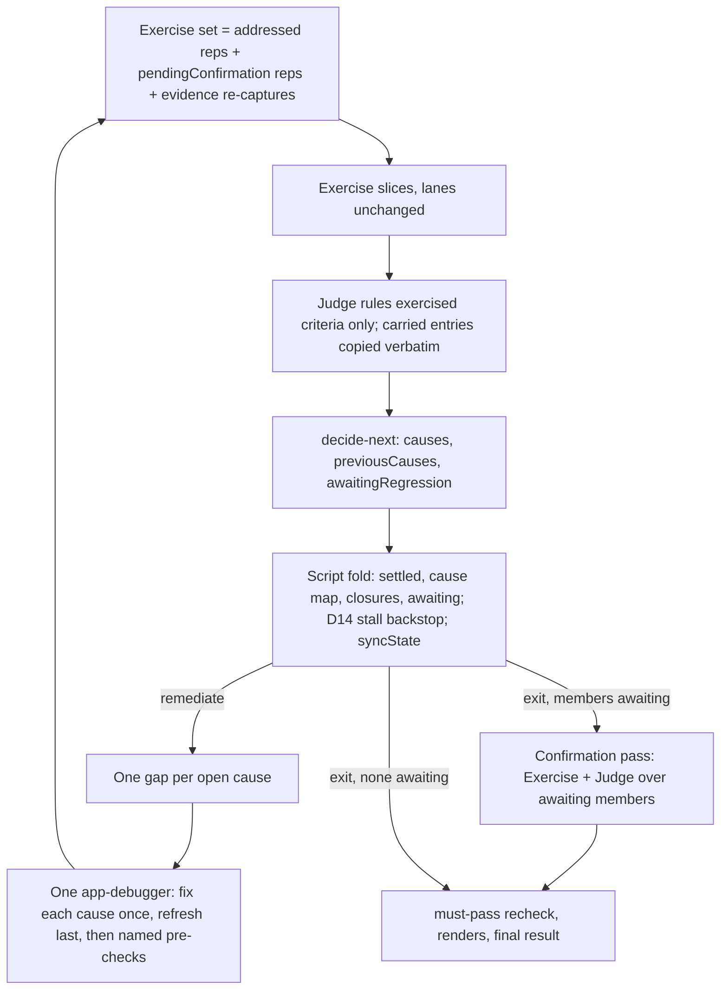

# TRD: Targeted inner loop by shared cause

**Version**: 1.3.0
**Status**: Draft
**Created**: 2026-11-11
**Last Updated**: 2026-11-11
**Author**: @technical-architect
**Source PRD**: `docs/plan/targeted-inner-loop-by-shared-cause.investigation.md` (workplan `verification-targeted-loop`, roadmap item 2, `docs/plans/verification-targeted-loop/roadmap.md`; GitHub issue FortiumPartners/ensemble-vnext#113). Its objectives come from the PM's instruction of 2026-11-11, which supersedes the roadmap's item 2 brief on one point: a closed cause's other members go to the end-of-run regression pass, not back through the inner loop.
**Task ID Prefix**: CAUSE

---

## Changelog

| Version | Date | Changes | Author |
|---------|------|---------|--------|
| 1.0.0 | 2026-11-11 | Initial TRD creation | @technical-architect |
| 1.1.0 | 2026-11-11 | Design review findings applied. Debug simplified to one `app-debugger` per iteration that fixes each cause once, refreshes last as today and then runs its named pre-checks (D8, D10 rewritten; recorded as an OWNER-CALL; O3's parallel clause deferred, NG8). Removed: file-sharing batches, `MAX_PARALLEL_DEBUG`, the post-debug agent and its schema, the sibling amendments to `verification-convergence.md` D3/D11 and `functional-verification.md` D8, TR2 and its contingency, OQ-3. D4: a fallback key never closes a cause (new TR5). D6: `forcedUnbuilt` ids leave the carried block; `statusForRender` added. D15: confirmation `exit-stuck` reason rewritten. D16/D17: the Judge writes `causes` after ruling; `syncState` only on a correction; the re-proof merge keeps five keys. D18: a malformed `resume.exercised` is dropped with a log line. D22/CAUSE-D001: more sibling passages, a cause-key pattern parity test, `docs/reference/implement-trd.md` moved from CAUSE-B005. D23/CAUSE-T001: registration needs no `smoke-registration.test.sh` edit; T001 is no longer under Deferred by design. ACs moved and added in CAUSE-B001 to B004. Could Not Verify row 1 verified. Task count unchanged (7). | @technical-architect |
| 1.2.0 | 2026-11-11 | Audit findings applied. O3's parallel clause: the "source says MAY" rationale was wrong (the investigation states it as an instruction; only the superseded roadmap brief says "may"), so its deferral is now recorded as a change of scope escalated to the owner (preamble, D8, NG8, OQ-9). D14 redesigned: a `remediate` replacement discards the stalled exit's gate result and report, and Debug's gaps come from the Judge's `criteria` entries because an exit return carries no `debugGaps` (D7, §3.3, CAUSE-B004 AC 5). D13: a key failing D1's pattern is not a different key. D22/CAUSE-D001: `functional-verification.md` D8 gets a second amendment marker for its "handed every gap" clause. D4's reference to the awaiting exclusion corrected from D10 to D12. Could Not Verify: three rows confirmed and removed. Task count unchanged (7). | @technical-architect |
| 1.3.0 | 2026-11-11 | O3 corrected to the PM instruction's own wording ("independent causes may be fixed in parallel"); the investigation's first draft had overstated it. D8's one-Debug-agent choice is therefore a routine OWNER-CALL, not a scope change: preamble, D8, NG8 and OQ-9 updated, OQ-9 no longer owner-only. | /plan |

## Objectives

O1–O9 are the investigation's objectives, carried with their wording and their Must pass
marks. O10–O13 come from the constitution or are domain-derived, and say so.

**O3 is covered, and it is not must-pass.** Debug gets one gap per cause and fixes each
cause once (D7, D9, CAUSE-B003). The PM instruction (the source of every objective, quoted in
the `/plan` invocation) says "independent causes **may** be fixed in parallel": parallelism is
permitted, not required. This TRD uses one `app-debugger` per iteration (D8), a routine
engineering choice recorded as an OWNER-CALL. The investigation's first draft of O3 overstated
the clause as an instruction ("are fixed by separate Debug agents in parallel"); it was
corrected to the PM's wording on 2026-11-11 after the audit flagged the mismatch.

| ID | Objective | Source | Must pass |
|----|-----------|--------|-----------|
| O1 | After a Debug pass, the next iteration's Exercise pass is dispatched only for the representative criterion of each cause that Debug pass addressed (plus any evidence-gap re-capture F-1 already schedules). No other open criterion is exercised or re-judged in that iteration. | Investigation O1 (PM instruction, 2026-11-11) | yes |
| O2 | The Judge groups build-defect criteria by shared root cause: every build-defect criterion carries one cause key, and criteria with the same root cause carry the same key. The workflow records each cause (key, members, representative) in `verification-state.json` and shows it in `verification-report.md`. | Investigation O2 (PM instruction, 2026-11-11) | yes |
| O3 | Debug fixes each cause once, from one gap per cause rather than one per criterion. Independent causes may be fixed in parallel (the PM's words: "independent causes may be fixed in parallel"); whether to is an engineering choice. | Investigation O3 (PM instruction, 2026-11-11) | |
| O4 | A cause with many members (for example 20 criteria) is re-checked in the inner loop through exactly one representative. When the representative passes, the cause is closed and its other members are left for the end-of-run regression pass, not re-checked in the inner loop. | Investigation O4 (PM instruction, 2026-11-11, acceptance) | yes |
| O5 | Criteria of a cause that the last Debug pass did not address stay open and untouched: they are not exercised or re-judged, and their last verdict stands. | Investigation O5 (PM instruction, 2026-11-11, acceptance) | yes |
| O6 | A check-derived criterion (`derivation: check:<skill>`, such as design comparison) takes part in the inner loop only as its cause's representative. A representative is chosen from criteria that are not check-derived whenever its cause has one, so a design check is re-captured only when every member of its cause is check-derived. | Investigation O6 (PM instruction, 2026-11-11) | |
| O7 | A targeted unit test or Playwright spec may run as a fast pre-check before the representative is re-captured. A failing pre-check means the cause is not re-captured that iteration. A passing pre-check never settles a criterion `met`: only the criterion's own evidence, judged, does. | Investigation O7 (PM instruction, 2026-11-11, acceptance) | yes |
| O8 | The inner loop stays bounded by the existing iteration cap and stalled rule. The stalled rule counts closed causes as well as closed criteria: an iteration that closes a cause has made progress even if no criterion's status changed. | Investigation O8 (PM instruction, 2026-11-11) | yes |
| O9 | One headless fixture run (`fixtures` environment in `verification.md`) seeded with two causes spread over at least six criteria, one cause fixed and one not, produces a `verification-state.json` whose second iteration exercised only the fixed cause's representative. | Investigation O9 (PM instruction, 2026-11-11, acceptance) | |
| O10 | Tests pass. Unit coverage is at least 60% and integration coverage at least 50% where integration tests apply. These are the constitution's floors and are not exceeded here. | `constitution.md` Quality Gates | |
| O11 | Every new input is validated where it enters: the three new `decideNext` inputs, the Judge's cause key, the Debug stage's per-cause return and the optional `resume.exercised` history. A malformed value fails loudly or is replaced by a stated, logged fallback; it is never silently read as "nothing". | `constitution.md` Quality Gates ("Input validation present") | |
| O12 | Documentation is updated. Sibling TRDs whose decisions this feature changes carry an inline amendment marker that points here, and the contract the Judge reads states the cause-key vocabulary. | `constitution.md` Quality Gates ("Documentation updated"); convention `verification-convergence.md` D16 (amend a sibling in place, never fork it) | |
| O13 | State files and report inputs written before this change (no `causes`, `exercised`, `causeKey` or `awaiting` keys) still load, resume and render. A report built from an older input is byte-identical to today's. | domain-derived: `.trd-state/` is git-tracked (`CLAUDE.md` and `stack.md` File Structure Reference: "Implementation tracking (git-tracked)"), so state files from earlier releases sit in every project's history and are read by `--resume`, `/verify-build` fix rounds and `/refine-verification`. Same reasoning as `triage-unmet-results-by-kind.md` O12. | |

## 1. Overview

### 1.1 Technical Summary

Today every iteration of the functional-verification loop re-exercises every open criterion
(`verify-functional.js`, the loop head computes `openCriteria = CRITERIA.filter((c) =>
!settled.has(c.id))` and slices all of it), and one `app-debugger` agent receives one gap
per failing criterion. Twenty criteria failing for one reason cost twenty captures and
twenty judgements per iteration, and twenty gaps for one fix.

This change makes the loop work per **cause** rather than per criterion, after the first
Debug pass of an invocation:

1. **The Judge names a cause key** on every build-defect criterion it rules. The script
   owns the cause map (key, members, representative), the same way it already owns the
   settled set.
2. **Debug gets one gap per open cause.** One `app-debugger` per iteration, as today,
   fixes each cause once, runs the declared refresh as its last step exactly as today, then
   runs any targeted pre-check it named, and returns a result per cause.
3. **The next Exercise pass covers only** the representatives of causes Debug addressed
   (a failing pre-check counts as not addressed) plus F-1's evidence-gap re-captures. Every
   other open criterion is carried untouched, with its last verdict.
4. **A cause closes** when its representative is no longer failing for that cause: ruled
   `met`, or failing under a different, validated cause key. Its other members are marked as
   awaiting the regression pass and drop out of the stall and cap arithmetic, as F-1's
   settled evidence gaps do.
5. **`decideNext` counts closed causes** as progress: it stalls only when no criterion and
   no cause closed. A script-side backstop overrides a Judge `exit-stalled` that the
   script's own cause map contradicts.
6. **Bridge until roadmap item 3:** when the loop exits (other than unbuilt or setup
   failure) with members still awaiting, the workflow runs one bounded confirmation pass
   over only those members. Item 3's full regression pass replaces it.

The first iteration of every invocation (fresh run, resume, `/verify-build` fix round)
still walks the whole open set; targeting applies only after a Debug pass in the same
invocation.

### 1.2 Key Technical Decisions

| ID | Decision | Choice | Serves Objective | Rationale | Alternatives Considered |
|----|----------|--------|------------------|-----------|------------------------|
| D1 | Who assigns the cause key | The Judge returns `causeKey` on every `not_met` criterion whose kind is `build-defect`. The script validates it against `^[a-z0-9][a-z0-9._-]{0,63}$`. A missing or malformed key makes the criterion its own cause, `criterion:<id>`, and is logged. The colon keeps that fallback namespace out of reach of a Judge key. A `causeKey` on any other entry is dropped. A fallback key never closes a cause (D4). | O2, O11 | The Judge is the only stage that reads evidence, so only it can see that two failures share a root. The script owns the map because the open set is arithmetic (`verify-functional.js` "the open set is arithmetic"). Investigation Decision 1. | Debug groups causes. Rejected: Debug runs after the grouping is needed and does not see met/not-met evidence. Revisit if fixture runs show the Judge's grouping is unusable and Debug's file view groups better. |
| D2 | Keeping keys stable across iterations | The Judge prompt lists every open cause (key, representative statement, member ids, last reason) and tells the Judge to reuse an existing key whenever the root cause is the same, and to invent a new key only for a root cause not in the list. | O2, O4 | O4's closure test ("the representative now fails under a different key") only means something when keys are reused. | Let the script match causes by implicated files. Rejected: two causes can share a file (O3 says so), so files cannot identify a cause. Revisit if keys drift between iterations in live runs. |
| D3 | Choosing the representative | A pure function in the workflow, `causeGroups`. A cause keeps its previous representative while that criterion is still a member and is still eligible. Otherwise the representative is the first member in definition order that is not check-derived (`derivation` matches `^check:`), or the first member when all are check-derived. "Still eligible" means the representative is not check-derived, or no member is non-check-derived. **This departs from investigation Decision 2**, which put `causeGroups` in `functional-verification.js` and mirrored it into the workflow under a pinning test. Nothing in the lib or the commands would call it. The report renders the map the script supplies, and readers group by the stored `causeKey`. A lib copy would be a second implementation with no reader. | O1, O4, O6 | It must be deterministic, stable across iterations, and prefer a member that is cheap to re-capture (O6). | Lib function plus a mirrored copy and a parity test (investigation Decision 2). Rejected for the reason in the Choice cell. Revisit if a command needs to regroup causes from a state file. The Judge chooses the representative. Rejected: not stable across iterations (investigation Decision 2). |
| D4 | When a cause closes, and what happens to its members | A cause K closes when its representative is ruled `met`, or `not_met` with a validated Judge `causeKey` other than K (investigation OQ-4: the representative joins the new cause). A representative whose key is the D1 fallback (`criterion:<id>`, because the Judge's key was missing or malformed) stays in K, and that is logged: only a validated Judge key different from K closes K. A closed cause's other members keep their last verdict (`not_met`, kind `build-defect`, their `causeKey`) and gain `awaiting: "regression"`. An awaiting member is never handed to Exercise, the Judge or Debug in the inner loop, and is excluded from `decideNext`'s gaps (D12). A representative that leaves its cause any other way (ruled an evidence gap, `not_verifiable` or `unbuilt`) is routed by its own kind as today. The cause then stays open, picks a new representative by D3, and is marked `pendingConfirmation`: its new representative is exercised next iteration without another Debug pass. A cause left with no member is dropped and does not count as closed. | O4, O5 | O4 states the closing rule. Investigation Decision 3 and OQ-4 settle the case of a different key. A fallback key is not a finding about the root cause, only a missing or malformed field, so it must not close an unfixed cause; a Judge that re-keys with valid keys is TR5. The departure route is not in the source and is recorded as OQ-5. | Re-check the members in the inner loop once the representative passes (the roadmap's item 2 brief). Rejected: the PM instruction moves them to the end-of-run pass (investigation header). |
| D5 | What the next Exercise pass covers | While no Debug pass has run in this invocation (`debugHasRun` false), the Exercise set is the whole open set, as today. After one has run, the Exercise set is (a) the representative of each cause the last Debug pass addressed (D9) whose pre-check did not fail, (b) the representative of each `pendingConfirmation` cause (D4), and (c) F-1's evidence-gap re-captures (`evidenceRetries`). Lane slicing, the setup check's target filter and the Judge's open set all use this set instead of the open set. | O1, O5, O7 | O1 names the set exactly. Reusing the existing slicing keeps lanes, budgets and dead-slice handling unchanged. | Target only after a pre-check passes. Rejected: O7 makes the pre-check optional ("may run"). Revisit if fixture runs show representatives re-captured needlessly. |
| D6 | Open criteria that are not exercised | The script keeps the last full entry of every open criterion (status, tier1, artifact, reason, cause, kind, causeKey, awaiting, files, and its last debug gap). This generalises today's `lastRulings` map, which holds only cause and reason. Carried entries go to the Judge in a separate block marked "open, not re-checked this iteration", to be copied verbatim into the state file and the report input and never ruled. Ids in `forcedUnbuilt` are excepted from the carried block: the Judge rules them `unbuilt`, as it does today on an iteration that skips Exercise. The script also uses the carried entry's last verdict wherever it rebuilds the whole definition or reads a status for an id the Judge did not rule (`syncKindState`, `buildFinalResult`, `applyMustPassRecheck`, the cap fall-through, `statusForRender` ~:950). | O5, O13 | Today those rebuilds assume the Judge returned an entry for every open criterion. A carried criterion would otherwise vanish from the result, be written as a placeholder `not_met` with nulls (`syncKindState`'s `entryOf`), or render with no reason (`statusForRender` returns `{status: 'not_met', reason: null}` for an id neither settled nor judged). An unbuilt cause's members were never fixed, so carrying their old verdict would hide the unbuilt finding. | Let the Judge re-judge carried criteria from their old evidence. Rejected: O5 says they are not re-judged. |
| D7 | What Debug receives | One gap per open cause, excluding `pendingConfirmation` causes: `{ cause, representative: <the representative's gap: id, statement, reason, artifact, files, cites, derivation>, members: [{ id, statement, reason }], files: <union of members' implicated files> }`. Built by the script from the Judge's `debugGaps`; where a representative has no `debugGaps` entry, from its `not_met` entry in the Judge's `criteria` return (id, reason, artifact, files, with statement, cites and derivation from the definition), and for a carried criterion from its last recorded gap (D6). The criteria fallback is what a D14 replacement uses: an exit return carries no `debugGaps` (`buildJudgePrompt`'s return spec: "present only when action is `remediate`"). | O3 | O3: one gap per cause. The members' statements let Debug fix the root without walking each criterion. | Representative's gap only. Rejected: Debug would fix one symptom and miss what the other members need from the same root. |
| D8 | How many Debug agents run | **OWNER-CALL** (design review, 2026-11-11): a routine engineering choice within the PM's permissive wording ("may be fixed in parallel"). ONE `app-debugger` per iteration, as today, receives one gap per open cause (D7) and fixes each cause once. There are no file-sharing batches, no parallel Debug agents and no `MAX_PARALLEL_DEBUG`. Renders run beside it, as they run beside Debug today. Parallel Debug is not built; revisit if fixture runs show Debug dominating an iteration (NG8). `verification-convergence.md` D3 ("Judge and Debug stay one agent each") and D11 ("Debug runs the refresh as its last act") still hold and are not amended. `functional-verification.md` D8's one-agent-per-iteration half still holds; its "handed every gap" clause does not, and is amended (D22). | O3 | **Reason for the call:** parallel Debug agents on one working tree need file-sharing batches, a separate agent to run the refresh after every batch (a refresh run by one agent can land while another is still editing, the interleaving VC D11 exists to prevent), a second return schema, amendments to three sibling decisions, and they bring a collision risk on shared build output, lockfiles and test runs. O3 is not must-pass, and one agent fixing per cause already delivers O3's first sentence: each cause fixed once, from one gap. The PM instruction makes parallelism optional ("may"), so this is an engineering call, recorded for the owner's later review. | File-sharing batches (connected components over shared implicated files), up to four `app-debugger` agents in parallel, and a separate post-debug agent for the refresh and pre-checks (v1.0.0 of this TRD). Rejected for the reason given; it is the revisit path if Debug dominates an iteration. |
| D9 | What Debug returns | `DEBUG_SCHEMA` changes from per-criterion `results` to per-cause: `{ results: [{ cause, addressed, result, unbuilt?, preCheck?: { command, exitCode } }], refresh: { ran, exitCode } }`, where `preCheck` records a targeted unit test or Playwright spec Debug named and ran (D10), or is absent. `refresh` stays in the schema and stays required, exactly as today. A cause reported `unbuilt` puts every member of that cause into `forcedUnbuilt`. A cause the agent returned no entry for, or a Debug agent that returned nothing, counts as not addressed (logged). `debugAttempts` records one line per cause (`<cause>: <result>`). | O3, O5, O7, O11 | Addressed-ness is per cause, because that is what the next Exercise set is built from (D5). | Keep per-criterion results and infer the cause. Rejected: one result per member would be a duplicate claim about one fix. `unbuilt` on the representative only. Rejected: an absent capability is absent for every member that needs it. Recorded as OQ-6. |
| D10 | Who runs the refresh and the pre-checks, and in what order | The one Debug agent (D8). After fixing every cause it runs the declared fast refresh as its LAST step, exactly as today (VC D11). It then runs each pre-check it named, changing no code, and reports each as `preCheck: { command, exitCode }` on that cause's result. Its `refresh` feeds `lastDebugRefresh` exactly as today. | O7, O3 | A Playwright pre-check needs the refreshed build, so pre-checks run after the refresh. A pre-check only reads the build, so running it after the refresh does not reopen the interleaving VC D11 prevents. With one agent there is nothing to race, so no second agent is needed. | A separate post-debug agent runs the refresh and the pre-checks. Rejected with D8: it existed only to serialise parallel Debug agents. Debug runs its pre-checks before the refresh. Rejected: a Playwright spec would test the stale build. The script runs them. Rejected: the workflow has no shell. |
| D11 | How a pre-check gates re-capture | A pre-check with a non-zero exit code, or one that was named but has no recorded exit code, marks its cause not addressed: its representative is not in the next Exercise set. A passing pre-check is shown to the representative's Exercise slice as a hint ("Debug's targeted check `<command>` passed; capture this criterion's own evidence regardless"). The Judge prompt never mentions pre-checks. | O7 | O7: a failing pre-check blocks re-capture, and a passing one never settles `met`. Keeping it out of the Judge's input makes "never settles met" structural (investigation Decision 5). | Show the pre-check to the Judge as supporting evidence. Rejected: O7. |
| D12 | The stall arithmetic | `decideNext` gains three **required** inputs, validated after `settledEvidenceGaps` (the file's established order): `causes` (open cause keys after this ruling), `previousCauses` (array or null, like `previousGaps`) and `awaitingRegression` (ids). The `awaitingRegression` ids are removed from both `gaps` and `previousGaps` up front, as `settledEvidenceGaps` are. It returns `closedCauses = previousCauses \ causes` beside `closed`. The stall branch fires only when `previousGaps` is non-empty and both `closed` and `closedCauses` are empty. Evaluation order is unchanged. | O8, O4, O11 | O8 states the rule. Removing awaiting members up front is what stops a closed cause's members from holding the run to the cap (investigation "absorbed ... [BLOCKS]"). A required input, rather than a defaulted one, keeps a caller bug from silently reading as "no causes". | Default the new inputs to `[]`. Rejected: an absent `awaitingRegression` would hold every closed cause's members open until the cap. |
| D13 | What the Judge is given for STEP 3 | The script supplies as literals: `previousCauses`, the open cause keys not re-checked this iteration, the ids already awaiting, and, for each cause whose representative is exercised this iteration, one rule: "if you rule `<rep>` `met`, or `not_met` with a key that matches `<D1's pattern>` and differs from `<key>`, leave `<key>` out of `causes` and add `<members>` to `awaitingRegression`; otherwise (including a key that fails the pattern, or none) put `<key>` in `causes`". `causes` is then those literals plus every valid key the Judge assigns this iteration. | O8, O4 | The Judge runs `decide-next`, and the script cannot. Each conditional the Judge applies is a single membership rule, the same device triage D6 uses for `settledEvidenceGaps`. The pattern is in the rule so the Judge's closure test matches the script's (D4: only a validated key different from K closes K); without it a malformed key would read as progress to decide-next while the script kept K open, and D14 guards only the other direction. | A second agent runs `decide-next` from a script-built payload after the Judge returns. Rejected: it moves decide-next out of the Judge, which every sibling TRD builds on. Revisit if fixture runs show the Judge mis-applying the rules. |
| D14 | Stall backstop | After each Judge return the script recomputes closed causes from its own map and the Judge's rulings. When the Judge returned `exit-stalled` and the script's map shows a cause closed this iteration, the script replaces the action: `remediate` below the cap, `exit-stuck` at it (decideNext's next branches). On a replacement it rewrites the state file's `outcome` (null for `remediate`) through the state-sync writer (D17). **A replacement to `remediate` follows an exit the Judge has already finished**, so three rules apply. (a) **The gate:** the Judge already ran STEP 5's full-environment gate; its `finalRun` is discarded with the overridden exit (logged), and the run's real exit runs the gate again against the code Debug then changes. VC D14 requires the gate on the exit the run ends on, and this is the one case where an invocation runs it twice. (b) **The report:** the stalled report the Judge rendered is left on disk and overwritten by the real exit's render, as every exit writes `REPORT_PATH`; the state file's `outcome: null` is what marks the run unfinished, and resume reads the state file, not the report. (c) **Debug's input:** the return carries no `debugGaps`, so the gap routing (by kind, ~:2169) runs over the Judge's `not_met` `criteria` entries instead, and each open cause's gap is built from its representative's entry (D7). The `exit-stuck` replacement needs none of this: it is still an exit, and `syncState` re-renders the report. | O8 | Investigation Decision 7. A Judge that drops a key from its payload would otherwise end a converging run as `stalled`. `recheckAndReconcile` is the precedent only for overriding an exit into another exit; turning an exit into `remediate` has no precedent, which is why rules (a)-(c) are stated. | No backstop. Rejected: investigation Decision 7. |
| D15 | Bridge until roadmap item 3: one confirmation pass at exit | When the Judge's action, after D14 and before the must-pass recheck, is anything other than `exit-unbuilt` or `exit-setup-failure`, and members are awaiting, the workflow runs one Exercise pass over only those members and one Judge in confirmation mode. No Debug follows it, and it is outside the iteration cap. It keeps the exit iteration's number. Its payload files carry a `-confirm` suffix, and its `exercised` entry is marked `confirmation: true`. Its `decide-next` payload is the exit iteration's, with `gaps`, `unbuilt` and `met` recomputed from the new rulings, `awaitingRegression: []` and `cap` equal to the iteration, so it can never return `remediate`. The confirmation Judge does not run the full-environment gate again: it is given the exit's `finalRun` and copies it verbatim. Its action replaces the exit action. When that action is `exit-stuck`, the script rewrites its `reason` to name the members still failing and the run's real cap (`CAP`): `decideNext` would otherwise say "iteration cap (N) reached" with N the exit iteration, because the payload's `cap` is the iteration. The must-pass recheck, the renders and `buildFinalResult` then run on it. A member still failing keeps the run from `satisfied`. | O4 | Investigation Decision 4 and OQ-1, absorbed as blocking. Without it, a run whose representatives all pass would end `satisfied` with siblings never re-checked. Re-using the exit iteration's `previousGaps`, `causes` and `previousCauses` keeps a real stall reading `stalled` rather than `stuck`. | Run it only when the exit would otherwise be satisfied. Rejected: awaiting members count as unproven, so they can also move a run across the coverage floor or the must-pass line. Re-run the gate in confirmation. Rejected: the gate runs exactly once (`verification-convergence.md` D14), and no code changed after it. |
| D16 | What the state file and report input gain | Two top-level keys: `causes: [{ key, representative, members, status: 'open'|'closed', closedAt }]` and `exercised: [{ iteration, ids, confirmation? }]`. Per criterion, `causeKey` and `awaiting`. The Judge's STEP 4 writes six keys instead of four. It copies `exercised` from a literal (this iteration's ids are known before the Judge runs). It writes `causes` AFTER ruling: the pre-ruling cause-map literal with the closure rules it already applies for STEP 3 (D13), plus each key it assigned this iteration with its members in definition order and the representative by D3's rule, which the prompt states. The report input gains `causes`. The re-proof merged file (`mergeReproofRetry` / the `merge-reproof-retry` CLI, `functional-verification.js` ~:2108) keeps its five keys (`iteration`, `criteria`, `gapsClosed`, `outcome`, `retried`): `causes` and `exercised` are deliberately not carried there, because a re-proof runs at cap 1, so no Debug pass runs and no cause can close. | O2, O9 | O2 requires the cause record in the state file. O9 is checked against `exercised`. Writing `causes` after ruling makes the Judge's file right on every iteration where the script corrects nothing, so `syncState` (D17) runs only on a correction, as triage D20 does, not every iteration. The resume readers read keys by name (`implement-trd.md` Step 8.2 builds `resume` from `iteration`, `criteria`, `gapsClosed`, ~:1722; the workflow reads `RESUME.iteration`, `.criteria`, `.gapsClosed`), so a new key changes nothing for them (verified in the design review, 2026-11-11). | Derive the cause record from per-criterion `causeKey` only. Rejected: the representative and closure are not derivable from per-criterion keys. The Judge copies the pre-ruling map and the script syncs every iteration. Rejected: a state-sync agent on every iteration for a file the Judge can write right. |
| D17 | Who writes the script's facts | `syncKindState` (triage D20) is generalised to `syncState`. It runs after the fold only when the script corrected the Judge, as triage D20 does, not every iteration: it corrected a kind or settled an entry (triage D20), replaced or dropped a `causeKey` (D1), kept a fallback-key representative in its cause (D4), or replaced an action (D14). On an iteration with no correction the Judge's file stands (D16). It writes the full state from `settled`, the carried entries (D6), the cause map and the `exercised` history through `implement-state` `save()`. On an exit iteration it also patches the report input by id (adding `causeKey`, `awaiting` and the top-level `causes`) and re-renders the report. | O2, O13 | The script's map is the authority, as it already is for `kind` and `settled`. The Judge writes `causes` by the same rules (D16), so its file differs from the script's map only where the script overrode a Judge return. The script cannot read the file back (no filesystem), so it syncs on the corrections it knows of. | A separate writer agent for causes. Rejected: two writers of one file, one after the other, in the same iteration. |
| D18 | Resume and fix rounds | The first iteration of every invocation walks the whole open set and regroups causes from scratch. Addressed causes are not carried across invocations (investigation Decision 6, OQ-2). An awaiting member is `not_met`, so it is not seeded into `settled` and is walked on that first iteration. `resume` gains an optional `exercised` history: an array of `{ iteration: integer, ids: string[], confirmation?: true }` (entries may carry `confirmation`, D15). It is read leniently, like `gapsClosed` (`gapsClosedHistory`, `verify-functional.js` ~:1765): a malformed value is dropped with a log line and the history starts empty; it is not thrown. A valid one is seeded the way `gapsClosed` is, so the state file's history survives a resume. `/implement-trd` Step 8.2 adds it to the `resume` it composes by name, when the state file has it. `/verify-build --resume` already passes the whole state file as `resume`, so `exercised` reaches the workflow with no change there. A `/verify-build` fix round passes none, because it starts a fresh loop at iteration 0. | O1, O9, O13, O11 | A resume does not know what was changed in between, so its first iteration cannot target. `exercised` is an audit history the loop never steers by, so a damaged one should cost the history, not the run; that is the same trade `gapsClosed` already makes, and the log line keeps it from being read silently as "nothing" (O11). | Persist addressed causes across invocations. Rejected (investigation Decision 6). |
| D19 | Report rendering | `renderReport` gains a `## Causes` section when the input carries `causes`: one row per cause with key, representative, member count and member ids, and status ("open", "closed at iteration N", with "N members awaiting the regression pass" where any remain). A Not Met row whose criterion carries `awaiting` reads "awaiting the regression pass, not re-checked" after its reason. All of it is gated on the input carrying `causes` or any `awaiting`, so an older input renders byte-identically. | O2, O13 | Triage D16's gating device. | A separate causes report file. Rejected: the owner reads one report. |
| D20 | The contract the Judge reads | `packages/core/contracts/functional-verification.md` gains a "Cause keys" section after the cause vocabulary: what a cause key is, the key format, "same root cause, same key; reuse a listed key", the representative rule, and what `awaiting` means. | O2, O12 | The contract is the Judge's standing text. Without this section the prompt and the contract would drift (triage D17). | Prompt only. Rejected for the same reason. |
| D21 | Readers of `awaiting` | `/verify-build` fix loop step 2 records no failing row (no build task) for an entry carrying `awaiting`; it is re-walked in the next round, because it is not `met`. `/refine-verification` step 2 lists it as neither a Blocker nor a ruling, as "awaiting re-check". After D15, `awaiting` survives on disk only on an `exit-unbuilt` or `exit-setup-failure` run. | O4, O13 | A member whose cause's representative passed is probably fixed. Turning it into a build task would rebuild a fixed thing. | Leave readers as they are. Rejected for that reason. |
| D22 | Sibling documents | Amended in place, each with an inline `AMENDED 2026-11-11 by docs/TRD/targeted-inner-loop-by-shared-cause.md Dn` marker and a changelog row: `functional-verification.md` §3.3 (the `resume` shape, and the "`resume` is not the state file" paragraph's "FOUR top-level keys", ~:740), §3.3a (the Judge's disk work: six keys, `causes` written after ruling), §3.4 (`decideNext`'s three new inputs and `closedCauses`), §3.5 (the Debug stage: one gap and one result per cause, pre-checks after the refresh) and §3.6 (the report's Causes section and awaiting marker); `verification-fix-loop.md` D4 (an `awaiting` entry is not a build task, D21); `functional-verification.md` D8, a SECOND marker beside triage's, for its "handed every gap" clause only (Debug is handed one gap per open cause and returns one result per cause, D7, D9). Also updated: `docs/reference/verification.md` ("exactly four keys"; the Debug stage; `decideNext` inputs), `docs/reference/implement-trd.md` (~:289, the §8.2 `resume` shape) and `.claude/verification-notes.md` (decide-next's required fields, ~lines 886 and 1350). Not amended: `verification-convergence.md` D3 and D11, which still hold, because Debug stays one agent per iteration that refreshes as its last act (D8, D10). `functional-verification.md` D8's one-agent-per-iteration half also holds; only its per-gap clause is marked. | O12 | `verification-convergence.md` D16: amend, never fork. | Rely on this TRD alone. Rejected: the next reader of `functional-verification.md` §3.5 would believe Debug still fixes and returns per gap. |
| D23 | How O9 is planned | A `[LIVE]` smoke scenario, `test/smoke/scenarios/verify-inner-loop-causes.sh`, modelled on `verify-triage-kinds.sh`. It uses a pre-seeded definition of six criteria over two causes. Cause A's defect is fixable. Cause B's defect sits in a file marked frozen, so Debug leaves it. The scenario asserts that the second iteration's `exercised` entry lists cause A's representative alone. It is registered in `test/smoke/run-smoke.sh` (the `LLM_OPT_IN_SCENARIOS` line plus a `SCENARIO_TIMEOUT` entry) and in `test/smoke/README.md` (the scenario table row and the `scenarios/` tree line). `test/integration/tests/smoke-registration.test.sh` needs no edit: it discovers both rosters from `run-smoke.sh` and fails by itself if the new scenario is registered wrongly. | O9 | The authoring contract requires a model-spending run to be its own `[LIVE]` task. Triage D19 is the precedent. | Unit tests alone. Rejected: O9 names a fixture run. |

### 1.3 Technology Stack

| Layer | Technology | Purpose | Notes |
|-------|------------|---------|-------|
| Library | Node.js 18+ (`packages/core/lib/functional-verification.js`) | `decideNext`, `renderReport`, `decide-next` CLI | Mirrored byte-identically to `.claude/lib/` |
| Workflow | Workflow script (`packages/core/workflows/verify-functional.js`) | The loop: cause map, targeting, per-cause Debug, confirmation pass | No `require`, no filesystem. Mirrored to `.claude/workflows/` |
| Commands | Markdown prompts | `/implement-trd`, `/verify-build`, `/refine-verification` reader changes | Mirrored to `.claude/commands/` |
| Tests | Jest ^29.7.0; BATS ^1.9.0; smoke scenarios | Unit, workflow harness, registration, live fixture | `stack.md` |

### 1.4 Integration Points

| System | Type | Direction | Notes |
|--------|------|-----------|-------|
| `functional-verification.js decide-next` CLI | CLI, JSON payload | Judge → lib | Three new required payload fields (D12) |
| `implement-state` `save()` | Node module | Judge / state-sync agent → state file | Unchanged; the only sanctioned writer |
| `verification-state.json` | JSON file | Workflow → commands | Gains `causes`, `exercised`, per-criterion `causeKey`, `awaiting` (D16) |
| `app-debugger` agent | Agent | Workflow → Debug | Per-cause gaps and returns, one agent per iteration as today (D7–D10) |

## 2. System Architecture

### 2.1 Architecture Overview

One iteration after the first Debug pass of an invocation:



### 2.2 Component Architecture

#### 2.2.1 `decideNext` (lib)
**Responsibility**: the stall and cap arithmetic with closed causes and awaiting members (D12).
**Interfaces**: `decideNext(input)`, `decide-next` CLI.
**Dependencies**: none new.

#### 2.2.2 `renderReport` (lib)
**Responsibility**: the `## Causes` section and the awaiting marker (D19).
**Interfaces**: report input gains `causes` and per-criterion `causeKey`, `awaiting`.

#### 2.2.3 Loop orchestration (workflow)
**Responsibility**: the cause map and representatives (D1–D4), the Exercise set (D5), the
carried entries (D6), the per-cause Debug stage and pre-check gating (D7–D11), the Judge
payload literals (D13), the stall backstop (D14), the confirmation pass (D15) and the state
sync (D16, D17).
**Dependencies**: the lib through the Judge's CLI calls only.

#### 2.2.4 Commands
**Responsibility**: `/implement-trd` §8.2 passes `exercised` in the `resume` it composes
(D18; `/verify-build --resume` already passes the whole state file). Treat `awaiting` as not
a failing row (D21).

### 2.3 Data Flow

```mermaid
sequenceDiagram
    participant S as Workflow script
    participant E as Exercise slices
    participant J as Judge
    participant L as decide-next (lib)
    participant D as Debug (one app-debugger)

    S->>E: representatives of addressed causes + re-captures
    E-->>S: claims
    S->>J: claims, exercised criteria, carried entries, cause literals and closure rules
    J->>L: gaps, causes, previousCauses, awaitingRegression, ...
    L-->>J: action, closed, closedCauses
    J-->>S: action, rulings with causeKey, debugGaps
    S->>S: fold, update cause map, backstop, syncState on a correction
    S->>D: one gap per open cause, refresh command
    D->>D: fix each cause once, refresh last, then named pre-checks
    D-->>S: per cause addressed, result, unbuilt, preCheck {command, exitCode}; refresh
    S->>S: next Exercise set = addressed and pre-check not failed
```

### 2.4 State Management

The script holds, across iterations of one invocation:

- `settled` (unchanged).
- `openEntries`: the last full entry per open criterion (D6; replaces `lastRulings`).
- `causeMap`: key → `{ members, representative, status, closedAt, pendingConfirmation }` (D3, D4).
- `addressedCauses`: keys the last Debug pass addressed whose pre-check did not fail (D9, D11).
- `preCheckHints`: cause key → passing pre-check command (D11).
- `exercisedHistory`: one entry per iteration, seeded from `resume.exercised` (D18).

None of it persists across invocations except `exercisedHistory`, through the state file and
`resume` (D18).

## 3. Technical Specifications

### 3.1 `decideNext` input change (lib)

```typescript
interface DecideNextInput {
  // ...existing fields unchanged...
  settledEvidenceGaps: string[];
  causes: string[];               // NEW, required: open cause keys after this ruling
  previousCauses: string[] | null;// NEW, required key: null on the first iteration
  awaitingRegression: string[];   // NEW, required: ids removed from gaps and previousGaps up front
}
interface DecideNextResult {
  action: LoopAction; reason: string; closed: string[];
  closedCauses: string[];         // NEW: previousCauses \ causes ([] when previousCauses is null)
}
```

**Behavior**:
- Validation order: existing checks, then `settledEvidenceGaps`, then `causes`,
  `previousCauses` (must be an array or null; `undefined` throws), `awaitingRegression`.
  Each throws a `TypeError` naming the field and the lenient reading its absence would cause.
- `openGaps = gaps \ settledEvidenceGaps \ awaitingRegression`; `previousGaps` likewise.
- Stall: `previousGaps != null && previousGaps.length > 0 && closed.length === 0 && closedCauses.length === 0`.
- The stall reason names both counts ("closed no gaps and no causes").
- Everything else (order, coverage re-label, must-pass step) is unchanged.

**Error Handling**: missing or wrongly typed field → `TypeError`. The CLI already surfaces
a thrown error as a non-zero exit with the message.

### 3.2 Report (lib)

- Input: optional top-level `causes: CauseRecord[]`; per criterion optional `causeKey`,
  `awaiting`.
- `## Causes` section, after `## Not Met`, only when `causes` is a non-empty array.
- The awaiting suffix on a Not Met row only when that criterion carries `awaiting`.
- No other line changes. A test renders a fixture without the new keys and compares it
  byte for byte with today's output.

### 3.3 Workflow (`verify-functional.js`)

```typescript
// Judge criterion schema gains:
causeKey: string | null;          // build-defect not_met only; validated by D1's regex
// Debug schema becomes (one agent per iteration, D8; refresh unchanged and still required):
interface DebugReturn {
  results: Array<{
    cause: string; addressed: boolean; result: string; unbuilt?: boolean;
    preCheck?: { command: string; exitCode: number | null };  // named and run after the refresh (D10)
  }>;
  refresh: { ran: boolean; exitCode: number | null };
}
// State file (Judge STEP 4, written after ruling; syncState on a correction):
interface VerificationState {
  iteration: number; criteria: StateEntry[]; gapsClosed: number[]; outcome: string | null;
  causes: Array<{ key: string; representative: string; members: string[]; status: 'open' | 'closed'; closedAt: number | null }>;
  exercised: Array<{ iteration: number; ids: string[]; confirmation?: true }>;
}
// StateEntry gains: causeKey?: string; awaiting?: 'regression'
// The re-proof merged file (mergeReproofRetry) keeps its five keys; no causes or exercised (D16).
```

**Behavior** (the order within one iteration):
1. Exercise set: D5. The setup check's target filter, the lane slicing and the Judge's
   STEP 2a skill list use it. An empty Exercise set dispatches no slice. The Judge still
   runs, and its decide-next call reaches the stall rule.
2. Judge prompt: the exercised criteria as "under judgement"; carried entries (D6) as
   "open, not re-checked this iteration — copy verbatim, include their `not_met` ids in
   `gaps` unless listed in `awaitingRegression`", with ids in `forcedUnbuilt` left out of
   that block and ruled `unbuilt` (D6); the open causes for key reuse (D2); the STEP 3
   literals and closure rules (D13); STEP 4's six keys, with `causes` written after ruling
   (D16). The zero-criteria branch (~:1795) supplies `causes: []`, `previousCauses: null`
   and `awaitingRegression: []` to decide-next.
3. Fold: settled entries as today. `openEntries` updated from this iteration's rulings.
   `causeKey` validated (D1). Cause map recomputed (D3, D4). `exercisedHistory` appended.
4. Backstop (D14), then `syncState` only when the script corrected the Judge (D17). A
   replacement to `remediate` discards the exit's `finalRun`, leaves the stalled report to be
   overwritten at the real exit, and routes gaps from the Judge's `not_met` `criteria`
   entries, because an exit return carries no `debugGaps` (D14 rules a-c).
5. On an exit: the confirmation pass when members await (D15, with its `exit-stuck` reason
   rewritten), then `recheckAndReconcile`, the renders and `buildFinalResult` (now
   including carried entries).
6. On remediate: evidence re-captures routed as today. One gap per open, non-pending cause
   (D7), all to one `app-debugger` beside the renders, as today (D8). Its prompt keeps the
   refresh as its last step, then asks for each named pre-check to run, and asks for
   per-cause results (D9, D10). Then `addressedCauses` and `preCheckHints` are computed
   (D11).

**Error Handling**:
- A malformed `causeKey`: fallback `criterion:<id>`, logged (D1). A representative with a
  fallback key stays in its cause, logged (D4).
- A dead Debug agent: every cause counts as not addressed, `debugAttempts` records "agent
  returned nothing", `lastDebugRefresh = null`, and the loop continues (today's dead-Debug
  pattern).
- A cause with no entry in Debug's return: not addressed, logged (D9). A named pre-check
  with no exit code counts as failed (D11).
- A malformed `resume.exercised`: dropped with a log line, and the history starts empty,
  as a malformed `resume.gapsClosed` is today (~:1765); never thrown (D18, O11).

### 3.4 Commands

- `implement-trd.md` Step 8.2: `resume` becomes `{ iteration, criteria, gapsClosed,
  exercised }`, with `exercised` passed only when the state file has it, and unfiltered by
  id.
- `verify-build.md` `--resume`: unchanged. It passes the whole state file as `resume`, so
  `exercised` already reaches the workflow.
- `verify-build.md` fix loop step 2: an entry with `awaiting` gets no failing row. Step 6's
  stop reason for it reads `awaiting re-check: its cause was fixed through <representative>`.
- `refine-verification.md` step 2: an `awaiting` entry is listed under "awaiting re-check",
  never under Blockers.

## 4. Master Task List

### 4.1 Task ID Convention

`CAUSE-[CATEGORY][SEQ]`: B backend (lib, workflow, command prose), D documentation, T
testing (`[LIVE]` fixture run).

### 4.2 Phase 1: Decision logic and report (lib)

| Task ID | Description | Serves | Skills | Dependencies | Acceptance Criteria |
|---------|-------------|--------|--------|--------------|---------------------|
| CAUSE-B001 | `functional-verification.js`: add `causes`, `previousCauses` and `awaitingRegression` to `decideNext` with validation after `settledEvidenceGaps`; return `closedCauses`; extend the stall rule (§3.1). Add the `## Causes` section and the awaiting marker to `renderReport` (§3.2). Mirror to `.claude/lib/`. Fix every existing `decideNext(` call site and CLI payload in `functional-verification.test.js` with the new inputs. One task: both changes are small, in one file, and are proven by one test file. | D12, D19, O8, O13 | `jest` | None | (1) Each new input, when absent or wrongly typed, throws a `TypeError` naming it. A test omitting several fields still sees the earliest field's message. (2) An iteration whose `closed` is empty but whose `closedCauses` is not returns `remediate`, not `exit-stalled`. (3) With `closed` and `closedCauses` both empty and `previousGaps` non-empty, it returns `exit-stalled`. (4) Ids in `awaitingRegression` neither hold the run open (a gap set made only of them returns `exit-satisfied`) nor count as closed. (5) A report input with `causes` renders the section; one without it renders byte-identically to the current output. (6) Mirror parity passes. |

### 4.3 Phase 2: Loop changes (workflow)

All three tasks edit `verify-functional.js`, its test and its mirror, so they serialize.
They stay split for **size**: merged, the change would cover most of a 2268-line file in one
pass, and each part has its own acceptance criteria that the workflow harness checks on its
own.

| Task ID | Description | Serves | Skills | Dependencies | Acceptance Criteria |
|---------|-------------|--------|--------|--------------|---------------------|
| CAUSE-B002 | Cause map and targeting: `causeKey` in `JUDGE_CRITERION_SCHEMA` and the Judge prompt (D1, D2); `causeGroups` (D3); `openEntries` replacing `lastRulings` (D6); the Exercise set (D5) driving slicing, the setup filter and STEP 2a; the carried-entries block, with `forcedUnbuilt` ids excepted and ruled `unbuilt` (D6); the STEP 3 literals (D13) with the new decide-next fields, including the zero-criteria branch's empty values; STEP 4's six keys with `causes` written after ruling, and `exercisedHistory` (D16); `syncKindState` generalised to `syncState`, run only on a correction (D17); `buildFinalResult`, `applyMustPassRecheck`, the cap fall-through and `statusForRender` using carried entries; lenient `resume.exercised` reading and seeding (D18). Mirror to `.claude/workflows/`. | D1, D2, D3, D5, D6, D13, D16, D17, D18, O1, O2, O5, O6 | `jest` | CAUSE-B001 | Through `test-harness.js` with stubbed agents: (1) Iteration 1 exercises the whole open set, and so does every iteration before the invocation's first Debug pass. (2) A malformed or missing `causeKey` yields `criterion:<id>` and a log line. (3) The representative is the first non-check-derived member in definition order, falls back to the first member when all are check-derived, and is kept across iterations while it is a member and still eligible (O6). (4) A carried criterion appears in the result's `criteria`, in the state-sync JSON, in the must-pass recheck and in the render rows (`statusForRender`) with its last verdict and reason, not as a placeholder. (5) The Judge prompt's decide-next payload names `causes`, `previousCauses` and `awaitingRegression`; each closure rule quotes D1's key pattern and says a key failing it keeps the cause in `causes`; STEP 4 names six top-level keys and tells the Judge to write `causes` after ruling. (6) A malformed `resume.exercised` is dropped with a log line and the run proceeds with an empty history. A valid one, including an entry carrying `confirmation: true`, is carried into the state JSON. (7) The zero-criteria branch's Judge prompt supplies `causes: []`, `previousCauses: null` and `awaitingRegression: []` to decide-next. (8) An id in `forcedUnbuilt` is absent from the carried block, and the Judge prompt tells the Judge to rule it `unbuilt`. (9) No state-sync agent is dispatched on an iteration where the script corrected nothing; a replaced `causeKey` dispatches one. (10) Mirror parity passes. |
| CAUSE-B003 | Debug per cause: per-cause gaps (D7) to the one `app-debugger` per iteration, as today (D8, an OWNER-CALL); per-cause `DEBUG_SCHEMA` with `refresh` kept, `preCheck: { command, exitCode }` and `unbuilt` per cause (D9); the Debug prompt keeps its refresh as the last step and adds the named pre-checks after it (D10); `addressedCauses` and `preCheckHints` (D11); the pre-check hint in the representative's Exercise slice. Rewrite the existing Debug tests and per-criterion debug stubs to the per-cause shape. Mirror. | D7, D8, D9, D10, D11, O1, O3, O5, O7 | `jest` | CAUSE-B002 | (1) After a Debug pass that addresses cause A only, the next Exercise prompt carries A's representative plus any re-capture ids and no other id (O1, O5). (2) One `app-debugger` is dispatched per remediate iteration. Its prompt carries one gap per open, non-pending cause, with the representative's evidence, the members' statements and the union of files (O3). (3) The Debug prompt carries the refresh command once, as its last step, and every pre-check instruction comes after it. (4) A cause whose pre-check exit code is non-zero or missing is absent from the next Exercise set. A passing one appears with the hint in the Exercise prompt, and the Judge prompt contains no pre-check text (O7). (5) A cause reported `unbuilt` puts all its members into `forcedUnbuilt`. (6) A dead Debug agent, or a cause with no entry in its return, is logged and not addressed; a dead agent leaves `lastDebugRefresh` null, as today. (7) The existing tests 'Debug refresh (D11)' (~:980), 'Debug's refresh report (D16)' (~:3352) and 'dead Debug agent' (~:227, whose Exercise call count changes because no cause is addressed), and the per-criterion `unbuilt` debug stubs, are rewritten to the per-cause shape and pass. (8) Mirror parity passes. |
| CAUSE-B004 | How a cause ends: closure and `awaiting` (D4), including the different-key case, the fallback-key rule and the departure route (`pendingConfirmation`); awaiting members kept out of Exercise, the Judge's open set and Debug; the stall backstop (D14) with its state rewrite; the confirmation pass with its `exit-stuck` reason rewrite (D15). Mirror. | D4, D14, D15, O4, O8 | `jest` | CAUSE-B003 | (1) A 20-member cause is re-checked through exactly one representative. When the representative is ruled `met`, the cause is `closed` with `closedAt`, and its 19 other members carry `awaiting: "regression"` and appear in no later inner-loop Exercise prompt (O4). (2) A representative ruled `not_met` under a new, valid key closes its old cause and joins the new one. (3) A representative ruled `not_met` with a missing or malformed key stays in its cause, the cause does not close, and a log line names it. (4) A representative ruled an evidence gap leaves the cause. The cause gets a new representative, which is exercised next iteration with no Debug. (5) A Judge `exit-stalled` on an iteration where the script's map closed a cause becomes `remediate` (or `exit-stuck` at the cap), and the state-sync prompt writes `outcome: null` (O8). On the `remediate` replacement, from a stubbed Judge return with no `debugGaps`: one Debug is dispatched with one gap per open cause built from the Judge's `criteria` entries, the stalled `finalRun` is absent from the final result, and the real exit's Judge prompt carries the gate command again. (6) An exit with awaiting members dispatches exactly one Exercise and one Judge over those members only, with no Debug, a payload `cap` equal to the iteration and `-confirm` file names. A member failing there turns a satisfied exit into a non-satisfied one, and the full-environment gate command appears in no confirmation prompt. (7) An `exit-stuck` from the confirmation pass carries a reason naming the members still failing and the run's real cap, not the exit iteration. (8) `exit-unbuilt` and `exit-setup-failure` dispatch no confirmation pass. (9) Mirror parity passes. |

### 4.4 Phase 3: Commands and documentation

| Task ID | Description | Serves | Skills | Dependencies | Acceptance Criteria |
|---------|-------------|--------|--------|--------------|---------------------|
| CAUSE-B005 | Command readers: `implement-trd.md` Step 8.2 passes `exercised` in the `resume` it composes (D18); `verify-build.md` `--resume` needs no change for it, because it passes the whole state file. `verify-build.md` fix loop steps 2 and 6 and `refine-verification.md` step 2 treat `awaiting` entries as described in §3.4 (D21). Mirror to `.claude/commands/`. Update the command pin tests that quote these passages. | D18, D21, O4, O13 | `jest` | CAUSE-B004 | (1) `implement-trd.md` §8.2 names `exercised` in the composed `resume` and states it is passed only when present, unfiltered by id. (2) Fix-loop step 2 states that an `awaiting` entry is not a failing row, and step 6 gives its stop reason. (3) `/refine-verification` step 2 lists `awaiting` entries as awaiting re-check, never as Blockers. (4) Command mirror and pin tests pass. |
| CAUSE-D001 | Documentation: the contract's "Cause keys" section (D20), and its debugger brief reworded from per gap ("one gap at a time", "Returns, per gap") to per cause, with the named pre-checks run after the refresh (D9, D10), and mirror; inline amendment markers with changelog rows (D22) on `functional-verification.md` §3.3 (the `resume` shape and the "FOUR top-level keys" paragraph, ~:740), §3.3a, §3.4, §3.5 and §3.6, on `verification-fix-loop.md` D4, and on `functional-verification.md` D8 (a second marker beside triage's, for its "handed every gap" clause); `docs/reference/verification.md` (state keys, Debug stage, decideNext inputs); `docs/reference/implement-trd.md` (~:289, the §8.2 `resume` shape); `.claude/verification-notes.md` decide-next required fields. | D20, D22, O12 | | CAUSE-B004 | (1) The contract states the key format, the reuse rule, the representative rule and `awaiting`, and a test asserts it quotes the same cause-key pattern as the workflow source. Its debugger brief no longer says "one gap at a time" or "Returns, per gap": it says per cause, keeps the refresh, and puts the pre-checks after it. Its mirror is byte-identical. (2) Each amended sibling passage carries an `AMENDED 2026-11-11 by docs/TRD/targeted-inner-loop-by-shared-cause.md Dn` marker, keeps its original wording, and its changelog has a row. `functional-verification.md` D8 carries this TRD's marker beside triage's, which is kept. `verification-convergence.md` D3 and D11 carry no marker from this TRD. (3) `docs/reference/verification.md` no longer says "exactly four keys", and `docs/reference/implement-trd.md`'s §8.2 row names `exercised`. (4) `verify-functional-trd-sync.test.js` and the contract tests pass. |

### 4.5 Phase 4: Assembled-feature verification

| Task ID | Description | Serves | Skills | Dependencies | Acceptance Criteria |
|---------|-------------|--------|--------|--------------|---------------------|
| CAUSE-T001 [LIVE] | Add `test/smoke/scenarios/verify-inner-loop-causes.sh` (D23); register it in `test/smoke/run-smoke.sh` (the `LLM_OPT_IN_SCENARIOS` line and a `SCENARIO_TIMEOUT` entry) and in `test/smoke/README.md` (the scenario table row and the `scenarios/` tree line); `test/integration/tests/smoke-registration.test.sh` needs no edit. Run it once in a `fixtures` slot. Record the report, the state file and the transcript under `.trd-state/targeted-inner-loop-by-shared-cause/evidence/live/CAUSE-T001/` and in `live-manifest.jsonl`. | O9, D23 | | CAUSE-B005, CAUSE-D001 | (1) `bats test/integration/tests/smoke-registration.test.sh` passes, unedited. (2) In the recorded `verification-state.json`, `causes` holds two causes over the six criteria, and the `exercised` entry for iteration 2 (not a confirmation entry) lists the fixed cause's representative alone (plus any evidence re-capture id, each named in the scenario output). (3) If the live Judge groups the criteria differently from the seed, the scenario reports a named INCONCLUSIVE rather than a pass. |
| AMEND-001 | [test-gap] The resumed-run half of FS-4 (a resume's first iteration exercises the whole open set) has no test that asserts the ids sent to Exercise; add an exercisedIdsOf assertion on a resume with several open criteria and prior cause state (task CAUSE-B002) — promoted from a gap discovery found by audit-build — find and fix every instance of this weakness across the feature's touched files, and list each one fixed (observed: packages/core/workflows/verify-functional.test.js ~:651-677 asserts only /iteration 3/ and the Judge prompt; the D18 test ~:4178 uses one criterion; behaviour in verify-functional.js exerciseSetOf (addressedCauses null until a Debug pass)) | amendment — no objective recorded |  | None | [test-gap] The resumed-run half of FS-4 (a resume's first iteration exercises the whole open set) has no test that asserts the ids sent to Exercise; add an exercisedIdsOf assertion on a resume with several open criteria and prior cause state (task CAUSE-B002) no longer holds |

## 5. Execution Plan

### 5.1 Phase Overview

| Phase | Focus | Prerequisites | Parallelizable Sessions |
|-------|-------|---------------|------------------------|
| 1 | Lib: `decideNext`, report (each task ships its unit tests) | None | 1A alone |
| 2 | Workflow: targeting, per-cause Debug, cause closure | Phase 1 | Serial (one file) |
| 3 | Command readers, documentation | Phase 2 | 3A and 3B in parallel |
| 4 | `[LIVE]` fixture run | Phase 3 | 4A alone |

### 5.2 Session Details

- **1A**: CAUSE-B001, @backend-implementer.
- **2A**: CAUSE-B002 → CAUSE-B003 → CAUSE-B004, @backend-implementer, in order.
- **3A**: CAUSE-B005, @backend-implementer. Can run in parallel with 3B.
- **3B**: CAUSE-D001, @backend-implementer. Can run in parallel with 3A.
- **4A**: CAUSE-T001, @verify-app. A `[LIVE]` task is dispatched like any other, after
  Phase 3 (`.claude/contracts/trd-authoring.md` ~:324: only tasks under a "Deferred by
  design" section are set aside, and this TRD has none). No deploy is needed: the fixture
  is scaffolded from the working tree.

### 5.3 Parallelization Map

```mermaid
gantt
    title Execution Plan (No time scale - dependency order only)
    dateFormat X
    axisFormat %s
    section Phase 1
    CAUSE-B001: p1, 0, 1
    section Phase 2
    CAUSE-B002: p2a, after p1, 1
    CAUSE-B003: p2b, after p2a, 1
    CAUSE-B004: p2c, after p2b, 1
    section Phase 3
    CAUSE-B005: p3a, after p2c, 1
    CAUSE-D001: p3b, after p2c, 1
    section Phase 4
    CAUSE-T001: p4, after p3a p3b, 1
```



### 5.4 Critical Path

CAUSE-B001 → CAUSE-B002 → CAUSE-B003 → CAUSE-B004 → CAUSE-B005 / CAUSE-D001 → CAUSE-T001.

## 6. Quality Requirements

### 6.1 Testing Requirements

| Type | Coverage Target | Source | Scope |
|------|-----------------|--------|-------|
| Unit Tests | ≥ 60% | `constitution.md` Quality Gates | Changed lib functions; workflow behaviour through `test-harness.js` |
| Integration Tests | ≥ 50% when applicable | `constitution.md` Quality Gates | Workflow-harness suites, command pin tests, smoke registration |

End-to-end: CAUSE-T001 is the single `[LIVE]` walk of the assembled feature (O9). Test
commands: `npx jest packages/core/lib/functional-verification.test.js
packages/core/workflows/verify-functional.test.js
packages/core/workflows/verify-functional-trd-sync.test.js
packages/core/contracts/functional-verification.test.js`, plus the command pin tests that
CAUSE-B005 touches and `bats test/integration/tests/smoke-registration.test.sh`.

### 6.2 Code Quality Standards

The constitution names none beyond its quality gates (O10–O12).

### 6.3 Security Requirements

None. The feature handles no credentials, personal data, payments or tenancy. Pre-check
commands are written by the Debug agent and run in the same working tree the Debug agent
already edits and runs commands in. They add no new trust boundary.

## 7. Risk Assessment

### 7.1 Risks Imported from PRD

The investigation states no risks. It names two hazards in its grounding, carried as TR3 and
TR4.

### 7.2 Technical Risks

| ID | Risk | Likelihood | Impact | Mitigation |
|----|------|------------|--------|------------|
| TR1 | The Judge gives one key to two different root causes. Fixing one closes both, and the unfixed one's members are marked awaiting without being fixed. | Med | Med | The confirmation pass (D15) re-checks every awaiting member before the run can end `satisfied`, so the result is not wrong, only slower to reach. D2 shows the Judge the representative statement and last reason of each open cause. |
| TR3 | Every `decideNext(` call site and CLI payload in the 4646-line lib test and the 3884-line workflow test needs the three new required fields. Existing tests assert the earliest missing field's message. | High | Low | Validation goes after `settledEvidenceGaps` (D12), so existing message assertions stand. CAUSE-B001 owns the lib call sites. |
| TR4 | The workflow has no `require`. `causeGroups` and closure live only in the script and can only be tested through the harness. | Low | Low | D3 keeps one copy only, so there is no parity to drift. Each acceptance criterion in CAUSE-B002–B004 is a harness assertion. |
| TR5 | A Judge that gives the same root cause a new, valid key every iteration closes a cause every iteration, so `closedCauses` is never empty and the stalled rule never fires: a non-converging run reads as making progress. | Low | Low | The iteration cap bounds it (O8): the run ends `stuck` at the cap rather than `stalled`, at most cap iterations later. D2 lists every open cause's key, representative statement and last reason and tells the Judge to reuse a listed key; the confirmation pass (D15) re-checks every member left awaiting, so the outcome is not falsely `satisfied`. A fallback key never closes a cause (D4), so a malformed key cannot cause it. |

### 7.3 Contingency Plans

**TR1 Contingency**: if fixture runs show frequent over-merged causes, make the confirmation
pass's failures re-open their cause and send it to Debug once more within the cap. That
needs a `/refine-trd` decision, because it adds an inner-loop round.

## 8. Non-Goals (Scope Boundaries)

| PRD ID | Non-Goal | Rationale |
|--------|----------|-----------|
| NG1 | Re-checking `met` criteria at the end of the run; a full end-of-run regression pass | Roadmap item 3, to come. The confirmation pass (D15) covers only awaiting members and is replaced by item 3 (investigation "not absorbed") |
| NG2 | Re-checking a closed cause's other members inside the inner loop | The roadmap's item 2 brief did this. The PM instruction of 2026-11-11 moves it to the end-of-run pass (investigation header) |
| NG3 | Restricting the per-iteration Render re-dispatch for check skills | Investigation "not absorbed": renders reuse existing evidence, a separate cost question |
| NG4 | Moving design checks into `/sync-design` | Investigation "not absorbed": outside the roadmap's fence |
| NG5 | Carrying addressed causes or the cause map across invocations | Investigation Decision 6 and OQ-2 |
| NG6 | Accepted gaps for must-pass criteria; materiality; follow-up ranking | Roadmap items 4–6, to come |
| NG7 | Editing `.claude/rules/verification.md`, `constitution.md` or `stack.md` | Owner-governed files (`CLAUDE.md` Approval Requirements). The O9 fixture writes its own `verification.md` inside its slot |
| NG8 | Fixing independent causes in separate, parallel Debug agents | The PM instruction permits it ("may be fixed in parallel"), it does not require it (D8, OWNER-CALL): one `app-debugger` per iteration fixes every cause. O3 is not must-pass. Revisit if fixture runs show Debug dominating an iteration |

## Verification Artifacts

None apply — this change has no UI design, no interaction diagram, and renders no data from
an API or store: it changes the verification loop's own library, workflow and commands.

## Verification Environment

**Environment**: local, for every criterion except O9. O9 uses `fixtures` (CAUSE-T001).
**Refresh**: local: none declared. fixtures: `packages/core/scripts/scaffold-project.sh --refresh --plugin-dir packages/full <slot folder>`.
**Cannot be checked there**: `claude --remote` sessions and failures that occur only on the GitHub Actions runner (`verification.md` §5). This feature adds none.

## 9. Task Grounding

### CAUSE-B001
- **Touches:** `packages/core/lib/functional-verification.js`, `packages/core/lib/functional-verification.test.js`, `.claude/lib/functional-verification.js` (mirror; byte-identical to the source today [ran: `diff -q` printed nothing])
- **Reuse:** [read] `decideNext(input)` (`function decideNext`, ~:327) already validates each required array with a `TypeError` naming the field and the lenient reading its absence would cause; add `causes`, `previousCauses`, `awaitingRegression` in that style, after the `const { settledEvidenceGaps } = input` check (~:370), which is the file's established order (gaps, unbuilt, met, mustPass, mustPassUncovered, refreshFailed, settledEvidenceGaps). Reuse the existing up-front filter `const openGaps = gaps.filter((id) => !settledEvidenceGaps.includes(id))` and the `previousGaps` filter beside it (~:379-380): extend both with `awaitingRegression`, do not add a second filter pass. For `renderReport` reuse the gate device `const kindGate = criteria.some((c) => c.kind != null)` (~:1288) and `escapeCell` (~:1128). For the byte-identical-without-new-keys test follow `'with both lists empty (or absent) the report has no Must pass line and is byte-identical'` (functional-verification.test.js ~:3169).
- **Replaces:** Nothing becomes unreachable. [read] The stall reason literal `'iteration closed no gaps — remediation is not converging'` (~:425) is reworded to name both counts (D12); no test or doc asserts the exact string [ran: grep of packages, .claude, test, docs/reference found only comments and the contract's prose "remediation not converging"].
- **Follow:** [read] the triage D6 pattern for `settledEvidenceGaps` (validation block ~:370-373, filter ~:379). For the report, the triage D16 kind gate.
- **Careful:**
  - [read] `closedCauses` must be threaded into EVERY result literal in `decideNext`, not just the stall one: the five base branches each end `closed,` (~:397-440), the coverage re-label rebuilds `result = { action: 'exit-insufficient-coverage', ..., closed }` (~:463-467), and the must-pass step rebuilds `{ action: 'exit-must-pass-unproven', ..., closed }` (~:482) and `{ ...result, reason }`. A missed literal returns no `closedCauses` on that exit.
  - [read] 62 `decideNext(` / `decide-next` references in `functional-verification.test.js`; fixtures that already carry `settledEvidenceGaps: []` start at ~:418, and shared `base` objects sit at ~:2471, ~:3034, ~:4034 and ~:4307. The earliest-missing-field assertions are ~:4028 (`refreshFailed`) and ~:4312 (`settledEvidenceGaps`); both survive if the new checks go after `settledEvidenceGaps`. CLI payload tests at ~:1191, ~:1327 also need the three fields.
  - [read] Do not edit the CLI's `usage()` string or the header comment block (~:2262-2330): they list subcommands only (`decide-next '<input-json>'|--file <path>|-`) and name no payload fields. The lines that do name decide-next's required fields are `.claude/verification-notes.md` (~:886, ~:1350) and `docs/reference/verification.md`, which are CAUSE-D001's.
  - [read] Leave `mergeReproofRetry` (~:2108) as it is. It builds a NEW object with exactly `iteration, criteria, gapsClosed, outcome, retried`, and D16 keeps those five keys on purpose: a re-proof runs at cap 1, so no cause can close, and `causes`/`exercised` are not carried there.
  - Collision: no other task in the roster touches this file or its test. CAUSE-D001 touches docs only.

### CAUSE-B002
- **Touches:** `packages/core/workflows/verify-functional.js`, `packages/core/workflows/verify-functional.test.js`, `.claude/workflows/verify-functional.js` (mirror; byte-identical today [ran: `diff -q` silent])
- **Reuse:** [read] `reconcileJudgeKinds` (~:1408) and its `kindOf`/`KIND_BY_CAUSE` (~:466-477) for the kind-first routing, so `causeKey` is validated in the same pass. `settledList` (~:307) and `imageKeys` (~:267) for entry shapes. The lane-slicing code in the Exercise block (~:1963-1984) is kept: feed it the Exercise set instead of `openCriteria` (D5), do not write a second slicer. `gapsClosedHistory` seeding (~:1765) is the model for seeding `exercisedHistory`. `buildStateSyncPrompt`/`STATE_SYNC_SCHEMA` (~:1468-1503) and `STATE_KEYS` (~:1505) are extended, not duplicated. The Judge-literal device for `settledEvidenceGaps` (~:708) is the model for D13's STEP 3 literals.
- **Replaces:** [read]
  - `const lastRulings = new Map()` (~:1389), its read in `reconcileJudgeKinds` (`lastRulings.get`, ~:1418) and its write (`lastRulings.set`, ~:1441): replaced by `openEntries`; delete the Map.
  - `syncKindState` (~:1507) is renamed `syncState`; its one call site is `if (reconciledKinds.changed) await syncKindState(...)` (~:2146). Leave no alias. Keep the call conditional: its trigger widens to D17's list of corrections (a replaced or dropped `causeKey`, a fallback-key representative kept in its cause, a replaced action), never to every iteration. Its `entryOf` placeholder (`status: 'not_met', ... provenAt: null`, ~:1512) becomes unreachable for open criteria once carried entries exist.
  - The Judge prompt literal "Write EXACTLY these four top-level keys" (~:733) and its test pin `expect(capturedPrompt).toContain('four top-level keys')` (verify-functional.test.js ~:499) become false; change both to six.
  - `JUDGE_CRITERION_SCHEMA` (~:1009) has `additionalProperties: false`; `causeKey` and `awaiting` must be added there or the Judge's return is rejected.
- **Follow:** [read] D20/triage pattern: script is authority over what the Judge wrote (`reconcileJudgeKinds` overrides a returned `kind`; same for `causeKey` validation). Lenient-resume pattern at ~:1812-1813 ("treat its shape as untrusted").
- **Careful:**
  - [read] `buildJudgePrompt` is also called from the zero-criteria branch (~:1795) with named args and no `recaptureIds`; every new parameter needs a safe default, as `recaptureIds = []` has. That branch's decide-next payload gets `causes: []`, `previousCauses: null` and `awaitingRegression: []` (AC 7), or the lib's new required-field checks throw.
  - [read] Rebuild sites that assume the Judge returned an entry for every open criterion: `buildFinalResult` (`openReturned = (judgeResult.criteria || []).filter((c) => !settled.has(c.id))`, ~:1295), `applyMustPassRecheck` (~:1348), the cap fall-through (`criteria: settledList(settled)`, ~:2257) and `syncState`. Also `statusForRender` (~:950): for an id neither settled nor judged it returns `{status: 'not_met', reason: null}`, so a carried check-derived row would render with no reason; D6 lists it, and it reads the carried entry's last verdict. `endOnSetupFailure` (~:1604) rewrites every non-settled criterion as `not_verifiable`/`never-exercised`, so `awaiting` is not preserved on a setup failure unless threaded.
  - [read] A `forcedUnbuilt` iteration (`skipExercise`) hands the Judge "Carry them into unbuilt" (~:586). D6 settles the conflict with "never ruled": ids in `forcedUnbuilt` are left out of the carried block and the Judge rules them `unbuilt` (AC 8). Every other open id stays in the carried block.
  - [read] The result key `exercised` is a STRING label (`exercisedLabel`, `"walked/open"`), while the new state/resume key `exercised` is an array of `{iteration, ids}`. Different objects, same word; keep the label code untouched and name the new variable `exercisedHistory`.
  - [read] Read `resume.exercised` beside `gapsClosedHistory` (~:1765), above the `N === 0` Judge dispatch (~:1791), and in the same lenient way: a value that is not an array of `{ iteration: integer, ids: string[], confirmation?: true }` is dropped, the history starts empty, and a log line says so (D18). Unlike `gapsClosed`, which falls back silently today, the drop is logged (O11). Entries may carry `confirmation: true` (D15); do not reject that key. `/verify-build --resume` passes the whole state file as `resume`, so expect other top-level keys beside it and ignore them.
  - [read] Source-level pins in `verify-functional.test.js` ~:94-122: no `require(`, no `Date.now`, and `expect(SOURCE).not.toMatch(/\bwaves\b/i)` and `/\bTRD\b/`. New code and comments must say "batch"/"group", never "wave", and must not write the word TRD.
  - [read] `exercisedLabel` denominators (`${walked}/${openCriteria.length}`, ~:2095) stay over the open set.
  - STEP 4 writes `causes` after ruling (D16), so the prompt must state the closure rules (D13) and D3's representative rule, with the definition order and each criterion's `derivation`, so that the Judge's file matches the script's map on an iteration the script does not correct. [inferred]
  - Collision: CAUSE-B003 and CAUSE-B004 edit the same three files (declared in TRD 4.3). D5(b) reads a `pendingConfirmation` flag that CAUSE-B004 sets.

### CAUSE-B003
- **Touches:** `packages/core/workflows/verify-functional.js`, `packages/core/workflows/verify-functional.test.js`, `.claude/workflows/verify-functional.js`
- **Reuse:** [read] the single Debug dispatch as it stands: one `debugThunk` run beside the renders through `parallel([debugThunk, ...RENDER_SKILLS.map(...)])` (~:2212). Keep it one agent (D8); only its prompt, schema and result handling change. `enrichDebugGaps` (~:816) for `cites`/`derivation`. `lastDebugRefresh` + `refreshFailed()` (~:857) stay the refresh channel, written from `debugResult.refresh` (~:2229-2233) exactly as today. The dead-agent pattern at ~:2217-2226.
- **Replaces:** [read]
  - `refreshStep` inside `buildDebugPrompt` (~:824-834) and its "LAST STEP ... refresh" text are KEPT (D10); the named pre-checks are added after the refresh, and the per-gap wording becomes per cause.
  - `DEBUG_SCHEMA` (~:1098): `results.items` changes from `criterion` to `cause` + `addressed`, with an optional `preCheck: { command, exitCode }`; `refresh` stays in `required` and `properties`.
  - The `results.map((r) => \`${r.criterion}: ...\`)` / `unbuiltIds` block (~:2201-2244) becomes per cause; `unbuilt` on a cause expands to all its members.
  - Existing tests and stubs in the per-criterion shape are rewritten to the per-cause shape (AC 7): `describe('verify-functional: Debug refresh (D11)')` (verify-functional.test.js ~:980-1062, asserts `LAST STEP` and the command in the Debug prompt), `describe('verify-functional: Debug\'s refresh report (D16)')` (~:3352-3361, asserts `debugCall.opts.schema.required` equals `['results', 'refresh']`, which still holds, and the `"refresh": {"ran": true ...` text), `describe('verify-functional: dead Debug agent')` (~:227, expects 2 exercise calls, which D5/D9 change: a dead agent leaves no cause addressed, so the next Exercise set holds only re-captures), and the unbuilt stubs keyed on `criterion` at ~:325, ~:3190, ~:3592; 47 `'debug'` references in all [ran: grep count].
- **Follow:** [read] The Debug prompt's data-never-instructions framing.
- **Careful:**
  - [read] `debugAttempts` entries today are `{iteration, gaps: previousGaps, result}` (~:2234-2238); the TRD's per-cause line `<cause>: <result>` changes only the `result` string.
  - [read] `Judge` `files` per criterion and `debugGaps[].files` are optional (`files: { type: 'array' ...}` not in `required`), so a cause's union of files may be empty. Path spelling (`./src/a.js` vs `src/a.js`) is unspecified [inferred]; normalise before taking the union.
  - [read] `debugHasRun = true` is set when Debug starts (~:2200) and is sticky; `addressedCauses` and `preCheckHints` must be reset on every iteration, including one where `buildGaps.length === 0` takes `continue` (~:2190-2197), or a stale set re-exercises last pass's representatives.
  - [read] Source-level pins in `verify-functional.test.js` ~:94-122 apply: no `require(`, no `Date.now`, `expect(SOURCE).not.toMatch(/\bwaves\b/i)` and `/\bTRD\b/`. New code and comments must not write "wave(s)" or the word TRD.
  - [inferred] `app-debugger` has no declared tool restriction in its frontmatter (`.claude/agents/app-debugger.md`; grep for Playwright finds only the skill-routing row `writing-playwright-tests`), so a Playwright pre-check is plausible but unconfirmed; the TRD's Could Not Verify row on Playwright pre-checks stands.
  - The contract's debugger brief, injected into the Debug prompt, still says "one gap at a time" and "Returns, per gap" until CAUSE-D001 rewords it; the prompt's own per-cause instruction must be explicit enough to win meanwhile. [read]
  - Collision: CAUSE-B002 and CAUSE-B004 edit the same three files.

### CAUSE-B004
- **Touches:** `packages/core/workflows/verify-functional.js`, `packages/core/workflows/verify-functional.test.js`, `.claude/workflows/verify-functional.js`
- **Reuse:** [read] the one-direction override device in `recheckAndReconcile` / `applyMustPassRecheck` (~:1344, ~:1592) for the D14 stall backstop, and `reconcileOutcome` (~:1558), which already rewrites only `outcome` in the state file via `save()`; D14's `outcome: null` rewrite should go through B002's `syncState`, not a third writer. For the confirmation pass reuse `buildExercisePrompt` / the slice dispatch (~:479, ~:2002) and `buildJudgePrompt` (~:566; it needs a file-suffix parameter, since its payload paths are `judge-claims-${iteration}.json`, `judge-decide-${iteration}.json`, `judge-report-input-${iteration}.json`, `judge-state-${iteration}.json`). `computeFinalRun` (~:1267) and `buildFinalResult` (~:1293) for the final result.
- **Replaces:** Nothing becomes unreachable. [read] The exit path `const checked = await recheckAndReconcile(judgeResult, settled, iteration)` (~:2151) gains the confirmation pass in front of it; the zero-criteria branch (~:1803) is unaffected.
- **Follow:** [read] D14 of verification-convergence is what the TRD cites for "the gate runs exactly once"; the code form is `fullRunGate` in `buildJudgePrompt` (~:594), which the confirmation Judge must NOT repeat (give it the exit's `finalRun` to copy).
- **Careful:**
  - [read] `decideNext`'s cap branch (`iteration >= cap`) is what makes D15's `cap = iteration` never return `remediate`, but its reason text then reads "iteration cap (N) reached" with N the iteration, not the real cap. D15 has the script rewrite that `exit-stuck` reason (AC 7) to name the members still failing and `CAP`, before the must-pass recheck, which appends to `judgeResult.reason` (~:1596). An exit iteration that closed a cause also gives the confirmation call a non-empty `closedCauses`, so a failing member reads `exit-stuck`, not `exit-stalled`.
  - [read] D1's fallback key for a missing/malformed `causeKey` is `criterion:<id>`. D4 closes K only on a validated Judge key other than K: compare against the Judge's key after D1 validation, and treat a fallback key as "stays in K" (AC 3), or every malformed key would close an unfixed cause.
  - [read] Source-level pins in `verify-functional.test.js` ~:94-122 apply: no `require(`, no `Date.now`, `expect(SOURCE).not.toMatch(/\bwaves\b/i)` and `/\bTRD\b/`. New code and comments (the confirmation pass, the backstop) must not write "wave(s)" or the word TRD.
  - [read] Existing `skipExercise`/`forcedUnbuilt` handling (~:1941, ~:2240) interacts with `exit-unbuilt`: D15 skips confirmation on `exit-unbuilt` and `exit-setup-failure`, matching `computeFinalRun`'s two special cases (~:1270-1272).
  - [read] `endOnSetupFailure` (~:1604) is the Setup-check exit and never reaches the Judge; it needs no confirmation pass, and loses `awaiting` markers unless carried entries are threaded (the TRD's Could Not Verify row on `endOnSetupFailure`).
  - Collision: CAUSE-B002 and CAUSE-B003 edit the same three files; B004 consumes B002's cause map, `openEntries` and `syncState`.

### CAUSE-B005
- **Touches:** `packages/core/commands/implement-trd.md`, `.claude/commands/implement-trd.md`, `packages/core/commands/verify-build.md`, `.claude/commands/verify-build.md`, `packages/core/commands/refine-verification.md`, `.claude/commands/refine-verification.md`, `packages/core/commands/verify-command-surface.test.js` (pin tests), `packages/core/lib/refine-verification-must-pass.test.js` (the refine-verification command's pins live here) [read]
- **Reuse:** the existing passages are edit points, not new sections. [read] `implement-trd.md` `### 8.2 The \`--resume\` composition` (~`:1708`), the sentence "Pass what remains as `resume: { iteration, criteria, gapsClosed }` (D13)" (~`:1722`) and the dispatch-block line `resume,   // §8.2, null on a fresh run` (~`:1943`). `verify-build.md`: the dispatch-block line `resume, // from verification-state.json when --resume and its outcome is null; else null` (~`:312`), `### \`--resume\`` (~`:555`), fix-loop step 2 (`2. **Round k ≥ 1 — record.**` ~`:601`), step 4 (~`:635`) and step 6 (`6. **Render and close.**` ~`:659`). `refine-verification.md`: `**2. Work out every section of \`verification-plan.md\`` (~`:84`) with its `- **Blockers**` (~`:86`) and `- **Slices**` (~`:92`) bullets. Mirror each edit with `cp` to `.claude/commands/`; do not hand-edit the mirror.
- **Replaces:** nothing is deleted. Two statements go stale and are rewritten in place: `implement-trd.md` "`resume: { iteration, criteria, gapsClosed }`" (~`:1722`) and the fix-loop step 6 stop-reason list, which gains one form. (The matching `docs/reference/implement-trd.md` row is CAUSE-D001's.) [read]
- **Follow:** the triage wiring in the same files (`TRIAGE-B005`/`B008`): reader rules written as a "non-null `kindOf(cause)` wins" sentence inside the existing step, with a pin test per sentence in `verify-command-surface.test.js` under `describe('triage by kind: command wiring ...` (~`:2354`). Its helpers `fixLoop()` and `step(n)` split the fix loop with `new RegExp(\`\\n${n}\\. \\*\\*\`)` and `/\n\d\. \*\*/`, so new prose inside steps 2 and 6 must not start a line with `<digit>. **`. [read]
- **Careful:**
  - **`verify-build.md` `--resume` needs no edit for `exercised`.** It passes the whole state file as `resume` (the dispatch comment at ~`:312`: "from verification-state.json when --resume and its outcome is null"); the `### --resume` paragraph (~`:555-567`) never composes a shape by name. `exercised` therefore already reaches the workflow, which reads it by name (D18). Do not add a composition sentence there. [read]
  - **The fix-loop `resume` stays exactly as pinned.** `verify-command-surface.test.js` (~`:715`) matches `iteration: 0, criteria: <the latest state file's entries with status 'met', plus those whose \`kind\` is \`not-checkable-here\`>, gapsClosed: []`. D18 passes no `exercised` there, so leave step 4 byte-for-byte; a change breaks that pin and `:2406`. [read]
  - **Step 6's stop-reason list is "the first of these that applies"** and a pin (`step 6 checks the new forms before the old ones`, ~`:2413`) fixes the order of four phrases. Insert the `awaiting re-check: its cause was fixed through <representative>` form AFTER `setup failure: <problem>` (a setup-failure run can also carry `awaiting`; D21) and before `not verifiable here`, and keep the pinned relative order of the others. The representative id is not on the entry: read it from the state file's top-level `causes` (D16). [read]
  - **`awaiting` entries are `kind: 'build-defect'`, so three existing rules would otherwise catch them:** step 2's "buildable" test, step 2's active-slice rule, and refine-verification's `Blockers` and `Slices` bullets ("the open, buildable criteria"). The `refine-verification-must-pass.test.js` pins split on `- **Blockers**`/`- **Slices**`/`- **Accepted as not verifiable**`; add the new sentence inside the Blockers bullet (and say "awaiting re-check" is neither Blocker nor ruling) without moving those bullet markers. Also decide in the prose whether step 5's `buildable`/`buildableOpen` counts exclude them; `decideFixRound` (`functional-verification.js`, `if (buildableOpen === 0)`) would otherwise count them as work left. [read] [inferred for the counts]
  - **§8.2 passes `exercised` unfiltered by id.** §8.2 drops resumed `criteria` entries whose id is no longer in the regenerated definition; `exercised` is an audit history of iteration/ids and needs no such filter, but say so, or an implementer will apply it. The workflow reads it leniently (D18): a malformed value is dropped with a log line, not thrown. [inferred]
  - **Mirror and sync tests:** `verify-command-surface.test.js` `%s copies are byte-identical` (~`:1995`, all three commands) and the per-file mirror tests at ~`:49-66`; `verify-functional-trd-sync.test.js` reads only the `argument-hint` of `implement-trd.md`, so prose edits do not affect it. [read]
  - **Collisions:** none with another task in this TRD. CAUSE-D001 runs beside it and shares no file (D001 edits docs, the contract and `verification-notes.md`; this task edits the three commands and their pin tests). `docs/reference/implement-trd.md`'s §8.2 row (~`:289`), which restates the `resume` shape, is CAUSE-D001's, not this task's, so the two parallel tasks share no file. [read]

### CAUSE-D001
- **Touches:** `packages/core/contracts/functional-verification.md`, `.claude/contracts/functional-verification.md` (mirror), `packages/core/contracts/functional-verification.test.js`, `docs/TRD/functional-verification.md` (§3.3 `resume` shape and its "`resume` is not the state file" paragraph with "FOUR top-level keys" ~`:740`, §3.3a ~`:870`, §3.4 ~`:930`, §3.5 ~`:1022`, §3.6 ~`:1063`, the D8 row ~`:110`, + changelog + header), `docs/TRD/verification-fix-loop.md` (D4 row + changelog + header), `docs/reference/verification.md`, `docs/reference/implement-trd.md` (row `| §8.2 |` at ~`:289` restates `resume: {iteration, criteria, gapsClosed}`), `.claude/verification-notes.md`. [read]
- **Reuse:** the amendment idiom already in these files: a decision cell headed "— **AMENDED 2026-11-11 by `docs/TRD/<feature>.md` Dn**" plus an italic "*Amended: ... The text below is the original wording.*" lead sentence, original text left intact. [read] `verification-fix-loop.md` D4 (`| D4 | Which failures become build tasks — **AMENDED 2026-11-11 by \`docs/TRD/triage-unmet-results-by-kind.md\` D14**`) carries a triage marker already; it needs a SECOND marker naming this TRD's D21, not a replacement of the triage one. For the `functional-verification.md` §3.3, §3.3a, §3.4, §3.5 and §3.6 passages, which are prose sections rather than table rows, put the marker and the italic lead sentence at the head of the passage that changes. [read] The contract's "Cause keys" section goes immediately after `## The cause vocabulary (D3, §3.1)` (~`:387`), whose last paragraph (`**One re-capture, then settled.**`) ends before a `---` at ~`:441`, ahead of `## The debugger's brief` (~`:443`). [read]
- **Replaces:** statements that become false and must be rewritten, not just marked: `docs/reference/verification.md` ~`:454` "has exactly four keys" (required by AC 3); the Debug row ~`:275` ("`app-debugger`, one ... then runs `refreshCommand` once": one agent and the refresh stay true, the per-gap fix becomes per cause, and the pre-checks after the refresh are added); the decide order table ~`:381-385` and the sequence diagram line ~`:242` (`decide-next with gaps, unbuilt, met, total, cap, floor`); Exercise row ~`:267` ("walks every criterion in it") and the "Settled criteria are not re-walked" paragraph ~`:307`; `functional-verification.md` ~`:740` "The state file ... has FOUR top-level keys ... Only the first three keys reach the workflow"; `docs/reference/implement-trd.md` ~`:289` (`resume: {iteration, criteria, gapsClosed}` gains `exercised`); `.claude/verification-notes.md` `:886` and `:1350` (both read "[ran] ... `decide-next` requires `mustPass`, `mustPassUncovered` and `settledEvidenceGaps`" and "`decideNext` needs `refreshFailed`, `mustPass`, `mustPassUncovered` and `settledEvidenceGaps` all present"): add `causes`, `previousCauses`, `awaitingRegression`. The contract's debugger brief: "fixes the code in place, one gap at a time" (~`:449`) and "Returns, per gap" become per cause. [read]
- **Follow:** header discipline from `TRIAGE-D001`: `verify-functional-trd-sync.test.js` (`describe('the header states the newest changelog row'`) fails unless `functional-verification.md`'s `**Version**` equals its highest changelog version and `**Last Updated**` equals that row's date. Today `**Version**: 2.11.0` / `2026-11-11`; add row `2.12.0 | 2026-11-11` and move both header lines together. `verification-fix-loop.md` is at `1.0.4`; no test covers it, but follow the same rule (`1.0.5`). [read] The contract test file's pattern: one `test('states ...')` per added rule, plus the existing mirror byte-identity test (`the two copies are byte-identical`). The cause-key pattern parity test (AC 1) reads the workflow source as text, as `verify-functional.test.js` reads `SOURCE`, extracts the key pattern and asserts the contract quotes it verbatim. [read] [inferred for the test's shape]
- **Careful:**
  - **The contract's debugger section is injected whole into every Debug prompt.** `buildDebugPrompt` ends with `Contract:\n${CONTRACT}` + `refreshStep` (`verify-functional.js` ~`:846`), and the contract's `## The debugger's brief` (~`:443`) says Debug fixes "one gap at a time" (~`:449`) and "Returns, per gap". D9 makes the gap and the return per cause, so reword both. Its "Brings the environment to the new code before returning — and this is not optional" (~`:451`) stays true (D10: the one Debug agent still refreshes as its last step) and is kept; add that the pre-checks Debug named run after the refresh and change no code. [read]
  - **Do not touch the `VerifyFunctionalArgs` block's top-level fields.** `verify-functional-trd-sync.test.js` compares them (`interfaceFields`, two-space members only) with the workflow's `a.*` reads (28). `exercised` sits inside `resume` at four-space indent, so adding it there is safe; adding a new two-space member would break the test. [read]
  - **Do not amend `docs/TRD/verification-convergence.md` (D3, D11).** They still hold: D8 and D10 of this TRD keep one Debug agent per iteration that refreshes as its last act. **`functional-verification.md` D8 does get a marker**, a SECOND one beside triage's (`AMENDED 2026-11-11 by docs/TRD/triage-unmet-results-by-kind.md D4`, kept): its "handed every gap" clause becomes one gap per open cause with one result per cause; its one-agent-per-iteration half is unchanged and the italic lead sentence says so. [read]
  - **Pins to keep:** the contract tests assert `Does not re-verify`, `Does not implement absent capability`, `only \`build-defect\` gaps are handed to the debugger`, `re-captured exactly once`; reword around them. [read]
  - **Collisions:** `functional-verification.md`, `verification-fix-loop.md`, `docs/reference/verification.md` and `docs/reference/implement-trd.md` are touched by no other task in this TRD (`docs/reference/implement-trd.md` moved here from CAUSE-B005, which runs in parallel). CAUSE-B002 to B004 write the same keys these docs describe (`causes`, `exercised`, `awaiting`, `causeKey`), so wording should be checked against the delivered workflow, not this TRD. `.claude/verification-notes.md` has no `packages/core` copy (`git ls-files` shows `.claude/` only) and is union-merged; edit in place, no mirror. [read]

### CAUSE-T001
- **Touches:** `test/smoke/scenarios/verify-inner-loop-causes.sh` (new), `test/smoke/run-smoke.sh` (the `LLM_OPT_IN_SCENARIOS=(...)` line and a `[verify-inner-loop-causes]=<seconds>` entry in `SCENARIO_TIMEOUT` with a sizing comment), `test/smoke/README.md` (the scenario table row and the scenarios tree line, as verify-triage-kinds has at ~:46 and ~:116); evidence under `.trd-state/targeted-inner-loop-by-shared-cause/evidence/live/CAUSE-T001/`. [read]
- **Reuse:** do not write a second harness. `test/smoke/scenarios/verify-triage-kinds.sh` is the template (preamble, `smoke_skip` for missing `claude`/`jq`/`python3`, `smoke_write_*` fixture writers, pre-seeded `success-definition.md`, `cleanup()` that PRESERVES the scratch project when `ASSERT_FAIL_COUNT > 0`, `save_evidence()` honouring `SMOKE_EVIDENCE_DIR`, `SMOKE_PROJECT_DIR`, `smoke_claude "/verify-build <trd>" "$TIMEOUT_RUN"`, rc≠0 guard, banner check, named-INCONCLUSIVE helpers `check_kind`). From `test/smoke/lib/`: `smoke_scaffold_project`, `smoke_claude`, `smoke_final_text`, `smoke_file_hash`, `assert_pass_raw`/`assert_fail_raw`, `smoke_finish`. Evidence recording: `node .claude/lib/live-evidence.js record --state-dir .trd-state/targeted-inner-loop-by-shared-cause --task CAUSE-T001 --artifact <path> --covers <files> --shows "<line>" --environment fixtures`; it writes `<state-dir>/evidence/live-manifest.jsonl` and rejects an empty `--covers` or a missing path. [read]
- **Replaces:** nothing. New file plus additive edits. [read]
- **Follow:** `verify-triage-kinds.sh` for the fixture shape and `run-smoke.sh`'s comment style for the timeout entry (`[verify-triage-kinds]=1800` over an in-scenario `TIMEOUT_RUN=1500`; keep the runner cap above scenario timeout plus scaffold, raise both together). [read]
- **Careful:**
  - **Do not edit `test/integration/tests/smoke-registration.test.sh`.** It discovers both rosters from `run-smoke.sh` (`_names_in_array`) and has no per-scenario list; it fails by itself if the new file is in no roster, in both, has no `SCENARIO_TIMEOUT` key, or uses `smoke_claude` while sitting in `ALL_SCENARIOS`. Registration is the `LLM_OPT_IN_SCENARIOS` line, the `SCENARIO_TIMEOUT` entry and the README. [read]
  - **The grouping into two causes is the live Judge's, not the fixture's.** Pre-seeding six criteria fixes which criteria exist, not their `causeKey`s. Assert on `verification-state.json` `.causes` and `.criteria[].causeKey`, and report an unexpected grouping as a named INCONCLUSIVE (AC 3), as `check_kind` does. [read] `JUDGE_CRITERION_SCHEMA` has no `causeKey` yet on disk; it arrives with CAUSE-B002. [read]
  - **Select the second iteration by field, not position.** Read `.exercised[] | select(.iteration == 2 and (.confirmation // false) | not)` rather than literally `exercised[1]`: D15's confirmation entry reuses the exit iteration's number, so position and iteration number can diverge on a run that exits early or resumes. [inferred]
  - **Cause B must stay unfixed in a way Debug reliably leaves it.** The triage fixture used a `FROZEN:` header comment in `src/legacy/total.js` for this; that run is the only evidence it works. If Debug edits the frozen file, cause B's representative is addressed and the iteration-2 `exercised` entry is wider than expected; name that outcome INCONCLUSIVE. [read] [inferred for reliability]
  - **Slot vs scratch directory.** `verification.md` §1a's create command targets `.trd-state/<feature>/evidence/live/work/slot-<n>` and a one-time trust prompt; every existing scenario instead uses `mktemp -d` or `SMOKE_PROJECT_DIR` and runs headless with bypass permissions. Follow the scenario pattern and COPY report, state file and transcript to the CAUSE-T001 folder before cleanup (`save_evidence`). `.trd-state/*/evidence/` is gitignored (`.gitignore:80`), so the evidence is local. [read]
  - **Never touch this repo's `.claude/rules/verification.md`** (NG7). The fixture writes its own inside the scratch project, as `smoke_write_triage_verification_md` does from `packages/core/templates/claude-directory/rules/verification.md`. [read]
  - **The run measures whatever the scaffold copied.** `packages/full` symlinks `contracts`, `lib` and the rest into `packages/core`, so the scenario proves nothing until CAUSE-B001 to B004 and D001 are on disk. The default cap of 3 is enough: iteration 1 groups, Debug fixes cause A, iteration 2 exercises A's representative. [read]
  - **Collisions:** touches no file another task touches; `run-smoke.sh` and `README.md` are edited by no other task here. [read]

### AMEND-001

- **Careful:** no `file` was recorded for this discovery, so no `Touches` field is written here — the file-conflict guard in `task-graph.js` cannot protect this task from a concurrent one until an owner fills in `Touches` by hand. Until then this task has no inferred conflict edges and may be scheduled alongside anything.

## Open Questions

| ID | Question | What I assumed | Why it matters | If I'm wrong |
|----|----------|----------------|----------------|--------------|
| OQ-1 | Until roadmap item 3 lands, how are a closed cause's other members re-checked? | One confirmation pass over only those members at exit, outside the cap, with no Debug after it (D15; investigation OQ-1). | Without it the run either ends `satisfied` unchecked or never ends. | Item 3 arrives first, and D15 is built and then deleted. |
| OQ-2 | Does a resume or `/verify-build` fix round keep the previous invocation's targeting? | No. Its first iteration walks the whole open set (D18; investigation OQ-2). | Re-walks a little more than strictly needed after a resume. | A resume re-exercises criteria a targeted run would skip. |
| OQ-4 | A representative that now fails under a different cause key: does its old cause close? | Yes. The old cause closes, its members await, and the representative joins the new cause (D4; investigation OQ-4). | It decides whether the stall rule sees progress. | A cause closes without being fixed. TR1's confirmation pass catches it. |
| OQ-5 | A representative that becomes an evidence gap, `not_verifiable` or `unbuilt`: what happens to its cause? | The cause stays open, takes a new representative, and that representative is exercised next iteration without another Debug pass (D4, `pendingConfirmation`). The source does not say. | Otherwise a cause whose representative's capture broke would be closed (unproven) or stranded. | An extra Exercise per such cause, or a cause closed too early. |
| OQ-6 | Debug reports a cause `unbuilt`: is every member unbuilt, or only the representative? | Every member (D9). | Changes the report's unbuilt count, not the outcome: any unbuilt ends the run `unbuilt`. | The report overstates what is unbuilt. |
| OQ-7 | Should `causeGroups` live in the lib, as investigation Decision 2 says? | No. It lives only in the workflow, its only consumer (D3). | A lib copy with no caller would be dead code plus a parity test. | A later command needs to regroup from a state file and has to add it then. |
| OQ-8 | Should the cause-key format be stricter or looser than `^[a-z0-9][a-z0-9._-]{0,63}$`? | That pattern. The Judge is told the format. | A Judge writing prose keys would fall back to one cause per criterion and lose grouping. | Grouping silently degrades. The fallback is logged, so it shows. |
| OQ-9 | Should independent causes be fixed by parallel Debug agents? | No: one `app-debugger` per iteration fixes every cause (D8, NG8). The PM instruction says "may", so this is an engineering OWNER-CALL, for review, not a scope change. Revisit if fixture runs show Debug dominating an iteration. | Parallel Debug needs batches, a second agent for the refresh, sibling amendments and a collision risk on one working tree; O3 is not must-pass. | Parallel Debug is added later as its own change, with the batching design of this TRD's v1.0.0 as the starting point. |

## Could Not Verify

State after the build audit of 2026-11-12 (5 of 5 verifiers reported; source checked:
`docs/plan/targeted-inner-loop-by-shared-cause.investigation.md`; 20 requirements and 7 tasks
indexed). Two rows from the 2026-11-11 audit were checked against the delivered code and
removed: the `awaiting` reader changes did land in `/refine-verification` step 2
(`refine-verification.md` ~`:88-90`) and in `verify-build.md`'s fix loop steps 2, 5 and 6
(~`:608`, ~`:659-660`, ~`:671-672`); and `endOnSetupFailure` (`verify-functional.js` ~`:1975`)
does not thread carried entries, as that row predicted: a Setup-check failure rewrites every
open criterion, awaiting members included, as `not_verifiable` / `never-exercised` with
`causes: []`, so the marker survives only a Judge-ruled `exit-setup-failure` (D21's case). The
members are still re-walked on the next round, so no objective is affected.

| Claim | Why this audit did not check it | How I'd check it |
|-------|-------------------------------|------------------|
| An `app-debugger` agent can run a Playwright spec as a pre-check (O7) in a project that has one installed | Needs a project with Playwright configured; `verification.md` §4 lists none here, and `.claude/agents/app-debugger.md` names only the `writing-playwright-tests` skill row, no tooling | Run a fixture project with Playwright installed and a failing representative whose pre-check is a spec |
