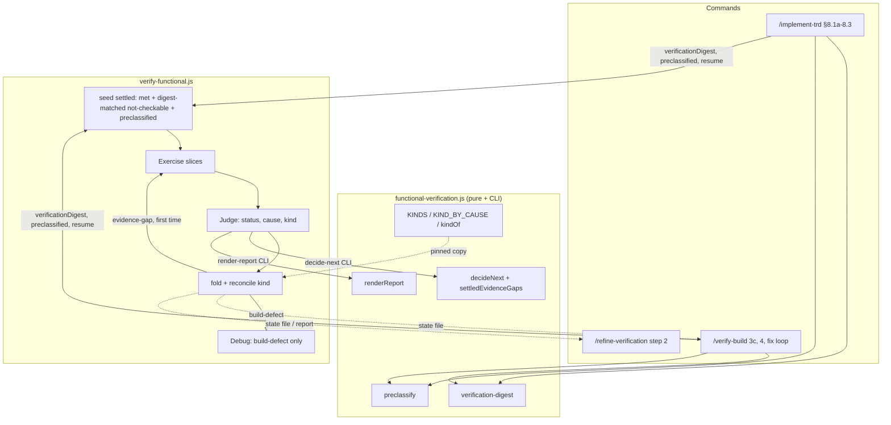
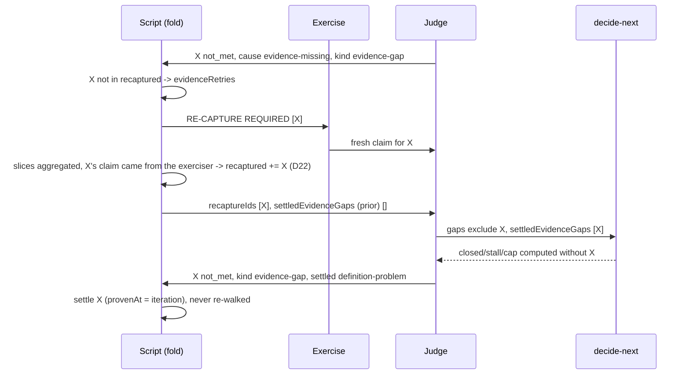

# TRD: Triage unmet verification results by kind

**Version**: 1.1.0
**Status**: Draft
**Created**: 2026-11-11
**Last Updated**: 2026-11-11
**Author**: @technical-architect
**Source PRD**: `docs/plan/triage-unmet-results-by-kind.investigation.md` (workplan `verification-targeted-loop`, roadmap item 1, `docs/plans/verification-targeted-loop/roadmap.md`; GitHub issue FortiumPartners/ensemble-vnext#113)
**Task ID Prefix**: TRIAGE

---

## Changelog

| Version | Date | Changes | Author |
|---------|------|---------|--------|
| 1.0.0 | 2026-11-11 | Initial TRD creation | @technical-architect |
| 1.1.0 | 2026-11-11 | `/audit-trd` findings applied: O12 citation re-pointed; D20 also re-renders the report and its reader rule excepts D21's null-cause entries; D4, D5, §2.3 and §3.4 aligned with D22 and D21; D23 clarified for an undone re-capture; D16 gains the definition-problem Next line; the digest stamp moved from TRIAGE-B004 to TRIAGE-B007; TRIAGE-B002 now depends on TRIAGE-B001; TRIAGE-B003's redundant edge dropped; TRIAGE-B008's Touches made parseable so it serializes behind TRIAGE-B005; Could Not Verify rewritten. | @technical-architect (audit) |

## Objectives

O1–O8 are copied from the source investigation's Objectives table, with their ids, wording
and Must pass marks. O9–O12 come from `constitution.md` or are domain-derived, and are
labelled as such.

| ID | Objective | Source | Must pass |
|----|-----------|--------|-----------|
| O1 | Every criterion the Judge rules not `met` carries exactly one kind (`build-defect`, `evidence-gap` or `not-checkable-here`). The Judge returns it, it is recorded on that criterion in `verification-state.json`, and it is shown in `verification-report.md`. | Investigation O1 (PM instruction, 2026-11-11) | yes |
| O2 | Only `build-defect` criteria are handed to the Debug stage. An iteration with no build defect dispatches no Debug agent. | Investigation O2 (PM instruction, 2026-11-11) | yes |
| O3 | An `evidence-gap` criterion gets exactly one re-capture per run. If the re-capture is still an evidence gap, the criterion is settled as an evidence gap with its reason and reported as a definition problem ("the criterion asks for evidence the build does not produce"). After that it counts toward neither the open nor the closed side of the stalled and cap rules. | Investigation O3 (PM instruction, 2026-11-11) | yes |
| O4 | A `not-checkable-here` result is settled once with its reason. A later invocation (resume, or a `/verify-build` fix round) does not re-open it unless `verification.md` has changed since it was recorded; when it has changed, the criterion re-opens. | Investigation O4 (PM instruction, 2026-11-11) | yes |
| O5 | Some not-checkable results can be known before exercising: a parts-only design board's structure row, and a design-structure row whose environment is a production/minified build. These are classified at preflight from the definition, the design map and `verification.md`, enter the run already settled `not-checkable-here`, and are never handed to Exercise. | Investigation O5 (PM instruction, 2026-11-11) | |
| O6 | The setup check tolerates a dev server's cold start: it sends a warm-up request and allows a generous first-response timeout before it records a target's reach as failed. | Investigation O6 (PM instruction, 2026-11-11) | |
| O7 | `/verify-build`'s fix rounds and `/refine-verification` read the recorded kind instead of re-deriving buildability from the cause. They fall back to the cause only for a state file written before this change. | Investigation O7 (PM instruction, 2026-11-11) | |
| O8 | One headless fixture run of `/verify-build` (the `fixtures` environment in `verification.md`) shows all three kinds in its report. The fixture is seeded with one defect, one missing capture and one host-only criterion. | Investigation O8 (PM instruction, 2026-11-11, acceptance) | |
| O9 | Tests pass. Unit coverage is at least 60% and integration coverage at least 50% where integration tests apply. These are the constitution's floors and are not exceeded here. | `constitution.md` Quality Gates | |
| O10 | Every new input is validated where it enters: the two new workflow arguments, the new `decideNext` input and the two new CLI subcommands. A malformed value fails loudly and is never defaulted into a lenient reading. | `constitution.md` Quality Gates ("Input validation present") | |
| O11 | Documentation is updated. Sibling TRDs whose decisions this feature changes carry an inline amendment marker that points here, and the contract the Judge reads states the kind vocabulary. | `constitution.md` Quality Gates ("Documentation updated"); convention `verification-convergence.md` D16 (amend a sibling in place, never fork it) | |
| O12 | State files and report inputs written before this change (no `kind`, `settled` or `verificationDigest` keys) still load, resume and render. A report built from an older input is unchanged. | domain-derived: `.trd-state/` is git-tracked (`CLAUDE.md` File Structure Reference and `stack.md` File Structure Reference: "Implementation tracking (git-tracked)"), so state files from earlier releases sit in every project's history and are read by `--resume`, `/verify-build` fix rounds and `/refine-verification`. O7's "falling back to the cause only for a state file written before this change" already implies them for the commands. | |

## 1. Overview

### 1.1 Technical Summary

**Today:** the loop tells capture failures apart from build failures only at one point in
the workflow: the `EVIDENCE_CAUSES` split in
`packages/core/workflows/verify-functional.js`. Evidence gaps are re-captured on every
iteration with no limit. Anything else goes to Debug, including `never-exercised` and the
fallback that hands Debug every gap when it has no build gap. Across invocations every
`not_verifiable` verdict re-opens.

**This change:** the cause vocabulary gains one derived attribute, its **kind**, defined once
in `packages/core/lib/functional-verification.js` as `KIND_BY_CAUSE`. The Judge returns it,
and the script reconciles it against the cause. Three things then route on the kind instead
of the cause:

- Debug receives build defects only.
- An evidence gap gets one re-capture, then settles as a definition problem that counts
  toward neither side of the stall and cap rules.
- A not-checkable result settles with a digest of `verification.md`, and a resume keeps it
  settled while that digest is unchanged.

Before the loop, a new pure lib function classifies the not-checkable rows that can be known
from the definition, the design map and `verification.md`. The setup probe gains a warm-up
request and a longer timeout. The report shows kinds. `/verify-build` and
`/refine-verification` read the kind, falling back to the cause for older files.

Pure logic stays in the lib and is exposed through its CLI. Orchestration stays in the
workflow, which has no `require` and so mirrors the lib's constants under a pinning test.
Commands stay prose. These are the existing conventions of `docs/TRD/functional-verification.md`
D3 and `verification-convergence.md`, and nothing here changes them.

### 1.2 Key Technical Decisions

| ID | Decision | Choice | Serves Objective | Rationale | Alternatives Considered |
|----|----------|--------|------------------|-----------|------------------------|
| D1 | Where a kind comes from | Kind is a function of cause. The lib exports `KINDS`, `KIND_BY_CAUSE` (`judged-failed`, `not-built` → `build-defect`; `evidence-missing`, `evidence-stale`, `locator-not-found`, `never-exercised` → `evidence-gap`; `environment-unreachable`, `capability-absent` → `not-checkable-here`), `KIND_LABEL` and `kindOf(cause)`. The Judge returns `kind` beside `cause`. The script reconciles: when the returned kind is absent or disagrees with `KIND_BY_CAUSE[cause]`, it uses the cause-derived kind and logs the disagreement. The one exception is a `not_met` entry whose cause yields no kind (`kindOf(cause)` is null); D21 gives it `build-defect`. | O1, O2 | The eight-cause vocabulary already encodes the distinction (`EVIDENCE_CAUSES` is its evidence half), and routing must not rest on one unchecked model field. Taken from the investigation's Decision section. | A free kind chosen by the Judge, independent of cause. Rejected: two fields could disagree with nothing deciding between them. Revisit if a criterion turns up whose correct kind is not determined by its cause. |
| D2 | `never-exercised` | Kind `evidence-gap`: it is re-captured once and no longer reaches Debug. **This changes today's behaviour**, where a `never-exercised` gap reached Debug. | O2, O3 | No claim reached the Judge, so there is nothing for Debug to fix in code. Investigation OQ-2 assumes the same. | Keep it as a build defect. Rejected: it hands Debug a criterion with no evidence of misbehaviour. Revisit if fixture runs show `never-exercised` hiding crashes (a crash during capture is `judged-failed` by the contract, so this would be a Judge mis-ruling). |
| D3 | The workflow's copy of the map | `verify-functional.js` replaces `EVIDENCE_CAUSES` with a literal `KIND_BY_CAUSE`. A test in `verify-functional.test.js` pins it equal to the lib's export, the same device as the existing cause-enum test. | O1 | The script cannot `require` the lib (existing hazard). A pinned duplicate is the established answer. | Pass the map in as a workflow argument. Rejected: it adds a 29th argument for a constant. Revisit if the workflow runtime gains `require`. |
| D4 | What Debug receives | The remediate split keys on kind. Debug receives only `build-defect` gaps, and the `buildGaps.length > 0 ? buildGaps : allDebugGaps` fallback is deleted. With no build defect the iteration dispatches no Debug agent; renders still run, as the evidence-only branch does today. **Amends `functional-verification.md` D8** ("handed every gap"). | O2 | The fallback is exactly the path that sends a non-build gap to Debug. | Keep the fallback for "Judge returned no kinds". Rejected: D21 gives every `not_met` gap exactly one route (one with no derivable kind goes to Debug as `build-defect`), so the fallback is not needed. The earlier rationale here, that reconciliation always yields a kind, was false: `JUDGE_CRITERION_SCHEMA` permits `cause: null`, and `kindOf(null)` is null. D21 replaces it. |
| D5 | One re-capture, then settle | The script keeps a per-invocation `recaptured` set. On the first time an `evidence-gap` gap is seen, it goes to the next Exercise pass (today's `RE-CAPTURE REQUIRED` block). It joins the set only after that pass, and only when D22 counts the re-capture as done. The next Judge prompt names the ids that are on their one re-capture. If the Judge still rules one of them `evidence-gap`, the fold settles it with status `not_met`, `kind: 'evidence-gap'`, `settled: 'definition-problem'`, its reason, and `provenAt` = the iteration. It is never re-walked in that invocation. **Amends `verification-convergence.md` D2** (a `not_met` entry can now be settled within an invocation). | O3 | The status enum (`met`/`not_met`/`not_verifiable`/`unbuilt`) is read by custody, the reproof retry set, the commands and the report. A marker key on an existing status changes none of those readers. | A new status `evidence_gap`. Rejected: it would ripple through every status reader for what one marker key says. Revisit if roadmap item 4 or 5 needs settled evidence gaps distinguished at the status level. |
| D6 | The stall and cap arithmetic | `decideNext` gains a **required** input `settledEvidenceGaps` (ids), and throws `TypeError` when it is absent or not an array (the file's established style). Those ids are removed from both `gaps` and `previousGaps` before `closed`, the stall rule and the cap rule are computed. The script gives the Judge's STEP 3 payload the ids already settled, verbatim, plus the list of this iteration's re-capture ids, with one stated rule: add to `settledEvidenceGaps`, and leave out of `gaps`, every re-capture id you rule `evidence-gap` again. | O3, O10 | Settling a gap is neither a closure (it must not fake progress past the stall rule) nor an open gap (it must not hold the run to the cap). A required input, rather than a defaulted one, keeps a caller bug from silently reading as "none settled". | Leave the ids in `gaps` and special-case them inside the stall rule. Rejected: the cap rule and the satisfied branch would still count them. Revisit with roadmap item 2, which adds closed causes to the stall rule. |
| D7 | How a run with only settled evidence gaps ends | It exits through the ordinary satisfied branch, still subject to the coverage floor and the must-pass step. A settled evidence gap is not `met`, so a must-pass one ends the run `must-pass-unproven`. `applyMustPassRecheck` in the workflow treats a settled evidence gap like `not_verifiable` (it no longer returns early on that `not_met`), so the deterministic must-pass backstop still applies. | O3 | A new outcome string would ripple through every outcome reader (eight lists in commands and tests, per the investigation) for what the report's own section already says. Without the backstop change, a must-pass settled evidence gap would slip past the recheck's `not_met` early return. | A new outcome `evidence-gaps`. Rejected for the ripple. Revisit if owners report that `satisfied` with definition problems reads as misleading. |
| D8 | Persistence of not-checkable results | Each settled `not-checkable-here` entry records `verificationDigest` (the current workflow argument). On resume the workflow seeds, besides `met`, every `not_verifiable` entry whose `kind` is `not-checkable-here` and whose recorded digest is non-empty and equal to the current one. Any other `not_verifiable` entry re-opens, as today. **Only the workflow applies this rule.** Callers pass the entries through unfiltered. The digest is per entry, not a fifth top-level key. **Amends `verification-convergence.md` D2** (across invocations, more than `met` now carries forward). | O4, O12 | The state file's four top-level keys are read by name in the Judge prompt, `/implement-trd` §8.2 and `/verify-build --resume`, and an unrecognised key is documented to read as absent. One place applying the rule means one reading of it. An older entry has no digest, so it re-opens, which is today's behaviour (O12). | A fifth top-level `verificationDigest` key. Rejected for the reason in the Rationale cell. Callers filtering by digest themselves: rejected, because it would put the same rule in three places. |
| D9 | What the digest covers | A new lib CLI, `functional-verification.js verification-digest <path>`, prints `{"digest": "<sha256 hex>"}` of the file's content after `normalizeVerificationContent` (line endings and surrounding whitespace normalised, the existing helper). It prints `{"digest": ""}` when the file is absent. Commands run it on the path that `node .claude/lib/owner-rules.js path verification.md` prints, which is the copy §8.1a already reads. An empty digest never matches, not even another empty one. | O4, O10 | The digest must cover the same `verification.md` the run's lane resolution used. Normalisation keeps a line-ending conversion from counting as a change. An absent file must not make every entry persist forever. | Hash the working-tree `.claude/rules/verification.md`. Rejected: it can differ from the copy owner-rules resolves. Hash only §1/§2/§5: rejected because O4 says "`verification.md` has changed", not a part of it. Revisit if unrelated edits re-open too much. |
| D10 | Preflight classification | A new pure lib function, `preclassifyNotCheckable({ criteria, boards, environmentByCriterion, minifiedEnvironments })`, plus `readMinifiedEnvironments(verificationText)`, plus a CLI `preclassify --file <payload> --verification <path> [--design-map <path> ...]` that reads the files itself. It returns one `{ id, status: 'not_verifiable', kind: 'not-checkable-here', cause: 'capability-absent', reason, preclassified: true }` per `check:verify-design-structure` row that is either (a) `ST-<board id>` for a board whose `components` list is empty ("parts board: the structure check does not run"), or (b) resolved to a minified environment (the reason names minified component names). A minified environment is one named `production`, or whose §1 row text contains `production build`, `prod build` or `minified`, case-insensitive. `/implement-trd` §8.1a (and so `/verify-build` 3c, which follows it) calls the CLI after lane resolution and passes the result as the workflow argument `preclassified`. | O5 | Reading files in code, not in the model, follows the `must-pass-coverage` CLI's pattern ("never read the Must pass column yourself"). Only the two cases O5 names are classified. | Classify in the workflow. Rejected: the workflow has no filesystem. Let the Judge rule them on the first iteration. Rejected: O5 says they are never handed to Exercise. Revisit with other knowable cases (for example a non-React stack's structure row) when an objective names them. |
| D11 | Seeding preclassified entries | Before the loop, the workflow puts each `preclassified` entry into `settled` with `provenAt: 0` and `verificationDigest`. It is then in no Exercise slice, in no setup target's open set and in no Judge open set, and it appears in the state file and report like any settled entry. A resume entry for the same id is ignored: preclassification is recomputed from the current inputs each invocation. | O5 | One seeding point keeps "never handed to Exercise" structural: the open set is computed by subtraction from `settled`. | Filter preclassified ids out of `criteria` before dispatch. Rejected: they would vanish from the state file, the coverage total and the report. |
| D12 | New workflow arguments | Two optional arguments, appended after `mustPassUncovered` in both dispatch blocks: `verificationDigest` (a string; `""` means nothing persists) and `preclassified` (an array; `[]` means none). Each is validated before any agent dispatches: wrong type, an id not in `criteria`, or an entry whose status or kind is not `not_verifiable`/`not-checkable-here` throws. The dispatch lists go from 26 to 28 fields, `docs/TRD/functional-verification.md` §3.3 `VerifyFunctionalArgs` gains both, and the pins in `verify-command-surface.test.js` and `verify-build-criteria.test.js` move to 28. | O4, O5, O10 | `verify-functional-trd-sync.test.js` already fails if §3.3 and the workflow's `a.*` reads disagree, so the TRD edit is not optional. | Fold both into `resume`. Rejected: preclassification applies to fresh runs too, and the digest is a property of this invocation, not of the prior run. |
| D13 | Cold-start tolerant setup probe | `buildSetupPrompt` step 2's reach probe becomes: one warm-up request whose result is ignored, then `curl ... --max-time 60`, retried until about 90 seconds have passed, before `reach.ok` is `false`. `decideSetup` is unchanged. These numbers are design parameters for O6's "generous", not acceptance thresholds. | O6 | O6 changes how the fact is gathered, not how it is decided. The values are the investigation's. | Declare the timeout per environment in `verification.md`. Rejected: that file is owner-governed and out of scope (NG9). Revisit if a project's cold start exceeds 90 seconds. |
| D14 | Commands read the kind | `/verify-build` fix loop step 2 records a failing row for `kind: 'build-defect'`, and uses cause `judged-failed`/`not-built` only when `kind` is absent. Step 6's stop reasons read `evidence gap — definition problem: <reason>` for a settled evidence gap and `not checkable here: <reason>` for `not-checkable-here`, falling back to the existing cause wording. `buildableOpen` counts `build-defect`. Step 4's synthesised `resume` carries `met` entries **and** `not-checkable-here` entries (D8 applies the digest). The `--resume` prose is updated to match. **Amends `verification-fix-loop.md` D4 and D8.** | O7, O4, O12 | One field decides buildability. The cause fallback is what O7 asks for older files. | Keep cause-based buildability and add the kind as a display field only. Rejected: O7. |
| D15 | `/refine-verification` routing | Step 2: Blockers = `build-defect`. Accepted as not verifiable = `not-checkable-here` (the must-pass rule is unchanged; that is roadmap item 4). A criterion with `settled: 'definition-problem'` is never a Blocker and goes under Owner rulings as a definition problem (`--auto`: an `OWNER-CALL` row). A `never-exercised` criterion left open by a `setup-failure` (kind `evidence-gap`, no `settled` marker) stays neither, as today. Cause is used when `kind` is absent. | O7, O12 | Routing on the `settled` marker rather than the kind alone keeps a setup-failure leftover from being called a definition problem. | Route every `evidence-gap` to Owner rulings. Rejected: a setup-failure `never-exercised` row is not a definition problem. |
| D16 | Report rendering | `renderReport` shows each non-`met` criterion's kind in its row. Under the Diagnosis outcomes, the Diagnosis line leads with counts by kind ("2 build defects, 1 evidence gap, 1 not checkable here") before the existing cause counts. A new `## Evidence gaps (definition problems)` section lists settled evidence gaps with their reason and the sentence "the criterion asks for evidence the build does not produce — change the criterion or the build's outputs". Those criteria are listed there and not under `## Not Met`. The Not Verifiable section marks preclassified rows "classified before exercise". The satisfied outcome's suffix counts settled evidence gaps beside not-verifiable ones. A satisfied, non-sweep run with any `settled: 'definition-problem'` entry prints the existing `/refine-verification` Next line instead of the `/audit-build` one, so the report and the command readouts (D24) name the same next step. **All kind rendering is gated on any criterion carrying `kind`**, so an older input renders byte-identically. | O1, O3, O5, O12 | Gating on the field's presence is the cheapest way to keep old reports stable. The Next line follows the rule `renderReport` already states: the report's Next line matches both commands' readouts. | A separate kind table at the end of the report. Rejected: the owner reads rows, and a kind away from its row asks for a lookup. |
| D17 | The contract the Judge reads | `packages/core/contracts/functional-verification.md` "The cause vocabulary" table gains a Kind column. The contract states the one-re-capture rule and the meaning of `settled: 'definition-problem'`. | O1, O11 | The contract is the Judge's standing text (`contract` argument). The prompt alone would leave the contract contradicting the loop. | Prompt-only. Rejected: the contract and the prompt would drift. |
| D18 | Sibling TRDs | Amended in place with an inline `AMENDED 2026-11-11 by docs/TRD/triage-unmet-results-by-kind.md Dn` marker: `functional-verification.md` D8 and D14 (Debug scope), `verification-convergence.md` D2 (settled set and resume seeding), `verification-fix-loop.md` D3, D4 and D8 (kind stored beside cause, buildable by kind, synthesised resume). | O11 | Follows `verification-convergence.md` D16. A forked statement of the same rule is how a schema flaps across documents. | Leave the siblings as they are and rely on this TRD. Rejected: the next reader of D4 would believe cause still decides. |
| D19 | How O8 is planned | A `[LIVE]` task in the final phase that adds a smoke scenario (`test/smoke/scenarios/`) and runs it once in the `fixtures` environment. **This departs from the investigation**, which planned O8 untagged because "`/plan --implement` does not pass `--include-deferred`". `/implement-trd` §4.1a sets aside only tasks under `## Deferred by design`, so a `[LIVE]` task is dispatched like any other. The authoring contract requires a model-spending run to be its own `[LIVE]` task. | O8 | The contract requires it, and the investigation's reason for avoiding it does not hold. | Untagged, as the investigation planned. Rejected for the reasons in the Rationale cell. |
| D20 | Who writes script-derived facts to the state file (review F1, supersedes the D1/D8 assumption that the Judge's STEP 4 copy carries them) | After each fold, when the fold added or changed `kind`, `settled` or `verificationDigest` on any entry (including entries judged on the exit iteration), the **script** assembles the full state JSON from `settled` plus the open entries and has the existing small writer agent save it through `implement-state` `save()` (the `buildRecordPrompt` / `reconcileOutcome` pattern), before Render or return. On an exit iteration (the only one on which the Judge writes a report) the same agent also brings the report in step: it rewrites each criterion's `status`, `reason`, `kind`, `settled` and `verificationDigest` in the Judge-written `judge-report-input-<n>.json` to the script's values, by id, leaves every other key as it is, and re-renders `verification-report.md` with `render-report` (`reconcileOutcome` steps 2 and 3). It runs before `recheckAndReconcile`, which reads both files back and so composes with it. The Judge prompt's STEP 4 still writes the file first (an interrupted run keeps today's durability); the script's write is the authoritative one. The Judge prompt is also given the literal digest so its own STEP 4 write stamps `verificationDigest` on entries it rules not-checkable. Readers (`/verify-build`, `/refine-verification`, `/implement-trd`) treat `kindOf(cause)` as authoritative when it is non-null and a stored `kind` disagrees. When `kindOf(cause)` is null (D21's null-cause or unknown-cause `not_met` entries), the stored kind stands; a `not_met` entry with neither reads as `build-defect`. | O1, O4, O7 | Without it, a verdict made on the last iteration (the common one-iteration case) is on disk without its digest or with the Judge's uncorrected kind, so O4 fails on the next resume. | Judge-only copy (rejected: never runs for the exit iteration). Re-saving the state file alone (rejected: the report would keep the Judge's kind and status while the state file carries the script's, and O1 requires the kind in the report). |
| D21 | A not-met gap with no derivable kind, or a not-met gap whose cause is not-checkable (review F2, replaces D4's rationale) | A `not_met` gap whose cause is null, unknown, or whose `debugGaps` item has no matching `criteria` entry gets kind `build-defect`, keeps `cause: null`, is logged, and goes to Debug exactly as today. A `not_met` gap whose cause is `environment-unreachable` or `capability-absent` is re-statused `not_verifiable` (logged) and settled as `not-checkable-here` with the digest. Every not-met gap therefore has exactly one route. | O1, O2 | Deleting the `allDebugGaps` fallback otherwise strands these gaps (no Debug, no re-capture, no settle) and the run stalls; the `remediateJudge()` fixture (no cause) is used at ~44 test call sites. | Leave kind null (rejected: violates O1, strands the gap). |
| D22 | When a re-capture counts as done (review F3, refines D5) | An id is added to `recaptured` only after the re-capture iteration's slices are aggregated, and only if: Exercise was not skipped that iteration, the id's slice was not dead, and its claim came from the exerciser (not synthesized by `reconcileClaims` or the dead-slice / no-lane fallback). Only those ids are named to the Judge as "on their one re-capture" and only those can be settled as a definition problem. An id whose re-capture did not happen keeps its one re-capture for the next iteration. | O3 | A dead slice or skipped Exercise produces `evidence-missing`/`never-exercised`, and settling that as "the criterion asks for evidence the build does not produce" would be false. | Count at routing time (rejected: the defect above). |
| D23 | Stall rule after a re-capture-only iteration (review §3) | Besides D6's `settledEvidenceGaps`, the script removes from the `previousGaps` it passes to the Judge every id routed to re-capture this iteration, whether or not D22 counted the re-capture as done (no Debug pass ran for any of them), so a re-capture that reveals a real build defect is routed to Debug next iteration instead of ending `exit-stalled` at once. | O2, O3 | No fix was attempted for those ids, so "closed nothing" is not evidence of non-convergence. An id whose re-capture keeps failing to happen (a dead slice every time) is therefore never the cause of a stall; the cap ends the run with it open, as OQ-4 states for a gap first seen at the cap. | None. |
| D24 | Definition problems on a satisfied run reach the owner (review F4) | Any entry with `settled: 'definition-problem'` counts as something open for NEXT routing in `/verify-build` and `/implement-trd` Step 9: ISSUES names each (statement in words, reason) with the owner as the one who acts, and NEXT routes to `/refine-verification` rather than `/audit-build`. `refine-verification.md`'s "does not apply to a run that ended satisfied with nothing open" sentence is amended so such a run applies. | O3, O7 | Otherwise D15's Owner-rulings path is unreachable on exactly the runs D7 creates. | None. |
| D25 | Fix-loop step 6 stop-reason order and the subset dispatches (review §2) | In `/verify-build` fix loop step 6, the `not checkable here: <reason>` form is checked **before** the existing `not verifiable here:` form, and `evidence gap — definition problem: <reason>` before the cause-based forms; step 2's "never recorded: a `not_verifiable` criterion" stays keyed on status. The `--criteria` overrides and the re-proof retry's "same fields except" list both add `preclassified: []` explicitly. The Step 9 / Readout sentences in `implement-trd.md` (~2085, ~2139) and `verify-build.md` (~393) that promise Diagnosis counts "exactly as `renderReport` counts them" are updated to the kind-led line. | O4, O5, O7 | The new forms would otherwise never fire; D12 throws on a preclassified id outside `criteria`; the readouts would disagree with the report. | None. |
| D26 | Stale reference text (review §2) | The Judge prompt's settled-block header ("Already-settled criteria… (status met/not_verifiable/unbuilt)") includes settled not-met evidence gaps, and STEP 3's `"gaps":<not_met ids>` excludes settled ids. `.claude/verification-notes.md` (decide-next's required fields, ~line 886) gains `settledEvidenceGaps`. `docs/reference/verification.md` (resume carries only met ~308-310; status table ~344-349; cause table Buildable column ~355-364; decideNext order ~379; "the same 26 arguments" line 36) and `docs/TRD/functional-verification.md` (~516 "26 fields") are brought in line. `verify-functional-trd-sync.test.js`'s `toHaveLength(26)` becomes 28. | O1, O11 | These are the remaining readers of the changed behaviour. | None. |

### 1.3 Technology Stack

| Layer | Technology | Purpose | Notes |
|-------|------------|---------|-------|
| Deterministic logic | JavaScript / Node.js 18+ | `functional-verification.js` (kinds, `decideNext`, digest, preclassify, report) | `stack.md` |
| Orchestration | Workflow script (no `require`) | `verify-functional.js` | Mirrors lib constants under a pinning test |
| Commands, contract | Markdown prompts | `verify-build.md`, `implement-trd.md`, `refine-verification.md`, `contracts/functional-verification.md` | Mirrored byte-identically under `.claude/` |
| Tests | Jest ^29.7.0; Shell for the smoke scenario | Unit and workflow-harness tests; headless fixture run | `stack.md` |

### 1.4 Integration Points

| System | Type | Direction | Notes |
|--------|------|-----------|-------|
| `verification-state.json` | JSON file via `implement-state.save()` | Out (Judge writes), In (resume, commands) | Gains per-entry keys `kind`, `settled`, `verificationDigest`, `preclassified`. The four top-level keys are unchanged. |
| `verification-report.md` | Markdown via `render-report` CLI | Out | Kind rendering gated on `kind` presence |
| `owner-rules.js path verification.md` | CLI | In | The `verification.md` copy that is digested and read for minified environments |
| `design-map.json` | JSON file | In (preclassify CLI) | The `boards[].id` and `boards[].components` fields |
| `custody.js`, reproof retry set | readers of state `status` | In | Unaffected: no status value changes (D5) |

## 2. System Architecture

### 2.1 Architecture Overview

Where the kind is decided and who reads it:



### 2.2 Component Architecture

#### 2.2.1 Kind vocabulary (lib)
**Responsibility**: the single definition of kinds and their mapping from causes.
**Interfaces**: `KINDS`, `KIND_BY_CAUSE`, `KIND_LABEL`, `kindOf` exports.
**Dependencies**: `CAUSES`.

#### 2.2.2 `decideNext` (lib)
**Responsibility**: the loop's exit decision. It now excludes settled evidence gaps from the
gap arithmetic.
**Interfaces**: `decide-next` CLI and the `decideNext(input)` export.

#### 2.2.3 Preflight helpers (lib)
**Responsibility**: the `verification.md` digest and the classification of knowable
not-checkable rows.
**Interfaces**: the `verification-digest` and `preclassify` CLIs; the
`preclassifyNotCheckable` and `readMinifiedEnvironments` exports.

#### 2.2.4 Loop orchestration (workflow)
**Responsibility**: seeding, kind reconciliation, the re-capture set, the Debug routing and
the setup probe.
**Interfaces**: two new arguments (D12); the Judge schema gains `kind` and `settled`.

#### 2.2.5 Commands
**Responsibility**: compute the digest and the preclassified list; pass them and a resume
through; read the kind to decide what is built, what is accepted and what is an owner ruling.

### 2.3 Data Flow

One evidence gap across one invocation (O3):



### 2.4 State Management

A criterion entry in `verification-state.json` gains these optional keys. All existing keys
and the four top-level keys are unchanged.

- `kind`: on every non-`met` entry; null on `met`.
- `settled: 'definition-problem'`: only on an evidence gap settled after its re-capture.
- `verificationDigest`: only on a settled `not-checkable-here` entry (including preclassified
  ones).
- `preclassified: true`: only on a preflight-classified entry.

Lifetimes:

- **Within one invocation:** settled evidence gaps and not-checkable results are both
  settled.
- **Across invocations:** a settled evidence gap re-opens, because a new invocation may
  capture differently. A not-checkable result persists only while the digest matches (D8).

## 3. Technical Specifications

### 3.1 Kind vocabulary (lib)

```typescript
type Kind = 'build-defect' | 'evidence-gap' | 'not-checkable-here';
const KINDS: Kind[]; // in that order
const KIND_BY_CAUSE: Record<Cause, Kind>; // D1's table; keys equal CAUSES exactly
const KIND_LABEL: Record<Kind, string>; // 'build defect' | 'evidence gap' | 'not checkable here'
function kindOf(cause: string | null | undefined): Kind | null; // null for null or an unknown cause
```

**Behavior**: `Object.keys(KIND_BY_CAUSE)` equals `CAUSES` in order (asserted by a test).
`kindOf('unrecorded')` is `null`. `kindOf` stays a pure function of the cause; a `not_met`
entry for which it returns null is given `build-defect` by the workflow (D21), and readers keep
that stored kind (D20).

### 3.2 `decideNext` input change (lib)

```typescript
interface DecideNextInput {
  // ...every existing field, unchanged...
  settledEvidenceGaps: string[]; // required (D6)
}
```

**Behavior**:
- `gaps' = gaps \ settledEvidenceGaps` and `previousGaps' = previousGaps \ settledEvidenceGaps`
  (when `previousGaps` is not null).
- Every existing branch (unbuilt, satisfied, setup-failure, stalled, stuck, remediate), the
  coverage re-label and the must-pass step run on `gaps'` and `previousGaps'`, in today's
  order.
- `closed` is computed from the primed sets.
- `met` is unchanged. A settled evidence gap is not met, so the must-pass step still blocks
  on it.

**Error Handling**: an absent or non-array `settledEvidenceGaps` throws `TypeError`, naming
the field and the lenient reading it prevents.

### 3.3 Digest and preflight classification (lib)

```typescript
// CLI: node functional-verification.js verification-digest <path>
//   -> {"digest": "<64 hex>"}  |  {"digest": ""} when <path> does not exist
function readMinifiedEnvironments(verificationText: string): string[];

interface PreclassifyInput {
  criteria: { id: string; derivation?: string }[];
  boards: { id: string; components: string[] }[]; // union of boards[] from each --design-map
  environmentByCriterion: Record<string, string>; // from §8.1a lane resolution
  minifiedEnvironments: string[];
}
interface PreclassifiedEntry {
  id: string; status: 'not_verifiable'; kind: 'not-checkable-here';
  cause: 'capability-absent'; reason: string; preclassified: true;
}
function preclassifyNotCheckable(input: PreclassifyInput): PreclassifiedEntry[];
// CLI: node functional-verification.js preclassify --file <payload: {criteria, environmentByCriterion}>
//        --verification <path> [--design-map <path> ...]   -> PreclassifiedEntry[] as JSON
```

**Behavior**:
- Only `check:verify-design-structure` rows are candidates.
- Case (a): `ST-<id>` whose board is found with `components: []`.
- Case (b): any candidate row whose `environmentByCriterion` value is in
  `minifiedEnvironments`. When both apply, (a) wins.
- A board id not found in `boards`, or a row with no resolved environment, is not
  classified. It is left to Exercise, as today.

**Error Handling**:
- The CLI exits non-zero with a usage line for a missing `--file` or `--verification`, or
  for an unparseable payload.
- A `--design-map` that is absent or unparseable is skipped and named on stderr. Its boards
  are then simply not classified, which is the conservative direction.

### 3.4 Workflow changes (`verify-functional.js`)

**Arguments** (D12):

```typescript
interface VerifyFunctionalArgs {
  // ...26 existing fields...
  verificationDigest?: string;            // default ""
  preclassified?: PreclassifiedEntry[];   // default []
}
```

**Behavior**:
- **Seeding** (D8, D11), in this order:
  1. `met` resume entries.
  2. Resume entries with status `not_verifiable`, `kind` `not-checkable-here` and a non-empty
     `verificationDigest` equal to `VERIFICATION_DIGEST`.
  3. Every `preclassified` entry, with `provenAt: 0` and `verificationDigest`. It overwrites
     any resume entry for the same id.
- **Judge schema**: `JUDGE_CRITERION_SCHEMA` gains `kind` (enum of `KINDS`, or null) and
  `settled` (`'definition-problem'` or null).
- **Judge prompt**:
  - STEP 2 asks for `kind` and states D1's mapping.
  - The prompt lists the re-capture ids for this iteration.
  - STEP 3's payload adds `settledEvidenceGaps` (D6).
  - STEP 4's and STEP 5's carried-key lists name `kind`, `settled`, `verificationDigest` and
    `preclassified`. A settled entry's keys are copied "EXACTLY as given", so a key left out
    of a list is silently dropped.
  - The return item list adds `kind` and `settled`.
- **Fold**: for each returned entry, `kind = reconcile(entry)` (D1).
  - `met`, `not_verifiable` and `unbuilt` settle as today, carrying `kind`.
  - A `not-checkable-here` entry also carries `verificationDigest`.
  - A `not_met` evidence gap whose id is in `recaptured` settles with
    `settled: 'definition-problem'`.
- **Split** (D4, D5):
  - A `build-defect` gap goes to Debug.
  - An `evidence-gap` gap not yet in `recaptured` goes to `evidenceRetries`. It is added to
    `recaptured` only after the next iteration's slices are aggregated, and only under D22's
    conditions (Exercise ran, its slice was not dead, its claim came from the exerciser).
  - If no build defect remains, no Debug agent is dispatched.
  - `previousGaps` drops settled ids.
- **`applyMustPassRecheck`** (D7): a settled evidence gap no longer triggers the early
  `not_met` return.
- **`endOnSetupFailure`**: its synthesised `never-exercised` entries carry
  `kind: 'evidence-gap'` and no `settled` marker.
- **Setup probe** (D13).

**Error Handling**:
- An argument fails validation (O10) → throw before any dispatch.
- The Judge returns a kind that disagrees with its cause → use the cause-derived kind and
  log it, naming the id.
- The Judge returns no kind → derive it from the cause.

### 3.5 Commands

- `/implement-trd` §8.1a:
  - After lane resolution, run `verification-digest` on the owner-rules path.
  - Run `preclassify` with the criteria, `environmentByCriterion`, that same
    `verification.md` path, and every `design-map.json` named in the selected
    verify-design-structure inputs (§8.1b).
  - Hold the two results as `verificationDigest` and `preclassified`.
- `/implement-trd` §8.2: unchanged in what it filters; it already passes all surviving
  entries.
- `/implement-trd` §8.3 and `/verify-build` §4: 28 fields (D12).
- `/verify-build` `--resume` prose, and fix loop steps 2, 4 and 6: as in D14.
- `/refine-verification` step 2: as in D15.
- All `.claude/` mirrors are updated byte-identically; existing tests assert this.

## 4. Master Task List

### 4.1 Task ID Convention

`TRIAGE-[CATEGORY][SEQ]`; B = build, D = documentation, T = test. Unit tests ship inside each
build task. Every task that edits a `packages/core/` file also updates its `.claude/` mirror,
which must stay byte-identical.

### 4.2 Phase 1: Vocabulary and decision logic

| Task ID | Description | Serves | Skills | Dependencies | Acceptance Criteria |
|---------|-------------|--------|--------|--------------|---------------------|
| TRIAGE-B001 | In `functional-verification.js`, add `KINDS`, `KIND_BY_CAUSE`, `KIND_LABEL` and `kindOf` beside `CAUSES` (§3.1). Add the required `settledEvidenceGaps` input to `decideNext` (§3.2). Add the `verification-digest` CLI (D9). Export the new names and add usage lines. Also add `settledEvidenceGaps` to `.claude/verification-notes.md`'s decide-next field list (D26). | D1, D6, D9 (O1, O3, O4, O10) | `jest` | None | New `functional-verification.test.js` cases: (1) the map's keys equal `CAUSES` and its values are in `KINDS`; (2) `decideNext` throws without `settledEvidenceGaps`; (3) with gaps `[X, B]`, previous `[X, B]` and settled `[X]`, it returns `exit-stalled` (B not closed); with gaps `[X]`, settled `[X]`, it returns `exit-satisfied`, or `exit-must-pass-unproven` when X is must-pass; (4) the digest is stable across CRLF/LF and is `""` for an absent file. Every existing `decideNext` case passes with `settledEvidenceGaps: []` added. Coverage at or above O9's floors. |
| TRIAGE-B002 | Write the functional-verification contract amendment (D17). The cause table gains a Kind column, plus the one-re-capture rule and the meaning of `settled: 'definition-problem'`. | D17 (O1, O11) | | TRIAGE-B001 | `packages/core/contracts/functional-verification.md` and its mirror are updated; `packages/core/contracts/functional-verification.test.js` passes, with a new assertion that every cause row names the kind `KIND_BY_CAUSE` gives it. That assertion imports `KIND_BY_CAUSE`, which TRIAGE-B001 creates, hence the dependency. |

### 4.3 Phase 2: Preflight classification and loop routing

| Task ID | Description | Serves | Skills | Dependencies | Acceptance Criteria |
|---------|-------------|--------|--------|--------------|---------------------|
| TRIAGE-B003 | In `functional-verification.js`, add `readMinifiedEnvironments`, `preclassifyNotCheckable` and the `preclassify` CLI (§3.3). This is the same file as B001 and B006; it is split out for **verifiability**: O5's acceptance (parts board, minified environment, unknown board left alone) is a separate suite from B001's routing arithmetic. It consumes nothing B001 adds (§3.3 uses the literals), so it declares no dependency; `task-graph.js` serializes it behind B001 because their Touches intersect. | D10 (O5, O10) | `jest` | None | Cases: a parts board's `ST-` row is classified with the parts-board reason; a real board on a `production` environment is classified with the minified reason; a row whose environment row says "minified" is classified; an unknown board id and a non-structure row are not classified; the CLI reads `--design-map` files and skips an unparseable one with a stderr line; a missing `--verification` gives a usage exit. |
| TRIAGE-B004 | In `verify-functional.js`, implement the kind routing: replace `EVIDENCE_CAUSES` with a pinned `KIND_BY_CAUSE` copy (D3); add `kind`/`settled` to `JUDGE_CRITERION_SCHEMA` and to the Judge prompt's STEP 2–5 key lists and return list; reconcile kind in the fold (D1); add the `recaptured` set and settling (D5); add the STEP 3 `settledEvidenceGaps` payload (D6); route only build defects to Debug and delete the `allDebugGaps` fallback (D4); update `applyMustPassRecheck` (D7); give `endOnSetupFailure` entries a kind. Update the existing evidence-gap suite to the one-re-capture rule. Also: D20 (script-side state write after the fold, and on an exit iteration the report-input rewrite and re-render; the `verificationDigest` part of D20 is TRIAGE-B007's, because the digest exists only as the workflow argument B007 adds), D21 (route for no-kind and not-checkable not-met gaps; the re-statused entry is settled without a digest here and B007 adds the stamp), D22 (re-capture counts only when a real claim came back), D23 (re-capture ids removed from `previousGaps`), D26 (settled-block header and STEP 3 `gaps`). Tests: a dead slice and a skipped Exercise on the re-capture iteration do not settle; a cause-null not-met gap still reaches Debug; on an exit iteration where the Judge's kind is overridden, the writer agent's prompt carries the corrected kind for both the state file and the report input and calls `render-report`; a re-capture id is absent from the `previousGaps` handed to the next Judge. | D1, D3, D4, D5, D6, D7, D20, D21, D22, D23 (O1, O2, O3) | `jest` | TRIAGE-B001 | `verify-functional.test.js`: (1) with a Judge stub that keeps ruling `evidence-missing` on X, there are exactly two Exercise dispatches holding X (the initial one and one re-capture), no Exercise slice for X on the third iteration, X settled with `settled: 'definition-problem'`, and X named in the third Judge prompt's `settledEvidenceGaps`; today's code gives three dispatches, so the test fails if the change does nothing (the stall arithmetic is not observable here because the tests stub the Judge; TRIAGE-B001 case (3) pins it); (2) a Debug prompt never contains a non-build-defect id, and an iteration with only evidence gaps dispatches no Debug agent; (3) a `never-exercised` gap reaches Exercise, not Debug; (4) a Judge kind that disagrees with its cause is overridden and logged; (5) the pinned map equals the lib's export; (6) the STEP 4 and STEP 5 prompt text name `kind`, `settled`, `verificationDigest` and `preclassified`; (7) a must-pass settled evidence gap ends `must-pass-unproven`. |
| TRIAGE-B005 | `/refine-verification` step 2 routing (D15), using cause when `kind` is absent, and D20's reader rule (a non-null `kindOf(cause)` wins over a disagreeing stored kind; a stored kind stands where `kindOf(cause)` is null). Also D24: amend the "does not apply to a run that ended satisfied with nothing open" sentence so a satisfied run with definition problems applies. | D15 (O7, O12) | | TRIAGE-B001 | `packages/core/commands/refine-verification.md` and its mirror are updated; `refine-verification-must-pass.test.js` and `verify-command-surface.test.js` pass, with new prose assertions: Blockers keyed on `build-defect`; `settled: 'definition-problem'` goes under Owner rulings (an `OWNER-CALL` row under `--auto`); the cause fallback is named. |

### 4.4 Phase 3: Report, persistence and new inputs

| Task ID | Description | Serves | Skills | Dependencies | Acceptance Criteria |
|---------|-------------|--------|--------|--------------|---------------------|
| TRIAGE-B006 | Add kind rendering to `renderReport` (D16): a kind on each row, kind counts leading the Diagnosis line, the `## Evidence gaps (definition problems)` section, preclassified marks, the satisfied suffix, and the `/refine-verification` Next line for a satisfied run with a definition problem (D24). All of it is gated on `kind` being present. This is the same file as B001 and B003; it is split out for **size**, since the report renderer is about 300 lines with its own suite, and folding it into B003 would give one pass two unrelated acceptance suites. | D16, D24 (O1, O3, O5, O12) | `jest` | TRIAGE-B003 | Cases: an input with kinds shows each row's kind and a Diagnosis line starting "N build defects, …"; a settled evidence gap appears in the new section with the definition-problem sentence and not under `## Not Met`; a preclassified row is marked; a satisfied non-sweep input with a `settled: 'definition-problem'` entry prints the `/refine-verification` Next line, and one without prints `/audit-build`; **an existing fixture input with no `kind` renders byte-identically to its current output**. |
| TRIAGE-B007 | In `verify-functional.js`, add the two new arguments with validation (D12), resume seeding by digest (D8), preclassified seeding (D11) and the cold-start setup probe (D13). Stamp `verificationDigest` on every settled `not-checkable-here` entry (the fold, D21's re-statused entries and the D20 script-side write) and pass the literal digest to the Judge prompt so its STEP 4 write carries it (the digest part of D20, moved here from B004 because only this task adds `a.verificationDigest`, and `verify-functional-trd-sync.test.js` fails on an `a.` read that §3.3 does not declare). Add both arguments to `docs/TRD/functional-verification.md` §3.3 `VerifyFunctionalArgs`, and update its leading `// args -- 26 fields` comment (~516) to 28. This is the same file as B004 and runs after it; it is split out for **size**, since the combined change touches about ten regions of a 1,957-line file. Also update `verify-functional-trd-sync.test.js` (`toHaveLength(26)` → 28) (D26). | D8, D11, D12, D13, D20 (O4, O5, O6, O10, O12) | `jest` | TRIAGE-B004, TRIAGE-B003 | `verify-functional.test.js`: (1) a resume with a `not-checkable-here` entry and an equal digest is not exercised or judged again; with a different digest, or with no recorded digest (an older state file), it re-opens; (2) a preclassified id is in no Exercise prompt, no setup-target open set and no Judge open set, and appears in the state entries with `provenAt: 0`; (3) bad argument shapes throw before any dispatch; (4) the setup prompt contains a warm-up request and `--max-time 60` and no longer contains `--max-time 5`; (5) a not-checkable verdict made on the exit iteration is saved, in the script-side write, with the current digest. `verify-functional-trd-sync.test.js` passes. |

### 4.5 Phase 4: Commands and documentation

| Task ID | Description | Serves | Skills | Dependencies | Acceptance Criteria |
|---------|-------------|--------|--------|--------------|---------------------|
| TRIAGE-B008 | Command wiring, in `implement-trd.md` (§8.1a: run the digest and preclassify; §8.3: 28 fields) and `verify-build.md` (§4: 28 fields; `--resume` prose; fix loop steps 2, 4 and 6 per D14). Update the field-count pins in `verify-command-surface.test.js` and `verify-build-criteria.test.js`. Both command files are in one task for **verifiability**: one pin test compares the two dispatch lists field by field, so neither file can pass alone. Also: D24 (definition problems route NEXT to `/refine-verification` and appear in ISSUES), D25 (step 6 order, `preclassified: []` on `--criteria` and re-proof retry, readout Diagnosis wording), D20 (readers trust a non-null `kindOf(cause)` over a disagreeing stored kind; where `kindOf(cause)` is null the stored kind stands). | D9, D10, D12, D14 (O4, O5, O7, O12) | | TRIAGE-B003, TRIAGE-B007 | Both dispatch blocks list the same 28 fields, ending `mustPassUncovered, verificationDigest, preclassified`. §8.1a names both CLI calls and the owner-rules path. Fix loop step 2 keys on `kind: 'build-defect'` with a stated cause fallback. Step 4's synthesised resume includes `not-checkable-here` entries. Step 6 names the two new stop-reason forms. Mirrors are byte-identical, and the command test files pass. |
| TRIAGE-D001 | Sibling TRD amendments (D18): inline `AMENDED 2026-11-11` markers on `functional-verification.md` D8 and D14, `verification-convergence.md` D2, and `verification-fix-loop.md` D3, D4 and D8, each pointing at the deciding Dn here. Add a changelog row to each. Also bring `docs/reference/verification.md` in line (D26). Kept apart from TRIAGE-B007, which also edits `functional-verification.md`, because B007's §3.3 edit must land in the same change as the workflow's `a.*` reads (`verify-functional-trd-sync.test.js` fails between them), while this task is documentation only and owns that file's single header bump and changelog row. | D18 (O11) | | TRIAGE-B007, TRIAGE-B008 | Each named decision cell carries the marker and pointer; each TRD has a new changelog row; `verify-functional-trd-sync.test.js` still passes. |

### 4.6 Phase 5: Assembled-feature verification

| Task ID | Description | Serves | Skills | Dependencies | Acceptance Criteria |
|---------|-------------|--------|--------|--------------|---------------------|
| TRIAGE-T001 [LIVE] | Add `test/smoke/scenarios/verify-triage-kinds.sh`, following `test/smoke/lib/project.sh` and the existing `verify-fix.sh` scenario. It scaffolds a fixture slot (`verification.md` §1a's create command), seeds a feature with a success definition of three criteria (one the fixture's code breaks, one whose evidence the build never writes, and one needing an environment the fixture's own `verification.md` marks as not reachable from this host), and runs `/verify-build` headless. Run it once in the `fixtures` environment. | O8 (D19) | | TRIAGE-B002, TRIAGE-B005, TRIAGE-B006, TRIAGE-B008 | The fixture's `verification-report.md` shows one `build defect`, one `evidence gap` (in the definition-problems section) and one `not checkable here`. Its `verification-state.json` carries the three kinds. The report, state file and session transcript are saved under `.trd-state/triage-unmet-results-by-kind/evidence/live/TRIAGE-T001/` and listed in `live-manifest.jsonl`. The slot folder is removed afterwards. |
| AMEND-001 | [test-gap] O5 / TRIAGE-B007 acceptance case 2: no test proves a preclassified criterion's setup target is left out of the setup check — promoted from a gap discovery found by audit-build — find and fix every instance of this weakness across the feature's touched files, and list each one fixed (observed: packages/core/workflows/verify-functional.js:1955 filters SETUP_TARGETS on the settled map; verify-functional.test.js:3776-3783 checks only the Exercise prompt and Judge open set; no test passes preclassified together with setupTargets.) | amendment — no objective recorded |  | None | [test-gap] O5 / TRIAGE-B007 acceptance case 2: no test proves a preclassified criterion's setup target is left out of the setup check no longer holds |
| AMEND-002 | [defect] TRIAGE-B004 / D21: a not-met gap whose debugGaps item has no matching criteria entry is routed as a build defect but not logged, as D21 requires — promoted from a gap discovery found by audit-build — find and fix every instance of this weakness across the feature's touched files, and list each one fixed (observed: packages/core/workflows/verify-functional.js:2171 `const kind = entry ? entry.kind ?? 'build-defect' : 'build-defect'` has no log in the no-entry branch; only the null-cause case is logged, in reconcileJudgeKinds (~line 1437).) | amendment — no objective recorded |  | None | [defect] TRIAGE-B004 / D21: a not-met gap whose debugGaps item has no matching criteria entry is routed as a build defect but not logged, as D21 requires no longer holds |
| AMEND-003 | [defect] O8's passing fixture run (13/13 assertions; report and state show build-defect, evidence-gap, not-checkable-here) is saved only under evidence/fs30/. TRIAGE-T001's acceptance requires it under evidence/live/TRIAGE-T001/ and listed in live-manifest.jsonl. Copy the fs30 report, state file and transcript there, add manifest rows describing the passing run, and clear implement.json TRIAGE-T00 — promoted from a gap discovery found by audit-build — find and fix every instance of this weakness across the feature's touched files, and list each one fixed (observed: .trd-state/triage-unmet-results-by-kind/evidence/live/TRIAGE-T001/run.log ('ASSERTIONS: 11 passed, 2 failed'; line 8 FS-2 expected evidence-gap, got build-defect); evidence/fs30/run.log ('ASSERTIONS: 13 passed, 0 failed'); evidence/live-manifest.jsonl 3 rows, all 'FS-2 ... ruled build-defect by the live Judge'; implement.json:174 current_problem 'O8 partial...'; docs/TRD/triage-unmet-results-by-ki) | amendment — no objective recorded |  | None | [defect] O8's passing fixture run (13/13 assertions; report and state show build-defect, evidence-gap, not-checkable-here) is saved only under evidence/fs30/. TRIAGE-T001's acceptance requires it under evidence/live/TRIAGE-T001/ and listed in live-manifest.jsonl. Copy the fs30 report, state file and transcript there, add manifest rows describing the passing run, and clear implement.json TRIAGE-T00 no longer holds |

## 5. Execution Plan

### 5.1 Phase Overview

| Phase | Focus | Prerequisites | Parallelizable Sessions |
|-------|-------|---------------|------------------------|
| 1 | Vocabulary, `decideNext`, digest; contract (each task ships its unit tests) | None | B001, then B002 (B002's test imports `KIND_BY_CAUSE`) |
| 2 | Preclassify; workflow routing; refine-verification | B001 | B003 (lib), B004 (workflow) and B005 (command) in parallel; B003 waits on B001 through their shared file |
| 3 | Report rendering; workflow inputs | B003, B004 | B006 (lib) and B007 (workflow) in parallel |
| 4 | Command wiring; sibling TRDs | B007 | B008, then D001 (D001 waits for B007's §3.3 edit in `functional-verification.md`); B008 also waits on B005 through `verify-command-surface.test.js` |
| 5 | `[LIVE]` fixture run | All build tasks | single task |

### 5.2 Session Details

- **1A** B001, then B003, then B006: the lib chain (@backend-implementer). These serialize on
  `functional-verification.js`.
- **1B** B002 (@agent-implementer, prompt contract). It starts once B001 lands, in parallel with
  the rest of 1A.
- **2A** B004, then B007: the workflow chain (@backend-implementer). These serialize on
  `verify-functional.js`. B007 also waits for B003, for the preclassified shape.
- **2B** B005 (@agent-implementer). It needs only B001.
- **4A** B008, then D001.
- **5A** T001 (@verify-app).

### 5.3 Parallelization Map

```mermaid
gantt
    title Execution Plan (No time scale - dependency order only)
    dateFormat X
    axisFormat %s
    section Lib
    B001 vocabulary+decideNext+digest: b1, 0, 1
    B003 preclassify: b3, after b1, 1
    B006 report: b6, after b3, 1
    section Contract and commands
    B002 contract: b2, after b1, 1
    B005 refine-verification: b5, after b1, 1
    section Workflow
    B004 routing: b4, after b1, 1
    B007 inputs+persistence+probe: b7, after b4 b3, 1
    section Wiring
    B008 commands: b8, after b7, 1
    D001 sibling TRDs: d1, after b8, 1
    section Live
    T001 fixture run: t1, after b6 b8 b2 b5, 1
```



### 5.4 Critical Path

TRIAGE-B001 → TRIAGE-B004 → TRIAGE-B007 → TRIAGE-B008 → TRIAGE-T001.

## 6. Quality Requirements

### 6.1 Testing Requirements

| Type | Coverage Target | Source | Scope |
|------|-----------------|--------|-------|
| Unit Tests | ≥ 60% | `constitution.md` Quality Gates | New and changed lib functions; workflow behaviour through `test-harness.js` |
| Integration Tests | ≥ 50% when applicable | `constitution.md` Quality Gates | The workflow-harness suites and the command-prose pin tests |

End-to-end: TRIAGE-T001 is the single `[LIVE]` walk of the assembled feature (O8). The test
commands come from the roadmap: `npx jest packages/core/workflows/verify-functional.test.js
packages/core/lib/functional-verification.test.js packages/core/commands/verify-build-criteria.test.js`.
The other suites named in the tasks are added to that list.

### 6.2 Code Quality Standards

The constitution names none beyond its quality gates (O9–O11).

### 6.3 Security Requirements

None. The feature handles no credentials, personal data, payments or tenancy. The digest is
a hash of a committed policy file that holds no credential (`verification.md` §3).

## 7. Risk Assessment

### 7.1 Risks Imported from PRD

The investigation states no risks.

### 7.2 Technical Risks

| ID | Risk | Likelihood | Impact | Mitigation |
|----|------|------------|--------|------------|
| TR1 | An environment that was only temporarily unusable at §3.6a (for example a stopped dev server) is ruled `environment-unreachable`, so its criteria become `not-checkable-here` and persist across invocations, because `verification.md` did not change. | Med | Med | O4 states the re-open condition as written. The report row names the reason, and editing `verification.md`, or starting a fresh run, re-opens it. Raised as OQ-3 for the owner. A setup failure still produces `never-exercised` (an evidence gap), which never persists. |
| TR2 | The Judge copies settled entries "EXACTLY as given" into a fixed key list. A new key missing from one list is silently dropped, which loses the digest and so re-opens everything. | Med | High | TRIAGE-B004 acceptance (6) asserts that each prompt key list names every new key. TRIAGE-B007 acceptance (1) exercises a full resume round trip through the stub. |
| TR3 | The Judge computes the STEP 3 `settledEvidenceGaps` payload wrongly, so the stall or cap rule fires on the wrong set. | Low | Med | The script supplies the prior set verbatim and lists the re-capture ids, so the Judge applies a single membership rule. The fold settles deterministically whatever the Judge computed. |

### 7.3 Contingency Plans

**TR2 Contingency**: if a key is found dropped in a live run, the fold already holds the
authoritative entry. Add a script-side rewrite of the state file's settled entries (the same
shape as `reconcileOutcome`) under a follow-up `/amend`.

**TR3 Contingency**: if fixture runs show it, add a deterministic backstop after the Judge
returns: recompute the exit from the fold's settled set, the way `applyMustPassRecheck` does.

## 8. Non-Goals (Scope Boundaries)

| PRD ID | Non-Goal | Rationale |
|--------|----------|-----------|
| NG1 | Grouping build defects by shared cause; re-exercising only the criteria a Debug pass addressed | Roadmap item 2, to come (investigation "not absorbed") |
| NG2 | A full regression pass at the end of the loop | Roadmap item 3, to come |
| NG3 | Accepting a must-pass `not-checkable-here` criterion as an accepted gap; any change to the must-pass rule in `/refine-verification` or custody | Roadmap item 4, to come (investigation step 9: "must-pass rule unchanged") |
| NG4 | A materiality verdict; follow-up ranking | Roadmap items 5 and 6, to come |
| NG5 | Not counting a setup failure as a round | The roadmap fence names it, and the investigation keeps it out ("Only the probe changes") |
| NG6 | Stopping base-branch merges or record-only commits from re-opening custody | Issue #113 item 8; investigation "not absorbed" |
| NG7 | Persisting a settled evidence gap across invocations | Investigation step 4: "Across invocations a settled evidence gap re-opens"; only O4's kind persists |
| NG8 | Anything only Storybook needs; Forge's side; moving run records off the branch; reworking what 4.17.5 shipped; moving design checks into `/sync-design` | Roadmap out-of-scope fence |
| NG9 | Editing `.claude/rules/verification.md`, `constitution.md` or `stack.md` | Owner-governed files (roadmap fence; `CLAUDE.md` Approval Requirements). The O8 fixture writes its own `verification.md` inside its slot, never this repository's. |

## Verification Artifacts

None apply — This change has no UI design, no interaction diagram, and renders no data from
an API or store: it changes the verification loop's own library, workflow and commands.

## Verification Environment

**Environment**: local, for every criterion except O8. O8 uses `fixtures` (TRIAGE-T001).
**Refresh**: local: none declared. fixtures: `packages/core/scripts/scaffold-project.sh --refresh --plugin-dir packages/full <slot folder>`.
**Cannot be checked there**: `claude --remote` sessions and failures that occur only on the GitHub Actions runner (`verification.md` §5). Nothing else is known for this feature.

## 9. Task Grounding

### TRIAGE-B001
- **Touches:** `packages/core/lib/functional-verification.js`, `.claude/lib/functional-verification.js` (mirror, must stay byte-identical: `describe('mirror parity'` in the lib test) [read], `packages/core/lib/functional-verification.test.js`, `.claude/verification-notes.md` (D26)
- **Reuse:** the `const CAUSES = [` / `const CAUSE_LABEL = {` table-lookup pair (lines ~1051/1068) is the shape to copy for `KINDS` / `KIND_BY_CAUSE` / `KIND_LABEL`; add the new constants beside them [read]. For the digest, reuse the private `normalizeVerificationContent(s)` (~1824) and the `crypto.createHash('sha256').update(...).digest('hex')` already used in `matchKnownUnfilledDigest` (~1830); do not write a second normaliser [read]. The `verification-digest` CLI branch follows the `read-coverage-floor` branch (`else if (subcommand === 'read-coverage-floor')`, ~2323): positional `[path] = rest`, `usage()` when absent, `fs.existsSync` guard, `console.log(JSON.stringify({...}))` [read]. `crypto` and `fs` are already imported at the top of the file [read].
- **Replaces:** nothing is made unreachable. Three things go stale and must be edited, not left: (1) the `@param {{ iteration, gaps, unbuilt, previousGaps, met, mustPass, mustPassUncovered, refreshFailed, ... }}` JSDoc block above `function decideNext(input)` (~303-322) gains `settledEvidenceGaps` [read]; (2) the `exit-satisfied` reason `'no gaps remain — every criterion is met or not verifiable here'` (~388) is untrue once settled evidence gaps exist; the only holder of that string is this file (`grep -rIn "no gaps remain" packages` hits the lib line and one `||` fallback in `verify-functional.js` ~1290; no test pins it) [ran]; (3) every existing `decideNext` input in the test file needs `settledEvidenceGaps: []`: 51 `decideNext(` call sites (several share `clean`/`base` fixtures), plus the two CLI payloads that carry inline JSON (`decide-next` test with `const input = JSON.stringify({ iteration: 1, ...`, ~1165, and `decide-next accepts the input payload via --file <path>`, ~1299) [ran: `grep -c "decideNext(" = 51`; read both CLI tests].
- **Follow:** `decideNext`'s own validate-rather-than-default block (`if (!Array.isArray(mustPass)) { throw new TypeError('decideNext: input.mustPass is required and must be an array (...D10)') }`, ~352) and the `refreshFailed` boolean check (`typeof refreshFailed !== 'boolean'`, ~362): the message names the field and the lenient reading it prevents [read].
- **Careful:** (a) Put the new `Array.isArray(settledEvidenceGaps)` check AFTER the `refreshFailed` check, before `const closed = previousGaps == null ? ...` (~370). Existing tests omit several fields at once and assert the EARLIER field's message (for example `decideNext({ iteration: 1, gaps: [], unbuilt: [], previousGaps: null, total: 10 })` expects `/input\.met is required/`), so an earlier-placed check would change which error they see [read]. (b) Write `KIND_BY_CAUSE` with keys in `CAUSES` order (evidence-missing, evidence-stale, locator-not-found, never-exercised, judged-failed, not-built, environment-unreachable, capability-absent), not in D1's table order (judged-failed first): the TRD's own test is `Object.keys(KIND_BY_CAUSE)` equals `CAUSES` in order [read: `CAUSES` array]. (c) Export the new names in `module.exports = {` (~2023) beside `CAUSES`; the workflow pin test (B004) and the contract test (B002) import `KIND_BY_CAUSE` from here [read]. (d) `KINDS` is already an export name in two unrelated modules with different vocabularies: `design-map.js` (`['as-is','to-be','part','flow']`) and `discovered.js` (`['bug','scope-conflict',...]`); neither imports this file, so no clash, but a reader grepping `KINDS` finds three [read]. (e) The satisfied branch still precedes the coverage re-label, so with a coverage floor set, a run whose only non-met criteria are settled evidence gaps can re-label to `exit-insufficient-coverage`; that is consistent with D7 but the B001 acceptance case (3) should set no `coverageFloor` [inferred from the `COVERAGE_RELABELABLE_ACTIONS` re-label code]. (f) SERIALIZES with TRIAGE-B003 and TRIAGE-B006 on `packages/core/lib/functional-verification.js`, its `.claude/lib/` mirror and its test file; the task graph blocks the lexically later id behind the earlier (`blockedBy` in `task-graph.js`) [read].

### TRIAGE-B002
- **Touches:** `packages/core/contracts/functional-verification.md`, `.claude/contracts/functional-verification.md` (mirror; test `the two copies are byte-identical`), `packages/core/contracts/functional-verification.test.js` [read]
- **Reuse:** the existing `## The cause vocabulary (D3, §3.1)` table (~387-405) already has a `Buildable` column (`Yes`/`No`/`No — never promoted`) that partitions the causes exactly as the kinds will (Yes = build-defect). Add the Kind column and say in one sentence how it relates to `Buildable`, rather than leaving two columns that each claim to decide buildability [read]. The contract test's existing style is `toContain`/`toMatch` on `coreText` (test `states the cause vocabulary (D3, §3.1): all eight causes...`); the new kind-per-row assertion is additive and breaks none of them [read].
- **Replaces:** two statements this feature makes false, in the same file and not named by the TRD: (1) the status table row `| \`not_met\` | ... | **Yes** — handed to the debugger |` (~361): after D4 only `build-defect` gaps are handed to Debug, and a settled evidence gap is `not_met` and is not; (2) the debugger's brief `**Given:** every \`not_met\` gap — its criterion id...` (~431). Also the closing paragraph `**Buildable is a property of the cause, not a judgment call per criterion.**` (~422-425) restates the rule by cause and should be reworded to point at kind [read]. The table row `never-exercised ... Buildable: No` already says what D2 now makes true in the workflow; the contract and the code have disagreed on that cause until this change [read: `EVIDENCE_CAUSES` omits `never-exercised`].
- **Follow:** the way the contract states a cross-file duplicated constant: KS-1/KS-2 are written word for word in the contract and pinned against the workflow by a test; a Kind table that the workflow also duplicates should likewise be pinned, not trusted [read: `KS_1` / `KS_2` in `verify-functional.js` and the test `KS-1 and KS-2 appear word for word`].
- **Careful:** The Judge sees only the `contract` argument plus its prompt, so any rule the prompt states (B004) must also read the same here. The new test assertion (every cause row names the kind `KIND_BY_CAUSE` gives it) must `require('../lib/functional-verification')`, which the contract test file does not do today, and `KIND_BY_CAUSE` does not exist until TRIAGE-B001 lands; B002 therefore depends on TRIAGE-B001 [read]. Do not edit the KS-1/KS-2 paragraphs or the `## Check criteria` section; other tests pin them. No other listed task touches this file, so no collision.

### TRIAGE-B003
- **Touches:** `packages/core/lib/functional-verification.js`, `.claude/lib/functional-verification.js` (mirror), `packages/core/lib/functional-verification.test.js` [read]
- **Reuse:** `readFullDeploy(verificationText, env)` (~1928) is the pattern for `readMinifiedEnvironments`: `maskFencedLines(text.replace(/\r\n?/g,'\n').split('\n'))` then `findTables(lines, 0, lines.length)` (both imported from `./trd-parser`), a local `clean()` for header cells, and "returns none, never throws on content" for an older file [read]. For the CLI, copy the `must-pass-coverage` branch (`else if (subcommand === 'must-pass-coverage')`, ~2230: named flags, files read in code, `usage()` on a missing flag) and use the existing `readJsonOrNull(filePath)` (~2124) for the skip-an-unparseable-`--design-map` behaviour [read]. A criterion is a design-structure row when its `derivation` matches the same pattern the workflow uses, `/^check:([\w-]+)/` (`CHECK_DERIVATION_RE` in `verify-functional.js`), with skill `verify-design-structure` [read]. Board shape (`id`, `components`) is defined by `design-map.js` (`REQUIRED_BOARD_FIELDS`, `derive()`); do not re-validate maps, only read `boards[].id` and `boards[].components` [read].
- **Replaces:** greenfield functions; nothing is deleted. One doc statement goes partly stale: `packages/skills/verify-design-structure/SKILL.md` ("A **parts board** ... the exerciser claims it with `artifact: null` ... and the Judge resolves it `not_verifiable`", ~51-55) stays true only as the fallback for a run where preclassify did not classify the row; no task touches that file, so say "or classified before exercise" there or leave it knowingly [read].
- **Follow:** `readNeverUnattended` / `readCoverageFloor` return shapes (`{status, raw, ...}`) are not needed; follow `readFullDeploy`'s doc-comment-with-`@example` style and its `typeof verificationText !== 'string'` TypeError [read].
- **Careful:** (a) The CLI's `flag(name)` helper (~2151) returns only the FIRST value after a flag (`rest.indexOf(name)`), so a repeated `--design-map <path> ...` needs its own loop collecting every occurrence; `flag` also rejects a value that starts with `--` [read]. (b) `--file <payload>` here is a named flag read directly, not the `resolveJsonPayload(rest)` form (that helper only recognises `--file`/`-`/inline as the HEAD of `rest`, which would break once `--verification` and `--design-map` follow) [read]. (c) Choosing the §1 table: the shipped template's §1 header is `| Name | URL / how to reach it | What it is for | Loop may WRITE data? | ...`, but §1a is headed `Resource`, §2 `Environment`, so select on first header cell `name`; an older file lacking the `Loop may WRITE data?` column (`missingVerificationSections` id `write-permission-column`) must still be found, so do not key on that column [read: `packages/skills/verification-setup/template.md` lines 28, 98]. (d) Rule (a) of D10 says a row named `production` is minified; the shipped template always carries a `production` row, which is `must not be touched` and so never has a criterion resolved to it; harmless, but the test for "a real board on a production environment" must supply that environment through `environmentByCriterion`, not rely on §1 alone [read template; inferred for the consequence]. (e) Board ids are `NN-name` (hyphenated), so strip exactly one leading `ST-` and compare the remainder to `boards[].id` whole; do not split on `-` [inferred from the `ST-<board id>` rule in SKILL.md and the `NN-name` board-id convention]. (f) A `--design-map` path names a FILE; `design-map.js read(dir)` takes the DIRECTORY holding `design-map.json`, so do not call it with the flag value unchanged [read]. (g) SERIALIZES with TRIAGE-B001 and TRIAGE-B006 on the same lib, mirror and test files; that shared Touches, not a declared edge, is what orders it behind B001.

### TRIAGE-B004
- **Touches:** `packages/core/workflows/verify-functional.js`, `.claude/workflows/verify-functional.js` (mirror; `verify-functional: mirror parity` test; `packages/full/workflows` is a symlink to `packages/core/workflows`, so no third copy) [read, ran: `diff -q` identical], `packages/core/workflows/verify-functional.test.js`
- **Reuse:** `imageKeys(c)` (~267) is the carry-only-when-present helper for entries; add the new per-entry keys (`kind`, `settled`, `verificationDigest`, `preclassified`) the same way so an older entry gains no keys [read]. The existing `evidenceRetries` array and the `RE-CAPTURE REQUIRED` block in `buildExercisePrompt` (~436-444) ARE the one re-capture; do not write a second retry channel [read]. `causeById` (~1864) already indexes the Judge's returned criteria by id; key the kind lookup on it [read]. Replace `const EVIDENCE_CAUSES = [...]` (~434) with the pinned `KIND_BY_CAUSE`; the source-level pin test follows the existing `the schema's cause enum equals CAUSES from the lib` test (regex over `SOURCE`, then compare to the lib's export) [read]. `applyMustPassRecheck` (~1259) already treats `not_verifiable` as not-a-gap: its early return is `criteria.some((c) => c.status === 'not_met' || c.status === 'unbuilt')` (~1264) [read].
- **Replaces:** (1) `EVIDENCE_CAUSES` (~434) and `const isEvidenceGap = (g) => EVIDENCE_CAUSES.includes(causeById.get(g.id)?.cause)` (~1866) become unreachable: delete both. (2) The fallback `buildGaps.length > 0 ? buildGaps : allDebugGaps` in `buildDebugPrompt(enrichDebugGaps(...))` (~1891) and the `allDebugGaps` local that exists only to feed it. (3) The unlimited per-iteration `evidenceRetries` assignment (~1867-1870) is replaced by a first-time-only one. (4) The Judge prompt sentence defining `provenAt` as set only for `met`/`not_verifiable`/`unbuilt` and "absent/null for a not_met criterion, which stays open" (STEP 4, ~668-671) is false for a settled evidence gap: reword. (5) `docs/reference/verification.md` states the old behaviour in four places and no task in the TRD touches it: lines ~308-310 ("only `met` is carried in; `not_verifiable` gets another try"), ~344-349 (the status table: `not_met` | `yes` goes to Debug), ~355-364 (the cause table's Buildable column) and the `decideNext` table row 2 (~379, "no `not_met` gaps") (see finding) [read]. (6) The comment above the settled map (~1578-1587, "Seeded from `resume.criteria` filtering for `met` ONLY (D2)") is superseded by TRIAGE-B007; leave it to that task but know it is the same block.
- **Follow:** the dead-agent and "validate rather than default" style already in this file; `reconcileClaims`' comment explains why a synthesized claim stands in for a missing one (relevant to the settle rule below) [read].
- **Careful:** (a) `const settled` is declared at ~1590 and `let evidenceRetries` at ~1650, both AFTER the `if (N === 0) {` branch (~1549), which calls `buildJudgePrompt({ iteration: 0, openCriteria: [], settledEntries: [], claims: [], previousGaps: null, ... })`. Anything `buildJudgePrompt` newly reads (the re-capture ids, the settled evidence-gap ids) must either be passed in as parameters with a safe value at that call, or be declared above the `N === 0` branch the way `setupState` and `lastDebugRefresh` are (the comment at `const setupState` says why); a later-declared `const` read there is a ReferenceError [read]. (b) The control flow `if (buildGaps.length === 0 && evidenceRetries.length > 0) { ...renders...; continue }` (~1879) must become `if (buildGaps.length === 0)`; left as is, an iteration with no build defect and no first-time evidence gap would dispatch Debug with an empty list once the fallback is gone [read]. (c) Filter settled ids out of the Judge's `debugGaps` and out of the new `previousGaps` assignment (`previousGaps = judgeResult.gaps || []`, ~1860): the Judge may still list a just-settled id, and the script is the authority [inferred from the fold order]. (d) A null or unknown kind (a `not_met` entry with `cause: null`, which `JUDGE_CRITERION_SCHEMA` permits) is routed by D21 (to Debug as `build-defect`); this matters because the default `remediateJudge()` fixture in the test file (~71) is exactly such an entry and appears at 44 `remediateJudge(` sites, 43 of them with no `criteria` override [read, ran `grep -c`]. (e) Existing tests that will fail if done naively: `toEqual` on a settled `met` entry (`expect(settled2).toEqual([{ id: 'FS-1', status: 'met', ..., cause: null, provenAt: 1, statement, cites }])`, ~1102 and ~1266) fails if `kind: null` is added to `met` entries, so carry-only-when-present; and the key-list pins `"id", "status", "tier1", "artifact", "reason", "cause",\s+"provenAt"` (~2466, ~2565), `artifact, reason, cause, provenAt, attempts, blocker` (~2470) and `"provenAt", "image", "ui", "imageExcluded"` (~2559) require the new keys to be APPENDED after `imageExcluded` (the test comment says "append-only key lists"); likewise append `"kind","settled"` after `"imageExcluded"` in the Return spec (pinned at ~2558) [read]. (f) `JUDGE_CRITERION_SCHEMA` has `additionalProperties: false`, so `kind` and `settled` must be added to its `properties` (enum with `null`, like `cause`) or a real Judge's valid output is rejected [read]. (g) The workflow tests stub the Judge, so "no exit-stalled" in acceptance (1) cannot be observed there; the stall/cap arithmetic is only testable in B001's lib tests, and the workflow test can assert only the dispatch counts, the settled entry and the `settledEvidenceGaps` / re-capture text handed to the Judge [inferred from `makeAgentStub`]. (h) SERIALIZES with TRIAGE-B007 on `verify-functional.js`, its mirror and `verify-functional.test.js` (B007 is the lexically later id). B008 and B005 do not touch these files.

### TRIAGE-B005
- **Touches:** `packages/core/commands/refine-verification.md` and its byte-identical mirror `.claude/commands/refine-verification.md` [read; `cmp` reported the two identical]; the new prose assertions go in `packages/core/lib/refine-verification-must-pass.test.js` (it lives in `lib/`, not `commands/` as the TRD's phrasing suggests [read]) and/or `packages/core/commands/verify-command-surface.test.js` (describe `'verify-build.md and refine-verification.md handle setup-failure (VPRE-B006)'`). `packages/full/commands/core` is a symlink to `packages/core/commands`, so no third copy exists [read].
- **Reuse:** the existing step 2 bullets in `refine-verification.md` — `- **Blockers**`, `- **Accepted as not verifiable**`, `- **Owner rulings**` (the must-pass rule and its two-ways-out sentence are already there; edit in place, do not add a parallel routing section) [read]. The existing `OWNER-CALL` / `decided by: agent (--auto)` row convention under `Owner rulings` is how a definition problem is recorded under `--auto` [read]. The setup-failure carve-out in step 1 ("Every criterion that run left open is `never-exercised`; none is a Blocker ... none is Accepted as not verifiable") already states the "kind `evidence-gap`, no `settled` marker stays neither" outcome that D15 wants — keep it, only re-key it from cause to kind [read].
- **Replaces:** the cause-keyed wording becomes unreachable and must be reworded, not left beside the new wording: (1) `- **Blockers** — one task-sized change per \`judged-failed\` or \`not-built\` gap` (line 84) [read]; (2) `- **Accepted as not verifiable** — every criterion whose cause is \`environment-unreachable\` or \`capability-absent\`` (line 89) [read]; (3) the parenthetical in step 1 "(that rule takes only `environment-unreachable` and `capability-absent`)" (line ~74) [read]. Keep each as the stated fallback "when `kind` is absent" rather than deleting the cause names outright.
- **Follow:** the existing step 2 bullet shape, and the D16 (must-pass) rewording pattern in the same section [read].
- **Careful:**
  - Tests pin literal phrases in this file; the rewrite must keep them: `derive()` slices `## Derive (both modes)` to `## Open items`; the Accepted bullet (between `- **Accepted as not verifiable**` and `- **Owner rulings**`) must still match `/never a must-pass criterion|except a must-pass|not a must-pass/i`; the Owner rulings bullet (up to `- **Extra checks**`) must still contain `must-pass`, `OWNER-CALL`, `/verification-setup` and `remove the must-pass marking`; step 1 must keep `lead with "the environment, not the code" (D13)`, `its \`**Setup**:\` lines are the diagnosis`, `none is a Blocker`, `none is Accepted as not verifiable`, `re-verified by the next \`/verify-build\``, and `causes by name and count` after the must-pass sentence [read: `refine-verification-must-pass.test.js` and `verify-command-surface.test.js` ~line 2135].
  - A must-pass `not-checkable-here` criterion still goes to Owner rulings, never Accepted (NG3: the must-pass rule is unchanged) [read: TRD §8 NG3 and the test above].
  - The `settled: 'definition-problem'` marker is written into the state file by the Judge agent (STEP 4 key list), not by the script, so a Judge that drops it leaves an evidence gap with `kind: 'evidence-gap'` and no marker; D15 then routes it to neither Blockers nor Owner rulings. That is the stated "stays neither" behaviour but it is also what a dropped key looks like (TRIAGE-B004 owns the prompt key lists) [inferred from `buildJudgePrompt` STEP 4 "Write EXACTLY these four top-level keys ... copy them EXACTLY as given"].
  - File collision: `verify-command-surface.test.js` is also edited by TRIAGE-B008 (the 26 to 28 pins). Both tasks list it under Touches, so `task-graph.js` blocks B008 behind B005 (`blockedBy` adds every lexically earlier task whose Touches intersect) [read: `packages/core/lib/task-graph.js` header; ran: `trd-parser.js` on this TRD]. `refine-verification-must-pass.test.js` is touched by B005 alone.
  - The byte-identical mirror is enforced twice: `refine-verification-must-pass.test.js` ("the mirror is byte-identical") and `verify-command-surface.test.js` (`test.each(['implement-trd','verify-build','refine-verification'])`) [read].

### TRIAGE-B006
- **Touches:** `packages/core/lib/functional-verification.js` (function `renderReport`, ~line 1224; its `.claude/` mirror `.claude/lib/functional-verification.js` is byte-identical today [ran: `cmp` same]; `packages/full/lib/functional-verification.js` is a symlink to the core file, so it needs no edit [read]); `packages/core/lib/functional-verification.test.js` (describe `renderReport`, ~line 779; the Diagnosis suite at ~2555; the GOLDEN at ~3289).
- **Reuse:** `KIND_LABEL` / `kindOf` / `KINDS` from TRIAGE-B001 (the singular labels "build defect", "evidence gap", "not checkable here") — do not hand-write a second label table next to `CAUSE_LABEL` [read: TRD §3.1; neither exists yet in the lib, which has only `CAUSES` and `CAUSE_LABEL`]. `escapeCell` for every free-text cell (a settled reason is Judge text) [read: `function escapeCell`]. `isSweep`, `DIAGNOSIS_OUTCOMES` and the `outcomeSuffix` construction already in `renderReport` — extend them, do not fork [read].
- **Replaces:** nothing is deleted, but three behaviours change under the gate and each old line must stay reachable for an input with no `kind`: (1) `const outcomeSuffix = outcome === 'satisfied' && notVerifiable.length > 0 ? ...` (~line 1256) gains the settled-evidence-gap count; (2) the `## Not Met` loop `for (const c of notMet)` (~line 1445) must skip settled evidence gaps when the gate is open; (3) the `**Diagnosis**:` line (~line 1346 block) gains a kind-count prefix [read].
- **Follow:** the existing "gate closed, byte-identical" pattern: `const images = classifyImages(criteria)` with `images.gate` (verification-report-images D7), and the must-pass line that is emitted only when declared. The byte-identity proof pattern is the `GOLDEN` constant in `functional-verification.test.js` (~line 3289) and the "byte-identical" tests at ~3141 and ~4044 [read].
- **Careful:**
  - The gate must be "some criterion carries a non-null `kind`", not "the key exists": TRD §2.4 says `kind` is `null` on every `met` entry, so a key-presence test would open the gate on a state written by the new Judge for an all-met run and change its bytes [read: TRD §2.4; inferred for the gate wording].
  - The Diagnosis line only exists for the five `DIAGNOSIS_OUTCOMES`; a `satisfied` run (where D7 says settled evidence gaps end) gets no Diagnosis line, so for it the new `## Evidence gaps (definition problems)` section and the satisfied suffix are the only places the gaps show [read: `DIAGNOSIS_OUTCOMES` and the `else if (outcome === 'satisfied')` branch].
  - D16's example "2 build defects, 1 evidence gap, 1 not checkable here" needs a plural rule, but `KIND_LABEL` is a singular `Record<Kind,string>` (TRD §3.1) and `CAUSE_LABEL` never pluralises ("2 evidence missing"). Decide the rule once and pin it in the test (see the pluralisation finding) [read].
  - A non-`met` entry with no `kind` while the gate is open (a mixed input) has no rule in the TRD: fall back to `kindOf(cause)`, else count it as "unrecorded" the way the cause counts already do (`counts.set('unrecorded', 0)`) [inferred].
  - The new section must sit before `## Evidence`: `images.gate` makes `## Evidence` the report's last section, and `/verify-build` step 6 appends `## Fix run` after it, with `report-publish-plan` scanning only that region [read: comment above `lines.push('## Evidence')`].
  - The report input is hand-composed by the Judge (STEP 5 key list: "id, statement, cites, status, artifact, reason, cause, provenAt, attempts, blocker, image, ui, imageExcluded"), so `kind`, `settled` and `preclassified` reach `renderReport` only if TRIAGE-B004 adds them to that list [read].
  - Same-file collision with TRIAGE-B001 and TRIAGE-B003 (all three edit `functional-verification.js` and `functional-verification.test.js`); the declared chain B001, B003, B006 already serialises them.
  - `renderReport` readers outside the lib: the Step 9 readouts in `implement-trd.md` (~line 2085) and `verify-build.md` (~line 393) say the Diagnosis line is counted "exactly as `renderReport` counts them", which stops being true once the kind prefix exists (see the readout finding) [read].

### TRIAGE-B007
- **Touches:** `packages/core/workflows/verify-functional.js` (and its byte-identical mirror `.claude/workflows/verify-functional.js`, asserted by the test `'is byte-identical to the .claude/workflows/ copy'` at the end of `verify-functional.test.js` [ran: `cmp` same]); `packages/core/workflows/verify-functional.test.js`; `packages/core/workflows/verify-functional-trd-sync.test.js` (its `it('the workflow reads 26 fields ...')` at ~line 70 hard-codes `toHaveLength(26)` and must become 28 — the TRD does not list this edit [read]); `docs/TRD/functional-verification.md` (§3.3 `interface VerifyFunctionalArgs`, plus its leading comment `// args -- 26 fields` at ~line 516 and the `resume.criteria` sub-shape whose `provenAt` comment says "only `met` entries are carried forward" at ~line 571 [read])., `packages/core/workflows/verify-functional-trd-sync.test.js` (D26: 26 → 28)
- **Reuse:**
  - `MUST_PASS_IDS` / `MUST_PASS_UNCOVERED` IIFE validators (~lines 112-127): the established "absent or null gives the default; a wrong shape throws `verify-functional: args.<name> must be ...` before any agent runs" form. Copy that form for `VERIFICATION_DIGEST` and `PRECLASSIFIED` [read].
  - `CRITERION_BY_ID` (line 264) for the "id not in `criteria`" check; the validator must sit after it (the other id-checking validators, `EXERCISE_LANES` and `SETUP_TARGETS`, are also placed after line 264) [read].
  - `imageKeys(c)` (line 267): the "carry a key only when present" device. Use the same shape for `kind`, `settled`, `verificationDigest` and `preclassified` on seeded entries [read].
  - `settledList(settled)` and the existing `settled` Map: preclassified entries go in the Map, so `openCriteria = CRITERIA.filter(c => !settled.has(c.id))` and `setupNow = SETUP_TARGETS.filter(t => t.criteria.some(id => !settled.has(id)))` already exclude them with no further change [read].
  - For the digest value itself, the lib's `normalizeVerificationContent` and the `crypto` sha256 pattern (`matchKnownUnfilledDigest`) — B001's job, not this file's [read].
- **Replaces:**
  - The seeding loop `if (c.status === 'met') { settled.set(c.id, {...}) }` inside `if (RESUME_CRITERIA)` (~line 1592) and the comment block above it ("Seeded from `resume.criteria` filtering for `met` ONLY (D2) ... `not_verifiable` entry ... goes back into the open set") become false; rewrite the comment as well as the code [read].
  - `curl -s -o /dev/null --max-time 5 -w '%{http_code}' <url>` in `buildSetupPrompt` step 2 (line 827) is the only `--max-time` in the repo's source or tests, so no test pins the old value [ran: grep over packages, test, .claude/commands, docs].
  - `docs/TRD/functional-verification.md` line ~571 "only `met` entries are carried forward" and `verify-build.md` line 546 ("Only the file's `met` entries carry forward ... `not_verifiable` ... do not") describe the retired rule; the TRD line is in this task's file, the command line is TRIAGE-B008's.
- **Follow:** the `setupTargets` validator (`SETUP_TARGETS` IIFE) for a multi-field entry check that names the index and the offending field in its message; the `verify-functional: args.mustPassIds must be ...` message form [read].
- **Careful:**
  - Exact-shape tests will break if a key is added unconditionally: `verify-functional.test.js` ~line 1233 asserts the seeded settled entry equals `{ id, status, tier1, artifact, reason, cause, provenAt, statement, cites }` exactly, and ~line 2615 asserts a resume entry "is not backfilled" with image keys. Seed `kind`/`verificationDigest` only when the resume entry has them [read].
  - The existing test at ~line 1233 ("reloads only met resume entries ... a `not_verifiable` entry goes back into the open set") stays valid only because its FS-3 entry carries no `kind` or digest; keep it as the O12 older-file case and add the new cases beside it [read].
  - `a.<name>` reads are counted by a regex over the whole script text (`/\ba\.([A-Za-z_]\w*)/g`), comments and prompt strings included: write exactly two new `a.` reads (`a.verificationDigest`, `a.preclassified`) and no stray `a.<word>` in comments, or the count is not 28 [read: `verify-functional-trd-sync.test.js` ~line 68].
  - `docs/TRD/functional-verification.md` §3.3 is parsed by `interfaceFields(section('3.3'), 'VerifyFunctionalArgs')`: members are two-space-indented `name?:` lines inside `interface VerifyFunctionalArgs {`; a `PreclassifiedEntry` interface placed inside that block would be miscounted [read].
  - This task owns the digest stamp: on the fold's newly judged not-checkable entries, on D21's re-statused entries, in the D20 script-side write, and as a literal in the Judge prompt for its STEP 4 write. TRIAGE-B004 builds those code paths without the digest, because `a.verificationDigest` cannot be read before this task declares it in §3.3 [read: TRD §3.4 Fold bullet, D8, D20; `verify-functional-trd-sync.test.js` ~line 68].
  - Preclassified entries are seeded after the `iteration > CAP` early return's inputs are fixed: that return reports `criteria: RESUME_CRITERIA || []` and `mustPassSummary(RESUME_CRITERIA, false)`, so on a resume that is already at the cap a preclassified must-pass id would read as `missing`. Edge case, no TRD rule [read: the `if (iteration > CAP)` block].
  - Seeding order is part of D11: `met`, then digest-matched not-checkable, then preclassified overwriting. A preclassified id with a resume entry must end with the preclassified one (`provenAt: 0`) [read: TRD §3.4].
  - The Map is named `settled` and the new per-entry marker is also `settled: 'definition-problem'`; `{ id: c.id, ...settled.get(c.id) }` (in `endOnSetupFailure`) spreads the marker as a key, which is intended, but keep the two apart in names and comments [read].
  - File collision: same file as TRIAGE-B004 (declared, serialised). `docs/TRD/functional-verification.md` is also edited by TRIAGE-D001 (declared after B007) [read: TRD §4.5].
  - The cold-start probe is shell run by a model agent; the prompt must say the retry loop belongs inside one Bash call that stays under the Bash tool's default 120s limit, or the 90s budget cannot be met in a single call [inferred].

### TRIAGE-B008
- **Touches:** `packages/core/commands/implement-trd.md`, `.claude/commands/implement-trd.md`, `packages/core/commands/verify-build.md`, `.claude/commands/verify-build.md`, `packages/core/commands/verify-command-surface.test.js`, `packages/core/commands/verify-build-criteria.test.js` (the two command mirrors are identical today [ran: cmp]). Regions: in implement-trd.md, section 8.1a (Resolve criteria to environments and lanes) and the verify-functional Workflow dispatch block under 8.3; in verify-build.md, section 3c, the section 4 Dispatch intro "All 26 fields" (line 293), the closing sentence "the list stays the 26 fields" (line 333), the --criteria section's retry dispatch "with the same 26 fields except" (line 493), the --resume section (lines 540-549), and fix loop steps 2, 4 and 6. In verify-command-surface.test.js, the describe 'both dispatch blocks carry the same 26 fields ...' (lines ~263-281); in verify-build-criteria.test.js, the step 4 test at ~71-79 asserting v.length 26 and /No field is added or removed: the list stays the 26 fields/, and the retry test at ~114-117 asserting /the list stays the 26 fields/. docs/reference/verification.md line 36 ("the same 26 arguments") is also stale after this change; it is TRIAGE-D001's (D26) [read]. Paths are kept in plain code spans on this line because the TRD parser reads every backticked span here as a Touches entry, and an escaped backtick in an earlier version shifted the pairing so that the test files and mirrors were dropped [ran: the parser on this TRD].
- **Reuse:** `owner-rules.js path verification.md` as the only way to name the file — `owner-rules-wiring.test.js` fails if either command mentions the raw `.claude/rules/verification.md` path outside a discovery record's `file: '...'`; the digest call is `node .claude/lib/functional-verification.js verification-digest "$(node .claude/lib/owner-rules.js path verification.md)"`, the same shape as the existing `read-coverage-floor` call in §8.1a step 6 [read]. `/verify-build` 3c already says "Identical to `/implement-trd` §8.1a — read that section and follow it", so the two CLI calls need writing once, in §8.1a [read]. The existing synthesised-`resume` sentence in fix loop step 4 and the stop-reason chain in step 6.
- **Replaces:**
  - `verify-build.md` lines 546-548 "Only the file's `met` entries carry forward ... `not_verifiable` and `unbuilt` entries do not, so they are walked again this run" — now false for digest-matched `not-checkable-here` entries [read].
  - Step 2's buildable test "(`judged-failed` or `not-built` — D4; every other cause is re-verified next round and never built)" and the parenthetical in the "Never recorded" sentence "(its causes, `environment-unreachable` and `capability-absent`, are never promoted — D4)" — re-key to kind with the cause fallback [read].
  - Step 6's `not buildable by cause: <cause in words> — re-verified each round, never built` chain entry for the evidence-gap and not-checkable cases (keep it as the fallback for a state without `kind`) [read].
  - Step 4's `criteria: <the latest state file's entries with status 'met'>` [read].
  - Every "26 fields" string in both files and their tests.
- **Follow:** `extractDispatchFields` in `verify-command-surface.test.js` (a field line must match `^([A-Za-z_][A-Za-z0-9_]*)\s*[,:]`) — append `verificationDigest,` and `preclassified,` after `mustPassUncovered,` in BOTH blocks, same order, each with a trailing `// ...` comment in the neighbours' style; the `fields.slice(-5)` assertion in the same file must become `slice(-7)` [read]. Discovery-row field names in step 2 (`kind: 'gap', foundBy: ..., blocksFeature: true, status, ref, evidence`) are unchanged.
- **Careful:**
  - **`--criteria` and the reproof retry narrow `criteria`:** the `--criteria` section filters `criteria` to the named ids and restricts `mustPassIds`, and the retry dispatch narrows it again to the retry set. D12 makes the workflow throw on a `preclassified` id not in `criteria`, so both dispatches must also filter `preclassified` to the ids in that call. The `--criteria` section does not mention it today [read: verify-build.md lines 466-500; TRD D12].
  - **Where the design-map paths come from:** the TRD says to pass "every `design-map.json` named in the selected verify-design-structure inputs (§8.1b)", but `implement-trd.md` does not contain the string `design-map` at all; the path (`docs/ui/<slug>/design-map.json`) is an Input of the `verify-design-structure` skill that 8.1b step 3 walks. 8.1b must record the paths it resolved, or 8.1a has nothing to pass to `--design-map` [ran: grep over `implement-trd.md`; read: `packages/skills/verify-design-structure/SKILL.md` Inputs table].
  - **The preclassify payload file:** the CLI takes `--file <payload: {criteria, environmentByCriterion}>`, but `environmentByCriterion` exists only as the model's own §8.1a resolution (the section says to "record" it in prose). The command must write that JSON to a named file with a file write (not on the command line; the repo's other CLIs do this because a reason string can hold an apostrophe), and the TRD names no path — pick one under `.trd-state/<feature>/` [read: §8.1a "Record, per criterion, which environment it resolved to"].
  - **Resume on `/implement-trd` goes through 8.1a too** (8.2: "runs §8.1a exactly like a fresh run does"), so the digest and preclassify calls placed in 8.1a cover both paths; do not duplicate them in 8.2 [read].
  - **Step 2's word `kind`:** the same step already records discovery rows with `kind: 'gap'`. Say "the criterion's `kind` in the state file" so a reader does not take `kind: 'build-defect'` as a discovery field [read: verify-build.md step 2].
  - **Step 6 must keep its pinned phrases:** `verify-command-surface.test.js` ~line 2117 asserts `setup failure: <problem>` appears before `not verifiable here: <the Judge's reason>` in the file; keep the latter literal as the fallback and put the two new forms (`evidence gap — definition problem: <reason>`, `not checkable here: <reason>`) without reordering those two [read].
  - **Readout wording:** the Step 9 readouts (`implement-trd.md` ~2085 and ~2139, `verify-build.md` ~393) define the Diagnosis line as counted "exactly as `renderReport` counts them"; after TRIAGE-B006 that is only true if the readout text also leads with kind counts. The TRD assigns the report side to B006 and no readout edit to anyone [read].
  - `--resume` for `/verify-build` passes the state file's entries to the workflow with only the TRD-named filters; the 3.6 gate "outcome null" decides whether a resume happens at all, so a plain re-run of `/verify-build` after a finished run still re-opens a `not-checkable-here` result (TR1's "starting a fresh run re-opens it") [read: verify-build.md line 308 and `### \`--resume\``].
  - The `section36a` assertions in `verify-command-surface.test.js` (no `remainder lane`, no `createCommand: ""` in §3.6a) apply to §3.6a only; put the new CLI prose in §8.1a, not §3.6a [read].
  - File collision: `verify-command-surface.test.js` is also in TRIAGE-B005's Touches, so `task-graph.js` serializes B008 behind B005 with no declared edge. The two command files are touched by B008 alone.

### TRIAGE-D001
- **Touches:** `docs/TRD/functional-verification.md`, `docs/TRD/verification-convergence.md`, `docs/TRD/verification-fix-loop.md`. No code, no mirror. [read], `docs/reference/verification.md` (D26)
- **Reuse:** the in-place marker convention already used in these three files; do not invent a new one. [read] `functional-verification.md` D2 title cell `Shape of one iteration — **SUPERSEDED 2026-09-26**` with the first sentence of the Choice cell `**Superseded by `docs/TRD/verification-convergence.md` D3–D5.**`; `verification-convergence.md` `| NG2 | ~~An outer implement/review/verify loop~~ — **superseded 2026-09-27, conditionally**` (struck text kept, a `*Corrected …*` italic note added). Use the same shape: `**AMENDED 2026-11-11 by `docs/TRD/triage-unmet-results-by-kind.md` Dn**` in the title cell and one sentence in the Choice cell, original text kept. The changelog-row convention to copy is `functional-verification.md` row `| 2.9.0 | 2026-10-11 | **Synced to `docs/TRD/verification-report-images.md` (RIMG-D001).** …| @backend-implementer (RIMG-D001) |`.
- **Replaces:** nothing is deleted; this task marks statements as no longer true. The statements that become false, by symbol: [read]
  - `functional-verification.md` D8 (`| D8 | How gaps are fixed |`): "handed every gap" — Debug now gets `build-defect` gaps only (TRIAGE D4).
  - `functional-verification.md` D14 (`| D14 | The unbuilt / misbehaving boundary |`): its sentence "A criterion the judge reports as **unbuilt** … is never handed to the debugger" is NOT contradicted by D4; the marker on D14 should be a "see also: Debug scope narrowed further", not a reversal. [inferred]
  - `verification-convergence.md` D2 (`| D2 | What counts as settled |`): "**Across invocations only `met` carries over**" — now `met` plus digest-matched `not-checkable-here` entries (TRIAGE D8); and "`not_met` … open" — a `not_met` evidence gap can now be settled within an invocation (TRIAGE D5).
  - `verification-fix-loop.md` D3 (`| D3 | Cause storage |`): kind is now stored beside cause; D4 (`| D4 | Which failures become build tasks |`): "Only criteria with cause `judged-failed` or `not-built`" becomes "kind `build-defect`, cause as fallback"; D8 (`| D8 | Re-verify only what is open |`): "The workflow already seeds its settled set from `resume.criteria` filtered to `met` and nothing else, so no workflow change is needed" is now false, and the synthesised `resume` carries `not-checkable-here` entries too.
  - **Restatements outside the named decision cells that go stale with them and are not in this task's list** (see findings): `functional-verification.md` `provenAt?: number | null;        // only `met` entries are carried forward — see below` (§3.3 `resume.criteria` shape); the §3.3 paragraph "**Across invocations only `met` carries:** a resumed run seeds the map from `resume.criteria` filtered for `met`"; the §3.5 bullet "It receives every gap with its evidence path" (the Debug stage list in §3.3); `verification-fix-loop.md` §3.9 line "only `met` carries forward (not `not_verifiable`/`unbuilt`)", §3.6 step 3 "whose cause is buildable", and the `buildableOpen` comment `// open criteria with a buildable cause, not accepted-not-verifiable` (§3.5); `verification-convergence.md` task row VCON-B004 "seed it from `resume` (`met` only — D2)". Task rows are history and may be left; the interface comments and §3.x prose are not.
- **Follow:** header discipline. `packages/core/workflows/verify-functional-trd-sync.test.js` (`describe('the header states the newest changelog row'`) fails unless `functional-verification.md`'s `**Version**` equals its highest changelog version and `**Last Updated**` equals that row's date: new row `2.11.0 | 2026-11-11`, header `**Version**: 2.11.0`, `**Last Updated**: 2026-11-11`. [read] Row for `verification-convergence.md`: `1.5.6` (header is `1.5.5`, last updated `2026-09-27`). Row for `verification-fix-loop.md`: `1.0.4`; its header already reads `**Version**: 1.0.2` while its table holds a `1.0.3` row (Synced from `functional-verification.md`, VFIX-D002), so the header is stale today and this row corrects it. No test covers the last two. [read]
- **Careful:** `functional-verification.md` is also edited by TRIAGE-B007 (§3.3 `VerifyFunctionalArgs`, adds `verificationDigest` and `preclassified`). Same file, so the two tasks serialize; D001 runs after B007, which the TRD already declares. B007 must not bump the header or add a changelog row (the test only holds when version, date and newest row move together; D001 owns the single row and should describe the §3.3 field change in it, as 2.8.0/2.10.0 do). [read] The sync test also compares §3.3's fields to the workflow's `a.*` reads, so D001 must not touch the `VerifyFunctionalArgs` block. No other task touches `verification-convergence.md` or `verification-fix-loop.md`. Do not edit the amended rows' original wording; add the marker and a pointer sentence only (convergence's own D16 is the convention being followed). The `AMENDED` marker text must name the deciding decision (D4, D5/D8, D14, D15 of the triage TRD), not just the file.

### TRIAGE-T001
- **Touches:** `test/smoke/scenarios/verify-triage-kinds.sh` (new), `test/smoke/run-smoke.sh` (add `verify-triage-kinds` to the `LLM_OPT_IN_SCENARIOS=(…)` line and add a `[verify-triage-kinds]=<seconds>` entry to `SCENARIO_TIMEOUT` with a sizing comment), `test/smoke/README.md` (a scenario table row and the `scenarios/` tree line). [read] `test/integration/tests/smoke-registration.test.sh` fails if the file is in no roster, in both, or has no `SCENARIO_TIMEOUT` key (`grep -qE "^\s*\[${n}\]=[0-9]+"`), and fails if a file using `smoke_claude` sits in `ALL_SCENARIOS`; so the `run-smoke.sh` edit is not optional. [read] Evidence outputs land under `.trd-state/triage-unmet-results-by-kind/evidence/live/TRIAGE-T001/` (gitignored by `.trd-state/*/evidence/` in `.gitignore`), recorded with `node .claude/lib/live-evidence.js record --state-dir D --task TRIAGE-T001 --artifact P --covers a.js,b.js [--shows S] [--environment fixtures]` (usage in the header comment of `packages/core/lib/live-evidence.js`). [read]
- **Reuse:** `test/smoke/lib/project.sh` — `smoke_scaffold_project` (scaffolds with `scaffold-project.sh --plugin-dir packages/full --force`, writes constitution/stack/process, `git init`s and commits), `smoke_claude` (headless `claude --print … --permission-mode bypassPermissions --output-format stream-json`), `smoke_final_text`, `smoke_file_hash`; `test/smoke/lib/assert.sh` — `assert_pass_raw`, `assert_fail_raw`, `assert_exit_code`, `assert_file_nonempty`, `assert_tail_matches`, `smoke_finish`, `smoke_skip`. [read] Do not write a second scaffold or claude-launch helper. Pre-seed `.trd-state/<feature>/success-definition.md` rather than letting the derive agent write it: `verify-build.md` step 3 says "**present → use it. Absent → DERIVE it**", and the table shape is in `packages/core/contracts/functional-verification.md` ("Output" block: `| ID | Functional statement | Cites | Evidence that would prove it | Derivation | Tier 1 | Parts | Must pass |`). That gives exactly three known rows and removes the derive agent as a source of variation. [read] For the host-only criterion, copy the idea in `smoke_write_vset_verification_md` in `test/smoke/scenarios/verification-md-setup.sh`: a hand-filled `.claude/rules/verification.md` in the slot whose §5 lists the capability as not verifiable here, so the criterion reaches the Judge as `not_verifiable`. Use the CURRENT template shape (`packages/core/templates/claude-directory/rules/verification.md`, with §1a), not that scenario's deliberately old pre-1.5.0 shape, or the run will add an old-shape notice and the coverage-floor relabel. [read]
- **Replaces:** nothing. Greenfield file; the edits to `run-smoke.sh` and the README are additions. [read]
- **Follow:** `test/smoke/scenarios/verify-fix.sh` (header comment block, `set -uo pipefail`, `SCENARIO_DIR/SMOKE_DIR/REPO_ROOT` preamble, skip when `claude` or `jq` is absent, a `cleanup()` trap that PRESERVES the scratch project when `ASSERT_FAIL_COUNT > 0`, a vacuous-pass guard for `rc != 0` (124 = timeout), `grep '^{' "$session_file" | jq -rs … ` to extract all assistant text, `smoke_finish` last) and `verification-md-setup.sh` (single `/verify-build <trd>` run, byte-unchanged check on `verification.md`). Sizing: `verification-md-setup` uses `TIMEOUT_RUN=1500` inside `[verification-md-setup]=1800`; this run can iterate 3 times with Debug, so size it like `verify-fix`'s `TIMEOUT_RUN1=1500` and keep the `SCENARIO_TIMEOUT` entry above the in-scenario timeout plus scaffold time. [read]
- **Careful:**
  - **The kinds are assigned by a live Judge, not by the fixture.** Pre-seeding the definition fixes WHICH three criteria exist; it does not fix their causes. The assertion "one of each kind" holds only if the Judge rules the seeded criteria as intended. [read] `JUDGE_CRITERION_SCHEMA`/STEP 2 in `packages/core/workflows/verify-functional.js` ("cause", "environment-unreachable", "capability-absent" prompt text). Assert on `verification-state.json` `.criteria[].kind` and on the report text, and treat an unexpected cause as a named INCONCLUSIVE, as `verify-fix.sh` does for a missing criterion id.
  - **A seeded build defect is repaired by the loop's own Debug stage.** `/verify-build <trd>` with no plan and no `--fix` never enters the fix loop (`verify-build.md`: "a run with no plan, and no `--fix`, never enters it"), but the in-workflow Debug (`app-debugger`) still runs at the default `cap: 3`; `cap: 1` skips Debug (`verify-build.md` line "**`cap: 1`**: one iteration, so the loop never reaches its in-place Debug stage"). If Debug repairs the defect, the final state file has no `build-defect` row and the acceptance "one `build defect`" cannot be read from it. The fixture needs a defect the Debug stage cannot or will not repair within the cap, or the assertion must read iteration-1 verdicts from the transcript instead of the final report. [read] [inferred for the repair outcome]
  - **The evidence gap appears in the report only after a second iteration** (one re-capture, then settled; TRIAGE D5, OQ-4: a gap first seen on the cap iteration is never settled). So `--cap` must be at least 2; leave the default 3.
  - **Slot vs scratch directory.** The task text says "fixtures slot" and cites `verification.md` §1a's create command, which targets `.trd-state/<feature>/evidence/live/work/slot-<n>` and a one-off folder-trust prompt accepted in tmux. Every existing scenario instead uses `mktemp -d` plus `smoke_scaffold_project` and runs headless with bypass permissions, with no trust prompt. [read] Follow the scenario pattern for the run, then COPY the report, state file and transcript out to the TRIAGE-T001 evidence folder before cleanup. "The slot folder is removed afterwards" holds only on a green run, because `cleanup()` preserves the directory on failure.
  - **Never touch this repo's `.claude/rules/verification.md`** (NG9). The fixture writes its own inside the scratch project.
  - The scaffolded runtime is whatever `packages/core/lib`, `workflows` and `commands` held when the scenario ran, so T001 only proves anything after B001-B008 are on disk; its declared dependencies on B006 (report), B008 (commands, transitively B007/B004) and B002 (contract text the Judge reads) are real consumers. B005 is not (see findings).

### AMEND-001

- **Touches:** `packages/core/workflows/verify-functional.js`, `.claude/workflows/verify-functional.js` (mirror), `packages/core/workflows/verify-functional.test.js`
- **Careful:** Touches filled in by the fix run from the audit's evidence; both AMEND tasks share these files, so they serialize.

### AMEND-002

- **Touches:** `packages/core/workflows/verify-functional.js`, `.claude/workflows/verify-functional.js` (mirror), `packages/core/workflows/verify-functional.test.js`
- **Careful:** Touches filled in by the fix run from the audit's evidence; both AMEND tasks share these files, so they serialize.

### AMEND-003

- **Careful:** no `file` was recorded for this discovery, so no `Touches` field is written here — the file-conflict guard in `task-graph.js` cannot protect this task from a concurrent one until an owner fills in `Touches` by hand. Until then this task has no inferred conflict edges and may be scheduled alongside anything.

## Open Questions

| ID | Question | What I assumed | Why it matters | If I'm wrong |
|----|----------|----------------|----------------|--------------|
| OQ-1 | Should a run whose only open criteria are settled evidence gaps end `satisfied`? | Yes, through the existing satisfied branch, still blocked by the coverage floor and must-pass (D7). This is the investigation's OQ-1 assumption. | A `satisfied` banner beside definition problems may read as clean. | Add a distinct outcome. That touches every outcome reader. |
| OQ-2 | Is `never-exercised` an evidence gap? | Yes (D2), following the investigation's OQ-2. It now re-captures once instead of reaching Debug. | It changes today's routing. | Map it back to `build-defect` in `KIND_BY_CAUSE`. The change is one table cell plus its pin. |
| OQ-3 | Should `not-checkable-here` from a temporarily unusable environment persist until `verification.md` changes (TR1)? | Yes: O4's condition as written, with no extra re-open trigger. | A dev server that was down at preflight keeps its criteria set aside on later invocations. | Also re-open when §3.6a's per-environment result for that criterion's environment changes. That would mean recording the environment name per entry. |
| OQ-4 | An evidence gap first seen on the cap iteration has no iteration left for its re-capture. Should it count as open at the cap? | Yes. It is not settled (never re-captured), so the run ends `stuck` as today. | O3 says "exactly one re-capture per run". At the cap there is no room for one. | Settle it at the cap without a re-capture. That needs a rule for "re-capture impossible". |
| OQ-5 | Are a 60-second first-response timeout and about 90 seconds of retries "generous" enough? | Yes; these are the investigation's values (D13). They are design parameters, not acceptance thresholds. | A slower cold start still ends `setup-failure`. | Raise the constants in `buildSetupPrompt`. |
| OQ-6 | Which `verification.md` copy is digested? | The copy `owner-rules.js path verification.md` prints, which §8.1a already reads (D9). | Hashing a different copy than the one the run resolved lanes from would persist results against the wrong policy. | Switch the CLI argument in §8.1a. The CLI itself is path-agnostic. |
| OQ-7 | Should O8's task be `[LIVE]`, departing from the investigation? | Yes (D19). `[LIVE]` is not deferred, and the authoring contract requires it. | If `/plan --implement` did set `[LIVE]` aside, O8 would never run. | Drop the marker. The task text and its acceptance are unchanged. |
| OQ-8 | Should a settled evidence gap appear under `## Not Met` as well as the new section? | No. It appears only in the new section (D16), so it is not read as an open defect. | Readers of `## Not Met` lose sight of it. | List it in both. This is a renderer-only change. |

## Could Not Verify

State after the `/audit-build` re-audit on 2026-11-11 (5 of 5 verifiers reported; source
investigation `docs/plan/triage-unmet-results-by-kind.investigation.md` supplied; 14
requirements and 12 tasks indexed). The re-audit was limited to whether the previous round's
three defects are fixed and to the files changed since commit `c8aeb339`; it took no fresh
sample. The two code defects from that round (the setup-check test for preclassified criteria,
AMEND-001, and the D21 log for a gap with no criterion entry, AMEND-002) were checked and are
fixed. The third, where the passing fixture run's evidence is recorded compared with where
TRIAGE-T001 says it goes, is still open and is an audit finding, not an entry here.

O8 itself was checked against the saved run of the committed fixture scenario at
`.trd-state/triage-unmet-results-by-kind/evidence/fs30/`: its report's Diagnosis reads "3 open
— 1 build defect, 1 evidence gap, 1 not checkable here", FS-2 sits in the "Evidence gaps
(definition problems)" section, and its state file carries one each of `build-defect`,
`evidence-gap` and `not-checkable-here`.

| Claim | Why this audit did not check it | How to check it |
|-------|---------------------------------|-----------------|
| Every requirement other than O8, and every task other than TRIAGE-T001, AMEND-001 and AMEND-002, is still implemented and tested as the first `/audit-build` round found | Out of scope: this re-audit checked only the previous round's defects and the files changed since `c8aeb339`, and took no fresh sample | Run `/audit-build` without the re-audit limit |
| A live Judge rules the committed fixture's three seeded criteria with the intended kinds on repeated runs, not only once | Only one run of the committed scenario exists (the two earlier runs used the fixture before its FS-2 was reworked, and in both the live Judge ruled FS-2 a build defect). The Judge is a live model, and an audit runs no model session | Run `test/smoke/scenarios/verify-triage-kinds.sh` several more times in the `fixtures` environment and count how often FS-2 comes back `evidence-gap` |
