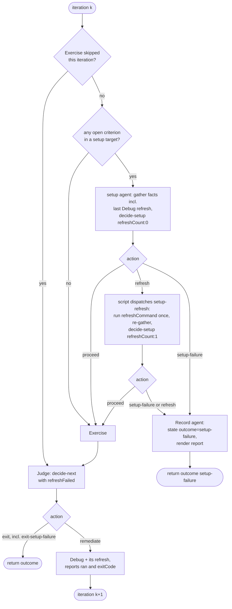

# TRD: Verification Preflight — flag, don't stop; tell a broken environment from broken code

**Version**: 1.3.0
**Status**: Draft
**Created**: 2026-10-23
**Last Updated**: 2026-10-25
**Author**: @technical-architect
**Source PRD**: `docs/plan/verification-preflight.investigation.md` (a `/plan` investigation record, `**Kind**: change`, `**Weight**: medium`, `**Route**: plan`; no supersession marker). Its source is the owner's instruction of 2026-10-23, refining fix-list item 2 of the usage analysis.
**Task ID Prefix**: VPRE

---

## Changelog

| Version | Date | Changes | Author |
|---------|------|---------|--------|
| 1.0.0 | 2026-10-23 | Initial TRD creation | @technical-architect |
| 1.1.0 | 2026-10-23 | Adversarial-review corrections, no new task or objective: Debug reports its refresh and a failed one is a setup problem, never `stalled` (D16; B001, B003); §3.6a classifies policy only, so a dead declared stack ends `setup-failure` (D17; B005, B006, T001 grounding); the sweep chain never stops the build on a setup problem and its flag reaches `/implement-trd`'s ISSUES (D14; B004, B005); refresh-once enforced by code (D3, D5); D12 simplified to a stop-reason rule; two Could Not Verify rows | @technical-architect |
| 1.2.0 | 2026-10-23 | `/audit-trd` corrections: VPRE-D001 moves into Phase 2 after VPRE-B003 so the parent-TRD sync test is green at the phase gate (D7); the decide-next route to `setup-failure` names the four code edits it needs, incl. `computeFinalRun` returning `null` (D6, §3.2); `gapsClosed` gets a source in the script (§3.2); a digit-only token no longer reads as a wrong commit (D8, §3.1); the one refresh is spent only on the environment it belongs to, via `SetupTarget.refreshable` (D5, §3.1, §3.2, §3.4); new VPRE-D002 updates `docs/reference/` for D1/D17; Could Not Verify rewritten | @technical-architect |
| 1.3.0 | 2026-10-25 | `/refine-trd` (interactive): the owner confirmed the assumption behind all six open questions (OQ-1 to OQ-6), so D5, D6, D8, D14, D15 and §3.2's dead-setup-agent rule now rest on an owner ruling, not on the author's judgment. O5's source gains that ruling. Challenge pass: nothing removed, lowered or added back; every cited symbol and file exists. No task or objective changed. | owner via /refine-trd |

## Objectives

| ID | Objective | Source | Must pass |
|----|-----------|--------|-----------|
| O1 | No environment or setup check stops, pauses or asks before implementation starts or continues. Every problem the checks find is recorded as a flag with a stated default, the build runs in full, and the flag appears in the readout. | PRD O1 — owner instruction, 2026-10-23: "it can't block implementation from starting. It can flag problems but can't lead to stopping implementation" | yes |
| O2 | Before each verification attempt, the loop checks that the running build is the current HEAD and that no other checkout holds the dev stack. A failed check is reported as a setup failure naming the problem: the attempt is not judged, nothing is sent to the debugger, and it never counts toward `stalled`. | PRD O2 — owner instruction, 2026-10-23 (fix list item 2) | yes |
| O3 | A verification run whose environment stays broken ends with a distinct outcome, `setup-failure`, that names what is wrong and what would fix it. It is never reported as `stalled` or `stuck`, and the run's banner and report say it is the environment, not the code. | PRD O3 — owner instruction, 2026-10-23: "a broken setup should report as a setup failure, not 'stalled'" | yes |
| O4 | At plan time, the TRD records which environment verification runs against, whether the loop can refresh it, and what cannot be checked there. | PRD O4 — owner instruction, 2026-10-23 (fix list item 2) | |
| O5 | The setup check never runs a refresh against a stack another checkout holds. | owner ruling, 2026-10-25 (`/refine-trd`, OQ-2: "No refresh"); originally domain-derived: O2 names "another checkout holds the dev stack" as a state the check must detect; the declared fast refresh (`verification.md` §2, e.g. `docker compose up -d --build`) acts on whatever stack answers on the declared port, so running it then would rebuild or restart the other checkout's work. Detecting the hold and then disturbing it would trade one rig failure for another. | |
| O6 | Code changed by this work ships with unit tests at the constitution floor: unit ≥ 60%, integration ≥ 50% where applicable. | `constitution.md` Quality Gates | |

The PRD's measured motivation, cited, not an objective: of 40 functional-verification runs, 14
ended without converging, and at least 12 of those 14 were test-rig failures (a simulator
running a stale build, a dev stack held by another checkout, an evidence-path typo), not
product defects.

## 1. Overview

### 1.1 Technical Summary

Two changes, one on each side of the build.

**Before the build — the owner question becomes a flag (O1).** `/implement-trd` §3.6a and
`/verify-build` step 2 today ask one batched `AskUserQuestion` when an environment "needs one
thing from the owner". That question goes. The environment is recorded with a new status,
`needs-owner`, the thing the owner must do, and the default applied (criteria needing it
resolve `not_verifiable`). The build runs; the readout's ISSUES names each such environment.
§3.6a also stops probing whether an environment is up: it classifies policy only (declared,
allowed, tooling and credentials present), so a dead declared stack reaches the loop's setup
check and ends `setup-failure` instead of resolving its criteria `not_verifiable` (D17).

**Inside the verification loop — a setup check before every attempt (O2, O3).** At the top of
each iteration, before Exercise, `verify-functional.js` dispatches one small agent that gathers
facts about each environment the iteration will touch: is it reachable, what commit is its
running build from, and which checkout owns the process listening on its port. A new pure
function, `decideSetup()` in `functional-verification.js`, turns those facts into one of three
actions — `proceed`, `refresh` (the script dispatches the declared fast refresh once, then
re-checks) or `setup-failure` — exactly the way `decideNext()` turns the Judge's facts into a
loop action. On `setup-failure` the iteration is not judged, nothing reaches Debug, and the run
ends with the new outcome `setup-failure`, whose report, readout and banner name the environment
problem and its fix. Unknowns (no declared way to read the build's commit, no `lsof`) are flags,
never failures.

**The root cause — a Debug fix that never reached the running build (D16).** Debug now reports
whether its refresh ran and succeeded. A failed refresh after a Debug pass is a setup problem for
the next attempt (none declared is only a flag); and `decideNext()` no longer returns `exit-stalled` when
the last refresh failed — it returns `exit-setup-failure`.

**At plan time — a `## Verification Environment` section (O4).** The light TRD template in
`/plan` and the TRD authoring contract gain a three-line section naming the environment, how
the loop refreshes it, and what cannot be checked there. Absence is valid and reported.
§3.6a reads the section, when present, as the feature's declared target.

### 1.2 Key Technical Decisions

| ID | Decision | Choice | Serves Objective | Rationale | Alternatives Considered |
|----|----------|--------|------------------|-----------|------------------------|
| D1 | The owner question at §3.6a and `/verify-build` step 2 | Removed in every mode. An environment that needs the owner is persisted as `{ status: "needs-owner", reason, need, default }`; `needs-owner-declined` is retired as a value. ISSUES names each one and what the owner must do. The bucket narrows to what only the owner can supply (a missing credential, a deploy approval); a service that must be started by hand leaves it (D17). Under the fix loop and `--chained`, the need is additionally recorded as a `verification.md` discovery exactly as today (VFIX D13). | O1 | O1 cannot hold while the question exists (PRD Decision, "[BLOCKS]"). The default the question already stated — criteria resolve `not_verifiable` — becomes the only path. **Deliberate departure** from verification-convergence §3.6a and functional-verification §3.7 "Step 3.6a", which called this the one legitimate `AskUserQuestion` on the path (`autonomy.md` case 2); VPRE-D001 strikes that sentence through per the supersession convention. | Keep the question in interactive `/verify-build` only — rejected: O1 says no check pauses or asks before implementation, and `/verify-build`'s fix loop builds. Ask with a timeout — rejected: a timed wait is still a wait. **Revisit** if owners report criteria resolving `not_verifiable` that one answer would have unblocked, measured from ISSUES lines across runs. |
| D2 | Where the setup check runs | One untyped agent per iteration, phase `Setup`, at the top of the loop body before `phase('Exercise')`, dispatched only when Exercise will run this iteration (not when `skipExercise` is set) and at least one open criterion belongs to a setup target. The agent gathers facts and runs `node <checker> decide-setup`; it decides nothing itself. | O2 | `verify-functional.js` has no shell and no filesystem (:16-18), so facts must come from an agent; the decision is a pure lib function, the `decideNext` pattern the PRD names as the reuse. Per-iteration placement catches a stack that went stale after the previous iteration's Debug refresh. | Inside each Exercise slice — rejected: N slices repeat one check, and capture would mix with environment judgement (Exercise is capture-only). Once per run at §3.6a — rejected: it cannot see staleness introduced mid-run, and no criterion exists yet there to know which environments matter. **Revisit** if setup agents dominate iteration cost in the dispatch ledger. |
| D3 | What decides | `decideSetup(input)` in `packages/core/lib/functional-verification.js`, exposed as CLI `decide-setup --file <payload>`. It classifies raw facts (reach result, identity-command output against HEAD, git top-level of each listener's working directory against this checkout's, the last Debug pass's reported refresh, and the exit code of the setup check's own refresh) into statuses, problems and flags, then picks the action. Its `refreshCount` input makes refresh-once arithmetic, not instruction (D5). No agent acts on the result: the script reads it and decides what to dispatch next. Validate-then-throw on a missing field, like `decideNext`. | O2, O3 | Keeps the agent a fact-gatherer and makes every classification unit-testable; the same "arithmetic, not judgement" shape as `decideNext` and `decideFixRound`. | Let the agent classify — rejected: classification ("does this output name HEAD?") is exactly what drifts when a model does it. Let the agent act on `refresh` itself — rejected under D5. **Revisit** never, unless a fact cannot be expressed as data. |
| D4 | Unknown facts | Any fact that cannot be read — no identity method declared, identity command fails, `lsof` absent, a listener whose working directory is not in a git checkout, no URL to probe — classifies `unknown` and becomes a flag `{environment, flag, default: "treated as fine for this attempt"}`, never a problem. | O1, O2 | PRD Decision: "Unknown build identity is a flag, not a failure… failing on `unknown` would turn the new check into a new rig failure." Extended to the holder and reach facts for the same reason. | Fail on unknown — rejected by the PRD. **Revisit** if a declared identity method becomes common enough that `unknown` mostly hides real staleness. |
| D5 | Repair before failing | Refresh-once is enforced by code, not by a prompt. The `setup` agent only gathers facts and runs `decide-setup` with `refreshCount: 0`; it runs no refresh. When the result is `refresh`, the **script** dispatches one `setup-refresh` agent that runs the declared fast refresh (`refreshCommand`, `verification.md` §2) exactly once, re-gathers, and runs `decide-setup` with `refreshCount: 1` and the refresh's exit code. `decideSetup` returns `refresh` only at `refreshCount: 0`, so a second failure is `setup-failure`. The script rejects, as `setup-failure`, any return that reports more refreshes than it authorized (0 for `setup`, 1 for `setup-refresh`) and any `refresh` returned by `setup-refresh`. **Exception:** when any problem is "held by another checkout", `decideSetup` returns `setup-failure` at once and no refresh runs. With no refresh declared, the first failure is final. **Scope of the one refresh:** `refreshCommand` is one run-wide string, chosen at `/implement-trd` §8.1a step 4 for a single environment (the "prefer this" row when criteria span several), not one per target. Each `SetupTarget` therefore carries `refreshable` (true only for the environment step 4 chose it for), and `decideSetup` returns `refresh` only when every problem is on a refreshable environment; a problem on any other environment is `setup-failure` at once, with no refresh spent on a command that cannot reach it. | O2, O3, O5 | PRD Decision: one refresh is the cheapest repair and §2 already authorizes it; retrying more re-creates the burned-iteration problem. A limit stated only in a prompt is one a model can exceed, and an extra refresh can be the one that disturbs a held stack (O5), so the count lives in the script and in `decideSetup`'s input. The exception serves O5: a refresh cannot make another checkout release its port, and would act on that checkout's stack. The `refreshable` rule exists because running the preferred environment's refresh to repair a different environment burns the one attempt and then reports "the declared refresh did not bring it up" about a refresh that never targeted it. **Partial departure** from the PRD's After-3, which refreshes on any failure — recorded as OQ-2. | One agent that refreshes and re-checks itself, with "once" stated in its prompt — rejected: the limit would rest on the prompt. Refresh on every failure, as After-3 reads — rejected for the held case under O5. Refresh up to N times — rejected by the PRD. **Revisit** if a declared refresh is shown to target only this checkout's stack (e.g. a per-checkout port), which would make it safe. |
| D6 | What a setup failure leaves behind | The run ends (no further iterations) with outcome `setup-failure`, reached two ways. **From the `decide-next` backstop (D16)**, when no Setup check ran this iteration: `exit-setup-failure` is a Judge action, added to `JUDGE_SCHEMA`'s enum and to `OUTCOME_BY_ACTION` (→ `setup-failure`); the Judge writes state and report as for any exit, runs no full-environment gate, and its criteria keep the verdicts it gave. That needs four edits beyond the enum and map, because today's code assumes every non-`exit-unbuilt` exit ran the gate: `computeFinalRun` returns `null` for `exit-setup-failure` (today it returns `{status: 'fail'}` for every action but `exit-unbuilt` whenever a full-run command is declared, which would report a gate that never ran); the Judge prompt's gate instruction skips the run on `exit-setup-failure` as it does on `exit-unbuilt`; its STEP 4 `outcome` enumeration gains `"setup-failure"`; and its `Return { "action": ... }` list gains `"exit-setup-failure"`. **From the Setup check** (the main route, everything below): not a Judge action; the workflow returns it from a dedicated builder. Criteria settled earlier keep their verdicts; every still-open criterion is recorded `status: "not_verifiable"`, `cause: "never-exercised"`, `reason: "not exercised: the setup check failed — <problem>"`. The state file gets `outcome: "setup-failure"` and `iteration` = the last completed iteration (the failed attempt is not counted). A small `Record` agent writes state (via `implement-state.save()`) and runs `render-report`, given JSON the script assembled; no full-environment gate runs (`finalRun: null`). | O2, O3 | PRD Decision: "A setup failure ends the run rather than skipping one iteration." `not_verifiable` is the status that already means "we could not look" (§3.6a's fanfare note); `never-exercised` is a cause that is neither buildable (fix loop, VFIX D4) nor accepted by `/refine-verification` (which accepts only `environment-unreachable`/`capability-absent`), so these criteria are re-verified next run rather than parked. A non-null `outcome` keeps `--verify --resume` from re-entering a finished run. The `decide-next` route is a Judge action because, by the time a stale build is found there, the attempt has already been judged; only the outcome can still be corrected. | Override `exit-stalled` in the script after the Judge, the `applyMustPassRecheck` pattern — rejected: the stall rule lives in `decideNext`, and a second copy of it in the script would drift. A new cause `setup-failed` — rejected for now: it touches `CAUSES`, `CAUSE_LABEL`, the Judge enum and its sync test for a distinction the outcome already carries; **revisit** if `/refine-verification` or a report is seen conflating these criteria with Judge-assigned `never-exercised`. Cause `environment-unreachable` — rejected: `/refine-verification` would accept them as permanently not verifiable. Let the Judge write the files — rejected: O2 says the attempt is not judged. |
| D7 | How the workflow knows what to check | New workflow arg `setupTargets: SetupTarget[]` (§3.2), resolved by the command at `/implement-trd` §8.1a (new step 7) from `verification.md` §1/§1a/§2, `.claude/verification-notes.md` and the TRD's `## Verification Environment` section. Each iteration checks only the targets that hold an open criterion. Absent or `[]` → no setup agent is dispatched (logged), which is today's behaviour. | O2 | VC D5/D15: resolving environments is the orchestrator's job and "a second reader of `verification.md` would be a second opinion". Absent-means-off keeps every existing caller valid and every existing behavioural test green. It does not keep `verify-functional-trd-sync.test.js` green: that test pins the workflow's `a.*` read count (25), the `OUTCOME_BY_ACTION` value count (six) and §3.4's `LoopAction` union against `JUDGE_SCHEMA`'s enum, all of which VPRE-B003 changes, so the parent-TRD update that repairs it (VPRE-D001) runs in Phase 2, after B003 and before that phase's gate. | Have the setup agent read `verification.md` from `stackHints` — rejected: a second reader. **Revisit** if a caller is found that should check but passes no targets. |
| D8 | Build identity | `SetupTarget.identity` is a command the owner already stated — in `verification.md` §2 or `.claude/verification-notes.md` — that prints the commit the running build was made from; `""` when none is stated. `decideSetup` reads its output as word-delimited tokens of 7–40 characters from `[0-9a-f]`: any token that is a prefix of HEAD → `matches`; otherwise, any token containing at least one letter `a`–`f` → `differs`; anything else (including tokens of digits only) → `unknown`. Nothing is added to `verification.md`. | O2 | PRD OQ-1's stated assumption, adopted; constitution 1.4.0 makes `verification.md` owner-governed and never edited by a run. The letter requirement on `differs` keeps a build date, epoch or PID printed beside the commit (`built 20261023`) from reading as a wrong commit, which would make the check a new rig failure (D4); an all-digit short SHA can still `match`, and one that does not match reads `unknown`, a flag. | A new `verification.md` column for the method — rejected: owner-governed file, and `/verification-setup` is out of scope (PRD OQ-1). Infer a method per stack (e.g. `/__version` endpoint) — rejected: guessing the owner's rig. **Revisit** when `/verification-setup` gains a build-identity question. |
| D9 | "Another checkout holds it" | For each declared localhost port of a target, the agent lists listening processes (`lsof -nP -iTCP:<port> -sTCP:LISTEN`), reads each one's working directory, and reports `git -C <cwd> rev-parse --show-toplevel` (or `null`). `decideSetup` compares that top-level with this checkout's: different → `other-checkout` (a problem); same → `this-checkout`; nobody listening → `none`; `null`/`lsof` unavailable → `unknown` (a flag). A target with no localhost port → `not-applicable`. | O2 | Comparing git top-levels, not path prefixes, is what makes a worktree under `<repo>/.claude/worktrees/` read as another checkout — a prefix test would call it this one. The PRD defines the check as "a process listening on a declared port … whose working directory is outside this checkout". | Path-prefix comparison — rejected (worktree case). Lock files per resource — not built: nothing declares one today; a resource with no port is `unknown`. **Revisit** when an owner declares a lock-file claim rule in `.claude/verification-notes.md` (the template already asks how instances are told apart). |
| D10 | The workflow's return | Every return path carries a new key `setup: { checked, refreshed, flags, problems }` (§3.2) — flags de-duplicated across iterations, `problems` non-empty only on `setup-failure`. | O1, O3 | O1 requires the flags to reach the readout; the workflow's return is the only channel to the command (§8.4). | Read flags back out of the report file — rejected: §8.4 forbids re-reading the rendered report. |
| D11 | How a setup failure reads to the owner | Report: `**Outcome**: Setup Failure`, one `**Setup**:` line per problem with its fix, no Diagnosis line, and `**Next**: fix the environment named above, then run \`/verify-build\`` (a sweep file: `/verify-build <sweep file>`). Readouts (`/implement-trd` Step 9, `/verify-build`): STATE says the software was not checked because the environment is broken, "the environment, not the code"; ISSUES names each problem, its fix, and that the owner acts; NEXT is (1) the fix, as plain text, (2) `/verify-build`. Setup flags go under DECISIONS as defaults applied. The banner is `COMMAND COMPLETE`, its summary naming `setup-failure` and the problem. | O1, O3 | O3: "the run's banner and report say it is the environment, not the code". `/refine-verification` writes a build plan, and there is nothing to build; sending the owner there first would repeat today's misdirection. COMPLETE, not STUCK: the command did its whole job (O1, After-5). | Route to `/refine-verification` like every other non-satisfied outcome (verify-build O4 rule) — rejected for this one outcome, with the reason stated in the rule. **Revisit** if a setup failure is ever caused by something a plan could fix. |
| D12 | The `/verify-build` fix loop meeting a setup failure | No dedicated branch. A round whose verify returns `setup-failure` runs the fix loop's ordinary steps, and step 6's stop-reason order gains `setup failure: <problem>` as its **first** rule, ahead of `not verifiable here: <the Judge's reason>`, so each criterion still open after that round reads it. | O3 | PRD After-4: "nothing promotes it to a fix task". The Setup check's exit records every open criterion `never-exercised`, which no round builds (VFIX D4), so `decide-fix-round` already stops; left alone, its reason would read "nothing left to build", which blames nothing. Putting the setup rule first in step 6's order names the cause without a second path through the loop. | A branch from step 4 straight to step 6 — rejected: it skips step 5, where `fix.stopped` and the round record are written, for no gain. Add an `outcome` input to `decideFixRound` — rejected: widens a validated interface for a case the stop-reason order can name. **Revisit** if a `setup-failure` from `decide-next` (D16), whose criteria were judged `not_met` on a stale build and may be buildable, is seen promoting them to fix tasks. |
| D13 | `/refine-verification` on a setup failure | Diagnose leads with "the environment, not the code", naming each `**Setup**:` problem and its fix. Criteria recorded `never-exercised` by the setup failure are neither Blockers nor Accepted-as-not-verifiable; the plan states they are re-verified by the next `/verify-build`. | O3 | PRD After-4: "`/refine-verification` treats it as an environment problem, not a code gap." | Refuse to run on `setup-failure` — rejected: the bridge is still where an owner looks after a non-satisfied run. |
| D14 | `/plan`'s sweep chain meeting a setup failure | Step 7a takes `verificationOutcome` from the chained `/verify-build`'s `RETURN →` line (the workflow's own return), and falls back to the state file, newer than the step, only when no RETURN line was printed. `sweepChainNext({after: 'verify'})` proceeds through the existing never-unattended brake to `commit` with a `flag`, instead of stopping, in three cases: (a) the outcome is `setup-failure`; (b) it is `null` and `verifyEndedBySetup` is true (the workflow's return carried setup problems but no outcome reached the chain, e.g. a dead Record agent); (c) it is `insufficient-coverage` and `coverageShortByEnvironmentOnly` is true (every criterion short of `met` is `not_verifiable` with cause `environment-unreachable` or `capability-absent`, i.e. its environment was unusable or needs the owner). The flag reads `"<sweep file> was not verified: <the environment, not the code — <reason>, or the environments named>; the swept fixes are committed unverified"`. plan.md passes it back as `carriedFlag` on the `commit` call; `commit` carries it on `go('implement', { flag })`, plan.md hands it to `/implement-trd` as `--sweep-flag "<flag>"`, and Step 9 lists it in ISSUES. With no core TRD, `commit`'s done text says the fixes were committed but not verified, and plan.md's readout puts the flag in ISSUES. Every other non-satisfied outcome still stops. | O1 | In `/plan --implement` on a sweep list, the sweep's verify gates the core build; stopping there on a setup problem would be a setup check stopping implementation, which O1 forbids. Case (c) is the same owner rule: an environment the owner must fix is a flag, not a stop. Reading the outcome from the state file alone is how a dead Record agent turned a setup failure into "no outcome recorded", a stop. The flag has to reach a readout the owner sees: Step 7a emits nothing after the `implement` hand-off, so only `/implement-trd`'s readout can carry it, and the done text must not claim a verification that did not happen. | Stop as for other non-satisfied outcomes — rejected under O1. Skip the commit and build the core over uncommitted fixes — rejected: `/implement-trd`'s phase commit would take them in anyway, unnamed. Hand the flag over in a file — rejected: an argument is visible in the run's own invocation and needs no new reader. Recorded as OQ-3. |
| D16 | Debug's refresh as a setup fact | `DEBUG_SCHEMA` gains a required `refresh: { ran, exitCode }`, so Debug reports whether the refresh `buildDebugPrompt` asks for ran and succeeded. The script carries it to the next iteration as two facts. (1) `debugRefresh` in the Setup check's `decide-setup` payload: a refresh that exited non-zero after a Debug pass is a problem for that attempt, so it is repaired by the one refresh or ends `setup-failure` (D5). None declared (`ran: false`) is a flag, never a problem: a hot-reload environment declares no refresh by design (`verification.md` §2), and failing on it would make the check a new rig failure. (2) `refreshFailed` in the Judge's `decide-next` payload, set when the reported refresh exited non-zero and no Setup check consumed the fact this iteration: with any gap open, `decideNext` then returns `exit-setup-failure` instead of `exit-stalled` or `exit-stuck`. `refreshFailed` is required and validated, like `mustPass`. | O2, O3 | This is the root cause the PRD names: Debug's fix "cannot close the gap, so `decideNext` returns `exit-stalled`… which blames the code" — a fix that never reached the running build. Nothing reports the refresh's result today, so neither function can see it. The `decide-next` half is the backstop for an iteration with no Setup check (no `setupTargets`, no target holding an open criterion, or a dead setup agent); with one, the failure is caught before Exercise, as O2 asks. Only a reported failure reaches `decideNext`: "none declared" with no Setup check stays today's behaviour, so callers without targets behave as before (D7). | Infer staleness from the identity check — rejected: it cannot see Debug's uncommitted edits (TR1). Let the Judge read Debug's free-text result — rejected: classification by a model is what D3 rules out. Default `refreshFailed` to false — rejected: an absent value would read as "the refresh worked" and re-create the misattribution. **Revisit** if a hot-reload environment is seen measuring a stale build after Debug while flagged only (TR4). |
| D17 | What §3.6a classifies | Policy only. An environment is `usable` when `verification.md` declares it, §1 lets the loop touch it, and the tooling and credentials §3/§4 name are present; §3.6a no longer probes whether it is up. `unusable` keeps its meaning (`must not be touched`, tooling absent, named in §5). `needs-owner` holds what only the owner can supply (D1). Whether a declared stack is up is decided only by `decideSetup`, inside the loop. | O3, O2 | A stack §3.6a found dead resolved its criteria `not_verifiable` at §8.1a, so they never became setup targets and the run ended `insufficient-coverage`: the one place O3's outcome is produced never saw the dead stack. **Deliberate departure** from the reason §3.6a probed reachability (catch a dead environment before the phase loop): under O1 nothing stops the build anyway, so the early probe changed only the label, to the misleading one. | Keep the probe and also make a dead environment a setup target — rejected: two readers of liveness, and §3.6a runs before the build exists, so "dead" there often means "not started yet". **Revisit** if owners report runs that spent a whole build before a setup failure a §3.6a probe would have named — as a flag, never a stop. |
| D15 | Plan-time record | A `## Verification Environment` section of three bold lines — `**Environment**:`, `**Refresh**:`, `**Cannot be checked there**:` — added to `plan.md`'s light TRD template, the authoring contract (`trd-authoring.md`, after Section 9a) and `create-trd.md`'s copy of the structure. Absence is valid. `/implement-trd` §3.6a reads it when present and records `state.functional_verification.target = { environment, source: "trd" }` (or `{ environment: null, source: "none" }` with a DECISIONS line). `verification.md` stays authoritative: an environment it does not declare is not authorized (S-2) and is flagged; a refresh line that differs from §2 is flagged, and §2 wins. §8.1a step 4's tie-break prefers the TRD's target over the "prefer this" row; its "cannot be checked" items are read like `verification.md` §5 entries. | O4 | PRD After-6, item for item. The authoring contract and `create-trd.md` carry the same structure today; changing one alone is how they drift. Read by the model at §3.6a, as §3.6a already reads `verification.md`. | A parser in `trd-parser.js` — rejected: nothing computes on the section; §3.6a is already a model step. **Revisit** if a session log shows §3.6a misreading it, or if lane derivation starts keying on it. Making `/audit-trd` require it — rejected: absence is valid (After-6). |

### 1.3 Technology Stack

| Layer | Technology | Purpose | Notes |
|-------|------------|---------|-------|
| Decision logic | Node.js 18+ (`packages/core/lib/functional-verification.js`) | `decideSetup`, `decide-setup` CLI, report rendering | `stack.md` |
| Loop | Workflow script (`packages/core/workflows/verify-functional.js`) | `Setup` phase, `setup-failure` exit, `Record` agent | no shell, no filesystem, no clock |
| Commands | Markdown prompts (`implement-trd.md`, `verify-build.md`, `refine-verification.md`, `plan.md`, `create-trd.md`) | preflight, readouts, templates | each has a byte-identical `.claude/` mirror |
| Tests | Jest ^29.7.0; BATS-style smoke scenario | unit and live | `stack.md` |
| Facts | `git`, `lsof`, `curl` (via the setup agent's Bash) | HEAD, listeners, reachability | `lsof` absent → `unknown` (D4) |

### 1.4 Integration Points

| System | Type | Direction | Notes |
|--------|------|-----------|-------|
| `.claude/rules/verification.md` | File (owner-governed) | In | Read only, at §3.6a and §8.1a; never edited (constitution 1.4.0) |
| `.claude/verification-notes.md` | File | In | Read at §8.1a for a stated identity command or per-instance ports |
| The running environment | Process / HTTP | In | Probed by the setup agent; refreshed at most once per iteration, by the `setup-refresh` agent the script dispatches (D5), plus Debug's own refresh as today |

## 2. System Architecture

### 2.1 One iteration, after this change



### 2.2 Component Architecture

#### 2.2.1 `decideSetup()` — `packages/core/lib/functional-verification.js`
**Responsibility**: classify setup facts and pick `proceed` / `refresh` / `setup-failure`.
**Interfaces**: exported function; CLI `decide-setup --file <payload>`.
**Dependencies**: none (pure).

#### 2.2.2 Setup phase — `packages/core/workflows/verify-functional.js`
**Responsibility**: per iteration, pick the targets holding open criteria, dispatch the setup agent, dispatch the one refresh itself when asked (D5), end the run on `setup-failure`; carry Debug's refresh report to the next Setup check and the Judge (D16).
**Interfaces**: new arg `setupTargets`; new return key `setup`; new outcome `setup-failure`; `DEBUG_SCHEMA` gains `refresh`.
**Dependencies**: `decide-setup` CLI (through the agent), `implement-state.save()` and `render-report` (through the Record agent).

#### 2.2.3 Preflight and readouts — `implement-trd.md`, `verify-build.md`
**Responsibility**: record `needs-owner` without asking; read the TRD's `## Verification Environment`; resolve `setupTargets`; render `setup-failure` and flags.

### 2.3 State

`implement.json`'s `functional_verification` gains `target` and changes one status value:

```javascript
state.functional_verification = {
  ...state.functional_verification,
  target: { environment: "<name>" | null, source: "trd" | "none" },          // NEW (D15)
  environments: {
    "<environment name>": {
      status: "usable" | "unusable" | "needs-owner",                         // was needs-owner-declined; usable = policy only, not "up" (D17)
      reason: "<one line>",
      need: "<what the owner must do>",      // NEW, needs-owner only (D1)
      default: "criteria needing it resolve not_verifiable",                 // NEW, needs-owner only
    },
  },
};
```

`verification-state.json` keeps its four keys; `outcome` gains the value `"setup-failure"`.

## 3. Technical Specifications

### 3.1 `decideSetup()`

**Interface**:

```typescript
interface SetupFacts {
  environment: string;                        // verification.md §1 name
  refreshable: boolean;                       // copied from SetupTarget.refreshable (D5)
  reach: { ok: boolean | null; detail: string };          // null = no way to test it
  identity: { command: string; output: string | null; exitCode: number | null };
                                              // command "" = none declared, not run
  holderCheck: 'ran' | 'unavailable' | 'not-applicable';  // not-applicable = no localhost port
  listeners: Array<{ port: number; pid: number | null; toplevel: string | null }>;
                                              // toplevel = git top-level of the process's cwd
}

interface DecideSetupInput {
  head: string;            // `git rev-parse HEAD`
  checkout: string;        // `git rev-parse --show-toplevel` of this checkout
  facts: SetupFacts[];
  refreshCommand: string;  // "" when verification.md §2 declares none
  refreshCount: number;    // refreshes the script authorized this attempt: 0 on `setup`, 1 on `setup-refresh` (D5)
  refreshExitCode: number | null;   // exit code of that refresh; null when refreshCount is 0
  debugRefresh: { ran: boolean; exitCode: number | null } | null;
                           // the last Debug pass's reported refresh (D16); null = no Debug pass since the last check
}

interface DecideSetupResult {
  action: 'proceed' | 'refresh' | 'setup-failure';
  reason: string;
  environments: Array<{
    environment: string;
    reachable: 'yes' | 'no' | 'unknown';
    build: 'matches' | 'differs' | 'unknown';
    holder: 'this-checkout' | 'other-checkout' | 'none' | 'unknown' | 'not-applicable';
  }>;
  problems: Array<{ environment: string; problem: string; fix: string }>;
  flags: Array<{ environment: string; flag: string; default: string }>;
}
```

**Behavior**:
- `reachable`: `reach.ok` true → `yes`, false → `no` (problem), null → `unknown` (flag).
- `build`: `identity.command === ""` → `unknown`, flag "no way to read the running build's commit is declared for <env>". Non-zero exit or empty output → `unknown`, flag naming the command. Otherwise per D8: a word-delimited `[0-9a-f]` token (7–40 chars) that prefixes `head` → `matches`; else a token with at least one letter `a`–`f` → `differs` (problem "running build is from <token>, not HEAD <head7>"); else (no token, or digit-only tokens) → `unknown`.
- `holder` per D9. `other-checkout` is a problem "port <p> is held by a process in another checkout (<toplevel>)".
- `debugRefresh` (D16), read only at `refreshCount: 0` (at `refreshCount ≥ 1` the setup check's own refresh supersedes it): `null` or `{ ran: true, exitCode: 0 }` → nothing. `{ ran: true, exitCode: <non-zero> }` → a problem on each target, "the last Debug pass's refresh (`<cmd>`) exited <code>, so the running build may not include its fixes". `{ ran: true, exitCode: null }` → a flag. `{ ran: false }` → a flag on each target (never a problem; D16), "Debug changed code and no fast refresh is declared, so the running build may not include its fixes".
- `refreshExitCode`, read at `refreshCount ≥ 1`: non-zero → a problem "the declared refresh (`<cmd>`) exited <code>"; `null` → a flag.
- Every problem carries a `fix` in plain words: unreachable → "start <env>" plus, when `refreshCount ≥ 1` and the environment is `refreshable`, "the declared refresh (`<cmd>`) did not bring it up"; differs → "rebuild or restart <env> from this checkout"; held → "stop the stack in <toplevel>, or run verification from that checkout"; a failed refresh → "run `<cmd>` by hand and fix what stops it". No refresh declared after Debug is a flag, not a problem: "no fast refresh is declared for <env>; the next attempt may measure a build without Debug's edits".
- Action: no problems → `proceed`. Problems, `refreshCount === 0`, `refreshCommand !== ""`, no `other-checkout` problem, and every problem on an environment whose `refreshable` is true → `refresh`. Otherwise → `setup-failure`. `refresh` is never returned at `refreshCount ≥ 1`. Flags never change the action (D4).
- `reason` names the problems (or "all setup checks passed"/"N flags, no problems").

**Error Handling**:
- Missing `head`, `checkout`, `facts` (array; each entry's `refreshable` a boolean), `refreshCommand` (string), `refreshCount` (a non-negative integer), `refreshExitCode` (a number, or `null`; the key must be present) or `debugRefresh` (`null`, or an object with a boolean `ran`; the key must be present): `TypeError` naming the field — the `decideNext` discipline, because a defaulted `refreshCount` would allow a second refresh and a defaulted `debugRefresh` would read as "the last fix reached the build".
- `facts: []` → `proceed` with reason "no environment to check".

### 3.1a `decideNext()` — the failed-refresh guard (D16)

- Input gains a required `refreshFailed: boolean`: true when the last Debug pass reported its refresh ran and exited non-zero, and no Setup check consumed that fact this iteration. Missing or non-boolean → `TypeError` naming it.
- Evaluation order becomes unbuilt → satisfied → **setup-failure** → stalled → stuck → remediate. With `refreshFailed: true` and any gap open, the action is `exit-setup-failure`, reason "the last Debug pass's refresh failed, so this attempt measured a build without its fixes — the environment, not the code".
- `exit-setup-failure` is not in `COVERAGE_RELABELABLE_ACTIONS`, and the must-pass step leaves it alone, so it is never re-labelled.
- With `refreshFailed: false`, every existing branch behaves exactly as today.

### 3.2 Workflow changes — `verify-functional.js`

**Interface**:

```typescript
interface SetupTarget {
  environment: string;   // verification.md §1 name
  url: string;           // §1's "URL / how to reach it" cell; "" when it names no URL
  ports: number[];       // localhost ports: from url, and per-instance ports §1a/notes state; [] = remote
  identity: string;      // owner-stated command printing the running build's commit; "" = none (D8)
  refreshable: boolean;  // true only for the environment §8.1a step 4 chose refreshCommand for (D5)
  criteria: string[];    // criterion ids resolved to this environment at §8.1a
}

// VerifyFunctionalArgs gains:
  setupTargets?: SetupTarget[];      // absent or [] = no setup check (D7)

// VerifyFunctionalResult gains:
  setup: {
    checked: number;                 // iterations at which the setup agent ran
    refreshed: number;               // how many of those ran the one refresh
    flags: Array<{ environment: string; flag: string; default: string }>;  // de-duplicated
    problems: Array<{ environment: string; problem: string; fix: string }>; // setup-failure only
  };
// and `outcome` may be 'setup-failure'.
```

**Behavior**:
- `setupTargets` is validated before any agent runs, the `exerciseLanes` standard: an array when supplied; each entry has a non-empty `environment`, a string `url` and `identity`, integer `ports`, a boolean `refreshable`, and `criteria` naming only known criterion ids. At most one environment may be `refreshable`, and none when `REFRESH_COMMAND` is `""`.
- Per iteration, when Exercise will run: `targets = setupTargets.filter(t => t.criteria.some(id => open))`. Empty → no dispatch. Otherwise `phase('Setup')` and one agent (label `setup`, schema-bound, no `agentType`) whose prompt gives it the targets, `REFRESH_COMMAND` (as a fact, not to run), the carried `debugRefresh`, the checker path and a payload file path, and tells it to: read HEAD and the checkout top-level; gather facts per target (§3.1, D9); run `decide-setup` with `refreshCount: 0`, `refreshExitCode: null`; run no refresh; return the result plus `refreshesRun`.
- Refresh-once, decided by the script (D5): when `setup` returns `refresh`, the script dispatches one `setup-refresh` agent (same schema) that runs `REFRESH_COMMAND` exactly once, records its exit code, re-gathers, runs `decide-setup` with `refreshCount: 1` and that `refreshExitCode`, and returns the result plus `refreshesRun`. Never a second `setup-refresh` in one iteration.
- Result handling: `proceed` → accumulate flags, clear the carried `debugRefresh`, continue to Exercise. `setup-failure` → end the run (below). Rejected returns end the run as `setup-failure` too: a `setup` return reporting `refreshesRun > 0`, or a `setup-refresh` return reporting `refreshesRun > 1` (reason "the setup check ran <n> refreshes; one is allowed"), and a `refresh` from `setup-refresh` (reason "the setup check asked for a second refresh"). A dead `setup` agent (null) → a flag "the setup check returned nothing; this attempt ran without it", then Exercise — the check is a guard, and its absence is today's behaviour (O1, D4). A dead `setup-refresh` → `setup-failure` with the problems `setup` reported, since they were found and not shown repaired.
- Debug's refresh (D16): `DEBUG_SCHEMA` gains a required `refresh: { ran: boolean, exitCode: integer or null }`, and `buildDebugPrompt` asks for it (`{ ran: false, exitCode: null }` when no command is declared). The script keeps `lastDebugRefresh` (null before any Debug pass, after a dead Debug agent, and for a result without `refresh`, which only a test stub can produce), passes it as `debugRefresh` to the next `setup` dispatch, and injects `"refreshFailed":<true or false>` into the Judge's STEP 3 `decide-next` payload, the `coverageFloor` pattern: true when `lastDebugRefresh` is still carried with `ran: true` and a non-zero `exitCode`. On `exit-setup-failure` the Judge runs no full-environment gate (its gate instruction skips it as on `exit-unbuilt`; its STEP 4 outcome list and its return-action list name `setup-failure` / `exit-setup-failure`), `computeFinalRun` returns `null` for that action so `buildFinalResult` reports `finalRun: null`, and its report input and the result's `setup.problems` carry one entry, `{ environment: "running build", problem: <decide-next's reason>, fix: "make the declared fast refresh (<cmd>) succeed, then run /verify-build" }`.
- `setup-failure` exit: assemble `criteria` = settled entries unchanged + each open criterion as `{ status: 'not_verifiable', cause: 'never-exercised', reason: 'not exercised: the setup check failed — <problems>', artifact: null, tier1: null, provenAt: null }` (D6); dispatch one `Record` agent (label `record`) with the exact state JSON (`iteration: iteration - 1`, `outcome: 'setup-failure'`, `gapsClosed` from the script's own `gapsClosedHistory`: seeded from `RESUME.gapsClosed` when that is an array of integers, else `[]`, and appended `judgeResult.closed.length` (0 when `closed` is not an array) after every Judge turn — today the script holds no such history, only the Judge prompt names it) and report-input JSON (feature, prd, definitionPath, outcome, reason, criteria with statements and cites, `finalEnvironmentRun: null`, mustPass lists, `setup: { problems }`); it writes state through `implement-state.save()` and the report through `render-report`. No Judge, no Debug, no Render. A dead Record agent is logged and the result still returns.
- The result: `outcome: 'setup-failure'`, `reason`, `iterations: iteration - 1`, `criteria` as assembled, `gaps: []`, `unbuilt: []`, `exercised: '0/<open>'`, `debugAttempts`, `coverage`, `finalRun: null`, `pages` (prior renders only), `mustPass`, `setup`.
- `meta.description`, `meta.whenToUse` and `meta.phases` name the Setup phase and the new exit.

### 3.3 `renderReport()` and labels

- `OUTCOME_LABEL['setup-failure'] = 'Setup Failure'`; the doc comment's outcome union gains it.
- Report input gains optional `setup: { problems }`. When `outcome === 'setup-failure'`: one line per problem, `**Setup**: <environment> — <problem>; fix: <fix>`, after the Reason line; no Diagnosis line (`DIAGNOSIS_OUTCOMES` unchanged); Next line per D11 (sweep variant when the prd is a `.sweep.md`).
- A report input without `setup`, or any other outcome, renders byte-identically to today.

### 3.4 `/implement-trd` §3.6a, §8.1a, §8.3, §8.4, Step 9

- §3.6a: classification becomes policy only (D17): `usable` means declared, allowed and with its tooling and credentials present, with no reachability probe. The third bucket becomes `needs-owner` (D1): no `AskUserQuestion`; persist `need` and `default`; then read the TRD's `## Verification Environment` and persist `target` (D15).
- The argument parse gains `--sweep-flag "<text>"`, passed only by `/plan`'s sweep chain (D14), and the frontmatter `argument-hint` lists it beside `--chained`. The `autonomy.md` case-2 paragraph is removed; §3.7's "would ask its one batched question a second time" sentence is reworded to the remaining reason (the caller already ran it).
- §8.1a: `needs-owner` resolves `not_verifiable` (the sentence about "the one legitimate question … already asked" goes). New step 7 resolves `setupTargets` (D7, D8, D9), marking `refreshable` on the target whose environment step 4 chose `refreshCommand` for (D5), and records each target's url, ports, identity method and whether the loop can refresh it — "none declared" when `""` — in the readout, the same "state what was READ" habit as step 5. Step 4 prefers the TRD's target (D15).
- §8.3: `setupTargets` added to the dispatch args block. §8.4: carry `setup`.
- Step 9: STATE, DECISIONS, ISSUES, NEXT and the banner summary per D11; ISSUES names each `needs-owner` environment and its `need`, and lists a `--sweep-flag` text verbatim.

### 3.5 `/verify-build`, `/refine-verification`, `/plan`

- `/verify-build` step 2: identical to §3.6a, policy only (D17), no question in any mode; the fix-loop/`--chained` paragraphs keep only the discovery-recording half (D1). The args block gains `setupTargets`. Step 5, the Readout's NEXT rule (with D11's exception stated), the `--chained` RETURN outcome list, fix-loop step 6's stop-reason order (D12), and the autonomy section (no "realistic case" question remains) are updated.
- `/refine-verification` Diagnose per D13.
- `/plan`: the template section (D15); Step 7a reads the verify outcome from the `RETURN →` line first, passes the sweep chain's new inputs, carries a returned `flag` to `/implement-trd` as `--sweep-flag`, and puts it in its own readout's ISSUES when it stops (D14).

## 4. Master Task List

### 4.1 Task ID Convention

`VPRE-[CATEGORY][SEQ]`: `B` build, `D` documentation, `T` test. Every `packages/core/...` file
named below has a byte-identical `.claude/` mirror that the same task updates; existing parity
tests enforce it.

### 4.2 Phase 1: Decision logic and plan-time section

| Task ID | Description | Serves | Skills | Dependencies | Acceptance Criteria |
|---------|-------------|--------|--------|--------------|---------------------|
| VPRE-B001 | `packages/core/lib/functional-verification.js` (+ mirror): `decideSetup()` and the `decide-setup --file` CLI (§3.1); `decideNext()`'s required `refreshFailed` input and `exit-setup-failure` action (§3.1a); `OUTCOME_LABEL['setup-failure']`; `renderReport()`'s `**Setup**:` lines and Next line for `setup-failure` (§3.3). Unit tests in `functional-verification.test.js`. | O1, O2, O3, O5, O6 | `jest` | None | Every classification row in §3.1 has a test, including: a worktree under `<checkout>/.claude/worktrees/x` reads `other-checkout`; held-elsewhere with a declared refresh returns `setup-failure`, not `refresh`; `refreshCount: 1` with problems returns `setup-failure`, and no input at `refreshCount ≥ 1` returns `refresh`; a problem on an environment with `refreshable: false` returns `setup-failure`, not `refresh`, even with a declared refresh; identity output `built 20261023` alone reads `unknown`, a non-matching token with a letter `a`–`f` reads `differs`, and an all-digit token that prefixes HEAD reads `matches`; `debugRefresh` `{ ran: true, exitCode: 1 }` yields a problem (so `refresh`, or `setup-failure` when no refresh is declared), `{ ran: false }` yields a flag and returns `proceed`, and `null` and `{ ran: true, exitCode: 0 }` yield neither; flags alone return `proceed`; each missing field throws naming it, `refreshCount`, `refreshExitCode` and `debugRefresh` included. `decideNext` with `refreshFailed: true`, open gaps and a `previousGaps` that closed none returns `exit-setup-failure`, and the same input with `refreshFailed: false` still returns `exit-stalled`; `exit-setup-failure` is never re-labelled by the coverage floor; a missing `refreshFailed` throws naming it. A `setup-failure` report shows "Setup Failure", one Setup line per problem, no Diagnosis line, D11's Next (and its sweep variant); reports for every existing outcome are byte-identical to before. Unit coverage of the new code at or above 60% (O6). |
| VPRE-B002 | Add `## Verification Environment` (D15) to `packages/core/commands/plan.md`'s light TRD template, `packages/core/contracts/trd-authoring.md` (after Section 9a, with how to fill it from `verification.md` §1/§2/§5 and that absence is valid), and `packages/core/commands/create-trd.md`'s structure copy (+ mirrors). Extend `fix-template.test.js` and `verify-command-surface.test.js`. | O4 | `jest` | None | The shipped `plan.md` template still parses with `parseTrd` and passes `fix-audit` with the section present; all three files name the same three lines and say absence is valid; mirrors byte-identical. |

### 4.3 Phase 2: The loop, the sweep chain and the parent design

| Task ID | Description | Serves | Skills | Dependencies | Acceptance Criteria |
|---------|-------------|--------|--------|--------------|---------------------|
| VPRE-B003 | `packages/core/workflows/verify-functional.js` (+ mirror): `setupTargets` arg and validation, `Setup` phase, refresh-once decided by the script (the `setup-refresh` dispatch and the rejection of extra refreshes), `DEBUG_SCHEMA`'s `refresh` report carried forward as `debugRefresh` and `refreshFailed`, `exit-setup-failure` in `JUDGE_SCHEMA` and `OUTCOME_BY_ACTION`, `setup-failure` exit with the `Record` agent, `setup` on every return path, `meta` text (§3.2). Tests in `verify-functional.test.js`. | O1, O2, O3, O5, O6 | `jest` | VPRE-B001 | With no `setupTargets`, every existing test except `verify-functional-trd-sync.test.js` passes (that one is red by design until VPRE-D001, later in this phase; do not edit it here) and no Setup agent is dispatched (a stubbed Debug result without `refresh` is carried as `null`). With targets: Setup dispatches before Exercise and only for targets holding an open criterion; not dispatched when Exercise is skipped; `proceed` reaches Exercise with flags accumulated; `setup-failure` dispatches no Judge, Debug or Render, dispatches one Record agent whose state JSON has `outcome: "setup-failure"` and `iteration` = k−1, and returns `outcome: 'setup-failure'` with open criteria `not_verifiable`/`never-exercised` and settled ones unchanged; on a `setup` return of `refresh` the script dispatches exactly one `setup-refresh`, never two in an iteration; a `setup` return reporting `refreshesRun > 0`, a `setup-refresh` return reporting `refreshesRun > 1`, and a `refresh` from `setup-refresh` each end `setup-failure`; a dead `setup` agent yields a flag and Exercise still runs; every return path carries `setup`. `DEBUG_SCHEMA` requires `refresh`; after a Debug result with `refresh: { ran: true, exitCode: 1 }`, the next `setup` prompt carries that `debugRefresh`, and in an iteration with no Setup check the Judge's decide-next payload carries `"refreshFailed":true` (and `false` after `exitCode: 0`); a Judge returning `exit-setup-failure` yields `outcome: 'setup-failure'`, `finalRun: null` (also with a `fullRunCommand` declared) and a non-empty `setup.problems`; the Judge prompt's gate instruction, STEP 4 outcome list and return-action list each name the new value; a `setupTargets` with two `refreshable` entries, or one with no refresh declared, is rejected before any agent runs; the Record agent's state JSON carries `gapsClosed` equal to one `closed.length` per completed iteration (seeded from `resume.gapsClosed`). `JUDGE_SCHEMA`'s action enum and `OUTCOME_BY_ACTION` each gain exactly `exit-setup-failure` (→ `setup-failure`) and nothing else. |
| VPRE-B004 | `packages/core/lib/fix-plan.js` (+ mirror): `sweepChainNext` `after: 'verify'` goes through `sweepBrake()` to `commit` carrying a `flag`, instead of stopping, when the outcome is `setup-failure`, when it is `null` and `verifyEndedBySetup` is true, and when it is `insufficient-coverage` and `coverageShortByEnvironmentOnly` is true; `after: 'commit'` carries the passed-back `carriedFlag` onto `go('implement', { flag })`, and with no core TRD its done text says the fixes were committed but not verified (D14). `SWEEP_CHAIN_INPUTS` gains those three keys. `packages/core/commands/plan.md` (+ mirror): Step 7a takes `verificationOutcome` from the chained `/verify-build`'s `RETURN →` line, falling back to the newer state file; sets the two booleans; passes a returned `flag` back as `carriedFlag`; hands it to `/implement-trd` as `--sweep-flag "<flag>"`; and its stop readout puts a flag in ISSUES. Tests in `fix-plan.test.js`. Separate from VPRE-B002 despite sharing `plan.md`: **verifiability** — this is chain behaviour, checked by `fix-plan.test.js`; B002 is a template, checked by a parse. | O1, O6 | `jest` | VPRE-B002 | `setup-failure`, `null` with `verifyEndedBySetup: true`, and `insufficient-coverage` with `coverageShortByEnvironmentOnly: true` each return `action: 'commit'` (or the brake's stop when a never-unattended hit applies) with a `flag` naming the sweep file and "committed unverified" (the two setup cases also "the environment, not the code"); `null` and `insufficient-coverage` with their booleans false, and every other non-satisfied outcome, still stop exactly as today. `after: 'commit'` with a `carriedFlag` and a core TRD returns `action: 'implement'` carrying that `flag`; with no core TRD its done text says "not verified" and does not read "swept, verified and committed"; without a `carriedFlag` both are unchanged. `SWEEP_CHAIN_INPUTS` gains exactly the three new keys, each named in Step 7a's prose; Step 7a names the `RETURN →` line as the outcome's first source and `--sweep-flag` as how a flag reaches `/implement-trd`. |
| VPRE-D001 | Bring the parent design in step: `docs/TRD/functional-verification.md` §3.3 (`setupTargets`, `SetupTarget`, result `setup`, `outcome` union), §3.4 (`decideNext`'s `refreshFailed` input and `exit-setup-failure` in `LoopAction` and the evaluation order), Debug's `refresh` report where §3.6 specifies the Debug stage, §3.7 Step 9 list, and the "Step 3.6a" paragraph's owner-question sentence struck through with "superseded 2026-10-23 by `docs/TRD/verification-preflight.md` D1"; a changelog row and header bump. `packages/core/contracts/functional-verification.md` (+ mirror): seven outcomes, with `setup-failure` defined (reached from the setup check, or from decide-next when the last Debug pass's refresh failed and no setup check ran that iteration). Update `verify-functional-trd-sync.test.js` (arg count 26; the outcome map has seven values, `OUTCOME_BY_ACTION` now carrying `setup-failure`) and `contracts/functional-verification.test.js`'s six-outcome assertion. | O1, O2, O3 | `jest` | VPRE-B003 | `verify-functional-trd-sync.test.js` (including its check that §3.4's `LoopAction` union equals the Judge's action enum) and `contracts/functional-verification.test.js` pass against the new workflow; the struck sentence follows the `~~…~~` + "superseded" convention; header version equals the newest changelog row. |

### 4.4 Phase 3: Commands and the reference docs

| Task ID | Description | Serves | Skills | Dependencies | Acceptance Criteria |
|---------|-------------|--------|--------|--------------|---------------------|
| VPRE-B005 | `packages/core/commands/implement-trd.md` (+ mirror): §3.6a (policy-only classification, D17; no question, D1), the argument parse and `argument-hint` (`--sweep-flag`, D14), the state schema block, §3.7, §8.1a (incl. step 7), §8.3, §8.4, Step 9 and §9.1's banner summary, per §3.4. Update `verify-command-surface.test.js`. One task because every change is in one file. | O1, O2, O3, O4 | `jest` | VPRE-B002, VPRE-B003 | No `AskUserQuestion` remains reachable from §3.6a or §8.1a; `needs-owner-declined` appears nowhere; §3.6a's `usable` names declaration, permission and present tooling/credentials with no reachability probe, and "a service that must be started by hand" appears in no bucket; the parse line and `argument-hint` name `--sweep-flag`, and Step 9's ISSUES template has a line listing its text; the persisted shape has `needs-owner`, `need`, `default` and `target`; §8.1a step 7 and the §8.3 args block name `setupTargets`; §8.4 carries `setup`; Step 9 has D11's STATE/DECISIONS/ISSUES/NEXT lines for `setup-failure` and its flags, and the banner summary names the problem. Surface tests pin each. |
| VPRE-B006 | `packages/core/commands/verify-build.md` and `packages/core/commands/refine-verification.md` (+ mirrors) per §3.5, D12, D13. Update `verify-command-surface.test.js` (and `refine-verification-must-pass.test.js` only if a pinned sentence moves). Separate from VPRE-B005 despite sharing the surface test: **verifiability** (two different commands' behaviour) and **size** (merged, one pass would edit three long command files). | O1, O2, O3 | `jest` | VPRE-B005 | Step 2 asks nothing in any mode, classifies policy only as §3.6a does, and still records the `verification.md` discovery under the fix loop and `--chained`; the args block names `setupTargets` in the same position as §8.3's; every outcome enumeration includes `setup-failure`; NEXT for `setup-failure` is the fix then `/verify-build`, with the exception stated beside the O4 rule; the fix loop has no dedicated `setup-failure` branch, and step 6's stop-reason order lists `setup failure: <problem>` first, ahead of `not verifiable here`; `/refine-verification` diagnoses it as the environment and makes no Blocker or Acceptance from its `never-exercised` criteria. |
| VPRE-D002 | Bring the owner-facing reference docs in step with D1 and D17: `docs/reference/implement-trd.md` (the steps-table row 6 at ~:48, "Check that each environment … can be reached … one batched question to **you**"; the §3.6a narrative at ~:179-180 naming the batched question and `needs-owner-declined`; the situations-table row at ~:322, "One batched question before the phase loop") and `docs/reference/verification.md` (the §3.6a table at ~:63-66, whose step 3 lists "a service to start" as a needs-you case and whose step 4 is the batched question; the `/verify-build --fix` note at ~:69-70; the §8.1a row at ~:168 naming `needs-owner-declined`). Each becomes: policy-only classification, `needs-owner` recorded with its need and default, no question, ISSUES names it; add `setup-failure` wherever these docs list outcomes. | O1, O2, O3 | | VPRE-B005, VPRE-B006 | `grep -rn 'needs-owner-declined\|batched question' docs/reference/` returns nothing; neither doc lists "a service to start" or "can be reached" as a §3.6a check; every outcome list in `docs/reference/` that names `must-pass-unproven` also names `setup-failure`. |

### 4.5 Phase 4: Live end-to-end

| Task ID | Description | Serves | Skills | Dependencies | Acceptance Criteria |
|---------|-------------|--------|--------|--------------|---------------------|
| VPRE-T001 | [LIVE] New smoke scenario `test/smoke/scenarios/verification-preflight.sh`, registered in `test/smoke/run-smoke.sh`'s opt-in list: a throwaway fixture project whose `verification.md` declares a `local` environment on a port nothing listens on, with a success definition already on disk; run `/verify-build` headlessly once. Record the transcript and report as live evidence. | O1, O2, O3 | | VPRE-B005, VPRE-B006, VPRE-D001 | The transcript contains no `AskUserQuestion` tool use; `verification-report.md` reads `**Outcome**: Setup Failure` with a `**Setup**:` line naming the environment; no `app-debugger` dispatch appears; the last line is `═══ COMMAND COMPLETE: /verify-build ═══`; the readout's NEXT does not open with `/refine-verification`. |

## Deferred by design

These tasks cannot complete in a normal implementation run, by their own text. Record them
so the run reports them as PLANNED deferrals instead of discovering them as failures:

| Task ID | Why it cannot run now |
|---------|----------------------|
| VPRE-T001 | Tagged [LIVE]. It runs a real /verify-build against a fixture to collect evidence, so /implement-trd sets it aside unless --include-deferred is passed. Plan it as the owner's live proof after the build, not as part of the unattended run. |

## 5. Execution Plan

### 5.1 Phase Overview

| Phase | Focus | Prerequisites | Parallelizable Sessions |
|-------|-------|---------------|------------------------|
| 1 | `decideSetup` and report rendering; the plan-time section (each task ships its own unit tests) | None | B001 and B002 in parallel |
| 2 | The loop's Setup phase; the sweep chain; the parent TRD and contract (D001 here so the phase gate sees `verify-functional-trd-sync.test.js` green again, D7) | B001 (for B003), B002 (for B004), B003 (for D001) | B003 and B004 in parallel; D001 after B003 |
| 3 | `/implement-trd`; then `/verify-build` and `/refine-verification`; then the reference docs | Phase 2 | B005, then B006 (shared surface test), then D002 |
| 4 | `[LIVE]` end-to-end | Phase 3 | — |

### 5.2 Session Details

- **1A** — VPRE-B001, @backend-implementer. **1B** — VPRE-B002, @backend-implementer. Parallel.
- **2A** — VPRE-B003 then VPRE-D001, @backend-implementer, after 1A. **2B** — VPRE-B004, @backend-implementer, after 1B. Parallel.
- **3A** — VPRE-B005 then VPRE-B006 (sequential: both edit `verify-command-surface.test.js`), then VPRE-D002, @backend-implementer.
- **4A** — VPRE-T001, @verify-app, after 3A.

### 5.3 Parallelization Map

```mermaid
gantt
    title Execution Plan (No time scale - dependency order only)
    dateFormat X
    axisFormat %s

    section Phase 1
    B001 decideSetup + report: b001, 0, 1
    B002 template section: b002, 0, 1

    section Phase 2
    B003 workflow Setup phase: b003, after b001, 1
    B004 sweep chain: b004, after b002, 1
    D001 parent TRD + contract: d001, after b003, 1

    section Phase 3
    B005 implement-trd: b005, after b002 b003, 1
    B006 verify-build + refine: b006, after b005, 1
    D002 reference docs: d002, after b006, 1

    section Phase 4
    T001 LIVE smoke: t001, after b006 d001, 1
```



### 5.4 Critical Path

VPRE-B001 → VPRE-B003 → VPRE-D001 (Phase 2 gate) → VPRE-B005 → VPRE-B006 → VPRE-D002; VPRE-T001 follows B006 and D001.

## 6. Quality Requirements

### 6.1 Testing Requirements

| Type | Coverage Target | Source | Scope |
|------|-----------------|--------|-------|
| Unit Tests | 60% | `constitution.md` Quality Gates | new code in `functional-verification.js`, `verify-functional.js`, `fix-plan.js` |
| Integration Tests | 50% where applicable | `constitution.md` Quality Gates | the workflow tests (`verify-functional.test.js`) exercise the Setup phase across the lib's CLI contract |

Existing mirror-parity tests (`runtime-integrity.test.sh`, `verify-command-surface.test.js`,
`verify-functional.test.js`, `contracts/functional-verification.test.js`) stay green — source:
the codebase's own tests. End-to-end coverage is VPRE-T001; prose changes to commands are
pinned by surface tests and confirmed by session-log review (constitution, Testing Philosophy).

### 6.2 Code Quality Standards

None beyond the constitution's.

### 6.3 Security Requirements

The setup agent runs `lsof`, `git` and an HTTP probe against owner-declared ports and URLs
only, plus the one owner-declared refresh command. No credential value is read or written; a
`verification.md` §3 entry names where a credential lives, and the check does not open it.
domain-derived: the check runs shell commands built from declared values, so ports are
validated as integers in the workflow (§3.2) before they reach a prompt.

## 7. Risk Assessment

### 7.1 Risks Imported from PRD

| PRD Risk ID | Risk | Technical Mitigation |
|-------------|------|---------------------|
| (Decision, "not absorbed") | A stack that dies after the setup check passed still crashes Exercise and is judged `not_met` and sent to Debug. | Accepted by the PRD; listed under Non-Goals and Could Not Verify. |

### 7.2 Technical Risks

| ID | Risk | Likelihood | Impact | Mitigation |
|----|------|------------|--------|------------|
| TR1 | Debug's edits are uncommitted, so HEAD does not move during a run. An identity command reports the commit, so a build from HEAD that is missing Debug's uncommitted edits still reads `matches`. The HEAD check catches a build from another commit, not a build that skipped the last refresh. | High | Med | D16 now catches a refresh Debug reports as failed or undeclared. A refresh that exits 0 without rebuilding stays invisible; stated in Could Not Verify and in the contract's `setup-failure` text. |
| TR4 | A hot-reload environment usually declares no fast refresh (`verification.md` §2's own example reads "hot reload — nothing to run"), so after a Debug pass the loop cannot confirm the change reached the running build. | Med | Low | No declared refresh is a flag, not a problem (D16), so these projects behave as today and the flag names the gap. A hot-reload environment that did not reload is not caught; stated in Could Not Verify. |
| TR2 | Most projects declare no identity command, so `build` is usually `unknown` — the HEAD half of O2 is mostly a flag in practice. | High | Med | D4 keeps it from becoming a failure; the flag says what to declare and where. Revisit with D8's condition. |
| TR3 | `lsof` is absent or restricted (some Linux containers, Claude Code Web), or the listener is a proxy (Docker) whose cwd is not a checkout. | Med | Low | Both read `unknown` → flag (D4, D9); never a false `other-checkout`. |

## 8. Non-Goals (Scope Boundaries)

| PRD ID | Non-Goal | Rationale |
|--------|----------|-----------|
| not absorbed (1) | Detecting an Exercise crash against a stack that died after the setup check passed; it is still judged `not_met` and sent to Debug. | PRD: the check catches the common case; this work succeeds without the rare one. |
| not absorbed (2) | A per-criterion commit stamp on every `met` result (fix-list item 4). | PRD: a separate item. |
| not absorbed (3) | Evidence-path typos (the six-day stall). | PRD: a locator problem, already routed back to Exercise by `EVIDENCE_CAUSES`. |
| Grounding: conventions | Any edit to `.claude/rules/verification.md` or its template, or a new section in it. | PRD: "This change reads it and adds nothing to it"; constitution 1.4.0. |
| OQ-1 assumption | Changes to the `/verification-setup` skill (e.g. a build-identity question). | PRD OQ-1: "that skill is not changed here". |
| After-6 | Making `/audit-trd` or `fix-audit.js` require `## Verification Environment`. | PRD: "Absence is valid and is reported, never fatal." |

## Verification Artifacts

None apply — this change has no UI design, no interaction diagram, and renders no data from an API or store; its output is a Markdown report and command readouts.

## Task Grounding

### VPRE-B001
- **Touches:** `packages/core/lib/functional-verification.js`, `.claude/lib/functional-verification.js` (byte-identical mirror [ran: `diff -q` clean]; enforced by `describe('mirror parity')` in the test), `packages/core/lib/functional-verification.test.js`
- **Reuse:** `decideNext(input)` (`function decideNext`, ~:320) is the model for `decideSetup`: validate-then-throw `TypeError` naming the field, with the comment explaining why a defaulted value is worse than a throw [read]. The CLI already resolves `--file <path>` / inline / `-` through `resolveJsonPayload` (~:1738); add one `else if (subcommand === 'decide-setup')` branch beside `decide-fix-round` (~:1811), do not write a second payload reader [read]. Use `escapeCell()` (~:850) on any fact-derived text put in a `**Setup**:` line: git top-levels and identity output are free text and can hold newlines [read]. `renderReport` already computes `isSweep` (`/\.sweep\.md$/` on `prd`) before the Diagnosis branch: reuse it for the sweep Next variant, do not re-derive [read].
- **Replaces:** Nothing becomes unreachable; this is new code [read]. It does make these stale, update them in place: the file header comment ("Exports `checkEvidence()`, `decideNext()` and `renderReport()`"), the `renderReport` JSDoc `outcome:` union (~:960), the CLI subcommand comment block (~:1685-1715) and the `usage()` string (~:1715-1730), `module.exports` (add `decideSetup`), and `decideNext`'s JSDoc input and `@returns` action union (~:304-319) plus its "Evaluation order is the specification" comment (~:360), which gain `refreshFailed` and `exit-setup-failure` [read].
- **Follow:** `OUTCOME_LABEL` (~:796) is a plain lookup table: add `'setup-failure': 'Setup Failure'` there, not a string transform [read]. Do NOT add `setup-failure` to `DIAGNOSIS_OUTCOMES` (~:848): that set drives the Diagnosis line and the `/refine-verification` Next line, both of which D11 forbids here. Add a separate `else if (outcome === 'setup-failure')` branch beside the `satisfied` branches [read].
- **Careful:** Put the `**Setup**:` lines directly after the `**Reason**:` push and before `**Criteria**:` (spec 3.3); a report without `setup`, and every other outcome, must stay byte-identical. The full-report golden string (`GOLDEN` in the RIMG describe) and the `CAUSES` equality test pin this; do not add a cause (D6 agrees) [read]. Hex-token rule: a bare `[0-9a-f]{7,40}` also matches decimal numbers such as `20261023`, which would classify `differs` and fail the run (see findings) [inferred]. `git rev-parse --show-toplevel` and `lsof` cwd both return resolved paths, but compare after trimming trailing slashes [inferred]. The Next wording is quoted by `verify-command-surface.test.js` ("readout NEXT matches renderReport's wording", ~:626 and ~:673), so B005/B006 must copy D11's text exactly. Making `refreshFailed` required touches every existing `decideNext(` call in `functional-verification.test.js` (41 of them [ran: `grep -c`]), the same churn `mustPass` caused; the Judge's STEP 3 payload gains the field only in VPRE-B003, so between Phase 1 and Phase 2 a live `decide-next` call would throw. Insert the guard after the `gaps.length === 0` branch and before the `previousGaps` stall branch (~:378), and leave `COVERAGE_RELABELABLE_ACTIONS` (~:295) without it [read]. No other task touches these three files.

### VPRE-B002
- **Touches:** `packages/core/commands/plan.md`, `packages/core/contracts/trd-authoring.md`, `packages/core/commands/create-trd.md`, their three `.claude/` mirrors (all three byte-identical today [ran: `diff -q`]), `packages/core/lib/fix-template.test.js`, `packages/core/commands/verify-command-surface.test.js`
- **Reuse:** The `## Verification Artifacts` pattern in all three files: the contract holds the full rule at "### Section 9a: Verification Artifacts" (~:653), `create-trd.md` carries a short copy at ~:605 that points back at the contract, and `plan.md`'s light template has the section at ~:568 [read]. Copy that split: full rule in `trd-authoring.md` (the architect reads it), the three lines plus "absence is valid" in the other two. Do not hand-write a parser: nothing computes on the section (D15) [read: `findSection` is a case-insensitive substring match on headings, and "Verification Environment" collides with no existing lookup phrase: Master Task List, Task Grounding, Open Questions, Decision, Could Not Verify, Verification Artifacts].
- **Replaces:** Nothing; additive [read].
- **Follow:** The "Must pass column" surface test (`describe('Must pass column on the TRD authoring surfaces ...')`, ~:990) is the shape for pinning one structure across plan.md, the contract and create-trd.md plus mirror parity [read]. Place the new section after Verification Artifacts and before Task Grounding (contract) / Open Questions (plan.md template).
- **Careful:** `fix-template.test.js` fills template placeholders with hard-coded `literal()` replacements and then asserts no `<...>` remains (`fill()` and the "fill actually SUBSTITUTED" test); every new placeholder in plan.md needs its own `literal(...)` line or that test fails (intended signal) [read]. `extractTemplate()` takes the first ```` ```markdown ```` fence starting `# TRD:` up to the next fence line, so the new section must contain no inner code fence [read]. The light template is also what the sweep path's "light core TRD per Step 5a" uses, and plan.md's phased path (5b) is authored by the create-trd workflow from the contract, so those two need no extra edit [read]. Collisions: `plan.md` with VPRE-B004; `verify-command-surface.test.js` with VPRE-B005 and VPRE-B006 (their declared edges serialize them).

### VPRE-B003
- **Touches:** `packages/core/workflows/verify-functional.js`, `.claude/workflows/verify-functional.js` (byte-identical mirror; `describe('verify-functional: mirror parity')`), `packages/core/workflows/verify-functional.test.js`
- **Reuse:** `reconcileOutcome()` (`async function reconcileOutcome`, ~:1101) is the existing "small agent that writes state via `implement-state.save()` then runs `render-report`" and is the template for the Record agent: same `STATE_WRITER`, `STATE_DIR`, `REPORT_PATH`, `CHECKER`, `model: 'sonnet'`, schema, dead-agent log-and-continue [read]. Validate `setupTargets` in an IIFE like `EXERCISE_LANES` (`const EXERCISE_LANES = (() => {`, ~:284), with `new Set(CRITERIA.map(c => c.id))` for the id check [read]. `settledList(settled)` and `CRITERION_BY_ID` give settled entries and statements/cites [read]. For "`setup` on every return path" follow the `pages` pattern: `buildFinalResult`, the resume-at-cap literal, the bottom fall-through literal, plus the existing test group "pages is present on the no-Judge-turn early returns" [read].
- **Replaces:** The comment above `const REFRESH_COMMAND` (~:62-65) says the refresh is run "by Debug as its last act ... nowhere else in this loop"; the `setup-refresh` agent now also runs it, so rewrite that comment [read]. `buildDebugPrompt`'s refresh step (~:691-698) and its "just return your results" line now also ask for the `refresh` report, and `DEBUG_SCHEMA` (~:867) gains the required `refresh` property beside `results` [read].
- **Follow:** Insert `phase('Setup')` and the dispatch inside the `else` of `if (skipExercise)` immediately before `phase('Exercise')` (~:1298), so the skipped-Exercise branch is untouched [read]. Add `{ title: 'Setup', ... }` to `meta.phases` and update `description` / `whenToUse`.
- **Careful:** (1) `verify-functional-trd-sync.test.js` counts exactly 25 `a.*` reads, compares `buildFinalResult`'s keys to the parent TRD, counts six `OUTCOME_BY_ACTION` values, and checks the parent's §3.4 `LoopAction` union against `JUDGE_SCHEMA`'s enum; B003 turns all four red until VPRE-D001, which now follows B003 inside Phase 2 so the phase gate sees them green (D7); B003 does not edit that test. Also keep prose free of `a.<word>` fragments (the regex runs over comments and prompt strings). (2) `verify-functional.test.js` forbids `\bTRD\b`, `waves`, `remediation task`, `fs.`, `require(`, `Date.now`, `workflow(` anywhere in the source, comments included, so cite no TRD name or `docs/TRD/...` path in new comments [read]. (3) Every agent call must name `agentType` or `model` (`unpinnedLabels`, asserted at ~:2365 and ~:2818); the TRD's "untyped" means no `agentType`, so pin `model: 'sonnet'` [read]. (4) State for `setup` and `lastDebugRefresh` must be declared above the `if (N === 0)` block (~:1175), which calls `buildFinalResult` before the later `const`s exist; a `const` declared after it is a TDZ error [inferred]. Set `lastDebugRefresh` where `debugAttempts` is pushed (~:1527 dead Debug → `null`; ~:1532 otherwise), and inject `refreshFailed` into STEP 3's payload beside `coverageFloor` (~:590); the Judge's full-environment-gate instruction must exclude `exit-setup-failure` beside `exit-unbuilt` (`const fullRunGate`, ~:494-503), `computeFinalRun` (~:977) must return `null` for `exit-setup-failure` (today it returns `{status: 'fail'}` for every action but `exit-unbuilt` when a full-run command is declared), and the STEP 4 outcome enumeration (~:627) and the `Return { "action": ... }` list (~:667-668) each gain the new value [read]. (5) `gapsClosed`: the script holds no history today (the string appears only in the Judge prompt, ~:624/:636); keep `gapsClosedHistory` per §3.2, declared above the `if (N === 0)` block with the other state [read]. (6) `makeAgentStub` returns `null` for any unplanned label, so the new `setup`, `setup-refresh` and `record` labels need no harness change (`test-harness.js` `makeAgentStub`, :51-66: a label-keyed plan, `undefined` → `null`) [read]. (7) `settled` also holds earlier `not_verifiable`/`unbuilt` entries; the failure exit keeps them and rewrites only still-open criteria. (8) A single run-wide `REFRESH_COMMAND` (~:66) serves all targets; validate that at most one target is `refreshable` and none when it is `""` (D5, §3.2), and pass each target's `refreshable` into the setup prompt so the agent copies it into its facts. Depends on VPRE-B001: the prompts call `decide-setup` and `render-report`'s `setup` input.

### VPRE-B004
- **Touches:** `packages/core/lib/fix-plan.js`, `.claude/lib/fix-plan.js` (byte-identical mirror [ran: `diff -q`]), `packages/core/lib/fix-plan.test.js`, `packages/core/commands/plan.md`, `.claude/commands/plan.md`
- **Reuse:** `sweepBrake()` (`const sweepBrake = () => {`, ~:326) already returns a stop or `null`; each new branch is `sweepBrake() || go('commit', { flag })` inside `case 'verify':` (~:354), mirroring the existing satisfied path [read]. `go()` already spreads `extra`, so `go('implement', { flag })` in `case 'commit':` (~:360) needs no helper [read]. `SWEEP_CHAIN_INPUTS` (~:270) gains exactly `verifyEndedBySetup`, `coverageShortByEnvironmentOnly` and `carriedFlag`, destructured with the existing defaults style (`false`, `false`, `null`); the surface test requires every key to appear in Step 7a's prose and the payload to carry exactly those keys, so name each in Step 7a step 3's `/verify-build` bullet or step 5 [read].
- **Replaces:** Nothing becomes unreachable. The generic stop stays for every other outcome, and for `null` and `insufficient-coverage` when their booleans are false; the existing test "anything but exactly satisfied stops" passes neither boolean, so it stays valid [read]. Step 7a's sentence "Only exactly `satisfied` passes." is no longer true: rewrite it to name the three flagged cases. `case 'commit'`'s done text "every criterion was swept, verified and committed" stays only for the no-flag case [read].
- **Follow:** The `case 'verify'` structure and the `fix-plan.test.js` `describe('fix-plan: sweepChainNext, the only sequencer')` helper `N(over)` for the new tests [read]. `/verify-build --chained` already ends with `[STATUS: /verify-build] RETURN → <outcome>, <met> of <total> met` (`verify-build.md` ~:411), the line Step 7a now reads first [read].
- **Careful:** The Step 7a prose is pinned by `verify-command-surface.test.js` (`describe('Step 7a: the sweep chain')`: Loop, fold-back, commit and stop regexes, and "only if it is newer than the time recorded"), a file this task does not list; keep those phrases intact, keeping the state-file fallback in those words [read]. The same describe asserts `not.toMatch(/chainSteps\.implement[^.]*--chained/)`: write the `--sweep-flag` hand-off so no sentence names `chainSteps.implement` and `--chained` together [read]. The `implement` step's `Skill()` args are `chainSteps.implement.args` plus `--sweep-flag "<flag>"` when the action carries one; `/implement-trd` parses it (VPRE-B005), and until B005 lands an unknown flag is ignored, not fatal [inferred]. `coverageShortByEnvironmentOnly` is computed by plan.md from the newer state file's criteria (every non-`met` one `not_verifiable` with cause `environment-unreachable` or `capability-absent`); `verifyEndedBySetup` from the workflow return the chained `/verify-build` received (`setup.problems` non-empty) [inferred]. Collisions: `plan.md` with VPRE-B002; edge B004 -> B002 is a file collision, not consumption (see findings).

### VPRE-B005
- **Touches:** `packages/core/commands/implement-trd.md` and its byte-identical mirror `.claude/commands/implement-trd.md`; `packages/core/commands/verify-command-surface.test.js`. [read]
- **Reuse:** the persist pattern §3.6a already documents ("follow EXACTLY the pattern §3.6 ... documents": set on in-memory `state.functional_verification`, save with `implement-state.save()`, never a bare `writeFileSync`) [read: `### 3.6a Preflight the environment`, ~:904-917]. Reuse the verification.md-discovery recording (`kind: 'gap', blocksFeature: false, file: '.claude/rules/verification.md'`) by pointing at it, not restating it [read: verify-build.md fix loop step 2]. §8.1a step 5's "state what was READ" habit is the model for the new step 7 readout [read]. Do not re-document the `decide-setup` CLI; the command only passes `setupTargets` and reads back `setup`.
- **Replaces:** (1) the §3.6a paragraph beginning "**That third bucket is the ONLY legitimate `AskUserQuestion` on this path**" (~:896-902), including its `autonomy.md` case-2 justification [read]; (2) every `needs-owner-declined`: the §3.6a schema comment (~:915), the paragraph "`needs-owner-declined` is distinct from `unusable`" (~:920), the state-schema block `"status": "usable | unusable | needs-owner-declined"` (~:1362), §8.1a's bucket definition (~:1668) [read, grep `needs-owner-declined`]; (3) §8.1a's "**There is no `AskUserQuestion` here.** The one legitimate question ... already asked" paragraph (~:1672-1675); (4) §3.7's chained bullet "would ask its one batched question a second time, and that question must never fire at all" (~:987-990); (5) per D17, §3.6a's liveness wording: the `usable` bullet's "it is reachable" (~:888), "a service that must be started by hand" in the third bucket (~:893-894), "resolve whether it can be reached at all" (~:884-885) and the opening rationale that a dead environment is "caught before the phase loop" (~:867-869) [read]. Delete each rather than leaving the old wording beside the new. The owner-facing copies of this behaviour in `docs/reference/` are VPRE-D002's, not this task's.
- **Follow:** the §8.3 `Workflow({ name: "verify-functional", args: {...} })` block is parsed by `extractDispatchFields` in the surface test, one `name,` / `name:` per line; add `setupTargets,` as a line in that shape and in the SAME position `verify-build.md` §4 will use (B006), because the test `verify-build.md §4 lists the identical 25 fields in the identical order` compares the two arrays [read]. Mirror with `cp`; `implement-trd.md is byte-identical to its mirror` enforces it [read].
- **Careful:** `verify-command-surface.test.js` pins counts that this task moves: `expect(fields).toHaveLength(25)` for §8.3 and `/All 25 fields/` for verify-build.md (describe `both dispatch blocks carry the same 25 fields`). Bumping §8.3 to 26 makes the cross-file equality red until B006 edits verify-build.md; both land before the Phase 3 gate, but B005 must not leave the 25 pin in place. The test file is also edited by VPRE-B002 and VPRE-B006 (hence the B002 and B006 ordering; the B002 edge is a shared-file edge). `implement-trd.md` has two further outcome lists the task text does not name, and each should gain `setup-failure`: the `--verify` argument-hint block (~:28) and §3.6 step 0 (~:700, pinned by the "terminality list names all six" test; its regex is not end-anchored, so appending is safe). §3.6a must keep passing `§3.6a contains no per-criterion three-way bucket and no lane derivation` (no "remainder lane", no `createCommand: ""`), so the new `target` text must not mention lanes. `--chained` still skips §3.6a (§3.7), so `target` and the `needs-owner` recording are only written on non-chained runs; the caller's step 2 wrote the environments. Step 9's four-section readout (`command-status.md`) must stay one screen; the `setup-failure` variants replace, not add to, the existing Diagnosis/NEXT lines, and `setup-failure` must be excluded from the "stalled/stuck/unbuilt/..." branch that sends NEXT to `/refine-verification`. Setup-failure reports have no Diagnosis line (`DIAGNOSIS_OUTCOMES` unchanged in `functional-verification.js` ~:848), so STATE must not promise one. `--sweep-flag` joins the User Input parse line (~:52) and the frontmatter `argument-hint` (~:4) beside `--chained`, described as for callers only (`/plan`'s sweep chain); Step 9's ISSUES gains one template line printing its text verbatim, beside the existing `{blocking discoveries…}` line (~:1984) [read]. §8.1a's "this step does not re-derive reachability, it looks it up" (~:1662) stays true: §8.1a still reads §3.6a's statuses, which now carry policy only. Banner stays the LAST line (§9.1).

### VPRE-B006
- **Touches:** `packages/core/commands/verify-build.md`, `.claude/commands/verify-build.md`, `packages/core/commands/refine-verification.md`, `.claude/commands/refine-verification.md`, `packages/core/commands/verify-command-surface.test.js`; `packages/core/lib/refine-verification-must-pass.test.js` only if a pinned sentence moves. [read]
- **Reuse:** step 2 already says "Identical to `/implement-trd` §3.6a — read that section and follow it"; keep that delegation and delete the restated question paragraphs rather than rewriting them [read: `### 2. Preflight the environment`]. The discovery-recording half (`kind: 'gap', blocksFeature: false, file: '.claude/rules/verification.md'`) stays; the surface test pins that string [read: `discovery records use discovered.js's field names`]. The sweep-file NEXT block already resolves `coreTrd` via `spec-scope.js source`; add only the `setup-failure` branch.
- **Replaces:** step 2's three paragraphs about "that one question" (batch the third bucket; "Under `--chained` ... that one question is NOT asked either"; "When the fix loop runs ... that one question is NOT asked") [read]; step 3c's "(no new `AskUserQuestion`; the one question already ran at step 2)"; the `--chained` bullet "**Asks nothing.** Step 2's batched question is skipped"; the Autonomous-execution section's "the realistic one is §2's preflight batch" and "Step 2's question takes its stated default" [read]. Surface tests that pin the old wording and must be rewritten with it: `Step 2 asks nothing under it` (`/Under \`--chained\`.*that one question is NOT asked either/`, `/Asks nothing/`) ~:1500-1504; `verify-build.md --resume section says "six" outcome strings` (`/six outcome strings/`) ~:501.
- **Follow:** the dispatch block in step 4 must carry `setupTargets` in the same position as implement-trd.md §8.3 (the pair-equality test) and its intro "All 25 fields" becomes "All 26 fields" with the test's `not.toMatch` list extended [read]. Outcome lists use the order `satisfied, unbuilt, stalled, stuck, insufficient-coverage, must-pass-unproven` followed by `setup-failure`; two surface regexes (`satisfied.*unbuilt.*stalled.*stuck.*insufficient-coverage.*must-pass-unproven`, ~:485/:496) are not end-anchored, so appending keeps them green.
- **Careful:** outcome lists appear at verify-build.md step 5 (~:316), the NEXT rule (~:346-353), the `--chained` RETURN sentence (~:414), `--resume` ("six outcome strings", ~:453), fix-loop step 2 (~:504) and step 6 (~:555): all need `setup-failure`, and "six" becomes "seven". The NEXT rule must carve out `setup-failure` before "Any other outcome → /refine-verification" (the pinned renderReport wording `refine the plan with /refine-verification ... then run /verify-build` must still appear for the other outcomes), and the sweep-file NEXT's "any other outcome → re-run `/sweep`" needs the same carve-out (D11: fix the environment, then `/verify-build <sweep file>`; never `/sweep`). Fix loop step 6 builds each non-`met` criterion's `stopReason` from "the first of these that applies", and a setup-failure criterion is `not_verifiable`, so the existing first rule (`not verifiable here: <the Judge's reason>`) would win; D12's `setup failure: <problem>` (applies when the round's verify outcome was `setup-failure` and the criterion is still open) must be placed ahead of it. No new branch is added elsewhere in the fix loop (D12): steps 4 and 5 run as for any outcome, so `fix.stopped` and the round record are written where they already are. Step 2's "resolve each DECLARED ENVIRONMENT as usable / unusable / needs-one-thing" restates §3.6a's buckets; rewrite it to the policy-only buckets (D17) or delete it in favour of the delegation sentence. Under `--chained` a sweep run's RETURN line is `RETURN → setup-failure, <met> of <total> met`; `fix-plan.js` `sweepChainNext` (VPRE-B004) consumes that exact string. `refine-verification.md` Inputs lists "Latest verification report, with its Diagnosis block" as required, but a setup-failure report carries no Diagnosis line (`DIAGNOSIS_OUTCOMES` unchanged), so the Diagnose step and the Inputs row must name the `**Setup**:` lines as the diagnosis for that outcome; its Accepted-as-not-verifiable rule accepts only `environment-unreachable`/`capability-absent` [read], so the `never-exercised` criteria are correctly excluded, but say so. The surface test is also edited by B002 and B005 (B005 is the declared predecessor). Mirror all four command files byte for byte (`implement-trd, verify-build, refine-verification copies are byte-identical`).

### VPRE-D001
- **Touches:** `docs/TRD/functional-verification.md`; `packages/core/contracts/functional-verification.md` and mirror `.claude/contracts/functional-verification.md`; `packages/core/workflows/verify-functional-trd-sync.test.js`; `packages/core/contracts/functional-verification.test.js`. [read]
- **Reuse:** the sync test's own extractors (`section('3.3')`, `interfaceFields(text, 'VerifyFunctionalArgs')`, `typeUnion`) drive what shape the TRD edit must take: declare `setupTargets?: SetupTarget[];` as a two-space-indented member of `interface VerifyFunctionalArgs`, add a separate `interface SetupTarget {` block, add `setup:` as a two-space member of `VerifyFunctionalResult`, and keep the result's `outcome: ...;` union on ONE line (the test matches `^ {2}outcome: ([^;]+);`) [read]. The strike-through convention already exists in that file (R3 and NG4 rows use `~~...~~` plus "SUPERSEDED").
- **Replaces:** the sentence in the "**Step 3.6a (added by VC D5, D15)**" paragraph (§3.7, ~:1131-1134) "the one legitimate `AskUserQuestion` on this path is a single batched question ... asked once, here" (strike, do not delete) [read]; in the contract, the sentence "The loop's own exit carries one of six outcomes" (~:564) and its paired test regex `one of six outcomes: ... or \`must-pass-unproven\`` plus `expect(coreText).not.toMatch(/one of five outcomes/)` (`contracts/functional-verification.test.js` ~:155-158), which must become a seven-outcome assertion; in the sync test, the sanity checks `the workflow reads 25 fields` (-> 26) and `the outcome map has six values` (-> seven); the outcome-union and Step 9 assertions already compare against `OUTCOME_BY_ACTION`'s values, which now include `setup-failure`, so they need no special case.
- **Follow:** the header rule the sync test enforces: `**Version**` must equal the highest changelog row and `**Last Updated**` that row's date, so the new row (2.10.0, 2026-10-23, matching the file's row format `| x.y.z | date | text | author |`) and both header lines change together [read: `the header states the newest changelog row`]. Previous sync rows (2.9.0 "Synced to ... (RIMG-D001)") are the wording model.
- **Careful:** the sync test's Step 9 assertion splits §3.7 on `**Step 9**` and requires every outcome in backticks after it, so `setup-failure` must appear in that paragraph (~:1203) [read]. The TRD's `renderReport` input interface (~:1021) already lists a stale outcome union (`... 'insufficient-coverage' | 'not-run'`, missing `must-pass-unproven`); not tested, so D001 may leave it, but B001 adds `setup-failure` and `setup` there too. Contract wording must say `setup-failure` is reached from the setup check, or from decide-next's `exit-setup-failure` when the last Debug pass's refresh failed and no setup check ran that iteration (D6, D16). The sync test's `§3.4's LoopAction union matches the Judge schema's action enum` (~:132) requires the parent §3.4 `LoopAction` union to gain `exit-setup-failure` exactly as B003 adds it to `JUDGE_SCHEMA` [read]. The contract is also read at runtime as the `contract` workflow arg, so an incorrect sentence misleads live agents. The sync test goes red the moment B003 lands and green again only when this task lands, so this task sits in Phase 2, in the wave after B003 and before the Phase 2 gate (D7). Add `refreshable` to the parent's `SetupTarget` block. No file overlap with B004.

### VPRE-D002
- **Touches:** `docs/reference/implement-trd.md`, `docs/reference/verification.md`. [read]
- **Owner:** these two pages are the owner-facing explanation of `/implement-trd` §3.6a/§8.1a and of the verification loop; they already own this description, so the change lands there, extended in place [read].
- **Reuse:** describe the new behaviour by pointing at the command sections B005 and B006 rewrote, in the pages' existing table shape (`| # | Step | Kind | Where |`); do not restate `decideSetup`'s rules [read].
- **Replaces:** `docs/reference/implement-trd.md` :48 (row 6, "can be reached … one batched question to **you**"), :179-180 (the batched question and `needs-owner-declined`), :322 ("One batched question before the phase loop"); `docs/reference/verification.md` :63 ("a service to start" in the needs-you bucket), :66 (step 4, the batched question and `needs-owner-declined`), :69-70 ("Under `/verify-build --fix` step 4 is **not asked**"), :168 (`needs-owner-declined` in §8.1a's not-verifiable list) [ran: `grep -rln needs-owner-declined .` outside `.git` hits only `implement-trd.md` (+ mirror), these two pages and this TRD and its investigation; `grep -n 'batched question\|AskUserQuestion' docs/reference/*.md`].
- **Careful:** `docs/reference/verification.md` :462-463 and :527 describe `/refine-verification`'s and `/verification-setup`'s own interactive questions, which this work keeps (autonomy.md's refine exemption); leave them. Runs after B006 so the pages describe the commands as rewritten. No test pins these pages.

### VPRE-T001
- **Touches:** `test/smoke/scenarios/verification-preflight.sh` (new), `test/smoke/run-smoke.sh`, `test/smoke/README.md`. [read]
- **Reuse:** `test/smoke/scenarios/verification-md-setup.sh` is the closest analogue (one live `/verify-build`, hand-filled `.claude/rules/verification.md`, fixture PRD/TRD writers `smoke_write_vset_prd`/`smoke_write_vset_trd`); copy its structure rather than inventing one. Helpers in `test/smoke/lib/project.sh`: `smoke_scaffold_project`, `smoke_claude "<prompt>" <timeout> <dir> <session_file>`, `smoke_final_text`, `smoke_agent_invoked` (use it for the no-`app-debugger` assertion; it checks the Agent/Task and Workflow `agentType` shapes); `assert_tail_matches` for the banner check as in `verify-fix.sh` [read]. For the "no `AskUserQuestion`" assertion, filter the stream-json with the same `grep '^{' | jq` shape those helpers use (tool_use name).
- **Replaces:** nothing; greenfield.
- **Follow:** the opt-in registration pattern in `run-smoke.sh`: a `[verification-preflight]=<seconds>` entry in `SCENARIO_TIMEOUT` (with a comment sized like `verification-md-setup`'s 1800) AND the name appended to `LLM_OPT_IN_SCENARIOS` (single line, space-separated) [read].
- **Careful:** `test/integration/tests/smoke-registration.test.sh` fails unless the name is in exactly one roster, has a scenario file, AND has a `SCENARIO_TIMEOUT` entry; the scenario must call `smoke_claude` only (never in `ALL_SCENARIOS`) [read]. README needs both the table row and the file-tree line. The fixture reaches Setup because §3.6a now classifies policy only (D17, VPRE-B005): `local` reads `usable` whenever its §1 row lets the loop touch it and §3/§4 name no missing tooling or credential, whatever is listening on the port, so its criterion becomes a setup target and the dead port ends `setup-failure`, not `insufficient-coverage`. Leave `local`'s §2 fast refresh blank so the first failed check is final (D5). The success definition must contain at least one criterion that §8.1a resolves to the `local` environment, and it must be on disk before the run so step 3a's derive agent is not what decides the outcome. [LIVE] tasks are set aside by `/implement-trd` unless `--include-deferred`; this one is meant to be run by hand. Depends on B005, B006 and D001; no file shared with any other task.

## Open Questions

None open. All six were answered on 2026-10-25; see Owner Rulings below.

## Owner Rulings

The owner answered these during `/refine-trd` (interactive) on 2026-10-25. Each answer confirmed the author's assumption.

| ID | Question | Ruling | Rests on |
|----|----------|--------|----------|
| OQ-1 | How does the setup check read a running build's commit? | It uses only a method the owner has declared in `verification.md` §2 or `.claude/verification-notes.md`. With none declared, `unknown` is recorded as a flag. | D8 |
| OQ-2 | Does held-by-another-checkout spend the one refresh? | No. It goes straight to `setup-failure`. | D5, O5 |
| OQ-3 | In the sweep chain, does a setup failure still commit the swept fixes and build the core? | Yes, both, flagged as committed unverified. | D14 |
| OQ-4 | How are criteria that were never judged labelled after a setup failure? | `not_verifiable` with cause `never-exercised`, plus a reason that names the setup problem. No new cause. | D6 |
| OQ-5 | If `## Verification Environment` disagrees with `verification.md`, which wins? | `verification.md`, always. The disagreement is a flag. | D15 |
| OQ-6 | What happens if the setup agent itself dies? | A flag, and the iteration goes on to Exercise. | §3.2 |

## Could Not Verify

State after `/audit-trd` of 2026-10-23 (5 of 5 verifiers reported; source checked: `docs/plan/verification-preflight.investigation.md`). That audit confirmed, and removed from this list, that the workflow test harness stubs any new agent label with no change (`packages/core/workflows/test-harness.js` `makeAgentStub`, :51-66). It did not run anything live, so every row below stays open for that reason.

| Claim | How I'd check it |
|-------|------------------|
| `lsof -nP -iTCP:<port> -sTCP:LISTEN` and `lsof -a -p <pid> -d cwd -Fn` behave the same on macOS and the Linux images smoke runs use. | Run both on each platform with a known listener. Out of this audit's scope: needs a live listener on each platform. |
| No existing reader of `implement.json` depends on the literal `needs-owner-declined`, other than `implement-trd.md` (+ mirror), which VPRE-B005 rewrites. | The audit ran `grep -rln needs-owner-declined .` over the whole repo, `.git` excluded: hits are `implement-trd.md` (+ mirror), `docs/reference/implement-trd.md` and `docs/reference/verification.md` (prose, now VPRE-D002), this TRD and its investigation. Still unchecked: `.trd-state/*/implement.json` files on other machines and in consuming projects. |
| A process listening on a declared port has a working directory inside the checkout that started it (true for `npm run dev`; unknown for task runners that `cd` elsewhere). | Start the fixture's dev server via each declared command and read its cwd. |
| The identity check cannot see Debug's uncommitted edits (TR1). | Reasoned from `since`'s per-run floor and Debug's no-commit behaviour; confirm on a live run with a declared identity command. |
| A simulator target has no URL, no port and usually no identity command, so its setup facts read `unknown` (reach, build) or `not-applicable` (holder) and the check can only flag. One of the three cited rig failures, a simulator running a stale build, is therefore not caught unless the project declares an identity method, except where the staleness follows a Debug pass whose refresh failed (D16); an undeclared refresh is flagged only. | Run the setup check against a fixture simulator target with and without a declared identity command. |
| Exercise crashing mid-run against a stack that died after the setup check passed is still judged `not_met` and sent to Debug (PRD "not absorbed"; Non-Goals). | Kill the fixture stack between the Setup and Exercise phases of a live run and read the report. |
