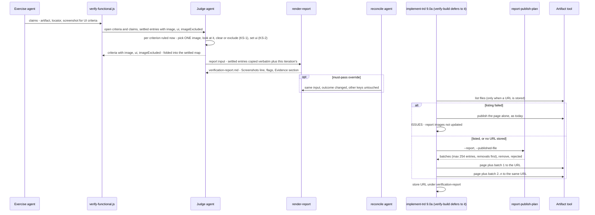

# TRD: verification-report-images

**Version**: 1.1.3
**Status**: Draft
**Created**: 2026-10-11
**Last Updated**: 2026-10-11
**Author**: @technical-architect
**Source PRD**: None — change decided in session; investigation record `docs/plan/verification-report-images.investigation.md`
**Kind**: change
**Weight**: medium
**Task ID Prefix**: RIMG

---

## Changelog

| Version | Date | Changes | Author |
|---------|------|---------|--------|
| 1.1.3 | 2026-10-11 | Owner ruling R1 after `/implement-trd`'s verification ended must-pass-unproven: the four publishing criteria (FS-6, FS-7, FS-8, FS-10, under O3 and O4) are accepted as covered by the publish plan's unit tests plus the 2026-10-11 hand probe, without a live publish during verification. No objective, decision or task changed; the must-pass markings stay | owner |
| 1.1.2 | 2026-10-11 | `/refine-trd`, interactive: the owner confirmed the stated assumption on every question put to them, so no design changed. **OQ-6** (the evidence-hygiene rule): exclude and name — S-3/KS-1 stand as written; the capture stays in the gitignored `evidence/` folder, and the exerciser's delete-on-capture rule is unchanged. **OQ-2**: any status shows its image (D12). **OQ-3**: the `## Evidence` section, not the table row (D7). **OQ-5**: the exerciser uses whatever frame-grab tool the project has; with none, the O2 flag shows (D4). **OQ-4** was not put to the owner — it is a cost to measure, not a decision — and moves to Could Not Verify beside TR3. Challenge pass: every objective traces to the owner instruction or a `constitution.md`/`CLAUDE.md` floor, O6/O7 sit at the floor, every cited decision and task ID resolves, the parent TRD is at 2.8.0 so RIMG-D001's 2.9.0 row is the next version. Nothing removed, lowered or added | @technical-architect |
| 1.1.1 | 2026-10-11 | `/audit-trd` findings applied. **O8** narrowed to shipped files: `*.test.js` and `test-harness.js` are exempt, as the enforcing mirror test exempts them. **D9** (and §3.4, RIMG-B002): the publish plan collects only the whole `` lines in `## Evidence`, not every image reference in the report, because `escapeCell` leaves `![` intact and Judge free text could otherwise carry an excluded image into a batch; new RIMG-B002 test. **D1** (and the Non-Goal row, RIMG-B003 grounding): the sweep caller's citation now names `verify-build.md:160-162` with the `:282` template it reuses. Could Not Verify rewritten with this audit's coverage | @technical-architect |
| 1.1.0 | 2026-10-11 | Revised after the 2026-10-11 adversarial review. **Removed:** the staging step (`stage-report-images`, the `report-images/` folder, its delete-on-omission cleanup and `.gitignore` line, old D5/D11, OQ-1) — images now embed straight from `evidence/`, which always sits beside the report; old D6's size and count limits (a refused publish is the existing one-line failure); the hand-run publish probe RIMG-T001, TR1 and its asset-store contingency — the probe was run by hand on 2026-10-11 and is recorded as grounding. **Added:** an optional `screenshot` on Exercise claims (D14); `image`/`ui`/`imageExcluded` carried through settled and resumed criteria (D15); the failed-listing rule and `--published-file` (D9, D10); `/verify-build` defers to `/implement-trd` §9.0a for the report; D13's rationale corrected (the Judge never sees the contract), with two rule sentences shared word for word between contract and Judge prompt and pinned by a test; sweep screenshots as a Non-Goal. **Edges:** RIMG-D001 depends on RIMG-B001 only; RIMG-B003 depends on RIMG-B004 because its test reads the contract. 7 tasks → 6 | @technical-architect |
| 1.0.0 | 2026-10-11 | Initial TRD, authored from the investigation record | @technical-architect |

## Objectives

O1–O5 are the investigation record's objectives, verbatim in substance. O6–O9 are floors and
invariants this repository already states, which every change to these files inherits.

| ID | Objective | Source | Must pass |
|----|-----------|--------|-----------|
| O1 | When a criterion's proving artifact is an image (png/jpg/jpeg; for video, a frame grab the run captured), the verification report shows that one image inline next to the criterion. No design frames or journey are required. Exactly one image per criterion, the one cited as its proof, never every capture | owner instruction, 2026-10-11, intended change 1 (investigation O1) | yes |
| O2 | A criterion about UI (it names a screen, element, layout or visual state, or its Tier 1 is judge-only for a visual property) that is `met` with no image is flagged in the report as "UI criterion proven without a screenshot". It still counts as met | owner instruction, 2026-10-11, intended change 2 (investigation O2) | |
| O3 | The published report carries its images through the existing publish path in `/implement-trd` §9.0a and `/verify-build`: images go up as supporting files (`files` map), every publish stays under the per-publish file limit (several publishes to the same URL when needed), and the feature keeps one report URL in `artifacts.json` | owner instruction, 2026-10-11, intended change 3 (investigation O3) | yes |
| O4 | No image showing a password, token, key or other credential value is ever published. Each image is cleared before it can be embedded; an image that cannot be cleared is left out and named in the report | owner instruction, 2026-10-11, intended change 4 (investigation O4) | yes |
| O5 | Behaviour preserved: the check-role skills' pages and triggers are unchanged; a report with no images and no UI criteria renders byte-identically to today; outcome logic (satisfied / stalled / insufficient-coverage / must-pass-unproven) is unchanged; with `ensemble.publishArtifacts: false`, the on-disk report embeds its images by relative path and nothing is published | owner instruction, 2026-10-11, "Behaviour preserved" (investigation O5) | |
| O6 | Unit test coverage of changed code ≥ 60% | `constitution.md` Quality Gates | |
| O7 | Integration test coverage ≥ 50% where an integration seam exists | `constitution.md` Quality Gates ("when applicable") | |
| O8 | Every changed shipped file under `packages/core/{lib,workflows,commands,contracts}` — every one except `*.test.js` and `test-harness.js`, which are deliberately not shipped into `.claude/` — is mirrored byte-identically into `.claude/` | `constitution.md` Architecture Invariants, "Vendored Runtime" (runtime components live in `.claude/`); the byte-identical bar and the test-file exemption are both those of the enforcing test, `test/integration/tests/runtime-integrity.test.sh`, 'every file mirrored into .claude/ matches its packages/ source' (`filecmp.cmp(..., shallow=False)`; `SKIP = lambda f: f.endswith('.test.js') or f == 'test-harness.js'`) | |
| O9 | A path taken from the report input or the report (an image path) is validated to stay inside its expected directory before it is embedded or published | `CLAUDE.md` Security Considerations, "Path Traversal Prevention" | |

## Intended Change

From the owner's instruction of 2026-10-11, as settled in the investigation record:

1. **Images inline.** Whenever a criterion's proving artifact is an image, the verification
   report shows it beside that criterion — one image per criterion, the one cited as its proof.
   Video evidence contributes a frame grab, never the video.
2. **Imageless UI criteria flagged.** A UI criterion that is `met` without an image carries the
   visible flag "UI criterion proven without a screenshot". It still counts as met.
3. **Published with its images**, through the two existing publish steps, in batches that stay
   under the per-publish limit, all to the one URL `artifacts.json` keeps under
   `verification-report`.
4. **No credential in a published image.** Each image is cleared before it is embedded; one that
   is not cleared is not embedded, not published, and is named in the report with the reason.

Why it matters, from the investigation's evidence (the owner's consuming-project counts, not
re-checked here): one feature captured 578 screenshots and published no visual page; four
others captured 85–316 and published none. A visual page today comes only from the check-role
skills, which need design frames or a screen-to-screen journey. This change works whatever
`checks` the verify-functional call carries — including `checks: {}` — because it lives in the
Exercise and Judge prompts and the renderer, not in a check skill.

## Decision

The Judge picks, clears and records one image per criterion in the iteration where it rules
that criterion; the renderer embeds it by a path relative to the report; the publish step sends
exactly what the rendered report embeds.

- **Where the image comes from.** The criterion's artifact when it is itself a png/jpg/jpeg (a
  judge-only criterion); otherwise the claim's new optional `screenshot`, which the Exercise
  agent attaches for every criterion about UI. A video contributes a frame grab, never the video.
  Most criteria are proven by a text artifact, so without `screenshot` nearly every UI criterion
  would be flagged.
- **Paths, no copying.** The evidence directory is always `<report dir>/evidence`, so `image` is
  written as `evidence/<path under the evidence directory>` and the on-disk report resolves it
  as is. An image anywhere else is `imageExcluded: "outside the evidence directory"`. There is no
  staging step, no `report-images/` folder and no `.gitignore` change.
- **Carried, never re-picked.** `image`, `ui` and `imageExcluded` travel through the Judge's
  return, the script's settled map, the resume seed and the state file exactly as `cause` does.
  A settled criterion keeps the image chosen when it was ruled. Nothing re-selects an image from
  a settled criterion's artifact path.
- **The Judge never sees the contract**, so these two sentences are written word for word into
  both the contract and the Judge prompt, and a test checks they match:
  - KS-1: "An image that shows a password, token, key or other credential value is never cited as a criterion's image; one that cannot be cleared is recorded as excluded, with the reason."
  - KS-2: "A criterion is about UI when it names a screen, element, layout or visual state, or its Tier 1 is judge-only for a visual property."
- **Publishing.** `report-publish-plan` reads the image references the report embeds and returns
  `files` batches of at most 254 entries, removal `null`s first; each batch goes with the page to
  the one stored URL. With a stored URL the command first lists the artifact's files, freshly,
  every time it publishes; if that listing fails it publishes the page alone, as today, and
  reports one ISSUES line. It never sends a `files` map without a listing. `/verify-build`
  follows `/implement-trd` §9.0a for this sequence rather than restating it.
- **Rejected:** a staging copy, because the evidence directory already sits beside the report;
  size and count limits enforced in the library, because a refused publish is already a one-line
  failure; the asset store, because the 2026-10-11 probe showed a Markdown page serves its
  `files` map at the referenced paths.

---

## 1. Overview

### 1.1 Technical Summary

The Exercise claim gains an optional `screenshot`: one image, saved under the evidence
directory, for every criterion about UI. Most criteria are proven by a text artifact through
the locator rule, so this is the image a UI criterion's report entry can show.

The Judge records three optional fields on every criterion it rules: `image` (the one image its
verdict rests on, written as `evidence/<path>`), `ui` (whether the criterion is about UI) and
`imageExcluded` (why a found image was not cited). It looks at each image before citing it, and
records a credential-bearing one, one outside the evidence directory, or one it cannot open as
excluded. The workflow script carries the three fields through its settled map, the resume seed
and the state file, so a criterion settled in an earlier iteration or an earlier
`/verify-build` round keeps its image.

`renderReport` embeds each image in a new `## Evidence` section, adds a one-line
`**Screenshots**` summary to the header, flags an imageless `met` UI criterion in its Met row,
and lists left-out images with their reasons. It embeds only paths an exported guard accepts:
`evidence/…` ending in a lower-case png/jpg/jpeg extension, with no `..`. All of this renders
only when one of the new fields is present, so every report written without them stays
byte-identical. Because the evidence directory sits beside the report, the on-disk report
resolves its images with nothing copied.

The publish step in `/implement-trd` §9.0a stops publishing the report as a bare file. With a
stored URL it lists the artifact's files, then asks a new library call, `report-publish-plan`,
which reads the image references the rendered report actually contains, resolves each against
the report's directory by real path, and returns batches of `files` maps, removals first. A
failed listing falls back to today's bare publish plus one ISSUES line. `/verify-build`'s three
publish points defer to §9.0a.

The contract gains the screenshot rule, the image-citation rule, the UI-criterion definition,
and S-3 — an image showing a credential value is never cited. Two of those sentences are copied
into the Judge prompt word for word, because the Judge is never given the contract.

**Consistency with prior decisions.** This does not reopen verification-must-pass D14 ("met
counts however proven"): O2's flag is visibility only, and the criterion still counts as met.
It extends verification-artifacts O8 (no credential in a published page) from the check pages
to the report's images. The check pages (verification-artifacts D8, D13) keep their own render
stage, images and publish calls untouched.

### 1.2 Key Technical Decisions

D5, D6 and D11 were removed in 1.1.0 (see Changelog); the remaining IDs are kept stable.

| ID | Decision | Choice | Serves Objective | Rationale | Alternatives Considered |
|----|----------|--------|------------------|-----------|------------------------|
| D1 | Report-input shape | Three optional per-criterion fields: `image?: string \| null` — report-relative, `evidence/<path under the evidence directory>` — plus `ui?: boolean` and `imageExcluded?: string \| null`. Nothing else in the input changes | O1, O2, O4, O5 | Absent fields render exactly as today, which keeps O5's byte-identity checkable (the pattern of `functional-verification.test.js:3094`). Report-relative works because every caller passes the evidence directory beside the report (`implement-trd.md:1795`, `verify-build.md:282`, and the sweep dispatch at `verify-build.md:160-162`, which runs step 4's block — the `.trd-state/<feature>/evidence` template at `:282` — with `feature: "<slug>-sweep"`, so its evidence directory is `.trd-state/<slug>-sweep/evidence` beside `.trd-state/<slug>-sweep/verification-report.md`, the report path `:396` names) | **Renderer infers the image from `artifact`** — rejected: `artifact` is free text and inference skips clearance (O4); revisit if Judges are measured omitting `image` where one is plainly available. **Repo-relative `image`, the 1.0.0 shape** — rejected with staging: the renderer would need the report's location to rewrite it |
| D2 | Who selects and clears the image | The Judge, in the iteration where it rules the criterion (STEP 2): the artifact when it is itself a `.png`/`.jpg`/`.jpeg`, otherwise the claim's `screenshot` (D14). It opens the image and looks at it; KS-1 governs. An image not under the evidence directory is `imageExcluded: "outside the evidence directory"`; one it cannot open, or cannot tell about, is excluded with that reason | O1, O4 | The Judge already reads image evidence for judge-only criteria (`verify-functional.js:531-533`), so clearing at selection costs no new agent, and the report on disk and the published page agree | **Separate clearance agent in each command's publish step** — duplicates the check in two commands, and a rendered report would need re-rendering to name the exclusion. **Deterministic OCR scan** — no OCR tool in `stack.md`. Revisit both if a credential is ever found in a published report image |
| D3 | Who decides a criterion is "about UI" | The Judge sets `ui` by KS-2, which is written into its prompt (D13) | O2 | KS-2 needs the statement's meaning and the definition's Tier 1 cell; the open-criteria JSON in the Judge prompt carries both, the renderer holds neither | **Renderer derives `ui` from `tier1`** — not in the report input, and covers only judge-only rows. **Keyword regex over the statement** — brittle across projects. Revisit if `ui` is measured unset on obvious UI criteria |
| D4 | Video | The Exercise agent that records a video also saves a frame grab (png/jpg) and returns it as the claim's `screenshot`; nothing downstream handles video | O1 | Keeps every downstream step image-only. Where no frame grab could be made, there is no image and a `met` UI criterion is flagged (O2), which is the visible outcome | **Embed the video** — the owner asked for a frame grab. **Renderer extracts a frame** — needs a media tool the stack does not name |
| D7 | Report layout | (a) A `**Screenshots**` header line after `**Coverage**` (and after `**Must pass**` when present): `<n> shown`, then `<k> UI criteria proven without a screenshot: <ids>` and `<x> left out: <ids>` when non-zero. (b) A Met row whose criterion is `ui: true` with no embeddable image gets ` — UI criterion proven without a screenshot` appended to its Artifact cell. (c) A `## Evidence` section as the report's last section: one `### <ID> — <statement> (<status>)` block with `` per criterion with an embeddable image, in input order; then a `\| ID \| Image left out because \|` table for every `imageExcluded` and every path the guard refused. (a)–(c) render only when some criterion carries a non-null `image`, `ui: true` or a non-null `imageExcluded` | O1, O2, O4, O5 | Images in table cells render poorly and break the tables' scannability; a block per criterion keeps the image under the criterion's own id and statement. The summary line puts the flag where a reader of the header sees it without scrolling | **Image in the Met table cell** — tables become unreadable at screenshot widths. **Replace the Met table with per-criterion blocks when images exist** — loses the at-a-glance table. Owner confirmed this layout, 2026-10-11 (OQ-3) |
| D8 | Embedding guard | `renderReport` embeds an `image` only when the exported helper `isEmbeddableImagePath(image)` accepts it: `evidence/`, then one or more `/`-separated segments that each start with a letter, digit, `_` or `-` and otherwise hold only `[A-Za-z0-9._-]`, ending `.png`, `.jpg` or `.jpeg` in lower case. That excludes `..`, absolute paths, spaces and brackets a Markdown link cannot carry. Anything else is rendered as left out, reason "not an embeddable image path", never embedded. Statements in Evidence headings go through `escapeCell`. `reportPublishPlan` uses the same helper | O4, O9 | The report input is hand-composed and unvalidated (`renderReport`'s own comment, `functional-verification.js:891-899`); the renderer is the last point a stray path can reach a published page | **Trust the Judge's path** — the reconcile agent re-renders the same input by hand; a guard in the pure renderer costs one regex. **Accept upper-case extensions** — revisit if a project's capture tool writes them; they are left out visibly, never silently |
| D9 | Publish plan | New CLI `report-publish-plan --report <path> [--published-file <path>]`. `--published-file` holds a JSON array of the paths a fresh listing returned, read from the file the way `resolveJsonPayload`'s `--file` branch reads; there is no inline-JSON form. It collects only the image lines the renderer itself writes — a line consisting solely of ``, inside the `## Evidence` section (D7c, the report's last section) — whose path the guard (D8) accepts, resolves each against the report's directory and checks by real path that it stays inside it, and returns `{ batches, remove, rejected }`: `remove` is every listed path the guard accepts that those image lines no longer reference; `batches` are `files` maps (`"evidence/<p>": "<report dir>/evidence/<p>"`, or `null` for a removal) of at most 254 entries each, removals first; `rejected` names references not on disk or resolving outside the report directory. Pure half `reportPublishPlan()` exported and tested | O3, O4, O9 | Computed from the image lines the renderer writes from cleared `image` fields, so nothing else — an excluded image, an unrelated capture, or an `` string that Judge-written free text carries into a table cell or heading, which `escapeCell` (`functional-verification.js:850-857`) does not neutralise — can be sent; such a string renders as a broken image on the page, never as an uploaded file. `remove` withdraws an image a later run stopped citing, since a republish keeps files it is not told to remove. 254 because every call re-sends the page as `file_path`, and whether the page and `null` entries count toward the 255-file limit is untested (Could Not Verify); removals first because withdrawing an image matters more to O4 than adding one | **Commands assemble the `files` map in prose** — a model building a map of hundreds of paths is where an excluded file slips in. **No `remove`** — an image dropped on run 2 would stay published from run 1. **Scan every image reference in the report** (the 1.1.0 wording) — sends an image cited only from free text, even one the same criterion's `imageExcluded` withheld. **Escape `![` in `escapeCell`** — changes the bytes of existing reports (O5) to close a case the line-scoped scan already closes. **Byte and size accounting (1.0.0 D6)** — dropped: a publish the platform refuses is the existing one-line failure; revisit if a real feature hits the 64 MB-per-call or 511-files-per-version limit |
| D10 | Publish sequence | `/implement-trd` §9.0a: with a stored `verification-report` URL, list the artifact's files (`Artifact` `action: "list"`, `scope: "files"`). If the listing fails, publish the page alone exactly as today and report one ISSUES line, "report images not updated: could not list the published artifact". Otherwise write the listed paths to a JSON file, run the plan, publish the page with `files: batches[0]` to the URL (no URL on a first publish), then each later batch to the same URL, and store the URL. `rejected` is one ISSUES line. A `files` map is never sent to a stored URL without a successful listing taken for that publish, and a fresh listing is taken every time the sequence runs — every `/verify-build` round and its step-6 republish included. `/verify-build`'s three publish points defer to §9.0a ("identical to `/implement-trd` §9.0a — read that section and follow it"). `artifacts.json` keeps its one key; with `publishArtifacts: false` the step is skipped as today | O3, O5 | The Artifact tool refuses a republish whose `files` map replaces or removes a path this session has not listed or published, and sends nothing [read: Artifact tool contract]. Falling back to the bare publish keeps today's behaviour; every image already on the page was cleared when it was sent, so nothing uncleared appears. The hand probe of 2026-10-11 showed a Markdown page serves its `files` at the referenced paths and a second publish keeps the first batch (RIMG-B005 grounding). One written sequence keeps the two commands from drifting, as `/verify-build` already does for check pages | **A separate artifact for the images** — the owner asked for the report to carry them, one URL per feature. **Asset store (`asset: true`)** — not needed: the probe answered the question it was the contingency for. **Publish `files` without listing** — refused by the tool. **Skip images silently on a failed listing** — the owner would not know the page is stale |
| D12 | Images on non-met criteria | A criterion of any status shows its image when the Judge cites one; the O2 flag applies only to `met` | O1 | A screenshot of the failure is the most useful thing to review on a `not_met` row (investigation OQ-2 assumption) | **Met only** — reading "proving" strictly. Owner chose any status, 2026-10-11 (OQ-2) |
| D13 | Contract rules, and the Judge's copy of them | `packages/core/contracts/functional-verification.md` gains, under "What counts as an evidence artifact", the screenshot rule (D14), the image-citation rule (D2) and KS-2; and **S-3 — the image rule**: KS-1, the exerciser deletes a capture that shows a credential value, and the Judge looks at every image before citing it. The Judge prompt carries KS-1 and KS-2 word for word; a test asserts each appears in both | O2, O4 | The contract text reaches Exercise (`verify-functional.js:417`) and Debug (`:683`) only; `buildJudgePrompt` (`:452-651`) has no `${CONTRACT}`. A rule written only in the contract therefore binds Exercise and never reaches the Judge, which is the agent that clears and sets `ui`. Two shared sentences pinned by a test follow the cause-vocabulary precedent: written into the Judge prompt (`:540-556`), with the schema's list diffed against the library's by a test (`verify-functional.test.js:2430-2447`). The owner's "evidence-hygiene rule" is not present in this repository, so S-3 is where it is written down | **Inject the whole contract into the Judge** — grows every Judge prompt by a document written for Exercise and Debug. **Prompt-only rule in the Judge** — the Exercise agent, which deletes captures, would never see it |
| D14 | An image for a text-proven criterion | `EXERCISE_SCHEMA`'s claim item gains an optional `screenshot: string \| null` (a path under the evidence directory), and the Exercise return spec names it. The contract tells the exerciser to attach one for every criterion about UI (KS-2), a frame grab for video (D4), with a file name the D8 guard accepts, and never written over an existing file | O1, O2 | Most criteria are proven by a text artifact through the locator rule (contract `:199-231`), and `EXERCISE_SCHEMA` (`verify-functional.js:732-753`, `additionalProperties: false`) has no field to name an image. Without one the Judge has nothing to cite for a locator-proven UI criterion, and O2 would flag nearly every one. `reconcileClaims` already passes extra claim fields to the Judge (`:917-918`); `checkEvidence` reads only `criterion`, `artifact`, `locator` and `judgeOnly` (`functional-verification.js:127`) | **Judge searches the evidence directory for a likely image** — a guess at which capture shows the criterion. **Make every UI criterion judge-only** — changes tier-1 semantics, which O5 preserves. **Gate the screenshot through tier 1** — tier 1 cannot read images (contract `:210-214`) |
| D15 | Settled criteria keep their image | `image`, `ui` and `imageExcluded` are added to `JUDGE_CRITERION_SCHEMA` (`:755-788`), the Judge return spec (`:641`), the settled-map fold (`:1414-1421`), the resume seed (`:1187-1194`), STEP 4's state-file key list (`:587-588`) and STEP 5's report-input key list (`:622-623`) | O1, O4 | A settled criterion reaches STEP 5 only through the settled map, which today holds verdict fields only. Without this, a criterion met at iteration 1 loses its image when the run exits at iteration 2, and every `/verify-build` round (whose resume is synthesised from `met` entries, `verify-build.md:513-515`) drops every image | **Re-select images for settled criteria in STEP 5 from their artifact path** — rejected: it skips `screenshot` and re-clears every image on every iteration |

### 1.3 Technology Stack

| Layer | Technology | Purpose | Notes |
|-------|------------|---------|-------|
| Library + CLI | Node.js 18+ | `renderReport`, `isEmbeddableImagePath`, `reportPublishPlan` in `functional-verification.js` | `stack.md`; no new dependency |
| Workflow | Workflow script (`verify-functional.js`) | Exercise and Judge schemas and prompts; the settled map | must stay clock-free and `require`-free (source-level test) |
| Prompts | Markdown | contract, two command files | `constitution.md` Principle 2/3 |
| Tests | Jest ^29, BATS | unit + CLI-chain tests; mirror integrity | `stack.md` |

### 1.4 Integration Points

| System | Type | Direction | Notes |
|--------|------|-----------|-------|
| Artifact tool (claude.ai) | tool call | Out | `publish` with `file_path`, `files` and `url`; `list` with `scope: "files"` before any `files` republish (D10) |
| `.trd-state/<feature>/artifacts.json` | file | Both | key `verification-report`, unchanged |

## 2. System Architecture

### 2.1 Data Flow



### 2.2 Component Responsibilities

| Component | Owns | Does not own |
|-----------|------|--------------|
| Contract | screenshot rule, image-citation rule, KS-2, S-3 (KS-1) | enforcement |
| Exercise agent | `screenshot` for each UI criterion; frame grab for video; deleting a capture that shows a credential; never overwriting a capture | choosing the proving image |
| Judge agent | `image`, `ui`, `imageExcluded` for each criterion it rules; clearing by looking; copying settled entries verbatim | copying files; re-picking a settled criterion's image |
| Workflow script | carrying the three fields through the settled map and resume seed | reading or judging images |
| `renderReport` | layout; refusing a path `isEmbeddableImagePath` rejects | file I/O |
| `reportPublishPlan` / CLI | batches from what the report embeds; removals; real-path check; `rejected` | calling the Artifact tool |
| `/implement-trd` §9.0a (and `/verify-build` by deferral) | the listing, the publish calls, the stored URL, ISSUES lines | choosing files |

## 3. Technical Specifications

### 3.1 Exercise claim addition (`EXERCISE_SCHEMA`)

```typescript
interface ExerciseClaim {
  criterion: string;
  artifact: string | null;
  locator: string | null;
  reason?: string;
  screenshot?: string | null;  // NEW (D14). One screenshot under the evidence directory, for a
                               //   criterion about UI (KS-2); a frame grab for video (D4). Named
                               //   so the D8 guard accepts it, never written over an existing
                               //   file. Not tier-1 evidence: the verdict still rests on `artifact`.
}
```

`reconcileClaims` passes `screenshot` through to the Judge unchanged (`verify-functional.js:917-918`);
`check-evidence` ignores it.

### 3.2 Judge criterion and report-input additions

```typescript
interface ImageFields {
  image?: string | null;          // "evidence/<path under the evidence directory>"; looked at and cleared
  ui?: boolean;                   // KS-2; absent = false
  imageExcluded?: string | null;  // why an image was found but not cited
}
```

Carried on: the Judge's returned criteria (`JUDGE_CRITERION_SCHEMA`), every settled-map entry
(fold and resume seed), STEP 4's state-file entries, STEP 5's report-input entries. A criterion
carries at most one of `image` and `imageExcluded`; when both are present the renderer treats
`imageExcluded` as winning (the safer reading) and embeds nothing.

**Selection, in STEP 2, for each criterion ruled this iteration:**

1. `ui` by KS-2.
2. Candidate image: the artifact when it ends `.png`, `.jpg` or `.jpeg`; otherwise the claim's
   `screenshot`; otherwise none, and `image` is null.
3. A candidate whose path is not under the evidence directory → `imageExcluded: "outside the
   evidence directory"`.
4. Open it and look. KS-1 applies. It cannot be opened → `imageExcluded` says so; it shows a
   credential value, or the Judge cannot tell → `imageExcluded` with the reason.
5. Otherwise `image` = `evidence/` followed by its path under the evidence directory.

Settled entries are copied verbatim, image fields included. Nothing re-selects one.

### 3.3 `renderReport` additions

As D7 and D8. Byte-identity rule: when no criterion carries a non-null `image`, `ui: true` or a
non-null `imageExcluded`, the output is exactly today's. With `publishArtifacts: false` the same
file is the deliverable, and its `evidence/…` references resolve next to it on disk (O5).

### 3.4 `reportPublishPlan(reportMarkdown, opts)` and `report-publish-plan`

```typescript
function reportPublishPlan(
  reportMarkdown: string,
  opts: {
    reportDir: string;      // the report's directory; batch sources are joined to it
    published?: string[];   // paths from a fresh listing; [] or absent when no URL is stored
    resolveRef: (ref: string) => 'ok' | 'not on disk' | 'resolves outside the report directory';
  }
): {
  batches: Array<Record<string, string | null>>;  // ≤ 254 entries each; removal nulls first, then
                                                  //   images in report order
  remove: string[];      // guard-accepted `published` paths the report no longer references
  rejected: Array<{ path: string; reason: 'not on disk' | 'resolves outside the report directory' }>;
};
```

The pure half reads from the `## Evidence` heading to the end of the report and collects each
line that is exactly `` — the form D7c writes; a reference anywhere else, such as
free text in a table cell or a heading, is never collected — keeps those `isEmbeddableImagePath`
accepts (a reference it refuses is never sent), de-duplicates, and asks `resolveRef` about each.
The CLI supplies `resolveRef` with `fs.realpathSync` on both the report directory and the file,
then checks the file stays inside the directory. It prints one JSON line. Usage error (exit 1)
on a missing `--report`, or a `--published-file` that is not a JSON array of strings. A report
with no image references and nothing to remove returns `{ batches: [], remove: [], rejected: [] }`,
and the command publishes the page as today.

### 3.5 Publish sequence (`/implement-trd` §9.0a; `/verify-build` defers to it)

```
Unless ensemble.publishArtifacts is false (and, in /implement-trd, unless --no-verify):
1. URL = artifacts.json "verification-report" (may be absent).
2. If URL: Artifact({ action: "list", url: URL, scope: "files" }).
   - fails  -> Artifact({ file_path: <report>, icon: "check", url: URL }) as today; store URL;
               ISSUES: "report images not updated: could not list the published artifact". Done.
   - lists  -> write the listed paths as a JSON array to .trd-state/<feature>/report-published.json
3. node .claude/lib/functional-verification.js report-publish-plan \
     --report .trd-state/<feature>/verification-report.md [--published-file <that file>]
4. Artifact({ file_path: <report>, icon: "check", url: URL (omit if none), files: batches[0] (omit if none) })
   -> store the returned URL under "verification-report".
5. For each later batch: Artifact({ file_path: <report>, url: <the URL>, files: batches[i] }).
6. rejected non-empty -> one ISSUES line naming them. Any failed publish -> one line, as today.
```

`/verify-build` runs this at step 4 every round, at step 6 after appending `## Fix run`, and in
its `### Artifact link` section, by deferring to §9.0a at each point.

### 3.6 Judge and Exercise prompts (`verify-functional.js`)

- Exercise return spec (`:443-448`) names `"screenshot": "<path under the evidence directory>" | null`.
- Judge STEP 2 gains the selection rule (§3.2) with KS-1 and KS-2 written in verbatim, and the
  `evidence/` path form stated against the evidence directory already in scope (`EVIDENCE_DIR`, `:126`).
- STEP 4's key list continues `"provenAt", "image", "ui", "imageExcluded"`; STEP 5's report-input
  list continues `attempts, blocker, image, ui, imageExcluded`, with settled entries copied
  verbatim; the Return spec's criterion keys continue `"files","image","ui","imageExcluded"`.
- The reconcile prompt is unchanged: "Leave every other key exactly as it is" (`:1084`)
  already keeps the new keys.

### 3.7 Error handling

| Case | Handling |
|------|----------|
| Cited image outside the evidence directory | Judge: `imageExcluded: "outside the evidence directory"`; named in the report |
| Image cannot be opened, shows a credential, or cannot be judged | Judge: `imageExcluded` with the reason; named in the report |
| A path the guard rejects reaches the renderer | Not embedded; rendered as left out, "not an embeddable image path" |
| Referenced file missing, or resolving outside the report directory, at publish time | `rejected` in the plan; one ISSUES line; the rest publishes |
| Listing the stored artifact's files fails | Page published alone as today; one ISSUES line, "report images not updated: could not list the published artifact"; no `files` map sent |
| A publish call fails or is refused, including for a platform size or count limit | One line of prose, as today (`command-status.md`); never STUCK, never a retry |

## 4. Master Task List

### 4.1 Task ID Convention

`RIMG-[CATEGORY][SEQ]`, per the authoring contract.

### 4.2 Phase 1: Renderer and contract

| Task ID | Description | Serves | Skills | Dependencies | Acceptance Criteria |
|---------|-------------|--------|--------|--------------|---------------------|
| RIMG-B001 | `renderReport`: the `**Screenshots**` line, the Met-row flag, the `## Evidence` section and the left-out table (D7); the embedding guard as the exported helper `isEmbeddableImagePath` (D8). Mirror to `.claude/lib/`. Kept apart from RIMG-B002 though both edit `functional-verification.js` — **size**: this change ships a byte-identity regression suite over every existing report shape; RIMG-B002 ships file-system tests (temp dirs, a symlink escape, batch arithmetic at 254) and the render-to-plan CLI chain, which needs this renderer finished. They serialize by dependency | D7, D8 | `jest` | None | Each of these fails before the change: a fixture whose criterion carries `image: "evidence/FS-1/shot.png"` renders exactly one `` in `## Evidence`, and a criterion with only a text artifact renders none; a `met` `ui: true` criterion with no image renders ` — UI criterion proven without a screenshot` in its Met row and is named on the `**Screenshots**` line, while the same criterion with an image, and a non-UI criterion with none, are not; an `imageExcluded` criterion renders no image and appears in the left-out table with its reason; `image` values `evidence/../x.png`, `/abs/evidence/x.png`, `report-images/x.png`, `evidence/a b.png`, `evidence/x.PNG` and `evidence/x.gif` are not embedded and are listed as "not an embeddable image path"; `isEmbeddableImagePath` is exported and unit-tested on the same cases; a statement containing `\|` and a newline does not break its Evidence heading. Guards, which pass before and after and fail only if the change leaks: every existing `renderReport` test passes unchanged; a golden string, rendered by the pre-change renderer from a fixture that reaches every section and committed before the renderer is edited, still equals the output for that fixture with no new fields, and with `ui: false`, `image: null`, `imageExcluded: null` on every criterion; the Must pass line still sits at Coverage + 1. Coverage of changed lines ≥ 60%; mirror byte-identical |
| RIMG-B004 | Contract: under "What counts as an evidence artifact", the screenshot rule (D14: one `screenshot` for every UI criterion, saved under the evidence directory, named so the D8 guard accepts it, never written over an existing file; a frame grab for video, D4), the image-citation rule (D2) and KS-2; and **S-3** (KS-1; the exerciser deletes a capture showing a credential value; the Judge looks at every image before citing it) — D13. KS-1 and KS-2 are copied exactly as the Decision section states them. Mirror to `.claude/contracts/` | D13, D14 | `jest` | None | `packages/core/contracts/functional-verification.test.js` asserts, each failing before the change: a `## S-3` heading after `## S-2` and before `## The report shape`; KS-1 and KS-2 verbatim (whitespace-flattened); the screenshot rule naming `screenshot`, the evidence directory, a frame grab for video, and that a capture is never written over an existing file. Guards: the existing mirror test and the tier-1 image-limit test (`:94`) still pass |

### 4.3 Phase 2: Publish plan, loop prompts, parent TRD, commands

| Task ID | Description | Serves | Skills | Dependencies | Acceptance Criteria |
|---------|-------------|--------|--------|--------------|---------------------|
| RIMG-B002 | `reportPublishPlan` and the `report-publish-plan --report <path> [--published-file <path>]` CLI (D9), using RIMG-B001's guard. Mirror to `.claude/lib/`. Owns the render-to-plan CLI-chain test, since it consumes RIMG-B001's renderer | D9 | `jest` | RIMG-B001 | Unit tests on the pure half, each failing before the change: for 0, 1, 254, 255 and 300 embedded images with 0 or 3 removals, every batch holds at most 254 entries, removal `null`s come before any image, and the batches together hold exactly the guard-accepted references the resolver reports on disk plus the removals, nothing else; `remove` lists exactly the `published` paths the guard accepts that the report no longer references, and never `index.html`; a reference the resolver reports missing or outside is in `rejected` with that reason and in no batch; a hand-edited reference the guard refuses is in no batch; an `` string in a Not Met reason cell, a Met Artifact cell or an Evidence heading, with that file on disk, is in no batch, and when that path is also listed as published it appears in `remove` — only the `## Evidence` image lines count. CLI-chain test in a temp dir: `render-report --file` → write the report → `report-publish-plan --report <it> --published-file <json>` yields one entry per embedded image; an `imageExcluded` criterion's file, present on disk, is in no batch; a symlink under `evidence/` pointing outside the temp dir is rejected as "resolves outside the report directory"; a `--published-file` that is not a JSON array of strings exits 1. Coverage of changed lines ≥ 60%; integration (CLI chain) ≥ 50% of the new CLI branch; mirror byte-identical |
| RIMG-B003 | `verify-functional.js`: `screenshot` on `EXERCISE_SCHEMA` and the Exercise return spec (D14); `image`, `ui`, `imageExcluded` on `JUDGE_CRITERION_SCHEMA`, the Judge return spec, the settled-map fold, the resume seed, and STEP 4's and STEP 5's key lists (D15); the STEP 2 selection-and-clearance rule with KS-1 and KS-2 written in verbatim (D2, D3, D13). Depends on RIMG-B004 because its shared-sentence test reads the contract file. Mirror to `.claude/workflows/` | D2, D3, D13, D14, D15 | `jest` | RIMG-B004 | In `verify-functional.test.js`, each failing before the change: (a) a source-level test, by the cause-enum extraction technique (`:2430-2447`), that `EXERCISE_SCHEMA`'s claim item declares `screenshot` (string or null) and `JUDGE_CRITERION_SCHEMA` declares `image` (string or null), `ui` (boolean) and `imageExcluded` (string or null), both still `additionalProperties: false`; (b) the captured Exercise prompt's return spec names `"screenshot"`; the captured Judge prompt's Return spec reads `"files","image","ui","imageExcluded"`, STEP 4's list `"provenAt", "image", "ui", "imageExcluded"`, STEP 5's `attempts, blocker, image, ui, imageExcluded`, and the prompt names the `evidence/` form and the reason "outside the evidence directory"; (c) KS-1 and KS-2 each appear, whitespace-flattened, in both `packages/core/contracts/functional-verification.md` and the captured Judge prompt; (d) the iteration-1 Judge returns FS-1 `met` with `image: "evidence/FS-1/shot.png"`, `ui: true` while FS-2 stays `not_met` (remediate), and the run exits at iteration 2: the iteration-2 Judge prompt's settled list — what STEP 5 copies into the report input — carries FS-1's `image` and `ui` unchanged, and `result.criteria` carries them too; (e) a resume entry carrying `image`, `ui`, `imageExcluded` reaches the Judge prompt's settled list unchanged. Guards: the source-level constraints (`:94-122`), `verify-functional-trd-sync.test.js` (still 25 `a.*` reads), every existing prompt regex, mirror byte-identical |
| RIMG-D001 | Sync `docs/TRD/functional-verification.md` §3.6: `renderReport`'s interface gains the three fields, and the Behavior bullets gain the `**Screenshots**` line, the Met-row flag, the `## Evidence` section and the left-out table, as RIMG-B001 delivered them; add a changelog row "Synced to `docs/TRD/verification-report-images.md`", following that document's own convention | D1, D7, D8 | | RIMG-B001 | Each failing before the change: §3.6's interface lists `image`, `ui`, `imageExcluded`; a `2.9.0` changelog row naming this TRD and RIMG-D001, with `**Version**` and `**Last Updated**` moved to match. Guard: `verify-functional-trd-sync.test.js` passes |
| RIMG-B005 | `/implement-trd` §9.0a publishes the report by the §3.5 sequence (D10): a fresh listing when a URL is stored, the page alone plus one ISSUES line when the listing fails, otherwise the plan's batches to the one URL. `/verify-build`'s three publish points — step 4, step 6's republish and `### Artifact link` — defer to §9.0a. New assertions in `verify-command-surface.test.js`. Both command files in one task — **merged**: the two publish steps are twins and are checked as one unit. Mirror both to `.claude/commands/` | D10 | `jest` | RIMG-B002 | New assertions in `verify-command-surface.test.js`, each failing before the change: §9.0a (up to `### 9.1`) names `report-publish-plan`, `--published-file`, a listing with `scope: "files"`, the ISSUES line "report images not updated: could not list the published artifact", and that no `files` map goes to a stored URL without a successful listing; `/verify-build`'s `### Artifact link` report paragraph (up to `**Then, under the same switch`) carries "identical to `/implement-trd` §9.0a — read that section and follow it"; `/verify-build` no longer contains `Artifact({ file_path: ".trd-state/<feature>/verification-report.md", icon: "check" })`; step 6's republish sentence points at the Artifact link section. Guards: the existing §9.0a and Artifact-link assertions (`:374-379`, `:407-411`, `:508-511`) pass; the check-page publish text is unchanged (O5); both mirrors byte-identical |

## 5. Execution Plan

### 5.1 Phase Overview

| Phase | Focus | Prerequisites | Parallelizable Sessions |
|-------|-------|---------------|------------------------|
| 1 | Renderer and contract (each with its own tests) | None | RIMG-B001 and RIMG-B004 in parallel (no shared file) |
| 2 | Publish plan, loop prompts, parent TRD, commands | Phase 1 | RIMG-B002, RIMG-B003 and RIMG-D001 in parallel (no shared file); RIMG-B005 after RIMG-B002 |

### 5.2 Session Details

**Session 1A: Renderer**
- Tasks: RIMG-B001
- Agent: @backend-implementer
- Can parallelize with: Session 1B

**Session 1B: Contract**
- Tasks: RIMG-B004
- Agent: @agent-implementer
- Can parallelize with: Session 1A

**Session 2A: Publish plan**
- Tasks: RIMG-B002
- Agent: @backend-implementer
- Blocked by: RIMG-B001

**Session 2B: Loop prompts**
- Tasks: RIMG-B003
- Agent: @agent-implementer
- Blocked by: RIMG-B004

**Session 2C: Parent TRD sync**
- Tasks: RIMG-D001
- Agent: @backend-implementer
- Blocked by: RIMG-B001

**Session 2D: Command publish steps**
- Tasks: RIMG-B005
- Agent: @agent-implementer
- Blocked by: RIMG-B002

### 5.3 Critical Path

RIMG-B001 → RIMG-B002 → RIMG-B005. A second, shorter chain runs beside it: RIMG-B004 → RIMG-B003.

## 6. Quality Requirements

### 6.1 Testing Requirements

| Type | Coverage Target | Source | Scope |
|------|-----------------|--------|-------|
| Unit Tests | ≥ 60% | `constitution.md` Quality Gates | `renderReport` additions, `isEmbeddableImagePath`, `reportPublishPlan`, workflow schema and prompt assertions |
| Integration Tests | ≥ 50% | `constitution.md` Quality Gates | the render-to-plan CLI chain (RIMG-B002) |

**End-to-end.** There is no task for it. This repository has no UI, so the assembled loop on a
real UI feature — a Judge citing a real screenshot through to a published page — is exercisable
only in a consuming project. The publish half was probed by hand on 2026-10-11 (RIMG-B005
grounding): a Markdown page serves its `files` at the referenced paths, and a second publish to
the same URL keeps the first batch. Everything else is covered by the CLI-chain test
(RIMG-B002) and the workflow tests (RIMG-B003).

### 6.2 Code Quality Standards

Mirrors byte-identical (O8); the workflow stays clock-free and `require`-free (existing
source-level test).

### 6.3 Security Requirements

- **O4** (owner instruction): no credential value in a published image. The Judge clears every
  image it cites (D2, KS-1); the publish plan sends only what the report embeds and withdraws what
  it no longer embeds (D9); a failed listing sends no image at all (D10); the exerciser never
  overwrites a capture, so a cleared file is the file published (D14, TR4).
- **O9** (`CLAUDE.md`): image paths are checked against the evidence directory by the Judge
  (D2), by the renderer's guard (D8) and by real path at planning (D9).

## 7. Risk Assessment

### 7.1 Risks Imported from the Investigation

The investigation record lists no risks.

### 7.2 Technical Risks

TR1 (a Markdown artifact might not resolve its `files`) was closed by the 2026-10-11 hand probe
and removed in 1.1.0.

| ID | Risk | Likelihood | Impact | Mitigation |
|----|------|------------|--------|------------|
| TR2 | Judge clearance is model-judged and misses a credential (e.g. a password field rendered as plain text, a token in a devtools panel) | Low | High | KS-1 makes "cannot tell" an exclusion; D9 sends only what the report embeds, and `remove` withdraws an image a later run stops citing |
| TR3 | Looking at one image per criterion ruled grows the Judge's context and cost on features with many criteria; a `not_met` criterion is looked at again each iteration it stays open | Med | Low | One image per criterion, never every capture (O1); settled images are carried, not re-looked at (D15); cost unmeasured (Could Not Verify) |
| TR4 | A capture a settled criterion cites is overwritten by a later Exercise pass or `/verify-build` round, so the bytes published differ from the bytes the Judge cleared — a risk that exists because images are carried forward (D15) and no longer copied at clearance | Low | High | The contract forbids writing a capture over an existing file (D14, RIMG-B004) |

### 7.3 Contingency Plans

None. TR1's contingency, the asset store, was removed with TR1.

## 8. Non-Goals (Scope Boundaries)

| Source | Non-Goal | Rationale |
|--------|----------|-----------|
| owner instruction, O1 | Embedding every capture, or more than one image per criterion | "One image per criterion, the one cited as its proof, not every capture" |
| owner instruction, O5 | Any change to the check-role skills' pages, triggers or publish calls | preserved behaviour |
| owner instruction, O5 | Any change to outcome logic or must-pass handling; an imageless UI criterion still counts as met | preserved behaviour; consistent with verification-must-pass D14 |
| investigation, "not absorbed" | Making the tracked report's images resolve on another clone | `.trd-state/*/evidence/` is gitignored (`.gitignore:78`). With no staging copy, the tracked report's `evidence/` links resolve only in the working tree that ran the loop; the published artifact carries the images and is the shared record |
| investigation | Re-checking the consuming project's screenshot counts | motivating evidence, not a requirement |
| adversarial review 2026-10-11, finding 9 | Carrying a sweep run's `screenshot` into the core feature's live-evidence record (`verify-build.md:168-177` records only `artifact`) | Not trivial, so Non-Goal rather than carried: `live-evidence.js record` has no image field, and a swept image lives under `.trd-state/<slug>-sweep/evidence/` (`verify-build.md:160-162` with `:282`), outside the core run's evidence directory, where D2 would exclude it anyway. A swept UI criterion reused in the core run is flagged "proven without a screenshot" unless the core run captures one |
| adversarial review 2026-10-11, finding 4 | Enforcing the Artifact platform's size and count limits in the library | a publish the platform refuses is the existing one-line failure (§3.7) |

## Verification Artifacts

None apply — this change has no design frames, no screen-to-screen journey, and no screen that
renders data; it changes a Markdown report renderer, a workflow's prompts and schemas, a
contract and two publish steps.

## Task Grounding

### RIMG-B001
- **Touches:** `packages/core/lib/functional-verification.js`, `packages/core/lib/functional-verification.test.js`, `.claude/lib/functional-verification.js` [read; `cmp` shows the pair identical today, ran]
- **Reuse:** `escapeCell()` (`functional-verification.js:850`) for every cell and heading — statement, ids, reasons; it escapes `\` before `|` and folds `\r\n`; do not write a second escaper [read]. The must-pass gating pattern (`:953-955`): compute, then push lines only when present — that is how "byte-identical when the field is absent" is already achieved [read]. The byte-identity precedent `test('with both lists empty (or absent) the report has no Must pass line and is byte-identical'` (`functional-verification.test.js:3094`) and its `crit()`/`input()` helpers (`:3086-3092`) — but that test compares two current outputs; the golden string this task needs must be captured from the pre-change renderer [read]. The Met row is built at `:1064-1066` as `` `| ${c.id} | ${escapeCell(c.statement)} | ${escapeCell(c.artifact)} | ${escapeCell(provenAt)} |` ``: append the flag to the Artifact cell after escaping [read].
- **Replaces:** nothing. No existing rendering becomes unreachable; do not change the `## Met` header or column order [read].
- **Follow:** header lines are pushed Outcome, Reason, Criteria, Coverage, Must pass (conditional), then Diagnosis/Next (`:983`). Insert `**Screenshots**` after Must pass and before Diagnosis; the test that Must pass sits at Coverage + 1 stays true [read: `:3121-3123`]. `## Evidence` goes after the `## Not Verifiable` section (`:1093-1104`), before `return lines.join('\n')` (`:1106`); `/verify-build` step 6 appends `## Fix run` after the whole file, so Evidence precedes it [read: `verify-build.md:535-537`].
- **Careful:**
  - The guard is the Decision section's rule exactly: `evidence/`, segments of `[A-Za-z0-9._-]` not starting with `.`, a lower-case `.png`/`.jpg`/`.jpeg` ending. Export it as `isEmbeddableImagePath` from `module.exports` (`:1499-1517`); RIMG-B002 uses it, so do not inline a second copy [read].
  - Unrecognised-status criteria (`:891-899`) still get an Evidence block when they carry an embeddable `image` (D12: any status); decide and pin it in a test [inferred].
  - A `ui: true` criterion that is not `met` and has no image still opens the gate, so the `**Screenshots**` line can read "0 shown" with no flags. D7 states the gate that way; pin it in a test rather than leave it implicit [read: D7].
  - Alt text: the criterion id when it matches `[A-Za-z0-9._-]+`, else the word `image` — an id with `]` would break the link [inferred].
  - When a criterion carries both `image` and `imageExcluded`, `imageExcluded` wins and nothing is embedded (§3.2) [read: §3.2].
  - Purity: `renderReport` does no file I/O; keep it so. Update its JSDoc typedef (`:860-883`) with the three fields [read].
  - **Collision:** RIMG-B002 edits the same two files and the same mirror; they serialize by its declared dependency. RIMG-D001 edits only the parent TRD [read].

### RIMG-B002
- **Touches:** `packages/core/lib/functional-verification.js`, `packages/core/lib/functional-verification.test.js`, `.claude/lib/functional-verification.js` [read]
- **Reuse:** RIMG-B001's `isEmbeddableImagePath` for both the report scan and `remove` [read: D8]. The CLI's `resolveJsonPayload` (`functional-verification.js:1579-1590`) for how a `--file` payload is read, and the `flag = (name) => …` helper in the `must-pass-coverage` branch (`:1663-1666`) for `--report` and `--published-file` [read]. Real-path precedent: `coverEntry` in `packages/core/lib/live-evidence.js:74-85` (`fs.realpathSync`); inside-root precedent: `checkInputsCell` in `packages/core/lib/fix-audit.js:148-160` (`resolved.startsWith(absRoot + path.sep)`) [read]. CLI tests: the `describe('CLI'` temp-dir pattern (`functional-verification.test.js:1049`) with `execFileSync('node', [MODULE_PATH, …])`; pass `cwd: tmpDir` so relative sources resolve against the fixture [read].
- **Replaces:** nothing is made unreachable. The 1.0.0 design's `stage-report-images` CLI, `stageReportImages()` and `report-images/` folder were never built — do not build them [read: 1.0.0 of this TRD].
- **Follow:** pure half exported plus a thin CLI branch, like `mustPassCoverage` / `must-pass-coverage`, printing one JSON line via `console.log(JSON.stringify(…))`. Add the subcommand to `usage()` (`:1556-1573`) and the CLI header comment (`:1519-1553`); the new branch goes before the final `else { usage(); }` [read].
- **Careful:**
  - Every batch ≤ 254 entries, `null`s included, because every call re-sends the page as `file_path`; whether the page or a `null` counts toward the 255-file limit is untested (Could Not Verify) [read: Artifact tool limits; inferred for nulls].
  - Collect only whole `` lines from `## Evidence` onward, never a reference inside a cell or heading: `escapeCell` (`functional-verification.js:850-857`) folds newlines and escapes `\` and `|` but leaves `![`, `]` and `(` as written, so Judge-written free text can carry an image reference into the page, and a whole-report scan would send it [read].
  - Removals first, so a failure on a later call never leaves a withdrawn image published while new ones went up (O4) [inferred].
  - `remove` considers only listed paths the guard accepts; `index.html` and anything else not under `evidence/` are never nulled [ran 2026-10-11: the probe's listing showed `index.html` beside the images].
  - Real-path both sides: on macOS `os.tmpdir()` sits under `/var/folders`, which resolves to `/private/var/folders`, so comparing a real file path against an unresolved directory reads every image as outside [inferred from platform behaviour].
  - Batch sources are `path.join(reportDir, ref)`, relative to the working directory: the Artifact tool requires `files` sources under the working directory [read: Artifact tool contract].
  - No byte or size accounting (old D6 dropped); a refused publish is the command's one-line failure [read: review finding 4].
  - **Collision:** same files as RIMG-B001, serialized by the declared dependency, which is real: the CLI-chain test consumes RIMG-B001's renderer and guard.

### RIMG-B003
- **Touches:** `packages/core/workflows/verify-functional.js`, `packages/core/workflows/verify-functional.test.js`, `.claude/workflows/verify-functional.js` [read; `cmp` shows the pair identical today, ran]
- **Reuse:** how `cause` was threaded through, which is the exact shape needed: the vocabulary written into STEP 2 (`verify-functional.js:540-556`), STEP 4's key list (`:587-588`), STEP 5's list (`:622-623`), the Return spec (`:641`), the schema enum (`:772-785`) and its diff test against the library (`verify-functional.test.js:2430-2447`) [read]. Carry-through precedents: `'carries cause through a resume…'` (`:2475`) and `'folds a non-met cause from this iteration's Judge return into the settled map and the final result'` (`:2495`) [read]. `EVIDENCE_DIR` (`:126`) is already in scope; `STATE_DIR`'s string derivation (`:176`) is the precedent if the report's directory is ever needed [read].
- **Replaces:** nothing. The 1.0.0 plan's `stage-report-images` call in STEP 5 and its no-restage sentence for the reconcile prompt are withdrawn: the reconcile prompt's "Leave every other key exactly as it is" (`:1084`) already keeps the new keys, so do not edit `reconcileOutcome` (`:1068-1098`) [read].
- **Follow:** append each new key after the last existing one in its list; never reorder. Existing regexes pin today's order: `/"id", "status", "tier1", "artifact", "reason", "cause",\s+"provenAt"/`, `/artifact, reason, cause, provenAt, attempts, blocker/`, `/"id","status","tier1","artifact","reason","cause","files"/` (`verify-functional.test.js:2448-2473`) [read].
- **Careful:**
  - The Judge never sees the contract: `buildJudgePrompt` (`:452-651`) has no `${CONTRACT}`; only Exercise (`:417`) and Debug (`:683`) do. Write KS-1 and KS-2 into STEP 2 verbatim; do not inject the whole contract [read].
  - The shared-sentence test reads `packages/core/contracts/functional-verification.md`, but that file is deliberately not in this task's Touches: listing it would create a file-conflict edge, which `task-graph.js` orients lexically (RIMG-B003 before RIMG-B004), contradicting the declared dependency and forming a cycle [read: `task-graph.js` header].
  - Selection belongs in STEP 2, for criteria ruled this iteration, returned in `criteria` and folded by the script (`:1414-1421`). Settled entries are copied verbatim; do not re-select an image from a settled criterion's artifact path [read: review finding 2].
  - Add the three fields to the resume seed (`:1187-1194`) and the fold. An entry carried from a state file written before this change has no image fields; leave it so (it renders as today, unflagged) — do not backfill [inferred].
  - The `evidence/` form assumes the evidence directory sits beside the report, which all three callers satisfy (`implement-trd.md:1795`, `verify-build.md:282`, and the sweep run at `verify-build.md:160-162`, which reuses `:282`'s `.trd-state/<feature>/evidence` template with `feature: "<slug>-sweep"`). State the prefix to strip as `${EVIDENCE_DIR}/`; an absolute path to the same place counts as inside [read; inferred for absolute paths].
  - Source constraints: no `require`, no `fs.`, no `Date.now()`/`Math.random()`/argless `new Date()`, and the word "TRD" nowhere in the source, comments included (`verify-functional.test.js:94-122`) [read].
  - `verify-functional-trd-sync.test.js:70` counts exactly 25 `a.*` reads; this task adds none [read].
  - `reconcileClaims` already passes `screenshot` through (`:917-918`) and `check-evidence` ignores it (`functional-verification.js:127`); no change is needed there [read].
  - The `implement-trd.md:1777-1778` sentence "A `met` criterion carried forward … keeps its artifact and `provenAt`" stays true; it is RIMG-B005's file, so leave it [read].
  - **Collision:** no other task touches these files.

### RIMG-B004
- **Touches:** `packages/core/contracts/functional-verification.md`, `packages/core/contracts/functional-verification.test.js`, `.claude/contracts/functional-verification.md` [read; `cmp` shows the pair identical today, ran]
- **Reuse:** the S-1/S-2 heading shape (`## S-1 — the credential rule`, `:478`; `## S-2 — the authorization rule`, `:488`) and their tests (`functional-verification.test.js:79`, `:84`); the existing mirror test (`:23`). `runtime-integrity.test.sh` already iterates `packages/core/contracts`, so no list edit is needed [read].
- **Replaces:** nothing. "The stated limit: tier 1 cannot check image evidence" (`:210-214`) stays true — the screenshot is not tier-1 evidence; do not edit that paragraph [read].
- **Follow:** the screenshot rule, the image-citation rule and KS-2 go under `## What counts as an evidence artifact` (`:176-197`); `## S-3 — the image rule` goes after S-2 and before `## The report shape` (`:514`). Write it in S-1's voice; like S-2, name who does what — the exerciser deletes, the Judge clears and records the exclusion [read].
- **Careful:**
  - KS-1 and KS-2 exactly as the Decision section gives them; RIMG-B003's test compares them with the Judge prompt [read: D13].
  - The contract reaches Exercise and Debug and the success-definition derive pass, never the Judge — so this text binds the exerciser, and the Judge's copy lives in RIMG-B003 [read: `verify-functional.js:417`, `:683`].
  - The exercise discipline (`:304`) forbids source edits during capture; deleting a credential-bearing capture inside the evidence directory is not one, so say so where S-3 tells the exerciser to delete [read].
  - The file-name rule must match the D8 guard (lower-case extension, safe characters), or a screenshot taken by the book is left out [read: D8].
  - **Collision:** none.

### RIMG-B005
- **Touches:** `packages/core/commands/implement-trd.md`, `packages/core/commands/verify-build.md`, `packages/core/commands/verify-command-surface.test.js`, `.claude/commands/implement-trd.md`, `.claude/commands/verify-build.md` [read; `cmp` shows both pairs identical today, ran]
- **Reuse:** the `report-publish-plan` CLI (RIMG-B002); do not assemble a `files` map in prose. The check-page publish block in §9.0a (`implement-trd.md:2036-2049`) for the `files:` call shape. `/verify-build`'s existing deferral, "identical to `/implement-trd` §9.0a — read that section and follow it" (`verify-build.md:569-571`), and its habit of deferring to `/implement-trd` sections (`:118-120`, `:265`) [read]. The hand probe, [ran 2026-10-11]: a Markdown report published with `files` `{evidence/a.png, evidence/b.png}` rendered as `` and `` with both files served at those paths; a second publish to the same URL sending only `evidence/c.png` kept `a.png` and `b.png` — the listing showed all three plus `index.html`.
- **Replaces:** §9.0a's bare report call (`implement-trd.md:2027-2030`), which survives only as the failed-listing branch; `/verify-build`'s `### Artifact link` report one-liner (`verify-build.md:564-567`), replaced by the deferral; step 6's "republish it under the same stored URL" (`:537`), which now points at the Artifact link section. Exactly one written report-publish sequence remains, in §9.0a [read].
- **Follow:** step 4 (`verify-build.md:520-522`) already routes its per-round publish through the Artifact link section ("the same mechanism, run again each round, not a second one"); keep that wording, so every round runs §9.0a's fresh listing [read].
- **Careful:**
  - The Artifact tool refuses a `files` republish that replaces or removes a path this session has not listed or published, and sends nothing. With a stored URL, list first, every time the sequence runs; on a failed listing publish the page alone and write the one ISSUES line — never send a `files` map [read: Artifact tool contract].
  - Each later batch is its own publish to the same URL and still needs `file_path` (the report) [read: Artifact tool contract].
  - Write the listing's paths to `.trd-state/<feature>/report-published.json`, beside the Judge's payload files, and pass `--published-file`; never put JSON on the command line [read: `functional-verification.js` CLI comment].
  - Keep the `--no-verify` gate (implement-trd only), the `ensemble.publishArtifacts: false` skip and the `--chained` skip (`verify-build.md:559`) as they are; §9.0a's `--no-verify` clause does not apply to `/verify-build` [read].
  - Existing assertions in `verify-command-surface.test.js` must keep passing: §9.0a matches `/publish each selected check's page/`, `/files:/`, `/Store the returned URL back under the skill's own name/` (`:374-379`) and `/--no-verify/` (`:508-511`); the Artifact link section matches `/publish each selected check's page/` and the §9.0a deferral (`:407-411`). That last test already passes today, so the new assertion must target the report paragraph alone [read].
  - `docs/reference/implement-trd.md` and `docs/reference/verification.md` describe the old publish step; they are not in Touches and are left to `/audit-docs` [read].
  - **Collision:** no other task touches these files.

### RIMG-D001
- **Touches:** `docs/TRD/functional-verification.md` [read]
- **Reuse:** that document's changelog convention — newest row first, opening `**Synced to \`docs/TRD/<feature>.md\` (<TASK-ID>).**`, as in the 2.8.0 row (verification-must-pass, VMP-B002) and the 2.5.0 row, which last edited §3.6's interface and Behavior; the `cause?:` entry in the §3.6 interface block (`:1026-1029`) for an added optional field's comment style [read].
- **Replaces:** nothing. §3.6's closing paragraph stays true; add bullets, do not rewrite it. Do not touch §4 task rows or §9 grounding blocks, which the document keeps as the historical build record [read].
- **Follow:** how the 2.5.0 change (VFIX-D002) documented `Diagnosis`/`Next` in §3.6: an interface field plus one Behavior bullet saying when it renders and that older inputs are unchanged [read].
- **Careful:**
  - The header must move with the changelog: `verify-functional-trd-sync.test.js` (`:170-187`) requires `**Version**` to equal the highest changelog version and `**Last Updated**` that row's date. Today: 2.8.0, 2026-10-06 [read].
  - §3.6 is not compared to code by the sync test; describe the layout RIMG-B001 delivered, from its code, not from D7 [read].
  - §3.3's claim shape ("Each claim is `{criterion, artifact, locator, reason}`", line 742) and §3.3a step 3's state-file key list will not name `screenshot`, `image`, `ui` or `imageExcluded` after RIMG-B003. Both already omit `cause`, neither is compared by the sync test, and this task depends on RIMG-B001 only, so they are left to `/audit-docs` [read].
  - **Collision:** no other task edits this file.

## Open Questions

None open. All were settled on 2026-10-11 (`/refine-trd`, v1.1.2). OQ-1 was removed in 1.1.0 with the staging step.

| ID | Question | Resolution | By |
|----|----------|------------|----|
| OQ-2 | Show the image for a non-met criterion when the Judge cites one? | Yes, any status (D12); the O2 flag applies only to `met` | owner, 2026-10-11 |
| OQ-3 | Does "inline next to that criterion" mean inside the table row? | No: one block per criterion in a `## Evidence` section (D7) | owner, 2026-10-11 |
| OQ-4 | What does Judge clearance of one image per ruled criterion cost per run? | Not a decision; a measurement. Moved to Could Not Verify (TR3) | refinement, 2026-10-11 |
| OQ-5 | Is a frame-grab tool available to the Exercise agent? | The exerciser uses whatever the project has; with none there is no image and the O2 flag shows (D4). No tool is named in the contract | owner, 2026-10-11 |
| OQ-6 | What does the owner's "evidence-hygiene rule" say? | Exclude and name: a capture showing a credential value is never cited or published, and the report names it with the reason (S-3, KS-1 as written). The Judge does not delete files; the exerciser's rule to delete such a capture stands | owner, 2026-10-11 |
| R1 | Must the four publishing criteria (FS-6 images on the published page, FS-7 batches under the limit, FS-8 one report URL, FS-10 no uncleared image published) be proven by a live publish before the feature closes? | No. Accepted as covered by `reportPublishPlan`'s tests (batching at 254, removals, an excluded image never in a batch) and the 2026-10-11 hand probe (a page served its images; a second publish to the same URL kept the first batch). The first real UI report published by a consuming project is where they will be seen live | owner, 2026-10-11 |

## Could Not Verify

Audit of 2026-10-11 (`/audit-trd`, 5 of 5 verifiers reporting, source
`docs/plan/verification-report-images.investigation.md`): its three findings — O8's scope, D9's
scan, D1's sweep citation — were checked against the code and applied. None of them bore on the
rows below, and each row needs a live run or another repository, which an audit of the document
does not perform, so all four stay open. The cost row (former OQ-4) was added by the v1.1.2 refinement.

| Claim | How I'd check it | Why the 2026-10-11 audit left it open |
|-------|------------------|----------------------------------------|
| The 2026-10-11 probe's images display correctly in a browser: the probe established the rendered `` markup and that both files were served at those paths, but nobody viewed the page | open the probe page, or the first real report, in a browser | needs a person viewing a published page |
| Whether `null` removal entries — and the page passed as `file_path` — count toward the 255-file per-publish limit; untested, so every batch holds at most 254 entries including removals (D9) | publish a page with 254 images plus one `null`, then 255 entries, and see which call is refused | needs live publishes against the Artifact service |
| The Judge subagent can view png/jpg files through its Read tool | inspect a Judge transcript on a judge-only criterion | needs a live verification run's transcript |
| What Judge clearance of one image per ruled criterion costs per run (former OQ-4, TR3) | compare Judge token use with and without image fields on the first consuming-project UI run | needs a live run on a UI feature |
| The consuming project's counts (578, 316, 233, 87, 85 screenshots; 1054 for the one with frames) | read lightning-lane's `.trd-state/*/evidence` and `artifacts.json` | lives in another repository, outside this audit's scope |
