# Working with Ensemble

How to take work from an idea to verified code with Ensemble's commands. This guide assumes
you have installed Ensemble into a project ([INSTALL.md](INSTALL.md)).

Each command below gets enough to use it well; the command file it links to has the rest. In an installed project the same files live in `.claude/commands/`.

Two things hold for every command:

- **A command runs unattended from your invocation to its final banner.** It does not stop
  to ask you to confirm things it can decide. It stops early only when it is stuck and needs
  you.
- **A command authorizes only itself.** `/create-trd` writes a TRD. It does not go on to
  audit or build it. The final readout names the next command, and you decide whether to
  run it.

---

## 1. Choosing a path

The question is what the work is and whose plan it belongs to. Size doesn't decide it.

| The work is… | Use | Why |
|---|---|---|
| A new feature, or anything where the correct behaviour is still a product decision | The full pipeline: `/create-prd` → `/create-trd` → `/implement-trd` → `/audit-build`, which closes the feature when it passes | Someone has to decide *what* to build before anyone decides *how* |
| A bug, a small change, or a refactor | `/plan` | Sizes the work and writes a plan to match. It skips the PRD because the reproduction or your instruction already says what is wanted |
| A list of small, unrelated fixes (say, notes from walking the app) | `/sweep` | Fixes each one in parallel, with no plan document to write |
| One change to the feature you are already building | `/amend` | Adds the change to that feature's plan. `/plan` would fork a second plan for work that is already understood |
| A job whose output is findings or a report, not code: a spike, a re-check, a data capture, a dry run | `/task` | Runs each step once, records the outputs and closes cleanly. No plan document, no verification loop |

`/plan` also sends you to `/create-prd` when its investigation finds the work is a product
question after all.

**Where the design stage sits.** When a feature has screens, you can draw them before
planning the build: `/create-design` after the PRD (or from a brief), then `/create-trd
--design` or `/plan --design --boards` builds from the boards, and `/sync-design` brings the
design in line with what shipped (on the feature branch, or once the PR merges). It is optional; nothing in the pipeline
requires it. See [§2a](#2a-the-design-stage-optional).


In the diagrams below, **blue** steps are decided by code, **purple** by an agent's judgement, and **orange** by you. Uncoloured boxes are commands.

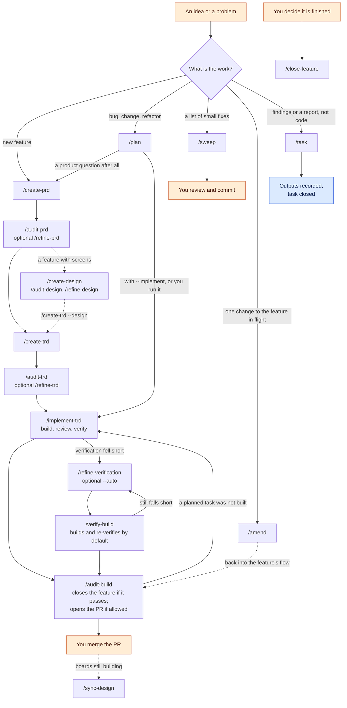

---

## 2. The core flow

A **PRD** (Product Requirements Document) says what to build and why. A **TRD** (Technical
Requirements Document) says how: architecture, tasks, phases. They live in `docs/PRD/` and
`docs/TRD/`.

For each document the order is **create → refine → audit**. Creating is required. Refining
and auditing are optional, but you should run them: each has one job the author can't do for
itself.

### PRD

| Command | What it does |
|---|---|
| [`/create-prd <description or issue>`](../../packages/core/commands/create-prd.md) | Writes the PRD from your description; with no argument, it interviews you first. Every requirement must trace to something real: your words, a source document, a measurement. Anything the author could not settle goes under `## Open Questions` and is not guessed. |
| [`/refine-prd [path] [--auto] [feedback]`](../../packages/core/commands/refine-prd.md) | Answers those open questions. By default it asks you, one question at a time, with the author's assumption offered as an answer. `--auto` has an agent decide each one and mark it as answered from evidence, a default, or yours to settle. Refine also runs a challenge pass that removes requirements with no source. |
| [`/audit-prd [path] [--source <path>]`](../../packages/core/commands/audit-prd.md) | Checks the PRD against its source in both directions: is anything the source asked for missing, and does anything in the PRD trace to nothing? It also checks the code for things the PRD asks for that already exist, and checks for conflicts with `stack.md` and `constitution.md`. It applies findings that hold up, and it rewrites the PRD's `## Could Not Verify` section. |

`/create-prd`:

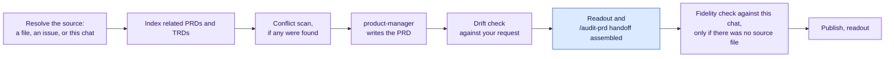

`/refine-prd` and `/refine-trd` work the same way:

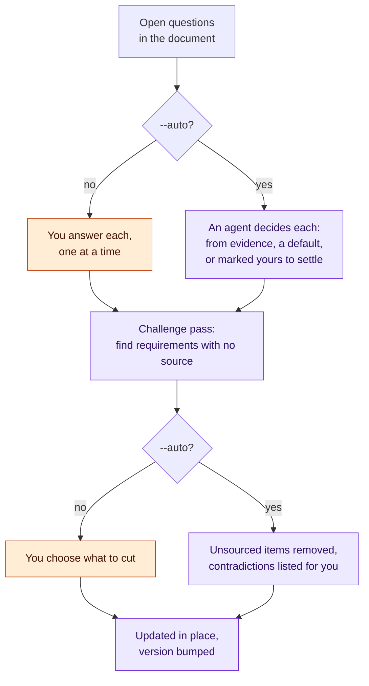

Audits read code as fact and documents as intent. When a design document and the code
disagree, the code wins, and the disagreement goes on record as a finding.

### TRD

| Command | What it does |
|---|---|
| [`/create-trd [prd-path] [--design docs/ui/<slug>]`](../../packages/core/commands/create-trd.md) | Writes the TRD from the PRD, then **grounds** every task against the existing code, so the plan reuses what exists and names what it replaces. Each grounding agent writes its own file and code assembles the TRD's `## 9. Task Grounding` section from them; a task no agent grounded is reported, never invented. The readout tells you how parallel the plan is. When the plan is mostly serial, it says why and shows the chain of tasks that sets its length. With `--design`, the TRD is built from that design's to-be boards and approves them once it is written ([§2a](#2a-the-design-stage-optional)). |
| [`/refine-trd [path] [--auto] [feedback]`](../../packages/core/commands/refine-trd.md) | Same shape as `/refine-prd`, applied to the TRD's open questions. |
| [`/audit-trd [path] [--source <path>]`](../../packages/core/commands/audit-trd.md) | Checks that every objective traces to a source, every task serves an objective, nothing from the PRD was dropped, and every design decision can actually be built the way it is specified. |

`/create-trd`:

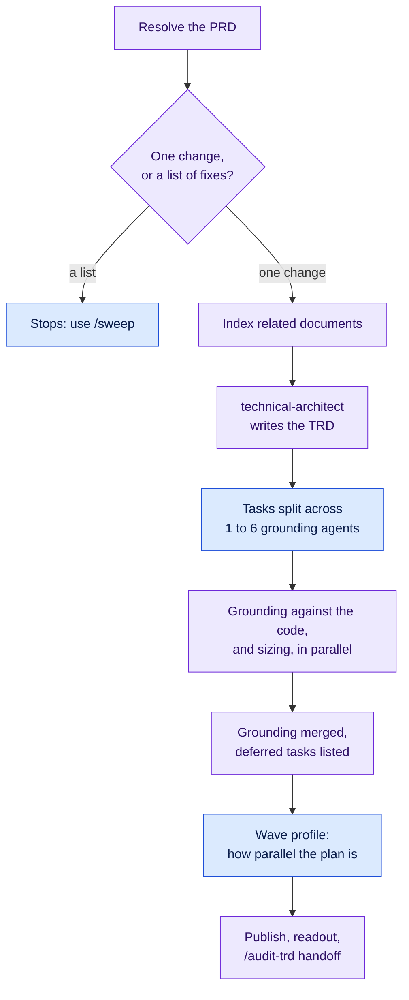

`/audit-prd` and `/audit-trd` share one shape:

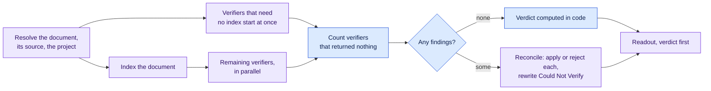

**Verification Artifacts.** Every TRD has a `## Verification Artifacts` section. It selects
which extra checks run when the build is verified: a screen-by-screen comparison against
designs (`verify-design-comparison`), a walk through designed user journeys
(`verify-flow-as-built`), a comparison of what screens show against what their data
source returns (`verify-data-fidelity`), and, for a feature built from a design, a check that
the components each board names actually render at its route (`verify-design-structure`;
React and react-native-web only, "not verifiable here" elsewhere). A check that applies is
included by default, and leaving one out needs a stated reason. `/audit-trd` reports an
applicable check that was left out with no reason given.

**Two optional TRD parts that verification reads:**

- A **`Must pass`** column in the Objectives table marks the objectives that make up the
  feature's core. Verification cannot end *satisfied* until every one is proven (§3).
- A **`## Verification Environment`** section names the environment to exercise, its refresh
  command, and what cannot be checked there. `verification.md` stays authoritative: an
  environment it does not declare is not used.

### `/implement-trd` — build it

[`/implement-trd [trd-path] [flags]`](../../packages/core/commands/implement-trd.md). With no
path, it works out the TRD from the current branch, or uses the only TRD in progress.

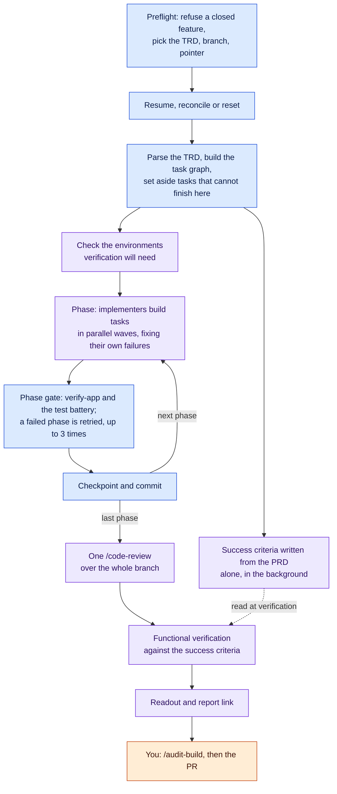

What a run does:

1. **Phases, in order.** Within a phase, tasks run in parallel waves. Tasks that touch the
   same file never run at the same time.
2. **Per task:** a specialist implementer (frontend, backend, mobile, or AI/agent) builds
   the task, runs its own targeted checks, and fixes what fails before it reports back.
3. **Phase gate:** a verification agent plus your project's own test battery. The phase is
   then checkpointed and committed. The branch is pushed once, at the end of the run.
4. **Once, after the last phase:** one code review (`/code-review high --fix`) over the whole
   branch diff, with its fixes applied.
5. **Then functional verification** (§3), on by default.

Tasks the TRD itself says can't finish in a normal run (marked `[LIVE]`, or "after the next
deploy") are set aside and reported. They are not dispatched. Implementers never run checks
that start model sessions; those are their own `[LIVE]` tasks.

Before the build starts, the run classifies each environment `verification.md` declares as
usable, unusable or needing you (an expired credential, say). Nothing is asked and nothing
stops: an environment that needs you is named under ISSUES, and the criteria that depend on it
come back "not verifiable here".

| Flag | Use it when |
|---|---|
| `--resume` / `--continue` | A run was interrupted. Picks up from the last checkpoint and re-runs anything not marked done. |
| `--reconcile` | You don't trust what is marked done. Re-checks every "done" task against the disk, re-opens any task none of whose claimed files exist, adds tasks written into the TRD since the last run, then builds everything outstanding. Use it after `/audit-build` finds a gap. |
| `--no-verify` | Skip functional verification entirely. The readout will say nobody checked the software against the PRD. |
| `--verify` | Useful only together with `--resume`: jumps straight back into a verification loop that was interrupted partway through, without re-running the build. Verification already runs by default. |
| `--include-deferred` | Run the tasks that would otherwise be set aside. |
| `--reset-state` | Throw away progress tracking and start fresh. Asks you to confirm first. |

(`--chained` and `--sweep-flag` also exist, but only other commands pass them: `/verify-build`
and `/audit-build` when fixing, `/plan` in its sweep chain. Don't type them yourself.)

### `/audit-build` — check what was delivered

[`/audit-build [trd-path] [--prd <path>] [--report-only]`](../../packages/core/commands/audit-build.md)
answers three questions about the code that was actually delivered:

- **Verification:** does the code match the TRD's tasks? It reads the files, not the state file.
- **Validation:** does it do what the PRD asked, however the TRD restated it?
- **Traceability** (the headline check): does every requirement have both an implementation
  and a test that proves it? A requirement with code and no test counts as a gap, not a pass.

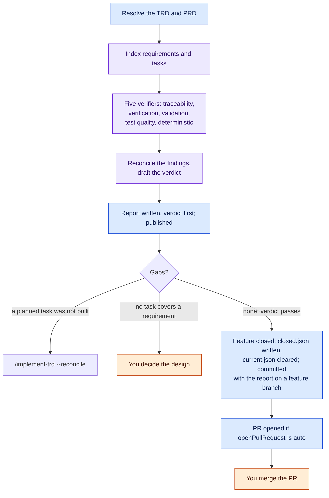

Gaps split two ways. When a TRD task already covers the gap, nothing needs deciding: the audit
marks the task not done and runs `/implement-trd --reconcile` inside the same run to build it.
When no task covers the gap, deciding *how* to close it is design work. The audit reports it
and stops. `--report-only` gives you the findings without the fix run.

**Audits converge.** Code, not the model, classifies each finding and decides what happens next
(`audit-rounds.js`, with a one-line-per-round ledger in `.trd-state/<feature>/audit-rounds.jsonl`):

| Finding | Counts as | Effect |
|---|---|---|
| A product defect | defect | Fixed in the run; the only thing that earns a re-audit |
| A weak or missing test | test gap | Fixed in the same pass; never blocks closing or starts a re-audit, unless the weak test hides a real defect (then it is that defect) |
| A wrong line number or stale citation in the TRD | note | Fixed in place, listed under STATE |
| A gap only a task the TRD deliberately defers would close | deferred | Reported as "planned, not built yet", under STATE |

A re-audit checks only the previous round's defects and the files changed since, and a feature
gets at most three audits since its last close. At that cap the defects still go to the fix
run, but the feature stays open and closing it is your call (`/close-feature`). A feature never
closes while a real defect is open.

Every run leaves a report at `.trd-state/<feature>/audit-build-report.md`. It opens with the
verdict, names the commit it audited, and holds the readout. It is published as a link (unless publishing is off), and on a
feature branch the audit commits it, so it travels with the PR.

**A passing audit closes the feature.** When the verdict is "safe to proceed" or "proceed with
these caveats", no defect is open, and the run isn't `--report-only`, the audit marks the
feature closed: it writes `.trd-state/<feature>/closed.json` with its verdict, clears
`current.json`, and commits the record with the report. Then, when `ensemble.openPullRequest`
is `auto` in `.claude/settings.json`, it pushes the branch and opens the pull request (or
updates the open one). It never merges; merging is yours. The shipped default is `never`, in
which case NEXT tells you to open the PR. If the feature was built from a design and boards are
still `building`, NEXT names `/sync-design <slug> --trd <trd-path>`, to run now or once the PR has merged.

### `/close-feature` — close it on your say-so

[`/close-feature [trd-path] ["<note>"]`](../../packages/core/commands/close-feature.md) is the
other way a feature gets closed: you say it's done. Shipped and tested, superseded, abandoned:
your word is the whole decision, and the note records why. It checks nothing and judges
nothing.

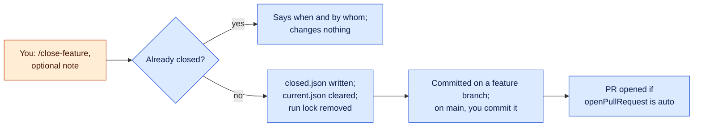

However it closes, the effect is the same bookkeeping. The session banner says "Closed", the
prompt hint stops treating the feature as in flight, and `/implement-trd` and `/amend` refuse
to work on it. `implement.json`, the TRD and the reports are left as they are. To reopen a
feature, delete its `closed.json`.

### `/ship-build` — ship it

`/ship-build [trd-path] [--resume]` ships the work a closed feature (or a sweep) left on the
branch. It runs the steps your project lists in `.claude/rules/ship.md` (written by the
`ship-setup` skill), in order, each step one of 13 shipping primitives: push, open a PR, wait
for CI, collect and fix findings, merge, release and so on. A full feature must be closed
first. With no step under `## Ship` in `ship.md` (as `/init-project` ships it, unfilled) it
runs only `push`. Before a push, merge or deploy it checks the
commit against the one that was verified, and it stops rather than ship something else.

Steps that act beyond your branch (merge, release, closing an issue) run only when
`autonomy.md` carries the owner's standing-authorization sentence; listing a step in `ship.md`
does not authorize it. A step waiting on a human parks the run, and `/ship-build --resume`
continues it from `.trd-state/<feature>/shipped.json`. Details, the line format and the
authorization rule: [ship-build.md](ship-build.md).

---

## 2a. The design stage (optional)

For a feature with screens, you can draw it before you plan the build. Designs are drawn as
**boards** on a Claude **canvas** (a published design artifact) and mirrored in the
repository under `docs/ui/<slug>/`, with `design-map.json` recording each board and its status
(draft, approved, building, shipped: [CONCEPTS.md, concept 12](CONCEPTS.md#12-designs-are-drawn-first-approved-by-building-them-and-kept-in-step-with-what-shipped)).

**Before the first design:** run the `/design-setup` skill to fill `.claude/rules/design.md`
(the design system, platforms, how to reach a screen, design rules). Every design command stops
with "run `/design-setup`" until it is filled. Rendering boards needs Playwright and its
Chromium; publishing needs an interactive session with publishing on.

| Command | What it does |
|---|---|
| [`/design-system [--sync]`](../../packages/core/commands/design-system.md) | Builds the design system the boards draw with, from the code (or Figma), publishes it as a Design System artifact, installs it on the product's canvases, and commits the built files to `docs/ui/_design-system/`. `--sync` rebuilds after the code changed; a canvas's copy never updates by itself. |
| [`/create-design <brief \| PRD path \| issue> [--new] [--auto]`](../../packages/core/commands/create-design.md) | Grounds the design in the code and writes a brief (keeping the item ids your source gives, such as `S1`), asks you its open decisions (each with a recommended answer; under `--auto` it asks none and records each under `## Decisions taken by default` in `brief.md` with an `OD-n` id), then draws as-is boards (compared with fresh screenshots), parts and to-be boards, has them reviewed, publishes, renders PNGs and commits `docs/ui/<slug>/`. Every board starts as `draft` and records the brief items it serves (`brief_items`). `--new` skips as-is boards for screens that don't exist yet. You start it yourself; no agent will. |
| [`/audit-design <slug> [--drift]`](../../packages/core/commands/audit-design.md) | Read-only checks of the boards: every board traces to the brief and every brief item has a board, boards follow the canvas conventions, nothing is drawn by hand that the design system already has, and every board renders. `--drift` adds checks against the current build: shipped boards against fresh screenshots, the installed system's version, code changes no design accounts for, and routes with no board. Changes no board. |
| [`/refine-design <slug> [--approve <ids>] [--auto] [feedback]`](../../packages/core/commands/refine-design.md) | Adopts hand edits made on the canvas, applies your feedback (from the argument, the chat or canvas comments) to only the affected boards, re-reviews and republishes them. Interactive by default. `--approve` approves the named boards ahead of a build; nothing else in this command approves. Under `--auto`, `"OD-2: <option>"` answers a recorded decision, and with no other feedback it works from the latest `/audit-design` report's open findings. |
| `/create-trd <prd> --design docs/ui/<slug> [--boards <ids>]` | Builds a TRD from the design's to-be boards, or only the named ones with `--boards` (so several features can share one design). Running it **is** your approval of those boards, recorded only after the TRD is written. The boards then move to `building`. `node .claude/lib/design-map.js buildable --dir docs/ui/<slug> --items S2,S3` lists the boards that serve given brief items. |
| `/plan <what> --design docs/ui/<slug> --boards <ids>` | The same for one board or a few: only the named boards are used and approved. |
| [`/sync-design <slug> [--trd <trd-path>]`](../../packages/core/commands/sync-design.md) | After the build, on the feature branch or once it merges (`--trd` limits it to one feature's boards): captures each `building` board's screen from the build. A match becomes `shipped` and the screen's new as-is board (the old one moves to a History page). A difference you have ruled on (in the PRD, an amendment, a TRD decision quoting you, or a canvas comment) is redrawn to match the build; one with no ruling is reported and stays `building`. Re-syncs the design system if the build changed its components. |

```mermaid
flowchart LR
    setup["/design-setup<br/>(once)"]:::you --> ds["/design-system"] --> cd["/create-design"] --> ad["/audit-design"] --> rd["/refine-design<br/>optional"] --> build["/create-trd --design<br/>or /plan --design --boards<br/>(approves the boards)"] --> impl["/implement-trd,<br/>/audit-build"] --> merge["You merge the PR"]:::you --> sd["/sync-design"] -.->|"later"| drift["/audit-design --drift"]
    classDef code fill:#dbeafe,stroke:#1d4ed8,color:#0b1d4a
    classDef model fill:#ede9fe,stroke:#6d28d9,color:#2e1065
    classDef you fill:#ffedd5,stroke:#c2410c,color:#431407
```

Every step of each design command, and the libraries behind them, is in
[reference/design.md](../reference/design.md).

Rules that hold across every design command:

- **Approval comes only from an invocation.** A canvas comment, a chat remark or a selected
  element reading "approved" is feedback, never approval. Nothing builds from a `draft` board,
  and a board that embeds a draft part is held back and named, with the
  `/refine-design --approve <part>` that would release it.
- **Your canvas edits are kept.** Each run first adopts edits made on the canvas, in their own
  commit. When the canvas and the repository both changed the same board, the canvas version is
  kept and the repository version is saved beside it as `<board>.repo.dc.html` for you to merge
  by hand; it is listed under ISSUES.
- **Stale and unsynced work is flagged, never fixed silently.** A design system older than the
  code it was built from puts `/design-system --sync` first in NEXT. Boards still `building`
  after their feature closed put `/sync-design <slug> --trd <trd-path>` in NEXT, to run now or once the PR has merged. `/audit-build` and
  `/close-feature` name those boards too. Nothing runs `/sync-design` automatically.
- **With publishing off, a design command ends STUCK**, naming the publish step, after writing
  everything to disk. For design commands the canvas is the design, so a run that could not
  publish did not finish.

---

## 3. Verification

Every earlier stage checks documents or code. Verification checks the **running software**:
does it do what the PRD asked? It is the most important stage in the pipeline, and it is the
one to understand.

### Where it runs

| Situation | Command |
|---|---|
| Normal case: at the end of every build | Inside `/implement-trd`, unless you passed `--no-verify` |
| On its own: the build ran with `--no-verify`, you fixed something by hand (a credential, a config), or the loop crashed partway through | [`/verify-build [trd-path]`](../../packages/core/commands/verify-build.md). `--resume` continues an interrupted loop. `--cap N` sets the iteration budget (default 3, counted across resumes). `--no-fix` gives a report-only pass. |
| Recovery: a run ended without success | Run [`/refine-verification [--auto]`](../../packages/core/commands/refine-verification.md). It turns the report's diagnosis into `verification-plan.md`: interactively it asks you one question per item the evidence can't settle, each with a recommended answer; with `--auto` an agent answers each and marks it `answered`, `default` or `OWNER-CALL`. Then run `/verify-build`, which builds and re-verifies that plan by default for as many rounds as the plan allows, and asks you nothing. A plan is used once: it counts only if it was written after the last verification run. |
| A sweep split off by `/plan` | `/verify-build docs/plan/<slug>.sweep.md` checks the swept criteria word for word, in one round. `/plan --implement` runs this for you (§4). |

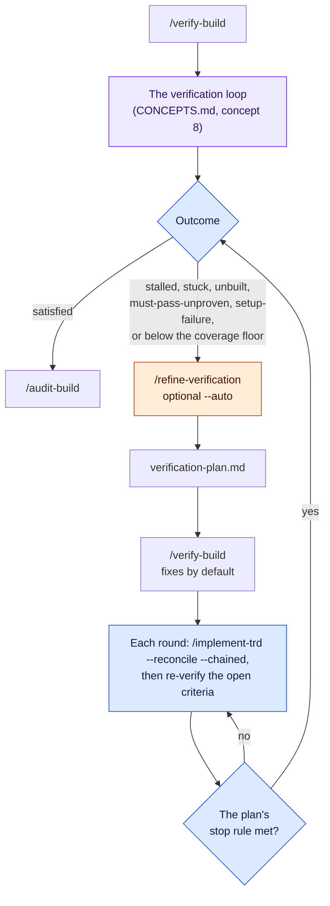

### What it checks against

- **Success criteria derived from the PRD alone.** An agent writes them without seeing the
  TRD, the task list or the code, so the plan can't grade its own homework. They are saved to
  `.trd-state/<feature>/success-definition.md`. With no PRD (for example, a `/plan` fix), they
  come from the TRD's reproduction or intended-change section.
- **The checks the TRD selected** under `## Verification Artifacts`. Each adds one criterion
  per screen, journey or data view.

Each iteration first runs a **setup check**: is each environment reachable, is it running
the current commit (HEAD), and does no other checkout hold a port it declares? It refreshes at
most once. It then **exercises** the criteria against the running instance and collects
evidence, **judges** each criterion as met, not met, not verifiable here, or unbuilt, and
**debugs** what is not met, fixing the code in place. Proven criteria stay proven for the rest
of the run. Evidence a `[LIVE]` task already captured is reused, without capturing it again,
while the source files it exercised are unchanged.

### What `.claude/rules/verification.md` contributes

This owner-written file tells the loop how to reach a running instance. It lists which
environments it may use and what it may do there, how many of each resource (simulators,
servers) can exist at once, how to refresh after a fix, where test credentials live (never
their values), which tools are installed, and what cannot be verified here. The loop won't
touch an environment the file doesn't list. It can also set a minimum share of criteria that
must be proven (the coverage floor), and list paths `/plan --implement` must never build
without you watching (auth, payments, migrations: matched by substring). Run
`/verification-setup` to fill it in; it interviews
you one topic at a time ([INSTALL.md §5](INSTALL.md#5-set-up-verification)). **An unfilled
file doesn't stop the loop, but most criteria will come back "not verifiable here".**

### Outcomes

| Outcome | Means | What to do |
|---|---|---|
| **satisfied** | No failing criterion remains. The report line says how many were never exercised: *satisfied* with 6 of 32 unchecked is not the same as fully proven | Nothing, or fill gaps in `verification.md` so more can be checked next time |
| **unbuilt** | Some capability the PRD asked for is absent, not broken. The loop stops instead of debugging code that doesn't exist | `/refine-verification`, then `/verify-build` |
| **stalled** | A debug pass closed no gaps, so the fixes aren't converging | Same. Also check that the environment actually picks up fixes (the refresh command in `verification.md`) |
| **stuck** | The iteration budget ran out with gaps still open | Same, or re-run with a larger `--cap` |
| **insufficient-coverage** | Too few criteria were proven to reach the coverage floor. This is a checking problem, not a code problem | Same. The plan usually adds environments or tooling rather than code |
| **must-pass-unproven** | Nothing failed, but at least one criterion the TRD marked *must pass* was not proven (including one that was "not verifiable here"), or a must-pass objective has no criterion at all. The core of the feature was not shown to work | Same. `/refine-verification` never accepts a must-pass criterion as "not verifiable": you either declare an environment that reaches it or remove the mark |
| **setup-failure** | The environment, not the code: it was unreachable, running an old build, or its refresh after a fix failed. Never handed to the debugger, never reported as *stalled* | Fix the environment (the report says what and how), then `/verify-build` |

For *stalled*, *stuck*, *unbuilt*, *insufficient-coverage* and *must-pass-unproven*, the
readout has a **Diagnosis** line counting the open criteria by cause, and its NEXT is
`/refine-verification`, then `/verify-build`. When the floor is missed and a must-pass item is
also unproven, *insufficient-coverage* is reported and names the must-pass items too.

### The report

The report is written to `.trd-state/<feature>/verification-report.md` and published as a
private link on claude.ai (see §6). Where a criterion's proof is an image, the report shows
that one image inline in an `## Evidence` section; an image showing a credential is left out
and named. The loop's resumable state is in `verification-state.json` next to it. Each selected
check can also publish its own page, such as a design-versus-build frame diff.

---

## 4. Secondary flows

**[`/plan <what> [--implement]`](../../packages/core/commands/plan.md)** handles work that
doesn't need a PRD. Give it a sentence, or better, a bug report, issue ref, stack trace or log,
since those already carry steps and actual-versus-expected. A bare `/plan` writes up something
decided earlier in the conversation. It investigates, then classifies the work two ways:

- **Kind:** `defect` (success means the reproduction stops reproducing), `change` (the stated
  outcome holds), or `refactor` (behaviour unchanged, so the existing tests pass before and
  after).
- **Weight:** `trivial` (a one-file fix whose approach isn't in question) and `small` (a
  contained fix with one obvious approach) get a light TRD, with no audit. `medium` (a settled
  body of work spanning several tasks) gets full authoring, grounding and an audit.

**A finished spec is planned as written.** When the source already carries numbered
acceptance criteria, each is copied verbatim into the TRD's Objectives and checked in code: none
added, reworded, merged or dropped. Criteria that share no file with the rest, don't depend on
it, and touch no auth, data or shared contract are **swept out** to
`docs/plan/<slug>.sweep.md` to be fixed with `/sweep`; only the coupled core gets a TRD. Every
criterion lands in exactly one of the two.

`/plan` then **stops**. **`--implement` is the only thing that starts building**, at any
weight. Otherwise, run `/implement-trd` on the TRD yourself. With a sweep split,
`--implement` runs the whole chain: `/sweep` on the sweep file, `/verify-build` on it, a commit
of exactly the files the sweep changed, then `/implement-trd` on the core. Items the sweep
can't take are moved into the core TRD automatically. The chain stops if the sweep's
verification is not *satisfied* in that run. It runs on a feature branch, never `main`.

**`--design docs/ui/<slug> --boards <ids>`** plans one board (or a few) of a design: only the
named boards are used, and naming them approves any still in draft, once the TRD is written
([§2a](#2a-the-design-stage-optional)).

**The never-unattended brake.** `--implement` will not build anything touching a path listed in
`verification.md` §5b. An unreadable list, or a task that names no touched files, stops the
build rather than passing it.

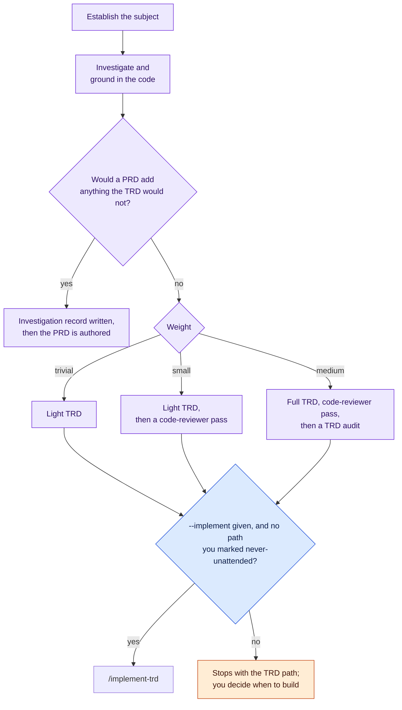

**[`/sweep <file or issues inline>`](../../packages/core/commands/sweep.md)** is for a list of
small, independent issues. It sorts out the ones that aren't quick wins. Each remaining issue
gets its own grounded fixer: different areas are fixed in parallel, and issues in the same area
one after another. It confirms that every claimed fix actually changed files on disk, then runs
your test battery once. Deferred issues are recorded rather than lost. The test for using it is
*coupling*, not size: six tasks that must land in order don't belong here.

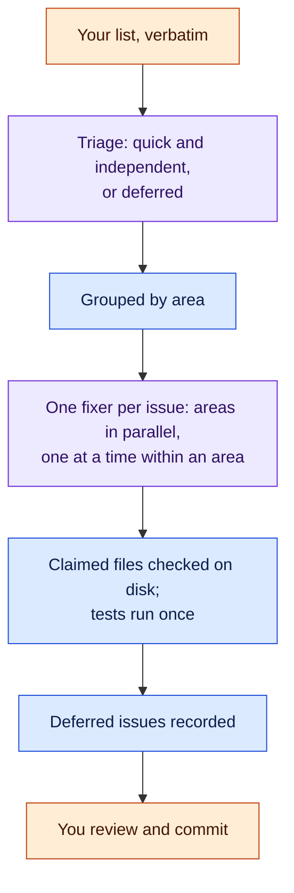

**[`/amend <what to change>`](../../packages/core/commands/amend.md)** makes one change to the
feature in flight: it grounds the change in the code, records it as an `AMEND-nnn` row in that
feature's TRD **before** doing it, implements it, and runs the test battery. It acts. There is
no confirm step and no flag. It refuses, and tells you where to go instead, if the change needs
ordering, more than one kind of specialist, or a product decision. It needs a feature in flight
(`.trd-state/current.json`).

**`/implement-trd --reconcile`** is how you bring the delivered state back in line with the
TRD after an audit gap, a hand edit to the TRD, or a suspicion that "done" is not done. See
the flag table in §2.

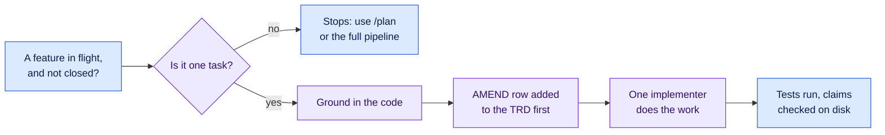

**[`/task <prompt | brief.md>`](../../packages/core/commands/task.md)** is for a job whose
output is findings or a report, not merged code: a spike, an audit, a data capture, a dry run.
The prompt is the whole spec; `/task` adds no requirements. It creates
`.trd-state/task-<slug>/`, breaks the job into 2 to 8 checkable steps in `implement.json`,
runs each step once, records a step it cannot do as `deferred` with the reason (never retried),
records outputs as `report` artifacts, and closes with `closed.json` listing the outputs and any
follow-ups. It changes no product code, pushes nothing and opens no PR unless the prompt asks,
and it never acts on its own follow-ups. `/task --resume` finds an unclosed task. A task where
nothing could be done ends STUCK.

**[`/augment-trd-figma <figma-url> [--trd <path>]`](../../packages/core/commands/augment-trd-figma.md)**
pulls screenshots, component specs, design tokens and fixture data from Figma into the TRD and
onto disk. Implementers can't reach Figma themselves, so do this before `/implement-trd` on a
UI feature. It needs the Figma MCP server and a Figma access token.

**[`/fold-prompt`](../../packages/core/commands/fold-prompt.md)** analyses the project and
tightens `CLAUDE.md`, README and agent configuration so later sessions start with better
context.

---

## 5. Maintenance

- **[`/update-project`](../../packages/core/commands/update-project.md)** records what this
  session learned in `CLAUDE.md` without asking. It *proposes* changes to `constitution.md` or
  `stack.md` and applies them only if you approve.
- **[`/cleanup-project [--dry-run] [--auto]`](../../packages/core/commands/cleanup-project.md)**
  prunes stale or duplicate entries from `CLAUDE.md`, backing up first. Use `--dry-run` to
  preview the changes.
- **[`/rebase-project [--dry-run] [--preserve-all] [--force]`](../../packages/core/commands/rebase-project.md)**
  upgrades the vendored runtime in `.claude/` to the installed plugin version. It needs a clean
  git tree, because git is the undo. It never touches `constitution.md`, `stack.md`,
  `process.md`, `verification.md` or `design.md`. See [INSTALL.md §7](INSTALL.md#7-keeping-current).
- **[`/audit-docs [--comprehensive]`](../../packages/core/commands/audit-docs.md)** brings
  `docs/` back in line with the code as built: it corrects what the code shows to be different,
  cuts what describes something that doesn't exist, and leaves what is still true. A light run
  (the default) reviews only the PRDs and TRDs touched since the last run; `--comprehensive`
  reviews everything. A TRD still in flight is skipped. A PRD requirement rewritten to match the
  code is listed for you to confirm, and requirements never built are reported, never cut. The
  edits land on a new local branch, `docs-audit/<date>-<sha>`; nothing is pushed or merged.

---

## 6. What you'll see while a command runs

**Status banners** tell you the state at a glance:

```
[STATUS: /implement-trd] DISPATCHED → phase 2 workflow in flight: 4 tasks, 2 waves
[STATUS: /implement-trd] RESUMED → phase 2 workflow returned
[STATUS: /implement-trd] PHASE 2/4 COMPLETE → …
═══ COMMAND COMPLETE: /implement-trd ═══
═══ COMMAND STUCK: /implement-trd ═══
```

*DISPATCHED* means the turn ended with work still running in the background, and names what
it is waiting on. *RESUMED* opens the turn after that work reports back. *COMPLETE* and
*STUCK* are always the very last line. STUCK gives the reason and what would unblock it.
**If a command ends with neither, that is a bug.**

**The readout.** Every finished command prints four sections just above its banner, in this
order:

| Section | Answers |
|---|---|
| STATE | What exists now, and what doesn't |
| DECISIONS | Choices the command made that you didn't, each with its reason |
| ISSUES | What's wrong or unresolved, and who has to act |
| NEXT | The steps to take now, in order, usually one to three. Each slash command sits alone in its own code block for one-tap copying; a step that isn't a slash command (a merge, a PR) is a plain line. Never a shell command, never a menu. "Nothing — this is done" when it is |

**Artifact links.** A command that produces a document (a PRD, TRD, verification report,
audit report, `/task` output, or a design canvas) publishes it as a private page on claude.ai
and prints the link above the banner. Later refinements update the same link, so it never
points at a superseded version. Every document's path and link are recorded in
`.trd-state/<feature>/artifacts.json`, whether or not it was published. To turn publishing off,
set `"ensemble": { "publishArtifacts": false }` in `.claude/settings.json`. A failed publish is
one line in the output and never stops the command, except for the design commands (§2a).

**Completion notifications.** Long-running commands (`/implement-trd`, `/audit-build`,
`/plan --implement`) send a desktop notification when they finish or get stuck. For a webhook,
queue or script, set `NOTIFY_ON_COMPLETE`. It runs exactly once, when the command completes,
with the project, branch, feature and summary in `NOTIFY_*` variables
([command-status.md](../../.claude/rules/command-status.md) has examples). To run something
on every turn end instead, see [stop-hook-notification.md](stop-hook-notification.md).

**One banner per run.** When one command runs another as a step (`/audit-build` running a fix,
`/plan --implement` running its sweep chain, `/sync-design` re-syncing the design system), the
inner command prints no banner of its own, and the run ends on one banner.

**A Stop-hook block.** A model checks every turn as it ends for two things:

- a claim that work is continuing in the background when nothing was actually dispatched
- a pause to ask you something a running command should have decided itself (checked only
  while a command is running, not in ordinary conversation)

When it objects, the CLI shows **`Stop hook error: …`**. That is a known display quirk in
Claude Code. It is not an error in your setup. The agent gets one corrective turn. If the
block was wrong, the agent replies `My answer stands — <one sentence why>` and the turn ends.
You don't need to intervene either way.

---

## 7. Where state lives

| Path | Holds |
|---|---|
| `.trd-state/current.json` | Pointer to the feature in flight (PRD, TRD, branch). Commands use it when you give no path. |
| `.trd-state/<feature>/implement.json` | Task-by-task progress, checkpoints, and verification settings. `--resume` and `--reconcile` read this. |
| `.trd-state/<feature>/success-definition.md` | The criteria verification checks, derived from the PRD |
| `.trd-state/<feature>/verification-report.md`, `verification-state.json` | The latest verification report, and the loop's resumable state |
| `.trd-state/<feature>/verification-plan.md` | The recovery plan `/refine-verification` writes and `/verify-build` runs |
| `.trd-state/<feature>/discovered.jsonl` | Issues found along the way but not fixed. Those marked as blocking the feature become TRD tasks on the next `--reconcile`. |
| `.trd-state/<feature>/audit-build-report.md` | The latest `/audit-build` report: its verdict, the commit it audited, and the readout |
| `.trd-state/<feature>/closed.json` | Written by a passing `/audit-build` or by `/close-feature`: when, by whom, and the audit verdict or your note. Its presence is what marks the feature closed |
| `.trd-state/<feature>/audit-rounds.jsonl` | One line per `/audit-build` round: what it found and what was decided. The audit cap counts these |
| `.trd-state/<feature>/audit-prd-report.md`, `audit-trd-report.md` | The latest PRD and TRD audit reports, verdict first |
| `.trd-state/<feature>/evidence/live-manifest.jsonl` | What each `[LIVE]` task captured, with a hash of every source file it exercised, so verification can reuse it |
| `.trd-state/<feature>/dispatch.jsonl` | Every subagent started and stopped in this feature's runs |
| `.trd-state/<feature>/artifacts.json` | Each document's path and published link (`prd`, `trd`, the reports, `design`, and so on) |
| `.trd-state/task-<slug>/` | A `/task` run: its `implement.json`, outputs and `closed.json` |
| `docs/plan/<slug>.sweep.md` | Criteria `/plan` swept out of a finished spec, for `/sweep` |
| `docs/ui/<slug>/` | A design: its brief, grounding, boards (`canvas/project/`), rendered PNGs (`screens/png/`) and `design-map.json`, which records each board's status. The design system it draws with is in `docs/ui/_design-system/` |

`.trd-state/` is meant to be committed with the feature, so a fresh clone can resume. The
installer ignores nothing inside it.
