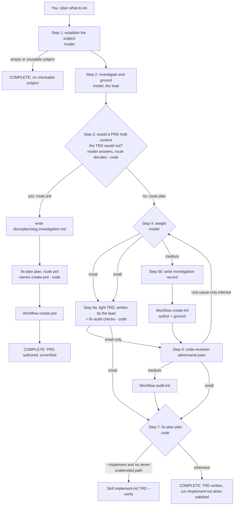
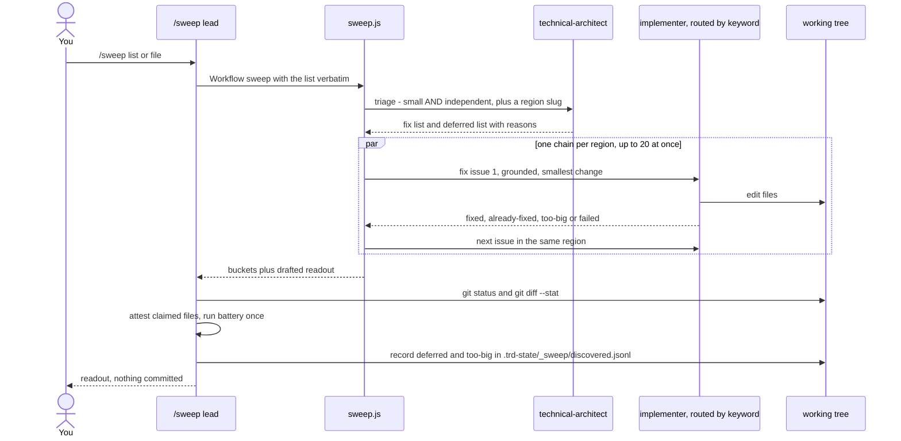
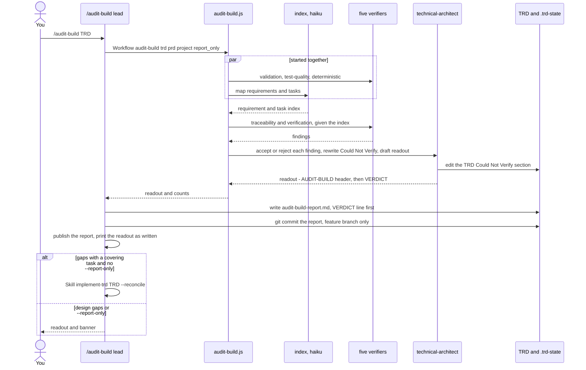

# Reference: the other commands

What happens inside `/plan`, `/sweep`, `/amend`, `/task`, `/audit-build`, `/close-feature` and
`/audit-docs`, step by step, and briefly inside the maintenance commands. For *when* to reach
for each one, see [`docs/guides/PROCESS.md`](../guides/PROCESS.md) §1 and §4; this page does not
repeat it.

Commands documented on other pages:

| Command | Page |
|---|---|
| `/create-prd`, `/audit-prd`, `/refine-prd`, `/create-trd`, `/audit-trd`, `/refine-trd`, `/augment-trd-figma` | [authoring](authoring.md) |
| `/implement-trd` | [implement-trd](implement-trd.md) |
| `/verify-build`, `/refine-verification` | [verification](verification.md) (summary below, under "The verification commands") |
| `/create-design`, `/refine-design`, `/audit-design`, `/design-system`, `/sync-design` | [design](design.md) |

Every step says who does it and where it lives, so any box can be checked against the source:

| Mark | Meaning |
|---|---|
| **code** | decided deterministically — a script or lib, or a fixed rule the lead applies with no judgement (a file exists or not, a branch matches or not) |
| **model** | an agent's judgement — the lead session running the command, or a subagent |
| **you** | the owner decides |

"The lead" means the Claude Code session that is running the slash command. A "workflow" is a
script under `packages/core/workflows/` that the lead starts with one `Workflow(...)` call; it
dispatches its own subagents and returns a result, and its intermediate output never enters the
lead's context. Command files live in `packages/core/commands/`, libs in `packages/core/lib/`
(vendored into a project as `.claude/lib/`).

Related pages: [README](README.md) · [implement-trd](implement-trd.md) ·
[authoring](authoring.md) · [verification](verification.md) · [design](design.md) ·
[hooks](hooks.md) · [agents](agents.md).

**Top-level flow of each command:** see the diagrams in
[`docs/guides/PROCESS.md`](../guides/PROCESS.md). This page does not redraw them. The diagrams
kept here go one level deeper: `/plan`'s routing across weights, and which subagents `/sweep`
and `/audit-build` dispatch, in what order.

---

## `/plan` — size the work, write a TRD to match, stop

Source: `commands/plan.md`; libs `plan-weight.js` (`route()`, `stages()`, `verification()`),
`fix-plan.js` (`plan()`), `fix-sizing.js` (`matchNeverUnattended()`), `fix-audit.js`
(`audit()`), `trd-parser.js`.

Two independent axes describe the work. **Kind** is what sort of change it is — `defect` (the
reproduction must stop reproducing), `change` (a stated outcome must hold), `refactor`
(behaviour must be unchanged). **Weight** is how much verification it earns — `trivial`,
`small` or `medium`. Kind changes what the TRD must contain; weight changes which stages run.
Neither decides whether building starts: only `--implement` does. Model-invocable: an agent may
start it with `Skill()`; its description opens on where it sits in the pipeline so a user's
phrasing does not select it by accident.

| Argument / flag | Effect |
|---|---|
| `<description \| source path \| issue ref>` | the subject. Empty: the lead reads the conversation and prints `SPECCING: <one line>`. |
| `--implement` | after the last stage the weight earns, chain into `/implement-trd` (or, on a sweep list, run the sweep chain, below). The only thing that starts work, at every weight. |
| `--design docs/ui/<slug> --boards <ids>` | build the TRD from those design boards and no others; naming a board approves it if it is still a draft. See "Design input", below, and [design](design.md). |



| # | Step | Kind | Where | What it does |
|---|---|---|---|---|
| 1 | Establish the subject | model | `plan.md` Step 1 | Strips `--implement` from the argument. A bare `/plan` reads the conversation and prints `SPECCING: <one line>`, then proceeds. Asks only if the conversation holds more than one candidate subject, or none stated in checkable terms. |
| 1.1 | Pre-triage | model | Step 1.1 | Rejects only an empty or unstated subject — never on size. |
| 2 | Investigate | model | Step 2a–2d | Defect: reproduce, find the mechanism, mark the root cause `[ran]` or `[inferred]`. Change: confirm current behaviour. Refactor: find and run the covering tests before touching anything; no tests means `covered: false`, not an abort. |
| 2e | Ground | model | Step 2e | For every file the fix touches: what it does now, what to reuse, what this replaces, conventions, hazards. Each claim marked `[ran]` / `[read]` / `[inferred]`. |
| 2f | Absorb blockers | model | Step 2f | A defect the requested work cannot succeed without becomes a task. Each candidate gets one line in the TRD's `## Decision`: `absorbed … [BLOCKS]` or `not absorbed … <why>`. An audit finding that changes *how* the fix is written is a correction, not extra scope. |
| 3 | Exit test | model → code | Step 3; `plan-weight.js` `route()` | The lead writes one sentence answering "would a PRD hold anything the TRD would not — personas, user value, trade-offs about what to build?" `route({prdWouldHaveContent})` takes that one boolean and nothing else (no task or file count), returning `'prd'` or `'plan'`. |
| 3a | Route `prd` exit | model + code | Step 3 "Route: `'prd'`"; `fix-plan.js` `plan()` | Writes `docs/plan/<slug>.investigation.md` first, then asks `plan({route:'prd'})`, which names `create-prd` as the next step. The lead runs `Workflow(create-prd)` (not the `/create-prd` command, which is manual-only), skips the session-fidelity pass because the record is a source file, and emits `/plan`'s own banner: PRD authored, **unverified**, NEXT `/audit-prd`. |
| 4 | Decide the weight | model | Step 4 | A judgement, not a formula, and no `--weight` flag. `stages({kind, weight})` then returns the stage list (table below). |
| 5a | Light TRD | model + code | Step 5a, 5a.1; `fix-audit.js` `audit()` | The lead writes `docs/TRD/<slug>.md` itself: Objectives (with an optional `Must pass` column marking the objectives verification must prove), the kind's section (`## Reproduction` / `## Intended Change` / `## Behaviour Preserved`), `## Decision`, Non-Goals, Verification Artifacts, an optional `## Verification Environment` (which `verification.md` environment to exercise, its refresh, what it cannot show), Open Questions, Master Task List (`FIX-001`…), Task Grounding, Could Not Verify. No phases. Then `audit()` checks it parses the way `/implement-trd` will read it: grounding has a `Touches` field, cited paths exist, each task serves a stated objective, the Verification Artifacts section is well formed. |
| 5b | Phased TRD | model | Step 5b | Writes `docs/plan/<slug>.investigation.md`, then `Workflow(create-trd)` with that file as its source — the `technical-architect` authors and the workflow grounds (see [authoring](authoring.md)). |
| 6 | Adversarial pass | model | Step 6 | One `code-reviewer` subagent judges five things: root cause vs symptom, regressions in each caller, a simpler fix, conflict with local convention, whether the declared kind matches the diff. Reports only. Runs once; it may send the weight back up, never down. |
| 5b cont. | Audit | model | Step 5b "Verify" | `Workflow(audit-trd)` against the investigation record (see [authoring](authoring.md)). |
| 7 | Implement or stop | code | Step 7; `fix-sizing.js` `matchNeverUnattended()`, `fix-plan.js` `plan()` | Touched files are matched against the owner's never-unattended paths in `verification.md`. `plan()` returns whether to write `current.json`, whether to chain, and the banner. Work begins only when `--implement` was passed **and** no never-unattended path matched. A touched path listed in `verification.md` §5b stops `--implement` — checked by `check-never-unattended <trd> <verification.md>` (`functional-verification.js`), which also stops the chain on an unreadable §5b list rather than treating it as empty. |

### A source that already lists acceptance criteria: the spec path

When the work comes from a spec section that already carries acceptance criteria (a roadmap
item, say), the scope is locked rather than re-derived (`plan.md` §2g, Step 6a; lib
`spec-scope.js`). Measured cause: an 18-criterion spec once came back as 29 objectives with four
consolidations nobody asked for.

| # | Step | Kind | Where | What it does |
|---|---|---|---|---|
| 1 | Extract | code | §2g; `spec-scope.js extract --file <spec> --section "<heading>"` | Returns the criteria under that section's "Acceptance criteria" heading, by id, plus its regression guards. `[]` means the spec path does not apply. |
| 2 | Lock | model | §2g items 1–2 | Every criterion is carried verbatim with its id. One that looks wrong becomes an owner-only open question quoting the spec line, never an edit. The exit test passes `prdWouldHaveContent: false`. |
| 3 | Sweep or core | model | §2g item 3 | A criterion is swept only when its fix shares no file with the core, does not depend on it, and changes no auth, data or shared contract. Anything uncertain stays in the core. Step 4 weighs the core only. |
| 4 | Write the sweep list | code | `spec-scope.js render-sweep` | Writes `docs/plan/<slug>.sweep.md` from the chosen ids; the model never types criterion text. Every criterion swept: no core TRD. None swept: no sweep file. |
| 5 | Lock the objectives | code | Step 6a; `spec-scope.js render-objectives`, `check` | After the last model writer, rewrites the TRD's `## Objectives` from the spec (keeping any `Must pass` mark) and checks nothing is missing, duplicated, added or reworded across the two documents. A failed check is `COMMAND STUCK: /plan`. |

Without `--implement`, NEXT lists four steps in order: `/sweep` on the sweep file,
`/verify-build` on it, commit the swept fixes, then `/implement-trd` on the core TRD.

### The sweep chain (`/plan --implement` on a sweep list)

With `--implement` and no never-unattended hit, `plan()` returns `chain: true` with no
`chainSkill`, and the lead runs `plan.md` Step 7a. **`sweepChainNext` in `fix-plan.js` is the
only sequencer:** after each step the lead calls it with what just finished and does what it
returns (`sweep`, `verify`, `fold-back`, `commit`, `implement` or `stop`).

| Step | What happens |
|---|---|
| Branch | switches to `feature/<slug>/impl` (creating it) before anything, so the sweep commit never lands on the default branch |
| `sweep` | `Skill(sweep <sweep file> --chained)`; the lead records `git status` and content hashes first, and reads `.trd-state/<slug>-sweep/sweep-result.json` after |
| `verify` | `Skill(verify-build <sweep file> --chained)`; the outcome comes from its `RETURN →` line. Only `satisfied` passes unflagged. Three cases pass **flagged** instead of stopping, because the environment rather than the code kept the fixes unproven: `setup-failure`, no outcome with setup problems, and `insufficient-coverage` where every unmet criterion was unreachable. Anything else stops. |
| `fold-back` | at most once per run: items the sweep could not take (deferred, too big, sharing a file with the core, or touching a never-unattended path) become tasks in the core TRD, which is written if none existed; the checks that TRD's weight earns run again |
| `commit` | the never-unattended check runs over every path to be committed; then `git commit -- <list>` by pathspec (changed files, the sweep file, `.trd-state/<slug>-sweep/`), never `git add -A` |
| `implement` | `Skill(implement-trd docs/TRD/<slug>.md)`, with `--sweep-flag "<flag>"` added when the swept fixes went in unverified, so `/implement-trd` shows it to you |
| `stop` | the readout and the banner `sweepChainNext` built; a carried flag goes in ISSUES |

The inner `/sweep` and `/verify-build` emit a `RETURN →` line instead of a banner and skip
`notify-complete.sh`, so the run ends on one banner.

### Design input (`--design`)

`plan.md` Step 5 "Design input". With `--design docs/ui/<slug> --boards <ids>` the TRD is built
from the named boards only. **Invoking it is approval:** a named board still in `draft` is
approved by this run, and only after the TRD is written, so a run that stops early approves
nothing. In order: `design-map.js buildable` (a named board already `building` or `shipped`, or
not a to-be board, is STUCK); `design-map.js held` (a named board embedding a draft part is
STUCK, naming `/refine-design <slug> --approve <part>`); commit pending edits under
`docs/ui/<slug>/` and record that commit; write the TRD (medium weight passes the boards to the
`create-trd` workflow as `design`); `design-map.js approve --commit <source commit>`; then
`design-map.js transition --to building --trd docs/TRD/<slug>.md`. A failed `approve` is one
ISSUES line and leaves the boards unapproved. The board lifecycle is in [design](design.md).

### What each weight runs

From `plan-weight.js` `stages()`. The lists are strict supersets of each other.

| Weight | Stages | TRD | Who writes it |
|---|---|---|---|
| `trivial` | investigate, author-trd, implement | light | the lead |
| `small` | + adversarial | light | the lead |
| `medium` | + ground, audit | phased | `create-trd` workflow, then `audit-trd` workflow |

`verification({kind, weight})` adds the kind-specific rules: a defect must state its root cause
with its marker; a change must not carry a "before" run (there is nothing to preserve); a
refactor needs before-run, after-run and public-surface check **only at `medium`** — at
`trivial`/`small` its "behaviour unchanged" claim has nothing behind it, an accepted risk.
At `medium` with kind `change` and open questions left after the audit, NEXT names
`/refine-trd` — named, never invoked.

### What gets written

| File | When | Written by |
|---|---|---|
| `docs/plan/<slug>.investigation.md` | route `prd`, and every `medium` | the lead, before any workflow call, so a crash cannot lose the investigation |
| `docs/TRD/<slug>.md` | every route `plan` run | the lead (light) or `create-trd` (phased) |
| `docs/PRD/<slug>.md` | route `prd` | `create-prd` workflow |
| `.trd-state/current.json` | only when work begins (`plan()` `writePointer`) | the lead |
| artifact link in `.trd-state/<slug>/artifacts.json` key `trd` | publishing on | the lead |

### The `--implement` chain

On a chained run the lead prints `plan()`'s `handoffLine`, calls
`Skill({skill: "implement-trd", args: "docs/TRD/<slug>.md --verify"})`, and emits **no** banner
or completion notify of its own: `/implement-trd` ends the run with its banner (see
[implement-trd](implement-trd.md)). Every non-chained path ends with
`═══ COMMAND COMPLETE: /plan ═══` and one `notify-complete.sh` call.

---

## `/sweep` — many small unrelated fixes, in parallel

Source: `commands/sweep.md`; workflow `workflows/sweep.js`; libs `discovered.js` `record()`,
`spec-scope.js` (criterion lists). For a list of issues from walking an app. The test for
fitting here is coupling, not size.

| Argument / flag | Effect |
|---|---|
| `<path \| issues inline>` | a readable file path is the list; anything else is the list, verbatim |
| `--project <dir>` | the project the fixes land in, when it is not this checkout |
| `--chained` | for `/plan --implement`'s sweep chain only: keeps never-unattended paths out of the fix, records ids that are not sweep items instead of stopping, and ends on a `[STATUS: /sweep] RETURN →` line with no banner and no `notify-complete.sh` |



| # | Step | Kind | Where | What it does |
|---|---|---|---|---|
| 1 | Resolve the list | model | `sweep.md` Step 1 | A readable file path is the list; anything else is the list, verbatim. The owner's words are not paraphrased. |
| 2 | Triage | model | `sweep.js` phase `Triage` | One `technical-architect` at low effort sorts each issue: small (one or two files, no schema, no API contract) **and** independent → `fix` with a region slug; anything else, or anything unclear → `deferred` with a reason. It reads no code. Under `--chained` it is also given the never-unattended path fragments and defers any issue that would touch one. |
| 3 | Group by region | code | `sweep.js` phase `Fix` | Issues with the same region go into one chain, run one after another, because two agents editing one file lose each other's work. Regions run in parallel, batched at 20 (`MAX_PARALLEL_REGIONS`, the platform's subagent pool). |
| 4 | Fix | model | `sweep.js` `fixPrompt`, `resolveFixAgent()` | One implementer per issue at medium effort, chosen by keywords in the issue's summary and region (a copy of `lib/agent-routing.js`'s table: frontend, mobile, devops, CI/CD and agent work go to their specialist; anything else to `backend-implementer`). Ground first, smallest change, run the narrowest check, list every changed file. May return `too-big` — it has read the code, triage had not — or `already-fixed` with evidence. Under `--chained`, a fix that would touch a never-unattended path changes nothing and returns `too-big`. |
| 5 | Account for every issue | code | `sweep.js` after `parallel()` | Every triaged issue must land in exactly one bucket, or the workflow throws. The issue id comes from the dispatch, never from the agent's reply. |
| 6 | Attest against disk | code + model | `sweep.md` Step 3 | The lead runs `git status --porcelain` / `git diff --stat`. An issue whose claimed files are all untouched is reported **failed**, whatever the agent said. Then the project's check battery runs once for the whole batch. |
| 6a | Criterion accounting | code + model | `sweep.md` Step 3a | Only for a sweep file `/plan` wrote from a spec (the list carries criterion ids such as `AC-4.1`). Every id must end fixed, already fine or failed; an id deferred or too big is "not a sweep item" and ends the run STUCK (under `--chained` it is listed in `notSweepItems` instead). Writes `.trd-state/<slug>-sweep/sweep-result.json` mapping each fixed id to the files it changed, which `/verify-build` uses to carry evidence into the core feature. A fixed file shared with the core TRD (`spec-scope.js overlap`) is STUCK, or listed in `overlap` under `--chained`. |
| 7 | Record what was not done | code | `sweep.md` Step 4; `discovered.js` `record()` | Each deferred or too-big item is appended to `.trd-state/_sweep/discovered.jsonl` so it survives the session (under `--chained`, ids moving to the core are skipped: the core TRD is their record). |
| 8 | Readout | model | `sweep.md` Readout | Fixed / already fine / too big / failed, in the reporter's words. **Nothing is committed** — the owner splits the batch into commits. |

---

## `/amend` — one change to the feature in flight

Source: `commands/amend.md`; libs `agent-routing.js`, `discovered.js`, `implement-state.js`
(`load()`, `save()`, `recordResult()`). It acts — there is no plan-then-stop mode.
Top-level flow: [PROCESS.md](../guides/PROCESS.md).

| # | Step | Kind | Where | What it does |
|---|---|---|---|---|
| 0 | Feature in flight | code | `amend.md` "What this is for" | Nothing in `.trd-state/current.json` → nothing to amend; stop and point at `/plan`. |
| 0a | Closed-feature guard | code | "Closed-feature guard" | `<feature>` is the TRD basename. If `.trd-state/<feature>/closed.json` exists: `COMMAND STUCK`, write nothing. Reopening means deleting that file. |
| 1 | Is this one task? | model | Step 1 | Not one task if it needs an unmade product decision, needs ordering between parts, needs more than one implementer specialism, or is several changes. File count is deliberately not a signal. If not one task: stop, say which signal fired. |
| 2 | Ground it | model | Step 2 | What the touched files do, what this replaces, local conventions; claims marked `[ran]`/`[read]`/`[inferred]`. |
| 3 | Record before doing | model + code | Step 3 | Writes one Master Task List row `AMEND-<nnn>` into the TRD **before** the change, so a crash leaves a record `--reconcile` will pick up; appends a discovery with `blocksFeature: true`. |
| 4 | Do it | model | Step 4 | Dispatches one implementer with an explicit `agentType` chosen by `agent-routing.js` — never unset, which would run the generic subagent on the session model. |
| 5 | Verify and attest | code | Step 5; `implement-state.js` `recordResult()` | Runs the check battery, then records the result in `implement.json` (seeding the file or task entry if missing). `recordResult()` marks a success claim `failed` if its files do not exist; deleted files go in `filesDeleted`. The lead reads the status back and believes it over its own report. |

It never chains and never grows: extra scope found mid-flight becomes a discovery record and a
stop (`amend.md` "What this command must not do").

---

## `/audit-build` — check the delivered code against the TRD and PRD

Source: `commands/audit-build.md`; workflow `workflows/audit-build.js`. Model-invocable since
4.13.7: an agent may run it with `Skill()`, and its description opens on where it sits in the
pipeline so it is not picked up by a description match.

| Argument / flag | Effect |
|---|---|
| `[path-to-trd]` | the TRD to audit; default `current.json`'s `trd`. Neither → `COMMAND STUCK` |
| `--prd <path>` | the PRD to validate against; default `current.json`'s `prd` |
| `--project <dir>` | the project the code lives in, when it is not this checkout |
| `--report-only` | write the report and stop: nothing recorded, chained or closed |

It answers three questions — does the code match the TRD's tasks (verification), the PRD's
requirements (validation), and does every requirement have both an implementation **and** a
test that proves it (traceability, the headline). Code with no proving test is a gap, not a
pass.



| # | Step | Kind | Where | What it does |
|---|---|---|---|---|
| 1 | Resolve inputs | code | `audit-build.md` "User Input" | TRD from the argument or `current.trd`; PRD from `--prd` or `current.prd`. No TRD anywhere (closing a feature nulls `current.json`) → `COMMAND STUCK`, workflow not called. Parses `--report-only`. |
| 1a | Snapshot the TRD; read its deferrals | code | "Execution: the workflow is the orchestrator" | `audit-rounds.js trd-snapshot` saves the TRD, on every run. `audit-rounds.js trd-hash` hashes only its `## Objectives` and `## Master Task List` sections. The TRD parser reads its `## Deferred by design` list (tasks the TRD says cannot complete in a normal run), which is passed to the workflow and to every `audit-rounds.js` call. |
| 2 | Index | model | `audit-build.js` phase `Index` | A Haiku agent maps every task (id, description, Touches) and every requirement (id, statement, which tasks serve it), plus Could Not Verify and Open Questions rows. A map, not a review. |
| 3 | Verify | model | phase `Verify`; `INDEX_FREE_VERIFIERS`, `INDEX_BOUND_VERIFIERS` | Five verifiers in parallel (table below). The three that need no index start alongside the Index stage. |
| 4 | Guard an empty index | code | `EMPTY_REQS`, `EMPTY_TASKS` | Zero requirements or zero tasks indexed is never reported as clean — the readout and Could Not Verify say traceability was unchecked. |
| 5 | Reconcile | model | phase `Reconcile` | A `technical-architect` (Opus, high effort — the one deliberately expensive judgement) re-opens each disputed file, accepts or rejects each finding naming the refuting file, and rejects absence claims that do not show the search that was run. Rewrites the TRD's `## Could Not Verify` section, and fixes stale citations (a wrong line number, a moved path) in place anywhere in the TRD, listing each under `FIXED THE CITATION`; it never changes what an objective, acceptance criterion or task requires. A gap only a deferred task covers is reported `PLANNED, NOT BUILT YET`, not as missing. Drafts the readout: an `AUDIT-BUILD:`/`PRD:` header, then the VERDICT line. With zero findings a `backend-implementer` does only the Could Not Verify rewrite and the workflow's own code builds the readout and VERDICT (*code*); an empty index forces `do not proceed`. No stage writes application code or tests. |
| 5a | Guard the TRD edit | code | "Guarding the TRD edit"; `audit-rounds.js trd-guard` | Compares the TRD's headings (fenced examples ignored) with the snapshot. A heading gone means the edit destroyed content: the TRD is restored to its pre-audit text, the report is still written naming the missing headings, and the run ends `COMMAND STUCK` with no round recorded, nothing chained, closed or committed. It checks headings only, so text deleted under a surviving heading passes. |
| 6 | Write the report | code | "Writing the audit report" | Right after the workflow returns, before any chain, `--report-only` runs included: `.trd-state/<feature>/audit-build-report.md`, overwritten each run. **First line: the VERDICT line**, then date, `- Audited commit:` (`git rev-parse --short HEAD`), paths and counts, then the readout verbatim. The terminal prints the same text character for character; a close record copies the VERDICT and audited commit. |
| 7 | Close the feature if the audit passes | code | "After the workflow returns: rounds, the fix run, the close" | `audit-rounds.js tally` counts the findings by class; `record` appends the round; `decide` returns `close: true` (no defects and nothing uncovered; test gaps are fixed first by the chained run), not `--report-only` → `/close-feature`'s close step with `closedBy: "audit"` and the audit's verdict, report path and audited commit. Otherwise the feature stays open and STATE says so. |
| 7a | Commit | code | "Commit, so it travels with the branch" | On any branch but the default one, commits the report, any close record, and the TRD when the audit fixed a citation in it, together (`git commit -- <paths>`) so they travel with the PR. On the default branch it does not commit; NEXT tells you to commit it. A failed write or commit is one STATE line, never STUCK. |
| 8 | Publish and record | code | same section | `Artifact(...)` of the report to the stored URL (`artifacts.js get --kind audit-build`), then always `artifacts.js record --kind audit-build`, with `--url` only when a publish returned one. The manifest `.trd-state/<feature>/artifacts.json` is committed right after, on every run that records. Publishing off or failed → STATE names the local path. |
| 9 | Chain or stop | model | "But it DOES close the loop" | A covered defect or test gap → recorded as a discovery, then `Skill implement-trd <trd> --reconcile --chained` (re-opens work only claimed done; `--resume` would skip it; `--chained` leaves the run's one banner to this command). See "Rounds" below for when a re-audit follows. A requirement no task covers is a design decision → recorded, reported, not chained. `--report-only` suppresses the chain and the readout says "not handed off on this run". |
| 8a | Open the pull request | code | "Open the pull request" | Only when the audit closed the feature, the run is not `--report-only` and the commit succeeded, and `ensemble.openPullRequest` is `auto` (shipped default `never`; this repo sets `auto`): `node .claude/lib/pull-request.js ensure --expect-branch <the feature's branch>` opens the PR, or updates it if one is already open (a closed one is ignored). It skips with a one-line reason (setting `never`, default branch, detached HEAD, not the feature's branch, `gh` missing) or fails with one line; neither blocks. It never merges: NEXT tells you to merge it once you have reviewed it. |
| 8b | Name unsynced design boards | code | "Readout", NEXT | After a close, `design-map.js unsynced --all --trd <trd>` lists design boards this TRD built that are still `building`. NEXT gets one step per design: check its boards against the build with `/sync-design` now or once the PR has merged, then `/sync-design <slug> --trd <trd>`. Named, never run. See [design](design.md). |

### The five verifiers

| Verifier | Model, effort | Needs the index | Checks |
|---|---|---|---|
| `traceability-audit` | Sonnet, high | yes | Per requirement: implemented **and** a test asserting its outcome → pass; code but no proving test → gap; nothing in the tree → gap; does something else → mismatch. Greps the tree; never trusts document mentions. |
| `verification-audit` | Sonnet, high | yes | Opens each task's touched files and confirms the described work is there. `implement.json` and commit messages are claims, not evidence. |
| `validation-audit` | Sonnet, high | no | Checks the delivered system against the PRD directly. No PRD → one finding saying so. |
| `test-quality-audit` | Sonnet, medium | no | Samples the tests traceability relies on: specific outcome, or just "did not throw"? Mocking the thing under test? Happy path only? |
| `deterministic` | Haiku, low | no | Citations resolve; nothing contradicts `stack.md` or `constitution.md`. |

### The verdict

Exactly one of three forms, with each caveat or blocker named inline:

```
VERDICT: safe to proceed — every requirement is implemented and tested
VERDICT: proceed with these caveats: <named>
VERDICT: do not proceed until <named>
```

On the first two (with no defect open) the audit has closed the feature, and NEXT is to open
or update the PR; on the third, NEXT is the reconcile or design work. At the re-audit cap with
defects still open, the feature stays open and NEXT is `/close-feature` once you are satisfied.

### Rounds: when it audits again, and when it stops

`audit-rounds.js` (`lib/audit-rounds.js`) decides what happens after each audit, as code with
tests rather than the lead's reading of the findings. It keeps a ledger, one line per audit, in
`.trd-state/<feature>/audit-rounds.jsonl`.

- **Only a true product defect earns another audit.** A requirement that is unbuilt, or code
  that does something other than the requirement says, is a defect. Re-audits are capped at
  two, so a feature gets at most three audits, counted since it was last closed. At the cap the
  defects still go to the fix run, but the feature stays open: it never closes with a defect open,
  not even with a caveat. The readout names the open defects, and NEXT is your call,
  `/close-feature docs/TRD/<feature>.md` once you are satisfied, never another `/audit-build`.
- **Notes and deferrals are not findings.** A fixed citation (class `note`) and a gap only a
  deferred task covers (class `deferred`) count as neither a defect nor a test gap, never reach
  the fix run, never cause another round or a `do not proceed` verdict, and are listed under
  STATE, not ISSUES.
- **Test-only gaps never cause another audit.** Code that exists but has no proving test is
  fixed in the same pass, and the feature then closes. Every finding from the test-quality check
  is a test gap: a weak test matters only when it masks a real defect, and then it is reported as
  that defect by its own check. Test gaps never block closing.
- **A requirement no task covers stops for design.** It is reported, not chained, and the
  feature stays open.
- **The fix runs inside the audit.** The audit records each coverable finding, then runs
  `/implement-trd <trd> --reconcile --chained` itself. The fix run ends with one RETURN line
  instead of its own banner, so the audit's banner is the only one in the run. Anything the fix
  run did not build is listed as a caveat.
- **A re-audit does not resample.** An audit is a sample, not a verification, so a re-audit checks
  only whether the previous round's defects are fixed and the files changed since the audited
  commit. Anything else it notices comes back as an `outOfScope` list, recorded as non-blocking
  discoveries and listed in the readout, never raised as findings and never chained. It reuses the
  previous requirement list (saved as `audit-index.json`) when the TRD's Objectives and Master
  Task List sections are unchanged (the command passes a `trdHash` over just those two sections).
- **A stale wake-up does nothing.** A fallback wake-up for an audit run that already recorded its
  round (matched by run id, not commit) prints one line and stops: no workflow, no report, no banner.

---

## `/task` — a job that produces findings, not code

Source: `commands/task.md`; libs `implement-state.js` (`save()`, `recordResult()`,
`checkpoint()`), `artifacts.js` `record`. No workflow script; it runs inline like `/amend`. For
reports, checkpoints, spikes, audits, data captures and dry runs: forced through `/plan`, these
would write a TRD nobody needs and leave no clean end state. The prompt is the whole spec.

| Argument / flag | Effect |
|---|---|
| `<prompt>` | the spec, verbatim |
| `<path-to-brief.md>` | an existing `.md` file: its text is the spec |
| `--resume` | continue the most recent task with no `closed.json`, found by scanning `.trd-state/*/implement.json` for `"kind": "task"` (never via `current.json`) |
| nothing | `COMMAND STUCK`: no prompt or brief given |

Rules it keeps (`task.md` "Rules"): report-only by default (no product-code change, push or PR
unless the prompt asks); writes nothing outside `.trd-state/task-<slug>/` and the output paths the
prompt names, apart from the framework's own bookkeeping; no TRD, no audit, no verification
loop; honours `verification.md`'s environment permissions and resource capacity; never acts on
its follow-ups; chains nothing.

| # | Step | Kind | Where | What it does |
|---|---|---|---|---|
| 1 | Create the task directory | code | Step 1 | `.trd-state/task-<slug>/`, suffixed `-2`, `-3` on a clash, with the step list written as `implement.json` (`"kind": "task"`, `trd_file` null). Points `current.json` at it only when no feature (no TRD and no PRD) is in flight. |
| 2 | Run each step once | model | Step 2 | Each step's result is attested through `recordResult()`. A step that cannot be done is `deferred` with its reason, never retried. |
| 3 | Record the outputs | code | Step 3 | `artifacts.js record`: first output as `report`, further ones `report-2`, `report-3`; published when publishing is on. |
| 4 | Close | code | Step 4 | `closed.json` with `closedBy: "task"`, `reason` (`task-complete` when at least one step succeeded, `task-stuck` when none did), `outputs` and `followups`; findings that need work are listed, never acted on. Nothing is committed or pushed. |

A task where no step succeeded ends `COMMAND STUCK`; some succeeded and some deferred ends
`COMMAND COMPLETE`, with the deferred steps in ISSUES. `/task --resume` continues from the first
step that is neither `success` nor `deferred`; a step left `failed` already ran and is recorded
`deferred`, never re-run. `/implement-trd` never picks a task directory as a TRD (`trd_file`
null or `"kind": "task"`).

---

## `/close-feature` — close a feature on your say-so

Source: `commands/close-feature.md`. One of the two ways a feature closes; the other is a
passing `/audit-build` (step 7 above), which performs the same close step. Closing is
bookkeeping: it judges nothing and checks nothing beyond finding the feature.
Top-level flow: [PROCESS.md](../guides/PROCESS.md).

| # | Step | Kind | Where | What it does |
|---|---|---|---|---|
| 0 | Parse | code | "User Input" | First existing `.md` argument is the TRD, else `current.json`'s `trd`; none → STUCK. Any quoted text is the note, kept verbatim. |
| 1 | Already closed? | code | "Already closed" | `closed.json` exists → COMPLETE, says when and by whom, changes nothing. |
| 2 | Write the record | code | "The close step" 1 | `.trd-state/<feature>/closed.json`, then a `JSON.parse` check; a broken file is rewritten once. |
| 3 | Clear the pointer | code | "The close step" 2 | If `current.json`'s `trd` names this feature, its four fields are set to null; the file is kept (`validate-init.sh` needs it). |
| 4 | Remove the run lock | code | "The close step" 3 | Deletes `.trd-state/<feature>/implement.lock` if present. |
| 5 | Commit | code | "The close step" 4 | On any branch but the default (from `git symbolic-ref refs/remotes/origin/HEAD`, else `main`), commits `closed.json` alone. On the default branch, NEXT tells you to commit it. |

`implement.json`, the TRD and the reports are left exactly as they are.

After a successful close commit on a feature branch, it also opens the pull request when `ensemble.openPullRequest` is `auto` (values `auto` or `never`; shipped default `never`, this repo `auto`), using the same script as `/audit-build` step 8a: an already-open PR is updated, a skip or failure is one STATE line and never blocks, and the "already closed" path opens nothing. Merging stays yours.

After writing `closed.json` it also runs `design-map.js unsynced --all --trd <trd>`: each
design with boards this TRD built that are still `building` gets one NEXT step naming
`/sync-design <slug> --trd <trd>`, to run now or once the PR has merged. A failing check is one ISSUES line; the
command never runs `/sync-design` itself.

### `closed.json` fields

| Field | Meaning |
|---|---|
| `feature`, `trd`, `closedAt` | identity and when |
| `closedBy` | `owner` (this command), `audit` (a passing `/audit-build`) or `task` (`/task`, which also adds `reason`, `outputs` and `followups`) |
| `note` | your note, verbatim, or null |
| `audit` | `{verdict, report, auditedCommit}` for an audit close; null for an owner close |

No script validates this shape. **Presence of the file is the signal**; the fields are for
display.

### What changes downstream once it exists

| Reader | Behaviour | Where |
|---|---|---|
| SessionStart banner | `Closed: <date> by owner: <note>` or `Closed: <date> by audit — <verdict>` instead of the implementation tally; an unparseable record still counts as closed | `hooks/session-context.js` `closedFeatureLine()` |
| Router's in-flight hint | Stops steering turns toward `/amend` for this feature, even in a checkout whose `current.json` still points at it | `router.py`, checked before `current.json` |
| `/implement-trd` (every mode) | STUCK "was closed on <date>" | `implement-trd.md` "Closed-feature guard" |
| `/amend` | STUCK before writing anything | `amend.md` "Closed-feature guard" |
| `/audit-build` with no argument | STUCK, because `current.json` names no TRD | `audit-build.md` "User Input" |

Reopening a feature is deleting `closed.json`.

---

## `/audit-docs` — bring `docs/` back in line with the code

Source: `commands/audit-docs.md`; workflow `workflows/audit-docs.js` (one call per batch);
libs `docs-audit-assemble.js`, `docs-audit-apply.js`, `docs-audit-deliver.js`; the reviewing
agents' procedure is `.claude/contracts/docs-audit.md`. Model-invocable.

Reviews the PRDs, TRDs and loose documents under `docs/` against the code as built: corrects
what the code shows to be different, cuts what describes something that does not exist, and
leaves what is still true. No archive folder and no banners on documents; a document with
nothing valid left is removed only after a reference check across the repository. Everything
lands on a new local branch; nothing is pushed or merged.

| Argument / flag | Effect |
|---|---|
| (none) | **light run**: the PRDs and TRDs touched by commits since the last run |
| `--comprehensive` | every PRD, TRD and loose doc. A run with no valid last-run marker (or one that is not an ancestor of HEAD) is comprehensive whatever the flag |

| Setting | Meaning |
|---|---|
| `ensemble.docsAudit.thresholds.high` (default 70) | a drift score at or above this goes to an Opus review |
| `ensemble.docsAudit.thresholds.medium` (default 40) | at or above this, a Sonnet review; below it, no review |

Only a value that is set but invalid (non-integer, outside 0–100, or `medium` above `high`)
stops the run.

| # | Step | Kind | Where | What it does |
|---|---|---|---|---|
| 1 | Set up | code | Step 1 | Run id `<date>-<short sha>`; an empty work directory `.trd-state/_docs-audit/work/<run-id>`. |
| 2 | Prepare the review branch | code | Step 2; `docs-audit-deliver.js prepare` | Creates `docs-audit/<date>-<sha>`. Uncommitted tracked changes (other than the framework's own state files) → `COMMAND STUCK`, nothing changed. |
| 3 | Assemble | code | Step 3; `docs-audit-assemble.js assemble` | Picks the documents and batches them before any model call. Skips a TRD with no implementation or with development tasks still open, and a PRD whose TRD is skipped as in flight. A TRD is matched to its `implement.json` by every path it has held (`git log --follow`), so a moved TRD is not skipped as unimplemented. |
| 4 | Review each batch | model, then code | Step 4; `workflows/audit-docs.js`; `docs-audit-apply.js apply`; `docs-audit-deliver.js commit-batch` | One workflow per batch scores each document for drift with a cheap model, routes it by score, and reviews it. The returned edits are applied and committed per batch, with a `PHASE n/m` banner each. A batch whose workflow returns nothing is recorded failed and left for the next run, never retried. |
| 5 | Finalize | code | Step 5; `docs-audit-deliver.js finalize` | Writes `docs/PRD/INDEX.md`, `docs/TRD/INDEX.md`, the last-run marker and the change set `.trd-state/_docs-audit/runs/<run-id>.md`; commits them; switches back to your original branch; prints the push-and-PR command. Never pushes. |
| 6 | Publish | code | Step 6 | The change set, read from the review branch, as an artifact (publishing on). |

**PRD changes are surfaced, not buried.** A requirement rewritten because the product behaves
differently is listed in ISSUES to confirm, with a dated row in the PRD's own changelog (a
missing row is reported). A non-goal the code contradicts is left as written and reported.
Requirements never built are reported, never cut. Every reviewed doc gains a "Where this lives
in the code" map, which the indexes read.

STUCK cases are only: an invalid threshold setting, a dirty tracked tree, or a git failure in
any library call (the work directory is kept for diagnosis). NEXT is two plain lines: review the
review branch's diff, then push it and open a PR. The exact push command is printed in STATE,
never run.

Measured cost (CHANGELOG 4.13.0): about 182k tokens per reviewed document on Sonnet; a
comprehensive run over this repository's ~129 docs is roughly 23M tokens.

---

## The verification commands — summary

Full detail is in [verification](verification.md). In brief:

| Command | Argument / flag | Effect |
|---|---|---|
| `/verify-build` | `[trd-path]` | the TRD to verify; default `current.json`'s `trd`. A `docs/plan/<slug>.sweep.md` file is accepted too: feature `<slug>-sweep`, one round, no fix loop |
| | (default, with a plan) | when `.trd-state/<feature>/verification-plan.md` is newer than the last report, builds and re-verifies in rounds, chaining `/implement-trd --reconcile --chained` to build |
| | (default, no plan) | one verify pass; NEXT is `/refine-verification` if it fell short |
| | `--no-fix` | report-only: one verify pass, builds nothing, even with a plan |
| | `--fix [plan-path]` | names a different plan, used whatever its timestamp |
| | `--resume` | continue an interrupted loop (`outcome: null`); builds nothing; refused together with `--fix` |
| | `--cap N` | iteration budget across every resume of one run (default 3) |
| | `--chained` | for `/plan`'s sweep chain, sweep files only: ends on `[STATUS: /verify-build] RETURN → <outcome>, <met> of <total> met`, no banner |
| `/refine-verification` | `[feature-or-trd]` | the feature whose last verification fell short |
| | (default, interactive) | asks you one question per item the evidence cannot settle |
| | `--auto` | a `product-manager` subagent answers every item, marking each `answered`, `default` or `OWNER-CALL` |

`/refine-verification` is the only writer of `verification-plan.md`, and is model-invocable
(an agent calling it unattended passes `--auto`). A plan is used once: refine, run, repeat.

---

## Maintenance commands

| Command | What happens | Kind of each step | Source |
|---|---|---|---|
| `/update-project` | Reads the session and `CLAUDE.md`; **writes learnings into `CLAUDE.md` directly** (the fast layer). Proposes `constitution.md` and `stack.md` changes and applies them only on your confirmation (the slow layer); an approved stack change also checks for matching skills to add. | model; you for governance files | `commands/update-project.md` Steps 1–5 |
| `/cleanup-project` | Copies `CLAUDE.md` to `.claude/backups/CLAUDE.md.backup.<timestamp>`, finds stale, superseded and duplicate entries. `--dry-run` previews only; default asks you before applying; `--auto` applies only the conservative removals. | model; you in the default mode | `commands/cleanup-project.md` Steps 1–7 |
| `/rebase-project` | Plugin-only. Refuses to run on uncommitted changes under `.claude/` or outside a git repo (`--force` overrides) — git is the backup, no copies are written. Compares the vendored version with the plugin's, prints a preview of the diff and proceeds without asking (Step 3), then overwrites every framework file whose content differs (agents, skills, commands, hooks, workflows, libs, contracts, framework rules), adds new ones, removes stale framework commands and hooks, never touches your governance files (`constitution.md`, `stack.md`, `process.md`, `verification.md`, `design.md`) or files you created, merges new `settings.json` defaults, and always leaves `ensemble.version` stamped (`scaffold-project.sh --stamp-version`). Agents are compared and copied with `scaffold-project.sh --agent-status` / `--sync-agents`, which ignore the generated skill preloads and rebuild them from the skills actually installed; retired skills are removed. `--dry-run` stops after the preview. Ends with a rebase report. | fixed rules run by the model; you via `--force` | `commands/rebase-project.md` "Recovery is git", Steps 1–5 |
| `/init-project` | Plugin-only. Detects an existing `.claude/`, analyses the project, asks configuration questions, then runs `scripts/scaffold-project.sh --plugin-dir <plugin> .` to copy commands, hooks, agents, libs and workflows; generates `constitution.md`, `stack.md`, `process.md`; copies `verification.md` and `design.md` unfilled (owner-governed: the `verification-setup` and `design-setup` skills fill them); selects skills (`--copy-skills`); writes `settings.json` and `.trd-state/current.json`; updates `.gitignore` and `CLAUDE.md`; Step 13 checks every required file exists. All 14 steps must complete. | model + code; you at Step 2 | `commands/init-project.md` Steps 0–14; `scripts/scaffold-project.sh` |
| `/fold-prompt` | Analyses the project and its docs, then tightens `CLAUDE.md` and aligns other documentation for context retention. Prose-only; no script. | model | `commands/fold-prompt.md` Phases 1–3 |

Between rebases, the `runtime-refresh.sh` SessionStart hook runs
`scaffold-project.sh --refresh` when the installed plugin is newer than the vendored copy. It
only replaces components already present — never adds or removes; that stays
`/rebase-project`'s job. See [hooks](hooks.md).
