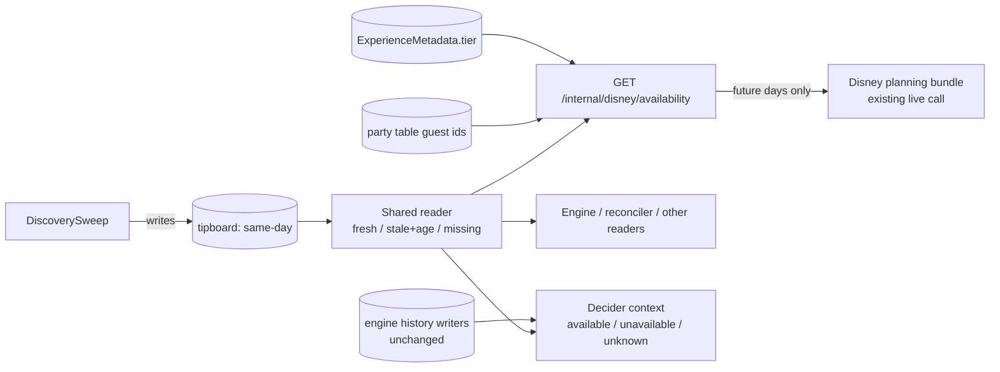

# PRD: Availability Consolidation

**Version**: 1.2.1
**Status**: Draft
**Created**: 2026-09-23
**Last Updated**: 2026-09-23
**Author**: @product-manager
**Stakeholders**: owner
**Source**: `docs/proposals/availability-consolidation.md` (decisions settled with the owner, 2026-09-23)
**Context**: Trip State, As Built §06 "What is available?" (https://claude.ai/artifact/UbsKeR4F7n3XtnGp2GzMsq)

Kept lean at the owner's instruction ("keep it lean"): the source's seven decisions are the
requirements (two deferred by the owner in 1.2.0), each with acceptance criteria. No personas, journeys or padding.

---

## Changelog

| Version | Date | Changes | Author |
|---------|------|---------|--------|
| 1.2.1 | 2026-09-23 | Audit (`/audit-prd` against the source). **Recorded** a removal 1.2.0 left out: AC-F4.6, added in 1.1.0 with AC-F7.6 for the chat booking gate refusing on `preArrivalSelectable`'s absence, is gone; its subject lapsed when 1.2.0 kept the field (AC-F3.3). Not restored. **Explained** the G3 numbering gap. **Fixed** the history-writer citation (`:2759` is the reader). **Grounded** AC-F1.3 (the existing ESLint route does not run on `packages/workers` in CI) and AC-F6.1 (the available half is already built). **Could Not Verify:** three rows confirmed and removed. | audit |
| 1.2.0 | 2026-09-23 | **Scope cut to the core** (owner: "getting core rock solid and then layering them in"; not letting "the least important goals become the most complex, time consuming, and error prone elements"). **Deferred** to a later layer: the future-day bundle sweep and store (source Decision 3, old F3) and sweep-owned history (source Decision 2, old F2) — now NG8, NG9. **Changed:** future days come from the route's existing live bundle call, with guest ids from the party table instead of the eligibility call (new F3); the route makes no Disney calls for same-day. **Superseded 1.1.0's OQ-5 answer:** `preArrivalSelectable` is kept, set from the bundle's available flag alone (owner); AC-F7.6 removed, R1/R5 rewritten. **Removed:** the engine-writer deletions (old AC-F2.3/AC-F7.5 — the writers stay), R4 (bundle sweep cost), OQ-1 and OQ-2 (they only sized the deferred sweep). **Kept** (owner): the decider's three explicit states, still needing eval Tier B. | owner via /refine-prd |
| 1.1.0 | 2026-09-23 | Owner answered four open questions (interactive `/refine-prd`). Added R5: the dropped field fixed a 2026-08-25 live defect that must not reopen. **OQ-5:** the route drops `preArrivalSelectable` rather than keep half of it; the chat booking gate must stop refusing on its absence (AC-F4.5, AC-F4.6, AC-F7.6; R1 rewritten). **OQ-6:** outside park hours stale/missing is still unknown but logged quietly (AC-F1.4). **OQ-3, OQ-4:** the TRD sets the history window and the stale threshold from measured data (AC-F2.1, AC-F1.6). Open Questions reduced to the two data questions. | owner via /refine-prd |
| 1.0.0 | 2026-09-23 | Replaces the unversioned draft at this path. Removed content the source does not support: the future-day store keyed `bundle:{park}:{date}` (the source deletes that key), an unqualified "no eligibility code remains", a "configurable, default 30 minutes" history window (the source gives 30 min as an example), invented response and decider-context shapes, and a tier rule widened from the route to "all readers". Added Open Questions, Could Not Verify, and the pre-arrival bookability gate found in code. | @product-manager |

---

## 1. Product Summary

### 1.1 Problem Statement

From the source. The code citations in brackets are ones this PRD checked; see Could Not Verify for the rest.

"What is available?" has one live writer, the availability sweep (`DiscoverySweep`), but no single reader. It also has a parallel cache, a dead layer, and a history signal sampled at an unknown rate:

- The sweep writes `tipboard:{park}:{date}` for all four theme parks roughly every 32 s during park hours (source measurement 2026-09-22, 09:00–21:00 ET: ~1,330 sweeps per park, longest gap 223 s). The source counts **42 files** that read the key directly, each parsing it itself. One of them, `HeldLLReconciler`'s `readTipboard`, parses the wrong shape and throws on every read into a silent `catch {}`. [It parses `Array<{id}>` inside a bare `catch {}`: `packages/workers/src/decisioning/HeldLLReconciler.ts:746-757`.]
- A cache miss reads as "nothing available", so a park day nobody swept looks sold out. No reader checks the data's age.
- The on-demand availability route (`GET /internal/disney/availability`) keeps its own copy, `availboard:{park}:{date}`, fetched live from Disney with the user's own service account. It also re-emits the sweep's change events. It makes a live park-wide eligibility call only to get guest ids for Disney's bundle call, and caches tier in `bundle:{park}:{date}`. [`packages/workers/src/http/handlers/availability.ts`: `availboard:` at :136/:161, `detectTipboardChanges` at :364, `getGuestEligibility` at :371, guest ids fed to `getBundleExperiences` at :406-417, `bundle:` at :175/:194.]
- `AvailabilityStore`, a 10-minute cache of offered return-time grids, is built and never instantiated. [The only `new AvailabilityStore` is in its own doc comment: `packages/workers/src/decisioning/AvailabilityStore.ts:157`.]
- Availability velocity (`rae:avail-history`) and "just became available" (`rae:prev-avail`) are recorded once per **engine run**, not once per sweep. So the sample rate varies with wakes and skips, and all users' runs at a park share one list. [Writers: `packages/workers/src/decisioning/DecisioningPipeline.ts:2655` (`rae:prev-avail`, `setex`) and `:2794-2796` (`rae:avail-history`, `lpush`/`ltrim`); `:2759` is the history reader.]
- The decider sees only a bare count of unavailable attractions and cannot tell unknown from none. [`packages/chat/src/engineDecider/buildDeciderContext.ts:255`, `:328`: `(${unavailable} further experiences currently unavailable)`.]

### 1.2 Proposed Solution

Version 1 is the core only (owner, 1.2.0); future-day storage and sweep-owned history are later layers.

- **Same day:** the sweep's `tipboard:` cache is the only authority, read through one shared reader that reports freshness.
- **Future days:** the route keeps its one live call to Disney's planning bundle, but takes guest ids from the party table instead of a live eligibility call.
- **History:** unchanged — the engine's existing velocity and "just became available" writers stay as they are.
- **The route:** no Disney calls for same-day; one bundle call for future days.
- **Tier:** comes from `ExperienceMetadata`.
- **The decider:** sees available, unavailable and unknown attractions explicitly.
- **Deleted:** the parallel cache, the route's eligibility call, the route's tier cache and the dead layer.

### 1.3 Value Proposition

- Every consumer gets the same answer.
- A sweep outage shows up as "unknown" and is logged loudly, instead of looking like "sold out".
- The chat agent stops spending a user's service account on same-day Disney calls that the sweep already makes, and on a park-wide eligibility call it only used for guest ids.

### 1.5 Solution Architecture

---

## 2. User Analysis

Omitted at the owner's instruction ("keep it lean"). The consumers are internal: the chat
agent (through the availability route), the decisioning engine and its decider, and the
other code that reads `tipboard:` directly today.

---

## 3. Goals and Non-Goals

### 3.1 Goals

| ID | Goal | Success Metric | Priority |
|----|------|----------------|----------|
| G1 | One authority and one reader for same-day availability | Outside the shared reader, zero raw reads of the `tipboard:` key, enforced by a CI gate | P0 |
| G2 | Unknown is never shown as "nothing available" | During park hours, a stale or missing read surfaces as unknown and is logged | P0 |
| G4 | Future-day availability without the eligibility call | The route's bundle call takes guest ids from the party table; no eligibility call remains in the route | P0 |
| G5 | The route makes no same-day Disney calls | For a same-day request, zero Disney client calls from the route handler | P0 |
| G6 | The decider distinguishes available, unavailable and unknown | Its context lists each state explicitly | P0 |
| G7 | The parallel and dead layers are deleted | Every item in F7 has no remaining references | P0 |

There is no G3. It was "history sampled per sweep, not per engine run" (source Decision 2), deferred to NG9 in 1.2.0; G4 was rewritten when the future-day store was deferred (NG8). Goal numbers are kept stable for the same reason as the feature numbers (§4).

### 3.2 Non-Goals (Explicit Scope Exclusions)

| ID | Non-Goal | Rationale |
|----|----------|-----------|
| NG1 | Keeping `ExperienceMetadata`, including tier, current | Source: out of scope. F5 changes where tier is read from, not how it is maintained |
| NG2 | Checking the hand-loaded LL overlay against Disney's bundle | Source: out of scope |
| NG3 | Showing the decider times more than 12 hours out, i.e. future-day availability in same-day decisions | Source: out of scope. F6 stays same-day |
| NG4 | The eligibility workstream ("can they book?": three answers, unmodelled reason codes, eligibility-call failures) | Source: out of scope. This work removes eligibility code **from the availability route only** (F7). Eligibility code elsewhere is untouched, including the unrelated `partyEligibility` on POI search (`apps/web/app/api/poi/search/route.ts:152`) |
| NG5 | Modifying the mock API (`packages/mock/**`) | Source constraint; constitution § Mock API Fidelity |
| NG6 | Changing the alert pipeline downstream of the sweep's change events | Only the route's **duplicate** emit is deleted (F7). The sweep's own `detectTipboardChanges` emit stays |
| NG7 | Settling data questions by asking the owner | Source: "to settle from captured data, not by asking" |
| NG8 | A future-day bundle sweep and store (source Decision 3) | Owner, 1.2.0: a later layer once the core is solid. Future days keep the route's existing live bundle call (F3) |
| NG9 | Sweep-owned history — rebuilding "just became available" and availability velocity on the sweep's clock, and removing the engine's `rae:prev-avail` / `rae:avail-history` writers (source Decision 2) | Owner, 1.2.0: a later layer. The engine writers stay exactly as they are; their per-run sampling flaw is accepted for now |

---

## 4. Feature Requirements

All P0. The source settled seven decisions; the owner deferred two of them (NG8, NG9) in 1.2.0. Feature numbers F2 and F3 are kept stable: F2 is now empty and F3 is rewritten.

### F1: One shared reader for same-day availability
**Priority**: P0 · **Source**: Decision 1

**Acceptance Criteria**:
- [ ] AC-F1.1: One shared reader returns the experiences for a park and date, plus a status of `fresh`, `stale` (with the data's age) or `missing`.
- [ ] AC-F1.2: Every consumer that reads `tipboard:` today reads it through the shared reader, including `HeldLLReconciler`, which stops parsing the wrong shape.
- [ ] AC-F1.3: A CI gate fails the build on any raw read of the `tipboard:` key outside the shared reader, and has been shown to fail on a planted raw read. The planted read must be in `packages/workers`, where most of today's raw reads live. [Grounding: the repo's existing custom-lint route, the `ll/*` ESLint rules registered for `packages/workers/**` in `eslint.config.mjs`, does not run there in CI. CI's lint step is `pnpm turbo lint` (`.github/workflows/ci.yml:178`), Turborepo runs only packages that declare a `lint` script, and `packages/workers/package.json` declares none (only `apps/admin`, `apps/mobile`, `apps/web` do). A gate built that way would pass while checking nothing. The standalone `mock-invariant` job (`ci.yml:861`) is a precedent that does run.]
- [ ] AC-F1.4: During park hours, a `stale` or `missing` read is surfaced to its consumer as **unknown** and logged loudly. It is never rendered or treated as "nothing available". Outside park hours it is still surfaced as **unknown**, but logged quietly: a stale cache after close is expected, not an outage (owner, 2026-09-23, OQ-6).
- [ ] AC-F1.5: No gate that would stop a booking attempt treats unknown as unavailable. This is the source's allow-over-block constraint.
- [ ] AC-F1.6: The age at which a read becomes `stale` is set in the TRD and justified from the measured sweep cadence (~32 s typical, 223 s longest gap on 2026-09-22), not picked here (owner, 2026-09-23, OQ-4).

### F2: (deferred — see NG9)

Sweep-owned history is a later layer (owner, 1.2.0). No requirement in this version.

### F3: Future-day availability without the eligibility call
**Priority**: P0 · **Source**: Decisions 4 and 7 as cut by the owner in 1.2.0

**Acceptance Criteria**:
- [ ] AC-F3.1: For a future day, the route makes its existing live call to Disney's planning bundle, and no other Disney call.
- [ ] AC-F3.2: Guest ids for that call come from the party table, not from a live eligibility call.
- [ ] AC-F3.3: `preArrivalSelectable` is kept and set from the bundle's available flag alone. The "an eligible guest has remaining tier capacity" half is removed (owner, 1.2.0). The chat booking gate at `packages/chat/src/llBookingDeepPrefetch.ts:756` is otherwise unchanged.
- [ ] AC-F3.4: The reproduction from `docs/TRD/prearrival-multipass-availability.md` (2026-08-25) still passes: on a pre-arrival Multi Pass day, an experience the bundle reports available reaches `get_booking_offers` rather than a "nothing available" reply.

### F4: The availability route becomes a thin read
**Priority**: P0 · **Source**: Decision 4

**Acceptance Criteria**:
- [ ] AC-F4.1: For a same-day request, `GET /internal/disney/availability` makes no Disney calls.
- [ ] AC-F4.2: Same-day availability comes from `tipboard:` through the shared reader.
- [ ] AC-F4.3: Future-day availability comes from the bundle call in F3.
- [ ] AC-F4.4: Tier comes from `ExperienceMetadata.tier`.
- [ ] AC-F4.5: When the shared reader reports unknown, the route makes that visible to its caller, and the chat booking path does not turn it into a refusal.

### F5: Tier comes from `ExperienceMetadata`
**Priority**: P0 · **Source**: Decision 5

**Acceptance Criteria**:
- [ ] AC-F5.1: The route reads tier from `ExperienceMetadata.tier`. [The column exists: `packages/data/prisma/schema.prisma:663`.]
- [ ] AC-F5.2: The route's `bundle:` tier cache is removed (also listed in F7).

### F6: The decider sees three explicit states
**Priority**: P0 · **Source**: Decision 6

**Acceptance Criteria**:
- [ ] AC-F6.1: The decider's availability context lists available, unavailable and unknown attractions explicitly, replacing today's bare unavailable count. [Already built: available attractions are listed one per line, with tier, time before close, standby wait, velocity and "just reappeared" (REW-B035, `packages/chat/src/engineDecider/buildDeciderContext.ts:243-326`). The new work is (a) listing unavailable attractions in place of the count at `:327-329`, which reverses a deliberate choice recorded in that block's comment (summarise to save context), and (b) adding unknown, which the context's tipboard entries cannot express today (a boolean `available`, `:254`).]
- [ ] AC-F6.2: The context's current-availability states come from the shared reader. Its history input (velocity, "just became available") stays as today (NG9).
- [ ] AC-F6.3: Unknown is distinguishable from unavailable in what the decider sees.
- [ ] AC-F6.4: Eval Tier B passes before merge. This change alters what the decider sees.

### F7: Deletions
**Priority**: P0 · **Source**: Decision 7

**Acceptance Criteria**, each with no remaining references outside tests:
- [ ] AC-F7.1: `availboard:`: its reader, its writer, the route's live tipboard fetch, and the route's duplicate `detectTipboardChanges` emit.
- [ ] AC-F7.2: The route's live eligibility call and the route's `partyEligibility` response field. Nothing outside the route is in scope (NG4).
- [ ] AC-F7.3: The `bundle:` tier cache.
- [ ] AC-F7.4: `AvailabilityStore` and its `avint:guard:*` key.

---

## 5. Non-Functional Requirements

| ID | Requirement | Source |
|----|-------------|--------|
| NFR-1 | A missing or stale value is "unknown", never a plausible default | Source § Constraints ("Fail loud"); CLAUDE.md fail-loud directive |
| NFR-2 | No gate that would stop a booking attempt may treat "unknown" as "unavailable" | Source § Constraints ("Allow over block") |
| NFR-3 | No availability or history value is inferred and stored as if Disney had said it | Source § Constraints; constitution § Ledger Written Only From Disney |
| NFR-4 | `packages/mock/**` is not modified | Source § Constraints; constitution § Mock API Fidelity |
| NFR-5 | Eval Tier B passes before merge | Source § Constraints ("Agent-behaviour change"); process.md `main` protections |

No performance, freshness-threshold or cost figure is stated in the source, and none is
written here. The stale threshold is the TRD's (AC-F1.6).

---

## 6. Acceptance Criteria Summary

| ID | Feature | Criterion | Verification Method |
|----|---------|-----------|---------------------|
| AC-F1.1 | F1 | Shared reader returns experiences plus `fresh` / `stale`+age / `missing` | Unit test |
| AC-F1.2 | F1 | All `tipboard:` consumers go through the reader, `HeldLLReconciler` included | Grep + CI gate |
| AC-F1.3 | F1 | CI gate blocks raw `tipboard:` reads and is proven able to fail | CI, with a planted violation |
| AC-F1.4 | F1 | Stale or missing in park hours surfaces as unknown and is logged | Unit test + live check |
| AC-F1.5 | F1 | No booking-stopping gate treats unknown as unavailable | Unit test on each gate |
| AC-F1.6 | F1 | Stale threshold set in the TRD from measured cadence | TRD review |
| AC-F3.1 | F3 | Future day: one bundle call, nothing else | Unit test (Disney client mock) |
| AC-F3.2 | F3 | Guest ids from the party table; no eligibility call | Unit test + grep |
| AC-F3.3 | F3 | `preArrivalSelectable` from the available flag alone | Unit test |
| AC-F3.4 | F3 | 2026-08-25 pre-arrival reproduction still passes | Unit test on `llBookingDeepPrefetch` |
| AC-F4.1 | F4 | Same-day request makes zero Disney calls | Unit test (Disney client mock asserts no calls) |
| AC-F4.2 | F4 | Same-day from the shared reader | Unit test |
| AC-F4.3 | F4 | Future-day from the F3 bundle call | Unit test |
| AC-F4.4 | F4 | Tier from `ExperienceMetadata.tier` | Unit test |
| AC-F4.5 | F4 | Unknown is visible and does not become a refusal | Unit test on `llBookingDeepPrefetch` |
| AC-F5.1 | F5 | Route tier read from `ExperienceMetadata.tier` | Unit test |
| AC-F5.2 | F5 | `bundle:` tier cache removed | Grep |
| AC-F6.1 | F6 | Decider context lists three states explicitly | Unit test on `buildDeciderContext` |
| AC-F6.2 | F6 | Current states from the shared reader; history input unchanged | Unit test |
| AC-F6.3 | F6 | Unknown is distinct from unavailable in the context | Unit test |
| AC-F6.4 | F6 | Eval Tier B green | CI eval Tier B |
| AC-F7.1–4 | F7 | Each deletion has no references outside tests | Grep |

### Non-Functional Acceptance Criteria

| ID | Requirement | Criterion | Verification Method |
|----|-------------|-----------|---------------------|
| AC-N1 | NFR-1 | No reader returns a default in place of stale or missing data | Covered by AC-F1.4 |
| AC-N2 | NFR-2 | Unknown never blocks a booking attempt | Covered by AC-F1.5, AC-F4.5 |
| AC-N3 | NFR-3 | Stored values trace to a Disney response | Review: this version stores no new availability or history value |
| AC-N4 | NFR-4 | Diff touches nothing under `packages/mock/**` | `mock-invariant` CI gate |
| AC-N5 | NFR-5 | Eval Tier B passes | CI |

---

## 7. Risk Assessment

| ID | Risk | Likelihood | Impact | Mitigation Strategy |
|----|------|------------|--------|---------------------|
| R1 | Removing the capacity half of `preArrivalSelectable` means some pre-arrival attempts Disney will refuse (no tier allowance left) now reach Disney instead of being stopped by us. | Med | Low | Accepted: allow over block. Disney's refusal is the answer; the eligibility workstream (NG4) can restore the capacity check properly |
| R2 | Once the route stops fetching same-day live, a sweep outage makes every same-day consumer report unknown. It is visible, where today it silently looks sold out, but nothing is served. | Med | Med | This is the intended trade (Decision 1). The loud log in AC-F1.4 is the alarm |
| R3 | Migrating ~42 direct readers changes behaviour for any reader that relied on a miss meaning empty. | Med | Med | The CI gate (AC-F1.3) finds all of them; review each reader's handling of unknown |
| R5 | `preArrivalSelectable` fixed a live defect on 2026-08-25 (`docs/TRD/prearrival-multipass-availability.md`, PR #1076): on a pre-arrival Multi Pass day the Lightning Lane specialist told the guest nothing was available. Changing how the field is computed could reopen it. | Low | High | AC-F3.4 replays that TRD's reproduction |

---

## 8. Decisions and Rejected Alternatives

| Proposal / Challenge | Verdict | Rationale | Revisit when |
|----------------------|---------|-----------|--------------|
| Build the future-day bundle sweep and store now (source Decision 3) | Deferred (owner, 1.2.0) | New Disney traffic, a new store, scout-budget sizing and two open data questions, for the least core goal | The core (one reader, unknown ≠ empty, route cleanup) is solid in production |
| Store a future-day store under `bundle:{park}:{date}` (1.0.0 draft) | Rejected | The source deletes the `bundle:` tier cache | Never for this key |
| Keep the route's live same-day Disney fetch as a fallback when the sweep is stale | Rejected | A fallback is a second authority, and it hides sweep outages | A measured sweep outage rate that makes "unknown" unusable for the agent |
| Move history onto the sweep's clock now (source Decision 2) | Deferred (owner, 1.2.0) | Easy to get wrong and not core; the existing engine writers work, imperfectly | The core is solid; the per-run sampling flaw is still the source's reason to do it |
| Keep `AvailabilityStore` for the schedule-conflict gate | Rejected | Source: never instantiated, and its intended reader is now advisory | The schedule-conflict gate becomes enforcing and needs offered return-time grids |
| Keep the capacity half of `preArrivalSelectable`, computed from the ledger instead of a live call (OQ-5) | Rejected (owner, 2026-09-23) | Tier allowance is eligibility, which the eligibility workstream owns (NG4); computing it here would rebuild eligibility inside the availability route | The eligibility workstream lands and supplies it |
| Drop `preArrivalSelectable` (1.1.0 answer to OQ-5) | Superseded (owner, 1.2.0) | With the live bundle call kept, availability-only answers it with no new code and keeps the 2026-08-25 fix intact | — |
| Log stale/missing loudly outside park hours too (OQ-6) | Rejected (owner, 2026-09-23) | A stale cache after close is expected; a loud log would fire every night | The sweep starts running outside park hours |

### Confirmed grounding — do not re-litigate

- "One authority for same-day availability: the sweep's `tipboard:` cache." (source, Decision 1)
- "The availability route becomes a thin read with no Disney calls." (source, Decision 4) — narrowed by the owner in 1.2.0 to same-day; future days keep one bundle call.
- "Tier's source is `ExperienceMetadata`." (source, Decision 5)
- Scope: core first — future availability, velocity and history are later layers; don't let "the least important goals become the most complex, time consuming, and error prone elements". (owner, 2026-09-23)
- Pre-arrival bookability: "Keep, availability-only". (owner, `/refine-prd`, 2026-09-23; supersedes "Drop the field")
- Decider three explicit states: "Keep it". (owner, `/refine-prd`, 2026-09-23)
- Off-hours: "Unknown, logged quietly". (owner, `/refine-prd`, 2026-09-23)
- Stale threshold: the TRD picks it from data. (owner, `/refine-prd`, 2026-09-23)
- Open questions are "to settle from captured data, not by asking". (source)

---

## Open Questions

None. OQ-3 to OQ-6 were answered by the owner (1.1.0). OQ-1 and OQ-2 only sized the future-day sweep, which is deferred (NG8), so they closed with it (1.2.0).

---

## Could Not Verify

State after the `/audit-prd` run of 2026-09-23 (1.2.1). Confirmed and removed in that run: the sweep covers the four theme parks (`THEME_PARK_IDS`, `packages/workers/src/disney/DiscoverySweep.ts:184-188`); `HeldLLReconciler.readTipboard` parses the wrong shape (the sweep stores an object `{experiences, sweptAt}`, `DiscoverySweep.ts:68-69` and its `setex` write, while `HeldLLReconciler.ts:753-754` casts it to an array and calls `.map`, which throws into the bare `catch {}`); the route is used only by the chat agent (the web proxy `apps/web/app/api/disney/availability/route.ts:76` has one caller, `packages/chat/src/llBookingDeepPrefetch.ts:300`; no hits in `apps/mobile`).

| Claim | Why not checked in this audit | How to check it |
|-------|-------------------------------|-----------------|
| "42 files" read `tipboard:` directly (source) | Needs every hit classified as read, write or comment; no verifier did it | An earlier grep found 41 non-test and 80 total `.ts`/`.tsx` files containing `tipboard:`. `grep -rlE --include='*.ts' --include='*.tsx' --exclude-dir=node_modules --exclude-dir=dist --exclude-dir=.next "tipboard:" apps packages`, then classify each hit. The CI gate (AC-F1.3) settles it mechanically |
| Sweep cadence ~32 s, ~1,330 sweeps per park, longest gap 223 s (source) | A production data measurement, not a code check | Query the sweep's audit or timestamps for 2026-09-22, 09:00–21:00 ET, on a direct connection inside `BEGIN READ ONLY … ROLLBACK` |
| `ExperienceMetadata.tier` is populated for every LL experience the route returns | A production data check; its currency is out of scope (NG1), but an empty tier would now show as null | `SELECT count(*) FROM experience_metadata WHERE tier IS NULL AND "llType"='MULTI_PASS'` on a direct connection inside `BEGIN READ ONLY … ROLLBACK` |
