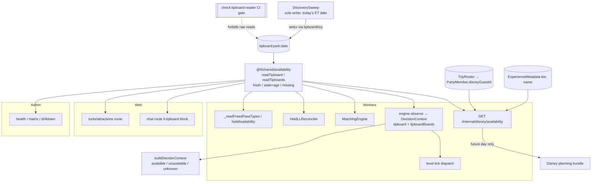
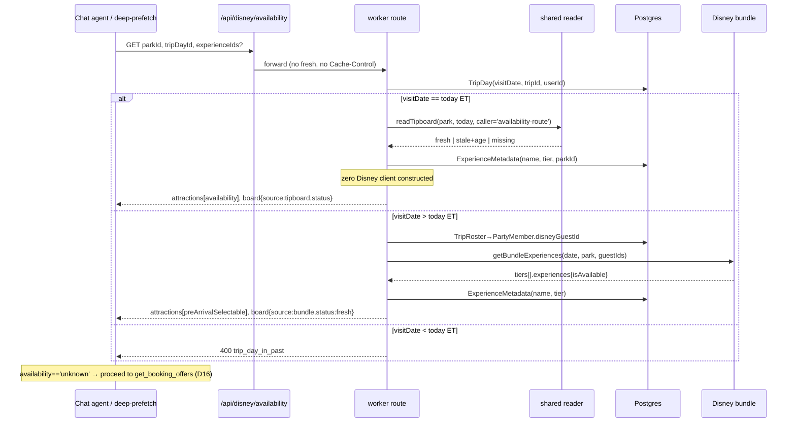

# TRD: Availability Consolidation

> **Replay fixture (speed-sentence TRD, FIX-005).** Not a live TRD of this repository. It is a
> past TRD of the lightning-lane project, replayed through `/implement-trd` to time tasks.
>
> - **Source repo:** lightning-lane (`~/dev/lightning-lane`, read-only)
> - **TRD text:** `docs/TRD/availability-consolidation.md` v1.1.1 at commit `0356413bf`
> - **Original implementation:** squash PR #1288 (`9fac17fbb`); base commit `e04cfe0ed`
> - **Edits to the source text, the only ones:**
>   1. The Phase 4 section, the "Deferred by design" section and the AVAIL-T001 / AVAIL-T002
>      grounding blocks are removed (a live local-stack check and a paid eval run).
>   2. AVAIL-B004's `[LIVE]` marker is removed, and its final acceptance sentence
>      ("Live: against the local stack, a same-day request records no Disney call in the mock's
>      `CallLogger` output.") is removed. Owner ruling OQ-3, 2026-10-20.
> - **Per task in the original run** (source id; seconds, tool calls, output tokens):
>   - AVAIL-B001: 421 s, 70 calls, 34,968 tokens
>   - AVAIL-B002: 1270 s, 242 calls, 122,101 tokens
>   - AVAIL-B003: 759 s, 159 calls, 74,715 tokens
>   - AVAIL-B004: 848 s, 114 calls, 66,246 tokens
>   - AVAIL-B005: 520 s, 97 calls, 48,472 tokens
>   - AVAIL-B006: 501 s, 89 calls, 51,049 tokens
>   - AVAIL-B007: 194 s, 50 calls, 18,002 tokens
>   - AVAIL-B008: 201 s, 41 calls, 20,713 tokens
>   - AVAIL-B009: 637 s, 176 calls, 48,214 tokens
>   - AVAIL-P001: 258 s, 45 calls, 27,262 tokens

**Version**: 1.1.1
**Status**: Draft
**Created**: 2026-09-23
**Last Updated**: 2026-09-24
**Author**: @technical-architect
**Source PRD**: [`docs/PRD/availability-consolidation.md`](../PRD/availability-consolidation.md) v1.2.1 (no supersession marker; 1.2.1 is the in-scope source)
**Task ID Prefix**: AVAIL

---

## Changelog

| Version | Date | Changes | Author |
|---------|------|---------|--------|
| 1.1.1 | 2026-09-24 | `/audit-trd` against PRD 1.2.1 (5 of 5 checkers reported). Citations: AC-F1.4 and AC-F1.6 now cite **PRD** OQ-6 / OQ-4, and AC-F1.5 cites **this TRD's** OQ-4, because the PRD and this TRD number their open questions independently and the bare ids pointed at the wrong question. `DiscoverySweep.ts` line numbers re-read at HEAD and corrected (TTL constant :225, quiet-hours constant :198, cache key :727, `TipboardCacheEntry` :69-98, entry write :697-724); the facts they point at were unchanged. Could Not Verify: all eight rows carried forward, none checked by this audit. | @technical-architect |
| 1.1.0 | 2026-09-24 | Interactive `/refine-trd`: owner answers to all twelve Open Questions, the eligibility-grep ruling, and the grounding stage's recorded findings applied. **Changed from the author's assumption (2):** OQ-4, pass type on an unknown board now comes from `ExperienceMetadata.llType` on both sides of the cross-pass-type gate instead of refusing on partial signal (D18, D16, B002, B003, new shared helper in B001). OQ-8, an experience a fresh board does not list is now **unknown**, not unavailable (D15 rewritten; D2, D10, D16, D17, §3.1–§3.4, B001–B004, B006–B008 follow; the route omits a requested id only when its metadata names another park, so the deep-prefetch's wrong-park recovery survives). **Confirmed (8):** OQ-1, OQ-3, OQ-7, OQ-9, OQ-10, OQ-11, OQ-12 by the owner; OQ-2 by a five-day prod measurement (D3, TR2), which also records an unsurfaced ~2.5-day sweep outage on 9/18–9/20. **Defaults kept, not asked (2):** OQ-5, OQ-6. **Added:** D22 (admin `status` field on `LLCell`/`LLDrillDownPayload`, and the queue-monitor view model renders it); fixture and file ownership the grounding stage found unowned (extra `DecisionContext` fixtures in B002/B008, `toolAuth.test.ts` in B005, `TipboardCacheEntry` migration in B003, `MatchingEngine.test.ts` AVINT scaffolding and the `DecisioningPipeline.ts:6169` comment in B009, an explicit B003/B009 ownership split). **Corrected:** B003 now asserts the reconciler's tie-break is gone and an ambiguous title takes the existing REFUSE fallback (its AC still described migrating the tie-break); B003 also drops the resolver's now-unused `redis` parameter; B004's eligibility grep is scoped to the route and its types (NG4). **Removed:** the TR1 contingency (TR1 resolved by OQ-12), the "lex-sort" wording in R3 (the code refuses on ambiguity), and five Could Not Verify rows now verified. No task ID changed and no dependency edge was added. | owner via /refine-trd |
| 1.0.0 | 2026-09-23 | Initial TRD from PRD 1.2.1. Replaces an unversioned draft previously at this path, which had no `Serves` column on its decisions and carried its own grounding appendix. | @technical-architect |

---

## 1. Overview

### 1.0 Objectives

Every objective below traces to a source. The TRD adds none of its own. Where the PRD gave the
TRD a number to choose (AC-F1.6), the choice is a decision (D3), not a new objective.

| ID | Objective | Source |
|----|-----------|--------|
| AC-F1.1 | One shared reader returns a park/date's experiences plus `fresh`, `stale` (with age) or `missing` | PRD F1 |
| AC-F1.2 | Every current `tipboard:` consumer reads through the shared reader; `HeldLLReconciler` stops parsing the wrong shape — satisfied by deleting its read (OQ-12) | PRD F1 |
| AC-F1.3 | A CI gate fails on any raw `tipboard:` read outside the reader, and is shown failing on a planted read in `packages/workers` | PRD F1 |
| AC-F1.4 | During park hours a `stale`/`missing` read surfaces as **unknown** and is logged loudly; outside park hours it is unknown and logged quietly; never "nothing available" | PRD F1; PRD OQ-6 (owner, 2026-09-23) |
| AC-F1.5 | No gate that would stop a booking attempt treats unknown as unavailable. This includes the cross-pass-type gate when a pass type is unknown because its board is not fresh | PRD F1; source "allow over block"; this TRD's OQ-4 (owner, 2026-09-24) |
| AC-F1.6 | The stale age is set in this TRD and justified from the measured sweep cadence | PRD F1; PRD OQ-4 (owner, 2026-09-23) |
| AC-F3.1 | Future day: the route makes its existing bundle call and no other Disney call | PRD F3 |
| AC-F3.2 | Future-day guest ids come from the party table, not an eligibility call | PRD F3 |
| AC-F3.3 | `preArrivalSelectable` is kept, set from the bundle's available flag alone; the chat booking gate is otherwise unchanged | PRD F3; owner 1.2.0 |
| AC-F3.4 | The 2026-08-25 pre-arrival reproduction still passes | PRD F3, R5 |
| AC-F4.1 | Same-day request: the route makes zero Disney calls | PRD F4, G5 |
| AC-F4.2 | Same-day availability comes from `tipboard:` via the shared reader | PRD F4 |
| AC-F4.3 | Future-day availability comes from the F3 bundle call | PRD F4 |
| AC-F4.4 | Tier comes from `ExperienceMetadata.tier` | PRD F4 |
| AC-F4.5 | Unknown is visible to the route's caller, and the chat booking path does not turn it into a refusal | PRD F4 |
| AC-F5.1 | The route reads tier from `ExperienceMetadata.tier` | PRD F5 |
| AC-F5.2 | The route's `bundle:` tier cache is removed | PRD F5 |
| AC-F6.1 | The decider's context lists available, unavailable and unknown attractions explicitly | PRD F6 |
| AC-F6.2 | Its current-availability states come from the shared reader; its history input is unchanged | PRD F6; NG9 |
| AC-F6.3 | Unknown is distinguishable from unavailable in what the decider sees | PRD F6 |
| AC-F6.4 | Eval Tier B passes before merge | PRD F6; NFR-5 |
| AC-F7.1 | `availboard:` reader, writer, the route's live tipboard fetch and its duplicate `detectTipboardChanges` emit are gone | PRD F7 |
| AC-F7.2 | The route's live eligibility call and `partyEligibility` field are gone. Scope is the route (`availability.ts`) and its response types (`packages/shared/src/disney-api/types.ts`) only; `getGuestEligibility` and the POI-search `partyEligibility` elsewhere stay (NG4) | PRD F7, NG4; owner ruling 2026-09-24 |
| AC-F7.3 | The `bundle:` tier cache is gone | PRD F7 |
| AC-F7.4 | `AvailabilityStore` and its `avint:guard:*` key are gone | PRD F7 |
| NFR-1 | A missing or stale value is "unknown", never a plausible default | PRD §5; CLAUDE.md fail-loud directive |
| NFR-2 | No booking-stopping gate treats "unknown" as "unavailable" | PRD §5 |
| NFR-3 | No availability or history value is inferred and stored as if Disney had said it | PRD §5; constitution § Ledger Written Only From Disney |
| NFR-4 | `packages/mock/**` is not modified | PRD §5; constitution § Mock API Fidelity |
| NFR-5 | Eval Tier B passes before merge | PRD §5; process.md `main` protections |
| Q-1 | Unit coverage ≥ 60%, integration ≥ 50% where applicable | constitution.md Quality Gates |
| Q-2 | Verification against a running instance | constitution.md `verification_level: live-required` |
| Q-3 | Both `Test` and `Lint & Type Check` green before merge | constitution.md § Agent-feature verification method |

### 1.1 Technical Summary

Today the sweep (`DiscoverySweep`) writes `tipboard:{parkId}:{date}` for today's ET date only
(`getSweepTargets`, `DiscoverySweep.ts`), and about a dozen call sites across `packages/workers`,
`apps/web` and `apps/admin` each read and parse that key themselves, with no notion of age.

This TRD adds **one reader in `@ll/shared`** that owns the key, parses the sweep's stored shape once,
and classifies every read as `fresh`, `stale` or `missing`. Every consumer moves onto it, and a
root `check:*` CI gate stops new raw reads. A consumer that needs a booking-grade answer asks the
reader for a tri-state (`available` / `unavailable` / `unknown`). `unknown` covers two cases: the
board for today is not fresh, or the board is fresh but does not list the experience (owner, OQ-8).
`unavailable` means a fresh board lists the experience as not available.

The availability route (`GET /internal/disney/availability`) becomes a thin read. **Same day:**
the shared reader, no Disney client constructed. **Future day:** the existing planning-bundle call,
with guest ids from `TripRoster → PartyMember.disneyGuestId` instead of a live eligibility call.
**Tier:** `ExperienceMetadata.tier`. The route's `availboard:` and `bundle:` caches, its eligibility
call, its duplicate change emit, its `partyEligibility` field and its now-meaningless `fresh`
parameter go.

The decisioning engine carries per-park board status into `DecisionContext`, so the decider can
list available, unavailable and unknown attractions separately. Wants whose availability is unknown
(the board should exist but is not fresh, or a fresh board does not list them) are dispatched, not
skipped: Disney's offer call is the answer. On an unknown board the cross-pass-type gate takes pass
type from `ExperienceMetadata.llType` instead of refusing (owner, OQ-4). The dead
`AvailabilityStore` layer is deleted with its plumbing.

**Grounding correction to the PRD.** The PRD's Could Not Verify section confirms the web proxy
`/api/disney/availability` "has one caller, `llBookingDeepPrefetch.ts:300`". A second caller
exists: the agent's `get_availability` tool (`packages/chat/src/agent.ts:1150`, `dapiProxyFetch`),
which relays the route's body to the model verbatim. This TRD treats both as consumers (AVAIL-B007).

### 1.2 Key Technical Decisions

| ID | Decision | Choice | Serves Objective | Rationale | Alternatives Considered |
|----|----------|--------|------------------|-----------|------------------------|
| D1 | Where the reader lives | `packages/shared/src/availability/tipboardReader.ts`, exported as `@ll/shared/availability`. It takes a structural Redis interface (`get`, `mget`), not an `ioredis` import | AC-F1.1, AC-F1.2 | Readers exist in `packages/workers`, `apps/web` and `apps/admin`, and all three already depend on `@ll/shared`. The web app deliberately avoids importing `@ll/workers` (comment at `apps/web/app/api/agent/chat/route.ts:405-412`). `@ll/shared/wake.ts` already uses exactly this structural-Redis pattern | **Reader in `@ll/workers`**: unreachable from web/admin without pulling workers into the Next bundle. Revisit if a workers-only client package is split out. **One reader per app**: three copies is the defect being removed; no revisit |
| D2 | Status model | `status: 'fresh' \| 'stale' \| 'missing'`, `ageSeconds`, `sweptAt`, and a `missingReason` of `absent`, `unparseable` or `not_swept_date`. Stale rows are **returned** (dashboards show them with their age); `availabilityOf(read, id, {caller})` returns `unknown` for a same-day board that is not fresh **and** for an id a fresh board does not list (D15) | AC-F1.1, AC-F1.4, NFR-1 | Keeps "what the cache holds" apart from "what a booking decision may trust". An unparseable entry is `missing` and logged; it is never `[]` | **Drop stale rows inside the reader**: loses the age display the admin drill-down already shows. Revisit if no consumer ends up displaying stale rows |
| D3 | Stale age (AC-F1.6) | `TIPBOARD_STALE_AFTER_SECONDS = 240` | AC-F1.6 | Two measured or read bounds. **Lower:** confirmed by measurement (OQ-2, 2026-09-24). Prod `disney_call_audit`, successful `/tipboard-vas/planning/v1/parks/<id>/experiences/` calls per park, 09:00–21:00 ET, gap between consecutive calls: 9/16 p50 32 s, p99 61 s, max 97 s; 9/17 32 / 47 / 98; 9/21 32 / 37 / 88; 9/22 32 / 63 / 223; 9/23 32 / 36 / 44. **No gap over 240 s on any measured day**, and the longest (223 s, 9/22) sits below the threshold. A threshold at or below it would fire the loud log on an ordinary day. **Upper:** the sweep writes with a 300 s TTL (`DEFAULT_CACHE_TTL_SECONDS`, `DiscoverySweep.ts:225`). A threshold at or above that could never be observed, because the key expires first. 240 s is the round value inside that window. **Why the loud log matters, measured:** on 9/18 and 9/19 there were **zero** sweep calls and on 9/20 only 140 (against ~5,400 on a normal day), a ~2.5-day sweep outage that nothing surfaced. AC-F1.4's loud log is the alarm that outage lacked | **2× typical cadence (~64 s)**: trips on normal gaps. **= TTL (300 s)**: `stale` can never occur by day. Revisit when a re-measured normal-day longest gap reaches 240 s, or the sweep TTL changes |
| D4 | What "park hours" means for the loud log | Loud when the read is for **today's ET date** and ET time is at least `06:00 + 240 s`, the sweep's active window (`isWithinSweepQuietHours`, hours [0, 6)). Quiet otherwise, and always quiet for any other date. The quiet-hours constant moves to `@ll/shared` and the sweep imports it | AC-F1.4 | The loud log exists to say "the sweep is down", and the sweep's schedule is the one that decides when a fresh board should exist. The 240 s offset absorbs the gap between 06:00 and the first post-quiet sweep. The overnight day-lock entry (7 h TTL) ages past 240 s by design and stays quiet | **Disney park hours from `park-hours:{park}:{date}`**: only populated as a side effect of plans/daily fetches (`RedisKeyStore.cacheParkHours`), so its own miss would need a policy. **mdeSyncWorker's fixed 08:00–22:00**: a sweep outage between 06:00 and 08:00 would go quiet. Owner confirmed the sweep window, 06:04–24:00 ET, as "park hours" (OQ-1, 2026-09-24). Revisit if the sweep schedule changes |
| D5 | Where logging happens | Inside the reader, on every non-fresh read, with a required `caller` label and `{parkId, date, status, ageSeconds, missingReason}`. `console.error` when loud and `console.info` when quiet. An id a **fresh** board does not list (D15) is logged by the same module's `logAbsentFromFresh` as `[tipboard-reader] absent-from-fresh park=… date=… experience=… caller=…`, always `console.info`, never loud: the board is fresh, so the sweep is not down, and the info line makes the omission rate measurable. `availabilityOf` calls it; so does the level tick, which classifies from `DecisionContext` rather than a `TipboardRead`. No rate limit | AC-F1.4, NFR-1, owner OQ-8 | One place, so every consumer's unknown is logged the same way. The caller label attributes each read (owner's persist-everything principle). Fail-loud directive: every time, no suppression | **Log in each consumer**: about ten copies that would drift. **Rate-limit**: suppression is the machinery the fail-loud directive forbids |
| D6 | CI gate mechanism (AC-F1.3) | Root script `scripts/check-tipboard-reader.ts`, run as `pnpm check:tipboard-reader`, plus a vitest (`check:tipboard-reader-vitest`) that plants a raw read in a `packages/workers/...` fixture tree and asserts exit 1. Both are wired as a named step in the CI `Lint & Type Check` job | AC-F1.3 | The PRD grounds that `ll/*` ESLint rules never run on `packages/workers` in CI. Named `check:*` steps do run: about twenty precedents in `ci.yml:199-424`, e.g. `check:v2-redis-prefix`. The vitest is what makes "shown to fail" a standing, re-runnable fact rather than a one-off demonstration | **ESLint rule**: does not execute on workers in CI (PRD AC-F1.3 grounding). Revisit when `packages/workers` gains a `lint` script. **Shell grep**: cannot tell comments from code, and every reader file is full of `tipboard:{parkId}:{date}` doc comments |
| D7 | What the gate matches | In comment-stripped source under `packages/` and `apps/`: (a) any string or template literal beginning `tipboard:` outside the reader module; (b) any reference to the `tipboardKey` identifier outside the reader module and `DiscoverySweep.ts`. Scope and exclusions mirror `check-ll-reader-manifest.ts`: skip `node_modules`, `dist`, `.next`, tests (`__tests__`, `__testkit__`, `__fixtures__`, `*.test.*`, `*.spec.*`) and any `scripts/` or `e2e/` path segment | AC-F1.3, AC-F1.2 | (a) catches every raw read, because a read needs the key. (b) stops a reader from being rebuilt on the exported key builder. `tipboard-prev:` (the change detector's own key) does not match `tipboard:`. Following the sibling gate's exclusions keeps one convention for "what is product code" | **Match call sites (`redis.get(...)`) instead of literals**: keys are usually built in a variable, so it would miss nearly everything (the reasoning `check-v2-redis-prefix.ts` records). Revisit never. **Include `scripts/`**: seed/probe tooling is not a product read path (sibling gate's precedent). Owner confirmed app code only (OQ-10, 2026-09-24) |
| D8 | Same-day vs future-day in the route | Compare `TripDay.visitDate` (ET park date) with `getEtDate(systemClock)`. Equal: same-day. Later: future-day. Earlier: `400 trip_day_in_past`, with no Disney call (OQ-5: author default, not asked) | AC-F4.1, AC-F4.3 | The sweep covers exactly today's ET date (`getSweepTargets`). That is the boundary at which `tipboard:` is authoritative | **Board-presence test (read, then fall back to the bundle on a miss)**: that is the fallback the PRD rejects (§8: "a fallback is a second authority"). Revisit never |
| D9 | Route response contract | `{ attractions, board }`. `board` is `{ source: 'tipboard' \| 'bundle', status, ageSeconds, asOf }`, or `null` on a non-park day. Each attraction gains `availability: 'available' \| 'unavailable' \| 'unknown'`. `llBookable` becomes `boolean \| null` (null exactly when unknown). `preArrivalSelectable` is present only on future-day rows. `partyEligibility` and `cachedAt` are removed | AC-F4.5, AC-F3.3, AC-F7.2, NFR-1 | Unknown has to be visible on the wire (AC-F4.5), and a `false` in place of unknown is the plausible default NFR-1 forbids. `cachedAt` described a cache that no longer exists; `board.asOf` replaces it | **Keep `llBookable: false` for unknown and add only `availability`**: leaves a wrong-and-plausible value on the wire for any reader that ignores the new field. Revisit never |
| D10 | Same-day unknown with an explicit `experienceIds` filter | Every requested id with no fresh row, because the board is stale/missing **or** because a fresh board does not list it (OQ-8), gets one row: name and tier from `ExperienceMetadata`, `availability: 'unknown'`, `llBookable: null`. **Exception:** an id whose `ExperienceMetadata.parkId` names a different park than the request's `parkId` is omitted, as today. An id with no metadata row is not omitted (no evidence it is the wrong park; allow over block). Without a filter: a fresh board's rows; a stale board's rows as unknown; `[]` with `board.status: 'missing'` when missing | AC-F4.5, AC-F1.5 | The deep-prefetch treats an absent entry as "wrong park, ask again" (`experience_missing_from_availability`, `llBookingDeepPrefetch.ts:748`; its Guard-5 comment documents why). Omitting an unknown experience would misnarrate a sweep outage, or an ordinary Disney omission, as a park mix-up and stop short of offers. The park exception keeps that recovery for the case it exists for: an id that belongs to another park | **Omit unknown rows**: produces the misnarration above. Revisit never. **Emit an unknown row for every requested id, whatever its park**: a wrong-park id would reach `get_booking_offers` instead of the re-scan. Revisit if `ExperienceMetadata.parkId` proves unreliable (Could Not Verify) |
| D11 | Future-day guest ids (AC-F3.2) | `TripRoster(tripId) → PartyMember.disneyGuestId`, falling back to `PartyMember(userId)` when `tripId` is null. This reuses `resolvePartyEaVasIds` from `packages/workers/src/http/handlers/reconcile.ts:113`, extracted to a shared worker module. The extracted core throws on a DB error; `reconcile.ts` keeps its non-fatal wrapper. Zero ids: `422 no_disney_guest_ids`, and no bundle call (OQ-6: author default, not asked) | AC-F3.2, NFR-1 | Today the bundle receives the eligibility response's `guests[].id` (`availability.ts:406-417`). The schema documents `disneyGuestId` as exactly that id: "EligibleGuest.id (plain UUID from /ea-vas/.../guest/guests)" (`schema.prisma`, PartyMember). Reusing the existing resolver avoids a third copy (engineering principle P-A) | **`PartyMember.disneyXid`**: the schema comment says the column has held three namespaces; project memory records SWIDs in it for registered guests. Revisit never. **Call the bundle with `[]`**: returns something plausible for nobody (fail-loud directive) |
| D12 | Future-day row set and flags | Rows come from the bundle's `tiers[].experiences`, not from a tipboard. `availability` and `preArrivalSelectable` both equal `isAvailable`. `llBookable: false`, because day-of flex offers do not exist before the day (owner confirmed, OQ-7). `standbyWait: null`. `nextAvailableTime: null`. A requested id the bundle does not list is omitted, as today: OQ-8 is about the same-day board, and the bundle lists only that day's Multi Pass experiences | AC-F4.3, AC-F3.3 | Today a future-day request is answered from **today's** live tipboard (`getTipboardExperiences` takes no date), with the bundle's flag bolted on. The new row set is the future day's own. AC-F3.3's "available flag alone" is the bundle's `isAvailable` | **Keep serving today's tipboard rows on a future day**: those rows are for a different date. Revisit never |
| D13 | The `fresh` query parameter and `Cache-Control` relay | Removed end to end: worker parser, web proxy, `get_availability` tool schema and description, `llBookingDeepPrefetch`, shared `AvailabilityQuery`, eval mock adapter | AC-F7.1, AC-F7.3 | `fresh` only bypassed `availboard:` and `bundle:` (`availability.ts:296-306, 401`), and both are deleted. The tool description tells the model that `fresh` "fetches live data", which would become false | **Accept and ignore it**: keeps a false claim in the agent's tool description. Revisit never |
| D14 | Engine context | `DecisionContextSchema` gains a required `tipboardBoards: Array<{ parkId, status, ageSeconds, missingReason?, sameDay }>` (§3.3). `ctx.tipboard` carries rows from **fresh** boards only. `observe()`'s `loadTipboard` dependency returns the reader's result. `RedisKeyStore.getCachedTipboard` is replaced by the reader. The history writers' **call site** (`DecisioningPipeline.ts:1744-1745`) runs only when the trip-day park's board is fresh (owner confirmed this does not cross NG9, OQ-3) | AC-F6.2, AC-F1.5, NFR-1, NFR-3 | Without the call-site guard, a stale board (rows now excluded) would be recorded as "nothing available", and the next fresh tick would read every row as JUST REAPPEARED. The writers themselves stay byte-identical (NG9); only whether they are called changes. A required field makes a builder that forgets it fail to parse, instead of silently rendering nothing. **Known residual, accepted under NG9:** the writers record a fresh board's *available set*, so an experience the fresh board does not list (unknown under OQ-8) is simply not in that set, and if it later appears available it reads as JUST REAPPEARED. That is today's behaviour, unchanged; a per-experience guard would mean editing the writer bodies, which NG9 forbids | **Optional field, absent meaning fresh**: a forgotten builder would claim freshness it never checked. **Leave the history call unguarded**: records unknown as none (NFR-3). Revisit when NG9's sweep-owned history lands and replaces both writers |
| D15 | What "unknown" means | For today's ET date, an experience is **unknown** when (a) the board is `stale` or `missing`, or (b) the board is fresh but **does not list it** (owner, OQ-8, 2026-09-24). It is **unavailable** only when a fresh board lists it with `available: false`. A read for any other date is `missing/not_swept_date`, which is *not applicable*, not unknown: same-day gates keep today's behaviour for it, and the decider labels it "no live board for a future day". Logging differs by case: (a) is the reader's loud/quiet board log (D4, D5); (b) is the `absent-from-fresh` info line (D5), never loud, because a fresh board means the sweep is running | AC-F6.3, AC-F1.5, NFR-1 | One meaning of unknown across route, engine, decider and admin. Only a board line that says "not available" is Disney saying no; an omission is not an answer. Scoping to today's date stops every pre-arrival tick from being logged as an outage and from triggering the D16 dispatch | **Absent-from-fresh-board = unavailable** (the 1.0.0 choice: Disney's board lists what it offers at that park): changed by the owner (OQ-8). **Cost the author flagged, accepted by the owner:** ordinary Disney omissions (an experience not offered today, closed, or not LL at that park) now dispatch blind Stage-2 offer calls from the level tick every tick they stay omitted, and proceed to `get_booking_offers` in the chat path, where before they stopped quietly. Revisit if the `absent-from-fresh` info-log rate shows those calls are a Disney-budget problem |
| D16 | Booking-stopping gates on unknown (AC-F1.5) | When a same-day experience is unknown (D15, both cases): the level tick (`DecisioningPipeline.ts:1841-1874`) **dispatches** the want instead of `continue`, logging `dispatch-on-unknown` with `reason: board_stale \| board_missing \| absent_from_fresh` and the experience id at `console.info` (the loud outage signal is the reader's own board log, D5, so it is not repeated here); `MatchingEngine.evaluateAvailabilityEvent` and `evaluateConfig` **proceed** to candidate building / Stage-2 with no `nextWindowStart` from the board and with the candidate's pass type taken from `ExperienceMetadata.llType` (D18), instead of returning `[]`; the deep-prefetch gate proceeds to `get_booking_offers`. Known-unavailable (listed `available: false` on a fresh board) still stops, as today. Owner confirmed dispatching on an unknown board (OQ-11) | AC-F1.5, NFR-2, AC-F4.5 | Disney's offer call is the authority. A missed Lightning Lane is invisible and unrecoverable, while an extra offer call costs a request (owner: prefer allow over block) | **Keep skipping on unknown**: exactly the behaviour AC-F1.5 removes. **Candidate pass type `undefined` on an unknown board (1.0.0)**: once D18 gives the freed side a real pass type, an `undefined` candidate would turn the gate's both-unknown allow into a partial-signal refuse. Revisit if a measured sweep-outage rate, or the `absent-from-fresh` rate (D15), makes the extra offer calls a Disney-budget problem (PRD §8 revisit condition for the rejected fallback) |
| D17 | Decider rendering (AC-F6.1) | Available: one line each, unchanged (REW-B035 detail). Unavailable: one line `Unavailable now: <names>`, replacing the bare count at `buildDeciderContext.ts:327-329`. Unknown: per park, `Unknown (<park> board <stale Ns \| missing>): <want names>` for a board that is not fresh, and `Unknown (not listed on <park> board): <want names>` for wants a fresh board does not list (OQ-8). Future date: `No live board for a future day`. The block comment explaining the old summarise-to-save-context choice is rewritten to record the reversal | AC-F6.1, AC-F6.3 | Lists each state by name as the PRD requires, while keeping unavailable compact: one line instead of one line per row, which honours the old comment's context-budget concern | **One line per unavailable row**: largest context cost for the least actionable rows. Revisit if eval Tier B shows the decider misreading the compact list |
| D18 | Pass type on an unknown board: `_readFreedPassTypes` (`DecisioningPipeline.ts:3964`) and the cross-pass-type gate (`isCrossPassTypeFill`, `MatchingEngine.ts:355`) | `_readFreedPassTypes` reads through the reader. For each freed experience whose availability is **unknown** (D15: same-day board stale/missing, or a fresh board does not list it), its pass type comes from `ExperienceMetadata.llType` in one `findMany` for those ids (owner, OQ-4, 2026-09-24). The candidate side uses the same source on an unknown board (D16, B003), so both sides of the gate read the same fact. Only `'MULTI_PASS'` and `'INDIVIDUAL'` are carried, via one shared helper `llPassTypeFromMetadata` (B001); any other value (`'VIRTUAL_QUEUE'`, `'NONE'`) or `null` leaves the pass type undefined and `isCrossPassTypeFill`'s existing rule applies, logged at `console.error` with the experience id and `passTypeSource: 'none'`. A fallback that succeeds logs at `console.info` with `passTypeSource: 'experience_metadata'`. `isCrossPassTypeFill`'s body is unchanged. `not_swept_date` returns an empty map, as today. The at-cap `heldAvailability` read (`DecisioningPipeline.ts:~5798`) also moves onto the reader: a board that is not fresh leaves `heldAvailability` undefined (solver asks first, as on today's miss), and a held experience the fresh board does not list gets no signal, as today | AC-F1.2, AC-F1.5 (extended by owner OQ-4), NFR-1 | During a sweep outage the gate must not stop a fill for want of a signal the catalog already holds. `ExperienceMetadata.llType` is the owner-blessed classification (`schema.prisma:664-667`), and it is read, not stored, so NFR-3 is untouched. Sourcing both sides from it keeps the gate's cross-pool protection working during an outage instead of degrading to its no-signal allow | **Refuse on partial signal, as 1.0.0 assumed**: a sweep outage could stop fills (changed by the owner, OQ-4). **Freed side only from `ExperienceMetadata`**: the candidate side stays undefined on an unknown board, so the gate sees partial signal and refuses, the opposite of the owner's intent. **Change `isCrossPassTypeFill` itself**: it is a pure two-value rule and needs no new input; the gap is where its inputs come from. Revisit if `ExperienceMetadata.llType` coverage for LL experiences proves thin (Could Not Verify) |
| D19 | `AvailabilityStore` deletion scope | Delete `AvailabilityStore.ts`, its tests and its fidelity tests, plus the optional `avintStore` / `availabilityStore` plumbing in `EntitlementMonitor`, `MatchingEngine` (the AVINT branch, the `avint_no_qualifying_slot` exit and `CandidateMatch.avintOfferSetId`, which has no other writer), `createMatchingEngine`, `DecisioningPipeline` (including the `:6169` comment that names `avintOfferSetId`) and `stageOfferTimeFetcher` | AC-F7.4 | Nothing in production constructs it: the only `new AvailabilityStore` outside tests is a doc comment (`AvailabilityStore.ts:157`). A repo-wide grep for `avintOfferSetId` finds only its declaration, its one assignment (`MatchingEngine.ts:1445`), the `DecisioningPipeline.ts:6169` comment and tests (grounding, 2026-09-24). A deleted class whose optional parameters, or a comment naming its field, survive still looks live | **Delete only the file**: leaves typed hooks for a store that cannot exist. Revisit never |
| D20 | `GET /api/agent/tools/attractions` | Reads through the reader. Fresh: 200 with rows mapped to the documented consumer shape `{experienceId, name, tier, status}` (the `AttractionRecord` / `ApiAttraction` types in the in-trip screen). Stale/missing: 503 with `{code:'availability_unknown', board}` (owner confirmed, OQ-9) | AC-F1.2, AC-F1.4 | Today it returns the whole `{experiences, sweptAt}` object as `attractions` (`route.ts:74-75`), so the consumer's `.map` throws into a `catch` and silently renders nothing: the same wrong-shape class as `HeldLLReconciler`. The consumer already treats non-ok as "fall back", not as "nothing available" | **200 with `[]` on unknown**: indistinguishable from an empty park. Revisit if a consumer needs stale rows |
| D21 | Admin health "stale" definition | `healthReader.llSweepGroup` classifies with the reader's status, replacing its private `STALE_MS = 10 min` and private quiet-hours constant | AC-F1.2, AC-F1.1 | One definition of stale across the product. Two thresholds would let the dashboard read green while the engine logs outages | **Keep the dashboard's 10 min**: a second copy of the rule. Revisit never |
| D22 | Admin cell and drill-down contract | `LLCell` and `LLDrillDownPayload` (`apps/admin/src/lib/contracts/index.ts:68-81`, `:234-242`) gain `status: 'available' \| 'unavailable' \| 'unknown'`, and their `available` becomes `boolean \| null`, null exactly when `status` is unknown (same rule as the route's `llBookable`, D9). `unknown` = the board is stale/missing, or a fresh board does not list the experience (D15). `sweptAtMs` is kept and still carries the age. The queue-monitor view model (`apps/admin/app/(queue-monitor)/_lib/viewModel.ts`) renders `status: 'unknown'` as its neutral "no data" cell (`:524-533`) with the age from `sweptAtMs` when present, and the drill-down panel reads `status` for its tone and text (`:737-748`) instead of mapping `available:false` to "sold out". `deriveFreshness` stays as a colour gradient inside fresh and never overrides `status` | AC-F1.4, AC-F1.2, NFR-1, D21 | The grounding stage found that neither contract has a field that can carry unknown, so B006's acceptance could not be built without inventing one. The view model is where "sold out" is actually rendered: today `statusText = count > 0 ? 'available' : 'sold out'` would print "sold out" for an unknown, which AC-F1.4 forbids | **Narrow B006's acceptance to reader output only**: the dashboard would keep rendering unknown as sold out. **Keep `available: false` for unknown and add only `status`**: a plausible default for any reader that ignores the new field (the argument D9 already settled). Revisit never |

### 1.3 Technology Stack

No new technology. Everything below is already in the repo and conforms to `stack.md`.

| Layer | Technology | Purpose | Notes |
|-------|------------|---------|-------|
| Shared reader | TypeScript 5 strict, Zod (`@ll/shared`) | Parse and classify the stored board | Reuses `TipboardRowSchema` (`packages/shared/src/reactiveEngine.ts`) |
| Workers / route | Node.js, ioredis, Prisma | Route, engine, sweep | Existing |
| Web / admin | Next.js 15 route handlers | Tool routes, dashboards | Existing |
| Tests | Vitest | Unit tests plus the gate's red test | Existing |
| CI | GitHub Actions `Lint & Type Check` job | Gate step | Existing `check:*` convention |

### 1.4 Integration Points

| System | Type | Direction | Notes |
|--------|------|-----------|-------|
| Redis `tipboard:{parkId}:{date}` | Key/value | In (read) | Written only by `DiscoverySweep`; `RedisKeyStore.cacheTipboard` was already deleted (FIX-003, noted at `RedisKeyStore.test.ts:201`) |
| Disney ea-vas planning bundle (`getBundleExperiences`) | REST via `IDisneyApiClient` | Out | Future-day only, with the user's service account as today |
| Postgres `experience_metadata`, `trip_roster`, `party_members`, `trip_days` | Prisma | In | Tier/name, and guest ids |
| Chat agent (`get_availability`, deep-prefetch) | HTTP via web proxy | In (consumer) | Contract per D9 |

---

## 2. System Architecture

### 2.1 Architecture Overview



### 2.2 Component Architecture

#### 2.2.1 Shared tipboard reader (`@ll/shared/availability`)
**Responsibility**: The only code that turns a `tipboard:` key into data. It owns the key format, the
stored-entry type (moved from `DiscoverySweep.TipboardCacheEntry`), the stale threshold and the
loud-window rule.
**Interfaces**: see §3.1.
**Dependencies**: `zod`, `TipboardRowSchema`, `@ll/shared/time/parkTime` ET helpers.

#### 2.2.2 Availability route (`packages/workers/src/http/handlers/availability.ts`)
**Responsibility**: Answer "what is available for this park/trip day" for the chat agent. It no
longer caches anything.
**Interfaces**: §3.2.
**Dependencies**: the reader, Prisma, `createServiceDisneyClient` (future-day only), and the
extracted party guest-id resolver.

#### 2.2.3 Engine context and gates
**Responsibility**: Carry board status into `DecisionContext`, apply D15/D16 at the level tick and in
`MatchingEngine`, and guard the history call site.
**Dependencies**: the reader, via `observe()`'s `loadTipboard` dependency.

#### 2.2.4 Decider renderer (`packages/chat/src/engineDecider/buildDeciderContext.ts`)
**Responsibility**: Render the three states (D17).

#### 2.2.5 CI gate (`scripts/check-tipboard-reader.ts`)
**Responsibility**: Fail the build on a raw `tipboard:` read (D6, D7).

### 2.3 Data Flow

The route's two paths are where the PRD's call-count objectives live (AC-F4.1, AC-F3.1).



### 2.4 State Management

No new stored state. The TRD removes three keys (`availboard:*`, `bundle:*`, `avint:*`) and adds
no key.

---

## 3. Technical Specifications

### 3.1 Shared reader

**Purpose**: One parse, one freshness rule, one log line (AC-F1.1, AC-F1.4, AC-F1.6).

**Interface** (`packages/shared/src/availability/tipboardReader.ts`, re-exported from
`packages/shared/src/availability/index.ts`, plus an `"./availability"` entry in
`packages/shared/package.json` `exports`):

```typescript
/** Structural — keeps @ll/shared free of an ioredis runtime dependency (precedent: wake.ts). */
export interface TipboardRedis {
  get(key: string): Promise<string | null>;
  mget(...keys: string[]): Promise<Array<string | null>>;
}

/** The sweep's stored entry; moved here from DiscoverySweep.TipboardCacheEntry (single definition). */
export interface TipboardEntry {
  experiences: TipboardRow[];            // TipboardRow = z.infer<typeof TipboardRowSchema> + optional standbyWaitMinutes
  sweptAt: string;                        // ISO instant
}

export type BoardStatus = 'fresh' | 'stale' | 'missing';
export type MissingReason = 'absent' | 'unparseable' | 'not_swept_date';

export interface TipboardRead {
  parkId: string;
  date: string;                           // YYYY-MM-DD, ET park date
  status: BoardStatus;
  experiences: TipboardRow[];             // [] when missing; stored rows when fresh OR stale
  sweptAt: string | null;
  ageSeconds: number | null;              // null when missing
  missingReason?: MissingReason;
  /** True when the board is expected to exist: date === today's ET park date. */
  sameDay: boolean;
}

export type Availability = 'available' | 'unavailable' | 'unknown' | 'not_applicable';

export const TIPBOARD_STALE_AFTER_SECONDS = 240;           // D3
export const SWEEP_QUIET_HOURS_END_ET = 6;                  // moved from DiscoverySweep (D4)

export interface ReadOptions { caller: string; now?: Date }

export function tipboardKey(parkId: string, date: string): string;   // gate-restricted (D7)
export async function readTipboard(r: TipboardRedis, parkId: string, date: string, o: ReadOptions): Promise<TipboardRead>;
export async function readTipboards(r: TipboardRedis, pairs: ReadonlyArray<{ parkId: string; date: string }>, o: ReadOptions): Promise<TipboardRead[]>; // one MGET
/**
 * D15: fresh + row listed → from the row ('available' | 'unavailable');
 *      fresh + row NOT listed → 'unknown', and logAbsentFromFresh (info) — OQ-8;
 *      stale|missing same-day → 'unknown' (the board log already fired in readTipboard[s]);
 *      other date → 'not_applicable'.
 */
export function availabilityOf(read: TipboardRead, experienceId: string, o: { caller: string }): Availability;
/** D5: the one `absent-from-fresh` log line, always console.info. Also called by the level tick. */
export function logAbsentFromFresh(a: { parkId: string; date: string; experienceId: string; caller: string }): void;
/** D18: ExperienceMetadata.llType → gate pass type. 'MULTI_PASS' | 'INDIVIDUAL' pass through; anything else → undefined. */
export function llPassTypeFromMetadata(llType: string | null | undefined): 'MULTI_PASS' | 'INDIVIDUAL' | undefined;
```

**Behavior**:
- `absent` means the key does not exist. `unparseable` means the JSON is invalid, has no
  `experiences` array, or lacks a parseable `sweptAt`. The bare-array shape is **not** accepted:
  its only writer (`cacheTipboard`) is deleted, and the bare-array branches in
  `MatchingEngine._readTipboardCache` and `RedisKeyStore.getCachedTipboard` go with those readers.
- Per-row validation uses `TipboardRowSchema.safeParse`. An invalid row is dropped and logged
  (`console.error`), and the rest of the board is kept. This is the posture `observe.ts:470-483`
  already takes.
- A missing key for a date that is not today's ET date is `missing` with `not_swept_date` and
  `sameDay: false`.
- `ageSeconds = floor((now − sweptAt) / 1000)`. The board is `fresh` when `ageSeconds ≤ 240`, else
  `stale`.
- Logging (D4, D5): for each read that is not fresh, emit
  `[tipboard-reader] <status> park=… date=… age=… reason=… caller=…`. Use `console.error` when
  `sameDay` and ET time ≥ 06:04:00; otherwise `console.info`.
- An id a fresh board does not list (OQ-8): `availabilityOf` returns `unknown` and emits
  `[tipboard-reader] absent-from-fresh park=… date=… experience=… caller=…` at `console.info`
  only, whatever the time of day. It never uses `console.error`: the board is fresh, so this is not
  a sweep outage, and the line exists so the omission rate can be counted.

**Error Handling**:
- A Redis error propagates to the caller. The reader does not turn a transport failure into
  `missing`: a thrown read is a different fact, and each caller keeps its existing catch (fail-loud
  directive).

### 3.2 Availability route

**Purpose**: Thin read (F3, F4, F5, F7).

**Interface** (worker-local type and `packages/shared/src/disney-api/types.ts` `AvailabilityResponse`
/ `AttractionsItem` updated together, since they are declared parallel duplicates at `types.ts:48-53`):

```typescript
interface AttractionAvailability {
  id: string;
  name: string;                              // ExperienceMetadata.name ?? id
  tier: 1 | 2 | null;                        // ExperienceMetadata.tier (AC-F4.4)
  availability: 'available' | 'unavailable' | 'unknown';
  standbyWait: number | null;                // same-day fresh: row.standbyWaitMinutes; else null
  llBookable: boolean | null;                // same-day day-of flex; null when unknown; false on a future day (D12)
  preArrivalSelectable?: boolean;            // future-day rows only = bundle isAvailable (AC-F3.3)
  nextAvailableTime: string | null;
}
interface BoardInfo {
  source: 'tipboard' | 'bundle';
  status: 'fresh' | 'stale' | 'missing';
  ageSeconds: number | null;
  asOf: string | null;                       // sweptAt, or the bundle call instant
}
interface AvailabilityResponse {
  attractions: AttractionAvailability[];
  board: BoardInfo | null;                   // null on a NON_PARK_PARK_ID day
}
```

**Behavior**:
1. Parse `parkId`, `tripDayId`, `experienceIds`. `fresh` is no longer read (D13).
2. `NON_PARK_PARK_ID`: `{attractions: [], board: null}`, as today.
3. Load `TripDay {visitDate, userId, tripId}`, then classify per D8.
4. **Same day**: `readTipboard(redis, parkId, today, {caller:'availability-route'})`. Filter by
   `experienceIds`. Map rows per the interface, with
   `availability = availabilityOf(read, id, {caller:'availability-route'})`. Apply D10 for every
   requested id without a fresh row, including one the fresh board does not list (OQ-8); omit only
   an id whose `ExperienceMetadata.parkId` names another park. **No `createServiceDisneyClient`
   call and no `DisneyConnection` lookup on this path.** Today the connection is resolved before the
   date branch (`availability.ts:~278-289`), so it moves inside the future-day branch.
5. **Future day**: resolve the `DisneyConnection` (503 `service_unavailable` when absent, as today).
   Resolve guest ids per D11 (422 `no_disney_guest_ids` when there are none). Call
   `getBundleExperiences({orderId:null, date, existingOfferIds:[], parkId, guestIds})` once. Map rows
   per D12, and filter by `experienceIds`.
6. Batch `ExperienceMetadata.findMany({experienceId in ids}, select {experienceId, name, tier, parkId})`
   once. This extends the existing name query at `availability.ts:455-459`; `parkId` serves D10's
   wrong-park exception.
7. Log with the existing `logRequest`. `cached` is dropped from the log fields for this endpoint.

**Deleted from this file**: `readTipboardCache` / `writeTipboardCache` (`availboard:`),
`readBundleCache` / `writeBundleCache` (`bundle:`), the live `getTipboardParks` +
`getTipboardExperiences` fetch, the SWID decrypt used only for it, `detectTipboardChanges` import and
call, `getGuestEligibility` and `partyEligibility`, the `guestSelectionLimits` capacity half of
`preArrivalSelectable`, and `CACHE_TTL_SECONDS`.

**Error Handling**: unchanged `mapError` / `logUpstreamError` path for thrown Disney or DB errors.
The new codes are `400 trip_day_in_past` and `422 no_disney_guest_ids`.

### 3.3 Engine context (D14–D16)

**`DecisionContextSchema`** (`packages/shared/src/reactiveEngine.ts`) gains:

```typescript
tipboardBoards: z.array(z.object({
  parkId: z.string(),
  status: z.enum(['fresh', 'stale', 'missing']),
  ageSeconds: z.number().nullable(),
  missingReason: z.enum(['absent', 'unparseable', 'not_swept_date']).optional(),
  sameDay: z.boolean(),
})),
```

**`observe()`**: `ObserveDeps.loadTipboard` becomes
`readBoards(parkIds: string[], date: string): Promise<TipboardRead[]>`, bound in
`DecisioningPipeline` (`:2887`) to `readTipboards(this.redis, …, {caller:'engine-observe'})`. Rows
from boards that are not fresh are excluded from `tipboard`. Every board goes into
`tipboardBoards`. The comment "a miss is empty state, not a failure" (`observe.ts:408`) is replaced.

**Level tick** (`DecisioningPipeline.ts:1841-1874`): look up the want's park in `tipboardBoards`
(the want's `parkId`, falling back to `context.tripDayParkId`, as the event stamping below it
already does). If the board is same-day and not fresh, dispatch (D16) and log
`dispatch-on-unknown reason=board_stale|board_missing`. If the board is fresh and `ctx.tipboard`
has no row for the want's experience, dispatch, call `logAbsentFromFresh` with
`caller:'engine-level-tick'`, and log `dispatch-on-unknown reason=absent_from_fresh` (OQ-8). All
`dispatch-on-unknown` lines are `console.info` (D16). Otherwise keep the current `available` test:
a listed row with `available: false` is still skipped.

**History call site** (`DecisioningPipeline.ts:1744-1745`): call `_commitAvailability` and
`_commitAvailabilityHistory` only when the trip-day park's board is fresh. The two methods'
bodies are not edited (NG9).

**`MatchingEngine`**: `_readTipboardCache` is replaced by the reader
(`caller:'matching-engine'`). In `evaluateAvailabilityEvent` and `evaluateConfig`, when
`availabilityOf` says `unknown` (a same-day board that is not fresh, or a fresh board that does not
list the experience), proceed with `nextWindowStart = event.nextWindowStart ?? undefined` and the
pass type from `llPassTypeFromMetadata(ExperienceMetadata.llType)` for that experience (D18),
instead of `return []`. `experience_not_available` now fires only for a listed row with
`available: false`. `SUPPRESSION_EXITS.tipboard_cache_miss` then fires only for `not_swept_date`;
rename it to `tipboard_not_swept_date`, and update the SUP-002 pattern in `informClassifier`.

**`_readFreedPassTypes`** (`DecisioningPipeline.ts:3964`, D18): reads each park through the reader
(`caller:'engine-freed-pass-type'`). A fresh board's listed rows supply `llType` as today. For the
freed experience ids whose availability is unknown, one
`experienceMetadata.findMany({experienceId in ids}, select {experienceId, llType})` supplies the pass
type via `llPassTypeFromMetadata`. The call site (`:3540-3547`) passes the freed ids in, since the
fallback needs to know which experiences to look up. Logging per D18.

### 3.4 Decider rendering (D17)

This replaces `buildDeciderContext.ts:243-330`. Available lines are unchanged. Then:
`Unavailable now: A, B, C` (rows a fresh board lists with `available: false`), then one
`Unknown (<park> board stale Ns | missing): …` line per park whose board is same-day and not fresh,
naming the wants targeting that park, then one `Unknown (not listed on <park> board): …` line per
fresh board that does not list some wanted experience, naming those wants (OQ-8), then
`No live board for a future day` when every board is `not_swept_date`. A want's park is its
`parkId`, falling back to `context.tripDayParkId`, the same rule the level tick uses. The empty-tipboard line
`tipboard empty — no live availability captured this tick` is removed. It conflated unknown with
none, which AC-F6.3 forbids.

### 3.5 CI gate (D6, D7)

`scripts/check-tipboard-reader.ts` accepts `--root <dir>` (default: the repo root) so its vitest can
run it against fixture trees:

- `scripts/__tests__/fixtures/tipboard-gate/violating/packages/workers/src/decisioning/planted.ts`:
  contains ``redis.get(`tipboard:${p}:${d}`)``. The gate must **exit 1** and name this file (the
  AC-F1.3 planted read in `packages/workers`).
- A `clean/` tree containing only doc comments naming `tipboard:{parkId}:{date}`, a `tipboard-prev:`
  literal, and a reader import: **exit 0**.
- A `violating-key/` tree that references `tipboardKey` outside the allowlist: **exit 1**.
- The real repo root: **exit 0**, once all migrations have landed.

Root `package.json` gets `check:tipboard-reader` and `check:tipboard-reader-vitest`. `ci.yml` gets a
named step in `Lint & Type Check`, guarded by `if: steps.should_run.outputs.run == 'true'` like its
siblings.

---

## 4. Master Task List

### 4.1 Task ID Convention

`AVAIL-[P|B|T][NNN]`. `[LIVE]` marks tasks that need a running instance (Q-2).

### 4.2 Phase 1: Reader

| Task ID | Description | Serves | Skills | Dependencies | Acceptance Criteria |
|---------|-------------|--------|--------|--------------|---------------------|
| AVAIL-B001 | Build `@ll/shared/availability` per §3.1: reader, `readTipboards` (one MGET), `availabilityOf` (with `caller`), `logAbsentFromFresh`, `llPassTypeFromMetadata`, `tipboardKey`, `TipboardEntry` (moved from `DiscoverySweep`), `TIPBOARD_STALE_AFTER_SECONDS`, `SWEEP_QUIET_HOURS_END_ET`, loud/quiet logging with caller label; add the package `exports` entry. Switch `DiscoverySweep.writeTipboardCache` to `tipboardKey()` and the shared `TipboardEntry`, and `isWithinSweepQuietHours` to the shared constant; no change to what the sweep writes. Keep `DiscoverySweep`'s `TipboardCacheEntry` name as a one-line type alias of the shared `TipboardEntry` so its two importers still compile; AVAIL-B003 migrates them and deletes the alias. | AC-F1.1, AC-F1.4, AC-F1.6, AC-F1.5, D1–D5, D15, D18 | `developing-with-typescript`, `jest` | None | Unit tests: fresh at 240 s and stale at 241 s; `absent` / `unparseable` (bad JSON, bare array, missing `sweptAt`) → `missing`; bad row dropped, others kept; other date → `not_swept_date`, `sameDay:false`; `availabilityOf` for every outcome: listed available → `available`, listed `available:false` → `unavailable`, **not listed on a fresh board → `unknown`** (OQ-8), stale/missing same-day → `unknown`, other date → `not_applicable`; the not-listed case logs one `absent-from-fresh` line with the experience id at `console.info` and **no** `console.error`, even at 12:00 ET; `console.error` at 12:00 ET same-day stale, `console.info` at 03:00 ET and at 06:02 ET, `console.info` for a future date; `llPassTypeFromMetadata` maps `'MULTI_PASS'`/`'INDIVIDUAL'` through and `'VIRTUAL_QUEUE'`, `'NONE'`, `null` to `undefined`; a Redis throw propagates. Existing `DiscoverySweep` tests pass unchanged (byte-identical stored entry). |

### 4.3 Phase 2: Consumers (parallel; no two tasks share a file)

| Task ID | Description | Serves | Skills | Dependencies | Acceptance Criteria |
|---------|-------------|--------|--------|--------------|---------------------|
| AVAIL-B002 | Engine context per §3.3 and D14/D15/D16: `DecisionContextSchema.tipboardBoards`; `observe()` on `readBoards`; `DecisioningPipeline` binding at `:2887`; level-tick dispatch-on-unknown, including a want a fresh board does not list (OQ-8); history call-site guard; `_readFreedPassTypes` on the reader with the `ExperienceMetadata.llType` fallback for unknown freed experiences (D18, OQ-4), and the at-cap `heldAvailability` read on the reader; replace `RedisKeyStore.getCachedTipboard` with the reader and delete it; update every hand-built `DecisionContext` in workers and shared to carry `tipboardBoards`: the `__testkit__/reactiveScenario.ts` builder, `packages/shared/src/__tests__/reactiveEngine.test.ts`'s `validFixture`, `observe.test.ts`'s deps, and the `makeContext` helpers in `wakeGate.test.ts`, `wakeMetricsWiring.test.ts` and `engine/__tests__/wakeHash.test.ts`. The chat-side fixtures are AVAIL-B008's. | AC-F1.2, AC-F1.5, AC-F6.2, NFR-1, NFR-3, D14–D16, D18 | `developing-with-typescript`, `jest` | AVAIL-B001 | Unit tests: a want on a same-day missing board is **dispatched** (it was `continue`); **a want whose experience a fresh same-day board does not list is dispatched**, with one `absent-from-fresh` info line naming it and no `console.error` (OQ-8); a want on a fresh board listed with `available:false` is not dispatched; a pre-arrival (`not_swept_date`) want is not dispatched (unchanged); history writers are **not called** when the trip-day board is stale or missing and are called when fresh; `ctx.tipboard` excludes stale-board rows while `tipboardBoards` lists every park read; a builder omitting `tipboardBoards` fails `DecisionContextSchema.parse`. **OQ-4** (eligibility-level path via `runReactiveScenario`, matching-engine stub returning a `MULTI_PASS` candidate, as AVAIL-B003 will produce on an unknown board): freed experience's board missing + `ExperienceMetadata.llType = 'MULTI_PASS'` → the fill **proceeds** (no `cross-pass-type fill refused`); board missing + `llType` null → `isCrossPassTypeFill` applies its existing rule unchanged and a `passTypeSource: 'none'` line is logged at `console.error`; a fresh board listing the experience still takes its `llType` from the row with no metadata query. `getCachedTipboard` has zero references. |
| AVAIL-B003 | `MatchingEngine._readTipboardCache` → reader (`caller:'matching-engine'`); `evaluateAvailabilityEvent` and `evaluateConfig` proceed when the experience is unknown, whether the board is not fresh or a fresh board does not list it (§3.3, OQ-8), with the candidate's pass type from `llPassTypeFromMetadata(ExperienceMetadata.llType)` (D16, D18, OQ-4); rename the `tipboard_cache_miss` exit to `tipboard_not_swept_date` and update `informClassifier`'s pattern. Migrate the two `TipboardCacheEntry` importers (`MatchingEngine.ts:79`, `MatchingEngine.test.ts:48`, plus that test's cache-entry fixtures) to the shared `TipboardEntry`, then delete AVAIL-B001's alias in `DiscoverySweep.ts`. **`HeldLLReconciler.readTipboard` (`:740-761`, with its comment) and the same-title tie-break branch that calls it (`:836-849`) are DELETED, not moved onto the reader (OQ-12, owner 2026-09-24; constitution ledger rule).** With the branch gone, an ambiguous title falls straight to the existing final fallback, which already refuses (`ambiguous experienceId resolution REFUSED`, pass left unresolved and counted toward the cap). That is today's effective outcome, since the tie-break always threw into its bare `catch {}`. `resolveFastpassExperienceIds`'s `redis` parameter is then unused: remove it and the `this.redis` argument at its three call sites (`ReconcileStep.ts:664`, `:693`, `HeldLLReconciler.ts:1265`), and rewrite its stale doc steps 3b/3c and the "tipboard disambiguates" id notes. The constructor-level `redis` on `HeldLLReconciler` and `ReconcileStep`, unused after this, is deleted by AVAIL-B009. The rest of the title path (refuse on ambiguity, record `via`) stays issue #1286. | AC-F1.2, AC-F1.5, D16, D18 | `developing-with-typescript`, `jest` | AVAIL-B001 | Unit tests: same-day stale/missing → candidates built (was `[]`), with no `tipboard_*` suppression reason; **fresh board not listing the experience → candidates built** (was `experience_not_available`) and one `absent-from-fresh` info line (OQ-8); fresh + listed `available:false` → `experience_not_available` (unchanged); other date → `tipboard_not_swept_date`; on an unknown board with `ExperienceMetadata.llType = 'MULTI_PASS'` the candidate carries `passType: 'MULTI_PASS'`, and with `llType` null it carries none; SUP-002's label/pattern pairing test passes. HeldLLReconciler: `HeldLLReconciler.ts` contains no `readTipboard` closure, no `tipboard:` literal and no tipboard branch; the two-row same-title case (Kilimanjaro Safaris `80010157` vs `80010164`) resolves to **no id** via the existing REFUSE fallback, with its `console.error`, and makes zero Redis calls. The three existing tests that relied on the tie-break through a bare-array fixture (`HeldLLReconciler.test.ts`: the Kilimanjaro and Expedition Everest disambiguation cases, and "4 AK real-Disney-shape holds") are rewritten to assert that refusal, not deleted; the reconciler case still counts 3 holds toward the cap. Grep: zero `TipboardCacheEntry` outside comments. |
| AVAIL-B004 | Rewrite `availability.ts` per §3.2 (D8–D13): same-day via the reader with no Disney client; future-day bundle with party guest ids; tier and name from `ExperienceMetadata`; delete everything §3.2 lists. Extract `resolvePartyEaVasIds` from `reconcile.ts` into `packages/workers/src/http/partyGuestIds.ts` (throwing core; reconcile keeps its non-fatal wrapper). Update `packages/shared/src/disney-api/types.ts` (`AvailabilityQuery` loses `fresh`; `AttractionsItem`, `AvailabilityResponse` per D9; `EligibilityItem` deleted if nothing else imports it). The web proxy `apps/web/app/api/disney/availability/route.ts` stops forwarding `fresh` and `Cache-Control`. | AC-F3.1, AC-F3.2, AC-F3.3, AC-F4.1–AC-F4.4, AC-F5.1, AC-F5.2, AC-F7.1–AC-F7.3, D8–D13 | `developing-with-typescript`, `using-prisma`, `jest` | AVAIL-B001 | Unit tests (Disney client mocked): same-day → `createServiceDisneyClient` **never called** and no `DisneyConnection` lookup (AC-F4.1); future-day → exactly one call, `getBundleExperiences`, with `guestIds` equal to the roster's cleaned `disneyGuestId`s, and no `getGuestEligibility` / `getTipboardParks` / `getTipboardExperiences` (AC-F3.1, AC-F3.2); `preArrivalSelectable === isAvailable` whatever `guestSelectionLimits` says (AC-F3.3); tier from `ExperienceMetadata` (AC-F4.4); same-day missing with `experienceIds` → an `unknown` row per id and `llBookable:null`; **same-day fresh board that does not list a requested id whose `ExperienceMetadata.parkId` is the requested park → an `unknown` row, `llBookable:null`** (OQ-8); a requested id whose metadata names another park → omitted (D10); a requested id with no metadata row → an `unknown` row named by its id; past day → 400; zero guest ids → 422 with no Disney call. Grep, repo-wide outside tests: zero `availboard:` and `bundle:\${` (AC-F7.1, AC-F7.3). Grep, **scoped to `packages/workers/src/http/handlers/availability.ts` and the availability types in `packages/shared/src/disney-api/types.ts` only** (`AvailabilityQuery`, `AttractionsItem`, `AvailabilityResponse`, `EligibilityItem`): zero `getGuestEligibility` and `partyEligibility` (AC-F7.2). Both names stay legitimately in use elsewhere and are out of scope (NG4): `getGuestEligibility` in `CapacityCronWorker`, `EntitlementMonitor`, `dropDiscriminator`, `CanaryWorker`, `ffCandidates`, `IdentityResolver`; `partyEligibility` on POI search in `apps/web` and `packages/client-core`. |
| AVAIL-B005 | Web readers → reader. (a) `apps/web/app/api/agent/chat/route.ts` `resolveLlTipboardExperiences` (`:438-535`): fresh → rows plus `sweptAt`; stale/missing → `experiences: undefined` (the `ll-tipboard` block's existing unknown line) with `caller:'chat-ll-tipboard'`. (b) `apps/web/app/api/agent/tools/attractions/route.ts` per D20. | AC-F1.2, AC-F1.4, D20 | `developing-with-typescript`, `jest` | AVAIL-B001 | Unit tests: a stale board renders the `ll-tipboard` unknown line, not an empty list; attractions route fresh → `attractions` is an array of `{experienceId, name, tier, status}` (it was the raw object); stale/missing → 503 `availability_unknown` with `board`; `toolAuth.test.ts`'s 401/403 cases unchanged, and its two 200-status attraction tests (`:379-385`, `:403-409`), which mock a bare-array payload the reader now classifies `unparseable → missing`, have their fixture changed to a fresh `{experiences, sweptAt}` entry so they still assert 200. |
| AVAIL-B006 | Admin readers → reader. `apps/admin/src/lib/readers/healthReader.ts` (D21: reader status replaces `STALE_MS` and its private quiet-hours constant), `llMatrixReader.ts` and `app/api/admin/drilldown/ll/route.ts`, all via `readTipboards` (one MGET, `caller:'admin-…'`). Add D22's `status` field and nullable `available` to `LLCell` and `LLDrillDownPayload` (`apps/admin/src/lib/contracts/index.ts`), and render them in `apps/admin/app/(queue-monitor)/_lib/viewModel.ts`. The drill-down's not-found payload stops reporting `available:false`: an experience on no fresh board, or on a stale/missing board, carries `status: 'unknown'` (D15, OQ-8). | AC-F1.2, AC-F1.4, D21, D22 | `developing-with-typescript`, `jest` | AVAIL-B001 | Unit tests: health `stale` is counted at 241 s (it was 600 s); a stale board in the drill-down returns `status: 'unknown'` and `available: null`, not `available:false`; an experience no fresh board lists returns `status: 'unknown'` in the drill-down; the matrix reader emits `status: 'unknown'` for a stale board's cells with `sweptAtMs` set (its age), and `status: 'unavailable'` only for a listed `available:false` row. The view model renders a `status: 'unknown'` cell as the neutral "no data" cell with its age, and the drill-down panel shows "unknown" rather than "sold out" for it (a unit test on the exported `computeViewModel`; there is no view-model test today, so this adds one). Existing admin reader tests are updated, not deleted. |

### 4.4 Phase 3: Downstream of the new contracts

| Task ID | Description | Serves | Skills | Dependencies | Acceptance Criteria |
|---------|-------------|--------|--------|--------------|---------------------|
| AVAIL-B007 | Chat consumers of the route contract. `llBookingDeepPrefetch.ts`: drop `fresh`; widen the inline `availResp.attractions` type to `availability` / `llBookable: boolean \| null`; add, **before** the existing gate at `:756`, "`availability === 'unknown'` → proceed to offers". The `llBookable \|\| preArrivalSelectable` test is otherwise unchanged (AC-F3.3). `agent.ts` `get_availability`: remove `fresh` from the schema and the forced `fresh=true` (`:1148`); the description states that `board.status` other than `fresh` and `availability:'unknown'` mean "not known", never "none available". `packages/chat/evals/mockAdapter.ts` availability handler: emit the D9 shape (`board`, `availability`; no `partyEligibility` / `cachedAt`). | AC-F4.5, AC-F3.3, AC-F3.4, D9, D13, D16 | `developing-with-typescript`, `jest` | AVAIL-B004 (contract only) | Unit tests on `llBookingDeepPrefetch`: `availability:'unknown'` with `llBookable:null` → reaches `get_booking_offers` (AC-F4.5); **AC-F3.4 replay**: a future-day row `{llBookable:false, preArrivalSelectable:true, availability:'available'}` → reaches `get_booking_offers`, not `experience_not_ll_bookable`; `llBookable:false, preArrivalSelectable:false, availability:'unavailable'` → `experience_not_ll_bookable` (unchanged); absent entry → `experience_missing_from_availability` (unchanged; after AVAIL-B004 the route omits a requested id only when its metadata names another park, so this now means "wrong park", which is what Guard 5 documents it as). An experience a fresh board does not list reaches the prefetch as an `availability:'unknown'` row (OQ-8) and is covered by the first case. `disneyTools.test.ts` fixtures updated to the D9 shape. `mockAdapter.ts`'s availability handler has no `partyEligibility` or `cachedAt`. |
| AVAIL-B008 | Decider three states per §3.4 / D17 in `buildDeciderContext.ts`, including the `Unknown (not listed on <park> board)` line for wants a fresh board does not list (OQ-8); rewrite the REW-B035 block comment to record the reversal. Update `packages/chat/evals/deciderRunner.ts`'s context builder to emit `tipboardBoards` (fresh for existing goldens, so their meaning is unchanged). Update the chat-side hand-built contexts so they carry `tipboardBoards`: `buildDeciderContext.test.ts`'s `baseContext` (`:17-29`) and `tierLimitPrompt.test.ts`'s two inline `base` literals (`:81-86`, `:128-133`). The latter are cast `as never`, so `tsc` will not flag them; they would fail at run time when the renderer reads `tipboardBoards`. | AC-F6.1, AC-F6.2, AC-F6.3, D17 | `developing-with-typescript`, `jest` | AVAIL-B002 | Unit tests: a fixture with 2 available, 3 unavailable and 1 missing-board park renders the available lines, `Unavailable now: <3 names>`, and `Unknown (<park> board missing): <want names>`; a stale board shows its age; **a fresh board that does not list one wanted experience renders `Unknown (not listed on <park> board): <that want>` and does not put it under `Unavailable now`**; an all-`not_swept_date` context renders `No live board for a future day`; no output contains the string `further experiences currently unavailable` or `tipboard empty`. The existing `tierLimitPrompt.test.ts` cases pass with their updated fixtures. |
| AVAIL-B009 | Delete `AvailabilityStore` per D19: the file, `AvailabilityStore.test.ts`, `STSR_B004_avint_fidelity.test.ts`, the AVINT `describe` in `STSR_T011_characterization.test.ts`, and in `MatchingEngine.test.ts` both the `OFFER-004` `describe` (`:1272-1412`) **and** the AVINT scaffolding outside it: the `AvailabilityStore`/`AvailabilityGrid` import (`:49`), the `avintStore` option of `makeEngine` with its destructure and pass-through (`:185-186`, `:195`, `:208`), and `makeAvintStore` (`:213-222`). Remove the optional plumbing in `EntitlementMonitor`, `MatchingEngine`, `createMatchingEngine`, `DecisioningPipeline` and `stageOfferTimeFetcher`, with the `avint_no_qualifying_slot` exit and its `informClassifier` pattern, and `CandidateMatch.avintOfferSetId`. Rewrite the `DecisioningPipeline.ts:6169` OFFER-001 comment so it no longer names `avintOfferSetId`, and drop `AvailabilityStore` from the tracer-scope comments at `TravelTime.ts:49` and `DecisionLedgerWriter.ts:55`. Also delete the `redis` plumbing AVAIL-B003 leaves unreachable once the reconciler stops reading the board: `HeldLLReconciler`'s `redis` option (doc `:205-216`, field `:969`, assignment `:1007`) with its one production pass-through and REC-B015 comment (`EntitlementMonitor.ts:841-843`), and `ReconcileStep`'s positional `redis` constructor parameter (`:543`, `:550-557`, `:577`) with its call sites (`DecisioningPipeline.ts:7941`, `index.ts:2681`, `confirmBookingViaPlanFetch.ts:51`, `BookingLoopWorker.ts:239`, and the ~60 test constructions that pass `undefined` in that slot). It lands here rather than in B003 because `DecisioningPipeline.ts` is AVAIL-B002's in Phase 2, and its proof is the same grep-zero-plus-typecheck. **Not merged with B002/B003** even though it touches `MatchingEngine.ts`, `MatchingEngine.test.ts`, `informClassifier.ts` and `DecisioningPipeline.ts`. Reason: verifiability. Its proof is grep-zero plus a clean typecheck, a different acceptance from those tasks' behaviour tests, and a merged failure could not be attributed. Ownership in the shared files is split by symbol (see its grounding block) and serialised by its dependency on both. | AC-F7.4, AC-F1.2, D19 | `developing-with-typescript`, `jest` | AVAIL-B002, AVAIL-B003 | Grep: zero `AvailabilityStore`, `AvailabilityGrid`, `avintStore`, `availabilityStore`, `makeAvintStore`, `avintOfferSetId`, `avint:` and `AVINT_TTL_SECONDS` in `apps/` and `packages/`, **including tests and comments**. `HeldLLReconciler` has no `redis` option and `ReconcileStep`'s constructor has no `redis` parameter; no `REC-B015` pass-through remains. `tsc --noEmit` clean for `@ll/workers`. The remaining `MatchingEngine` and `stageOfferTimeFetcher` tests pass. |
| AVAIL-P001 | CI gate per §3.5 / D6 / D7: `scripts/check-tipboard-reader.ts`, `scripts/__tests__/check-tipboard-reader.test.ts` with the three fixture trees, the two root `package.json` scripts, and the named `ci.yml` step. | AC-F1.3, AC-F1.2, D6, D7 | `developing-with-typescript`, `jest` | AVAIL-B002, AVAIL-B003, AVAIL-B004, AVAIL-B005, AVAIL-B006 | `pnpm check:tipboard-reader-vitest` passes, **including the planted `packages/workers` read exiting 1** (AC-F1.3). `pnpm check:tipboard-reader` exits 0 on the real tree. Reverting any one migrated reader locally turns it red, and the file is restored before commit. On the PR, `gh run view --json jobs` shows the new step's `conclusion: success`. |

---

## 5. Execution Plan

### 5.1 Phase Overview

| Phase | Focus | Prerequisites | Parallelizable Sessions |
|-------|-------|---------------|------------------------|
| 1 | Shared reader (with its unit tests) | None | single |
| 2 | Every consumer onto the reader (each with its unit tests) | Phase 1 | 2A, 2B, 2C, 2D, 2E all in parallel (no shared files) |
| 3 | Chat contract consumers, decider rendering, dead-layer deletion, CI gate | The Phase 2 task each depends on | 3A and 3B in parallel; 3C after 2A+2B; 3D after all of Phase 2 |
| 4 | `[LIVE]` assembled E2E and eval Tier B | Phase 3 | 4A, 4B in parallel |

### 5.2 Session Details

**Session 1A — Reader**: AVAIL-B001 · @backend-implementer

**Session 2A — Engine context**: AVAIL-B002 · @backend-implementer · blocked by 1A
**Session 2B — MatchingEngine + HeldLLReconciler**: AVAIL-B003 · @backend-implementer · blocked by 1A

2A and 2B split OQ-4 by file with no shared file: 2A owns the freed side of the cross-pass-type gate
(`_readFreedPassTypes`, `DecisioningPipeline.ts`), 2B owns the candidate side (`MatchingEngine.ts`).
Both call AVAIL-B001's `llPassTypeFromMetadata`, so neither waits on the other. 2A's scenario test
stubs the candidate side with the pass type 2B produces.
**Session 2C — Route**: AVAIL-B004 · @backend-implementer · blocked by 1A
**Session 2D — Web readers**: AVAIL-B005 · @backend-implementer · blocked by 1A
**Session 2E — Admin readers**: AVAIL-B006 · @backend-implementer · blocked by 1A

**Session 3A — Chat contract**: AVAIL-B007 · @backend-implementer · blocked by 2C (D9 contract)
**Session 3B — Decider rendering**: AVAIL-B008 · @backend-implementer · blocked by 2A (schema)
**Session 3C — Delete AvailabilityStore**: AVAIL-B009 · @backend-implementer · blocked by 2A, 2B (shared files: `DecisioningPipeline.ts` with 2A; `MatchingEngine.ts`, `MatchingEngine.test.ts`, `informClassifier.ts`, `HeldLLReconciler.ts` and `ReconcileStep.ts` with 2B; split by symbol in the AVAIL-B009 grounding block)
**Session 3D — CI gate**: AVAIL-P001 · @cicd-specialist · blocked by 2A–2E

**Session 4A — Live E2E**: AVAIL-T001 · @verify-app · blocked by 3A–3D
**Session 4B — Eval Tier B**: AVAIL-T002 · @verify-app · blocked by 3A, 3B

### 5.3 Parallelization Map

```mermaid
gantt
    title Execution Plan (no time scale — dependency order only)
    dateFormat X
    axisFormat %s

    section Phase 1
    B001 reader              :b1, 0, 1
    section Phase 2
    B002 engine context      :b2, after b1, 1
    B003 matching/reconciler :b3, after b1, 1
    B004 route [LIVE]        :b4, after b1, 1
    B005 web readers         :b5, after b1, 1
    B006 admin readers       :b6, after b1, 1
    section Phase 3
    B007 chat contract       :b7, after b4, 1
    B008 decider             :b8, after b2, 1
    B009 delete AVINT        :b9, after b2 b3, 1
    P001 CI gate             :p1, after b2 b3 b4 b5 b6, 1
    section Phase 4
    T001 live E2E            :t1, after b7 b8 b9 p1, 1
    T002 eval Tier B         :t2, after b7 b8, 1
```



### 5.4 Critical Path

AVAIL-B001 → AVAIL-B004 → AVAIL-B007 → AVAIL-T001 (tied with B001 → B002 → B008/B009 → T001, and
B001 → any Phase-2 task → P001 → T001).

### 5.5 Offload Recommendations

| Task | Recommended Agent | Rationale |
|------|-------------------|-----------|
| AVAIL-P001 | @cicd-specialist | CI step placement next to the existing `check:*` gates |
| AVAIL-T001, AVAIL-T002 | @verify-app | Live persona and eval evidence, per the constitution's verification method |

---

## 6. Quality Requirements

### 6.1 Testing Requirements

| Type | Coverage Target | Source | Scope |
|------|-----------------|--------|-------|
| Unit Tests | ≥ 60% | `constitution.md` Quality Gates | New and changed code in every B/P task; each task ships its own tests |
| Integration Tests | ≥ 50% where applicable | `constitution.md` Quality Gates | The route (AVAIL-B004) and engine tick (AVAIL-B002) against mocked Redis/Prisma/Disney |
| Live verification | Running instance | `constitution.md` `verification_level: live-required` | AVAIL-B004, AVAIL-T001 |
| Eval Tier B | Per `docs/runbooks/eval-gates.md` | PRD NFR-5 / AC-F6.4; `process.md` | AVAIL-T002 |
| CI | `Test` and `Lint & Type Check` both green | `constitution.md` § Agent-feature verification method | Every PR |

### 6.2 Code Quality Standards

- `packages/mock/**` untouched (NFR-4), enforced by the existing `mock-invariant` CI gate. The eval
  mock adapter (`packages/chat/evals/mockAdapter.ts`) is eval infrastructure, not `packages/mock`.
- Fail-loud: no reader or consumer returns `[]`, `false` or `0` in place of an unknown board (NFR-1;
  CLAUDE.md fail-loud directive).

### 6.3 Security Requirements

None new. The route stays behind the same web proxy auth (`requireTripMembership`). The future-day
path uses the same per-user service account as today. Guest ids are read, not logged. The reader's
log line carries park, date, age and caller only.

### 6.4 Performance Requirements

None. The PRD states no performance, freshness-SLA or cost figure (PRD §5), and none is written
here. D3's 240 s is a classification threshold chosen from a measurement, not a performance target.

---

## 7. Risk Assessment

### 7.1 Risks Imported from PRD

| PRD Risk ID | Risk | Technical Mitigation |
|-------------|------|---------------------|
| R1 | Dropping the capacity half of `preArrivalSelectable` lets pre-arrival attempts Disney will refuse reach Disney | Accepted (allow over block). AVAIL-B004 asserts that `preArrivalSelectable` ignores `guestSelectionLimits`; Disney's refusal at offer time is the answer |
| R2 | With no same-day live fetch, a sweep outage makes every same-day consumer report unknown | Intended. D5 logs it loudly with the caller label; D16 keeps bookings flowing to Disney's offer call; AVAIL-T001 (2) exercises it |
| R3 | Migrating the direct readers changes behaviour for any that relied on miss = empty | Each reader's unknown handling is specified per task (B002–B006). The gate (P001) proves none are left. The reconciler stops reading the board at all (OQ-12); an ambiguous title falls to its existing REFUSE fallback, which is what it already reached every time because the tie-break always threw |
| R5 | Changing how `preArrivalSelectable` is computed could reopen the 2026-08-25 defect | AVAIL-B007 replays the reproduction's shape as a unit test (AC-F3.4). AVAIL-T001 (3) checks the future-day path live |

### 7.2 Technical Risks

| ID | Risk | Likelihood | Impact | Mitigation |
|----|------|------------|--------|------------|
| TR1 | ~~Reviving the dormant tipboard tie-break~~ Resolved by OQ-12: the tie-break is deleted, not revived, so no title-derived id reaches `ReconcileStep` through the availability cache | — | — | B003 deletes `readTipboard` and its caller branch; its test asserts an ambiguous title takes the existing REFUSE fallback with no Redis read |
| TR2 | If normal sweep gaps exceed 240 s, the loud log fires on healthy days | Low | Low | Measured over five prod days (OQ-2, D3): p99 gap 36–63 s, max 223 s, zero gaps over 240 s. The constant is one line to change; the revisit condition is stated in D3 |
| TR3 | Level-tick dispatch-on-unknown (D16) sends Stage-2 offer calls for every same-day want while the sweep is down, and, since OQ-8, every tick for each want whose experience a fresh board does not list | Med | Med | Bounded by the engine's wake cadence (with the sweep down, there are no tipboard wakes). Every such dispatch logs `dispatch-on-unknown` with its reason, and every omission logs `absent-from-fresh`, so both volumes are countable. Owner-ranked asymmetry favours allow; the owner accepted the omission cost (OQ-8, D15) and confirmed dispatch on unknown (OQ-11) |
| TR4 | Making `tipboardBoards` required breaks every hand-built `DecisionContext` fixture | High | Low | Every fixture found is owned by a task: `reactiveScenario.ts`, `reactiveEngine.test.ts`, `observe.test.ts`, `wakeGate.test.ts`, `wakeMetricsWiring.test.ts`, `wakeHash.test.ts` in B002; `deciderRunner.ts`, `buildDeciderContext.test.ts`, `tierLimitPrompt.test.ts` in B008. Any missed one fails loudly at parse or at render, which is the intended signal |
| TR5 | OQ-4's fallback depends on `ExperienceMetadata.llType` being populated for LL experiences; where it is null, an outage still reaches the gate's existing rule | Low | Med | D18 logs every such case at `console.error` with `passTypeSource: 'none'`, so the gap is countable. Coverage is in Could Not Verify with the query to check it |

### 7.3 Contingency Plans

None. The 1.0.0 contingency for TR1 (remove the reconciler's tipboard branch instead of migrating
it) became the plan when the owner answered OQ-12, and is now AVAIL-B003's task text.

---

## 8. Non-Goals (Scope Boundaries)

Imported verbatim in substance from PRD §3.2. Implementation agents MUST reject work that falls
here.

| PRD ID | Non-Goal | Rationale |
|--------|----------|-----------|
| NG1 | Keeping `ExperienceMetadata`, including tier, current | Source: out of scope. F5 changes where tier is read from, not how it is maintained |
| NG2 | Checking the hand-loaded LL overlay against Disney's bundle | Source: out of scope |
| NG3 | Showing the decider times more than 12 hours out (future-day availability in same-day decisions) | Source: out of scope. F6 stays same-day |
| NG4 | The eligibility workstream. Eligibility code is removed **from the availability route only**; the unrelated `partyEligibility` on POI search (`apps/web/app/api/poi/search/route.ts:152`, `packages/client-core`) is untouched | Source: out of scope |
| NG5 | Modifying `packages/mock/**` | Constitution § Mock API Fidelity |
| NG6 | Changing the alert pipeline downstream of the sweep's change events. Only the route's **duplicate** emit is deleted; the sweep's `detectTipboardChanges` stays | PRD |
| NG7 | Settling data questions by asking the owner | Source: "settle from captured data" |
| NG8 | A future-day bundle sweep and store | Owner, 1.2.0: later layer |
| NG9 | Sweep-owned history and removing the engine's `rae:prev-avail` / `rae:avail-history` writers. Their bodies are not edited here; D14 changes only whether their call site runs on an unknown board | Owner, 1.2.0: later layer |

---

## Open Questions

All twelve are closed as of 1.1.0 (2026-09-24). Two answers changed what the author had assumed,
**OQ-4** and **OQ-8**; everything that depended on them was updated. The rest confirmed the
assumption, or kept an author default that was not put to the owner.

| ID | Question | Answer | Source | Applied in |
|----|----------|--------|--------|-----------|
| OQ-1 | ~~Owner said "park hours". Is that Disney's per-park hours, or "when the sweep runs"?~~ | The sweep's active window, 06:04–24:00 ET. Author's assumption confirmed | owner, 2026-09-24 | D4, §3.1 |
| OQ-2 | ~~Is the source's 223 s longest gap representative?~~ | Yes. Five prod days, 9/16–9/23 (09:00–21:00 ET, per park, successful tipboard-vas calls): p50 32 s every day, p99 36–63 s, max 44–223 s, zero gaps over 240 s. Threshold 240 s stands. The same data shows zero sweep calls on 9/18 and 9/19 and 140 on 9/20, against ~5,400 on a normal day: a ~2.5-day outage nothing surfaced | confirmed by measurement, not asked (prod `disney_call_audit`, 2026-09-24) | D3, TR2 |
| OQ-3 | ~~Does guarding the engine history writers' **call site** on an unknown board cross NG9?~~ | No. Skip the call on an unknown board; the writer bodies stay untouched. Author's assumption confirmed | owner, 2026-09-24 | D14, AVAIL-B002 |
| OQ-4 | ~~Does AC-F1.5 cover `isCrossPassTypeFill`'s partial-signal refusal when the freed side's pass type is unknown because its board is missing?~~ | **Yes, changed from the author's assumption** (which was "no, it is a pass-type rule"). On an unknown board the pass type comes from `ExperienceMetadata.llType` instead of refusing on partial signal. To make that hold, the candidate side reads the same source on an unknown board, otherwise the gate would see partial signal the other way round | owner, 2026-09-24 | AC-F1.5, D16, D18, TR5, AVAIL-B001 (`llPassTypeFromMetadata`), AVAIL-B002 (freed side and tests), AVAIL-B003 (candidate side and tests) |
| OQ-5 | ~~What should the route do for a trip day in the past?~~ | `400 trip_day_in_past`, no Disney call | author default, not asked | D8, AVAIL-B004 |
| OQ-6 | ~~Zero `disneyGuestId`s on the roster for a future day?~~ | `422 no_disney_guest_ids`, no bundle call | author default, not asked | D11, AVAIL-B004 |
| OQ-7 | ~~`llBookable` on future-day rows?~~ | `false`; the gate passes on `preArrivalSelectable`. Author's assumption confirmed | owner, 2026-09-24 | D12 |
| OQ-8 | ~~Is an experience absent from a fresh board unavailable or unknown?~~ | **Unknown, changed from the author's assumption** (which was "unavailable"). The author's flagged cost, more blind offer calls for ordinary Disney omissions, is accepted and recorded with a revisit condition. The omission is logged at `console.info` with the experience id, never with the loud sweep-outage log, since the board is fresh | owner, 2026-09-24 | D2, D5, D10, D14 (residual), D15, D16, D17, D22, §1.1, §3.1–§3.4, TR3, AVAIL-B001–B004, AVAIL-B006–B008 |
| OQ-9 | ~~`tools/attractions` on an unknown board: 503 or a 200 marked unknown?~~ | 503 `availability_unknown`. Confirmed | owner, 2026-09-24 | D20, AVAIL-B005 |
| OQ-10 | ~~Should the CI gate cover `scripts/`?~~ | No: app code only, not scripts or probes. Confirmed | owner, 2026-09-24 | D7, AVAIL-P001 |
| OQ-11 | ~~Should the level tick dispatch wants on an unknown same-day board?~~ | Yes. Confirmed; TR3 stands | owner, 2026-09-24 | D16, TR3, AVAIL-B002 |
| OQ-12 | ~~Should the tipboard tie-break in `resolveFastpassExperienceIds` be revived or removed?~~ | Removed. The constitution's ledger rule now allows title resolution only on a unique exact match and forbids any tie-break, including the availability cache. B003 deletes `HeldLLReconciler.readTipboard` and the tie-break branch instead of moving them onto the reader; an ambiguous title takes the existing REFUSE fallback. The rest of the title path (refuse on ambiguity, record `via`) is a separate ledger fix, GitHub issue #1286 | owner, 2026-09-24 | TR1, R3, AVAIL-B003 |

---

## Could Not Verify

Claims made here from inference rather than from reading or running.

**Audit of 2026-09-24 (1.1.1):** none of the eight rows below was checked. The audit's five
checkers covered citations, internal consistency and code references; every row here needs a
production read-only query, a captured Disney body, a unit test that does not exist yet (AVAIL-B002),
or live logs from code not yet built, and none of those was run. What the audit did confirm by
reading the code at HEAD: `DEFAULT_CACHE_TTL_SECONDS = 300` (`DiscoverySweep.ts:225`), so D3's
upper bound stands; `QUIET_HOURS_END_ET = 6` (`:198`); the sweep writes key
`tipboard:${parkId}:${date}` (`:727`) holding the object `{experiences, sweptAt}` (`:697-724`), so the
`HeldLLReconciler` shape defect AVAIL-B003 records is still present in the write side. No checker
failed to report, so nothing is added for an incomplete audit.

Verified and removed in 1.1.0: the sweep cadence behind D3 (five-day prod measurement, OQ-2); the
production reader inventory (the grounding stage's repo-wide `tipboard:` scan, tests excluded,
classified every hit, and found no raw reader beyond the Phase 2 tasks; AVAIL-P001's gate re-settles
it mechanically); the mock serving the planning bundle for T001 (3) (`packages/mock/src/routes/bundles.ts`
handles `POST …/bundles/experiences` and returns the park's tier-1/tier-2 experiences; it routes the
party on the first `guestIds` entry and falls back to an empty guest list when that id is unknown to
it); the level tick as the only engine gate that skips a want on the board
(`reactiveNarration.ts:345` reads `ctx.tipboard` only for display names; `wakeHash.ts` is covered by
the `computeWakeHash` row below); and `CandidateMatch.avintOfferSetId` having no writer outside the
AVINT branch (grounding grep, D19).

| Claim | How I'd check it |
|-------|------------------|
| `ExperienceMetadata.tier` is populated for the LL experiences the route returns. The `DecisionContextSchema` comment cites 12 tier-1 / 38 tier-2 / 126 null in prod, not re-checked | `SELECT tier, count(*) FROM experience_metadata WHERE "llType"='MULTI_PASS' GROUP BY 1` (read-only, direct host) |
| `ExperienceMetadata.llType` is populated for the LL experiences a fill can involve, so this TRD's OQ-4 fallback has a value to use (D18, TR5) | `SELECT count(*) FILTER (WHERE "llType" IS NULL), count(*) FROM experience_metadata WHERE "experienceId" IN (SELECT DISTINCT "experienceId" FROM search_configs)` (read-only, direct host) |
| `ExperienceMetadata.parkId` is the experience's real park, so D10's wrong-park exception omits only genuinely wrong-park ids | Compare `experience_metadata.parkId` with the park of the tipboard board each experience appears on in a captured sweep body |
| `TripRoster → PartyMember.disneyGuestId` is populated for real trips' members | `SELECT count(*) FILTER (WHERE pm."disneyGuestId" IS NULL), count(*) FROM trip_roster tr JOIN party_members pm ON pm.id = tr."partyMemberId"` (read-only) |
| The bundle's `tiers[].experiences` lists every LLMP experience for that park/date, so D12's row set is complete | Compare a captured bundle body in `disney_call_audit` with the same park's tipboard LLMP rows |
| How often a fresh board omits an experience someone wants, i.e. the size of OQ-8's accepted cost | Count `[tipboard-reader] absent-from-fresh` and `dispatch-on-unknown reason=absent_from_fresh` lines per day once AVAIL-B001/B002 are live |
| `computeWakeHash` needs no change: a board going stale removes its rows from `ctx.tipboard`, which changes the hash and wakes the decider | Unit test in AVAIL-B002: the hash differs between a fresh and a stale version of the same board |
| The in-trip screen's real-data mode never renders `AttractionRecord.status` in a way that depends on the old (broken) response | Trace `attractionsProp` in `MobileInTripScreen.tsx` beyond `:1640` |

---

## Task Grounding

### AVAIL-B001
- **Touches:** `packages/shared/src/availability/tipboardReader.ts` (new), `packages/shared/src/availability/index.ts` (new), `packages/shared/package.json` (new `"./availability"` export entry, alongside the existing `"./wake": "./src/wake.ts"` etc. [read] `packages/shared/package.json:7-32`), `packages/workers/src/disney/DiscoverySweep.ts` (switch `writeTipboardCache`'s literal key `tipboard:${parkId}:${date}` [read] line 727, and its local `TipboardCacheEntry` interface [read] lines 69-98, to the shared `tipboardKey()`/`TipboardEntry`; switch `isWithinSweepQuietHours`'s private `QUIET_HOURS_END_ET = 6` [read] line 198 to the shared `SWEEP_QUIET_HOURS_END_ET`).
- **Reuse:** `TipboardRowSchema` in `packages/shared/src/reactiveEngine.ts:151-241` — already includes `standbyWaitMinutes` as an optional field [read] line 240, so the reader's `TipboardRow` type needs no new field, only the import. The structural-Redis-interface pattern is an EXISTING precedent, not a new idea: `WakeRedis` in `packages/shared/src/wake.ts:61-63` ([read]) declares exactly `publish(channel, message)` structurally to keep `@ll/shared` free of an `ioredis` runtime dependency — `TipboardRedis` should follow this shape/rationale verbatim (`get`/`mget`). ET-date and ET-minute helpers already exist in `packages/shared/src/time/parkTime.ts`: `utcToParkDay(at, ianaTimezone)` [read] lines 215-224 for "today's ET park date", and `etMinuteOfDay`/`currentEtMinute` [read] lines 292-318 for the D4 loud-window boundary (06:04:00 ET = minute 364) — these are exported and importable today via `@ll/shared/time/parkTime` (already in the package `exports` map). `DEFAULT_CACHE_TTL_SECONDS = 300` (DiscoverySweep.ts:225, [read]) confirms D3's upper-bound claim exactly, and `cacheTtlSeconds` defaults to it via `options.cacheTtlSeconds ?? DEFAULT_CACHE_TTL_SECONDS` (line 317, [read]) — the 300s assumption underlying D3 holds unless a deploy overrides the constructor option (not itself contradicted by anything found).
- **Replaces:** `DiscoverySweep.TipboardCacheEntry` (the local interface at DiscoverySweep.ts:69-98) becomes the superseded copy once `@ll/shared/availability`'s `TipboardEntry` exists — D2 calls it a "single definition," i.e. a move, not a duplicate-and-keep. `DiscoverySweep`'s private `QUIET_HOURS_END_ET` constant (line 198) is replaced by the shared `SWEEP_QUIET_HOURS_END_ET`. Neither is deleted as dead code by B001 itself where still referenced by non-Phase-1 consumers — see Careful.
- **Follow:** `wake.ts`'s structural-Redis pattern (`TipboardRedis` mirrors `WakeRedis`'s shape/rationale). `observe.ts`'s existing per-row `TipboardRowSchema.safeParse` drop-and-log posture ([read] `packages/workers/src/decisioning/engine/observe.ts:470-484`, "drop a bad one loudly... instead of one malformed row aborting the whole tick") is the precedent the reader's own per-row validation (§3.1 "Behavior") should match, not reinvent.
- **Careful:** `DiscoverySweep.TipboardCacheEntry` has import consumers B001 does not touch: `import type { TipboardCacheEntry } from '../disney/DiscoverySweep.js'` at `packages/workers/src/decisioning/MatchingEngine.ts:79` and `packages/workers/src/decisioning/__tests__/MatchingEngine.test.ts:48` ([read], both confirmed live). **[Resolved in 1.1.0]** Ownership is now explicit: B001 keeps `TipboardCacheEntry` in `DiscoverySweep.ts` as a one-line type alias of the shared `TipboardEntry`, so both importers keep compiling after Phase 1; AVAIL-B003 migrates both importers and deletes the alias (its task text and AC). No new dependency edge is needed, since B003 already depends on B001.
- **OQ-4 / OQ-8 additions (1.1.0):** `llPassTypeFromMetadata` and `logAbsentFromFresh` live in this module so AVAIL-B002 and AVAIL-B003 share one mapping and one log line without depending on each other. `availabilityOf` gains the `{caller}` option it needs to log the not-listed case.

### AVAIL-B002
- **Touches:** `packages/shared/src/reactiveEngine.ts` (`DecisionContextSchema` gains `tipboardBoards`, [read] the schema at lines 266-353, `tipboard: z.array(TipboardRowSchema)` at line 352), `packages/workers/src/decisioning/engine/observe.ts` (`ObserveDeps.loadTipboard` interface at line 147 [read], and the tipboard-loading block at lines 407-479 [read] which currently does `Promise.all(parkIds.map((p) => deps.loadTipboard(p, dateKey)))` at line 454), `packages/workers/src/decisioning/DecisioningPipeline.ts` (the `ObserveDeps` binding `loadTipboard: (parkId, date) => redisKeyStore.getCachedTipboard(parkId, date)` at **line 2887 exactly** [read]; the level-tick want loop, confirmed ending `if (!available) continue;` at **line 1874 exactly** [read], range 1841-1874 as the TRD states; the history call site `void this._commitAvailability(...)` / `void this._commitAvailabilityHistory(...)` at **lines 1744-1745 exactly** [read]; the raw `heldAvailability` read at lines ~5798-5799, `` const tipboardKey = `tipboard:${parkId}:${etDate}`; const tipboardRaw = await this.redis.get(tipboardKey); `` [read] — a second, previously-uncited raw read site this task must also migrate, matching D18's "at-cap heldAvailability read"; `_readFreedPassTypes` at **line 3964 exactly** [read], its own raw read `` await this.redis.get(`tipboard:${parkId}:${date}`) `` at line 3971 [read]), `packages/workers/src/redis/RedisKeyStore.ts` (delete `getCachedTipboard`, [read] defined at line 210, its only production caller confirmed to be the DecisioningPipeline.ts:2887 binding above), `packages/workers/src/decisioning/__testkit__/reactiveScenario.ts` (`DecisionContextSchema.parse(candidate)` at line 508 [read], builder currently has no `tipboardBoards` field).
- **Touches added in 1.1.0:** the other hand-built `DecisionContext` literals in workers/shared, found by grepping for files that build one (`displacementCosts` + `tipboard` together) [ran]: `packages/shared/src/__tests__/reactiveEngine.test.ts` (`validFixture`, parsed by `DecisionContextSchema` at `:94-117`), `packages/workers/src/decisioning/engine/__tests__/observe.test.ts` (its `loadTipboard` deps become `readBoards`), and the `makeContext` helpers in `packages/workers/src/decisioning/__tests__/wakeGate.test.ts:28-41`, `__tests__/wakeMetricsWiring.test.ts:220-233` and `engine/__tests__/wakeHash.test.ts:25-35` (cast `as DecisionContext`, so they compile without the field, but they should carry it). The chat-side fixtures are AVAIL-B008's. For OQ-4: the `_readFreedPassTypes` call site at `DecisioningPipeline.ts:3540-3547` (pass the freed ids in) and a new scenario test beside `__tests__/slotFreedPerExperiencePark.test.ts`, which already drives this path through `runReactiveScenario` with a matching-engine stub. Comments naming `TipboardCacheEntry` in files this task owns (`DecisioningPipeline.ts:1848`, `__tests__/DecisioningPipeline.REW_B014_levelTriggeredTick.test.ts:210`) are updated to the shared `TipboardEntry`.
- **Reuse:** The reader from AVAIL-B001 (`readTipboards` for the batched multi-park MGET). `context.tripDayParkId` already exists on `DecisionContextSchema.context` ([read] `packages/shared/src/reactiveEngine.ts` context object, field `tripDayParkId: z.string()`) — the history call-site guard can key off `tipboardBoards.find(b => b.parkId === ctx.context.tripDayParkId)` with no new field needed. `parkIds` is already computed as the union of `context.tripDayParkId` and every want's `parkId` at observe.ts:441-448 ([read]) — the batched `readBoards`/`readTipboards` call can reuse this exact `parkIds` array rather than recomputing it. For OQ-4, `llPassTypeFromMetadata` and `logAbsentFromFresh` from AVAIL-B001; `this.prisma.experienceMetadata.findMany` is already used in this file (`DecisioningPipeline.ts:2821`), so the fallback query follows an existing call shape.
- **Replaces:** `RedisKeyStore.getCachedTipboard` (RedisKeyStore.ts:210-...) is fully superseded — its only production caller is the binding this task rewrites, confirmed by grep (all other hits are the same binding, its own tests, or comments). The `Promise.all(parkIds.map(p => deps.loadTipboard(p, dateKey)))` per-park-call pattern at observe.ts:454 is replaced by one batched call; the old comment "a miss is empty state, not a failure" at observe.ts:408 is explicitly named in §3.3 as text to replace. The raw `tipboard:${parkId}:${etDate}` read inside the `heldAvailability` block (DecisioningPipeline.ts ~5798) is an additional raw-read site not spelled out by task number in the TRD's prose but squarely inside AC-F1.2/AC-F1.3's "every current tipboard: consumer" scope and inside D18 — it must be migrated or the AVAIL-P001 CI gate will find it.
- **Follow:** `ObserveDeps`'s existing dependency-injection pattern (interface + bound closure in `DecisioningPipeline`) — `readBoards` should be added the same way `loadTipboard` is today, not as a new injection mechanism. The existing PreconditionFailure / fail-open-on-parse-error posture already established in `observe.ts` (try/catch around `deps.loadContext`, per-row `safeParse`) should be matched for the new required `tipboardBoards` field's failure modes.
- **Careful:** `DecisionContextSchema.tipboardBoards` being **required** (not `.optional()`) means every hand-built `DecisionContext` fixture must carry it. **[Resolved in 1.1.0]** Every one found is now named: the workers/shared ones under this task's Touches, the chat ones under AVAIL-B008 (TR4). The OQ-4 fallback's `experienceMetadata.findMany` must run only for freed ids whose availability is unknown, so a fresh board listing the experience makes no metadata query (asserted in the AC). `_readFreedPassTypes` keeps its never-throw posture: a metadata query failure is logged and leaves those ids undefined, which is today's miss behaviour. The `heldAvailability` raw-read migration (above) changes error-handling shape: today a JSON parse failure there is caught and logged non-fatally (`catch (err) { ... heldAvailability = undefined }`); the reader's `readTipboard` propagates Redis errors per D5/§3.1 ("A Redis error propagates to the caller... each caller keeps its existing catch") — so this call site's existing try/catch must be preserved around the new reader call, not removed.

### AVAIL-B003
- **Touches:** `packages/workers/src/decisioning/MatchingEngine.ts` (`_readTipboardCache` at **lines 1047-1100 exactly** [read], including its bare-array fallback branch `if (Array.isArray(parsed)) { return { experiences: parsed } as TipboardCacheEntry; }` at lines 1085-1087 [read] — the branch D2 says goes away; `evaluateAvailabilityEvent` at line 911 [read] and `evaluateConfig` at line 978 [read], the `tipboard_cache_miss` reason set at line 919 [read]; `SUPPRESSION_EXITS` array containing `'tipboard_cache_miss'` at lines 120-122 [read]), `packages/workers/src/decisioning/engine/informClassifier.ts` (SUP-002 pattern for the renamed exit — file confirmed to exist and be the sole owner of this classifier logic, separate from MatchingEngine.ts/DecisioningPipeline.ts, [read] via grep), `packages/workers/src/decisioning/HeldLLReconciler.ts` (`readTipboard` closure at **lines 746-761** with its comment from `:740` [read]; the tie-break loop that calls it at `:836-849` [read]; the final REFUSE fallback at `:851-880` stays; its log text "the tipboard did not disambiguate" is reworded since no tipboard is consulted).
- **Touches added in 1.1.0:**
  - `packages/workers/src/decisioning/__tests__/MatchingEngine.test.ts` — **this task owns** the `TipboardCacheEntry` import (`:48`), the cache-entry fixture builders and `makeRedis(cacheEntry)` (`:76-132`), the `cacheEntry` option of `makeEngine` (`:179`), a `experienceMetadata` mock in `makePrisma` for the OQ-4 candidate side, and the new unknown-board tests. **AVAIL-B009 owns** the AVINT scaffolding in the same file (`:49`, `:185-186`, `:195`, `:208`, `:213-222`, `:1272-1412`). Serialised: B009 depends on B003.
  - `packages/workers/src/disney/DiscoverySweep.ts` — delete AVAIL-B001's `TipboardCacheEntry` alias once both importers are migrated.
  - `packages/workers/src/decisioning/__tests__/HeldLLReconciler.test.ts` — three tests lean on the tie-break through the `makeFakeRedis` helper (`:263-266`), which serves a **bare-array** tipboard, the very shape the sweep never writes: the two "tipboard disambiguation" cases (`:354-383`, Kilimanjaro and Expedition Everest) and "4 AK real-Disney-shape holds" (`:540-607`), which asserts `held` contains `80010157` and `26068`. They pass only because the fixture is a shape production never produces; in production both titles already refuse. Rewrite all three to assert the REFUSE outcome (the two resolver cases: no id and zero Redis calls; the reconciler case: still 3 held, counted toward the cap, with Kilimanjaro and Everest unresolved rather than attributed), and delete `makeFakeRedis` if nothing else uses it.
  - `packages/workers/src/decisioning/ReconcileStep.ts` (`:664-670`, `:693-699`) and `HeldLLReconciler.ts:1265-1271` — stop passing `this.redis` to `resolveFastpassExperienceIds`, whose `redis` parameter this task removes (its only use was the deleted tipboard read [ran]).
  - Comment-only: `packages/chat/src/contextAssembler/blocks/llTipboard.ts:115` and `packages/workers/src/__tests__/attractionChain.integration.test.ts:234` name `TipboardCacheEntry`; update to `TipboardEntry`. No other task touches either file.
- **Reuse:** The reader (`readTipboard`, `availabilityOf`) from AVAIL-B001, `caller:'matching-engine'` per the task text, and `llPassTypeFromMetadata` for the OQ-4 candidate side (the same helper AVAIL-B002 uses for the freed side). `MatchingEngine` already holds `prisma`, so the `ExperienceMetadata.llType` lookup needs no new dependency.
- **Replaces:** The bare-array compatibility branch in `_readTipboardCache` (MatchingEngine.ts:1085-1087) is superseded per D2 ("The bare-array shape is not accepted"). The whole `HeldLLReconciler.readTipboard` closure, its bare `catch {}` included, and the tie-break loop that calls it are deleted (OQ-12). **Verified live defect this removes**: today's `readTipboard` closure does `JSON.parse(raw) as Array<{ id: string }>` (line 752, [read]) against a key that the sweep actually writes as an OBJECT `{experiences, sweptAt}`, not a bare array — so `tipboard.map(...)` on that parsed object throws a TypeError every time, silently caught by the bare `catch {}`, and every ambiguous title falls through to the final REFUSE fallback (1.1.0 correction: an earlier draft said lex-sort; the code at `:851` refuses). Confirmed by reading both the write side (DiscoverySweep.ts:697-724, object shape) and this read side together.
- **Follow:** The reader's tri-state classification (fresh/stale/missing → available/unavailable/unknown) as the single source of truth this file's two call sites (`_readTipboardCache`'s two callers at lines 916 and 1008, [read]) should converge on, rather than re-deriving cache freshness locally.
- **Careful:** **[Resolved in 1.1.0]** The `TipboardCacheEntry` import at `MatchingEngine.ts:79` and `MatchingEngine.test.ts:48` is now explicitly this task's (task text and AC), against AVAIL-B001's temporary alias. `MatchingEngine.test.ts`'s fixtures (lines 76-132) move to the reader's shape, a real test-rewrite surface beyond "swap one read call."
  - **Today's ambiguous-title outcome is REFUSE, not lex-sort.** The resolver's doc comment (`HeldLLReconciler.ts:478`, "pick lex-first + LOUD error log", and `:543`) is stale: the final fallback at `:851` refuses and logs. Because the tipboard branch always threw on the object-shaped value, every ambiguous title already reached that refusal. Deleting the branch changes no outcome, and the stale doc lines are rewritten in this task.
  - **Shared-file split with AVAIL-B009.** `MatchingEngine.ts`: this task owns `_readTipboardCache`, `evaluateAvailabilityEvent`, `evaluateConfig`, the `tipboard_cache_miss` member of `SUPPRESSION_EXITS` and the `TipboardCacheEntry` import; B009 owns the `avintStore` option, the AVINT branch in `_buildCandidates`, `avint_no_qualifying_slot` and `CandidateMatch.avintOfferSetId`. `informClassifier.ts:181`: this task renames `tipboard_cache_miss` first; B009 then removes `avint_no_qualifying_slot` from the same regex.
  - OQ-4 candidate side: the `ExperienceMetadata.llType` lookup runs only on the unknown path, so a fresh listed row keeps taking `llType` from the board with no metadata query.

### AVAIL-B004
- **Touches:** `packages/workers/src/http/handlers/availability.ts` (517 lines total [read]; delete `readTipboardCache`/`writeTipboardCache` at lines 118-152 [read] `availboard:` namespace; delete `readBundleCache`/`writeBundleCache` at lines 158-181 [read] `bundle:` namespace; delete the live tipboard fetch block at lines ~309-359 [read] including the SWID decrypt via `decrypt(serviceAccount.swid, encKey)` and the `detectTipboardChanges(...)` fire-and-forget call at lines ~356-359 [read]; delete the `getGuestEligibility` call and `partyEligibility` construction at lines ~371-388 [read]; delete `CACHE_TTL_SECONDS` at line 19 [read]; the `AttractionAvailability`/`AvailabilityResponse` local interfaces at lines 33-63 [read]; keep and extend the `ExperienceMetadata.findMany` name/tier query at **lines 455-459 exactly** [read], which the TRD cites correctly), `packages/shared/src/disney-api/types.ts` (`AvailabilityQuery` at lines 23-32 [read] loses `fresh`; `AttractionsItem` at lines 44-53 [read] and `AvailabilityResponse` at lines 71-79 [read] — the "parallel duplicates" comment the TRD cites at "types.ts:48-53" is confirmed verbatim at those exact lines [read]; `EligibilityItem` at lines 58-65 [read], deletable if AVAIL-B007 confirms no other importer), `packages/workers/src/http/partyGuestIds.ts` (new — extracted from `resolvePartyEaVasIds`), `packages/workers/src/http/handlers/reconcile.ts` (`resolvePartyEaVasIds` at **line 113 exactly** [read], confirmed to catch its own DB errors and return `[]`, importing `cleanEaVasId` from `../../disney/dropDiscriminator.js` at line 48 [read] — the extracted module will need the same import, adjusted for its new path), `apps/web/app/api/disney/availability/route.ts` (forwards `fresh` at line ~68 [read] and relays `Cache-Control` via `relayHeaders` at lines 80-82 [read], both confirmed present and both need removing per D13).
- **Reuse:** `createServiceDisneyClient` (already imported, keep for future-day only). `IDisneyApiClient.getBundleExperiences(req: BundleExperiencesRequest): Promise<BundleExperiencesResponse>` — single-object-argument signature confirmed at `packages/workers/src/disney/IDisneyApiClient.ts:1024` [read]; `BundleExperiencesRequest.guestIds: string[] // xid-format UUIDs` (lines 559-565, [read]) confirms `PartyMember.disneyGuestId` (an ea-vas/xid-namespace id per its own schema comment, see below) is the right id type to pass, consistent with project memory on Disney identity namespaces. `BundleExperience { facilityId, isAvailable, isMustDo, guestsBooked, segments }` at lines 533-540 [read] — `facilityId` is the id field to map onto the response's `id`; `isAvailable` is exactly D12's "availability and preArrivalSelectable both equal isAvailable" source field. `ExperienceMetadata.tier Int? // 1 = LL Multi Pass tier 1... 2 = tier 2` confirmed at `packages/data/prisma/schema.prisma:663` [read] — matches AC-F4.4/D9's `tier: 1 | 2 | null` exactly. `PartyMember.disneyGuestId String? // EligibleGuest.id (plain UUID from /ea-vas/.../guest/guests) — used in booking orderGuestDetails` confirmed verbatim at `schema.prisma:314` [read], matching D11's rationale quote exactly. `TripRoster` model (`schema.prisma:478-491` [read]) confirms the `tripId → partyMemberId` join `resolvePartyEaVasIds` already performs is the correct, existing relation — no new join needed. `mapError`/`logUpstreamError` (already imported) stay for thrown Disney/DB errors, unchanged per §3.2.
- **Replaces:** The route's own `availboard:`/`bundle:` Redis caches, its live `getTipboardParks`/`getTipboardExperiences` fetch + SWID decrypt, its `getGuestEligibility` call + `partyEligibility` field, its duplicate `detectTipboardChanges` emit (the sweep's own emit is untouched per NG6), and `CACHE_TTL_SECONDS` are all confirmed present in the current file and become dead once this task lands — verified none of `availboard:` or `` bundle:${ `` appear anywhere outside `availability.ts` itself and its own tests/comments [read via grep], so those two deletions are clean. The web proxy's `fresh` query-param forwarding and `Cache-Control` relay (`route.ts` lines ~68, 80-82) are replaced by simply not forwarding them.
- **Follow:** The existing `internalFetch`/proxy pattern in `apps/web/app/api/disney/availability/route.ts` (unchanged shape, just drop two fields). The existing non-fatal-wrapper-around-a-throwing-core split already used by `resolvePartyEaVasIds`'s own DB-error handling should be mirrored when it's split into a throwing core (new module) + `reconcile.ts`'s existing non-fatal wrapper, per D11.
- **Careful:** `getGuestEligibility` and `partyEligibility` are NOT exclusive to this route: an unscoped grep would fail against legitimate, unrelated production code (`CapacityCronWorker.ts`, `EntitlementMonitor.ts`, `dropDiscriminator.ts`, `CanaryWorker.ts`, `ffCandidates.ts`, `IdentityResolver.ts` for the former; POI search's `partyEligibility` in `apps/web` and `packages/client-core`, protected by NG4, for the latter). **[Resolved in 1.1.0, owner ruling 2026-09-24]** The AC's grep for these two names is scoped to `availability.ts` and the availability types in `packages/shared/src/disney-api/types.ts` only; AC-F7.2 says the same. `EligibilityItem` (`types.ts:67`) has no importer outside that file [ran], so it goes with them. The eval mock adapter's `partyEligibility` is AVAIL-B007's.
  - **OQ-8 (1.1.0):** D10 now needs `ExperienceMetadata.parkId` in the batched metadata query (§3.2 step 6) to tell an unlisted same-park id (→ unknown row) from a wrong-park id (→ omitted). The route currently resolves `DisneyConnection` **before** branching same-day/future-day (lines ~278-289, before the cache/date logic) — per D8/§3.2 step 4, same-day must do **zero** `DisneyConnection` lookup, so this task requires moving that resolution to be conditional on the future-day branch only, not merely adding a same-day early-return after today's existing eager lookup.

### AVAIL-B005
- **Touches:**
  - `apps/web/app/api/agent/chat/route.ts` — `resolveLlTipboardExperiences` (function at `:437-536`; the raw read is `:460`)
  - `apps/web/app/api/agent/tools/attractions/route.ts` — `serveTipBoard` (`:66-79`) and the module-level `redis` client (`:23-24`)
  - `apps/web/app/api/agent/tools/__tests__/toolAuth.test.ts` — the two 200-status attraction fixtures (`:379-385`, `:403-409`), added in 1.1.0
- **Reuse:**
  - `getRedis()` from `apps/web/app/api/_lib/redis.ts` — the chat route already imports it (`:115`, `import { getRedis } from '@api/_lib/redis'`); the attractions route should switch to it instead of its own module-level `new Redis(process.env.REDIS_URL!)` (`:23-24`), per that module's own singleton rationale.
  - `readTipboard(r, parkId, date, {caller})` / `availabilityOf` from `@ll/shared/availability` (AVAIL-B001) — both call sites currently hand-roll the parse of whatever `ioredis` returns.
  - The existing `ExperienceMetadata` batch-join in `resolveLlTipboardExperiences` (`:509-513`, mirrors `availability.ts:406`) is unaffected — only the raw-read half changes.
- **Replaces:**
  - `resolveLlTipboardExperiences`'s own `JSON.parse` + shape validation (`:473-502`: the `try { JSON.parse }`, the `!Array.isArray(parsed.experiences)` check and its `console.error`) — D5 already logs every non-fresh/unparseable read with a `caller` label, so this becomes the reader's job. The outer `try/catch` (`:459`, `:529-535`) is **not** replaced — §3.1 Error Handling: a thrown Redis error still propagates to each caller, which is exactly what this catch already does.
  - `apps/web/app/api/agent/tools/attractions/route.ts`'s `serveTipBoard` (`:66-79`) is the literal wrong-shape bug D20 describes: `JSON.parse(cached) as unknown` returned verbatim as `{ attractions: tipBoard }` — the whole `{experiences, sweptAt}` object, not the array. [read] `apps/web/app/(app)/chat/MobileInTripScreenServer.tsx:293-304` already expects `raw.attractions` to be an array of `{experienceId, name, tier?, heightRequirementInches?, status?}` (`ApiAttraction`, `:69-75`) and its own `.map` would throw on any real populated cache today. Its module-level `redis` singleton (`:23-24`) is replaced by `getRedis()`.
- **Follow:**
  - `resolveLlTipboardExperiences`'s own documented contract — "a genuine read failure … does NOT escalate to a block-level `[unavailable]` … 'we don't know yet' is a real, renderable state" (`:420-426`) — is the pattern to preserve; swap only what *produces* unknown, not the fact that it stays unknown on stale/missing.
  - The fresh-mapping shape for `tools/attractions` should match `ApiAttraction` field-for-field, exactly as `MobileInTripScreenServer.tsx:295-303` already narrows it — that is the real consumer contract D20 cites.
- **Careful:**
  - The reader returns `experiences` for a **stale** board too (D2: "stale rows are returned"). `resolveLlTipboardExperiences` must gate on `read.status === 'fresh'` before using `read.experiences` — piping the reader's rows straight through would leak stale data into the `ll-tipboard` block as current, which is exactly what NG-5/D15 exist to prevent for *this* consumer. (Admin's health/matrix readers, by contrast, are allowed to show stale rows with their age — don't import that behaviour here.)
  - **[Resolved in 1.1.0]** `toolAuth.test.ts`'s two 200-status attraction tests (`:379-385`, `:403-409`) mock a **bare-array** Redis payload, not `{experiences, sweptAt}`; under the reader this is `unparseable → missing` and would flip them to 503. The AC now names both and requires a fresh-shaped fixture; `apps/web/app/api/agent/tools/__tests__/toolAuth.test.ts` is added to this task's Touches. The chat route comment naming `TipboardCacheEntry.sweptAt` (`route.ts:451`) is updated to the shared `TipboardEntry`.
  - No other task in this TRD touches either file — no wave collision.

### AVAIL-B006
- **Touches:**
  - `apps/admin/src/lib/readers/healthReader.ts` — `llSweepGroup` (`:112-166`)
  - `apps/admin/src/lib/readers/llMatrixReader.ts` — `readLLMatrix` (`:141-210`) and its private `TipboardEntry` (`:66-72`)
  - `apps/admin/app/api/admin/drilldown/ll/route.ts` — the handler (`:1-119`), its private `TipboardEntry` (`:39-46`) and the not-found payload (`:97-105`)
  - `apps/admin/src/lib/readers/__tests__/readers.test.ts` — the `llSweep`/`readLLMatrix` describe blocks (AC: "updated, not deleted")
  - Added in 1.1.0 (D22): `apps/admin/src/lib/contracts/index.ts` (`LLCell` `:68-81`, `LLDrillDownPayload` `:234-242`: add `status`, make `available` nullable); `apps/admin/app/(queue-monitor)/_lib/viewModel.ts` (the LL "no data" cell `:524-533`, `llCellCount` `:286`, `buildLLHourBuckets` `:346`, and the drill-down panel's `count`/`statusText` `:737-748`); a new test for `computeViewModel` (`:416`, the file's only export) under `apps/admin` (vitest is configured there; no view-model test exists today)
- **Reuse:**
  - `readTipboards(r, pairs, {caller})` from `@ll/shared/availability` (AVAIL-B001) — one MGET across the 4 `LL_PARK_IDS`, replacing each file's own `redis.mget(...keys)` + per-key `JSON.parse`.
  - `apps/admin/src/lib/db.ts`'s `getRedis()`/`getPrisma()` DI pattern is unchanged: `healthReader`/`llMatrixReader` keep taking `(redis, prisma)`, so their callers — `apps/admin/app/api/admin/health/route.ts:23` and `apps/admin/app/api/admin/matrix/ll/route.ts:23` — need no edit.
  - `apps/admin` already depends on `@ll/shared` (`package.json:16`; `healthReader.ts:24` already imports `QUEUES` from it) — no new package dependency.
- **Replaces:**
  - `healthReader.ts`'s private `STALE_MS = 10 * 60 * 1000` (`:130`) is exactly what D21 replaces with `TIPBOARD_STALE_AFTER_SECONDS`; its private `todayEtDate()`/`currentEtHour()`/`QUIET_HOURS_END_ET` (`:44-66`) duplicate the reader's own date/quiet-hour logic — the standalone `QUIET_HOURS_END_ET` constant should import the shared `SWEEP_QUIET_HOURS_END_ET` instead of redeclaring it (`todayEtDate()` itself stays, to build the `{parkId,date}` pairs to pass in).
  - `llMatrixReader.ts`'s private `TipboardEntry` interface (`:66-72`) and manual parse loop (`:159-169`) — superseded by `readTipboards`.
  - `drilldown/ll/route.ts`'s private `TipboardEntry` interface (`:39-46`) and manual per-park scan (`:75-90`) — superseded the same way. Its not-found fallback (`:97-105`, `available: false`) is the literal case D21's AC targets and must change, not just re-parse.
  - Every literal `` `tipboard:${parkId}:${date}` `` construction in these three files (`healthReader.ts:118`, `llMatrixReader.ts:151`, `drilldown/ll/route.ts:75`) must be removed — AVAIL-P001's gate (D7) fails the build on exactly this pattern outside the reader module.
- **Follow:**
  - The existing DI-parameter pattern (`readHealth(redis, prisma)`, `readLLMatrix(redis, prisma)`) — the reader slots in as an internal detail, not a signature change.
  - `readers.test.ts`'s existing style of injecting a fake `{ mget: vi.fn()... }` object as `IORedis` (e.g. `:244-260`, `:490-492`) works unchanged as the structural `TipboardRedis` DI target — only the stale-boundary value (600 000 ms → 240 s) and fixture shapes need updating.
- **Careful:**
  - **[Resolved in 1.1.0 by D22]** Neither `LLCell` nor `LLDrillDownPayload` had a field to carry "unknown"/stale status. D22 specifies it: `status: 'available' | 'unavailable' | 'unknown'` plus `available: boolean | null`. The view model's current `noData` test (`sweptAtMs === null`) cannot see a stale board, which has a `sweptAtMs`, so it must key off `status` instead; its drill-down panel maps `count === 0` to "sold out", which is the render AC-F1.4 forbids for unknown. Its `deriveFreshness` LL thresholds (2 / 5 min) stay as a colour gradient inside fresh and must never override `status`.
  - The matrix builds rows only from experiences some board lists, so "not listed" (OQ-8) reaches admin only through the drill-down's not-found path, which becomes `status: 'unknown'`.
  - No other task in this TRD touches `apps/admin/**` — no wave collision.

### AVAIL-B007
- **Touches:**
  - `packages/chat/src/llBookingDeepPrefetch.ts` — `fetchAvailability` (`:295-324`, `fresh` at `:304`), the inline type at `:733-735`, the gate at `:756`
  - `packages/chat/src/llBookingDeepPrefetch.test.ts` — the `fresh=true` assertion (`:354-361`) and new unknown-proceeds-to-offers tests
  - `packages/chat/src/agent.ts` — `getAvailabilityTool` (`:1094-1190`): `fresh` parameter (`:1117-1121`), forced default (`:1148`), description (`:1097`)
  - `packages/chat/src/__tests__/disneyTools.test.ts` — the `fresh`-related fixtures/assertions (`:405-427`, `:466-479`, `:1052`) for `get_availability`
  - `packages/chat/evals/mockAdapter.ts` — `handleAvailability` (`:327-415`), both response sites (`:384-388`, `:410-414`)
- **Reuse:** none new — this task consumes the D9 wire contract AVAIL-B004 produces; no reader/library code is called directly here.
- **Replaces:**
  - `fetchAvailability`'s `url.searchParams.set('fresh', 'true')` (`:304`) — one of D13's five named removal sites.
  - `getAvailabilityTool`'s `fresh` parameter (`:1117-1121`) and forced `query['fresh'] = String(args.fresh ?? true)` (`:1148`) — same D13 removal. The description's claim that `fresh=true` "fetches live data" (`:1097`, `:1119-1120`) becomes false once D13 lands and must be rewritten, not left stale.
  - `mockAdapter.ts`'s `partyEligibility: {}` and `cachedAt: new Date().toISOString()` at both response sites (`:386-387`, `:412-413`) — D9 drops both fields.
- **Follow:**
  - `llBookingDeepPrefetch.ts`'s existing Guard-5 comment block (`:721-758`) already distinguishes three facts carefully (absent entry vs not-bookable vs malformed body), each with its own rationale — the new `availability === 'unknown'` branch is a fourth such fact and should read the same way, inserted **before** `:756`. Ordering matters mechanically: with `llBookable` widened to `boolean | null`, `null` is falsy in `if (!experienceEntry.llBookable && !experienceEntry.preArrivalSelectable)`, so an unhandled unknown would silently fall into `experience_not_ll_bookable` (a Disney-refusal narration) instead of proceeding — exactly the AC-F1.5/D16 violation the ordering prevents.
  - `disneyTools.test.ts`'s existing `mockFetchResponse` pattern (e.g. `:468`) is the pattern to reuse for the updated D9-shaped fixtures.
- **Careful:**
  - `agent.ts` has a **second, unrelated** `fresh` parameter on the dining-availability tool (`:4824`, description `:4750-4754`) — a live, deliberately different feature (its own FIX-001/FIX-002 comments). D13's `fresh` removal is scoped to `get_availability` (Lightning Lane) only; do not touch the dining tool.
  - `llBookingDeepPrefetch.test.ts:771` (AC-F3.4 replay: "proceeds PAST the bookability gate when llBookable is false but preArrivalSelectable is true") must keep passing unmodified — the new branch is additive, before the existing gate, not a rewrite of it.
  - **OQ-8 (1.1.0):** after AVAIL-B004, an experience a fresh board does not list arrives as an `availability:'unknown'` row, not as an absent entry, so it proceeds to offers through the new branch. An absent entry now arises only for a requested id whose metadata names another park, which keeps Guard 5's "ask again, correctly" meaning intact.
  - Dependency on AVAIL-B004 is for the response **contract** only (D9's `availability`/`board` fields) — no shared file with B004's actual touches (`availability.ts`, `packages/shared/src/disney-api/types.ts`, the web proxy route).
  - No other task in this TRD touches `llBookingDeepPrefetch.ts`, `agent.ts`, or `mockAdapter.ts` — no wave collision.

### AVAIL-B008
- **Touches:**
  - `packages/chat/src/engineDecider/buildDeciderContext.ts` — the REW-B035 block (`:243-330`): the empty-tipboard line (`:256-257`) and the unavailable-count line (`:327-328`)
  - `packages/chat/evals/deciderRunner.ts` — `buildDecisionContextFromScenario` (`:279-334`), the returned object literal (`:314-333`)
  - `packages/chat/src/engineDecider/__tests__/buildDeciderContext.test.ts` — the `baseContext` fixture (`:17-29`) and the REW-B035 describe block (`:145-183`)
  - `packages/chat/src/engineDecider/__tests__/tierLimitPrompt.test.ts` — the two inline `base` literals (`:81-86`, `:128-133`), added in 1.1.0
- **Reuse:**
  - `context.tipboardBoards` and `WantSchema.parkId` (optional, `reactiveEngine.ts:93-101`) — both exist as data by the time this task runs (B002 adds `tipboardBoards`); only rendering is new. `parkLabel()` (already used at `:123`, `:241`, `:332`) is the existing park-name renderer to reuse for the per-park `Unknown (...)` line.
- **Replaces:**
  - The empty-tipboard line `'Availability: tipboard empty — no live availability captured this tick.'` (`:257`) — D17/AC-F6.3 forbids it explicitly ("conflated unknown with none").
  - The unavailable summary `'  (${unavailable} further experiences currently unavailable)'` (`:328`) — replaced by the compact `Unavailable now: A, B, C` line (fresh boards only), per D17.
  - The REW-B035 block comment (`:243-253`) documenting the old count-only design choice — the task's own instruction requires rewriting it to record the reversal; leaving it would misdescribe the code beneath it.
- **Follow:**
  - The existing per-experience `AVAILABLE (...)` loop (`:262-326`) is **unchanged** per D17 ("Available: one line each, unchanged") — append the new unavailable/unknown/future-date lines in the same `lines.push(...)` style, immediately after it.
  - `parkLabel()` is this file's existing convention for rendering a park id — reuse it for the `Unknown (<park> board ...)` line rather than a second park-naming path.
- **Careful:**
  - **[Resolved in 1.1.0]** Two more hand-built `DecisionContext` fixtures, `buildDeciderContext.test.ts`'s `baseContext` (`:17-29`) and `tierLimitPrompt.test.ts`'s two inline literals (`:81-86`, `:128-133`), are now named in this task's text and Touches. Both test this task's own file. Correction to the finding: `tierLimitPrompt.test.ts` casts its contexts `as never`, so `tsc` will not catch the missing field; the failure would come at run time, when the renderer reads `tipboardBoards`. The workers/shared fixtures went to AVAIL-B002.
  - Grouping wants by park for the `Unknown (<park> board ...): <want names>` line needs a park id per want; `WantSchema.parkId` is **optional** and, per its own comment, falls back to the trip day's park — use the same fallback-to-`context.context.tripDayParkId` rule the level tick uses (owned by AVAIL-B002), not a new one, so the decider's grouping matches what was actually dispatched.
  - Dependency on AVAIL-B002 is for the `tipboardBoards` **schema field** only — no shared file with B002's actual touches (`reactiveEngine.ts`, `observe.ts`, `DecisioningPipeline.ts`, `RedisKeyStore`, `reactiveScenario.ts`).
  - No other task in this TRD touches `buildDeciderContext.ts` or `deciderRunner.ts` — no wave collision.

### AVAIL-B009
- **Touches:**
  - `packages/workers/src/decisioning/AvailabilityStore.ts` — delete (370 lines). [read]
  - `packages/workers/src/decisioning/__tests__/AvailabilityStore.test.ts` — delete (274 lines). [read]
  - `packages/workers/src/decisioning/__tests__/STSR_B004_avint_fidelity.test.ts` — delete (306 lines). [read]
  - `packages/workers/src/decisioning/__tests__/STSR_T011_characterization.test.ts` — delete the self-contained `describe('J11 — AVINT-grid-first: 4-7pm alert resolves 5pm AVINT slot when board-earliest is 1pm', ...)` block, lines 550-682 (opens with `AVINT_EXP_ID`/`AVINT_PARK_ID` constants at :567-573, closes at :682) [read: located exact open/close], plus its `new AvailabilityStore(redisMock)` construction at :598 and the `AvailabilityStore` import.
  - `packages/workers/src/decisioning/__tests__/MatchingEngine.test.ts` — delete the `describe('OFFER-004: AVINT-grid offerSetId is search-only, never a hold', ...)` block, lines 1272-1412 [read: verified open/close]; **also** the AVINT-only scaffolding that sits outside that block and is easy to miss: the `import type { AvailabilityStore, AvailabilityGrid } from '../AvailabilityStore.js'` at :49, the `avintStore` field in the shared `makeEngine()` helper's `opts` type plus its destructure/conditional spread at :186/:195/:208, and the standalone `makeAvintStore()` factory at :214-221. Leaving any of these behind either 404s on the deleted module or leaves dead AVINT-only helpers with nothing left to call them (see finding above).
  - `packages/workers/src/decisioning/MatchingEngine.ts` — `avintStore` constructor option (:474-486 doc, :864-865 field, :885 assignment); the whole AVINT branch inside `_buildCandidates` (:1239-1330, plus the `avintOfferSetId` write at :1444-1445); the `'avint_no_qualifying_slot'` member of `SUPPRESSION_EXITS` (:133-134); `CandidateMatch.avintOfferSetId?: string` (:303-317). [read, all confirmed by line]
  - `packages/workers/src/decisioning/createMatchingEngine.ts` — `avintStore` import (:55) and optional field (:82-94). [read]
  - `packages/workers/src/decisioning/DecisioningPipeline.ts` — `avintStore` optional field on `DecisioningPipelineOptions` (:899-910) and its conditional-spread pass-through into `createMatchingEngine` (:1099-1102). [read]
  - `packages/workers/src/decisioning/stageOfferTimeFetcher.ts` — `availabilityStore` optional param (:40 import, :58-66 doc, :84-89 field) and the fire-and-forget AVINT-harvest block (:123-146). [read]
  - `packages/workers/src/decisioning/EntitlementMonitor.ts` — `avintStore` optional field on the options type (:348-358), the private field (:450-451) and its constructor assignment (:486). [read]
  - `packages/workers/src/decisioning/engine/informClassifier.ts` — remove `avint_no_qualifying_slot` from the `SILENT_PATTERNS` alternation at :181. **Same line AVAIL-B003 edits** (renaming `tipboard_cache_miss`→`tipboard_not_swept_date` in the identical regex) — already correctly serialized via this task's declared dependency on AVAIL-B003.
  - Added in 1.1.0: `DecisioningPipeline.ts:6160-6170` (the OFFER-001 comment naming `avintOfferSetId`), `TravelTime.ts:49` and `DecisionLedgerWriter.ts:55` (tracer-scope comments naming `AvailabilityStore`, found by a repo-wide grep [ran]; without them the AC's "including comments" grep cannot pass); and the `redis` plumbing AVAIL-B003 leaves dead: `HeldLLReconciler.ts` (`:205-216`, `:969`, `:1007`), `EntitlementMonitor.ts:841-843`, `ReconcileStep.ts` (`:543`, `:550-557`, `:577`) and every `new ReconcileStep(` call site (production: `DecisioningPipeline.ts:7941`, `index.ts:2681`, `confirmBookingViaPlanFetch.ts:51`, `BookingLoopWorker.ts:239`; tests: the `undefined` second argument in `ReconcileStep.test.ts`, `ReconcileStep.dltp-disc.test.ts`, `ReconcileStep-F9.test.ts`, `b028AllGuestsPersistence.test.ts`, `SPR001_reconcileStep_probe.test.ts`, and any `redis` passed to `new HeldLLReconciler` in `HeldLLReconciler.test.ts`).
- **Ownership split with AVAIL-B002 and AVAIL-B003 (1.1.0).** Every shared file is split by symbol and serialised by this task's dependency on both, so nothing here edits code those tasks are still changing:
  - `MatchingEngine.ts` — B003: `_readTipboardCache`, `evaluateAvailabilityEvent`, `evaluateConfig`, `tipboard_cache_miss`, the `TipboardCacheEntry` import. This task: `avintStore` option/field/assignment, the AVINT branch in `_buildCandidates`, `avint_no_qualifying_slot`, `CandidateMatch.avintOfferSetId`.
  - `MatchingEngine.test.ts` — B003: `:48`, `:76-132`, `:179`, `makePrisma`'s metadata mock and the new unknown-board tests. This task: `:49`, `:185-186`, `:195`, `:208`, `:213-222`, `:1272-1412`.
  - `informClassifier.ts:181` — B003 renames first; this task removes `avint_no_qualifying_slot` from the result.
  - `HeldLLReconciler.ts`, `ReconcileStep.ts` — B003: the tipboard branch and the resolver's `redis` parameter. This task: the constructor-level `redis` those leave unused.
  - `DecisioningPipeline.ts` — B002: the observe binding, level tick, history guard, `_readFreedPassTypes`, `heldAvailability`. This task: the `avintStore` option and pass-through, the `:6169` comment, and the `ReconcileStep` construction at `:7941`.
- **Reuse:** none — this task only deletes; nothing it builds is reused elsewhere.
- **Replaces:** The entire STSR-B010/OFFER-004 AVINT-grid-cache layer becomes unreachable. [ran] `grep -rn "new AvailabilityStore" packages apps` (excluding `dist/`) found exactly one non-test hit, and it is the class's own `@example` doc comment (`AvailabilityStore.ts:157`) — confirmed nothing in production ever constructs it, matching D19's rationale verbatim. Once deleted: the `SUPPRESSION_EXITS` member and its `informClassifier` pattern go dead together (already covered above); `CandidateMatch.avintOfferSetId` has no writer anywhere else in the repo — [ran] `grep -rn "avintOfferSetId" packages apps` (excluding `dist/`) returned only its declaration, its one assignment (MatchingEngine.ts:1445), the DecisioningPipeline.ts:6169 comment (see finding), and the two test files already in scope.
- **Follow:** none — pure deletion task, no new pattern to author.
- **Careful:**
  - This task is explicitly **not merged** with AVAIL-B002/AVAIL-B003 "even though it touches `MatchingEngine.ts` and `DecisioningPipeline.ts`." Confirmed real, not narrative: `SUPPRESSION_EXITS` holds `'tipboard_cache_miss'` (edited by B003) and `'avint_no_qualifying_slot'` (deleted here) as adjacent array members in the same file, and `informClassifier.ts`'s `SILENT_PATTERNS` alternation carries both string literals on one regex line (:181). The declared dependency on both B002 and B003 is a real file/symbol collision, correctly serialized.
  - `informClassifier.test.ts` (:171, :176, :183) iterates `SUPPRESSION_EXITS` via `it.each` and asserts `SUPPRESSION_EXITS.length >= 11` — [read] removing `avint_no_qualifying_slot` drops the array from 13 to 12 members, which still satisfies `>= 11`, so this file needs no edit, but it is a live consumer of the exact array this task shrinks and is worth a glance after the delete.
  - **[Resolved in 1.1.0]** Both grounding findings are now in the task text and AC: `MatchingEngine.test.ts`'s out-of-block AVINT scaffolding (`:49`, `:185-186`, `:195`, `:208`, `:213-222`) and the stale `DecisioningPipeline.ts:6169` comment.

### AVAIL-P001
- **Touches:**
  - `scripts/check-tipboard-reader.ts` — new file. [ran] `find . -iname "check-tipboard-reader*"` (excluding node_modules) returns nothing — confirmed greenfield.
  - `scripts/__tests__/check-tipboard-reader.test.ts` — new file.
  - `scripts/__tests__/fixtures/tipboard-gate/{violating,clean,violating-key}/**` — new checked-in fixture trees.
  - `package.json` (root) — two new entries, `"check:tipboard-reader"` and `"check:tipboard-reader-vitest"`, alongside the ~30 existing `check:*` scripts (:13-67). [read]
  - `.github/workflows/ci.yml` — one new named step inside the `lint` job (`name: Lint & Type Check`, :49-50), placed among the existing named `check:*` steps (examples at :210-211, :244-245, :388-389, each `if: steps.should_run.outputs.run == 'true'`). [read]
- **Reuse:**
  - The exclusion-directory convention from `scripts/check-ll-reader-manifest.ts`'s `SKIP_DIRS` (`node_modules`, `.next`, `dist`, `.turbo`, `coverage`, `.git`, `__tests__`, `__mocks__`, `__testkit__`, `fixtures`, `e2e`, `scripts`, plus a `FILE_ALLOWLIST` for one harness file) — [read: `check-ll-reader-manifest.ts:56-68,79`] — D7 says to mirror this exactly.
  - `scripts/check-v2-redis-prefix.ts`'s exported `scanFile`/`collectFiles` shape — [read] its own test (`check-v2-redis-prefix.test.ts`) imports these directly and drives them against fixture files, which is the "prove it can go RED" pattern (AC-F1.3) this task must also satisfy. Its comment-stripped-literal-vs-call-site reasoning (D7's own "match call sites instead of literals" rejected-alternative citation) is drawn from this file's header.
  - The `check:X` / `check:X-vitest` package.json pairing already exists twice: `check:tool-labels`/`check:tool-labels-vitest` (:13-14) and `check:ledger-owns-fastpass`/`check:ledger-owns-fastpass-vitest` (:34-35). [read]
- **Replaces:** Nothing existing — no CI enforcement of "no raw `tipboard:` read outside the reader" exists today. [read] `packages/workers/package.json` has no `lint` script; the root `eslint.config.mjs` lists `packages/workers/**` among its includes but (per project memory, consistent with what I read) throws before it can run — matching D6's own grounding claim that `ll/*` ESLint rules never execute on `packages/workers` in CI.
- **Follow:**
  - For the scan/report logic and its own "provably red" unit test: `scripts/check-v2-redis-prefix.ts` + `scripts/__tests__/check-v2-redis-prefix.test.ts` (exported functions, driven directly by vitest against small fixture sources).
  - For the CHECKED-IN fixture-TREE layout the TRD's §3.5 specifically calls for (`violating/`, `clean/`, `violating-key/` subdirectories with real files on disk, not ephemeral `mkdtempSync` fixtures): follow `scripts/__tests__/fixtures/migration-lint/**` + `scripts/check-migration-literals.ts`'s test (`check-migration-literals.test.mjs`, `FIXTURES_ROOT = resolve(__dirname, 'fixtures/migration-lint')`) — [read] confirmed this is the one existing precedent with real checked-in fixture subdirectories (`clean/`, `hardcoded-id/`, `literal-count/`, `opt-out/`) rather than temp-dir-generated ones.
  - For the CI step itself: the three-part pattern at `ci.yml:238-245` (a comment explaining the step exists because `pnpm lint` doesn't run in CI, then `if:`/`run:`).
- **Careful:**
  - The AC "`pnpm check:tipboard-reader` exits 0 on the real tree" is a REAL dependency on every Phase-2 reader task, not narrative. [ran] A full-repo scan (`grep -rln "tipboard:" packages apps`, excluding `dist/.next/__tests__/*.test.*/*.spec.*`) still shows genuine literal reads today at: `packages/workers/src/redis/RedisKeyStore.ts:211` (`getCachedTipboard` — explicitly deleted by AVAIL-B002), `apps/web/app/api/agent/chat/route.ts` and `apps/web/app/api/agent/tools/attractions/route.ts` (AVAIL-B005), and the three admin files (AVAIL-B006: `healthReader.ts`, `llMatrixReader.ts`, `drilldown/ll/route.ts`). So the declared dependency on all five of AVAIL-B002 through AVAIL-B006 is necessary, not just a subset.
  - Every OTHER file my grep matched — `packages/workers/src/decisioning/DisplacementSolver.ts`, `ReconcileStep.ts`, `packages/workers/src/redis/weatherCache.ts`, `packages/chat/src/turnRouter/pathRegistry.ts`, `packages/chat/src/contextAssembler/blocks/llTipboard.ts`, `apps/web/app/api/agent/weather/route.ts` — [read, each one] are JSDoc/comment mentions of the literal string `tipboard:{parkId}:{date}` in prose (correctly excluded once the gate strips comments, per D7), and `packages/workers/src/redis/RateBudget.ts:279` (`tipboard: tipboardCap`) / `packages/workers/src/decisioning/engine/wakeMetrics.ts:50` (`tipboard: true`) are object-property keys, not string literals beginning `tipboard:`. No orphaned raw reader was found beyond what the Phase-2 tasks already name.
  - `packages/workers/src/scripts/{e2eDecisioningHarness,raeE2EVerification,raeValueDeliveredScenarios}.ts` still contain live `tipboard:`-shaped literals but sit under an excluded `scripts/` path segment per D7/OQ-10 — consistent with the TRD's own stated exclusion, not a gap this task needs to close.
  - `tipboardChangeDetector.ts` reads/writes only the `tipboard-prev:` key (:41, :62), which D7 explicitly notes does not match the `tipboard:` pattern — confirmed by reading the file; no `tipboard:` literal appears there outside comments.
