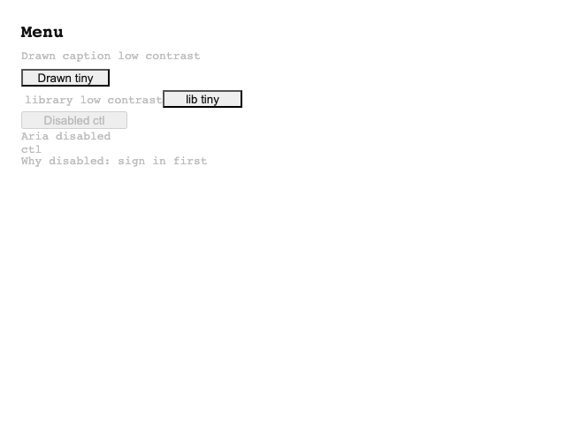

# Functional Verification Report: fix-design-command-defects

**Source PRD**: docs/TRD/fix-design-command-defects.md ## Reproduction
**Success definition**: .trd-state/fix-design-command-defects/success-definition.md
**Outcome**: Satisfied (1 of 19 not verifiable) (no full-environment run declared)
**Reason**: no gaps remain — every criterion is met, not verifiable here, or settled as an evidence gap
**Criteria**: 19 total — 18 met, 0 not met, 1 not verifiable, 0 unbuilt
**Coverage**: 18 of 19 proven — uncovered: FS-2
**Must pass**: 14 of 14 proven
**Screenshots**: 8 shown
**Next**: `/audit-build`

## Met

| ID | Statement | Artifact | Proven at |
|----|-----------|----------|-----------|
| FS-1 | When the canvas URL recorded in design-map.json returns not-found from the current account, `/refine-design` publishes a new canvas from the committed files under `docs/ui/<slug>/canvas/`, records the new URL, carries on, and does not end COMMAND STUCK | .trd-state/fix-design-command-defects/evidence/regression-2/transcript-refine-design-unreadable-canvas.txt | 2 |
| FS-3 | When the Design System page recorded in `design_system.url` returns not-found or no-access from the current account, `/design-system --sync` publishes a new Design System page from the committed files under `docs/ui/_design-system/<folder>/`, records the new URL, carries on, and does not end COMMAND STUCK | .trd-state/fix-design-command-defects/evidence/regression-2/transcript-design-system-sync-unreadable.txt | 2 |
| FS-4 | After a canvas is republished, its design-map.json entry holds the new URL and keeps the replaced URL as `previous_url` | .trd-state/fix-design-command-defects/evidence/regression-2/refine-design-map.json | 2 |
| FS-5 | After a canvas or Design System page is republished, its artifacts.json entry holds the new URL and keeps the replaced URL as `previous_url` | .trd-state/fix-design-command-defects/evidence/iter3/artifacts-demo-slot2.json | 1 |
| FS-6 | When the Design System page is republished, the place that records `design_system.url` holds the new URL and keeps the replaced URL as `previous_url` | .trd-state/fix-design-command-defects/evidence/regression-2/dsys-design-map.json | 2 |
| FS-7 | The library that writes artifacts.json entries accepts a `previous_url` and keeps it in the entry it writes (today `previous_url` exists nowhere in lib/) | .trd-state/fix-design-command-defects/evidence/regression-2/lib/fs7-artifacts-previous-url.txt | 2 |
| FS-8 | When a canvas or the Design System page is replaced, the command's readout says so in its DECISIONS section | .trd-state/fix-design-command-defects/evidence/regression-2/transcript-refine-design-unreadable-canvas.txt | 2 |
| FS-9 | A republished canvas starts a fresh sync base: the sync base recorded after the republish belongs to the new canvas, not one carried over from the replaced URL | .trd-state/fix-design-command-defects/evidence/regression-2/fs9-sync-base-check.txt | 2 |
| FS-10 | A canvas or Design System page read that fails with any error other than not-found or no-access does not trigger a republish: no new artifact is published, the recorded URL is unchanged, and no `previous_url` is written | .trd-state/fix-design-command-defects/evidence/iter3/transcript-slot3.txt | 1 |
| FS-11 | `/audit-design` labels each below-floor contrast miss and each below-44px target-size miss as either drawn by this design or on a reused component unchanged through `x-import` | .trd-state/fix-design-command-defects/evidence/regression-2/audit-design-C-design-md-ruling-report.md | 2 |
| FS-12 | A below-floor contrast or target-size miss on an element drawn by this design is ranked high, including when a build-side caveat ruling is recorded for reused components | .trd-state/fix-design-command-defects/evidence/regression-2/audit-design-C-design-md-ruling-report.md | 2 |
| FS-13 | With an accept or fix-in-build ruling recorded in brief.md `## Accessibility caveats`, `/audit-design` shows a below-floor miss on a reused, unchanged component as a known build-side caveat instead of a high finding | .trd-state/fix-design-command-defects/evidence/regression-2/audit-design-B-brief-ruling-report.md | 2 |
| FS-14 | With an accept or fix-in-build ruling recorded in design.md section 4, `/audit-design` shows a below-floor miss on a reused, unchanged component as a known build-side caveat instead of a high finding | .trd-state/fix-design-command-defects/evidence/regression-2/audit-design-C-design-md-ruling-report.md | 2 |
| FS-15 | With no ruling recorded in either brief.md or design.md section 4, a below-floor miss on a reused, unchanged component is not shown as a known build-side caveat | .trd-state/fix-design-command-defects/evidence/regression-2/audit-design-A-no-ruling-report.md | 2 |
| FS-16 | `/audit-design` never edits design.md | .trd-state/fix-design-command-defects/evidence/regression-2/fs16-design-md-unchanged.txt | 2 |
| FS-17 | A disabled control (one carrying the `disabled` attribute or `aria-disabled`) is not reported for a contrast miss | .trd-state/fix-design-command-defects/evidence/regression-2/lib/design-render-measures-fixture-board.json | 2 |
| FS-18 | Text explaining why a control is disabled is still measured for contrast, and a disabled control below 44px is still reported for target size | .trd-state/fix-design-command-defects/evidence/regression-2/lib/design-render-measures-fixture-board.json | 2 |
| FS-19 | `/refine-design` run with no feedback skips findings marked as recorded build-side caveats: it does not act on them, while other findings are still worked | .trd-state/fix-design-command-defects/evidence/regression-2/transcript-refine-design-no-feedback-caveats.txt | 2 |

## Not Met

_None._

## Not Verifiable

| ID | Statement | Kind | Reason |
|----|-----------|------|--------|
| FS-2 | When the canvas URL recorded in design-map.json returns no-access from the current account, `/refine-design` publishes a new canvas from `docs/ui/<slug>/canvas/`, records the new URL, carries on, and does not end COMMAND STUCK | not checkable here | The run shown is the not-found case, not no-access: the recorded canvas read returned 404 Not Found, the command republished it (new canvas 8d56283qVwWbsgV4k6e96a, old URL kept as previous_url) and ended COMMAND COMPLETE. A genuine no-access read (403/Forbidden) cannot be produced here: the Artifact tool gives one 404 for deleted and not-shared artifacts alike, and no artifact owned by another account exists in any authorized environment (owner ruling R1). |

## Evidence

### FS-11 — `/audit-design` labels each below-floor contrast miss and each below-44px target-size miss as either drawn by this design or on a reused component unchanged through `x-import` (met)

### FS-12 — A below-floor contrast or target-size miss on an element drawn by this design is ranked high, including when a build-side caveat ruling is recorded for reused components (met)

### FS-13 — With an accept or fix-in-build ruling recorded in brief.md `## Accessibility caveats`, `/audit-design` shows a below-floor miss on a reused, unchanged component as a known build-side caveat instead of a high finding (met)

### FS-14 — With an accept or fix-in-build ruling recorded in design.md section 4, `/audit-design` shows a below-floor miss on a reused, unchanged component as a known build-side caveat instead of a high finding (met)

### FS-15 — With no ruling recorded in either brief.md or design.md section 4, a below-floor miss on a reused, unchanged component is not shown as a known build-side caveat (met)

### FS-17 — A disabled control (one carrying the `disabled` attribute or `aria-disabled`) is not reported for a contrast miss (met)

### FS-18 — Text explaining why a control is disabled is still measured for contrast, and a disabled control below 44px is still reported for target size (met)

### FS-19 — `/refine-design` run with no feedback skips findings marked as recorded build-side caveats: it does not act on them, while other findings are still worked (met)

## Fix run

| Round | Tasks promoted | Criteria closed | Still open |
|-------|-----------------|------------------|-------------|
| 0 | 0 | 0 | 1 |

| ID | Statement | Status | Cause | Stop reason |
|----|-----------|--------|-------|-------------|
| FS-2 | A no-access (not just not-found) canvas read still republishes | not_verifiable | unrecorded | not checkable here: the Artifact tool returns one combined error for deleted and not-shared artifacts, and no artifact owned by another account exists in any authorized environment (owner ruling R1; no longer must-pass, filed as #160) |

