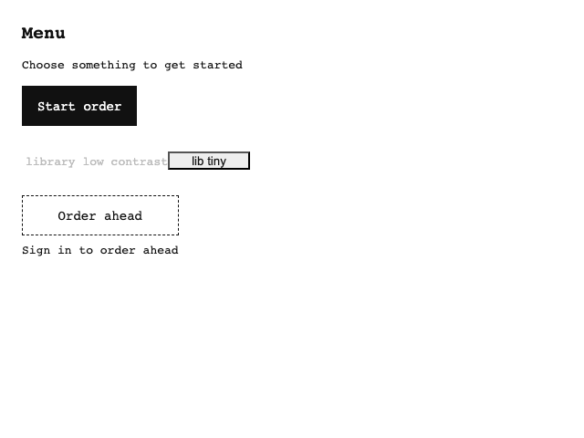

# Functional Verification Report: fix-design-command-defects

**Source PRD**: docs/TRD/fix-design-command-defects.md § Reproduction
**Success definition**: .trd-state/fix-design-command-defects/success-definition.md
**Outcome**: Stuck (no full-environment run declared)
**Reason**: 2 gap(s) still open when the run ended at iteration 2 of 3; 1 criterion/criteria still fail the regression pass: FS-5
**Criteria**: 19 total — 16 met, 2 not met, 1 not verifiable, 0 unbuilt
**Coverage**: 16 of 19 proven — uncovered: FS-2, FS-5, FS-10
**Must pass**: 13 of 15 proven — unproven: FS-2 (not verifiable), FS-5 (not met)
**Screenshots**: 8 shown
**Diagnosis**: 3 open — 1 build defect, 1 evidence gap, 1 not checkable here — 1 evidence missing, 1 judged failed, 1 capability absent
**Next**: refine the plan with `/refine-verification` (add `--auto` to let an agent answer), then run `/verify-build`

## Met

| ID | Statement | Artifact | Proven at |
|----|-----------|----------|-----------|
| FS-1 | When the canvas URL recorded in design-map.json returns not-found from the current account, `/refine-design` publishes a new canvas from the committed files under `docs/ui/<slug>/canvas/`, records the new URL, carries on, and does not end COMMAND STUCK | .trd-state/fix-design-command-defects/evidence/regression-2/transcript-refine-design-unreadable-canvas.txt | iteration 2 (regression pass 2) |
| FS-3 | When the Design System page recorded in `design_system.url` returns not-found or no-access from the current account, `/design-system --sync` publishes a new Design System page from the committed files under `docs/ui/_design-system/<folder>/`, records the new URL, carries on, and does not end COMMAND STUCK | .trd-state/fix-design-command-defects/evidence/regression-2/transcript-design-system-sync-unreadable.txt | iteration 2 (regression pass 2) |
| FS-4 | After a canvas is republished, its design-map.json entry holds the new URL and keeps the replaced URL as `previous_url` | .trd-state/fix-design-command-defects/evidence/regression-2/refine-design-map.json | iteration 2 (regression pass 2) |
| FS-6 | When the Design System page is republished, the place that records `design_system.url` holds the new URL and keeps the replaced URL as `previous_url` | .trd-state/fix-design-command-defects/evidence/regression-2/dsys-design-map.json | iteration 2 (regression pass 2) |
| FS-7 | The library that writes artifacts.json entries accepts a `previous_url` and keeps it in the entry it writes (today `previous_url` exists nowhere in lib/) | .trd-state/fix-design-command-defects/evidence/regression-2/lib/fs7-artifacts-previous-url.txt | iteration 2 (regression pass 2) |
| FS-8 | When a canvas or the Design System page is replaced, the command's readout says so in its DECISIONS section | .trd-state/fix-design-command-defects/evidence/regression-2/transcript-refine-design-unreadable-canvas.txt | iteration 2 (regression pass 2) |
| FS-9 | A republished canvas starts a fresh sync base: the sync base recorded after the republish belongs to the new canvas, not one carried over from the replaced URL | .trd-state/fix-design-command-defects/evidence/regression-2/fs9-sync-base-check.txt | iteration 2 (regression pass 2) |
| FS-11 | `/audit-design` labels each below-floor contrast miss and each below-44px target-size miss as either drawn by this design or on a reused component unchanged through `x-import` | .trd-state/fix-design-command-defects/evidence/regression-2/audit-design-C-design-md-ruling-report.md | iteration 2 (regression pass 2) |
| FS-12 | A below-floor contrast or target-size miss on an element drawn by this design is ranked high, including when a build-side caveat ruling is recorded for reused components | .trd-state/fix-design-command-defects/evidence/regression-2/audit-design-C-design-md-ruling-report.md | iteration 2 (regression pass 2) |
| FS-13 | With an accept or fix-in-build ruling recorded in brief.md `## Accessibility caveats`, `/audit-design` shows a below-floor miss on a reused, unchanged component as a known build-side caveat instead of a high finding | .trd-state/fix-design-command-defects/evidence/regression-2/audit-design-B-brief-ruling-report.md | iteration 2 (regression pass 2) |
| FS-14 | With an accept or fix-in-build ruling recorded in design.md section 4, `/audit-design` shows a below-floor miss on a reused, unchanged component as a known build-side caveat instead of a high finding | .trd-state/fix-design-command-defects/evidence/regression-2/audit-design-C-design-md-ruling-report.md | iteration 2 (regression pass 2) |
| FS-15 | With no ruling recorded in either brief.md or design.md section 4, a below-floor miss on a reused, unchanged component is not shown as a known build-side caveat | .trd-state/fix-design-command-defects/evidence/regression-2/audit-design-A-no-ruling-report.md | iteration 2 (regression pass 2) |
| FS-16 | `/audit-design` never edits design.md | .trd-state/fix-design-command-defects/evidence/regression-2/fs16-design-md-unchanged.txt | iteration 2 (regression pass 2) |
| FS-17 | A disabled control (one carrying the `disabled` attribute or `aria-disabled`) is not reported for a contrast miss | .trd-state/fix-design-command-defects/evidence/regression-2/lib/design-render-measures-fixture-board.json | iteration 2 (regression pass 2) |
| FS-18 | Text explaining why a control is disabled is still measured for contrast, and a disabled control below 44px is still reported for target size | .trd-state/fix-design-command-defects/evidence/regression-2/lib/design-render-measures-fixture-board.json | iteration 2 (regression pass 2) |
| FS-19 | `/refine-design` run with no feedback skips findings marked as recorded build-side caveats: it does not act on them, while other findings are still worked | .trd-state/fix-design-command-defects/evidence/regression-2/transcript-refine-design-no-feedback-caveats.txt | iteration 2 (regression pass 2) |

## Not Met

| ID | Statement | Kind | Tier 1 | Reason | Blocker | Attempts |
|----|-----------|------|--------|--------|---------|----------|
| FS-5 | After a canvas or Design System page is republished, its artifacts.json entry holds the new URL and keeps the replaced URL as `previous_url` | build defect | pass | Not consistently recorded. The contract requires artifacts.js record with the new url for each republished canvas or system. In the /refine-design run (slot 1) both canvas and system were replaced, but artifacts.json updated only the design (canvas) entry; the design-system entry still holds the old ...0d5 URL with no previous_url. In the /design-system --sync run (slot 2) both were replaced, but only the design-system entry was updated; the design (canvas) entry still holds the old ...c0de URL. Only the slot-4 run recorded both. — caught by the regression pass (was met earlier in the run) | Not consistently recorded. The contract requires artifacts.js record with the new url for each republished canvas or system. In the /refine-design republish run (slot 1) both the canvas and the system were replaced, but artifacts.json updated only the design (canvas) entry; the design-system entry still holds the old ...0d5 URL with no previous_url (refine-artifacts.json and its records-ref copy). In the /design-system --sync run (slot 2) both were replaced, but artifacts.json updated only the design-system entry; the design (canvas) entry still holds the old ...c0de URL. Only the slot-4 run recorded both. The build was reached and left a replaced artifact recorded under its dead URL. | iter 1: met; iter 2: met; iter 2: not_met (judged-failed: artifacts.json not updated for every republished artifact) |
| FS-10 | A canvas or Design System page read that fails with any error other than not-found or no-access does not trigger a republish: no new artifact is published, the recorded URL is unchanged, and no `previous_url` is written | evidence gap | pass | Partial evidence only. The transcript shows the canvas read failing with 'not an artifact URL' and the run then editing the board heading with no Artifact publish or create call, which is the right behaviour so far, and the after-snapshots still hold the original URLs with no previous_url. But the capture stops while the visual critic is still running, before the command's commit-and-record step, which is where a publish would happen. The criterion's evidence calls for design-map.json and artifacts.json after the run, and the run had not finished (tmux session fs10 still waiting on the critic at 02:04). Nothing seen shows the build misbehaving, but the end state is unproven. | Partial evidence only. The transcript shows the canvas read failing with 'not an artifact URL' and the run then editing the board heading with no Artifact publish or create call, which is the right behaviour so far, and the after-snapshots still hold the original URLs with no previous_url. But the capture stops while the visual critic is still running, before the command's commit-and-record step, which is where a publish would happen. The criterion's evidence calls for design-map.json and artifacts.json after the run, and the run had not finished (tmux session fs10 still waiting on the critic at 02:04). Nothing seen shows the build misbehaving, but the end state is unproven. | iter 1: not_met (judged-failed: republished on a malformed-URL read); iter 2: not_met (evidence-missing: capture ended before the run finished) |

## Causes

| Cause | Representative | Members | Status |
|-------|----------------|---------|--------|
| design-system-republish-not-in-decisions | FS-8 | 1 (FS-8) | closed at iteration 2 |
| republish-artifacts-record-incomplete | FS-5 | 1 (FS-5) | open |

## Not Verifiable

| ID | Statement | Kind | Reason |
|----|-----------|------|--------|
| FS-2 | When the canvas URL recorded in design-map.json returns no-access from the current account, `/refine-design` publishes a new canvas from `docs/ui/<slug>/canvas/`, records the new URL, carries on, and does not end COMMAND STUCK | not checkable here | No no-access fixture exists. The Artifact tool returns one combined error for a deleted artifact and for one not shared with this account, and no artifact owned by another account is available in the authorized environments. A genuine no-access read was never exercised. |

## Regression pass

After the loop exited, the criteria whose covered files changed (or whose coverage was unknown) were re-checked against the finished build.

### Round 1 (iteration 2)

| ID | Why re-checked | Changed files |
|----|----------------|---------------|
| FS-1 | no-covers |  |
| FS-3 | no-covers |  |
| FS-4 | no-covers |  |
| FS-5 | no-covers |  |
| FS-6 | no-covers |  |
| FS-7 | no-covers |  |
| FS-8 | no-covers |  |
| FS-9 | no-covers |  |
| FS-11 | no-covers |  |
| FS-12 | no-covers |  |
| FS-13 | no-covers |  |
| FS-14 | no-covers |  |
| FS-15 | no-covers |  |
| FS-16 | no-covers |  |
| FS-17 | no-covers |  |
| FS-18 | no-covers |  |
| FS-19 | no-covers |  |

Caught: FS-8
Repair round: causes design-system-republish-not-in-decisions; files changed: .claude/commands/design-system.md, .claude/contracts/design-commands.md, packages/core/commands/design-system.md, packages/core/commands/design-unreadable-prose.test.js, packages/core/contracts/design-commands.md

### Round 2 (iteration 2)

| ID | Why re-checked | Changed files |
|----|----------------|---------------|
| FS-1 | no-covers |  |
| FS-3 | no-covers |  |
| FS-4 | no-covers |  |
| FS-5 | no-covers |  |
| FS-6 | no-covers |  |
| FS-7 | no-covers |  |
| FS-8 | sent-to-debug |  |
| FS-9 | no-covers |  |
| FS-11 | no-covers |  |
| FS-12 | no-covers |  |
| FS-13 | no-covers |  |
| FS-14 | no-covers |  |
| FS-15 | no-covers |  |
| FS-16 | no-covers |  |
| FS-17 | no-covers |  |
| FS-18 | no-covers |  |
| FS-19 | no-covers |  |

Caught: FS-5

Not re-walked (covered files unchanged): _none._

Changed files no criterion covers: .claude/commands/design-system.md, .claude/commands/refine-design.md, .claude/contracts/design-commands.md, packages/core/commands/design-system.md, packages/core/commands/design-unreadable-prose.test.js, packages/core/commands/refine-design.md, packages/core/contracts/design-commands.md

## Evidence

### FS-11 — `/audit-design` labels each below-floor contrast miss and each below-44px target-size miss as either drawn by this design or on a reused component unchanged through `x-import` (met)

### FS-12 — A below-floor contrast or target-size miss on an element drawn by this design is ranked high, including when a build-side caveat ruling is recorded for reused components (met)

### FS-13 — With an accept or fix-in-build ruling recorded in brief.md `## Accessibility caveats`, `/audit-design` shows a below-floor miss on a reused, unchanged component as a known build-side caveat instead of a high finding (met)

### FS-14 — With an accept or fix-in-build ruling recorded in design.md section 4, `/audit-design` shows a below-floor miss on a reused, unchanged component as a known build-side caveat instead of a high finding (met)

### FS-15 — With no ruling recorded in either brief.md or design.md section 4, a below-floor miss on a reused, unchanged component is not shown as a known build-side caveat (met)

### FS-17 — A disabled control (one carrying the `disabled` attribute or `aria-disabled`) is not reported for a contrast miss (met)

### FS-18 — Text explaining why a control is disabled is still measured for contrast, and a disabled control below 44px is still reported for target size (met)

### FS-19 — `/refine-design` run with no feedback skips findings marked as recorded build-side caveats: it does not act on them, while other findings are still worked (met)

